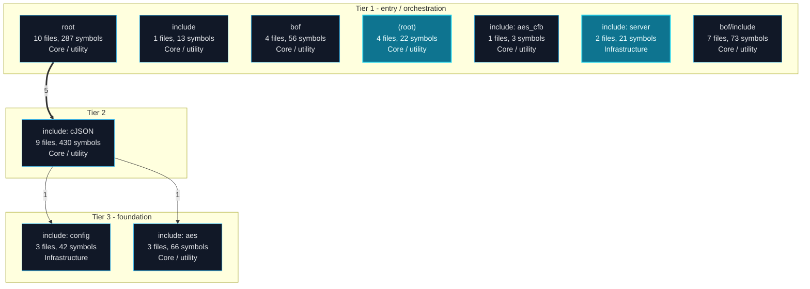
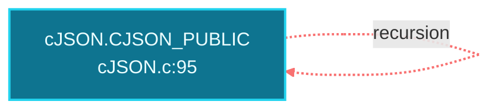
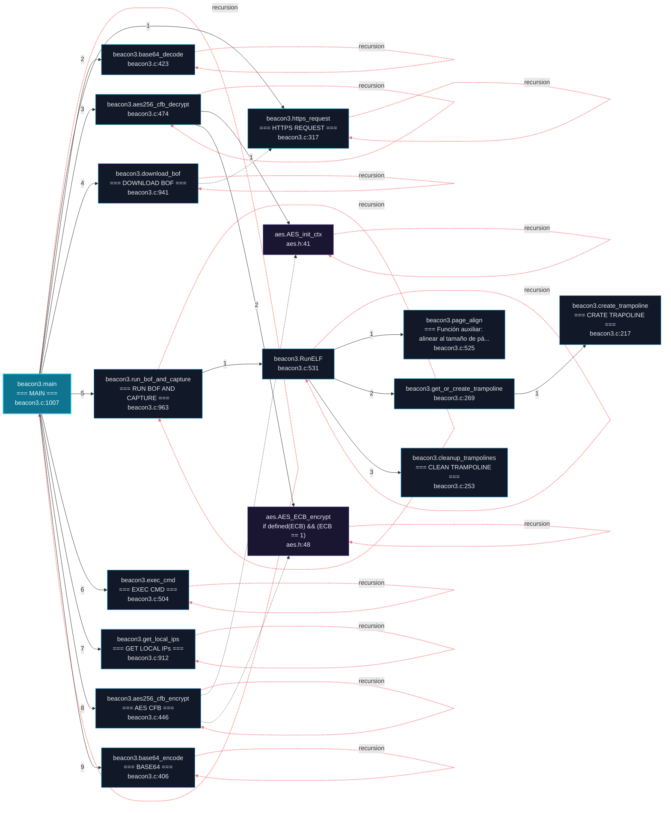
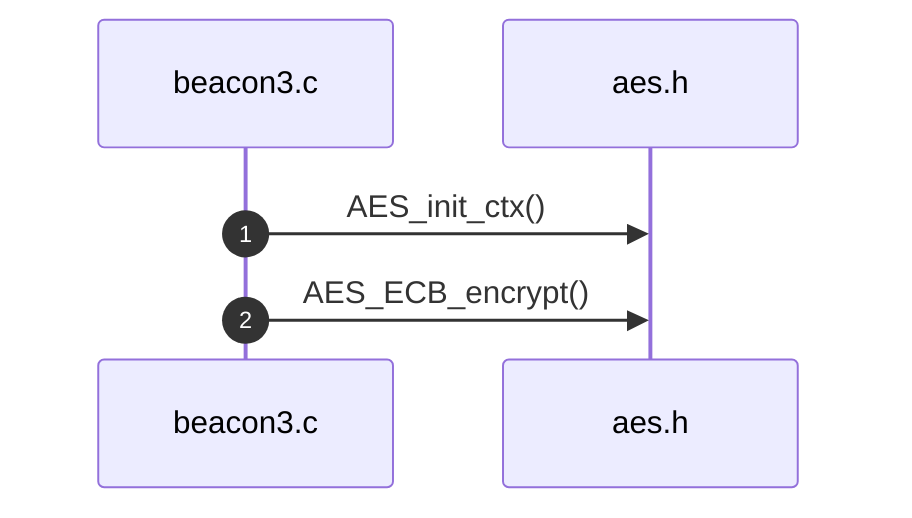

# blacksandbeacon Architecture and Execution Flows

[Back to index](index.md)

## Architecture Overview

10 components stacked in 3 dependency tiers (weighted Eades-Lin-Smyth ordering: arrows point from dependent to dependency, top to bottom). Labels are import counts, thick arrows the top quartile; 0 transitively implied edges are omitted. Dashed red arrows are upward dependencies: the smallest set of imports that closes every cycle and breaks the layering. Cyan components hold entry points. Interactive version: `readmenator-apidocs/index.html#/flows`.

---

## Execution Flows

Entry points are scored from `__main__` guards, `main` functions, entry-style names and files, and call-graph sources. Each flow walks resolved calls in call-site order (depth <= 4, <= 40 steps); numbers give the call order, dashed arrows revisit an already expanded callee, red arrows are recursion. Interactive version with zoom and per-node docs: `readmenator-apidocs/index.html#/flows`.

### `cJSON.CJSON_PUBLIC`

`cJSON.c:1134`, score 13: call-graph source with 6 calls; call-graph source with 3 calls; call-graph source with 4 calls.

Call tree:

### `cJSON.CJSON_PUBLIC`

`include/cJSON.c:1134`, score 13: call-graph source with 6 calls; call-graph source with 3 calls; call-graph source with 4 calls.

Call tree:

### `beacon3.main`

`beacon3.c:1007`, score 11: `main` in a compiled-language file; entry-style name `main`.

Call tree:

Cross-file sequence:

---
