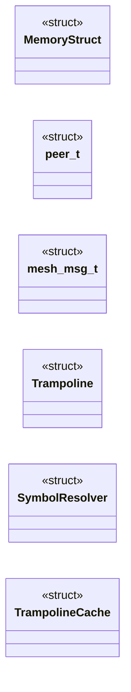
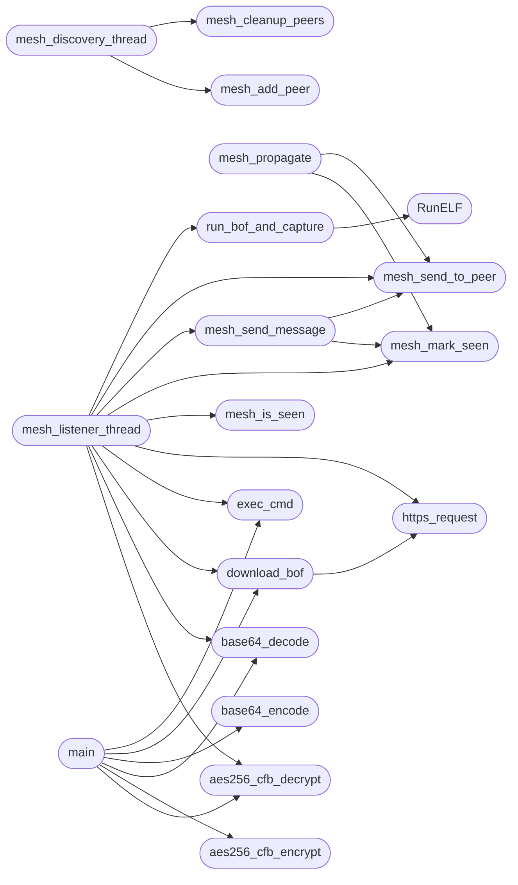

# `beacon5.c`

> Source: [beacon5.c:1](../../beacon5.c#L1) | language `c` | coverage 38.5% | [API index](../index.md)

## Contents

- **Structs:** [`MemoryStruct`](#memorystruct), [`peer_t`](#peer_t), [`mesh_msg_t`](#mesh_msg_t), [`Trampoline`](#trampoline), [`SymbolResolver`](#symbolresolver), [`TrampolineCache`](#trampolinecache)
- **Functions:** [`BeaconPrintf`](#beaconprintf), [`BeaconOutput`](#beaconoutput), [`https_request`](#https_request), [`base64_encode`](#base64_encode), [`base64_decode`](#base64_decode), [`aes256_cfb_encrypt`](#aes256_cfb_encrypt), [`aes256_cfb_decrypt`](#aes256_cfb_decrypt), [`exec_cmd`](#exec_cmd), [`RunELF`](#runelf), [`get_local_ips`](#get_local_ips), [`download_bof`](#download_bof), [`run_bof_and_capture`](#run_bof_and_capture), [`mesh_mark_seen`](#mesh_mark_seen), [`mesh_is_seen`](#mesh_is_seen), [`mesh_add_peer`](#mesh_add_peer), [`mesh_cleanup_peers`](#mesh_cleanup_peers), [`mesh_send_to_peer`](#mesh_send_to_peer), [`mesh_propagate`](#mesh_propagate), [`mesh_discovery_thread`](#mesh_discovery_thread), [`mesh_listener_thread`](#mesh_listener_thread), [`mesh_send_message`](#mesh_send_message), [`main`](#main)
- **Macros:** [`_GNU_SOURCE`](#_gnu_source), [`MAX_PEERS`](#max_peers), [`DISCOVERY_PORT`](#discovery_port), [`DISCOVERY_INTERVAL`](#discovery_interval), [`MAX_TTL`](#max_ttl), [`MESH_MSG_SIZE`](#mesh_msg_size), [`C2_URL`](#c2_url), [`CLIENT_ID`](#client_id), [`MALEABLE`](#maleable), [`USER_AGENTS_COUNT`](#user_agents_count)

## Type Diagram



## Call Graph

Solid arrows stay in this module, dashed arrows leave it.



## Structs

<a id="memorystruct"></a>

### `MemoryStruct`

`struct` | [beacon5.c:61](../../beacon5.c#L61)

```c
struct MemoryStruct
```

=== ESTRUCTURAS ===

---

<a id="peer_t"></a>

### `peer_t`

`struct` | [beacon5.c:68](../../beacon5.c#L68)

```c
typedef struct
```

=== ESTRUCTURAS MESH ===

---

<a id="mesh_msg_t"></a>

### `mesh_msg_t`

`struct` | [beacon5.c:75](../../beacon5.c#L75)

```c
typedef struct
```

---

<a id="trampoline"></a>

### `Trampoline`

`struct` | [beacon5.c:98](../../beacon5.c#L98)

```c
typedef struct
```

=== TRAMPOLINES ===

---

<a id="symbolresolver"></a>

### `SymbolResolver`

`struct` | [beacon5.c:106](../../beacon5.c#L106)

```c
typedef struct
```

---

<a id="trampolinecache"></a>

### `TrampolineCache`

`struct` | [beacon5.c:112](../../beacon5.c#L112)

```c
typedef struct
```

=== CACHE DE TRAMPOLINES ===

---

## Functions

<a id="beaconprintf"></a>

### `BeaconPrintf`

`function` | [beacon5.c:235](../../beacon5.c#L235)

```c
void BeaconPrintf(int type, const char *fmt, ...)
```

=== BEACON API ===

**Parameters**

| Name | Type | Default | Description |
|---|---|---|---|
| `type` | `int` |  |  |
| `fmt` | `char *` |  |  |
| `...` |  |  |  |

---

<a id="beaconoutput"></a>

### `BeaconOutput`

`function` | [beacon5.c:248](../../beacon5.c#L248)

```c
void BeaconOutput(int type, const char *data, int len)
```

Beacon API: raw output capture (called by BOFs).

**Parameters**

| Name | Type | Default | Description |
|---|---|---|---|
| `type` | `int` |  |  |
| `data` | `char *` |  |  |
| `len` | `int` |  |  |

> **Inherited:** Documentation from [`BeaconOutput`](#beaconoutput) (include/beacon_common.h:105).

---

<a id="https_request"></a>

### `https_request`

`function` | [beacon5.c:359](../../beacon5.c#L359)

```c
char* https_request(const char* url, const char* method, const char* post_data)
```

=== HTTPS REQUEST ===

**Parameters**

| Name | Type | Default | Description |
|---|---|---|---|
| `url` | `char*` |  |  |
| `method` | `char*` |  |  |
| `post_data` | `char*` |  |  |

**Returns:** `char*`

*Called by:* [`download_bof`](#download_bof), [`main`](#main), [`mesh_listener_thread`](#mesh_listener_thread)

---

<a id="base64_encode"></a>

### `base64_encode`

`function` | [beacon5.c:448](../../beacon5.c#L448)

```c
char* base64_encode(const unsigned char* input, int len)
```

=== BASE64 ===

**Parameters**

| Name | Type | Default | Description |
|---|---|---|---|
| `input` | `unsigned char*` |  |  |
| `len` | `int` |  |  |

**Returns:** `char*`

*Called by:* [`main`](#main)

---

<a id="base64_decode"></a>

### `base64_decode`

`function` | [beacon5.c:465](../../beacon5.c#L465)

```c
unsigned char* base64_decode(const char* input, int* len)
```

**Parameters**

| Name | Type | Default | Description |
|---|---|---|---|
| `input` | `char*` |  |  |
| `len` | `int*` |  |  |

**Returns:** `unsigned char*`

*Called by:* [`main`](#main), [`mesh_listener_thread`](#mesh_listener_thread)

---

<a id="aes256_cfb_encrypt"></a>

### `aes256_cfb_encrypt`

`function` | [beacon5.c:488](../../beacon5.c#L488)

```c
unsigned char* aes256_cfb_encrypt(const unsigned char* key, const unsigned char* iv, const unsigned char* plaintext, size_t len, int* out_len)
```

=== AES CFB ===

**Parameters**

| Name | Type | Default | Description |
|---|---|---|---|
| `key` | `unsigned char*` |  |  |
| `iv` | `unsigned char*` |  |  |
| `plaintext` | `unsigned char*` |  |  |
| `len` | `size_t` |  |  |
| `out_len` | `int*` |  |  |

**Returns:** `unsigned char*`

*Calls:* [`AES_ECB_encrypt`](aes.h.md#aes_ecb_encrypt), [`AES_init_ctx`](aes.h.md#aes_init_ctx)

*Called by:* [`main`](#main)

---

<a id="aes256_cfb_decrypt"></a>

### `aes256_cfb_decrypt`

`function` | [beacon5.c:516](../../beacon5.c#L516)

```c
unsigned char* aes256_cfb_decrypt(const unsigned char* key, const unsigned char* iv, const unsigned char* ciphertext, size_t len, int* out_len)
```

**Parameters**

| Name | Type | Default | Description |
|---|---|---|---|
| `key` | `unsigned char*` |  |  |
| `iv` | `unsigned char*` |  |  |
| `ciphertext` | `unsigned char*` |  |  |
| `len` | `size_t` |  |  |
| `out_len` | `int*` |  |  |

**Returns:** `unsigned char*`

*Calls:* [`AES_ECB_encrypt`](aes.h.md#aes_ecb_encrypt), [`AES_init_ctx`](aes.h.md#aes_init_ctx)

*Called by:* [`main`](#main), [`mesh_listener_thread`](#mesh_listener_thread)

---

<a id="exec_cmd"></a>

### `exec_cmd`

`function` | [beacon5.c:546](../../beacon5.c#L546)

```c
char* exec_cmd(const char* cmd, int* out_len)
```

=== EXEC CMD ===

**Parameters**

| Name | Type | Default | Description |
|---|---|---|---|
| `cmd` | `char*` |  |  |
| `out_len` | `int*` |  |  |

**Returns:** `char*`

*Called by:* [`main`](#main), [`mesh_listener_thread`](#mesh_listener_thread)

---

<a id="runelf"></a>

### `RunELF`

`function` | [beacon5.c:573](../../beacon5.c#L573)

```c
int RunELF(const char* functionname, unsigned char* elf_data, uint32_t filesize, unsigned char* argumentdata, int argumentSize)
```

ELF BOF loader.

Loads a position-independent ELF object into memory, resolves symbols, applies relocations, and calls the entry function in a forked child process for crash isolation. Returns 0 on success, -1 on error. BOF output is captured into g_beacon_output.

**Parameters**

| Name | Type | Default | Description |
|---|---|---|---|
| `functionname` | `char*` |  |  |
| `elf_data` | `unsigned char*` |  |  |
| `filesize` | `uint32_t` |  |  |
| `argumentdata` | `unsigned char*` |  |  |
| `argumentSize` | `int` |  |  |

**Returns:** `int`

> **Inherited:** Documentation from [`RunELF`](#runelf) (include/beacon_common.h:147).

*Called by:* [`run_bof_and_capture`](#run_bof_and_capture)

---

<a id="get_local_ips"></a>

### `get_local_ips`

`function` | [beacon5.c:954](../../beacon5.c#L954)

```c
char* get_local_ips()
```

=== GET LOCAL IPs ===

**Returns:** `char*`

*Called by:* [`main`](#main)

---

<a id="download_bof"></a>

### `download_bof`

`function` | [beacon5.c:983](../../beacon5.c#L983)

```c
unsigned char* download_bof(const char* url, size_t* out_size)
```

=== DOWNLOAD BOF ===

**Parameters**

| Name | Type | Default | Description |
|---|---|---|---|
| `url` | `char*` |  |  |
| `out_size` | `size_t*` |  |  |

**Returns:** `unsigned char*`

*Calls:* [`https_request`](#https_request)

*Called by:* [`main`](#main), [`mesh_listener_thread`](#mesh_listener_thread)

---

<a id="run_bof_and_capture"></a>

### `run_bof_and_capture`

`function` | [beacon5.c:1005](../../beacon5.c#L1005)

```c
char* run_bof_and_capture(unsigned char* elf_data, uint32_t filesize, char* args, int arglen, int* out_len)
```

=== RUN BOF AND CAPTURE ===

**Parameters**

| Name | Type | Default | Description |
|---|---|---|---|
| `elf_data` | `unsigned char*` |  |  |
| `filesize` | `uint32_t` |  |  |
| `args` | `char*` |  |  |
| `arglen` | `int` |  |  |
| `out_len` | `int*` |  |  |

**Returns:** `char*`

*Calls:* [`RunELF`](#runelf)

*Called by:* [`main`](#main), [`mesh_listener_thread`](#mesh_listener_thread)

---

<a id="mesh_mark_seen"></a>

### `mesh_mark_seen`

`function` | [beacon5.c:1050](../../beacon5.c#L1050)

```c
void mesh_mark_seen(const char *msg_id)
```

**Parameters**

| Name | Type | Default | Description |
|---|---|---|---|
| `msg_id` | `char *` |  |  |

*Called by:* [`mesh_listener_thread`](#mesh_listener_thread), [`mesh_propagate`](#mesh_propagate), [`mesh_send_message`](#mesh_send_message)

---

<a id="mesh_is_seen"></a>

### `mesh_is_seen`

`function` | [beacon5.c:1058](../../beacon5.c#L1058)

```c
int mesh_is_seen(const char *msg_id)
```

**Parameters**

| Name | Type | Default | Description |
|---|---|---|---|
| `msg_id` | `char *` |  |  |

**Returns:** `int`

*Called by:* [`mesh_listener_thread`](#mesh_listener_thread)

---

<a id="mesh_add_peer"></a>

### `mesh_add_peer`

`function` | [beacon5.c:1070](../../beacon5.c#L1070)

```c
void mesh_add_peer(const char *ip, int port)
```

**Parameters**

| Name | Type | Default | Description |
|---|---|---|---|
| `ip` | `char *` |  |  |
| `port` | `int` |  |  |

*Called by:* [`mesh_discovery_thread`](#mesh_discovery_thread)

---

<a id="mesh_cleanup_peers"></a>

### `mesh_cleanup_peers`

`function` | [beacon5.c:1095](../../beacon5.c#L1095)

```c
void mesh_cleanup_peers()
```

*Called by:* [`mesh_discovery_thread`](#mesh_discovery_thread)

---

<a id="mesh_send_to_peer"></a>

### `mesh_send_to_peer`

`function` | [beacon5.c:1109](../../beacon5.c#L1109)

```c
int mesh_send_to_peer(const char *ip, int port, const mesh_msg_t *msg)
```

**Parameters**

| Name | Type | Default | Description |
|---|---|---|---|
| `ip` | `char *` |  |  |
| `port` | `int` |  |  |
| `msg` | `mesh_msg_t *` |  |  |

**Returns:** `int`

*Called by:* [`mesh_listener_thread`](#mesh_listener_thread), [`mesh_propagate`](#mesh_propagate), [`mesh_send_message`](#mesh_send_message)

---

<a id="mesh_propagate"></a>

### `mesh_propagate`

`function` | [beacon5.c:1131](../../beacon5.c#L1131)

```c
void mesh_propagate(const char *command)
```

**Parameters**

| Name | Type | Default | Description |
|---|---|---|---|
| `command` | `char *` |  |  |

*Calls:* [`mesh_mark_seen`](#mesh_mark_seen), [`mesh_send_to_peer`](#mesh_send_to_peer)

*Called by:* [`main`](#main)

---

<a id="mesh_discovery_thread"></a>

### `mesh_discovery_thread`

`function` | [beacon5.c:1158](../../beacon5.c#L1158)

```c
void *mesh_discovery_thread(void *arg)
```

**Parameters**

| Name | Type | Default | Description |
|---|---|---|---|
| `arg` | `void *` |  |  |

**Returns:** `void *`

*Calls:* [`mesh_add_peer`](#mesh_add_peer), [`mesh_cleanup_peers`](#mesh_cleanup_peers)

---

<a id="mesh_listener_thread"></a>

### `mesh_listener_thread`

`function` | [beacon5.c:1241](../../beacon5.c#L1241)

```c
void *mesh_listener_thread(void *arg)
```

**Parameters**

| Name | Type | Default | Description |
|---|---|---|---|
| `arg` | `void *` |  |  |

**Returns:** `void *`

*Calls:* [`aes256_cfb_decrypt`](#aes256_cfb_decrypt), [`base64_decode`](#base64_decode), [`download_bof`](#download_bof), [`exec_cmd`](#exec_cmd), [`https_request`](#https_request), [`mesh_is_seen`](#mesh_is_seen), [`mesh_mark_seen`](#mesh_mark_seen), [`mesh_send_message`](#mesh_send_message), [`mesh_send_to_peer`](#mesh_send_to_peer), [`run_bof_and_capture`](#run_bof_and_capture)

---

<a id="mesh_send_message"></a>

### `mesh_send_message`

`function` | [beacon5.c:1417](../../beacon5.c#L1417)

```c
void mesh_send_message(int type, const char* target, const char* payload)
```

**Parameters**

| Name | Type | Default | Description |
|---|---|---|---|
| `type` | `int` |  |  |
| `target` | `char*` |  |  |
| `payload` | `char*` |  |  |

*Calls:* [`mesh_mark_seen`](#mesh_mark_seen), [`mesh_send_to_peer`](#mesh_send_to_peer)

*Called by:* [`mesh_listener_thread`](#mesh_listener_thread)

---

<a id="main"></a>

### `main`

`function` | [beacon5.c:1444](../../beacon5.c#L1444)

```c
int main(int argc, char **argv)
```

=== MAIN ===

**Parameters**

| Name | Type | Default | Description |
|---|---|---|---|
| `argc` | `int` |  |  |
| `argv` | `char **` |  |  |

**Returns:** `int`

*Calls:* [`aes256_cfb_decrypt`](#aes256_cfb_decrypt), [`aes256_cfb_encrypt`](#aes256_cfb_encrypt), [`base64_decode`](#base64_decode), [`base64_encode`](#base64_encode), [`download_bof`](#download_bof), [`exec_cmd`](#exec_cmd), [`get_local_ips`](#get_local_ips), [`https_request`](#https_request), [`mesh_propagate`](#mesh_propagate), [`run_bof_and_capture`](#run_bof_and_capture)

---

## Macros

<a id="_gnu_source"></a>

### `_GNU_SOURCE`

`macro` | [beacon5.c:1](../../beacon5.c#L1)

```c
#define _GNU_SOURCE
```

---

<a id="max_peers"></a>

### `MAX_PEERS`

`macro` | [beacon5.c:37](../../beacon5.c#L37)

```c
#define MAX_PEERS
```

---

<a id="discovery_port"></a>

### `DISCOVERY_PORT`

`macro` | [beacon5.c:38](../../beacon5.c#L38)

```c
#define DISCOVERY_PORT
```

---

<a id="discovery_interval"></a>

### `DISCOVERY_INTERVAL`

`macro` | [beacon5.c:39](../../beacon5.c#L39)

```c
#define DISCOVERY_INTERVAL
```

---

<a id="max_ttl"></a>

### `MAX_TTL`

`macro` | [beacon5.c:40](../../beacon5.c#L40)

```c
#define MAX_TTL
```

---

<a id="mesh_msg_size"></a>

### `MESH_MSG_SIZE`

`macro` | [beacon5.c:41](../../beacon5.c#L41)

```c
#define MESH_MSG_SIZE
```

---

<a id="c2_url"></a>

### `C2_URL`

`macro` | [beacon5.c:44](../../beacon5.c#L44)

```c
#define C2_URL
```

---

<a id="client_id"></a>

### `CLIENT_ID`

`macro` | [beacon5.c:45](../../beacon5.c#L45)

```c
#define CLIENT_ID
```

---

<a id="maleable"></a>

### `MALEABLE`

`macro` | [beacon5.c:46](../../beacon5.c#L46)

```c
#define MALEABLE
```

---

<a id="user_agents_count"></a>

### `USER_AGENTS_COUNT`

`macro` | [beacon5.c:47](../../beacon5.c#L47)

```c
#define USER_AGENTS_COUNT
```

---
