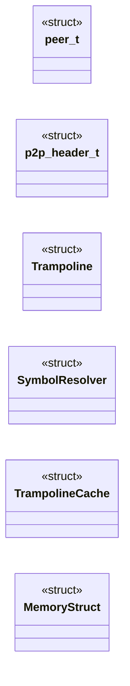
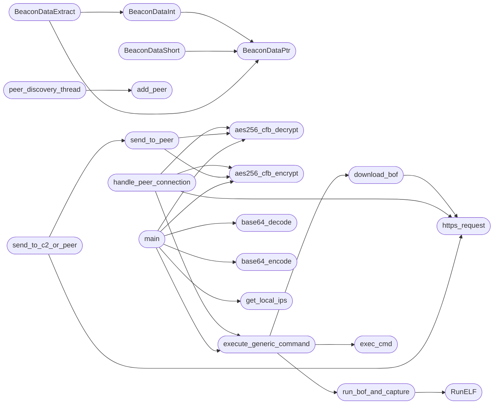

# `beacon_p2p.c`

> Source: [beacon_p2p.c:1](../../beacon_p2p.c#L1) | language `c` | coverage 40.9% | [API index](../index.md)

## Contents

- **Structs:** [`peer_t`](#peer_t), [`p2p_header_t`](#p2p_header_t), [`Trampoline`](#trampoline), [`SymbolResolver`](#symbolresolver), [`TrampolineCache`](#trampolinecache), [`MemoryStruct`](#memorystruct)
- **Functions:** [`BeaconDataParse`](#beacondataparse), [`BeaconDataPtr`](#beacondataptr), [`BeaconDataInt`](#beacondataint), [`BeaconDataShort`](#beacondatashort), [`BeaconDataLength`](#beacondatalength), [`BeaconDataExtract`](#beacondataextract), [`BeaconPrintf`](#beaconprintf), [`BeaconOutput`](#beaconoutput), [`RunELF`](#runelf), [`https_request`](#https_request), [`base64_encode`](#base64_encode), [`base64_decode`](#base64_decode), [`aes256_cfb_encrypt`](#aes256_cfb_encrypt), [`aes256_cfb_decrypt`](#aes256_cfb_decrypt), [`exec_cmd`](#exec_cmd), [`get_local_ips`](#get_local_ips), [`download_bof`](#download_bof), [`run_bof_and_capture`](#run_bof_and_capture), [`add_peer`](#add_peer), [`peer_discovery_thread`](#peer_discovery_thread), [`handle_peer_connection`](#handle_peer_connection), [`peer_server_thread`](#peer_server_thread), [`send_to_peer`](#send_to_peer), [`send_to_c2_or_peer`](#send_to_c2_or_peer), [`execute_generic_command`](#execute_generic_command), [`main`](#main)
- **Macros:** [`_GNU_SOURCE`](#_gnu_source), [`C2_URL`](#c2_url), [`CLIENT_ID`](#client_id), [`MALEABLE`](#maleable), [`USER_AGENTS_COUNT`](#user_agents_count), [`PEER_DISCOVERY_PORT`](#peer_discovery_port), [`PEER_TCP_PORT`](#peer_tcp_port), [`PEER_MAGIC`](#peer_magic), [`PEER_VERSION`](#peer_version), [`BROADCAST_INTERVAL`](#broadcast_interval), [`MAX_PEERS`](#max_peers)

## Type Diagram



## Call Graph

Solid arrows stay in this module, dashed arrows leave it.



## Structs

<a id="peer_t"></a>

### `peer_t`

`struct` | [beacon_p2p.c:59](../../beacon_p2p.c#L59)

```c
typedef struct
```

ESTRUCTURAS P2P

---

<a id="p2p_header_t"></a>

### `p2p_header_t`

`struct` | [beacon_p2p.c:72](../../beacon_p2p.c#L72)

```c
typedef struct
```

---

<a id="trampoline"></a>

### `Trampoline`

`struct` | [beacon_p2p.c:155](../../beacon_p2p.c#L155)

```c
typedef struct
```

TRAMPOLINES Y RELOCACIÓN (RunELF) - SIN CAMBIOS

---

<a id="symbolresolver"></a>

### `SymbolResolver`

`struct` | [beacon_p2p.c:161](../../beacon_p2p.c#L161)

```c
typedef struct
```

---

<a id="trampolinecache"></a>

### `TrampolineCache`

`struct` | [beacon_p2p.c:170](../../beacon_p2p.c#L170)

```c
typedef struct
```

---

<a id="memorystruct"></a>

### `MemoryStruct`

`struct` | [beacon_p2p.c:549](../../beacon_p2p.c#L549)

```c
struct MemoryStruct
```

FUNCIONES DE COMUNICACIÓN (HTTPS + BASE64 + AES)

---

## Functions

<a id="beacondataparse"></a>

### `BeaconDataParse`

`function` | [beacon_p2p.c:91](../../beacon_p2p.c#L91)

```c
void BeaconDataParse(datap *parser, char *buffer, int size)
```

FUNCIONES DE LA API DE BEACON (para BOFs)

**Parameters**

| Name | Type | Default | Description |
|---|---|---|---|
| `parser` | `datap *` |  |  |
| `buffer` | `char *` |  |  |
| `size` | `int` |  |  |

---

<a id="beacondataptr"></a>

### `BeaconDataPtr`

`function` | [beacon_p2p.c:97](../../beacon_p2p.c#L97)

```c
char *BeaconDataPtr(datap *parser, int size)
```

**Parameters**

| Name | Type | Default | Description |
|---|---|---|---|
| `parser` | `datap *` |  |  |
| `size` | `int` |  |  |

**Returns:** `char *`

*Called by:* [`BeaconDataExtract`](#beacondataextract), [`BeaconDataInt`](#beacondataint), [`BeaconDataShort`](#beacondatashort)

---

<a id="beacondataint"></a>

### `BeaconDataInt`

`function` | [beacon_p2p.c:105](../../beacon_p2p.c#L105)

```c
int BeaconDataInt(datap *parser)
```

**Parameters**

| Name | Type | Default | Description |
|---|---|---|---|
| `parser` | `datap *` |  |  |

**Returns:** `int`

*Calls:* [`BeaconDataPtr`](#beacondataptr)

*Called by:* [`BeaconDataExtract`](#beacondataextract)

---

<a id="beacondatashort"></a>

### `BeaconDataShort`

`function` | [beacon_p2p.c:111](../../beacon_p2p.c#L111)

```c
short BeaconDataShort(datap *parser)
```

**Parameters**

| Name | Type | Default | Description |
|---|---|---|---|
| `parser` | `datap *` |  |  |

**Returns:** `short`

*Calls:* [`BeaconDataPtr`](#beacondataptr)

---

<a id="beacondatalength"></a>

### `BeaconDataLength`

`function` | [beacon_p2p.c:117](../../beacon_p2p.c#L117)

```c
int BeaconDataLength(datap *parser)
```

**Parameters**

| Name | Type | Default | Description |
|---|---|---|---|
| `parser` | `datap *` |  |  |

**Returns:** `int`

---

<a id="beacondataextract"></a>

### `BeaconDataExtract`

`function` | [beacon_p2p.c:121](../../beacon_p2p.c#L121)

```c
char *BeaconDataExtract(datap *parser, int *size)
```

**Parameters**

| Name | Type | Default | Description |
|---|---|---|---|
| `parser` | `datap *` |  |  |
| `size` | `int *` |  |  |

**Returns:** `char *`

*Calls:* [`BeaconDataInt`](#beacondataint), [`BeaconDataPtr`](#beacondataptr)

---

<a id="beaconprintf"></a>

### `BeaconPrintf`

`function` | [beacon_p2p.c:129](../../beacon_p2p.c#L129)

```c
void BeaconPrintf(int type, const char *fmt, ...)
```

Beacon API: printf-style output capture (called by BOFs).

**Parameters**

| Name | Type | Default | Description |
|---|---|---|---|
| `type` | `int` |  |  |
| `fmt` | `char *` |  |  |
| `...` |  |  |  |

> **Inherited:** Documentation from [`BeaconPrintf`](#beaconprintf) (include/beacon_common.h:102).

---

<a id="beaconoutput"></a>

### `BeaconOutput`

`function` | [beacon_p2p.c:142](../../beacon_p2p.c#L142)

```c
void BeaconOutput(int type, const char *data, int len)
```

Beacon API: raw output capture (called by BOFs).

**Parameters**

| Name | Type | Default | Description |
|---|---|---|---|
| `type` | `int` |  |  |
| `data` | `char *` |  |  |
| `len` | `int` |  |  |

> **Inherited:** Documentation from [`BeaconOutput`](#beaconoutput) (include/beacon_common.h:105).

---

<a id="runelf"></a>

### `RunELF`

`function` | [beacon_p2p.c:324](../../beacon_p2p.c#L324)

```c
int RunELF(const char* functionname, unsigned char* elf_data, uint32_t filesize, unsigned char* argumentdata, int argumentSize)
```

ELF BOF loader.

Loads a position-independent ELF object into memory, resolves symbols, applies relocations, and calls the entry function in a forked child process for crash isolation. Returns 0 on success, -1 on error. BOF output is captured into g_beacon_output.

**Parameters**

| Name | Type | Default | Description |
|---|---|---|---|
| `functionname` | `char*` |  |  |
| `elf_data` | `unsigned char*` |  |  |
| `filesize` | `uint32_t` |  |  |
| `argumentdata` | `unsigned char*` |  |  |
| `argumentSize` | `int` |  |  |

**Returns:** `int`

> **Inherited:** Documentation from [`RunELF`](#runelf) (include/beacon_common.h:147).

*Called by:* [`run_bof_and_capture`](#run_bof_and_capture)

---

<a id="https_request"></a>

### `https_request`

`function` | [beacon_p2p.c:575](../../beacon_p2p.c#L575)

```c
char* https_request(const char* url, const char* method, const char* post_data)
```

HTTP client: performs GET or POST request.

Returns a struct with the response body, length, and status code. On error, data is NULL and len is 0. The caller must free(data). Uses config for timeouts, TLS verification, and user-agent.

**Parameters**

| Name | Type | Default | Description |
|---|---|---|---|
| `url` | `char*` |  |  |
| `method` | `char*` |  |  |
| `post_data` | `char*` |  |  |

**Returns:** `char*`

> **Inherited:** Documentation from [`https_request`](#https_request) (include/beacon_common.h:116).

*Called by:* [`download_bof`](#download_bof), [`handle_peer_connection`](#handle_peer_connection), [`send_to_c2_or_peer`](#send_to_c2_or_peer)

---

<a id="base64_encode"></a>

### `base64_encode`

`function` | [beacon_p2p.c:625](../../beacon_p2p.c#L625)

```c
char* base64_encode(const unsigned char* input, int len)
```

Base64 encode/decode (OpenSSL BIO-based)

**Parameters**

| Name | Type | Default | Description |
|---|---|---|---|
| `input` | `unsigned char*` |  |  |
| `len` | `int` |  |  |

**Returns:** `char*`

> **Inherited:** Documentation from [`base64_encode`](#base64_encode) (include/beacon_common.h:122).

*Called by:* [`main`](#main)

---

<a id="base64_decode"></a>

### `base64_decode`

`function` | [beacon_p2p.c:641](../../beacon_p2p.c#L641)

```c
unsigned char* base64_decode(const char* input, int* len)
```

**Parameters**

| Name | Type | Default | Description |
|---|---|---|---|
| `input` | `char*` |  |  |
| `len` | `int*` |  |  |

**Returns:** `unsigned char*`

*Called by:* [`main`](#main)

---

<a id="aes256_cfb_encrypt"></a>

### `aes256_cfb_encrypt`

`function` | [beacon_p2p.c:654](../../beacon_p2p.c#L654)

```c
unsigned char* aes256_cfb_encrypt(const unsigned char* key, const unsigned char* iv, const unsigned char* plaintext, size_t len, int* out_len)
```

AES-256-CFB encrypt/decrypt (standalone, no OpenSSL dependency)

**Parameters**

| Name | Type | Default | Description |
|---|---|---|---|
| `key` | `unsigned char*` |  |  |
| `iv` | `unsigned char*` |  |  |
| `plaintext` | `unsigned char*` |  |  |
| `len` | `size_t` |  |  |
| `out_len` | `int*` |  |  |

**Returns:** `unsigned char*`

> **Inherited:** Documentation from [`aes256_cfb_encrypt`](#aes256_cfb_encrypt) (include/beacon_common.h:129).

*Calls:* [`AES_ECB_encrypt`](aes.h.md#aes_ecb_encrypt), [`AES_init_ctx`](aes.h.md#aes_init_ctx)

*Called by:* [`handle_peer_connection`](#handle_peer_connection), [`main`](#main), [`send_to_peer`](#send_to_peer)

---

<a id="aes256_cfb_decrypt"></a>

### `aes256_cfb_decrypt`

`function` | [beacon_p2p.c:681](../../beacon_p2p.c#L681)

```c
unsigned char* aes256_cfb_decrypt(const unsigned char* key, const unsigned char* iv, const unsigned char* ciphertext, size_t len, int* out_len)
```

**Parameters**

| Name | Type | Default | Description |
|---|---|---|---|
| `key` | `unsigned char*` |  |  |
| `iv` | `unsigned char*` |  |  |
| `ciphertext` | `unsigned char*` |  |  |
| `len` | `size_t` |  |  |
| `out_len` | `int*` |  |  |

**Returns:** `unsigned char*`

*Calls:* [`AES_ECB_encrypt`](aes.h.md#aes_ecb_encrypt), [`AES_init_ctx`](aes.h.md#aes_init_ctx)

*Called by:* [`handle_peer_connection`](#handle_peer_connection), [`main`](#main), [`send_to_peer`](#send_to_peer)

---

<a id="exec_cmd"></a>

### `exec_cmd`

`function` | [beacon_p2p.c:712](../../beacon_p2p.c#L712)

```c
char* exec_cmd(const char* cmd, int* out_len)
```

UTILIDADES: ejecutar comandos shell, obtener IPs, etc.

**Parameters**

| Name | Type | Default | Description |
|---|---|---|---|
| `cmd` | `char*` |  |  |
| `out_len` | `int*` |  |  |

**Returns:** `char*`

*Called by:* [`execute_generic_command`](#execute_generic_command)

---

<a id="get_local_ips"></a>

### `get_local_ips`

`function` | [beacon_p2p.c:729](../../beacon_p2p.c#L729)

```c
char* get_local_ips()
```

Get local IP addresses as a comma-separated string.

Returns malloc'd buffer (caller frees). Falls back to "127.0.0.1".

**Returns:** `char*`

> **Inherited:** Documentation from [`get_local_ips`](#get_local_ips) (include/beacon_common.h:169).

*Called by:* [`main`](#main)

---

<a id="download_bof"></a>

### `download_bof`

`function` | [beacon_p2p.c:757](../../beacon_p2p.c#L757)

```c
unsigned char* download_bof(const char* url, size_t* out_size)
```

Download a BOF from the C2 server.

Returns malloc'd buffer (caller frees). On error, sets *out_size to 0 and returns NULL.

**Parameters**

| Name | Type | Default | Description |
|---|---|---|---|
| `url` | `char*` |  |  |
| `out_size` | `size_t*` |  |  |

**Returns:** `unsigned char*`

> **Inherited:** Documentation from [`download_bof`](#download_bof) (include/beacon_common.h:155).

*Calls:* [`https_request`](#https_request)

*Called by:* [`execute_generic_command`](#execute_generic_command)

---

<a id="run_bof_and_capture"></a>

### `run_bof_and_capture`

`function` | [beacon_p2p.c:766](../../beacon_p2p.c#L766)

```c
char* run_bof_and_capture(unsigned char* elf_data, uint32_t filesize, char* args, int arglen, int* out_len)
```

Execute a BOF and capture its output.

Returns malloc'd string (caller frees). On error or empty output, returns strdup("").

**Parameters**

| Name | Type | Default | Description |
|---|---|---|---|
| `elf_data` | `unsigned char*` |  |  |
| `filesize` | `uint32_t` |  |  |
| `args` | `char*` |  |  |
| `arglen` | `int` |  |  |
| `out_len` | `int*` |  |  |

**Returns:** `char*`

> **Inherited:** Documentation from [`run_bof_and_capture`](#run_bof_and_capture) (include/beacon_common.h:161).

*Calls:* [`RunELF`](#runelf)

*Called by:* [`execute_generic_command`](#execute_generic_command)

---

<a id="add_peer"></a>

### `add_peer`

`function` | [beacon_p2p.c:783](../../beacon_p2p.c#L783)

```c
void add_peer(struct in_addr ip, int port, const char *id)
```

FUNCIONES P2P

**Parameters**

| Name | Type | Default | Description |
|---|---|---|---|
| `ip` | `struct in_addr` |  |  |
| `port` | `int` |  |  |
| `id` | `char *` |  |  |

*Called by:* [`peer_discovery_thread`](#peer_discovery_thread)

---

<a id="peer_discovery_thread"></a>

### `peer_discovery_thread`

`function` | [beacon_p2p.c:807](../../beacon_p2p.c#L807)

```c
void *peer_discovery_thread(void *arg)
```

**Parameters**

| Name | Type | Default | Description |
|---|---|---|---|
| `arg` | `void *` |  |  |

**Returns:** `void *`

*Calls:* [`add_peer`](#add_peer)

---

<a id="handle_peer_connection"></a>

### `handle_peer_connection`

`function` | [beacon_p2p.c:846](../../beacon_p2p.c#L846)

```c
void *handle_peer_connection(void *arg)
```

**Parameters**

| Name | Type | Default | Description |
|---|---|---|---|
| `arg` | `void *` |  |  |

**Returns:** `void *`

*Calls:* [`aes256_cfb_decrypt`](#aes256_cfb_decrypt), [`aes256_cfb_encrypt`](#aes256_cfb_encrypt), [`execute_generic_command`](#execute_generic_command), [`https_request`](#https_request)

---

<a id="peer_server_thread"></a>

### `peer_server_thread`

`function` | [beacon_p2p.c:916](../../beacon_p2p.c#L916)

```c
void *peer_server_thread(void *arg)
```

**Parameters**

| Name | Type | Default | Description |
|---|---|---|---|
| `arg` | `void *` |  |  |

**Returns:** `void *`

---

<a id="send_to_peer"></a>

### `send_to_peer`

`function` | [beacon_p2p.c:935](../../beacon_p2p.c#L935)

```c
char* send_to_peer(peer_t *peer, const char *data, int *out_len)
```

**Parameters**

| Name | Type | Default | Description |
|---|---|---|---|
| `peer` | `peer_t *` |  |  |
| `data` | `char *` |  |  |
| `out_len` | `int *` |  |  |

**Returns:** `char*`

*Calls:* [`aes256_cfb_decrypt`](#aes256_cfb_decrypt), [`aes256_cfb_encrypt`](#aes256_cfb_encrypt)

*Called by:* [`send_to_c2_or_peer`](#send_to_c2_or_peer)

---

<a id="send_to_c2_or_peer"></a>

### `send_to_c2_or_peer`

`function` | [beacon_p2p.c:968](../../beacon_p2p.c#L968)

```c
char* send_to_c2_or_peer(const char *url, const char *method, const char *data, int *out_len)
```

**Parameters**

| Name | Type | Default | Description |
|---|---|---|---|
| `url` | `char *` |  |  |
| `method` | `char *` |  |  |
| `data` | `char *` |  |  |
| `out_len` | `int *` |  |  |

**Returns:** `char*`

*Calls:* [`https_request`](#https_request), [`send_to_peer`](#send_to_peer)

*Called by:* [`main`](#main)

---

<a id="execute_generic_command"></a>

### `execute_generic_command`

`function` | [beacon_p2p.c:996](../../beacon_p2p.c#L996)

```c
char* execute_generic_command(const char *cmd, int *out_len)
```

EJECUTOR DE COMANDOS (unificado para shell y BOF)

**Parameters**

| Name | Type | Default | Description |
|---|---|---|---|
| `cmd` | `char *` |  |  |
| `out_len` | `int *` |  |  |

**Returns:** `char*`

*Calls:* [`download_bof`](#download_bof), [`exec_cmd`](#exec_cmd), [`run_bof_and_capture`](#run_bof_and_capture)

*Called by:* [`handle_peer_connection`](#handle_peer_connection), [`main`](#main)

---

<a id="main"></a>

### `main`

`function` | [beacon_p2p.c:1031](../../beacon_p2p.c#L1031)

```c
int main()
```

MAIN

**Returns:** `int`

*Calls:* [`aes256_cfb_decrypt`](#aes256_cfb_decrypt), [`aes256_cfb_encrypt`](#aes256_cfb_encrypt), [`base64_decode`](#base64_decode), [`base64_encode`](#base64_encode), [`execute_generic_command`](#execute_generic_command), [`get_local_ips`](#get_local_ips), [`send_to_c2_or_peer`](#send_to_c2_or_peer)

---

## Macros

<a id="_gnu_source"></a>

### `_GNU_SOURCE`

`macro` | [beacon_p2p.c:1](../../beacon_p2p.c#L1)

```c
#define _GNU_SOURCE
```

---

<a id="c2_url"></a>

### `C2_URL`

`macro` | [beacon_p2p.c:37](../../beacon_p2p.c#L37)

```c
#define C2_URL
```

CONSTANTES

---

<a id="client_id"></a>

### `CLIENT_ID`

`macro` | [beacon_p2p.c:38](../../beacon_p2p.c#L38)

```c
#define CLIENT_ID
```

---

<a id="maleable"></a>

### `MALEABLE`

`macro` | [beacon_p2p.c:39](../../beacon_p2p.c#L39)

```c
#define MALEABLE
```

---

<a id="user_agents_count"></a>

### `USER_AGENTS_COUNT`

`macro` | [beacon_p2p.c:40](../../beacon_p2p.c#L40)

```c
#define USER_AGENTS_COUNT
```

---

<a id="peer_discovery_port"></a>

### `PEER_DISCOVERY_PORT`

`macro` | [beacon_p2p.c:42](../../beacon_p2p.c#L42)

```c
#define PEER_DISCOVERY_PORT
```

---

<a id="peer_tcp_port"></a>

### `PEER_TCP_PORT`

`macro` | [beacon_p2p.c:43](../../beacon_p2p.c#L43)

```c
#define PEER_TCP_PORT
```

---

<a id="peer_magic"></a>

### `PEER_MAGIC`

`macro` | [beacon_p2p.c:44](../../beacon_p2p.c#L44)

```c
#define PEER_MAGIC
```

---

<a id="peer_version"></a>

### `PEER_VERSION`

`macro` | [beacon_p2p.c:45](../../beacon_p2p.c#L45)

```c
#define PEER_VERSION
```

---

<a id="broadcast_interval"></a>

### `BROADCAST_INTERVAL`

`macro` | [beacon_p2p.c:46](../../beacon_p2p.c#L46)

```c
#define BROADCAST_INTERVAL
```

---

<a id="max_peers"></a>

### `MAX_PEERS`

`macro` | [beacon_p2p.c:47](../../beacon_p2p.c#L47)

```c
#define MAX_PEERS
```

---
