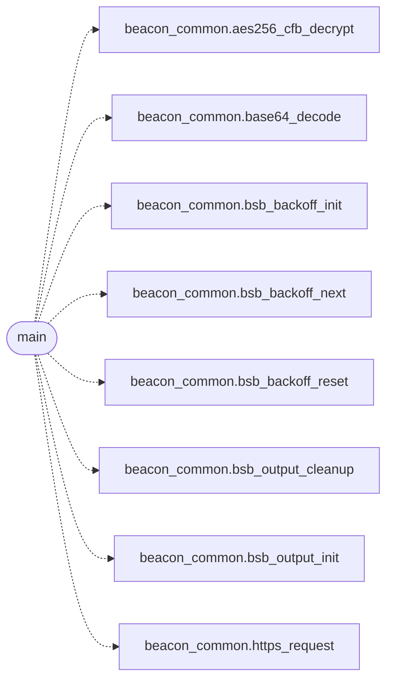

# `beacons/v1/beacon.c`

> Source: [beacons/v1/beacon.c:1](../../beacons/v1/beacon.c#L1) | language `c` | coverage 33.3% | [API index](../index.md)

## Contents

- **Functions:** [`main`](#main)
- **Macros:** [`_GNU_SOURCE`](#_gnu_source)

## Call Graph

Solid arrows stay in this module, dashed arrows leave it.



## Functions

<a id="main"></a>

### `main`

`function` | [beacons/v1/beacon.c:146](../../beacons/v1/beacon.c#L146)

```c
int main(void)
```

**Returns:** `int`

*Calls:* [`aes256_cfb_decrypt`](include.beacon_common.h.md#aes256_cfb_decrypt), [`base64_decode`](include.beacon_common.h.md#base64_decode), [`bsb_backoff_init`](include.beacon_common.h.md#bsb_backoff_init), [`bsb_backoff_next`](include.beacon_common.h.md#bsb_backoff_next), [`bsb_backoff_reset`](include.beacon_common.h.md#bsb_backoff_reset), [`bsb_output_cleanup`](include.beacon_common.h.md#bsb_output_cleanup), [`bsb_output_init`](include.beacon_common.h.md#bsb_output_init), [`https_request`](include.beacon_common.h.md#https_request)

---

## Macros

<a id="_gnu_source"></a>

### `_GNU_SOURCE`

`macro` | [beacons/v1/beacon.c:13](../../beacons/v1/beacon.c#L13)

```c
#define _GNU_SOURCE
```

beacon v1 - Canonical pull-mode beacon.

This is the simplest beacon variant: it polls the C2 server for
commands, executes them (either shell commands or BOFs), and
reports the results back. All shared infrastructure (HTTP client,
crypto, BOF loader, output capture) lives in beacon_common.c.

This beacon uses exponential backoff on failures to reduce noise
when the C2 is unreachable. The backoff resets on the first
successful command exchange.

---
