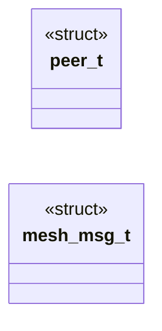
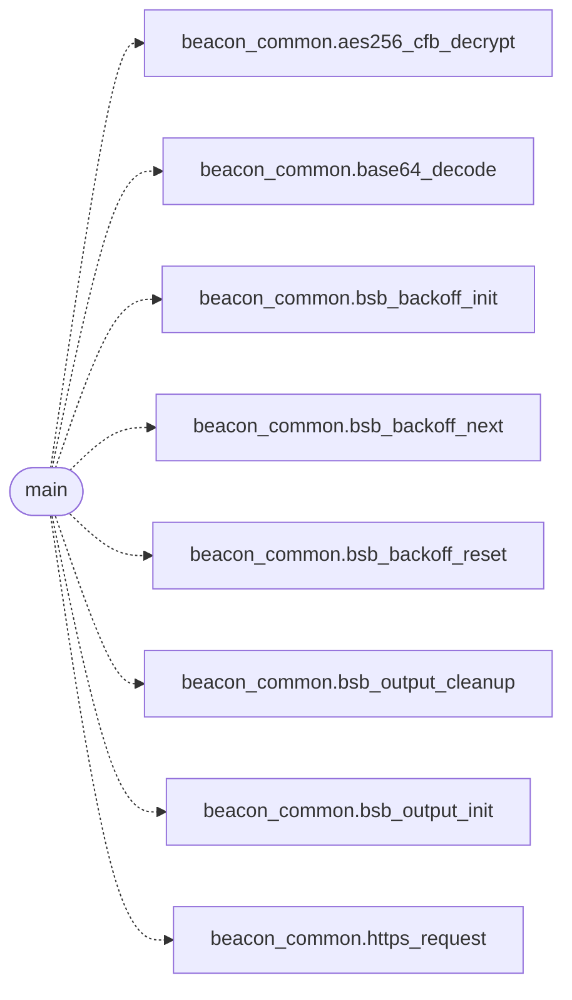

# `beacons/v2/beacon.c`

> Source: [beacons/v2/beacon.c:1](../../beacons/v2/beacon.c#L1) | language `c` | coverage 10.0% | [API index](../index.md)

## Contents

- **Structs:** [`peer_t`](#peer_t), [`mesh_msg_t`](#mesh_msg_t)
- **Functions:** [`main`](#main)
- **Macros:** [`_GNU_SOURCE`](#_gnu_source), [`MAX_PEERS`](#max_peers), [`DISCOVERY_PORT`](#discovery_port), [`DISCOVERY_INTERVAL`](#discovery_interval), [`MAX_TTL`](#max_ttl), [`MESH_MSG_SIZE`](#mesh_msg_size)

## Type Diagram



## Call Graph

Solid arrows stay in this module, dashed arrows leave it.



## Structs

<a id="peer_t"></a>

### `peer_t`

`struct` | [beacons/v2/beacon.c:33](../../beacons/v2/beacon.c#L33)

```c
typedef struct
```

---

<a id="mesh_msg_t"></a>

### `mesh_msg_t`

`struct` | [beacons/v2/beacon.c:40](../../beacons/v2/beacon.c#L40)

```c
typedef struct
```

---

## Functions

<a id="main"></a>

### `main`

`function` | [beacons/v2/beacon.c:188](../../beacons/v2/beacon.c#L188)

```c
int main(void)
```

**Returns:** `int`

*Calls:* [`aes256_cfb_decrypt`](include.beacon_common.h.md#aes256_cfb_decrypt), [`base64_decode`](include.beacon_common.h.md#base64_decode), [`bsb_backoff_init`](include.beacon_common.h.md#bsb_backoff_init), [`bsb_backoff_next`](include.beacon_common.h.md#bsb_backoff_next), [`bsb_backoff_reset`](include.beacon_common.h.md#bsb_backoff_reset), [`bsb_output_cleanup`](include.beacon_common.h.md#bsb_output_cleanup), [`bsb_output_init`](include.beacon_common.h.md#bsb_output_init), [`https_request`](include.beacon_common.h.md#https_request)

---

## Macros

<a id="_gnu_source"></a>

### `_GNU_SOURCE`

`macro` | [beacons/v2/beacon.c:12](../../beacons/v2/beacon.c#L12)

```c
#define _GNU_SOURCE
```

beacon v2 - Mesh/P2P discovery variant.

This beacon extends v1 with local network discovery and peer
communication. It periodically broadcasts its presence on the
local network and can relay commands between beacons.

All shared infrastructure (HTTP client, crypto, BOF loader)
lives in beacon_common.c. This file only implements the mesh
discovery and relay logic.

---

<a id="max_peers"></a>

### `MAX_PEERS`

`macro` | [beacons/v2/beacon.c:27](../../beacons/v2/beacon.c#L27)

```c
#define MAX_PEERS
```

---

<a id="discovery_port"></a>

### `DISCOVERY_PORT`

`macro` | [beacons/v2/beacon.c:28](../../beacons/v2/beacon.c#L28)

```c
#define DISCOVERY_PORT
```

---

<a id="discovery_interval"></a>

### `DISCOVERY_INTERVAL`

`macro` | [beacons/v2/beacon.c:29](../../beacons/v2/beacon.c#L29)

```c
#define DISCOVERY_INTERVAL
```

---

<a id="max_ttl"></a>

### `MAX_TTL`

`macro` | [beacons/v2/beacon.c:30](../../beacons/v2/beacon.c#L30)

```c
#define MAX_TTL
```

---

<a id="mesh_msg_size"></a>

### `MESH_MSG_SIZE`

`macro` | [beacons/v2/beacon.c:31](../../beacons/v2/beacon.c#L31)

```c
#define MESH_MSG_SIZE
```

---
