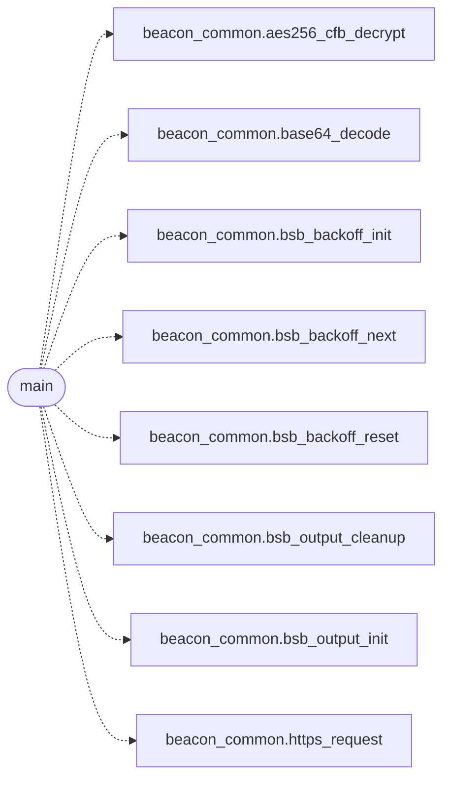

# `beacons/v3/beacon.c`

> Source: [beacons/v3/beacon.c:1](../../beacons/v3/beacon.c#L1) | language `c` | coverage 25.0% | [API index](../index.md)

## Contents

- **Functions:** [`infrastructure`](#infrastructure), [`main`](#main)
- **Macros:** [`_GNU_SOURCE`](#_gnu_source)

## Call Graph

Solid arrows stay in this module, dashed arrows leave it.



## Functions

<a id="infrastructure"></a>

### `infrastructure`

`function` | [beacons/v3/beacon.c:8](../../beacons/v3/beacon.c#L8)

```c
* * All shared infrastructure (HTTP client, crypto, BOF loader) * lives in beacon_common.c. Thi...
```

**Parameters**

| Name | Type | Default | Description |
|---|---|---|---|
| `client` | `HTTP` |  |  |
| `loader` | `BOF` |  |  |

**Returns:** `* * All shared`

---

<a id="main"></a>

### `main`

`function` | [beacons/v3/beacon.c:174](../../beacons/v3/beacon.c#L174)

```c
int main(void)
```

**Returns:** `int`

*Calls:* [`aes256_cfb_decrypt`](include.beacon_common.h.md#aes256_cfb_decrypt), [`base64_decode`](include.beacon_common.h.md#base64_decode), [`bsb_backoff_init`](include.beacon_common.h.md#bsb_backoff_init), [`bsb_backoff_next`](include.beacon_common.h.md#bsb_backoff_next), [`bsb_backoff_reset`](include.beacon_common.h.md#bsb_backoff_reset), [`bsb_output_cleanup`](include.beacon_common.h.md#bsb_output_cleanup), [`bsb_output_init`](include.beacon_common.h.md#bsb_output_init), [`https_request`](include.beacon_common.h.md#https_request)

---

## Macros

<a id="_gnu_source"></a>

### `_GNU_SOURCE`

`macro` | [beacons/v3/beacon.c:12](../../beacons/v3/beacon.c#L12)

```c
#define _GNU_SOURCE
```

beacon v3 - Experimental variant with enhanced evasion.

This beacon variant implements additional evasion techniques
including delayed execution, prime-number-based sleep obfuscation,
and enhanced anti-analysis measures.

All shared infrastructure (HTTP client, crypto, BOF loader)
lives in beacon_common.c. This file only implements the
experimental evasion logic.

---
