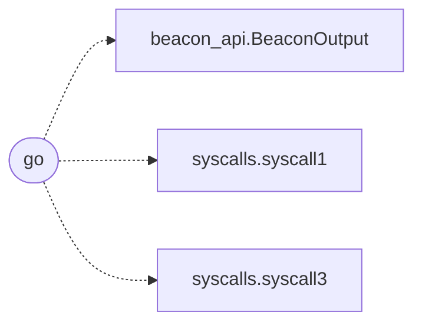

# `bof/is_sudo/bof.c`

> Source: [bof/is_sudo/bof.c:1](../../bof/is_sudo/bof.c#L1) | language `c` | coverage 0.0% | [API index](../index.md)

## Contents

- **Functions:** [`go`](#go)

## Call Graph

Solid arrows stay in this module, dashed arrows leave it.



## Functions

<a id="go"></a>

### `go`

`function` | [bof/is_sudo/bof.c:57](../../bof/is_sudo/bof.c#L57)

```c
void go(char *args, int alen)
```

**Parameters**

| Name | Type | Default | Description |
|---|---|---|---|
| `args` | `char *` |  |  |
| `alen` | `int` |  |  |

*Calls:* [`BeaconOutput`](bof.include.beacon_api.h.md#beaconoutput), [`syscall1`](bof.include.syscalls.h.md#syscall1), [`syscall3`](bof.include.syscalls.h.md#syscall3)

---
