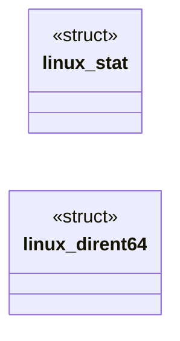

# `bof/suid_enum/bof.c`

> Source: [bof/suid_enum/bof.c:1](../../bof/suid_enum/bof.c#L1) | language `c` | coverage 44.4% | [API index](../index.md)

## Contents

- **Structs:** [`linux_stat`](#linux_stat), [`linux_dirent64`](#linux_dirent64)
- **Functions:** [`go`](#go)
- **Macros:** [`SYS_getdents64`](#sys_getdents64), [`SYS_lstat`](#sys_lstat), [`DT_UNKNOWN`](#dt_unknown), [`DT_DIR`](#dt_dir), [`DT_LNK`](#dt_lnk)

## Type Diagram



## Structs

<a id="linux_stat"></a>

### `linux_stat`

`struct` | [bof/suid_enum/bof.c:35](../../bof/suid_enum/bof.c#L35)

```c
struct linux_stat
```

Linux stat struct (matches the kernel ABI for x86_64).

---

<a id="linux_dirent64"></a>

### `linux_dirent64`

`struct` | [bof/suid_enum/bof.c:58](../../bof/suid_enum/bof.c#L58)

```c
struct linux_dirent64
```

getdents64 entry layout (kernel ABI).

The d_reclen field tells us the actual record size since names are variable length.

---

## Functions

<a id="go"></a>

### `go`

`function` | [bof/suid_enum/bof.c:247](../../bof/suid_enum/bof.c#L247)

```c
void go(char *args, int alen)
```

**Parameters**

| Name | Type | Default | Description |
|---|---|---|---|
| `args` | `char *` |  |  |
| `alen` | `int` |  |  |

---

## Macros

<a id="sys_getdents64"></a>

### `SYS_getdents64`

`macro` | [bof/suid_enum/bof.c:26](../../bof/suid_enum/bof.c#L26)

```c
#define SYS_getdents64
```

getdents64 syscall number (x86_64) and the dirent layout.

---

<a id="sys_lstat"></a>

### `SYS_lstat`

`macro` | [bof/suid_enum/bof.c:27](../../bof/suid_enum/bof.c#L27)

```c
#define SYS_lstat
```

---

<a id="dt_unknown"></a>

### `DT_UNKNOWN`

`macro` | [bof/suid_enum/bof.c:30](../../bof/suid_enum/bof.c#L30)

```c
#define DT_UNKNOWN
```

d_type values we care about (from <dirent.h>).

---

<a id="dt_dir"></a>

### `DT_DIR`

`macro` | [bof/suid_enum/bof.c:31](../../bof/suid_enum/bof.c#L31)

```c
#define DT_DIR
```

---

<a id="dt_lnk"></a>

### `DT_LNK`

`macro` | [bof/suid_enum/bof.c:32](../../bof/suid_enum/bof.c#L32)

```c
#define DT_LNK
```

---
