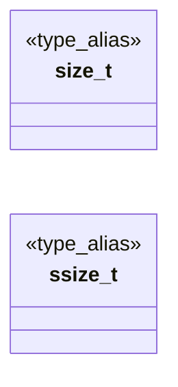
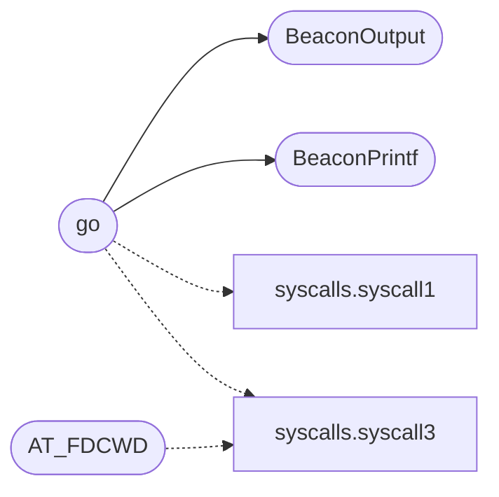

# `bof/whoami/whoami.c`

> Source: [bof/whoami/whoami.c:1](../../bof/whoami/whoami.c#L1) | language `c` | coverage 61.5% | [API index](../index.md)

## Contents

- **Type Aliases:** [`size_t`](#size_t), [`ssize_t`](#ssize_t)
- **Functions:** [`BeaconPrintf`](#beaconprintf), [`BeaconOutput`](#beaconoutput), [`go`](#go)
- **Macros:** [`NULL`](#null), [`CALLBACK_OUTPUT`](#callback_output), [`SYS_openat`](#sys_openat), [`SYS_read`](#sys_read), [`SYS_close`](#sys_close), [`SYS_getuid`](#sys_getuid), [`AT_FDCWD`](#at_fdcwd)

## Type Diagram



## Call Graph

Solid arrows stay in this module, dashed arrows leave it.



## Type Aliases

<a id="size_t"></a>

### `size_t`

`type_alias` | [bof/whoami/whoami.c:6](../../bof/whoami/whoami.c#L6)

```c
typedef unsigned long size_t;
```

Tipos

---

<a id="ssize_t"></a>

### `ssize_t`

`type_alias` | [bof/whoami/whoami.c:7](../../bof/whoami/whoami.c#L7)

```c
typedef long ssize_t;
```

---

## Functions

<a id="beaconprintf"></a>

### `BeaconPrintf`

`function` `extern` | [bof/whoami/whoami.c:10](../../bof/whoami/whoami.c#L10)

```c
extern void BeaconPrintf(int, const char*, ...);
```

Símbolos del beacon

**Parameters**

| Name | Type | Default | Description |
|---|---|---|---|
| `char` |  |  |  |
| `...` |  |  |  |

*Called by:* [`go`](#go)

---

<a id="beaconoutput"></a>

### `BeaconOutput`

`function` `extern` | [bof/whoami/whoami.c:11](../../bof/whoami/whoami.c#L11)

```c
extern void BeaconOutput(int, const char*, int);
```

Beacon API: raw output capture (called by BOFs).

**Parameters**

| Name | Type | Default | Description |
|---|---|---|---|
| `char` |  |  |  |

> **Inherited:** Documentation from [`BeaconOutput`](#beaconoutput) (include/beacon_common.h:105).

*Called by:* [`go`](#go)

---

<a id="go"></a>

### `go`

`function` | [bof/whoami/whoami.c:41](../../bof/whoami/whoami.c#L41)

```c
void go(char *args, int alen)
```

**Parameters**

| Name | Type | Default | Description |
|---|---|---|---|
| `args` | `char *` |  |  |
| `alen` | `int` |  |  |

*Calls:* [`syscall1`](bof.include.syscalls.h.md#syscall1), [`syscall3`](bof.include.syscalls.h.md#syscall3), [`BeaconOutput`](#beaconoutput), [`BeaconPrintf`](#beaconprintf)

---

## Macros

<a id="null"></a>

### `NULL`

`macro` | [bof/whoami/whoami.c:2](../../bof/whoami/whoami.c#L2)

```c
#define NULL
```

whoami.c — LazyOwn RedTeam BOF (Linux/x64)

---

<a id="callback_output"></a>

### `CALLBACK_OUTPUT`

`macro` | [bof/whoami/whoami.c:3](../../bof/whoami/whoami.c#L3)

```c
#define CALLBACK_OUTPUT
```

Tipos de callback

> **Inherited:** Documentation from [`CALLBACK_OUTPUT`](#callback_output) (beacon.h:9).

---

<a id="sys_openat"></a>

### `SYS_openat`

`macro` | [bof/whoami/whoami.c:14](../../bof/whoami/whoami.c#L14)

```c
#define SYS_openat
```

Números de syscall (x86_64 Linux)

---

<a id="sys_read"></a>

### `SYS_read`

`macro` | [bof/whoami/whoami.c:15](../../bof/whoami/whoami.c#L15)

```c
#define SYS_read
```

Syscall numbers - x86_64 Linux ABI.

> **Inherited:** Documentation from [`SYS_read`](#sys_read) (bof/include/syscalls.h:17).

---

<a id="sys_close"></a>

### `SYS_close`

`macro` | [bof/whoami/whoami.c:16](../../bof/whoami/whoami.c#L16)

```c
#define SYS_close
```

---

<a id="sys_getuid"></a>

### `SYS_getuid`

`macro` | [bof/whoami/whoami.c:17](../../bof/whoami/whoami.c#L17)

```c
#define SYS_getuid
```

---

<a id="at_fdcwd"></a>

### `AT_FDCWD`

`macro` | [bof/whoami/whoami.c:18](../../bof/whoami/whoami.c#L18)

```c
#define AT_FDCWD
```

Special fd value meaning "current working directory".

> **Inherited:** Documentation from [`AT_FDCWD`](#at_fdcwd) (bof/include/syscalls.h:47).

*Calls:* [`syscall3`](bof.include.syscalls.h.md#syscall3)

---
