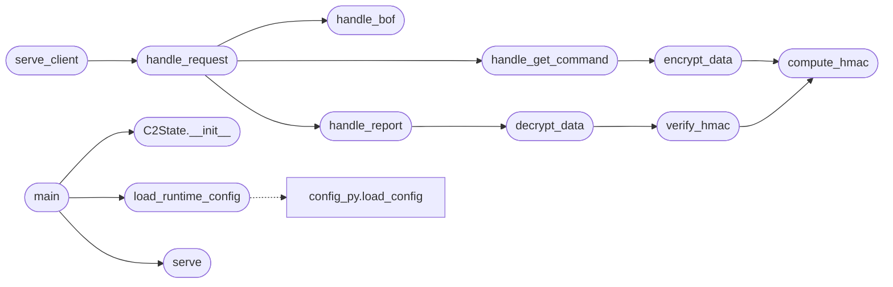

# `c2.server`

> Source: [c2/server.py:1](../../c2/server.py#L1) | language `py` | coverage 93.8% | [API index](../index.md)

Black Sand Beacon C2 Server

Gopher-style command and control server for Black Sand Beacon agents.
Handles command queuing, result collection, and BOF distribution.

Security features:
- Thread pool to prevent resource exhaustion
- HMAC-based message authentication (optional)
- Configurable TLS verification
- Centralized JSON configuration

Usage:
    python3 c2/server.py
    BSB_CONFIG=/path/to/config.json python3 c2/server.py

## Contents

- **Classes:** [`C2State`](#c2state)
- **Functions:** [`load_runtime_config`](#load_runtime_config), [`compute_hmac`](#compute_hmac), [`verify_hmac`](#verify_hmac), [`encrypt_data`](#encrypt_data), [`decrypt_data`](#decrypt_data), [`handle_get_command`](#handle_get_command), [`handle_report`](#handle_report), [`handle_bof`](#handle_bof), [`handle_request`](#handle_request), [`serve_client`](#serve_client), [`serve`](#serve), [`command_injector`](#command_injector), [`main`](#main)
- **Constants:** [`ROOT`](#root), [`DEFAULTS`](#defaults), [`MAX_REQUEST`](#max_request)

## Call Graph

Solid arrows stay in this module, dashed arrows leave it.



## Classes

<a id="c2state"></a>

### `C2State`

`class` | [c2/server.py:137](../../c2/server.py#L137)

```python
class C2State
```

Mutable state shared between request handlers.

**Members**

| Member | Kind | Summary |
|---|---|---|
| [`__init__`](#c2state-__init__) | constructor |  |

<a id="c2state-__init__"></a>

#### `C2State.__init__`

`constructor` | [c2/server.py:140](../../c2/server.py#L140)

```python
def __init__(self, cfg: Dict[str, Any])
```

**Parameters**

| Name | Type | Default | Description |
|---|---|---|---|
| `cfg` | `Dict[str, Any]` |  |  |

*Called by:* [`main`](#main)

---

## Functions

<a id="load_runtime_config"></a>

### `load_runtime_config`

`function` | [c2/server.py:60](../../c2/server.py#L60)

```python
def load_runtime_config() -> Dict[str, Any]
```

Load configuration from JSON file or use defaults.

**Returns:** `Dict[str, Any]`

*Calls:* [`load_config`](include.config_py.py.md#load_config)

*Called by:* [`main`](#main)

---

<a id="compute_hmac"></a>

### `compute_hmac`

`function` | [c2/server.py:87](../../c2/server.py#L87)

```python
def compute_hmac(key: bytes, data: bytes) -> str
```

Compute HMAC-SHA256 for message authentication.

**Parameters**

| Name | Type | Default | Description |
|---|---|---|---|
| `key` | `bytes` |  |  |
| `data` | `bytes` |  |  |

**Returns:** `str`

*Called by:* [`encrypt_data`](#encrypt_data), [`verify_hmac`](#verify_hmac)

---

<a id="verify_hmac"></a>

### `verify_hmac`

`function` | [c2/server.py:92](../../c2/server.py#L92)

```python
def verify_hmac(key: bytes, data: bytes, signature: str) -> bool
```

Verify HMAC-SHA256 signature.

**Parameters**

| Name | Type | Default | Description |
|---|---|---|---|
| `key` | `bytes` |  |  |
| `data` | `bytes` |  |  |
| `signature` | `str` |  |  |

**Returns:** `bool`

*Calls:* [`compute_hmac`](#compute_hmac)

*Called by:* [`decrypt_data`](#decrypt_data)

---

<a id="encrypt_data"></a>

### `encrypt_data`

`function` | [c2/server.py:98](../../c2/server.py#L98)

```python
def encrypt_data(data: bytes, key: bytes, use_hmac: bool = False) -> str
```

Encrypt data with AES-256-CFB and optional HMAC.

**Parameters**

| Name | Type | Default | Description |
|---|---|---|---|
| `data` | `bytes` |  |  |
| `key` | `bytes` |  |  |
| `use_hmac` | `bool` | `False` |  |

**Returns:** `str`

*Calls:* [`compute_hmac`](#compute_hmac)

*Called by:* [`handle_get_command`](#handle_get_command)

---

<a id="decrypt_data"></a>

### `decrypt_data`

`function` | [c2/server.py:118](../../c2/server.py#L118)

```python
def decrypt_data(b64_data: str, key: bytes, use_hmac: bool = False) -> Optional[bytes]
```

Decrypt AES-256-CFB data with optional HMAC verification.

**Parameters**

| Name | Type | Default | Description |
|---|---|---|---|
| `b64_data` | `str` |  |  |
| `key` | `bytes` |  |  |
| `use_hmac` | `bool` | `False` |  |

**Returns:** `Optional[bytes]`

*Calls:* [`verify_hmac`](#verify_hmac)

*Called by:* [`handle_report`](#handle_report)

---

<a id="handle_get_command"></a>

### `handle_get_command`

`function` | [c2/server.py:151](../../c2/server.py#L151)

```python
def handle_get_command(state: C2State, selector: str) -> bytes
```

Dispatch beacon's polling GET request.

**Parameters**

| Name | Type | Default | Description |
|---|---|---|---|
| `state` | `C2State` |  |  |
| `selector` | `str` |  |  |

**Returns:** `bytes`

*Calls:* [`encrypt_data`](#encrypt_data)

*Called by:* [`handle_request`](#handle_request)

---

<a id="handle_report"></a>

### `handle_report`

`function` | [c2/server.py:174](../../c2/server.py#L174)

```python
def handle_report(state: C2State, b64_payload: str) -> bytes
```

Process beacon result report.

**Parameters**

| Name | Type | Default | Description |
|---|---|---|---|
| `state` | `C2State` |  |  |
| `b64_payload` | `str` |  |  |

**Returns:** `bytes`

*Calls:* [`decrypt_data`](#decrypt_data)

*Called by:* [`handle_request`](#handle_request)

---

<a id="handle_bof"></a>

### `handle_bof`

`function` | [c2/server.py:230](../../c2/server.py#L230)

```python
def handle_bof(state: C2State, name: str) -> bytes
```

Serve BOF file from upload directory.

**Parameters**

| Name | Type | Default | Description |
|---|---|---|---|
| `state` | `C2State` |  |  |
| `name` | `str` |  |  |

**Returns:** `bytes`

*Called by:* [`handle_request`](#handle_request)

---

<a id="handle_request"></a>

### `handle_request`

`function` | [c2/server.py:240](../../c2/server.py#L240)

```python
def handle_request(state: C2State, selector: str) -> bytes
```

Route request to appropriate handler.

Accepts both the HTTP/1.1 request form (the beacon uses libcurl)
and the bare Gopher-style selector. Payloads carried in an HTTP
path are percent-decoded, since base64 uses '+', '/' and '='
which are not all legal in a request line.

**Parameters**

| Name | Type | Default | Description |
|---|---|---|---|
| `state` | `C2State` |  |  |
| `selector` | `str` |  |  |

**Returns:** `bytes`

*Calls:* [`handle_bof`](#handle_bof), [`handle_get_command`](#handle_get_command), [`handle_report`](#handle_report)

*Called by:* [`serve_client`](#serve_client)

---

<a id="serve_client"></a>

### `serve_client`

`function` | [c2/server.py:355](../../c2/server.py#L355)

```python
def serve_client(state: C2State, conn: socket.socket, addr: tuple)
```

Handle individual client connection.

**Parameters**

| Name | Type | Default | Description |
|---|---|---|---|
| `state` | `C2State` |  |  |
| `conn` | `socket.socket` |  |  |
| `addr` | `tuple` |  |  |

*Calls:* [`handle_request`](#handle_request)

---

<a id="serve"></a>

### `serve`

`function` | [c2/server.py:380](../../c2/server.py#L380)

```python
def serve(cfg: Dict[str, Any], state: C2State)
```

Bind and accept loop.

Blocks until interrupted.

**Parameters**

| Name | Type | Default | Description |
|---|---|---|---|
| `cfg` | `Dict[str, Any]` |  |  |
| `state` | `C2State` |  |  |

*Called by:* [`main`](#main)

---

<a id="command_injector"></a>

### `command_injector`

`function` | [c2/server.py:404](../../c2/server.py#L404)

```python
def command_injector(state: C2State)
```

Interactive command injection REPL.

**Parameters**

| Name | Type | Default | Description |
|---|---|---|---|
| `state` | `C2State` |  |  |

---

<a id="main"></a>

### `main`

`function` | [c2/server.py:427](../../c2/server.py#L427)

```python
def main()
```

Start C2 server.

*Calls:* [`C2State.__init__`](#c2state-__init__), [`load_runtime_config`](#load_runtime_config), [`serve`](#serve)

---

## Constants

<a id="root"></a>

### `ROOT`

`constant` | [c2/server.py:35](../../c2/server.py#L35)

```python
ROOT = Path(__file__).resolve().parent.parent
```

---

<a id="defaults"></a>

### `DEFAULTS`

`constant` | [c2/server.py:47](../../c2/server.py#L47)

```python
DEFAULTS
```

---

<a id="max_request"></a>

### `MAX_REQUEST`

`constant` | [c2/server.py:279](../../c2/server.py#L279)

```python
MAX_REQUEST = 65536
```

---
