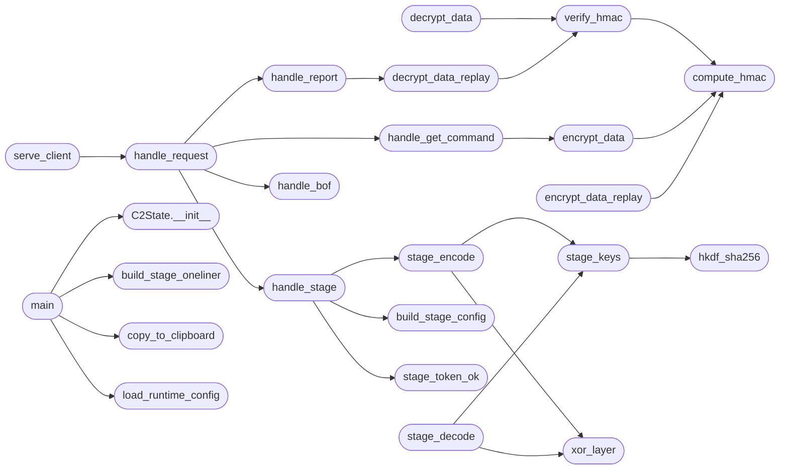

# `c2.server`

> Source: [c2/server.py:1](../../c2/server.py#L1) | language `py` | coverage 96.4% | [API index](../index.md)

Black Sand Beacon C2 Server

Gopher-style command and control server for Black Sand Beacon agents.
Handles command queuing, result collection, and BOF distribution.

Security features:
- Thread pool to prevent resource exhaustion
- HMAC-based message authentication (optional)
- Configurable TLS verification
- Centralized JSON configuration

Usage:
    python3 c2/server.py
    BSB_CONFIG=/path/to/config.json python3 c2/server.py

## Contents

- **Classes:** [`C2State`](#c2state)
- **Functions:** [`load_runtime_config`](#load_runtime_config), [`compute_hmac`](#compute_hmac), [`verify_hmac`](#verify_hmac), [`encrypt_data`](#encrypt_data), [`encrypt_data_replay`](#encrypt_data_replay), [`decrypt_data`](#decrypt_data), [`decrypt_data_replay`](#decrypt_data_replay), [`hkdf_sha256`](#hkdf_sha256), [`stage_keys`](#stage_keys), [`xor_layer`](#xor_layer), [`stage_encode`](#stage_encode), [`stage_decode`](#stage_decode), [`stage_token_ok`](#stage_token_ok), [`build_stage_config`](#build_stage_config), [`handle_stage`](#handle_stage), [`build_stage_oneliner`](#build_stage_oneliner), [`copy_to_clipboard`](#copy_to_clipboard), [`handle_get_command`](#handle_get_command), [`handle_report`](#handle_report), [`handle_bof`](#handle_bof), [`handle_request`](#handle_request), [`serve_client`](#serve_client), [`serve`](#serve), [`command_injector`](#command_injector), [`main`](#main)
- **Constants:** [`ROOT`](#root), [`DEFAULTS`](#defaults), [`STAGE_BEACON_PREFIX`](#stage_beacon_prefix), [`STAGE_CONFIG_PREFIX`](#stage_config_prefix), [`STAGE_KEY_COUNT`](#stage_key_count), [`STAGE_KEY_LEN`](#stage_key_len), [`STAGE_HKDF_SALT`](#stage_hkdf_salt), [`STAGE_HKDF_INFOS`](#stage_hkdf_infos), [`STAGE_PAYLOAD_PATH`](#stage_payload_path), [`MAX_REQUEST`](#max_request)

## Call Graph

Solid arrows stay in this module, dashed arrows leave it.



## Classes

<a id="c2state"></a>

### `C2State`

`class` | [c2/server.py:552](../../c2/server.py#L552)

```python
class C2State
```

Mutable state shared between request handlers.

**Members**

| Member | Kind | Summary |
|---|---|---|
| [`__init__`](#c2state-__init__) | constructor |  |

<a id="c2state-__init__"></a>

#### `C2State.__init__`

`constructor` | [c2/server.py:555](../../c2/server.py#L555)

```python
def __init__(self, cfg: Dict[str, Any])
```

**Parameters**

| Name | Type | Default | Description |
|---|---|---|---|
| `cfg` | `Dict[str, Any]` |  |  |

*Called by:* [`main`](#main)

---

## Functions

<a id="load_runtime_config"></a>

### `load_runtime_config`

`function` | [c2/server.py:86](../../c2/server.py#L86)

```python
def load_runtime_config() -> Dict[str, Any]
```

Load configuration from JSON file or use defaults.

Anything not provided (config.json or environment) is generated at
random *per server run*: port, master key, staging token and client
id. Generated values are recorded in cfg["generated"] so main() can
print them, and they always win over the on-disk file when the
config is served through the staging endpoint.

**Returns:** `Dict[str, Any]`

*Calls:* [`load_config`](include.config_py.py.md#load_config)

*Called by:* [`main`](#main)

---

<a id="compute_hmac"></a>

### `compute_hmac`

`function` | [c2/server.py:210](../../c2/server.py#L210)

```python
def compute_hmac(key: bytes, data: bytes) -> str
```

Compute HMAC-SHA256 for message authentication.

**Parameters**

| Name | Type | Default | Description |
|---|---|---|---|
| `key` | `bytes` |  |  |
| `data` | `bytes` |  |  |

**Returns:** `str`

*Called by:* [`encrypt_data`](#encrypt_data), [`encrypt_data_replay`](#encrypt_data_replay), [`verify_hmac`](#verify_hmac)

---

<a id="verify_hmac"></a>

### `verify_hmac`

`function` | [c2/server.py:215](../../c2/server.py#L215)

```python
def verify_hmac(key: bytes, data: bytes, signature: str) -> bool
```

Verify HMAC-SHA256 signature.

**Parameters**

| Name | Type | Default | Description |
|---|---|---|---|
| `key` | `bytes` |  |  |
| `data` | `bytes` |  |  |
| `signature` | `str` |  |  |

**Returns:** `bool`

*Calls:* [`compute_hmac`](#compute_hmac)

*Called by:* [`decrypt_data`](#decrypt_data), [`decrypt_data_replay`](#decrypt_data_replay)

---

<a id="encrypt_data"></a>

### `encrypt_data`

`function` | [c2/server.py:221](../../c2/server.py#L221)

```python
def encrypt_data(data: bytes, key: bytes, hmac_key: bytes = None, use_hmac: bool = False) -> str
```

Encrypt data with AES-256-CFB and optional HMAC (legacy format without replay protection).

**Parameters**

| Name | Type | Default | Description |
|---|---|---|---|
| `data` | `bytes` |  |  |
| `key` | `bytes` |  |  |
| `hmac_key` | `bytes` | `None` |  |
| `use_hmac` | `bool` | `False` |  |

**Returns:** `str`

*Calls:* [`compute_hmac`](#compute_hmac)

*Called by:* [`handle_get_command`](#handle_get_command)

---

<a id="encrypt_data_replay"></a>

### `encrypt_data_replay`

`function` | [c2/server.py:244](../../c2/server.py#L244)

```python
def encrypt_data_replay(data: bytes, key: bytes, counter: int, timestamp: int, hmac_key: bytes = None, use_hmac: bool = False) -> str
```

Encrypt data with AES-256-CFB and replay protection (counter + timestamp).

**Parameters**

| Name | Type | Default | Description |
|---|---|---|---|
| `data` | `bytes` |  |  |
| `key` | `bytes` |  |  |
| `counter` | `int` |  |  |
| `timestamp` | `int` |  |  |
| `hmac_key` | `bytes` | `None` |  |
| `use_hmac` | `bool` | `False` |  |

**Returns:** `str`

*Calls:* [`compute_hmac`](#compute_hmac)

---

<a id="decrypt_data"></a>

### `decrypt_data`

`function` | [c2/server.py:278](../../c2/server.py#L278)

```python
def decrypt_data(b64_data: str, key: bytes, hmac_key: bytes = None, use_hmac: bool = False) -> Optional[bytes]
```

Decrypt AES-256-CFB data with optional HMAC verification.

**Parameters**

| Name | Type | Default | Description |
|---|---|---|---|
| `b64_data` | `str` |  |  |
| `key` | `bytes` |  |  |
| `hmac_key` | `bytes` | `None` |  |
| `use_hmac` | `bool` | `False` |  |

**Returns:** `Optional[bytes]`

*Calls:* [`verify_hmac`](#verify_hmac)

---

<a id="decrypt_data_replay"></a>

### `decrypt_data_replay`

`function` | [c2/server.py:301](../../c2/server.py#L301)

```python
def decrypt_data_replay(b64_data: str, key: bytes, hmac_key: bytes = None, use_hmac: bool = False, replay_window_seconds: int = 300, last_seen_counter: Dict[str, int] = None, client_id: str = None) -> Optional[tuple[bytes, int, int]]
```

Decrypt AES-256-CFB data with replay protection (counter + timestamp).

Returns (decrypted_data, counter, timestamp) on success, None on failure.

**Parameters**

| Name | Type | Default | Description |
|---|---|---|---|
| `b64_data` | `str` |  |  |
| `key` | `bytes` |  |  |
| `hmac_key` | `bytes` | `None` |  |
| `use_hmac` | `bool` | `False` |  |
| `replay_window_seconds` | `int` | `300` |  |
| `last_seen_counter` | `Dict[str, int]` | `None` |  |
| `client_id` | `str` | `None` |  |

**Returns:** `Optional[tuple[bytes, int, int]]`

*Calls:* [`verify_hmac`](#verify_hmac)

*Called by:* [`handle_report`](#handle_report)

---

<a id="hkdf_sha256"></a>

### `hkdf_sha256`

`function` | [c2/server.py:398](../../c2/server.py#L398)

```python
def hkdf_sha256(ikm: bytes, salt: bytes, info: bytes, length: int = 32) -> bytes
```

RFC 5869 HKDF extract+expand.

Pure stdlib so the server and the stager payload implement byte-identical derivation.

**Parameters**

| Name | Type | Default | Description |
|---|---|---|---|
| `ikm` | `bytes` |  |  |
| `salt` | `bytes` |  |  |
| `info` | `bytes` |  |  |
| `length` | `int` | `32` |  |

**Returns:** `bytes`

*Called by:* [`stage_keys`](#stage_keys)

---

<a id="stage_keys"></a>

### `stage_keys`

`function` | [c2/server.py:410](../../c2/server.py#L410)

```python
def stage_keys(token: str) -> list
```

Derive the three staging XOR layers from the token.

**Parameters**

| Name | Type | Default | Description |
|---|---|---|---|
| `token` | `str` |  |  |

**Returns:** `list`

*Calls:* [`hkdf_sha256`](#hkdf_sha256)

*Called by:* [`stage_decode`](#stage_decode), [`stage_encode`](#stage_encode)

---

<a id="xor_layer"></a>

### `xor_layer`

`function` | [c2/server.py:416](../../c2/server.py#L416)

```python
def xor_layer(data: bytes, key: bytes) -> bytes
```

Apply one XOR layer with a repeating key.

**Parameters**

| Name | Type | Default | Description |
|---|---|---|---|
| `data` | `bytes` |  |  |
| `key` | `bytes` |  |  |

**Returns:** `bytes`

*Called by:* [`stage_decode`](#stage_decode), [`stage_encode`](#stage_encode)

---

<a id="stage_encode"></a>

### `stage_encode`

`function` | [c2/server.py:422](../../c2/server.py#L422)

```python
def stage_encode(payload: bytes, token: str) -> bytes
```

Pack payload as base64 using token-derived XOR keys.

**Parameters**

| Name | Type | Default | Description |
|---|---|---|---|
| `payload` | `bytes` |  |  |
| `token` | `str` |  |  |

**Returns:** `bytes`

*Calls:* [`stage_keys`](#stage_keys), [`xor_layer`](#xor_layer)

*Called by:* [`handle_stage`](#handle_stage)

---

<a id="stage_decode"></a>

### `stage_decode`

`function` | [c2/server.py:430](../../c2/server.py#L430)

```python
def stage_decode(body: bytes, token: str) -> Optional[bytes]
```

Inverse of stage_encode (used by tests and the stager parity check).

**Parameters**

| Name | Type | Default | Description |
|---|---|---|---|
| `body` | `bytes` |  |  |
| `token` | `str` |  |  |

**Returns:** `Optional[bytes]`

*Calls:* [`stage_keys`](#stage_keys), [`xor_layer`](#xor_layer)

---

<a id="stage_token_ok"></a>

### `stage_token_ok`

`function` | [c2/server.py:441](../../c2/server.py#L441)

```python
def stage_token_ok(state: C2State, token: str) -> bool
```

Constant-time token check; fail closed when no token configured.

**Parameters**

| Name | Type | Default | Description |
|---|---|---|---|
| `state` | `C2State` |  |  |
| `token` | `str` |  |  |

**Returns:** `bool`

*Called by:* [`handle_stage`](#handle_stage)

---

<a id="build_stage_config"></a>

### `build_stage_config`

`function` | [c2/server.py:449](../../c2/server.py#L449)

```python
def build_stage_config(state: C2State) -> bytes
```

Build the beacon config JSON served by /stage/config.

Runtime values (random-generated key/port/client id) always win over
the on-disk file, so a fileless beacon agrees with *this* server
run. The server-only section is stripped and derived key bytes are
dropped (not JSON-serializable).

**Parameters**

| Name | Type | Default | Description |
|---|---|---|---|
| `state` | `C2State` |  |  |

**Returns:** `bytes`

*Calls:* [`load_config`](include.config_py.py.md#load_config)

*Called by:* [`handle_stage`](#handle_stage)

---

<a id="handle_stage"></a>

### `handle_stage`

`function` | [c2/server.py:481](../../c2/server.py#L481)

```python
def handle_stage(state: C2State, kind: str, token: str) -> bytes
```

Serve the beacon ELF or the config.json through the staging contract.

**Parameters**

| Name | Type | Default | Description |
|---|---|---|---|
| `state` | `C2State` |  |  |
| `kind` | `str` |  |  |
| `token` | `str` |  |  |

**Returns:** `bytes`

*Calls:* [`build_stage_config`](#build_stage_config), [`stage_encode`](#stage_encode), [`stage_token_ok`](#stage_token_ok)

*Called by:* [`handle_request`](#handle_request)

---

<a id="build_stage_oneliner"></a>

### `build_stage_oneliner`

`function` | [c2/server.py:512](../../c2/server.py#L512)

```python
def build_stage_oneliner(cfg: Dict[str, Any]) -> str
```

Build the copy-paste stager one-liner for the current config.

The stager payload (c2/stage_payload.py) reads URL and token from
environment variables, so its base64 blob is constant and the
one-liner is a plain pipe: decode payload, run it with env vars set.

**Parameters**

| Name | Type | Default | Description |
|---|---|---|---|
| `cfg` | `Dict[str, Any]` |  |  |

**Returns:** `str`

*Called by:* [`main`](#main)

---

<a id="copy_to_clipboard"></a>

### `copy_to_clipboard`

`function` | [c2/server.py:529](../../c2/server.py#L529)

```python
def copy_to_clipboard(text: str) -> bool
```

Copy text to the X11/Wayland clipboard; False if no tool exists.

**Parameters**

| Name | Type | Default | Description |
|---|---|---|---|
| `text` | `str` |  |  |

**Returns:** `bool`

*Called by:* [`main`](#main)

---

<a id="handle_get_command"></a>

### `handle_get_command`

`function` | [c2/server.py:568](../../c2/server.py#L568)

```python
def handle_get_command(state: C2State, selector: str) -> bytes
```

Dispatch beacon's polling GET request.

**Parameters**

| Name | Type | Default | Description |
|---|---|---|---|
| `state` | `C2State` |  |  |
| `selector` | `str` |  |  |

**Returns:** `bytes`

*Calls:* [`encrypt_data`](#encrypt_data)

*Called by:* [`handle_request`](#handle_request)

---

<a id="handle_report"></a>

### `handle_report`

`function` | [c2/server.py:592](../../c2/server.py#L592)

```python
def handle_report(state: C2State, b64_payload: str) -> bytes
```

Process beacon result report.

**Parameters**

| Name | Type | Default | Description |
|---|---|---|---|
| `state` | `C2State` |  |  |
| `b64_payload` | `str` |  |  |

**Returns:** `bytes`

*Calls:* [`decrypt_data_replay`](#decrypt_data_replay)

*Called by:* [`handle_request`](#handle_request)

---

<a id="handle_bof"></a>

### `handle_bof`

`function` | [c2/server.py:682](../../c2/server.py#L682)

```python
def handle_bof(state: C2State, name: str) -> bytes
```

Serve BOF file from upload directory with path traversal protection.

**Parameters**

| Name | Type | Default | Description |
|---|---|---|---|
| `state` | `C2State` |  |  |
| `name` | `str` |  |  |

**Returns:** `bytes`

*Called by:* [`handle_request`](#handle_request)

---

<a id="handle_request"></a>

### `handle_request`

`function` | [c2/server.py:720](../../c2/server.py#L720)

```python
def handle_request(state: C2State, selector: str) -> bytes
```

Route request to appropriate handler.

Accepts both the HTTP/1.1 request form (the beacon uses libcurl)
and the bare Gopher-style selector. Payloads carried in an HTTP
path are percent-decoded, since base64 uses '+', '/' and '='
which are not all legal in a request line.

**Parameters**

| Name | Type | Default | Description |
|---|---|---|---|
| `state` | `C2State` |  |  |
| `selector` | `str` |  |  |

**Returns:** `bytes`

*Calls:* [`handle_bof`](#handle_bof), [`handle_get_command`](#handle_get_command), [`handle_report`](#handle_report), [`handle_stage`](#handle_stage)

*Called by:* [`serve_client`](#serve_client)

---

<a id="serve_client"></a>

### `serve_client`

`function` | [c2/server.py:860](../../c2/server.py#L860)

```python
def serve_client(state: C2State, conn: socket.socket, addr: tuple)
```

Handle individual client connection.

**Parameters**

| Name | Type | Default | Description |
|---|---|---|---|
| `state` | `C2State` |  |  |
| `conn` | `socket.socket` |  |  |
| `addr` | `tuple` |  |  |

*Calls:* [`handle_request`](#handle_request)

---

<a id="serve"></a>

### `serve`

`function` | [c2/server.py:890](../../c2/server.py#L890)

```python
def serve(cfg: Dict[str, Any], state: C2State)
```

Bind and accept loop.

Blocks until interrupted.

**Parameters**

| Name | Type | Default | Description |
|---|---|---|---|
| `cfg` | `Dict[str, Any]` |  |  |
| `state` | `C2State` |  |  |

*Called by:* [`main`](#main)

---

<a id="command_injector"></a>

### `command_injector`

`function` | [c2/server.py:932](../../c2/server.py#L932)

```python
def command_injector(state: C2State)
```

Interactive command injection REPL.

**Parameters**

| Name | Type | Default | Description |
|---|---|---|---|
| `state` | `C2State` |  |  |

---

<a id="main"></a>

### `main`

`function` | [c2/server.py:955](../../c2/server.py#L955)

```python
def main()
```

Start C2 server.

*Calls:* [`C2State.__init__`](#c2state-__init__), [`build_stage_oneliner`](#build_stage_oneliner), [`copy_to_clipboard`](#copy_to_clipboard), [`load_runtime_config`](#load_runtime_config), [`serve`](#serve)

---

## Constants

<a id="root"></a>

### `ROOT`

`constant` | [c2/server.py:41](../../c2/server.py#L41)

```python
ROOT = Path(__file__).resolve().parent.parent
```

---

<a id="defaults"></a>

### `DEFAULTS`

`constant` | [c2/server.py:55](../../c2/server.py#L55)

```python
DEFAULTS
```

---

<a id="stage_beacon_prefix"></a>

### `STAGE_BEACON_PREFIX`

`constant` | [c2/server.py:390](../../c2/server.py#L390)

```python
STAGE_BEACON_PREFIX = '/stage/beacon/'
```

---

<a id="stage_config_prefix"></a>

### `STAGE_CONFIG_PREFIX`

`constant` | [c2/server.py:391](../../c2/server.py#L391)

```python
STAGE_CONFIG_PREFIX = '/stage/config/'
```

---

<a id="stage_key_count"></a>

### `STAGE_KEY_COUNT`

`constant` | [c2/server.py:392](../../c2/server.py#L392)

```python
STAGE_KEY_COUNT = 3
```

---

<a id="stage_key_len"></a>

### `STAGE_KEY_LEN`

`constant` | [c2/server.py:393](../../c2/server.py#L393)

```python
STAGE_KEY_LEN = 32
```

---

<a id="stage_hkdf_salt"></a>

### `STAGE_HKDF_SALT`

`constant` | [c2/server.py:394](../../c2/server.py#L394)

```python
STAGE_HKDF_SALT = b'blacksandbeacon-stage-v1'
```

---

<a id="stage_hkdf_infos"></a>

### `STAGE_HKDF_INFOS`

`constant` | [c2/server.py:395](../../c2/server.py#L395)

```python
STAGE_HKDF_INFOS = (b'stage-l1', b'stage-l2', b'stage-l3')
```

---

<a id="stage_payload_path"></a>

### `STAGE_PAYLOAD_PATH`

`constant` | [c2/server.py:509](../../c2/server.py#L509)

```python
STAGE_PAYLOAD_PATH = Path(__file__).resolve().parent / 'stage_payload.py'
```

---

<a id="max_request"></a>

### `MAX_REQUEST`

`constant` | [c2/server.py:780](../../c2/server.py#L780)

```python
MAX_REQUEST = 65536
```

---
