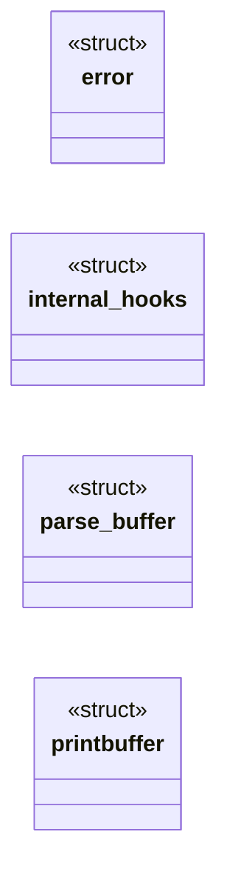

# `cJSON.c`

> Source: [cJSON.c:1](../../cJSON.c#L1) | language `c` | coverage 6.7% | [API index](../index.md)

## Contents

- **Structs:** [`error`](#error), [`internal_hooks`](#internal_hooks), [`parse_buffer`](#parse_buffer), [`printbuffer`](#printbuffer)
- **Functions:** [`CJSON_PUBLIC`](#cjson_public), [`CJSON_PUBLIC`](#cjson_public), [`CJSON_PUBLIC`](#cjson_public), [`CJSON_PUBLIC`](#cjson_public), [`CJSON_PUBLIC`](#cjson_public), [`CJSON_PUBLIC`](#cjson_public), [`CJSON_PUBLIC`](#cjson_public), [`CJSON_PUBLIC`](#cjson_public), [`CJSON_PUBLIC`](#cjson_public), [`CJSON_PUBLIC`](#cjson_public), [`CJSON_PUBLIC`](#cjson_public), [`CJSON_PUBLIC`](#cjson_public), [`CJSON_PUBLIC`](#cjson_public), [`CJSON_PUBLIC`](#cjson_public), [`CJSON_PUBLIC`](#cjson_public), [`CJSON_PUBLIC`](#cjson_public), [`CJSON_PUBLIC`](#cjson_public), [`CJSON_PUBLIC`](#cjson_public), [`CJSON_PUBLIC`](#cjson_public), [`CJSON_PUBLIC`](#cjson_public), [`CJSON_PUBLIC`](#cjson_public), [`CJSON_PUBLIC`](#cjson_public), [`CJSON_PUBLIC`](#cjson_public), [`CJSON_PUBLIC`](#cjson_public), [`CJSON_PUBLIC`](#cjson_public), [`CJSON_PUBLIC`](#cjson_public), [`CJSON_PUBLIC`](#cjson_public), [`CJSON_PUBLIC`](#cjson_public), [`CJSON_PUBLIC`](#cjson_public), [`CJSON_PUBLIC`](#cjson_public), [`CJSON_PUBLIC`](#cjson_public), [`CJSON_PUBLIC`](#cjson_public), [`CJSON_PUBLIC`](#cjson_public), [`CJSON_PUBLIC`](#cjson_public), [`CJSON_PUBLIC`](#cjson_public), [`CJSON_PUBLIC`](#cjson_public), [`CJSON_PUBLIC`](#cjson_public), [`CJSON_PUBLIC`](#cjson_public), [`CJSON_PUBLIC`](#cjson_public), [`CJSON_PUBLIC`](#cjson_public), [`CJSON_PUBLIC`](#cjson_public), [`CJSON_PUBLIC`](#cjson_public), [`CJSON_PUBLIC`](#cjson_public), [`CJSON_PUBLIC`](#cjson_public), [`CJSON_PUBLIC`](#cjson_public), [`CJSON_PUBLIC`](#cjson_public), [`CJSON_PUBLIC`](#cjson_public), [`CJSON_PUBLIC`](#cjson_public), [`CJSON_PUBLIC`](#cjson_public), [`CJSON_PUBLIC`](#cjson_public), [`CJSON_PUBLIC`](#cjson_public), [`cJSON_Duplicate_rec`](#cjson_duplicate_rec), [`CJSON_PUBLIC`](#cjson_public), [`CJSON_PUBLIC`](#cjson_public), [`CJSON_PUBLIC`](#cjson_public), [`CJSON_PUBLIC`](#cjson_public), [`CJSON_PUBLIC`](#cjson_public), [`CJSON_PUBLIC`](#cjson_public), [`CJSON_PUBLIC`](#cjson_public), [`CJSON_PUBLIC`](#cjson_public), [`CJSON_PUBLIC`](#cjson_public), [`CJSON_PUBLIC`](#cjson_public), [`CJSON_PUBLIC`](#cjson_public), [`CJSON_PUBLIC`](#cjson_public), [`cJSON_ArrayForEach`](#cjson_arrayforeach), [`cJSON_ArrayForEach`](#cjson_arrayforeach), [`CJSON_PUBLIC`](#cjson_public), [`CJSON_PUBLIC`](#cjson_public)
- **Macros:** [`_CRT_SECURE_NO_DEPRECATE`](#_crt_secure_no_deprecate), [`true`](#true), [`false`](#false), [`isinf`](#isinf), [`isnan`](#isnan), [`NAN`](#nan), [`NAN`](#nan), [`internal_malloc`](#internal_malloc), [`internal_free`](#internal_free), [`internal_realloc`](#internal_realloc), [`static_strlen`](#static_strlen), [`can_read`](#can_read), [`can_access_at_index`](#can_access_at_index), [`cannot_access_at_index`](#cannot_access_at_index), [`buffer_at_offset`](#buffer_at_offset), [`cjson_min`](#cjson_min)

## Type Diagram



## Call Graph

Solid arrows stay in this module, dashed arrows leave it.

```mermaid
flowchart LR
    n_cJSON_c__CJSON_PUBLIC_100(["CJSON_PUBLIC"])
    n_cJSON_c__CJSON_PUBLIC(["CJSON_PUBLIC"])
    n_cJSON_c__CJSON_PUBLIC_110(["CJSON_PUBLIC"])
    n_cJSON_c__CJSON_PUBLIC_125(["CJSON_PUBLIC"])
    n_cJSON_c__CJSON_PUBLIC_210(["CJSON_PUBLIC"])
    n_cJSON_c__buffer_at_offset(["buffer_at_offset"])
    n_cJSON_c__can_access_at_index(["can_access_at_index"])
    n_cJSON_c__CJSON_PUBLIC_1134(["CJSON_PUBLIC"])
    n_cJSON_c__CJSON_PUBLIC_1236(["CJSON_PUBLIC"])
    n_cJSON_c__CJSON_PUBLIC_1316(["CJSON_PUBLIC"])
    n_cJSON_c__CJSON_PUBLIC_1321(["CJSON_PUBLIC"])
    n_cJSON_c__CJSON_PUBLIC_1352(["CJSON_PUBLIC"])
    n_cJSON_c__CJSON_PUBLIC_1935(["CJSON_PUBLIC"])
    n_cJSON_c__CJSON_PUBLIC_1977(["CJSON_PUBLIC"])
    n_cJSON_c__CJSON_PUBLIC_1982(["CJSON_PUBLIC"])
    n_cJSON_c__CJSON_PUBLIC_1987(["CJSON_PUBLIC"])
    n_cJSON_c__CJSON_PUBLIC_2112(["CJSON_PUBLIC"])
    n_cJSON_c__CJSON_PUBLIC_2123(["CJSON_PUBLIC"])
    n_cJSON_c__CJSON_PUBLIC_2133(["CJSON_PUBLIC"])
    n_cJSON_c__CJSON_PUBLIC_2143(["CJSON_PUBLIC"])
    n_cJSON_c__CJSON_PUBLIC_2155(["CJSON_PUBLIC"])
    n_cJSON_c__CJSON_PUBLIC_2167(["CJSON_PUBLIC"])
    n_cJSON_c__CJSON_PUBLIC_2179(["CJSON_PUBLIC"])
    n_cJSON_c__CJSON_PUBLIC_2191(["CJSON_PUBLIC"])
    n_cJSON_c__CJSON_PUBLIC_2203(["CJSON_PUBLIC"])
    n_cJSON_c__CJSON_PUBLIC_2215(["CJSON_PUBLIC"])
    n_cJSON_c__CJSON_PUBLIC_100 --> n_cJSON_c__CJSON_PUBLIC
    n_cJSON_c__CJSON_PUBLIC_110 --> n_cJSON_c__CJSON_PUBLIC
    n_cJSON_c__CJSON_PUBLIC_125 --> n_cJSON_c__CJSON_PUBLIC
    n_cJSON_c__CJSON_PUBLIC_210 --> n_cJSON_c__CJSON_PUBLIC
    n_cJSON_c__buffer_at_offset --> n_cJSON_c__can_access_at_index
    n_cJSON_c__CJSON_PUBLIC_1134 --> n_cJSON_c__CJSON_PUBLIC
    n_cJSON_c__CJSON_PUBLIC_1236 --> n_cJSON_c__CJSON_PUBLIC
    n_cJSON_c__CJSON_PUBLIC_1316 --> n_cJSON_c__CJSON_PUBLIC
    n_cJSON_c__CJSON_PUBLIC_1321 --> n_cJSON_c__CJSON_PUBLIC
    n_cJSON_c__CJSON_PUBLIC_1352 --> n_cJSON_c__CJSON_PUBLIC
    n_cJSON_c__CJSON_PUBLIC_1935 --> n_cJSON_c__CJSON_PUBLIC
    n_cJSON_c__CJSON_PUBLIC_1977 --> n_cJSON_c__CJSON_PUBLIC
    n_cJSON_c__CJSON_PUBLIC_1982 --> n_cJSON_c__CJSON_PUBLIC
    n_cJSON_c__CJSON_PUBLIC_1987 --> n_cJSON_c__CJSON_PUBLIC
    n_cJSON_c__CJSON_PUBLIC_2112 --> n_cJSON_c__CJSON_PUBLIC
    n_cJSON_c__CJSON_PUBLIC_2123 --> n_cJSON_c__CJSON_PUBLIC
    n_cJSON_c__CJSON_PUBLIC_2133 --> n_cJSON_c__CJSON_PUBLIC
    n_cJSON_c__CJSON_PUBLIC_2143 --> n_cJSON_c__CJSON_PUBLIC
    n_cJSON_c__CJSON_PUBLIC_2155 --> n_cJSON_c__CJSON_PUBLIC
    n_cJSON_c__CJSON_PUBLIC_2167 --> n_cJSON_c__CJSON_PUBLIC
    n_cJSON_c__CJSON_PUBLIC_2179 --> n_cJSON_c__CJSON_PUBLIC
    n_cJSON_c__CJSON_PUBLIC_2191 --> n_cJSON_c__CJSON_PUBLIC
    n_cJSON_c__CJSON_PUBLIC_2203 --> n_cJSON_c__CJSON_PUBLIC
    n_cJSON_c__CJSON_PUBLIC_2215 --> n_cJSON_c__CJSON_PUBLIC
```



## Structs

<a id="error"></a>

### `error`

`struct` | [cJSON.c:88](../../cJSON.c#L88)

```c
typedef struct
```

---

<a id="internal_hooks"></a>

### `internal_hooks`

`struct` | [cJSON.c:157](../../cJSON.c#L157)

```c
typedef struct internal_hooks
```

---

<a id="parse_buffer"></a>

### `parse_buffer`

`struct` | [cJSON.c:291](../../cJSON.c#L291)

```c
typedef struct
```

---

<a id="printbuffer"></a>

### `printbuffer`

`struct` | [cJSON.c:482](../../cJSON.c#L482)

```c
typedef struct
```

---

## Functions

<a id="cjson_public"></a>

### `CJSON_PUBLIC`

`function` | [cJSON.c:95](../../cJSON.c#L95)

```c
CJSON_PUBLIC(const char *) cJSON_GetErrorPtr(void)
```

**Parameters**

| Name | Type | Default | Description |
|---|---|---|---|
| `char` |  |  |  |

*Called by:* [`CJSON_PUBLIC`](#cjson_public), [`CJSON_PUBLIC`](#cjson_public), [`CJSON_PUBLIC`](#cjson_public), [`CJSON_PUBLIC`](#cjson_public), [`CJSON_PUBLIC`](#cjson_public), [`CJSON_PUBLIC`](#cjson_public), [`CJSON_PUBLIC`](#cjson_public), [`CJSON_PUBLIC`](#cjson_public), [`CJSON_PUBLIC`](#cjson_public), [`CJSON_PUBLIC`](#cjson_public), [`CJSON_PUBLIC`](#cjson_public), [`CJSON_PUBLIC`](#cjson_public) and 52 more

---

<a id="cjson_public"></a>

### `CJSON_PUBLIC`

`function` | [cJSON.c:100](../../cJSON.c#L100)

```c
CJSON_PUBLIC(char *) cJSON_GetStringValue(const cJSON * const item)
```

**Parameters**

| Name | Type | Default | Description |
|---|---|---|---|
| `char` |  |  |  |

*Calls:* [`CJSON_PUBLIC`](#cjson_public)

---

<a id="cjson_public"></a>

### `CJSON_PUBLIC`

`function` | [cJSON.c:110](../../cJSON.c#L110)

```c
CJSON_PUBLIC(double) cJSON_GetNumberValue(const cJSON * const item)
```

*Calls:* [`CJSON_PUBLIC`](#cjson_public)

---

<a id="cjson_public"></a>

### `CJSON_PUBLIC`

`function` | [cJSON.c:125](../../cJSON.c#L125)

```c
CJSON_PUBLIC(const char*) cJSON_Version(void)
```

**Parameters**

| Name | Type | Default | Description |
|---|---|---|---|
| `char` |  |  |  |

*Calls:* [`CJSON_PUBLIC`](#cjson_public)

---

<a id="cjson_public"></a>

### `CJSON_PUBLIC`

`function` | [cJSON.c:210](../../cJSON.c#L210)

```c
CJSON_PUBLIC(void) cJSON_InitHooks(cJSON_Hooks* hooks)
```

*Calls:* [`CJSON_PUBLIC`](#cjson_public)

---

<a id="cjson_public"></a>

### `CJSON_PUBLIC`

`function` | [cJSON.c:1134](../../cJSON.c#L1134)

```c
CJSON_PUBLIC(cJSON *) cJSON_ParseWithOpts(const char *value, const char **return_parse_end, cJSON...
```

**Parameters**

| Name | Type | Default | Description |
|---|---|---|---|
| `cJSON` |  |  |  |

*Calls:* [`CJSON_PUBLIC`](#cjson_public)

---

<a id="cjson_public"></a>

### `CJSON_PUBLIC`

`function` | [cJSON.c:1236](../../cJSON.c#L1236)

```c
CJSON_PUBLIC(cJSON *) cJSON_ParseWithLength(const char *value, size_t buffer_length)
```

**Parameters**

| Name | Type | Default | Description |
|---|---|---|---|
| `cJSON` |  |  |  |

*Calls:* [`CJSON_PUBLIC`](#cjson_public)

---

<a id="cjson_public"></a>

### `CJSON_PUBLIC`

`function` | [cJSON.c:1316](../../cJSON.c#L1316)

```c
CJSON_PUBLIC(char *) cJSON_PrintUnformatted(const cJSON *item)
```

**Parameters**

| Name | Type | Default | Description |
|---|---|---|---|
| `char` |  |  |  |

*Calls:* [`CJSON_PUBLIC`](#cjson_public)

---

<a id="cjson_public"></a>

### `CJSON_PUBLIC`

`function` | [cJSON.c:1321](../../cJSON.c#L1321)

```c
CJSON_PUBLIC(char *) cJSON_PrintBuffered(const cJSON *item, int prebuffer, cJSON_bool fmt)
```

**Parameters**

| Name | Type | Default | Description |
|---|---|---|---|
| `char` |  |  |  |

*Calls:* [`CJSON_PUBLIC`](#cjson_public)

---

<a id="cjson_public"></a>

### `CJSON_PUBLIC`

`function` | [cJSON.c:1352](../../cJSON.c#L1352)

```c
CJSON_PUBLIC(cJSON_bool) cJSON_PrintPreallocated(cJSON *item, char *buffer, const int length, con...
```

*Calls:* [`CJSON_PUBLIC`](#cjson_public)

---

<a id="cjson_public"></a>

### `CJSON_PUBLIC`

`function` | [cJSON.c:1935](../../cJSON.c#L1935)

```c
CJSON_PUBLIC(cJSON *) cJSON_GetArrayItem(const cJSON *array, int index)
```

**Parameters**

| Name | Type | Default | Description |
|---|---|---|---|
| `cJSON` |  |  |  |

*Calls:* [`CJSON_PUBLIC`](#cjson_public)

---

<a id="cjson_public"></a>

### `CJSON_PUBLIC`

`function` | [cJSON.c:1977](../../cJSON.c#L1977)

```c
CJSON_PUBLIC(cJSON *) cJSON_GetObjectItem(const cJSON * const object, const char * const string)
```

**Parameters**

| Name | Type | Default | Description |
|---|---|---|---|
| `cJSON` |  |  |  |

*Calls:* [`CJSON_PUBLIC`](#cjson_public)

---

<a id="cjson_public"></a>

### `CJSON_PUBLIC`

`function` | [cJSON.c:1982](../../cJSON.c#L1982)

```c
CJSON_PUBLIC(cJSON *) cJSON_GetObjectItemCaseSensitive(const cJSON * const object, const char * c...
```

**Parameters**

| Name | Type | Default | Description |
|---|---|---|---|
| `cJSON` |  |  |  |

*Calls:* [`CJSON_PUBLIC`](#cjson_public)

---

<a id="cjson_public"></a>

### `CJSON_PUBLIC`

`function` | [cJSON.c:1987](../../cJSON.c#L1987)

```c
CJSON_PUBLIC(cJSON_bool) cJSON_HasObjectItem(const cJSON *object, const char *string)
```

*Calls:* [`CJSON_PUBLIC`](#cjson_public)

---

<a id="cjson_public"></a>

### `CJSON_PUBLIC`

`function` | [cJSON.c:2112](../../cJSON.c#L2112)

```c
CJSON_PUBLIC(cJSON_bool) cJSON_AddItemToObject(cJSON *object, const char *string, cJSON *item)
```

*Calls:* [`CJSON_PUBLIC`](#cjson_public)

---

<a id="cjson_public"></a>

### `CJSON_PUBLIC`

`function` | [cJSON.c:2123](../../cJSON.c#L2123)

```c
CJSON_PUBLIC(cJSON_bool) cJSON_AddItemReferenceToArray(cJSON *array, cJSON *item)
```

*Calls:* [`CJSON_PUBLIC`](#cjson_public)

---

<a id="cjson_public"></a>

### `CJSON_PUBLIC`

`function` | [cJSON.c:2133](../../cJSON.c#L2133)

```c
CJSON_PUBLIC(cJSON_bool) cJSON_AddItemReferenceToObject(cJSON *object, const char *string, cJSON ...
```

*Calls:* [`CJSON_PUBLIC`](#cjson_public)

---

<a id="cjson_public"></a>

### `CJSON_PUBLIC`

`function` | [cJSON.c:2143](../../cJSON.c#L2143)

```c
CJSON_PUBLIC(cJSON*) cJSON_AddNullToObject(cJSON * const object, const char * const name)
```

**Parameters**

| Name | Type | Default | Description |
|---|---|---|---|
| `cJSON` |  |  |  |

*Calls:* [`CJSON_PUBLIC`](#cjson_public)

---

<a id="cjson_public"></a>

### `CJSON_PUBLIC`

`function` | [cJSON.c:2155](../../cJSON.c#L2155)

```c
CJSON_PUBLIC(cJSON*) cJSON_AddTrueToObject(cJSON * const object, const char * const name)
```

**Parameters**

| Name | Type | Default | Description |
|---|---|---|---|
| `cJSON` |  |  |  |

*Calls:* [`CJSON_PUBLIC`](#cjson_public)

---

<a id="cjson_public"></a>

### `CJSON_PUBLIC`

`function` | [cJSON.c:2167](../../cJSON.c#L2167)

```c
CJSON_PUBLIC(cJSON*) cJSON_AddFalseToObject(cJSON * const object, const char * const name)
```

**Parameters**

| Name | Type | Default | Description |
|---|---|---|---|
| `cJSON` |  |  |  |

*Calls:* [`CJSON_PUBLIC`](#cjson_public)

---

<a id="cjson_public"></a>

### `CJSON_PUBLIC`

`function` | [cJSON.c:2179](../../cJSON.c#L2179)

```c
CJSON_PUBLIC(cJSON*) cJSON_AddBoolToObject(cJSON * const object, const char * const name, const c...
```

**Parameters**

| Name | Type | Default | Description |
|---|---|---|---|
| `cJSON` |  |  |  |

*Calls:* [`CJSON_PUBLIC`](#cjson_public)

---

<a id="cjson_public"></a>

### `CJSON_PUBLIC`

`function` | [cJSON.c:2191](../../cJSON.c#L2191)

```c
CJSON_PUBLIC(cJSON*) cJSON_AddNumberToObject(cJSON * const object, const char * const name, const...
```

**Parameters**

| Name | Type | Default | Description |
|---|---|---|---|
| `cJSON` |  |  |  |

*Calls:* [`CJSON_PUBLIC`](#cjson_public)

---

<a id="cjson_public"></a>

### `CJSON_PUBLIC`

`function` | [cJSON.c:2203](../../cJSON.c#L2203)

```c
CJSON_PUBLIC(cJSON*) cJSON_AddStringToObject(cJSON * const object, const char * const name, const...
```

**Parameters**

| Name | Type | Default | Description |
|---|---|---|---|
| `cJSON` |  |  |  |

*Calls:* [`CJSON_PUBLIC`](#cjson_public)

---

<a id="cjson_public"></a>

### `CJSON_PUBLIC`

`function` | [cJSON.c:2215](../../cJSON.c#L2215)

```c
CJSON_PUBLIC(cJSON*) cJSON_AddRawToObject(cJSON * const object, const char * const name, const ch...
```

**Parameters**

| Name | Type | Default | Description |
|---|---|---|---|
| `cJSON` |  |  |  |

*Calls:* [`CJSON_PUBLIC`](#cjson_public)

---

<a id="cjson_public"></a>

### `CJSON_PUBLIC`

`function` | [cJSON.c:2227](../../cJSON.c#L2227)

```c
CJSON_PUBLIC(cJSON*) cJSON_AddObjectToObject(cJSON * const object, const char * const name)
```

**Parameters**

| Name | Type | Default | Description |
|---|---|---|---|
| `cJSON` |  |  |  |

*Calls:* [`CJSON_PUBLIC`](#cjson_public)

---

<a id="cjson_public"></a>

### `CJSON_PUBLIC`

`function` | [cJSON.c:2239](../../cJSON.c#L2239)

```c
CJSON_PUBLIC(cJSON*) cJSON_AddArrayToObject(cJSON * const object, const char * const name)
```

**Parameters**

| Name | Type | Default | Description |
|---|---|---|---|
| `cJSON` |  |  |  |

*Calls:* [`CJSON_PUBLIC`](#cjson_public)

---

<a id="cjson_public"></a>

### `CJSON_PUBLIC`

`function` | [cJSON.c:2251](../../cJSON.c#L2251)

```c
CJSON_PUBLIC(cJSON *) cJSON_DetachItemViaPointer(cJSON *parent, cJSON * const item)
```

**Parameters**

| Name | Type | Default | Description |
|---|---|---|---|
| `cJSON` |  |  |  |

*Calls:* [`CJSON_PUBLIC`](#cjson_public)

---

<a id="cjson_public"></a>

### `CJSON_PUBLIC`

`function` | [cJSON.c:2287](../../cJSON.c#L2287)

```c
CJSON_PUBLIC(cJSON *) cJSON_DetachItemFromArray(cJSON *array, int which)
```

**Parameters**

| Name | Type | Default | Description |
|---|---|---|---|
| `cJSON` |  |  |  |

*Calls:* [`CJSON_PUBLIC`](#cjson_public)

---

<a id="cjson_public"></a>

### `CJSON_PUBLIC`

`function` | [cJSON.c:2297](../../cJSON.c#L2297)

```c
CJSON_PUBLIC(void) cJSON_DeleteItemFromArray(cJSON *array, int which)
```

*Calls:* [`CJSON_PUBLIC`](#cjson_public)

---

<a id="cjson_public"></a>

### `CJSON_PUBLIC`

`function` | [cJSON.c:2302](../../cJSON.c#L2302)

```c
CJSON_PUBLIC(cJSON *) cJSON_DetachItemFromObject(cJSON *object, const char *string)
```

**Parameters**

| Name | Type | Default | Description |
|---|---|---|---|
| `cJSON` |  |  |  |

*Calls:* [`CJSON_PUBLIC`](#cjson_public)

---

<a id="cjson_public"></a>

### `CJSON_PUBLIC`

`function` | [cJSON.c:2309](../../cJSON.c#L2309)

```c
CJSON_PUBLIC(cJSON *) cJSON_DetachItemFromObjectCaseSensitive(cJSON *object, const char *string)
```

**Parameters**

| Name | Type | Default | Description |
|---|---|---|---|
| `cJSON` |  |  |  |

*Calls:* [`CJSON_PUBLIC`](#cjson_public)

---

<a id="cjson_public"></a>

### `CJSON_PUBLIC`

`function` | [cJSON.c:2316](../../cJSON.c#L2316)

```c
CJSON_PUBLIC(void) cJSON_DeleteItemFromObject(cJSON *object, const char *string)
```

*Calls:* [`CJSON_PUBLIC`](#cjson_public)

---

<a id="cjson_public"></a>

### `CJSON_PUBLIC`

`function` | [cJSON.c:2321](../../cJSON.c#L2321)

```c
CJSON_PUBLIC(void) cJSON_DeleteItemFromObjectCaseSensitive(cJSON *object, const char *string)
```

*Calls:* [`CJSON_PUBLIC`](#cjson_public)

---

<a id="cjson_public"></a>

### `CJSON_PUBLIC`

`function` | [cJSON.c:2363](../../cJSON.c#L2363)

```c
CJSON_PUBLIC(cJSON_bool) cJSON_ReplaceItemViaPointer(cJSON * const parent, cJSON * const item, cJ...
```

*Calls:* [`CJSON_PUBLIC`](#cjson_public)

---

<a id="cjson_public"></a>

### `CJSON_PUBLIC`

`function` | [cJSON.c:2413](../../cJSON.c#L2413)

```c
CJSON_PUBLIC(cJSON_bool) cJSON_ReplaceItemInArray(cJSON *array, int which, cJSON *newitem)
```

*Calls:* [`CJSON_PUBLIC`](#cjson_public)

---

<a id="cjson_public"></a>

### `CJSON_PUBLIC`

`function` | [cJSON.c:2446](../../cJSON.c#L2446)

```c
CJSON_PUBLIC(cJSON_bool) cJSON_ReplaceItemInObject(cJSON *object, const char *string, cJSON *newi...
```

*Calls:* [`CJSON_PUBLIC`](#cjson_public)

---

<a id="cjson_public"></a>

### `CJSON_PUBLIC`

`function` | [cJSON.c:2451](../../cJSON.c#L2451)

```c
CJSON_PUBLIC(cJSON_bool) cJSON_ReplaceItemInObjectCaseSensitive(cJSON *object, const char *string...
```

*Calls:* [`CJSON_PUBLIC`](#cjson_public)

---

<a id="cjson_public"></a>

### `CJSON_PUBLIC`

`function` | [cJSON.c:2468](../../cJSON.c#L2468)

```c
CJSON_PUBLIC(cJSON *) cJSON_CreateTrue(void)
```

**Parameters**

| Name | Type | Default | Description |
|---|---|---|---|
| `cJSON` |  |  |  |

*Calls:* [`CJSON_PUBLIC`](#cjson_public)

---

<a id="cjson_public"></a>

### `CJSON_PUBLIC`

`function` | [cJSON.c:2479](../../cJSON.c#L2479)

```c
CJSON_PUBLIC(cJSON *) cJSON_CreateFalse(void)
```

**Parameters**

| Name | Type | Default | Description |
|---|---|---|---|
| `cJSON` |  |  |  |

*Calls:* [`CJSON_PUBLIC`](#cjson_public)

---

<a id="cjson_public"></a>

### `CJSON_PUBLIC`

`function` | [cJSON.c:2490](../../cJSON.c#L2490)

```c
CJSON_PUBLIC(cJSON *) cJSON_CreateBool(cJSON_bool boolean)
```

**Parameters**

| Name | Type | Default | Description |
|---|---|---|---|
| `cJSON` |  |  |  |

*Calls:* [`CJSON_PUBLIC`](#cjson_public)

---

<a id="cjson_public"></a>

### `CJSON_PUBLIC`

`function` | [cJSON.c:2501](../../cJSON.c#L2501)

```c
CJSON_PUBLIC(cJSON *) cJSON_CreateNumber(double num)
```

**Parameters**

| Name | Type | Default | Description |
|---|---|---|---|
| `cJSON` |  |  |  |

*Calls:* [`CJSON_PUBLIC`](#cjson_public)

---

<a id="cjson_public"></a>

### `CJSON_PUBLIC`

`function` | [cJSON.c:2526](../../cJSON.c#L2526)

```c
CJSON_PUBLIC(cJSON *) cJSON_CreateString(const char *string)
```

**Parameters**

| Name | Type | Default | Description |
|---|---|---|---|
| `cJSON` |  |  |  |

*Calls:* [`CJSON_PUBLIC`](#cjson_public)

---

<a id="cjson_public"></a>

### `CJSON_PUBLIC`

`function` | [cJSON.c:2543](../../cJSON.c#L2543)

```c
CJSON_PUBLIC(cJSON *) cJSON_CreateStringReference(const char *string)
```

**Parameters**

| Name | Type | Default | Description |
|---|---|---|---|
| `cJSON` |  |  |  |

*Calls:* [`CJSON_PUBLIC`](#cjson_public)

---

<a id="cjson_public"></a>

### `CJSON_PUBLIC`

`function` | [cJSON.c:2555](../../cJSON.c#L2555)

```c
CJSON_PUBLIC(cJSON *) cJSON_CreateObjectReference(const cJSON *child)
```

**Parameters**

| Name | Type | Default | Description |
|---|---|---|---|
| `cJSON` |  |  |  |

*Calls:* [`CJSON_PUBLIC`](#cjson_public)

---

<a id="cjson_public"></a>

### `CJSON_PUBLIC`

`function` | [cJSON.c:2567](../../cJSON.c#L2567)

```c
CJSON_PUBLIC(cJSON *) cJSON_CreateArrayReference(const cJSON *child)
```

**Parameters**

| Name | Type | Default | Description |
|---|---|---|---|
| `cJSON` |  |  |  |

*Calls:* [`CJSON_PUBLIC`](#cjson_public)

---

<a id="cjson_public"></a>

### `CJSON_PUBLIC`

`function` | [cJSON.c:2579](../../cJSON.c#L2579)

```c
CJSON_PUBLIC(cJSON *) cJSON_CreateRaw(const char *raw)
```

**Parameters**

| Name | Type | Default | Description |
|---|---|---|---|
| `cJSON` |  |  |  |

*Calls:* [`CJSON_PUBLIC`](#cjson_public)

---

<a id="cjson_public"></a>

### `CJSON_PUBLIC`

`function` | [cJSON.c:2596](../../cJSON.c#L2596)

```c
CJSON_PUBLIC(cJSON *) cJSON_CreateArray(void)
```

**Parameters**

| Name | Type | Default | Description |
|---|---|---|---|
| `cJSON` |  |  |  |

*Calls:* [`CJSON_PUBLIC`](#cjson_public)

---

<a id="cjson_public"></a>

### `CJSON_PUBLIC`

`function` | [cJSON.c:2607](../../cJSON.c#L2607)

```c
CJSON_PUBLIC(cJSON *) cJSON_CreateObject(void)
```

**Parameters**

| Name | Type | Default | Description |
|---|---|---|---|
| `cJSON` |  |  |  |

*Calls:* [`CJSON_PUBLIC`](#cjson_public)

---

<a id="cjson_public"></a>

### `CJSON_PUBLIC`

`function` | [cJSON.c:2659](../../cJSON.c#L2659)

```c
CJSON_PUBLIC(cJSON *) cJSON_CreateFloatArray(const float *numbers, int count)
```

**Parameters**

| Name | Type | Default | Description |
|---|---|---|---|
| `cJSON` |  |  |  |

*Calls:* [`CJSON_PUBLIC`](#cjson_public)

---

<a id="cjson_public"></a>

### `CJSON_PUBLIC`

`function` | [cJSON.c:2699](../../cJSON.c#L2699)

```c
CJSON_PUBLIC(cJSON *) cJSON_CreateDoubleArray(const double *numbers, int count)
```

**Parameters**

| Name | Type | Default | Description |
|---|---|---|---|
| `cJSON` |  |  |  |

*Calls:* [`CJSON_PUBLIC`](#cjson_public)

---

<a id="cjson_public"></a>

### `CJSON_PUBLIC`

`function` | [cJSON.c:2739](../../cJSON.c#L2739)

```c
CJSON_PUBLIC(cJSON *) cJSON_CreateStringArray(const char *const *strings, int count)
```

**Parameters**

| Name | Type | Default | Description |
|---|---|---|---|
| `cJSON` |  |  |  |

*Calls:* [`CJSON_PUBLIC`](#cjson_public)

---

<a id="cjson_duplicate_rec"></a>

### `cJSON_Duplicate_rec`

`function` | [cJSON.c:2786](../../cJSON.c#L2786)

```c
cJSON * cJSON_Duplicate_rec(const cJSON *item, size_t depth, cJSON_bool recurse)
```

**Parameters**

| Name | Type | Default | Description |
|---|---|---|---|
| `item` | `cJSON *` |  |  |
| `depth` | `size_t` |  |  |
| `recurse` | `cJSON_bool` |  |  |

**Returns:** `cJSON *`

---

<a id="cjson_public"></a>

### `CJSON_PUBLIC`

`function` | [cJSON.c:2922](../../cJSON.c#L2922)

```c
CJSON_PUBLIC(void) cJSON_Minify(char *json)
```

*Calls:* [`CJSON_PUBLIC`](#cjson_public)

---

<a id="cjson_public"></a>

### `CJSON_PUBLIC`

`function` | [cJSON.c:2972](../../cJSON.c#L2972)

```c
CJSON_PUBLIC(cJSON_bool) cJSON_IsInvalid(const cJSON * const item)
```

*Calls:* [`CJSON_PUBLIC`](#cjson_public)

---

<a id="cjson_public"></a>

### `CJSON_PUBLIC`

`function` | [cJSON.c:2982](../../cJSON.c#L2982)

```c
CJSON_PUBLIC(cJSON_bool) cJSON_IsFalse(const cJSON * const item)
```

*Calls:* [`CJSON_PUBLIC`](#cjson_public)

---

<a id="cjson_public"></a>

### `CJSON_PUBLIC`

`function` | [cJSON.c:2992](../../cJSON.c#L2992)

```c
CJSON_PUBLIC(cJSON_bool) cJSON_IsTrue(const cJSON * const item)
```

*Calls:* [`CJSON_PUBLIC`](#cjson_public)

---

<a id="cjson_public"></a>

### `CJSON_PUBLIC`

`function` | [cJSON.c:3002](../../cJSON.c#L3002)

```c
CJSON_PUBLIC(cJSON_bool) cJSON_IsBool(const cJSON * const item)
```

*Calls:* [`CJSON_PUBLIC`](#cjson_public)

---

<a id="cjson_public"></a>

### `CJSON_PUBLIC`

`function` | [cJSON.c:3012](../../cJSON.c#L3012)

```c
CJSON_PUBLIC(cJSON_bool) cJSON_IsNull(const cJSON * const item)
```

*Calls:* [`CJSON_PUBLIC`](#cjson_public)

---

<a id="cjson_public"></a>

### `CJSON_PUBLIC`

`function` | [cJSON.c:3022](../../cJSON.c#L3022)

```c
CJSON_PUBLIC(cJSON_bool) cJSON_IsNumber(const cJSON * const item)
```

*Calls:* [`CJSON_PUBLIC`](#cjson_public)

---

<a id="cjson_public"></a>

### `CJSON_PUBLIC`

`function` | [cJSON.c:3032](../../cJSON.c#L3032)

```c
CJSON_PUBLIC(cJSON_bool) cJSON_IsString(const cJSON * const item)
```

*Calls:* [`CJSON_PUBLIC`](#cjson_public)

---

<a id="cjson_public"></a>

### `CJSON_PUBLIC`

`function` | [cJSON.c:3042](../../cJSON.c#L3042)

```c
CJSON_PUBLIC(cJSON_bool) cJSON_IsArray(const cJSON * const item)
```

*Calls:* [`CJSON_PUBLIC`](#cjson_public)

---

<a id="cjson_public"></a>

### `CJSON_PUBLIC`

`function` | [cJSON.c:3052](../../cJSON.c#L3052)

```c
CJSON_PUBLIC(cJSON_bool) cJSON_IsObject(const cJSON * const item)
```

*Calls:* [`CJSON_PUBLIC`](#cjson_public)

---

<a id="cjson_public"></a>

### `CJSON_PUBLIC`

`function` | [cJSON.c:3062](../../cJSON.c#L3062)

```c
CJSON_PUBLIC(cJSON_bool) cJSON_IsRaw(const cJSON * const item)
```

*Calls:* [`CJSON_PUBLIC`](#cjson_public)

---

<a id="cjson_public"></a>

### `CJSON_PUBLIC`

`function` | [cJSON.c:3072](../../cJSON.c#L3072)

```c
CJSON_PUBLIC(cJSON_bool) cJSON_Compare(const cJSON * const a, const cJSON * const b, const cJSON_...
```

*Calls:* [`CJSON_PUBLIC`](#cjson_public)

---

<a id="cjson_arrayforeach"></a>

### `cJSON_ArrayForEach`

`function` | [cJSON.c:3157](../../cJSON.c#L3157)

```c
cJSON_ArrayForEach(a_element, a)
```

Macro for iterating over an array or object

> **Inherited:** Documentation from [`cJSON_ArrayForEach`](#cjson_arrayforeach) (cJSON.h:285).

*Called by:* [`cJSON_ArrayForEach`](#cjson_arrayforeach)

---

<a id="cjson_arrayforeach"></a>

### `cJSON_ArrayForEach`

`function` | [cJSON.c:3173](../../cJSON.c#L3173)

```c
cJSON_ArrayForEach(b_element, b)
```

doing this twice, once on a and b to prevent true comparison if a subset of b TODO: Do this the proper way, this is just a fix for now

*Calls:* [`cJSON_ArrayForEach`](#cjson_arrayforeach)

---

<a id="cjson_public"></a>

### `CJSON_PUBLIC`

`function` | [cJSON.c:3194](../../cJSON.c#L3194)

```c
CJSON_PUBLIC(void *) cJSON_malloc(size_t size)
```

**Parameters**

| Name | Type | Default | Description |
|---|---|---|---|
| `void` |  |  |  |

*Calls:* [`CJSON_PUBLIC`](#cjson_public)

---

<a id="cjson_public"></a>

### `CJSON_PUBLIC`

`function` | [cJSON.c:3199](../../cJSON.c#L3199)

```c
CJSON_PUBLIC(void) cJSON_free(void *object)
```

*Calls:* [`CJSON_PUBLIC`](#cjson_public)

---

## Macros

<a id="_crt_secure_no_deprecate"></a>

### `_CRT_SECURE_NO_DEPRECATE`

`macro` | [cJSON.c:28](../../cJSON.c#L28)

```c
#define _CRT_SECURE_NO_DEPRECATE
```

---

<a id="true"></a>

### `true`

`macro` | [cJSON.c:65](../../cJSON.c#L65)

```c
#define true
```

---

<a id="false"></a>

### `false`

`macro` | [cJSON.c:70](../../cJSON.c#L70)

```c
#define false
```

---

<a id="isinf"></a>

### `isinf`

`macro` | [cJSON.c:74](../../cJSON.c#L74)

```c
#define isinf(d)
```

---

<a id="isnan"></a>

### `isnan`

`macro` | [cJSON.c:77](../../cJSON.c#L77)

```c
#define isnan(d)
```

---

<a id="nan"></a>

### `NAN`

`macro` | [cJSON.c:82](../../cJSON.c#L82)

```c
#define NAN
```

---

<a id="nan"></a>

### `NAN`

`macro` | [cJSON.c:84](../../cJSON.c#L84)

```c
#define NAN
```

---

<a id="internal_malloc"></a>

### `internal_malloc`

`macro` | [cJSON.c:179](../../cJSON.c#L179)

```c
#define internal_malloc
```

---

<a id="internal_free"></a>

### `internal_free`

`macro` | [cJSON.c:180](../../cJSON.c#L180)

```c
#define internal_free
```

---

<a id="internal_realloc"></a>

### `internal_realloc`

`macro` | [cJSON.c:181](../../cJSON.c#L181)

```c
#define internal_realloc
```

---

<a id="static_strlen"></a>

### `static_strlen`

`macro` | [cJSON.c:185](../../cJSON.c#L185)

```c
#define static_strlen(string_literal)
```

strlen of character literals resolved at compile time

---

<a id="can_read"></a>

### `can_read`

`macro` | [cJSON.c:301](../../cJSON.c#L301)

```c
#define can_read(buffer, size)
```

check if the given size is left to read in a given parse buffer (starting with 1)

---

<a id="can_access_at_index"></a>

### `can_access_at_index`

`macro` | [cJSON.c:303](../../cJSON.c#L303)

```c
#define can_access_at_index(buffer, index)
```

check if the buffer can be accessed at the given index (starting with 0)

*Called by:* [`buffer_at_offset`](#buffer_at_offset)

---

<a id="cannot_access_at_index"></a>

### `cannot_access_at_index`

`macro` | [cJSON.c:304](../../cJSON.c#L304)

```c
#define cannot_access_at_index(buffer, index)
```

---

<a id="buffer_at_offset"></a>

### `buffer_at_offset`

`macro` | [cJSON.c:306](../../cJSON.c#L306)

```c
#define buffer_at_offset(buffer)
```

get a pointer to the buffer at the position

*Calls:* [`can_access_at_index`](#can_access_at_index)

---

<a id="cjson_min"></a>

### `cjson_min`

`macro` | [cJSON.c:1241](../../cJSON.c#L1241)

```c
#define cjson_min(a, b)
```

---
