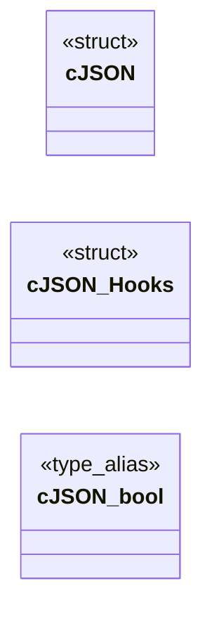
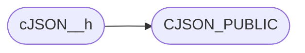

# `cJSON.h`

> Source: [cJSON.h:1](../../cJSON.h#L1) | language `h` | coverage 21.6% | [API index](../index.md)

## Contents

- **Structs:** [`cJSON`](#cjson), [`cJSON_Hooks`](#cjson_hooks)
- **Type Aliases:** [`cJSON_bool`](#cjson_bool)
- **Functions:** [`sensitive`](#sensitive)
- **Macros:** [`cJSON__h`](#cjson__h), [`__WINDOWS__`](#__windows__), [`CJSON_CDECL`](#cjson_cdecl), [`CJSON_STDCALL`](#cjson_stdcall), [`CJSON_EXPORT_SYMBOLS`](#cjson_export_symbols), [`CJSON_PUBLIC`](#cjson_public), [`CJSON_PUBLIC`](#cjson_public), [`CJSON_PUBLIC`](#cjson_public), [`CJSON_CDECL`](#cjson_cdecl), [`CJSON_STDCALL`](#cjson_stdcall), [`CJSON_PUBLIC`](#cjson_public), [`CJSON_PUBLIC`](#cjson_public), [`CJSON_VERSION_MAJOR`](#cjson_version_major), [`CJSON_VERSION_MINOR`](#cjson_version_minor), [`CJSON_VERSION_PATCH`](#cjson_version_patch), [`cJSON_Invalid`](#cjson_invalid), [`cJSON_False`](#cjson_false), [`cJSON_True`](#cjson_true), [`cJSON_NULL`](#cjson_null), [`cJSON_Number`](#cjson_number), [`cJSON_String`](#cjson_string), [`cJSON_Array`](#cjson_array), [`cJSON_Object`](#cjson_object), [`cJSON_Raw`](#cjson_raw), [`cJSON_IsReference`](#cjson_isreference), [`cJSON_StringIsConst`](#cjson_stringisconst), [`CJSON_NESTING_LIMIT`](#cjson_nesting_limit), [`CJSON_CIRCULAR_LIMIT`](#cjson_circular_limit), [`cJSON_SetIntValue`](#cjson_setintvalue), [`cJSON_SetNumberValue`](#cjson_setnumbervalue), [`cJSON_SetBoolValue`](#cjson_setboolvalue), [`cJSON_ArrayForEach`](#cjson_arrayforeach)
- **Variables:** [`next`](#next)

## Type Diagram



## Call Graph

Solid arrows stay in this module, dashed arrows leave it.



## Structs

<a id="cjson"></a>

### `cJSON`

`struct` | [cJSON.h:92](../../cJSON.h#L92)

```c
typedef struct cJSON
```

The cJSON structure:

---

<a id="cjson_hooks"></a>

### `cJSON_Hooks`

`struct` | [cJSON.h:114](../../cJSON.h#L114)

```c
typedef struct cJSON_Hooks
```

---

## Type Aliases

<a id="cjson_bool"></a>

### `cJSON_bool`

`type_alias` | [cJSON.h:120](../../cJSON.h#L120)

```c
typedef int cJSON_bool;
```

---

## Functions

<a id="sensitive"></a>

### `sensitive`

`function` | [cJSON.h:249](../../cJSON.h#L249)

```c
* case_sensitive determines if object keys are treated case sensitive (1) or case insensitive (0) */ CJSON_PUBLIC(cJSON_bool) cJSON_Compare(const cJSON * const a, const cJSON * const b, const cJSON_bo
```

**Parameters**

| Name | Type | Default | Description |
|---|---|---|---|
| `1` |  |  |  |

**Returns:** `* case_`

---

## Macros

<a id="cjson__h"></a>

### `cJSON__h`

`macro` | [cJSON.h:24](../../cJSON.h#L24)

```c
#define cJSON__h
```

*Calls:* [`CJSON_PUBLIC`](#cjson_public)

---

<a id="__windows__"></a>

### `__WINDOWS__`

`macro` | [cJSON.h:32](../../cJSON.h#L32)

```c
#define __WINDOWS__
```

---

<a id="cjson_cdecl"></a>

### `CJSON_CDECL`

`macro` | [cJSON.h:44](../../cJSON.h#L44)

```c
#define CJSON_CDECL
```

!__WINDOWS__

> **Inherited:** Documentation from [`CJSON_CDECL`](#cjson_cdecl) (cJSON.h:60).

---

<a id="cjson_stdcall"></a>

### `CJSON_STDCALL`

`macro` | [cJSON.h:45](../../cJSON.h#L45)

```c
#define CJSON_STDCALL
```

---

<a id="cjson_export_symbols"></a>

### `CJSON_EXPORT_SYMBOLS`

`macro` | [cJSON.h:49](../../cJSON.h#L49)

```c
#define CJSON_EXPORT_SYMBOLS
```

---

<a id="cjson_public"></a>

### `CJSON_PUBLIC`

`macro` | [cJSON.h:53](../../cJSON.h#L53)

```c
#define CJSON_PUBLIC(type)
```

*Called by:* [`cJSON__h`](#cjson__h)

---

<a id="cjson_public"></a>

### `CJSON_PUBLIC`

`macro` | [cJSON.h:55](../../cJSON.h#L55)

```c
#define CJSON_PUBLIC(type)
```

---

<a id="cjson_public"></a>

### `CJSON_PUBLIC`

`macro` | [cJSON.h:57](../../cJSON.h#L57)

```c
#define CJSON_PUBLIC(type)
```

---

<a id="cjson_cdecl"></a>

### `CJSON_CDECL`

`macro` | [cJSON.h:60](../../cJSON.h#L60)

```c
#define CJSON_CDECL
```

!__WINDOWS__

---

<a id="cjson_stdcall"></a>

### `CJSON_STDCALL`

`macro` | [cJSON.h:61](../../cJSON.h#L61)

```c
#define CJSON_STDCALL
```

---

<a id="cjson_public"></a>

### `CJSON_PUBLIC`

`macro` | [cJSON.h:64](../../cJSON.h#L64)

```c
#define CJSON_PUBLIC(type)
```

---

<a id="cjson_public"></a>

### `CJSON_PUBLIC`

`macro` | [cJSON.h:66](../../cJSON.h#L66)

```c
#define CJSON_PUBLIC(type)
```

---

<a id="cjson_version_major"></a>

### `CJSON_VERSION_MAJOR`

`macro` | [cJSON.h:71](../../cJSON.h#L71)

```c
#define CJSON_VERSION_MAJOR
```

project version

---

<a id="cjson_version_minor"></a>

### `CJSON_VERSION_MINOR`

`macro` | [cJSON.h:72](../../cJSON.h#L72)

```c
#define CJSON_VERSION_MINOR
```

---

<a id="cjson_version_patch"></a>

### `CJSON_VERSION_PATCH`

`macro` | [cJSON.h:73](../../cJSON.h#L73)

```c
#define CJSON_VERSION_PATCH
```

---

<a id="cjson_invalid"></a>

### `cJSON_Invalid`

`macro` | [cJSON.h:78](../../cJSON.h#L78)

```c
#define cJSON_Invalid
```

cJSON Types:

---

<a id="cjson_false"></a>

### `cJSON_False`

`macro` | [cJSON.h:79](../../cJSON.h#L79)

```c
#define cJSON_False
```

---

<a id="cjson_true"></a>

### `cJSON_True`

`macro` | [cJSON.h:80](../../cJSON.h#L80)

```c
#define cJSON_True
```

---

<a id="cjson_null"></a>

### `cJSON_NULL`

`macro` | [cJSON.h:81](../../cJSON.h#L81)

```c
#define cJSON_NULL
```

---

<a id="cjson_number"></a>

### `cJSON_Number`

`macro` | [cJSON.h:82](../../cJSON.h#L82)

```c
#define cJSON_Number
```

---

<a id="cjson_string"></a>

### `cJSON_String`

`macro` | [cJSON.h:83](../../cJSON.h#L83)

```c
#define cJSON_String
```

---

<a id="cjson_array"></a>

### `cJSON_Array`

`macro` | [cJSON.h:84](../../cJSON.h#L84)

```c
#define cJSON_Array
```

---

<a id="cjson_object"></a>

### `cJSON_Object`

`macro` | [cJSON.h:85](../../cJSON.h#L85)

```c
#define cJSON_Object
```

---

<a id="cjson_raw"></a>

### `cJSON_Raw`

`macro` | [cJSON.h:86](../../cJSON.h#L86)

```c
#define cJSON_Raw
```

---

<a id="cjson_isreference"></a>

### `cJSON_IsReference`

`macro` | [cJSON.h:88](../../cJSON.h#L88)

```c
#define cJSON_IsReference
```

---

<a id="cjson_stringisconst"></a>

### `cJSON_StringIsConst`

`macro` | [cJSON.h:89](../../cJSON.h#L89)

```c
#define cJSON_StringIsConst
```

---

<a id="cjson_nesting_limit"></a>

### `CJSON_NESTING_LIMIT`

`macro` | [cJSON.h:126](../../cJSON.h#L126)

```c
#define CJSON_NESTING_LIMIT
```

---

<a id="cjson_circular_limit"></a>

### `CJSON_CIRCULAR_LIMIT`

`macro` | [cJSON.h:132](../../cJSON.h#L132)

```c
#define CJSON_CIRCULAR_LIMIT
```

---

<a id="cjson_setintvalue"></a>

### `cJSON_SetIntValue`

`macro` | [cJSON.h:270](../../cJSON.h#L270)

```c
#define cJSON_SetIntValue(object, number)
```

When assigning an integer value, it needs to be propagated to valuedouble too.

---

<a id="cjson_setnumbervalue"></a>

### `cJSON_SetNumberValue`

`macro` | [cJSON.h:273](../../cJSON.h#L273)

```c
#define cJSON_SetNumberValue(object, number)
```

---

<a id="cjson_setboolvalue"></a>

### `cJSON_SetBoolValue`

`macro` | [cJSON.h:278](../../cJSON.h#L278)

```c
#define cJSON_SetBoolValue(object, boolValue)
```

If the object is not a boolean type this does nothing and returns cJSON_Invalid else it returns the new type

---

<a id="cjson_arrayforeach"></a>

### `cJSON_ArrayForEach`

`macro` | [cJSON.h:285](../../cJSON.h#L285)

```c
#define cJSON_ArrayForEach(element, array)
```

Macro for iterating over an array or object

---

## Variables

<a id="next"></a>

### `next`

`variable` `extern` | [cJSON.h:27](../../cJSON.h#L27)

```c
extern "C" { #endif #if !defined(__WINDOWS__) && (defined(WIN32) || defined(WIN64) || defined(_MSC_VER) || defined(_WIN32)) #define __WINDOWS__ #endif #ifdef __WINDOWS__ /* When compiling for windows,
```

ifdef __cplusplus

---
