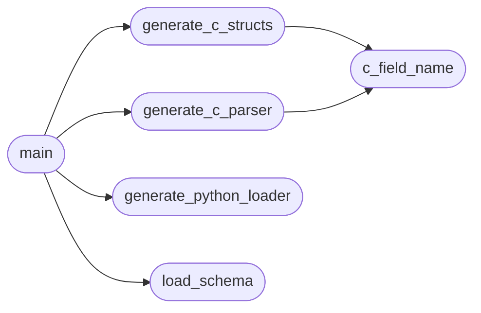

# `config.generate_parsers`

> Source: [config/generate_parsers.py:1](../../config/generate_parsers.py#L1) | language `py` | coverage 75.0% | [API index](../index.md)

Config Parser Generator for Black Sand Beacon

Reads config/schema.json (JSON Schema Draft 7) and generates:
1. include/config_autogen.h - C struct definitions
2. include/config_autogen.c - C parser implementation
3. include/config_py_autogen.py - Python config loader

This ensures C and Python parsers are always in sync.

## Contents

- **Functions:** [`load_schema`](#load_schema), [`c_type_from_schema`](#c_type_from_schema), [`c_field_name`](#c_field_name), [`generate_c_structs`](#generate_c_structs), [`generate_c_parser`](#generate_c_parser), [`generate_python_loader`](#generate_python_loader), [`main`](#main)
- **Constants:** [`ROOT`](#root), [`SCHEMA_PATH`](#schema_path), [`OUT_H`](#out_h), [`OUT_C`](#out_c), [`OUT_PY`](#out_py)

## Call Graph

Solid arrows stay in this module, dashed arrows leave it.



## Functions

<a id="load_schema"></a>

### `load_schema`

`function` | [config/generate_parsers.py:25](../../config/generate_parsers.py#L25)

```python
def load_schema() -> Dict[str, Any]
```

**Returns:** `Dict[str, Any]`

*Called by:* [`main`](#main)

---

<a id="c_type_from_schema"></a>

### `c_type_from_schema`

`function` | [config/generate_parsers.py:30](../../config/generate_parsers.py#L30)

```python
def c_type_from_schema(prop: Dict[str, Any], required: bool = True) -> str
```

Map JSON Schema type to C type.

**Parameters**

| Name | Type | Default | Description |
|---|---|---|---|
| `prop` | `Dict[str, Any]` |  |  |
| `required` | `bool` | `True` |  |

**Returns:** `str`

---

<a id="c_field_name"></a>

### `c_field_name`

`function` | [config/generate_parsers.py:48](../../config/generate_parsers.py#L48)

```python
def c_field_name(json_name: str) -> str
```

Convert JSON field name to C field name (snake_case).

**Parameters**

| Name | Type | Default | Description |
|---|---|---|---|
| `json_name` | `str` |  |  |

**Returns:** `str`

*Called by:* [`generate_c_parser`](#generate_c_parser), [`generate_c_structs`](#generate_c_structs)

---

<a id="generate_c_structs"></a>

### `generate_c_structs`

`function` | [config/generate_parsers.py:53](../../config/generate_parsers.py#L53)

```python
def generate_c_structs(schema: Dict[str, Any]) -> str
```

Generate C struct definitions from schema.

**Parameters**

| Name | Type | Default | Description |
|---|---|---|---|
| `schema` | `Dict[str, Any]` |  |  |

**Returns:** `str`

*Calls:* [`c_field_name`](#c_field_name)

*Called by:* [`main`](#main)

---

<a id="generate_c_parser"></a>

### `generate_c_parser`

`function` | [config/generate_parsers.py:136](../../config/generate_parsers.py#L136)

```python
def generate_c_parser(schema: Dict[str, Any]) -> str
```

Generate C parser implementation from schema.

**Parameters**

| Name | Type | Default | Description |
|---|---|---|---|
| `schema` | `Dict[str, Any]` |  |  |

**Returns:** `str`

*Calls:* [`c_field_name`](#c_field_name)

*Called by:* [`main`](#main)

---

<a id="generate_python_loader"></a>

### `generate_python_loader`

`function` | [config/generate_parsers.py:465](../../config/generate_parsers.py#L465)

```python
def generate_python_loader(schema: Dict[str, Any]) -> str
```

Generate Python config loader from schema.

**Parameters**

| Name | Type | Default | Description |
|---|---|---|---|
| `schema` | `Dict[str, Any]` |  |  |

**Returns:** `str`

*Called by:* [`main`](#main)

---

<a id="main"></a>

### `main`

`function` | [config/generate_parsers.py:615](../../config/generate_parsers.py#L615)

```python
def main()
```

*Calls:* [`generate_c_parser`](#generate_c_parser), [`generate_c_structs`](#generate_c_structs), [`generate_python_loader`](#generate_python_loader), [`load_schema`](#load_schema)

---

## Constants

<a id="root"></a>

### `ROOT`

`constant` | [config/generate_parsers.py:18](../../config/generate_parsers.py#L18)

```python
ROOT = Path(__file__).resolve().parent.parent
```

---

<a id="schema_path"></a>

### `SCHEMA_PATH`

`constant` | [config/generate_parsers.py:19](../../config/generate_parsers.py#L19)

```python
SCHEMA_PATH = ROOT / 'config' / 'schema.json'
```

---

<a id="out_h"></a>

### `OUT_H`

`constant` | [config/generate_parsers.py:20](../../config/generate_parsers.py#L20)

```python
OUT_H = ROOT / 'include' / 'config_autogen.h'
```

---

<a id="out_c"></a>

### `OUT_C`

`constant` | [config/generate_parsers.py:21](../../config/generate_parsers.py#L21)

```python
OUT_C = ROOT / 'include' / 'config_autogen.c'
```

---

<a id="out_py"></a>

### `OUT_PY`

`constant` | [config/generate_parsers.py:22](../../config/generate_parsers.py#L22)

```python
OUT_PY = ROOT / 'include' / 'config_py_autogen.py'
```

---
