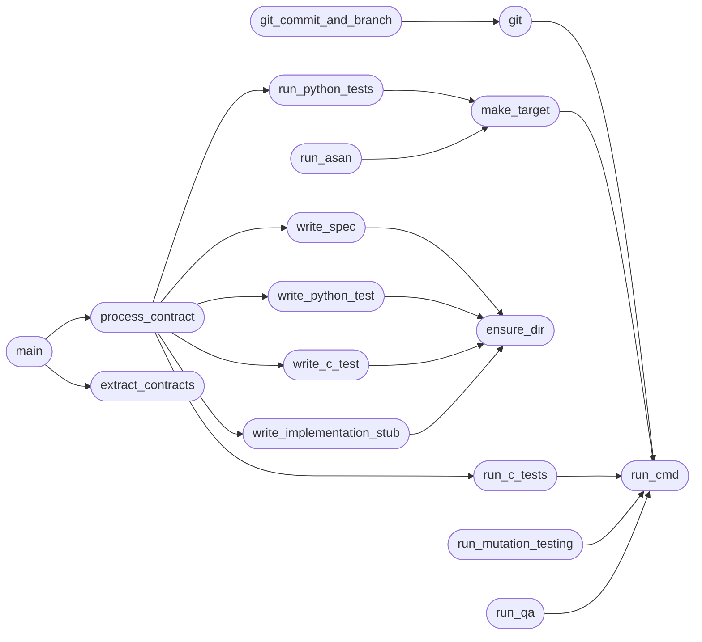

# `contract_agent`

> Source: [contract_agent.py:1](../../contract_agent.py#L1) | language `py` | coverage 77.8% | [API index](../index.md)

Contract Driven Agent - SDD/TDD/BDD workflow for Black Sand Beacon v2.

Reads CLAUDE.md contracts and executes the full workflow.

## Contents

- **Functions:** [`run_cmd`](#run_cmd), [`ensure_dir`](#ensure_dir), [`git`](#git), [`make_target`](#make_target), [`extract_contracts`](#extract_contracts), [`write_spec`](#write_spec), [`write_python_test`](#write_python_test), [`write_c_test`](#write_c_test), [`write_implementation_stub`](#write_implementation_stub), [`run_python_tests`](#run_python_tests), [`run_c_tests`](#run_c_tests), [`run_mutation_testing`](#run_mutation_testing), [`run_asan`](#run_asan), [`run_qa`](#run_qa), [`git_commit_and_branch`](#git_commit_and_branch), [`process_contract`](#process_contract), [`main`](#main)
- **Constants:** [`REPO_ROOT`](#repo_root), [`SPEC_DIR`](#spec_dir), [`TEST_DIR`](#test_dir), [`SRC_DIR`](#src_dir), [`INCLUDE_DIR`](#include_dir), [`MAKEFILE`](#makefile), [`CLAUDE_MD`](#claude_md)

## Call Graph

Solid arrows stay in this module, dashed arrows leave it.



## Functions

<a id="run_cmd"></a>

### `run_cmd`

`function` | [contract_agent.py:23](../../contract_agent.py#L23)

```python
def run_cmd(cmd: List[str], cwd: Path = REPO_ROOT) -> Tuple[int, str, str]
```

Run a command and return (exit_code, stdout, stderr).

**Parameters**

| Name | Type | Default | Description |
|---|---|---|---|
| `cmd` | `List[str]` |  |  |
| `cwd` | `Path` | `REPO_ROOT` |  |

**Returns:** `Tuple[int, str, str]`

*Called by:* [`git`](#git), [`make_target`](#make_target), [`run_c_tests`](#run_c_tests), [`run_mutation_testing`](#run_mutation_testing), [`run_qa`](#run_qa)

---

<a id="ensure_dir"></a>

### `ensure_dir`

`function` | [contract_agent.py:29](../../contract_agent.py#L29)

```python
def ensure_dir(path: Path)
```

**Parameters**

| Name | Type | Default | Description |
|---|---|---|---|
| `path` | `Path` |  |  |

*Called by:* [`write_c_test`](#write_c_test), [`write_implementation_stub`](#write_implementation_stub), [`write_python_test`](#write_python_test), [`write_spec`](#write_spec)

---

<a id="git"></a>

### `git`

`function` | [contract_agent.py:33](../../contract_agent.py#L33)

```python
def git(*args)
```

**Parameters**

| Name | Type | Default | Description |
|---|---|---|---|
| `*args` |  |  |  |

*Calls:* [`run_cmd`](#run_cmd)

*Called by:* [`git_commit_and_branch`](#git_commit_and_branch)

---

<a id="make_target"></a>

### `make_target`

`function` | [contract_agent.py:37](../../contract_agent.py#L37)

```python
def make_target(target: str)
```

**Parameters**

| Name | Type | Default | Description |
|---|---|---|---|
| `target` | `str` |  |  |

*Calls:* [`run_cmd`](#run_cmd)

*Called by:* [`run_asan`](#run_asan), [`run_python_tests`](#run_python_tests)

---

<a id="extract_contracts"></a>

### `extract_contracts`

`function` | [contract_agent.py:41](../../contract_agent.py#L41)

```python
def extract_contracts(claude_content: str) -> List[Tuple[str, str]]
```

Extract contracts from CLAUDE.md (## Contract: Name headings).

**Parameters**

| Name | Type | Default | Description |
|---|---|---|---|
| `claude_content` | `str` |  |  |

**Returns:** `List[Tuple[str, str]]`

*Called by:* [`main`](#main)

---

<a id="write_spec"></a>

### `write_spec`

`function` | [contract_agent.py:62](../../contract_agent.py#L62)

```python
def write_spec(contract_name: str, body: str)
```

Write spec/<contract_name>.md with SDD template.

**Parameters**

| Name | Type | Default | Description |
|---|---|---|---|
| `contract_name` | `str` |  |  |
| `body` | `str` |  |  |

*Calls:* [`ensure_dir`](#ensure_dir)

*Called by:* [`process_contract`](#process_contract)

---

<a id="write_python_test"></a>

### `write_python_test`

`function` | [contract_agent.py:96](../../contract_agent.py#L96)

```python
def write_python_test(contract_name: str, body: str)
```

Write a failing pytest test for the contract.

**Parameters**

| Name | Type | Default | Description |
|---|---|---|---|
| `contract_name` | `str` |  |  |
| `body` | `str` |  |  |

*Calls:* [`ensure_dir`](#ensure_dir)

*Called by:* [`process_contract`](#process_contract)

---

<a id="write_c_test"></a>

### `write_c_test`

`function` | [contract_agent.py:141](../../contract_agent.py#L141)

```python
def write_c_test(contract_name: str, body: str)
```

Write a failing CMocka test for C components.

**Parameters**

| Name | Type | Default | Description |
|---|---|---|---|
| `contract_name` | `str` |  |  |
| `body` | `str` |  |  |

*Calls:* [`ensure_dir`](#ensure_dir)

*Called by:* [`process_contract`](#process_contract)

---

<a id="write_implementation_stub"></a>

### `write_implementation_stub`

`function` | [contract_agent.py:179](../../contract_agent.py#L179)

```python
def write_implementation_stub(contract_name: str)
```

Write minimal C implementation stub.

**Parameters**

| Name | Type | Default | Description |
|---|---|---|---|
| `contract_name` | `str` |  |  |

*Calls:* [`ensure_dir`](#ensure_dir)

*Called by:* [`process_contract`](#process_contract)

---

<a id="run_python_tests"></a>

### `run_python_tests`

`function` | [contract_agent.py:213](../../contract_agent.py#L213)

```python
def run_python_tests() -> bool
```

Run pytest and return True if all pass.

**Returns:** `bool`

*Calls:* [`make_target`](#make_target)

*Called by:* [`process_contract`](#process_contract)

---

<a id="run_c_tests"></a>

### `run_c_tests`

`function` | [contract_agent.py:223](../../contract_agent.py#L223)

```python
def run_c_tests() -> bool
```

Run C tests via make test (assumes Makefile has C test targets).

**Returns:** `bool`

*Calls:* [`run_cmd`](#run_cmd)

*Called by:* [`process_contract`](#process_contract)

---

<a id="run_mutation_testing"></a>

### `run_mutation_testing`

`function` | [contract_agent.py:233](../../contract_agent.py#L233)

```python
def run_mutation_testing() -> bool
```

Run mutation testing with mutmut (Python) and custom (C).

**Returns:** `bool`

*Calls:* [`run_cmd`](#run_cmd)

---

<a id="run_asan"></a>

### `run_asan`

`function` | [contract_agent.py:256](../../contract_agent.py#L256)

```python
def run_asan() -> bool
```

Run AddressSanitizer build and tests.

**Returns:** `bool`

*Calls:* [`make_target`](#make_target)

---

<a id="run_qa"></a>

### `run_qa`

`function` | [contract_agent.py:266](../../contract_agent.py#L266)

```python
def run_qa() -> bool
```

Run static analysis (cppcheck).

**Returns:** `bool`

*Calls:* [`run_cmd`](#run_cmd)

---

<a id="git_commit_and_branch"></a>

### `git_commit_and_branch`

`function` | [contract_agent.py:275](../../contract_agent.py#L275)

```python
def git_commit_and_branch(contract_name: str)
```

Create a new branch, add changes, commit.

**Parameters**

| Name | Type | Default | Description |
|---|---|---|---|
| `contract_name` | `str` |  |  |

*Calls:* [`git`](#git)

---

<a id="process_contract"></a>

### `process_contract`

`function` | [contract_agent.py:289](../../contract_agent.py#L289)

```python
def process_contract(contract_name: str, body: str)
```

Execute the full SDD+TDD+BDD workflow for a single contract.

**Parameters**

| Name | Type | Default | Description |
|---|---|---|---|
| `contract_name` | `str` |  |  |
| `body` | `str` |  |  |

*Calls:* [`run_c_tests`](#run_c_tests), [`run_python_tests`](#run_python_tests), [`write_c_test`](#write_c_test), [`write_implementation_stub`](#write_implementation_stub), [`write_python_test`](#write_python_test), [`write_spec`](#write_spec)

*Called by:* [`main`](#main)

---

<a id="main"></a>

### `main`

`function` | [contract_agent.py:316](../../contract_agent.py#L316)

```python
def main()
```

*Calls:* [`extract_contracts`](#extract_contracts), [`process_contract`](#process_contract)

---

## Constants

<a id="repo_root"></a>

### `REPO_ROOT`

`constant` | [contract_agent.py:14](../../contract_agent.py#L14)

```python
REPO_ROOT = Path('/home/grisun0/src_note/c/blacksandbeacon')
```

---

<a id="spec_dir"></a>

### `SPEC_DIR`

`constant` | [contract_agent.py:15](../../contract_agent.py#L15)

```python
SPEC_DIR = REPO_ROOT / 'spec'
```

---

<a id="test_dir"></a>

### `TEST_DIR`

`constant` | [contract_agent.py:16](../../contract_agent.py#L16)

```python
TEST_DIR = REPO_ROOT / 'tests'
```

---

<a id="src_dir"></a>

### `SRC_DIR`

`constant` | [contract_agent.py:17](../../contract_agent.py#L17)

```python
SRC_DIR = REPO_ROOT / 'src'
```

---

<a id="include_dir"></a>

### `INCLUDE_DIR`

`constant` | [contract_agent.py:18](../../contract_agent.py#L18)

```python
INCLUDE_DIR = REPO_ROOT / 'include'
```

---

<a id="makefile"></a>

### `MAKEFILE`

`constant` | [contract_agent.py:19](../../contract_agent.py#L19)

```python
MAKEFILE = REPO_ROOT / 'Makefile'
```

---

<a id="claude_md"></a>

### `CLAUDE_MD`

`constant` | [contract_agent.py:20](../../contract_agent.py#L20)

```python
CLAUDE_MD = REPO_ROOT / 'CLAUDE.md'
```

---
