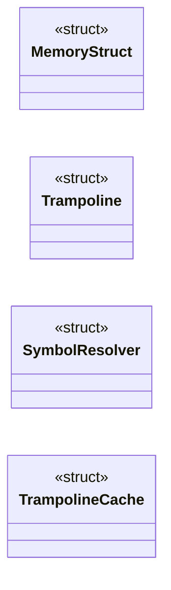
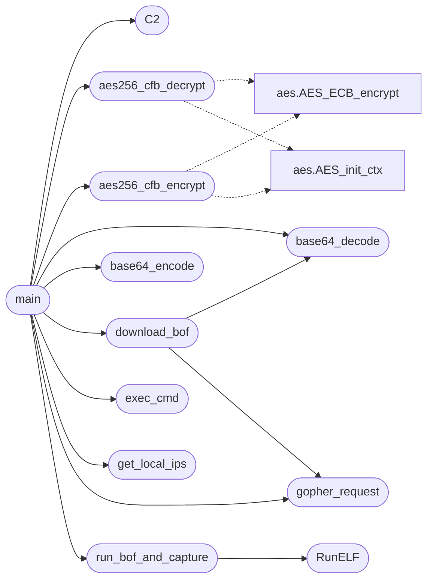

# `gopher_beacon.c`

> Source: [gopher_beacon.c:1](../../gopher_beacon.c#L1) | language `c` | coverage 60.9% | [API index](../index.md)

## Contents

- **Structs:** [`MemoryStruct`](#memorystruct), [`Trampoline`](#trampoline), [`SymbolResolver`](#symbolresolver), [`TrampolineCache`](#trampolinecache)
- **Functions:** [`BeaconPrintf`](#beaconprintf), [`BeaconOutput`](#beaconoutput), [`gopher_request`](#gopher_request), [`base64_encode`](#base64_encode), [`base64_decode`](#base64_decode), [`aes256_cfb_encrypt`](#aes256_cfb_encrypt), [`aes256_cfb_decrypt`](#aes256_cfb_decrypt), [`exec_cmd`](#exec_cmd), [`RunELF`](#runelf), [`get_local_ips`](#get_local_ips), [`download_bof`](#download_bof), [`run_bof_and_capture`](#run_bof_and_capture), [`main`](#main)
- **Macros:** [`_GNU_SOURCE`](#_gnu_source), [`C2`](#c2), [`CLIENT_ID`](#client_id), [`MALEABLE`](#maleable), [`USER_AGENTS_COUNT`](#user_agents_count)

## Type Diagram



## Call Graph

Solid arrows stay in this module, dashed arrows leave it.



## Structs

<a id="memorystruct"></a>

### `MemoryStruct`

`struct` | [gopher_beacon.c:47](../../gopher_beacon.c#L47)

```c
struct MemoryStruct
```

=== ESTRUCTURAS ===

---

<a id="trampoline"></a>

### `Trampoline`

`struct` | [gopher_beacon.c:54](../../gopher_beacon.c#L54)

```c
typedef struct
```

=== TRAMPOLINES ===

---

<a id="symbolresolver"></a>

### `SymbolResolver`

`struct` | [gopher_beacon.c:62](../../gopher_beacon.c#L62)

```c
typedef struct
```

---

<a id="trampolinecache"></a>

### `TrampolineCache`

`struct` | [gopher_beacon.c:68](../../gopher_beacon.c#L68)

```c
typedef struct
```

=== CACHE DE TRAMPOLINES ===

---

## Functions

<a id="beaconprintf"></a>

### `BeaconPrintf`

`function` | [gopher_beacon.c:190](../../gopher_beacon.c#L190)

```c
void BeaconPrintf(int type, const char *fmt, ...)
```

=== BEACON API ===

**Parameters**

| Name | Type | Default | Description |
|---|---|---|---|
| `type` | `int` |  |  |
| `fmt` | `char *` |  |  |
| `...` |  |  |  |

---

<a id="beaconoutput"></a>

### `BeaconOutput`

`function` | [gopher_beacon.c:203](../../gopher_beacon.c#L203)

```c
void BeaconOutput(int type, const char *data, int len)
```

Beacon API: raw output capture (called by BOFs).

**Parameters**

| Name | Type | Default | Description |
|---|---|---|---|
| `type` | `int` |  |  |
| `data` | `char *` |  |  |
| `len` | `int` |  |  |

> **Inherited:** Documentation from [`BeaconOutput`](#beaconoutput) (include/beacon_common.h:105).

---

<a id="gopher_request"></a>

### `gopher_request`

`function` | [gopher_beacon.c:314](../../gopher_beacon.c#L314)

```c
char* gopher_request(const char* host, int port, const char* selector, const char* method, const char* post_data)
```

=== GOPHER REQUEST () ===

**Parameters**

| Name | Type | Default | Description |
|---|---|---|---|
| `host` | `char*` |  |  |
| `port` | `int` |  |  |
| `selector` | `char*` |  |  |
| `method` | `char*` |  |  |
| `post_data` | `char*` |  |  |

**Returns:** `char*`

*Called by:* [`download_bof`](#download_bof), [`main`](#main)

---

<a id="base64_encode"></a>

### `base64_encode`

`function` | [gopher_beacon.c:377](../../gopher_beacon.c#L377)

```c
char* base64_encode(const unsigned char* input, int len)
```

=== BASE64 ===

**Parameters**

| Name | Type | Default | Description |
|---|---|---|---|
| `input` | `unsigned char*` |  |  |
| `len` | `int` |  |  |

**Returns:** `char*`

*Called by:* [`main`](#main)

---

<a id="base64_decode"></a>

### `base64_decode`

`function` | [gopher_beacon.c:394](../../gopher_beacon.c#L394)

```c
unsigned char* base64_decode(const char* input, int* len)
```

**Parameters**

| Name | Type | Default | Description |
|---|---|---|---|
| `input` | `char*` |  |  |
| `len` | `int*` |  |  |

**Returns:** `unsigned char*`

*Called by:* [`download_bof`](#download_bof), [`main`](#main)

---

<a id="aes256_cfb_encrypt"></a>

### `aes256_cfb_encrypt`

`function` | [gopher_beacon.c:417](../../gopher_beacon.c#L417)

```c
unsigned char* aes256_cfb_encrypt(const unsigned char* key, const unsigned char* iv, const unsigned char* plaintext, size_t len, int* out_len)
```

=== AES CFB ===

**Parameters**

| Name | Type | Default | Description |
|---|---|---|---|
| `key` | `unsigned char*` |  |  |
| `iv` | `unsigned char*` |  |  |
| `plaintext` | `unsigned char*` |  |  |
| `len` | `size_t` |  |  |
| `out_len` | `int*` |  |  |

**Returns:** `unsigned char*`

*Calls:* [`AES_ECB_encrypt`](aes.h.md#aes_ecb_encrypt), [`AES_init_ctx`](aes.h.md#aes_init_ctx)

*Called by:* [`main`](#main)

---

<a id="aes256_cfb_decrypt"></a>

### `aes256_cfb_decrypt`

`function` | [gopher_beacon.c:445](../../gopher_beacon.c#L445)

```c
unsigned char* aes256_cfb_decrypt(const unsigned char* key, const unsigned char* iv, const unsigned char* ciphertext, size_t len, int* out_len)
```

**Parameters**

| Name | Type | Default | Description |
|---|---|---|---|
| `key` | `unsigned char*` |  |  |
| `iv` | `unsigned char*` |  |  |
| `ciphertext` | `unsigned char*` |  |  |
| `len` | `size_t` |  |  |
| `out_len` | `int*` |  |  |

**Returns:** `unsigned char*`

*Calls:* [`AES_ECB_encrypt`](aes.h.md#aes_ecb_encrypt), [`AES_init_ctx`](aes.h.md#aes_init_ctx)

*Called by:* [`main`](#main)

---

<a id="exec_cmd"></a>

### `exec_cmd`

`function` | [gopher_beacon.c:475](../../gopher_beacon.c#L475)

```c
char* exec_cmd(const char* cmd, int* out_len)
```

=== EXEC CMD ===

**Parameters**

| Name | Type | Default | Description |
|---|---|---|---|
| `cmd` | `char*` |  |  |
| `out_len` | `int*` |  |  |

**Returns:** `char*`

*Called by:* [`main`](#main)

---

<a id="runelf"></a>

### `RunELF`

`function` | [gopher_beacon.c:512](../../gopher_beacon.c#L512)

```c
int RunELF(const char* functionname, unsigned char* elf_data, uint32_t filesize, unsigned char* argumentdata, int argumentSize)
```

ELF BOF loader.

Loads a position-independent ELF object into memory, resolves symbols, applies relocations, and calls the entry function in a forked child process for crash isolation. Returns 0 on success, -1 on error. BOF output is captured into g_beacon_output.

**Parameters**

| Name | Type | Default | Description |
|---|---|---|---|
| `functionname` | `char*` |  |  |
| `elf_data` | `unsigned char*` |  |  |
| `filesize` | `uint32_t` |  |  |
| `argumentdata` | `unsigned char*` |  |  |
| `argumentSize` | `int` |  |  |

**Returns:** `int`

> **Inherited:** Documentation from [`RunELF`](#runelf) (include/beacon_common.h:147).

*Called by:* [`run_bof_and_capture`](#run_bof_and_capture)

---

<a id="get_local_ips"></a>

### `get_local_ips`

`function` | [gopher_beacon.c:893](../../gopher_beacon.c#L893)

```c
char* get_local_ips()
```

=== GET LOCAL IPs ===

**Returns:** `char*`

*Called by:* [`main`](#main)

---

<a id="download_bof"></a>

### `download_bof`

`function` | [gopher_beacon.c:922](../../gopher_beacon.c#L922)

```c
unsigned char* download_bof(const char* bof_selector, size_t* out_size)
```

=== DOWNLOAD BOF ===

**Parameters**

| Name | Type | Default | Description |
|---|---|---|---|
| `bof_selector` | `char*` |  |  |
| `out_size` | `size_t*` |  |  |

**Returns:** `unsigned char*`

*Calls:* [`base64_decode`](#base64_decode), [`gopher_request`](#gopher_request)

*Called by:* [`main`](#main)

---

<a id="run_bof_and_capture"></a>

### `run_bof_and_capture`

`function` | [gopher_beacon.c:950](../../gopher_beacon.c#L950)

```c
char* run_bof_and_capture(unsigned char* elf_data, uint32_t filesize, char* args, int arglen, int* out_len)
```

=== RUN BOF AND CAPTURE ===

**Parameters**

| Name | Type | Default | Description |
|---|---|---|---|
| `elf_data` | `unsigned char*` |  |  |
| `filesize` | `uint32_t` |  |  |
| `args` | `char*` |  |  |
| `arglen` | `int` |  |  |
| `out_len` | `int*` |  |  |

**Returns:** `char*`

*Calls:* [`RunELF`](#runelf)

*Called by:* [`main`](#main)

---

<a id="main"></a>

### `main`

`function` | [gopher_beacon.c:994](../../gopher_beacon.c#L994)

```c
int main()
```

=== MAIN ===

**Returns:** `int`

*Calls:* [`C2`](#c2), [`aes256_cfb_decrypt`](#aes256_cfb_decrypt), [`aes256_cfb_encrypt`](#aes256_cfb_encrypt), [`base64_decode`](#base64_decode), [`base64_encode`](#base64_encode), [`download_bof`](#download_bof), [`exec_cmd`](#exec_cmd), [`get_local_ips`](#get_local_ips), [`gopher_request`](#gopher_request), [`run_bof_and_capture`](#run_bof_and_capture)

---

## Macros

<a id="_gnu_source"></a>

### `_GNU_SOURCE`

`macro` | [gopher_beacon.c:1](../../gopher_beacon.c#L1)

```c
#define _GNU_SOURCE
```

---

<a id="c2"></a>

### `C2`

`macro` | [gopher_beacon.c:30](../../gopher_beacon.c#L30)

```c
#define C2
```

*Called by:* [`main`](#main)

---

<a id="client_id"></a>

### `CLIENT_ID`

`macro` | [gopher_beacon.c:31](../../gopher_beacon.c#L31)

```c
#define CLIENT_ID
```

---

<a id="maleable"></a>

### `MALEABLE`

`macro` | [gopher_beacon.c:32](../../gopher_beacon.c#L32)

```c
#define MALEABLE
```

---

<a id="user_agents_count"></a>

### `USER_AGENTS_COUNT`

`macro` | [gopher_beacon.c:33](../../gopher_beacon.c#L33)

```c
#define USER_AGENTS_COUNT
```

---
