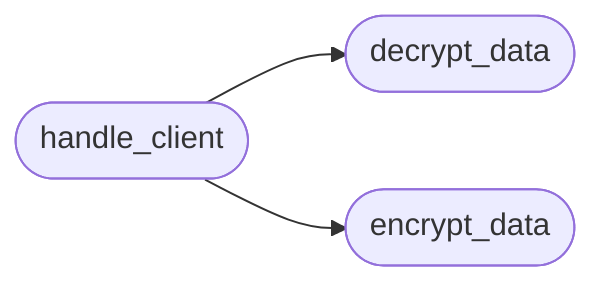

# `gopher_c2`

> Source: [gopher_c2.py:1](../../gopher_c2.py#L1) | language `py` | coverage 0.0% | [API index](../index.md)

## Contents

- **Functions:** [`encrypt_data`](#encrypt_data), [`decrypt_data`](#decrypt_data), [`handle_client`](#handle_client), [`main`](#main)
- **Constants:** [`HOST`](#host), [`PORT`](#port), [`AES_KEY`](#aes_key), [`ALLOWED_DIR`](#allowed_dir), [`UPLOAD_DIR`](#upload_dir)

## Call Graph

Solid arrows stay in this module, dashed arrows leave it.



## Functions

<a id="encrypt_data"></a>

### `encrypt_data`

`function` | [gopher_c2.py:28](../../gopher_c2.py#L28)

```python
def encrypt_data(data: bytes) -> str
```

**Parameters**

| Name | Type | Default | Description |
|---|---|---|---|
| `data` | `bytes` |  |  |

**Returns:** `str`

*Called by:* [`handle_client`](#handle_client)

---

<a id="decrypt_data"></a>

### `decrypt_data`

`function` | [gopher_c2.py:37](../../gopher_c2.py#L37)

```python
def decrypt_data(b64_data: str) -> bytes
```

**Parameters**

| Name | Type | Default | Description |
|---|---|---|---|
| `b64_data` | `str` |  |  |

**Returns:** `bytes`

*Called by:* [`handle_client`](#handle_client)

---

<a id="handle_client"></a>

### `handle_client`

`function` | [gopher_c2.py:45](../../gopher_c2.py#L45)

```python
def handle_client(conn, addr)
```

**Parameters**

| Name | Type | Default | Description |
|---|---|---|---|
| `conn` |  |  |  |
| `addr` |  |  |  |

*Calls:* [`decrypt_data`](#decrypt_data), [`encrypt_data`](#encrypt_data)

---

<a id="main"></a>

### `main`

`function` | [gopher_c2.py:127](../../gopher_c2.py#L127)

```python
def main()
```

---

## Constants

<a id="host"></a>

### `HOST`

`constant` | [gopher_c2.py:14](../../gopher_c2.py#L14)

```python
HOST = '0.0.0.0'
```

---

<a id="port"></a>

### `PORT`

`constant` | [gopher_c2.py:15](../../gopher_c2.py#L15)

```python
PORT = 7070
```

---

<a id="aes_key"></a>

### `AES_KEY`

`constant` | [gopher_c2.py:16](../../gopher_c2.py#L16)

```python
AES_KEY
```

---

<a id="allowed_dir"></a>

### `ALLOWED_DIR`

`constant` | [gopher_c2.py:17](../../gopher_c2.py#L17)

```python
ALLOWED_DIR = 'sessions/logs'
```

---

<a id="upload_dir"></a>

### `UPLOAD_DIR`

`constant` | [gopher_c2.py:18](../../gopher_c2.py#L18)

```python
UPLOAD_DIR = 'sessions/uploads'
```

---
