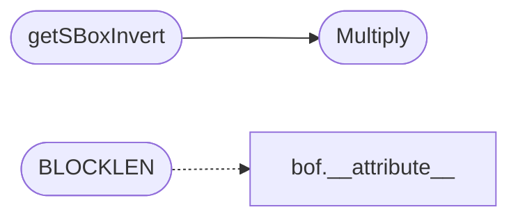

# `include/aes.c`

> Source: [include/aes.c:1](../../include/aes.c#L1) | language `c` | coverage 33.3% | [API index](../index.md)

aes.c - tiny-AES-c (https://github.com/kokke/tiny-AES-c)

## Contents

- **Functions:** [`AES_init_ctx`](#aes_init_ctx), [`AES_init_ctx_iv`](#aes_init_ctx_iv), [`AES_ctx_set_iv`](#aes_ctx_set_iv), [`AES_ECB_encrypt`](#aes_ecb_encrypt), [`AES_ECB_decrypt`](#aes_ecb_decrypt), [`AES_CBC_encrypt_buffer`](#aes_cbc_encrypt_buffer), [`AES_CBC_decrypt_buffer`](#aes_cbc_decrypt_buffer), [`AES_CTR_xcrypt_buffer`](#aes_ctr_xcrypt_buffer)
- **Macros:** [`Nb`](#nb), [`KEYLEN_256`](#keylen_256), [`RKLENGTH`](#rklength), [`BLOCKLEN`](#blocklen), [`Nb`](#nb), [`Nk`](#nk), [`Nr`](#nr), [`Nk`](#nk), [`Nr`](#nr), [`Nk`](#nk), [`Nr`](#nr), [`MULTIPLY_AS_A_FUNCTION`](#multiply_as_a_function), [`getSBoxValue`](#getsboxvalue), [`Multiply`](#multiply), [`getSBoxInvert`](#getsboxinvert)

## Call Graph

Solid arrows stay in this module, dashed arrows leave it.



## Functions

<a id="aes_init_ctx"></a>

### `AES_init_ctx`

`function` | [include/aes.c:254](../../include/aes.c#L254)

```c
void AES_init_ctx(struct AES_ctx *ctx, const uint8_t *key)
```

**Parameters**

| Name | Type | Default | Description |
|---|---|---|---|
| `ctx` | `struct AES_ctx *` |  |  |
| `key` | `uint8_t *` |  |  |

---

<a id="aes_init_ctx_iv"></a>

### `AES_init_ctx_iv`

`function` | [include/aes.c:259](../../include/aes.c#L259)

```c
void AES_init_ctx_iv(struct AES_ctx *ctx, const uint8_t *key, const uint8_t *iv)
```

if (defined(CBC) && (CBC == 1)) || (defined(CTR) && (CTR == 1))

**Parameters**

| Name | Type | Default | Description |
|---|---|---|---|
| `ctx` | `struct AES_ctx *` |  |  |
| `key` | `uint8_t *` |  |  |
| `iv` | `uint8_t *` |  |  |

---

<a id="aes_ctx_set_iv"></a>

### `AES_ctx_set_iv`

`function` | [include/aes.c:264](../../include/aes.c#L264)

```c
void AES_ctx_set_iv(struct AES_ctx *ctx, const uint8_t *iv)
```

**Parameters**

| Name | Type | Default | Description |
|---|---|---|---|
| `ctx` | `struct AES_ctx *` |  |  |
| `iv` | `uint8_t *` |  |  |

---

<a id="aes_ecb_encrypt"></a>

### `AES_ECB_encrypt`

`function` | [include/aes.c:512](../../include/aes.c#L512)

```c
void AES_ECB_encrypt(const struct AES_ctx *ctx, uint8_t *buf)
```

if defined(ECB) && (ECB == 1)

**Parameters**

| Name | Type | Default | Description |
|---|---|---|---|
| `ctx` | `struct AES_ctx *` |  |  |
| `buf` | `uint8_t *` |  |  |

> **Inherited:** Documentation from [`AES_ECB_encrypt`](#aes_ecb_encrypt) (aes.h:48).

---

<a id="aes_ecb_decrypt"></a>

### `AES_ECB_decrypt`

`function` | [include/aes.c:518](../../include/aes.c#L518)

```c
void AES_ECB_decrypt(const struct AES_ctx *ctx, uint8_t *buf)
```

**Parameters**

| Name | Type | Default | Description |
|---|---|---|---|
| `ctx` | `struct AES_ctx *` |  |  |
| `buf` | `uint8_t *` |  |  |

---

<a id="aes_cbc_encrypt_buffer"></a>

### `AES_CBC_encrypt_buffer`

`function` | [include/aes.c:537](../../include/aes.c#L537)

```c
void AES_CBC_encrypt_buffer(struct AES_ctx *ctx, uint8_t *buf, size_t length)
```

if defined(CBC) && (CBC == 1)

**Parameters**

| Name | Type | Default | Description |
|---|---|---|---|
| `ctx` | `struct AES_ctx *` |  |  |
| `buf` | `uint8_t *` |  |  |
| `length` | `size_t` |  |  |

> **Inherited:** Documentation from [`AES_CBC_encrypt_buffer`](#aes_cbc_encrypt_buffer) (aes.h:53).

---

<a id="aes_cbc_decrypt_buffer"></a>

### `AES_CBC_decrypt_buffer`

`function` | [include/aes.c:552](../../include/aes.c#L552)

```c
void AES_CBC_decrypt_buffer(struct AES_ctx *ctx, uint8_t *buf, size_t length)
```

**Parameters**

| Name | Type | Default | Description |
|---|---|---|---|
| `ctx` | `struct AES_ctx *` |  |  |
| `buf` | `uint8_t *` |  |  |
| `length` | `size_t` |  |  |

---

<a id="aes_ctr_xcrypt_buffer"></a>

### `AES_CTR_xcrypt_buffer`

`function` | [include/aes.c:572](../../include/aes.c#L572)

```c
void AES_CTR_xcrypt_buffer(struct AES_ctx *ctx, uint8_t *buf, size_t length)
```

Symmetrical operation: same function for encrypting as for decrypting.

Note any IV/nonce should never be reused with the same key

**Parameters**

| Name | Type | Default | Description |
|---|---|---|---|
| `ctx` | `struct AES_ctx *` |  |  |
| `buf` | `uint8_t *` |  |  |
| `length` | `size_t` |  |  |

---

## Macros

<a id="nb"></a>

### `Nb`

`macro` | [include/aes.c:5](../../include/aes.c#L5)

```c
#define Nb
```

---

<a id="keylen_256"></a>

### `KEYLEN_256`

`macro` | [include/aes.c:7](../../include/aes.c#L7)

```c
#define KEYLEN_256
```

---

<a id="rklength"></a>

### `RKLENGTH`

`macro` | [include/aes.c:8](../../include/aes.c#L8)

```c
#define RKLENGTH
```

---

<a id="blocklen"></a>

### `BLOCKLEN`

`macro` | [include/aes.c:9](../../include/aes.c#L9)

```c
#define BLOCKLEN
```

*Calls:* [`__attribute__`](bof.c.md#__attribute__)

---

<a id="nb"></a>

### `Nb`

`macro` | [include/aes.c:84](../../include/aes.c#L84)

```c
#define Nb
```

The number of columns comprising a state in AES.

This is a constant in AES. Value=4

---

<a id="nk"></a>

### `Nk`

`macro` | [include/aes.c:87](../../include/aes.c#L87)

```c
#define Nk
```

---

<a id="nr"></a>

### `Nr`

`macro` | [include/aes.c:88](../../include/aes.c#L88)

```c
#define Nr
```

---

<a id="nk"></a>

### `Nk`

`macro` | [include/aes.c:90](../../include/aes.c#L90)

```c
#define Nk
```

---

<a id="nr"></a>

### `Nr`

`macro` | [include/aes.c:91](../../include/aes.c#L91)

```c
#define Nr
```

---

<a id="nk"></a>

### `Nk`

`macro` | [include/aes.c:93](../../include/aes.c#L93)

```c
#define Nk
```

---

<a id="nr"></a>

### `Nr`

`macro` | [include/aes.c:94](../../include/aes.c#L94)

```c
#define Nr
```

---

<a id="multiply_as_a_function"></a>

### `MULTIPLY_AS_A_FUNCTION`

`macro` | [include/aes.c:101](../../include/aes.c#L101)

```c
#define MULTIPLY_AS_A_FUNCTION
```

---

<a id="getsboxvalue"></a>

### `getSBoxValue`

`macro` | [include/aes.c:177](../../include/aes.c#L177)

```c
#define getSBoxValue(num)
```

static uint8_t getSBoxValue(uint8_t num) { return sbox[num]; }

---

<a id="multiply"></a>

### `Multiply`

`macro` | [include/aes.c:371](../../include/aes.c#L371)

```c
#define Multiply(x, y)
```

*Called by:* [`getSBoxInvert`](#getsboxinvert)

---

<a id="getsboxinvert"></a>

### `getSBoxInvert`

`macro` | [include/aes.c:384](../../include/aes.c#L384)

```c
#define getSBoxInvert(num)
```

static uint8_t getSBoxInvert(uint8_t num) { return rsbox[num]; }

*Calls:* [`Multiply`](#multiply)

---
