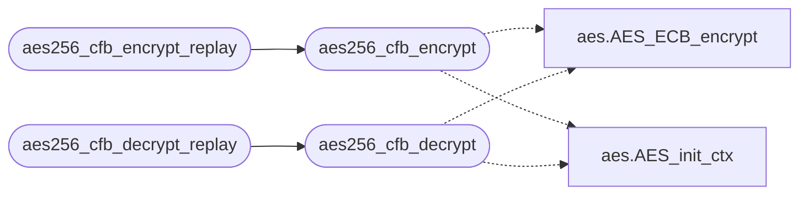

# `include/aes_cfb.c`

> Source: [include/aes_cfb.c:1](../../include/aes_cfb.c#L1) | language `c` | coverage 60.0% | [API index](../index.md)

## Contents

- **Functions:** [`aes256_cfb_encrypt`](#aes256_cfb_encrypt), [`aes256_cfb_decrypt`](#aes256_cfb_decrypt), [`aes256_cfb_encrypt_replay`](#aes256_cfb_encrypt_replay), [`aes256_cfb_decrypt_replay`](#aes256_cfb_decrypt_replay)

## Call Graph

Solid arrows stay in this module, dashed arrows leave it.



## Functions

<a id="aes256_cfb_encrypt"></a>

### `aes256_cfb_encrypt`

`function` | [include/aes_cfb.c:21](../../include/aes_cfb.c#L21)

```c
unsigned char *aes256_cfb_encrypt(const unsigned char *key, const unsigned char *iv, const unsigned char *plaintext, size_t len, int *out_len)
```

AES-256-CFB encrypt/decrypt (standalone, no OpenSSL dependency)

**Parameters**

| Name | Type | Default | Description |
|---|---|---|---|
| `key` | `unsigned char *` |  |  |
| `iv` | `unsigned char *` |  |  |
| `plaintext` | `unsigned char *` |  |  |
| `len` | `size_t` |  |  |
| `out_len` | `int *` |  |  |

**Returns:** `unsigned char *`

> **Inherited:** Documentation from [`aes256_cfb_encrypt`](#aes256_cfb_encrypt) (include/beacon_common.h:134).

*Calls:* [`AES_ECB_encrypt`](include.aes.h.md#aes_ecb_encrypt), [`AES_init_ctx`](include.aes.h.md#aes_init_ctx)

*Called by:* [`aes256_cfb_encrypt_replay`](#aes256_cfb_encrypt_replay)

---

<a id="aes256_cfb_decrypt"></a>

### `aes256_cfb_decrypt`

`function` | [include/aes_cfb.c:55](../../include/aes_cfb.c#L55)

```c
unsigned char *aes256_cfb_decrypt(const unsigned char *key, const unsigned char *iv, const unsigned char *ciphertext, size_t len, int *out_len)
```

**Parameters**

| Name | Type | Default | Description |
|---|---|---|---|
| `key` | `unsigned char *` |  |  |
| `iv` | `unsigned char *` |  |  |
| `ciphertext` | `unsigned char *` |  |  |
| `len` | `size_t` |  |  |
| `out_len` | `int *` |  |  |

**Returns:** `unsigned char *`

*Calls:* [`AES_ECB_encrypt`](include.aes.h.md#aes_ecb_encrypt), [`AES_init_ctx`](include.aes.h.md#aes_init_ctx)

*Called by:* [`aes256_cfb_decrypt_replay`](#aes256_cfb_decrypt_replay)

---

<a id="aes256_cfb_encrypt_replay"></a>

### `aes256_cfb_encrypt_replay`

`function` | [include/aes_cfb.c:94](../../include/aes_cfb.c#L94)

```c
unsigned char *aes256_cfb_encrypt_replay(const unsigned char *key, const unsigned char *iv, const unsigned char *plaintext, size_t len, uint64_t counter, uint64_t timestamp, int *out_len)
```

Encrypt with replay protection: prepends counter (8 bytes LE) and timestamp (8 bytes LE) to plaintext before AES-CFB encryption.

Returns malloc'd buffer (caller frees).

**Parameters**

| Name | Type | Default | Description |
|---|---|---|---|
| `key` | `unsigned char *` |  |  |
| `iv` | `unsigned char *` |  |  |
| `plaintext` | `unsigned char *` |  |  |
| `len` | `size_t` |  |  |
| `counter` | `uint64_t` |  |  |
| `timestamp` | `uint64_t` |  |  |
| `out_len` | `int *` |  |  |

**Returns:** `unsigned char *`

*Calls:* [`aes256_cfb_encrypt`](#aes256_cfb_encrypt)

---

<a id="aes256_cfb_decrypt_replay"></a>

### `aes256_cfb_decrypt_replay`

`function` | [include/aes_cfb.c:126](../../include/aes_cfb.c#L126)

```c
unsigned char *aes256_cfb_decrypt_replay(const unsigned char *key, const unsigned char *iv, const unsigned char *ciphertext, size_t len, uint64_t *out_counter, uint64_t *out_timestamp, int *out_len)
```

Decrypt with replay protection: decrypts ciphertext, extracts counter and timestamp.

Returns malloc'd plaintext (without counter/timestamp), sets *out_counter and *out_timestamp. Returns NULL on decryption failure.

**Parameters**

| Name | Type | Default | Description |
|---|---|---|---|
| `key` | `unsigned char *` |  |  |
| `iv` | `unsigned char *` |  |  |
| `ciphertext` | `unsigned char *` |  |  |
| `len` | `size_t` |  |  |
| `out_counter` | `uint64_t *` |  |  |
| `out_timestamp` | `uint64_t *` |  |  |
| `out_len` | `int *` |  |  |

**Returns:** `unsigned char *`

*Calls:* [`aes256_cfb_decrypt`](#aes256_cfb_decrypt)

---
