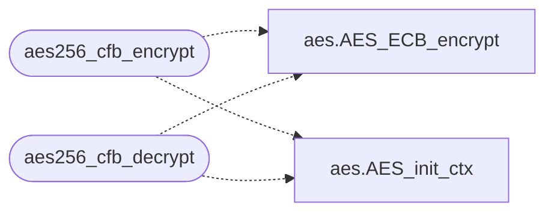

# `include/aes_cfb.c`

> Source: [include/aes_cfb.c:1](../../include/aes_cfb.c#L1) | language `c` | coverage 33.3% | [API index](../index.md)

## Contents

- **Functions:** [`aes256_cfb_encrypt`](#aes256_cfb_encrypt), [`aes256_cfb_decrypt`](#aes256_cfb_decrypt)

## Call Graph

Solid arrows stay in this module, dashed arrows leave it.



## Functions

<a id="aes256_cfb_encrypt"></a>

### `aes256_cfb_encrypt`

`function` | [include/aes_cfb.c:20](../../include/aes_cfb.c#L20)

```c
unsigned char* aes256_cfb_encrypt(const unsigned char* key, const unsigned char* iv, const unsigned char* plaintext, size_t len, int* out_len)
```

AES-256-CFB encrypt/decrypt (standalone, no OpenSSL dependency)

**Parameters**

| Name | Type | Default | Description |
|---|---|---|---|
| `key` | `unsigned char*` |  |  |
| `iv` | `unsigned char*` |  |  |
| `plaintext` | `unsigned char*` |  |  |
| `len` | `size_t` |  |  |
| `out_len` | `int*` |  |  |

**Returns:** `unsigned char*`

> **Inherited:** Documentation from [`aes256_cfb_encrypt`](#aes256_cfb_encrypt) (include/beacon_common.h:129).

*Calls:* [`AES_ECB_encrypt`](include.aes.h.md#aes_ecb_encrypt), [`AES_init_ctx`](include.aes.h.md#aes_init_ctx)

---

<a id="aes256_cfb_decrypt"></a>

### `aes256_cfb_decrypt`

`function` | [include/aes_cfb.c:48](../../include/aes_cfb.c#L48)

```c
unsigned char* aes256_cfb_decrypt(const unsigned char* key, const unsigned char* iv, const unsigned char* ciphertext, size_t len, int* out_len)
```

**Parameters**

| Name | Type | Default | Description |
|---|---|---|---|
| `key` | `unsigned char*` |  |  |
| `iv` | `unsigned char*` |  |  |
| `ciphertext` | `unsigned char*` |  |  |
| `len` | `size_t` |  |  |
| `out_len` | `int*` |  |  |

**Returns:** `unsigned char*`

*Calls:* [`AES_ECB_encrypt`](include.aes.h.md#aes_ecb_encrypt), [`AES_init_ctx`](include.aes.h.md#aes_init_ctx)

---
