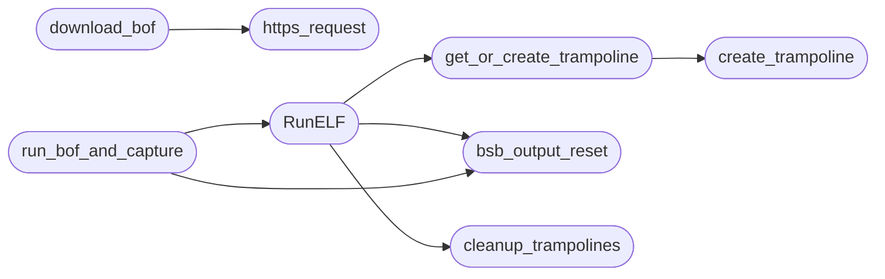

# `include/beacon_common.c`

> Source: [include/beacon_common.c:1](../../include/beacon_common.c#L1) | language `c` | coverage 73.9% | [API index](../index.md)

## Contents

- **Structs:** [`MemoryStruct`](#memorystruct)
- **Functions:** [`bsb_output_init`](#bsb_output_init), [`bsb_output_cleanup`](#bsb_output_cleanup), [`bsb_output_reset`](#bsb_output_reset), [`BeaconPrintf`](#beaconprintf), [`BeaconOutput`](#beaconoutput), [`create_trampoline`](#create_trampoline), [`cleanup_trampolines`](#cleanup_trampolines), [`get_or_create_trampoline`](#get_or_create_trampoline), [`https_request`](#https_request), [`base64_encode`](#base64_encode), [`base64_decode`](#base64_decode), [`url_encode`](#url_encode), [`exec_cmd`](#exec_cmd), [`bsb_backoff_init`](#bsb_backoff_init), [`bsb_backoff_next`](#bsb_backoff_next), [`bsb_backoff_reset`](#bsb_backoff_reset), [`get_local_ips`](#get_local_ips), [`download_bof`](#download_bof), [`RunELF`](#runelf), [`run_bof_and_capture`](#run_bof_and_capture)
- **Macros:** [`_GNU_SOURCE`](#_gnu_source)

## Call Graph

Solid arrows stay in this module, dashed arrows leave it.



## Structs

<a id="memorystruct"></a>

### `MemoryStruct`

`struct` | [include/beacon_common.c:220](../../include/beacon_common.c#L220)

```c
struct MemoryStruct
```

--- HTTP client ---

---

## Functions

<a id="bsb_output_init"></a>

### `bsb_output_init`

`function` | [include/beacon_common.c:100](../../include/beacon_common.c#L100)

```c
int bsb_output_init(size_t capacity)
```

--- Output buffer management ---

**Parameters**

| Name | Type | Default | Description |
|---|---|---|---|
| `capacity` | `size_t` |  |  |

**Returns:** `int`

---

<a id="bsb_output_cleanup"></a>

### `bsb_output_cleanup`

`function` | [include/beacon_common.c:110](../../include/beacon_common.c#L110)

```c
void bsb_output_cleanup(void)
```

Free the output buffer.

Call at beacon shutdown.

> **Inherited:** Documentation from [`bsb_output_cleanup`](#bsb_output_cleanup) (include/beacon_common.h:96).

---

<a id="bsb_output_reset"></a>

### `bsb_output_reset`

`function` | [include/beacon_common.c:117](../../include/beacon_common.c#L117)

```c
void bsb_output_reset(void)
```

Reset the output buffer for a new BOF execution.

> **Inherited:** Documentation from [`bsb_output_reset`](#bsb_output_reset) (include/beacon_common.h:99).

*Called by:* [`RunELF`](#runelf), [`run_bof_and_capture`](#run_bof_and_capture)

---

<a id="beaconprintf"></a>

### `BeaconPrintf`

`function` | [include/beacon_common.c:125](../../include/beacon_common.c#L125)

```c
void BeaconPrintf(int type, const char *fmt, ...)
```

--- Beacon API (called by BOFs) ---

**Parameters**

| Name | Type | Default | Description |
|---|---|---|---|
| `type` | `int` |  |  |
| `fmt` | `char *` |  |  |
| `...` |  |  |  |

---

<a id="beaconoutput"></a>

### `BeaconOutput`

`function` | [include/beacon_common.c:138](../../include/beacon_common.c#L138)

```c
void BeaconOutput(int type, const char *data, int len)
```

Beacon API: raw output capture (called by BOFs).

**Parameters**

| Name | Type | Default | Description |
|---|---|---|---|
| `type` | `int` |  |  |
| `data` | `char *` |  |  |
| `len` | `int` |  |  |

> **Inherited:** Documentation from [`BeaconOutput`](#beaconoutput) (include/beacon_common.h:105).

---

<a id="create_trampoline"></a>

### `create_trampoline`

`function` | [include/beacon_common.c:151](../../include/beacon_common.c#L151)

```c
void *create_trampoline(void *target)
```

--- Trampoline management ---

**Parameters**

| Name | Type | Default | Description |
|---|---|---|---|
| `target` | `void *` |  |  |

**Returns:** `void *`

*Called by:* [`get_or_create_trampoline`](#get_or_create_trampoline)

---

<a id="cleanup_trampolines"></a>

### `cleanup_trampolines`

`function` | [include/beacon_common.c:181](../../include/beacon_common.c#L181)

```c
void cleanup_trampolines(void)
```

*Called by:* [`RunELF`](#runelf)

---

<a id="get_or_create_trampoline"></a>

### `get_or_create_trampoline`

`function` | [include/beacon_common.c:196](../../include/beacon_common.c#L196)

```c
void *get_or_create_trampoline(void *target)
```

**Parameters**

| Name | Type | Default | Description |
|---|---|---|---|
| `target` | `void *` |  |  |

**Returns:** `void *`

*Calls:* [`create_trampoline`](#create_trampoline)

*Called by:* [`RunELF`](#runelf)

---

<a id="https_request"></a>

### `https_request`

`function` | [include/beacon_common.c:237](../../include/beacon_common.c#L237)

```c
http_response_t https_request(const bsb_config_t *cfg, const char *url, const char *method, const char *post_data)
```

HTTP client: performs GET or POST request.

Returns a struct with the response body, length, and status code. On error, data is NULL and len is 0. The caller must free(data). Uses config for timeouts, TLS verification, and user-agent.

**Parameters**

| Name | Type | Default | Description |
|---|---|---|---|
| `cfg` | `bsb_config_t *` |  |  |
| `url` | `char *` |  |  |
| `method` | `char *` |  |  |
| `post_data` | `char *` |  |  |

**Returns:** `http_response_t`

> **Inherited:** Documentation from [`https_request`](#https_request) (include/beacon_common.h:116).

*Called by:* [`download_bof`](#download_bof)

---

<a id="base64_encode"></a>

### `base64_encode`

`function` | [include/beacon_common.c:291](../../include/beacon_common.c#L291)

```c
char *base64_encode(const unsigned char *input, int len)
```

--- Base64 ---

**Parameters**

| Name | Type | Default | Description |
|---|---|---|---|
| `input` | `unsigned char *` |  |  |
| `len` | `int` |  |  |

**Returns:** `char *`

---

<a id="base64_decode"></a>

### `base64_decode`

`function` | [include/beacon_common.c:307](../../include/beacon_common.c#L307)

```c
unsigned char *base64_decode(const char *input, int *len)
```

**Parameters**

| Name | Type | Default | Description |
|---|---|---|---|
| `input` | `char *` |  |  |
| `len` | `int *` |  |  |

**Returns:** `unsigned char *`

---

<a id="url_encode"></a>

### `url_encode`

`function` | [include/beacon_common.c:335](../../include/beacon_common.c#L335)

```c
char *url_encode(const char *in, size_t in_len, size_t *out_len)
```

URL percent-encoding (RFC 3986 unreserved set)

**Parameters**

| Name | Type | Default | Description |
|---|---|---|---|
| `in` | `char *` |  |  |
| `in_len` | `size_t` |  |  |
| `out_len` | `size_t *` |  |  |

**Returns:** `char *`

> **Inherited:** Documentation from [`url_encode`](#url_encode) (include/beacon_common.h:126).

---

<a id="exec_cmd"></a>

### `exec_cmd`

`function` | [include/beacon_common.c:358](../../include/beacon_common.c#L358)

```c
char *exec_cmd(const char *cmd, int *out_len)
```

--- Command execution ---

**Parameters**

| Name | Type | Default | Description |
|---|---|---|---|
| `cmd` | `char *` |  |  |
| `out_len` | `int *` |  |  |

**Returns:** `char *`

---

<a id="bsb_backoff_init"></a>

### `bsb_backoff_init`

`function` | [include/beacon_common.c:385](../../include/beacon_common.c#L385)

```c
void bsb_backoff_init(bsb_backoff_t *bo, int base, int max)
```

--- Backoff state ---

**Parameters**

| Name | Type | Default | Description |
|---|---|---|---|
| `bo` | `bsb_backoff_t *` |  |  |
| `base` | `int` |  |  |
| `max` | `int` |  |  |

---

<a id="bsb_backoff_next"></a>

### `bsb_backoff_next`

`function` | [include/beacon_common.c:391](../../include/beacon_common.c#L391)

```c
int bsb_backoff_next(bsb_backoff_t *bo)
```

**Parameters**

| Name | Type | Default | Description |
|---|---|---|---|
| `bo` | `bsb_backoff_t *` |  |  |

**Returns:** `int`

---

<a id="bsb_backoff_reset"></a>

### `bsb_backoff_reset`

`function` | [include/beacon_common.c:400](../../include/beacon_common.c#L400)

```c
void bsb_backoff_reset(bsb_backoff_t *bo)
```

**Parameters**

| Name | Type | Default | Description |
|---|---|---|---|
| `bo` | `bsb_backoff_t *` |  |  |

---

<a id="get_local_ips"></a>

### `get_local_ips`

`function` | [include/beacon_common.c:405](../../include/beacon_common.c#L405)

```c
char *get_local_ips(void)
```

--- IP discovery ---

**Returns:** `char *`

---

<a id="download_bof"></a>

### `download_bof`

`function` | [include/beacon_common.c:434](../../include/beacon_common.c#L434)

```c
unsigned char *download_bof(const bsb_config_t *cfg, const char *url, size_t *out_size)
```

--- BOF download ---

**Parameters**

| Name | Type | Default | Description |
|---|---|---|---|
| `cfg` | `bsb_config_t *` |  |  |
| `url` | `char *` |  |  |
| `out_size` | `size_t *` |  |  |

**Returns:** `unsigned char *`

*Calls:* [`https_request`](#https_request)

---

<a id="runelf"></a>

### `RunELF`

`function` | [include/beacon_common.c:507](../../include/beacon_common.c#L507)

```c
int RunELF(const char *functionname, unsigned char *elf_data, uint32_t filesize, unsigned char *argumentdata, int argumentSize)
```

ELF BOF loader.

Loads a position-independent ELF object into memory, resolves symbols, applies relocations, and calls the entry function in a forked child process for crash isolation. Returns 0 on success, -1 on error. BOF output is captured into g_beacon_output.

**Parameters**

| Name | Type | Default | Description |
|---|---|---|---|
| `functionname` | `char *` |  |  |
| `elf_data` | `unsigned char *` |  |  |
| `filesize` | `uint32_t` |  |  |
| `argumentdata` | `unsigned char *` |  |  |
| `argumentSize` | `int` |  |  |

**Returns:** `int`

> **Inherited:** Documentation from [`RunELF`](#runelf) (include/beacon_common.h:147).

*Calls:* [`bsb_output_reset`](#bsb_output_reset), [`cleanup_trampolines`](#cleanup_trampolines), [`get_or_create_trampoline`](#get_or_create_trampoline)

*Called by:* [`run_bof_and_capture`](#run_bof_and_capture)

---

<a id="run_bof_and_capture"></a>

### `run_bof_and_capture`

`function` | [include/beacon_common.c:711](../../include/beacon_common.c#L711)

```c
char *run_bof_and_capture(unsigned char *elf_data, uint32_t filesize, char *args, int arglen, int *out_len)
```

Execute a BOF and capture its output.

Returns malloc'd string (caller frees). On error or empty output, returns strdup("").

**Parameters**

| Name | Type | Default | Description |
|---|---|---|---|
| `elf_data` | `unsigned char *` |  |  |
| `filesize` | `uint32_t` |  |  |
| `args` | `char *` |  |  |
| `arglen` | `int` |  |  |
| `out_len` | `int *` |  |  |

**Returns:** `char *`

> **Inherited:** Documentation from [`run_bof_and_capture`](#run_bof_and_capture) (include/beacon_common.h:161).

*Calls:* [`RunELF`](#runelf), [`bsb_output_reset`](#bsb_output_reset)

---

## Macros

<a id="_gnu_source"></a>

### `_GNU_SOURCE`

`macro` | [include/beacon_common.c:9](../../include/beacon_common.c#L9)

```c
#define _GNU_SOURCE
```

beacon_common.c - Shared beacon infrastructure implementation.

This file contains the BOF loader, HTTP client, crypto wrappers,
output capture, and utility functions used by all beacon variants.
Centralizing this code eliminates duplication and ensures consistent
behavior across v1, v2, and v3 beacons.

---
