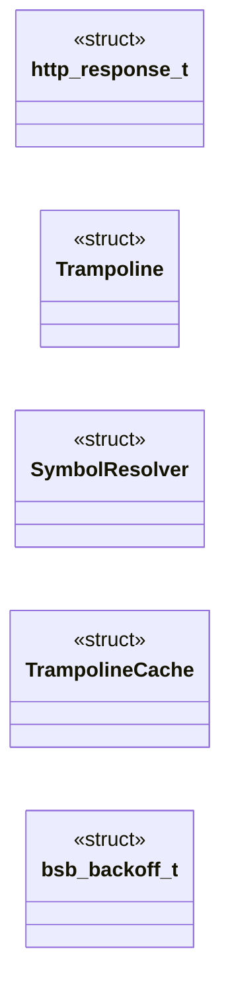

# `include/beacon_common.h`

> Source: [include/beacon_common.h:1](../../include/beacon_common.h#L1) | language `h` | coverage 67.6% | [API index](../index.md)

## Contents

- **Structs:** [`http_response_t`](#http_response_t), [`Trampoline`](#trampoline), [`SymbolResolver`](#symbolresolver), [`TrampolineCache`](#trampolinecache), [`bsb_backoff_t`](#bsb_backoff_t)
- **Functions:** [`bsb_output_init`](#bsb_output_init), [`bsb_output_cleanup`](#bsb_output_cleanup), [`bsb_output_reset`](#bsb_output_reset), [`BeaconPrintf`](#beaconprintf), [`BeaconOutput`](#beaconoutput), [`create_trampoline`](#create_trampoline), [`cleanup_trampolines`](#cleanup_trampolines), [`get_or_create_trampoline`](#get_or_create_trampoline), [`https_request`](#https_request), [`base64_encode`](#base64_encode), [`base64_decode`](#base64_decode), [`url_encode`](#url_encode), [`bsb_generate_secure_iv`](#bsb_generate_secure_iv), [`aes256_cfb_encrypt`](#aes256_cfb_encrypt), [`aes256_cfb_decrypt`](#aes256_cfb_decrypt), [`aes256_cfb_encrypt_replay`](#aes256_cfb_encrypt_replay), [`aes256_cfb_decrypt_replay`](#aes256_cfb_decrypt_replay), [`buffer`](#buffer), [`RunELF`](#runelf), [`download_bof`](#download_bof), [`run_bof_and_capture`](#run_bof_and_capture), [`get_local_ips`](#get_local_ips), [`bsb_backoff_init`](#bsb_backoff_init), [`bsb_backoff_next`](#bsb_backoff_next), [`bsb_backoff_reset`](#bsb_backoff_reset)
- **Macros:** [`_GNU_SOURCE`](#_gnu_source), [`BSB_OUTPUT_BUFFER_DEFAULT`](#bsb_output_buffer_default), [`BSB_OUTPUT_TRUNCATION_MARKER`](#bsb_output_truncation_marker)
- **Variables:** [`g_beacon_output`](#g_beacon_output), [`g_printf_ptr`](#g_printf_ptr), [`g_strlen_ptr`](#g_strlen_ptr), [`g_memcpy_ptr`](#g_memcpy_ptr), [`g_memset_ptr`](#g_memset_ptr), [`g_exit_ptr`](#g_exit_ptr), [`g_dlsym_ptr`](#g_dlsym_ptr), [`g_dlerror_ptr`](#g_dlerror_ptr), [`g_dlopen_ptr`](#g_dlopen_ptr), [`g_dlclose_ptr`](#g_dlclose_ptr), [`g_write_ptr`](#g_write_ptr), [`g_mmap_ptr`](#g_mmap_ptr), [`g_munmap_ptr`](#g_munmap_ptr), [`g_BeaconPrintf_ptr`](#g_beaconprintf_ptr), [`g_BeaconOutput_ptr`](#g_beaconoutput_ptr), [`g_socket_ptr`](#g_socket_ptr), [`g_connect_ptr`](#g_connect_ptr), [`g_inet_addr_ptr`](#g_inet_addr_ptr), [`g_htons_ptr`](#g_htons_ptr), [`g_send_ptr`](#g_send_ptr), [`g_recv_ptr`](#g_recv_ptr), [`g_close_ptr`](#g_close_ptr), [`g_getaddrinfo_ptr`](#g_getaddrinfo_ptr), [`g_freeaddrinfo_ptr`](#g_freeaddrinfo_ptr)

## Type Diagram



## Structs

<a id="http_response_t"></a>

### `http_response_t`

`struct` | [include/beacon_common.h:33](../../include/beacon_common.h#L33)

```c
typedef struct
```

--- HTTP response wrapper ---
https_request now returns a proper struct instead of the
broken full+8 pointer trick that leaked memory.

---

<a id="trampoline"></a>

### `Trampoline`

`struct` | [include/beacon_common.h:41](../../include/beacon_common.h#L41)

```c
typedef struct
```

--- Trampoline (for position-independent BOF relocations) ---

---

<a id="symbolresolver"></a>

### `SymbolResolver`

`struct` | [include/beacon_common.h:51](../../include/beacon_common.h#L51)

```c
typedef struct
```

--- Symbol resolver table entry ---

---

<a id="trampolinecache"></a>

### `TrampolineCache`

`struct` | [include/beacon_common.h:58](../../include/beacon_common.h#L58)

```c
typedef struct
```

--- Trampoline cache entry ---

---

<a id="bsb_backoff_t"></a>

### `bsb_backoff_t`

`struct` | [include/beacon_common.h:182](../../include/beacon_common.h#L182)

```c
typedef struct
```

Exponential backoff state.

Initialize once, call bsb_backoff_next() to get the next sleep duration. Automatically resets on success.

---

## Functions

<a id="bsb_output_init"></a>

### `bsb_output_init`

`function` | [include/beacon_common.h:96](../../include/beacon_common.h#L96)

```c
int bsb_output_init(size_t capacity);
```

Initialize the output buffer.

Call once at beacon startup. Returns 0 on success, -1 on allocation failure.

**Parameters**

| Name | Type | Default | Description |
|---|---|---|---|
| `capacity` | `size_t` |  |  |

**Returns:** `int`

*Called by:* [`main`](beacons.v1.beacon.c.md#main), [`main`](beacons.v2.beacon.c.md#main), [`main`](beacons.v3.beacon.c.md#main)

---

<a id="bsb_output_cleanup"></a>

### `bsb_output_cleanup`

`function` | [include/beacon_common.h:99](../../include/beacon_common.h#L99)

```c
void bsb_output_cleanup(void);
```

Free the output buffer.

Call at beacon shutdown.

*Called by:* [`main`](beacons.v1.beacon.c.md#main), [`main`](beacons.v2.beacon.c.md#main), [`main`](beacons.v3.beacon.c.md#main)

---

<a id="bsb_output_reset"></a>

### `bsb_output_reset`

`function` | [include/beacon_common.h:102](../../include/beacon_common.h#L102)

```c
void bsb_output_reset(void);
```

Reset the output buffer for a new BOF execution.

---

<a id="beaconprintf"></a>

### `BeaconPrintf`

`function` | [include/beacon_common.h:105](../../include/beacon_common.h#L105)

```c
void BeaconPrintf(int type, const char *fmt, ...);
```

Beacon API: printf-style output capture (called by BOFs).

**Parameters**

| Name | Type | Default | Description |
|---|---|---|---|
| `type` | `int` |  |  |
| `fmt` | `char *` |  |  |
| `...` |  |  |  |

---

<a id="beaconoutput"></a>

### `BeaconOutput`

`function` | [include/beacon_common.h:108](../../include/beacon_common.h#L108)

```c
void BeaconOutput(int type, const char *data, int len);
```

Beacon API: raw output capture (called by BOFs).

**Parameters**

| Name | Type | Default | Description |
|---|---|---|---|
| `type` | `int` |  |  |
| `data` | `char *` |  |  |
| `len` | `int` |  |  |

---

<a id="create_trampoline"></a>

### `create_trampoline`

`function` | [include/beacon_common.h:111](../../include/beacon_common.h#L111)

```c
void *create_trampoline(void *target, void *near_hint);
```

Trampoline management

**Parameters**

| Name | Type | Default | Description |
|---|---|---|---|
| `target` | `void *` |  |  |
| `near_hint` | `void *` |  |  |

**Returns:** `void *`

---

<a id="cleanup_trampolines"></a>

### `cleanup_trampolines`

`function` | [include/beacon_common.h:112](../../include/beacon_common.h#L112)

```c
void cleanup_trampolines(void);
```

---

<a id="get_or_create_trampoline"></a>

### `get_or_create_trampoline`

`function` | [include/beacon_common.h:113](../../include/beacon_common.h#L113)

```c
void *get_or_create_trampoline(void *target, void *near_hint);
```

**Parameters**

| Name | Type | Default | Description |
|---|---|---|---|
| `target` | `void *` |  |  |
| `near_hint` | `void *` |  |  |

**Returns:** `void *`

---

<a id="https_request"></a>

### `https_request`

`function` | [include/beacon_common.h:119](../../include/beacon_common.h#L119)

```c
http_response_t https_request(const bsb_config_t *cfg, const char *url, const char *method, const char *post_data);
```

HTTP client: performs GET or POST request.

Returns a struct with the response body, length, and status code. On error, data is NULL and len is 0. The caller must free(data). Uses config for timeouts, TLS verification, and user-agent.

**Parameters**

| Name | Type | Default | Description |
|---|---|---|---|
| `cfg` | `bsb_config_t *` |  |  |
| `url` | `char *` |  |  |
| `method` | `char *` |  |  |
| `post_data` | `char *` |  |  |

**Returns:** `http_response_t`

*Called by:* [`_GNU_SOURCE`](beacons.v1.beacon.c.md#_gnu_source), [`main`](beacons.v1.beacon.c.md#main), [`main`](beacons.v2.beacon.c.md#main), [`main`](beacons.v3.beacon.c.md#main)

---

<a id="base64_encode"></a>

### `base64_encode`

`function` | [include/beacon_common.h:123](../../include/beacon_common.h#L123)

```c
char *base64_encode(const unsigned char *input, int len);
```

Base64 encode/decode (OpenSSL BIO-based)

**Parameters**

| Name | Type | Default | Description |
|---|---|---|---|
| `input` | `unsigned char *` |  |  |
| `len` | `int` |  |  |

**Returns:** `char *`

*Called by:* [`_GNU_SOURCE`](beacons.v1.beacon.c.md#_gnu_source)

---

<a id="base64_decode"></a>

### `base64_decode`

`function` | [include/beacon_common.h:124](../../include/beacon_common.h#L124)

```c
unsigned char *base64_decode(const char *input, int *len);
```

**Parameters**

| Name | Type | Default | Description |
|---|---|---|---|
| `input` | `char *` |  |  |
| `len` | `int *` |  |  |

**Returns:** `unsigned char *`

*Called by:* [`main`](beacons.v1.beacon.c.md#main), [`main`](beacons.v2.beacon.c.md#main), [`main`](beacons.v3.beacon.c.md#main)

---

<a id="url_encode"></a>

### `url_encode`

`function` | [include/beacon_common.h:127](../../include/beacon_common.h#L127)

```c
char *url_encode(const char *in, size_t in_len, size_t *out_len);
```

URL percent-encoding (RFC 3986 unreserved set)

**Parameters**

| Name | Type | Default | Description |
|---|---|---|---|
| `in` | `char *` |  |  |
| `in_len` | `size_t` |  |  |
| `out_len` | `size_t *` |  |  |

**Returns:** `char *`

---

<a id="bsb_generate_secure_iv"></a>

### `bsb_generate_secure_iv`

`function` | [include/beacon_common.h:131](../../include/beacon_common.h#L131)

```c
int bsb_generate_secure_iv(unsigned char *iv_out);
```

Secure IV generation: tries RAND_bytes, falls back to getrandom(2).

Returns 1 on success, 0 on failure (fail-closed).

**Parameters**

| Name | Type | Default | Description |
|---|---|---|---|
| `iv_out` | `unsigned char *` |  |  |

**Returns:** `int`

*Called by:* [`_GNU_SOURCE`](beacons.v1.beacon.c.md#_gnu_source)

---

<a id="aes256_cfb_encrypt"></a>

### `aes256_cfb_encrypt`

`function` | [include/beacon_common.h:134](../../include/beacon_common.h#L134)

```c
unsigned char *aes256_cfb_encrypt(const unsigned char *key, const unsigned char *iv, const unsigned char *plaintext, size_t len, int *out_len);
```

AES-256-CFB encrypt/decrypt (standalone, no OpenSSL dependency)

**Parameters**

| Name | Type | Default | Description |
|---|---|---|---|
| `key` | `unsigned char *` |  |  |
| `iv` | `unsigned char *` |  |  |
| `plaintext` | `unsigned char *` |  |  |
| `len` | `size_t` |  |  |
| `out_len` | `int *` |  |  |

**Returns:** `unsigned char *`

---

<a id="aes256_cfb_decrypt"></a>

### `aes256_cfb_decrypt`

`function` | [include/beacon_common.h:136](../../include/beacon_common.h#L136)

```c
unsigned char *aes256_cfb_decrypt(const unsigned char *key, const unsigned char *iv, const unsigned char *ciphertext, size_t len, int *out_len);
```

**Parameters**

| Name | Type | Default | Description |
|---|---|---|---|
| `key` | `unsigned char *` |  |  |
| `iv` | `unsigned char *` |  |  |
| `ciphertext` | `unsigned char *` |  |  |
| `len` | `size_t` |  |  |
| `out_len` | `int *` |  |  |

**Returns:** `unsigned char *`

*Called by:* [`main`](beacons.v1.beacon.c.md#main), [`main`](beacons.v2.beacon.c.md#main), [`main`](beacons.v3.beacon.c.md#main)

---

<a id="aes256_cfb_encrypt_replay"></a>

### `aes256_cfb_encrypt_replay`

`function` | [include/beacon_common.h:142](../../include/beacon_common.h#L142)

```c
unsigned char *aes256_cfb_encrypt_replay(const unsigned char *key, const unsigned char *iv, const unsigned char *plaintext, size_t len, uint64_t counter, uint64_t timestamp, int *out_len);
```

Replay-protected encryption: prepends counter (8 bytes LE) and timestamp (8 bytes LE) to plaintext before AES-CFB encryption.

Returns malloc'd buffer with IV + ciphertext. Caller must free the returned buffer.

**Parameters**

| Name | Type | Default | Description |
|---|---|---|---|
| `key` | `unsigned char *` |  |  |
| `iv` | `unsigned char *` |  |  |
| `plaintext` | `unsigned char *` |  |  |
| `len` | `size_t` |  |  |
| `counter` | `uint64_t` |  |  |
| `timestamp` | `uint64_t` |  |  |
| `out_len` | `int *` |  |  |

**Returns:** `unsigned char *`

*Called by:* [`_GNU_SOURCE`](beacons.v1.beacon.c.md#_gnu_source)

---

<a id="aes256_cfb_decrypt_replay"></a>

### `aes256_cfb_decrypt_replay`

`function` | [include/beacon_common.h:150](../../include/beacon_common.h#L150)

```c
unsigned char *aes256_cfb_decrypt_replay(const unsigned char *key, const unsigned char *iv, const unsigned char *ciphertext, size_t len, uint64_t *out_counter, uint64_t *out_timestamp, int *out_len);
```

Replay-protected decryption: decrypts ciphertext, extracts counter and timestamp.

Returns malloc'd plaintext (without counter/timestamp), sets *out_counter and *out_timestamp. Returns NULL on decryption failure.

**Parameters**

| Name | Type | Default | Description |
|---|---|---|---|
| `key` | `unsigned char *` |  |  |
| `iv` | `unsigned char *` |  |  |
| `ciphertext` | `unsigned char *` |  |  |
| `len` | `size_t` |  |  |
| `out_counter` | `uint64_t *` |  |  |
| `out_timestamp` | `uint64_t *` |  |  |
| `out_len` | `int *` |  |  |

**Returns:** `unsigned char *`

---

<a id="buffer"></a>

### `buffer`

`function` | [include/beacon_common.h:156](../../include/beacon_common.h#L156)

```c
* buffer (caller frees). On error, returns NULL. */ char *exec_cmd(const char *cmd, int *out_len);
```

**Parameters**

| Name | Type | Default | Description |
|---|---|---|---|
| `frees` | `caller` |  |  |

**Returns:** `*`

---

<a id="runelf"></a>

### `RunELF`

`function` | [include/beacon_common.h:164](../../include/beacon_common.h#L164)

```c
int RunELF(const char *functionname, unsigned char *elf_data, uint32_t filesize, unsigned char *argumentdata, int argumentSize);
```

ELF BOF loader.

Loads a position-independent ELF object into memory, resolves symbols, applies relocations, and calls the entry function in a forked child process for crash isolation. Returns 0 on success, -1 on error. BOF output is captured into g_beacon_output.

**Parameters**

| Name | Type | Default | Description |
|---|---|---|---|
| `functionname` | `char *` |  |  |
| `elf_data` | `unsigned char *` |  |  |
| `filesize` | `uint32_t` |  |  |
| `argumentdata` | `unsigned char *` |  |  |
| `argumentSize` | `int` |  |  |

**Returns:** `int`

---

<a id="download_bof"></a>

### `download_bof`

`function` | [include/beacon_common.h:169](../../include/beacon_common.h#L169)

```c
unsigned char *download_bof(const bsb_config_t *cfg, const char *url, size_t *out_size);
```

Download a BOF from the C2 server.

Returns malloc'd buffer (caller frees). On error, sets *out_size to 0 and returns NULL.

**Parameters**

| Name | Type | Default | Description |
|---|---|---|---|
| `cfg` | `bsb_config_t *` |  |  |
| `url` | `char *` |  |  |
| `out_size` | `size_t *` |  |  |

**Returns:** `unsigned char *`

---

<a id="run_bof_and_capture"></a>

### `run_bof_and_capture`

`function` | [include/beacon_common.h:173](../../include/beacon_common.h#L173)

```c
char *run_bof_and_capture(unsigned char *elf_data, uint32_t filesize, char *args, int arglen, int *out_len);
```

Execute a BOF and capture its output.

Returns malloc'd string (caller frees). On error or empty output, returns strdup("").

**Parameters**

| Name | Type | Default | Description |
|---|---|---|---|
| `elf_data` | `unsigned char *` |  |  |
| `filesize` | `uint32_t` |  |  |
| `args` | `char *` |  |  |
| `arglen` | `int` |  |  |
| `out_len` | `int *` |  |  |

**Returns:** `char *`

---

<a id="get_local_ips"></a>

### `get_local_ips`

`function` | [include/beacon_common.h:178](../../include/beacon_common.h#L178)

```c
char *get_local_ips(void);
```

Get local IP addresses as a comma-separated string.

Returns malloc'd buffer (caller frees). Falls back to "127.0.0.1".

**Returns:** `char *`

*Called by:* [`_GNU_SOURCE`](beacons.v1.beacon.c.md#_gnu_source)

---

<a id="bsb_backoff_init"></a>

### `bsb_backoff_init`

`function` | [include/beacon_common.h:189](../../include/beacon_common.h#L189)

```c
void bsb_backoff_init(bsb_backoff_t *bo, int base, int max);
```

**Parameters**

| Name | Type | Default | Description |
|---|---|---|---|
| `bo` | `bsb_backoff_t *` |  |  |
| `base` | `int` |  |  |
| `max` | `int` |  |  |

*Called by:* [`main`](beacons.v1.beacon.c.md#main), [`main`](beacons.v2.beacon.c.md#main), [`main`](beacons.v3.beacon.c.md#main)

---

<a id="bsb_backoff_next"></a>

### `bsb_backoff_next`

`function` | [include/beacon_common.h:190](../../include/beacon_common.h#L190)

```c
int bsb_backoff_next(bsb_backoff_t *bo);
```

**Parameters**

| Name | Type | Default | Description |
|---|---|---|---|
| `bo` | `bsb_backoff_t *` |  |  |

**Returns:** `int`

*Called by:* [`main`](beacons.v1.beacon.c.md#main), [`main`](beacons.v2.beacon.c.md#main), [`main`](beacons.v3.beacon.c.md#main)

---

<a id="bsb_backoff_reset"></a>

### `bsb_backoff_reset`

`function` | [include/beacon_common.h:191](../../include/beacon_common.h#L191)

```c
void bsb_backoff_reset(bsb_backoff_t *bo);
```

**Parameters**

| Name | Type | Default | Description |
|---|---|---|---|
| `bo` | `bsb_backoff_t *` |  |  |

*Called by:* [`main`](beacons.v1.beacon.c.md#main), [`main`](beacons.v2.beacon.c.md#main), [`main`](beacons.v3.beacon.c.md#main)

---

## Macros

<a id="_gnu_source"></a>

### `_GNU_SOURCE`

`macro` | [include/beacon_common.h:15](../../include/beacon_common.h#L15)

```c
#define _GNU_SOURCE
```

---

<a id="bsb_output_buffer_default"></a>

### `BSB_OUTPUT_BUFFER_DEFAULT`

`macro` | [include/beacon_common.h:26](../../include/beacon_common.h#L26)

```c
#define BSB_OUTPUT_BUFFER_DEFAULT
```

--- Output buffer ---
BOF output is captured into a dynamically-sized buffer. The
default is 64KB which handles most BOFs. If a BOF produces more
output, it is truncated with a marker appended. The operator
can increase this via config.json "bof.output_buffer_size".

---

<a id="bsb_output_truncation_marker"></a>

### `BSB_OUTPUT_TRUNCATION_MARKER`

`macro` | [include/beacon_common.h:27](../../include/beacon_common.h#L27)

```c
#define BSB_OUTPUT_TRUNCATION_MARKER
```

---

## Variables

<a id="g_beacon_output"></a>

### `g_beacon_output`

`variable` `extern` | [include/beacon_common.h:65](../../include/beacon_common.h#L65)

```c
extern char *g_beacon_output;
```

--- Global state (defined in beacon_common.c) ---

---

<a id="g_printf_ptr"></a>

### `g_printf_ptr`

`variable` `extern` | [include/beacon_common.h:68](../../include/beacon_common.h#L68)

```c
extern void *g_printf_ptr;
```

Function pointers exposed to BOFs

---

<a id="g_strlen_ptr"></a>

### `g_strlen_ptr`

`variable` `extern` | [include/beacon_common.h:69](../../include/beacon_common.h#L69)

```c
extern void *g_strlen_ptr;
```

---

<a id="g_memcpy_ptr"></a>

### `g_memcpy_ptr`

`variable` `extern` | [include/beacon_common.h:70](../../include/beacon_common.h#L70)

```c
extern void *g_memcpy_ptr;
```

---

<a id="g_memset_ptr"></a>

### `g_memset_ptr`

`variable` `extern` | [include/beacon_common.h:71](../../include/beacon_common.h#L71)

```c
extern void *g_memset_ptr;
```

---

<a id="g_exit_ptr"></a>

### `g_exit_ptr`

`variable` `extern` | [include/beacon_common.h:72](../../include/beacon_common.h#L72)

```c
extern void *g_exit_ptr;
```

---

<a id="g_dlsym_ptr"></a>

### `g_dlsym_ptr`

`variable` `extern` | [include/beacon_common.h:73](../../include/beacon_common.h#L73)

```c
extern void *g_dlsym_ptr;
```

---

<a id="g_dlerror_ptr"></a>

### `g_dlerror_ptr`

`variable` `extern` | [include/beacon_common.h:74](../../include/beacon_common.h#L74)

```c
extern void *g_dlerror_ptr;
```

---

<a id="g_dlopen_ptr"></a>

### `g_dlopen_ptr`

`variable` `extern` | [include/beacon_common.h:75](../../include/beacon_common.h#L75)

```c
extern void *g_dlopen_ptr;
```

---

<a id="g_dlclose_ptr"></a>

### `g_dlclose_ptr`

`variable` `extern` | [include/beacon_common.h:76](../../include/beacon_common.h#L76)

```c
extern void *g_dlclose_ptr;
```

---

<a id="g_write_ptr"></a>

### `g_write_ptr`

`variable` `extern` | [include/beacon_common.h:77](../../include/beacon_common.h#L77)

```c
extern void *g_write_ptr;
```

---

<a id="g_mmap_ptr"></a>

### `g_mmap_ptr`

`variable` `extern` | [include/beacon_common.h:78](../../include/beacon_common.h#L78)

```c
extern void *g_mmap_ptr;
```

---

<a id="g_munmap_ptr"></a>

### `g_munmap_ptr`

`variable` `extern` | [include/beacon_common.h:79](../../include/beacon_common.h#L79)

```c
extern void *g_munmap_ptr;
```

---

<a id="g_beaconprintf_ptr"></a>

### `g_BeaconPrintf_ptr`

`variable` `extern` | [include/beacon_common.h:80](../../include/beacon_common.h#L80)

```c
extern void *g_BeaconPrintf_ptr;
```

---

<a id="g_beaconoutput_ptr"></a>

### `g_BeaconOutput_ptr`

`variable` `extern` | [include/beacon_common.h:81](../../include/beacon_common.h#L81)

```c
extern void *g_BeaconOutput_ptr;
```

---

<a id="g_socket_ptr"></a>

### `g_socket_ptr`

`variable` `extern` | [include/beacon_common.h:82](../../include/beacon_common.h#L82)

```c
extern void *g_socket_ptr;
```

---

<a id="g_connect_ptr"></a>

### `g_connect_ptr`

`variable` `extern` | [include/beacon_common.h:83](../../include/beacon_common.h#L83)

```c
extern void *g_connect_ptr;
```

---

<a id="g_inet_addr_ptr"></a>

### `g_inet_addr_ptr`

`variable` `extern` | [include/beacon_common.h:84](../../include/beacon_common.h#L84)

```c
extern void *g_inet_addr_ptr;
```

---

<a id="g_htons_ptr"></a>

### `g_htons_ptr`

`variable` `extern` | [include/beacon_common.h:85](../../include/beacon_common.h#L85)

```c
extern void *g_htons_ptr;
```

---

<a id="g_send_ptr"></a>

### `g_send_ptr`

`variable` `extern` | [include/beacon_common.h:86](../../include/beacon_common.h#L86)

```c
extern void *g_send_ptr;
```

---

<a id="g_recv_ptr"></a>

### `g_recv_ptr`

`variable` `extern` | [include/beacon_common.h:87](../../include/beacon_common.h#L87)

```c
extern void *g_recv_ptr;
```

---

<a id="g_close_ptr"></a>

### `g_close_ptr`

`variable` `extern` | [include/beacon_common.h:88](../../include/beacon_common.h#L88)

```c
extern void *g_close_ptr;
```

---

<a id="g_getaddrinfo_ptr"></a>

### `g_getaddrinfo_ptr`

`variable` `extern` | [include/beacon_common.h:89](../../include/beacon_common.h#L89)

```c
extern void *g_getaddrinfo_ptr;
```

---

<a id="g_freeaddrinfo_ptr"></a>

### `g_freeaddrinfo_ptr`

`variable` `extern` | [include/beacon_common.h:90](../../include/beacon_common.h#L90)

```c
extern void *g_freeaddrinfo_ptr;
```

---
