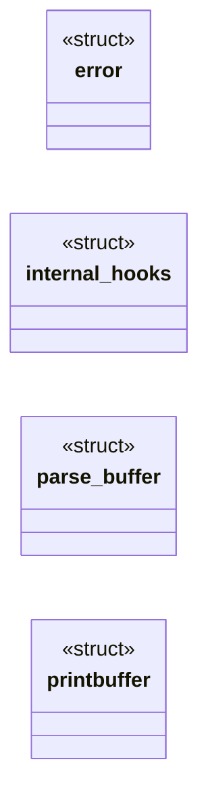

# `include/cJSON.c`

> Source: [include/cJSON.c:1](../../include/cJSON.c#L1) | language `c` | coverage 6.7% | [API index](../index.md)

## Contents

- **Structs:** [`error`](#error), [`internal_hooks`](#internal_hooks), [`parse_buffer`](#parse_buffer), [`printbuffer`](#printbuffer)
- **Functions:** [`CJSON_PUBLIC`](#cjson_public), [`CJSON_PUBLIC`](#cjson_public), [`CJSON_PUBLIC`](#cjson_public), [`CJSON_PUBLIC`](#cjson_public), [`CJSON_PUBLIC`](#cjson_public), [`CJSON_PUBLIC`](#cjson_public), [`CJSON_PUBLIC`](#cjson_public), [`CJSON_PUBLIC`](#cjson_public), [`CJSON_PUBLIC`](#cjson_public), [`CJSON_PUBLIC`](#cjson_public), [`CJSON_PUBLIC`](#cjson_public), [`CJSON_PUBLIC`](#cjson_public), [`CJSON_PUBLIC`](#cjson_public), [`CJSON_PUBLIC`](#cjson_public), [`CJSON_PUBLIC`](#cjson_public), [`CJSON_PUBLIC`](#cjson_public), [`CJSON_PUBLIC`](#cjson_public), [`CJSON_PUBLIC`](#cjson_public), [`CJSON_PUBLIC`](#cjson_public), [`CJSON_PUBLIC`](#cjson_public), [`CJSON_PUBLIC`](#cjson_public), [`CJSON_PUBLIC`](#cjson_public), [`CJSON_PUBLIC`](#cjson_public), [`CJSON_PUBLIC`](#cjson_public), [`CJSON_PUBLIC`](#cjson_public), [`CJSON_PUBLIC`](#cjson_public), [`CJSON_PUBLIC`](#cjson_public), [`CJSON_PUBLIC`](#cjson_public), [`CJSON_PUBLIC`](#cjson_public), [`CJSON_PUBLIC`](#cjson_public), [`CJSON_PUBLIC`](#cjson_public), [`CJSON_PUBLIC`](#cjson_public), [`CJSON_PUBLIC`](#cjson_public), [`CJSON_PUBLIC`](#cjson_public), [`CJSON_PUBLIC`](#cjson_public), [`CJSON_PUBLIC`](#cjson_public), [`CJSON_PUBLIC`](#cjson_public), [`CJSON_PUBLIC`](#cjson_public), [`CJSON_PUBLIC`](#cjson_public), [`CJSON_PUBLIC`](#cjson_public), [`CJSON_PUBLIC`](#cjson_public), [`CJSON_PUBLIC`](#cjson_public), [`CJSON_PUBLIC`](#cjson_public), [`CJSON_PUBLIC`](#cjson_public), [`CJSON_PUBLIC`](#cjson_public), [`CJSON_PUBLIC`](#cjson_public), [`CJSON_PUBLIC`](#cjson_public), [`CJSON_PUBLIC`](#cjson_public), [`CJSON_PUBLIC`](#cjson_public), [`CJSON_PUBLIC`](#cjson_public), [`CJSON_PUBLIC`](#cjson_public), [`cJSON_Duplicate_rec`](#cjson_duplicate_rec), [`CJSON_PUBLIC`](#cjson_public), [`CJSON_PUBLIC`](#cjson_public), [`CJSON_PUBLIC`](#cjson_public), [`CJSON_PUBLIC`](#cjson_public), [`CJSON_PUBLIC`](#cjson_public), [`CJSON_PUBLIC`](#cjson_public), [`CJSON_PUBLIC`](#cjson_public), [`CJSON_PUBLIC`](#cjson_public), [`CJSON_PUBLIC`](#cjson_public), [`CJSON_PUBLIC`](#cjson_public), [`CJSON_PUBLIC`](#cjson_public), [`CJSON_PUBLIC`](#cjson_public), [`cJSON_ArrayForEach`](#cjson_arrayforeach), [`cJSON_ArrayForEach`](#cjson_arrayforeach), [`CJSON_PUBLIC`](#cjson_public), [`CJSON_PUBLIC`](#cjson_public)
- **Macros:** [`_CRT_SECURE_NO_DEPRECATE`](#_crt_secure_no_deprecate), [`true`](#true), [`false`](#false), [`isinf`](#isinf), [`isnan`](#isnan), [`NAN`](#nan), [`NAN`](#nan), [`internal_malloc`](#internal_malloc), [`internal_free`](#internal_free), [`internal_realloc`](#internal_realloc), [`static_strlen`](#static_strlen), [`can_read`](#can_read), [`can_access_at_index`](#can_access_at_index), [`cannot_access_at_index`](#cannot_access_at_index), [`buffer_at_offset`](#buffer_at_offset), [`cjson_min`](#cjson_min)

## Type Diagram



## Call Graph

Solid arrows stay in this module, dashed arrows leave it.

```mermaid
flowchart LR
    n_include_cJSON_c__CJSON_PUBLIC_101(["CJSON_PUBLIC"])
    n_include_cJSON_c__CJSON_PUBLIC(["CJSON_PUBLIC"])
    n_include_cJSON_c__CJSON_PUBLIC_111(["CJSON_PUBLIC"])
    n_include_cJSON_c__CJSON_PUBLIC_126(["CJSON_PUBLIC"])
    n_include_cJSON_c__CJSON_PUBLIC_211(["CJSON_PUBLIC"])
    n_include_cJSON_c__buffer_at_offset(["buffer_at_offset"])
    n_include_cJSON_c__can_access_at_index(["can_access_at_index"])
    n_include_cJSON_c__CJSON_PUBLIC_1143(["CJSON_PUBLIC"])
    n_include_cJSON_c__CJSON_PUBLIC_1251(["CJSON_PUBLIC"])
    n_include_cJSON_c__CJSON_PUBLIC_1333(["CJSON_PUBLIC"])
    n_include_cJSON_c__CJSON_PUBLIC_1338(["CJSON_PUBLIC"])
    n_include_cJSON_c__CJSON_PUBLIC_1369(["CJSON_PUBLIC"])
    n_include_cJSON_c__CJSON_PUBLIC_1956(["CJSON_PUBLIC"])
    n_include_cJSON_c__CJSON_PUBLIC_2003(["CJSON_PUBLIC"])
    n_include_cJSON_c__CJSON_PUBLIC_2008(["CJSON_PUBLIC"])
    n_include_cJSON_c__CJSON_PUBLIC_2014(["CJSON_PUBLIC"])
    n_include_cJSON_c__CJSON_PUBLIC_2143(["CJSON_PUBLIC"])
    n_include_cJSON_c__CJSON_PUBLIC_2154(["CJSON_PUBLIC"])
    n_include_cJSON_c__CJSON_PUBLIC_2164(["CJSON_PUBLIC"])
    n_include_cJSON_c__CJSON_PUBLIC_2176(["CJSON_PUBLIC"])
    n_include_cJSON_c__CJSON_PUBLIC_2188(["CJSON_PUBLIC"])
    n_include_cJSON_c__CJSON_PUBLIC_2200(["CJSON_PUBLIC"])
    n_include_cJSON_c__CJSON_PUBLIC_2212(["CJSON_PUBLIC"])
    n_include_cJSON_c__CJSON_PUBLIC_2225(["CJSON_PUBLIC"])
    n_include_cJSON_c__CJSON_PUBLIC_2238(["CJSON_PUBLIC"])
    n_include_cJSON_c__CJSON_PUBLIC_2251(["CJSON_PUBLIC"])
    n_include_cJSON_c__CJSON_PUBLIC_101 --> n_include_cJSON_c__CJSON_PUBLIC
    n_include_cJSON_c__CJSON_PUBLIC_111 --> n_include_cJSON_c__CJSON_PUBLIC
    n_include_cJSON_c__CJSON_PUBLIC_126 --> n_include_cJSON_c__CJSON_PUBLIC
    n_include_cJSON_c__CJSON_PUBLIC_211 --> n_include_cJSON_c__CJSON_PUBLIC
    n_include_cJSON_c__buffer_at_offset --> n_include_cJSON_c__can_access_at_index
    n_include_cJSON_c__CJSON_PUBLIC_1143 --> n_include_cJSON_c__CJSON_PUBLIC
    n_include_cJSON_c__CJSON_PUBLIC_1251 --> n_include_cJSON_c__CJSON_PUBLIC
    n_include_cJSON_c__CJSON_PUBLIC_1333 --> n_include_cJSON_c__CJSON_PUBLIC
    n_include_cJSON_c__CJSON_PUBLIC_1338 --> n_include_cJSON_c__CJSON_PUBLIC
    n_include_cJSON_c__CJSON_PUBLIC_1369 --> n_include_cJSON_c__CJSON_PUBLIC
    n_include_cJSON_c__CJSON_PUBLIC_1956 --> n_include_cJSON_c__CJSON_PUBLIC
    n_include_cJSON_c__CJSON_PUBLIC_2003 --> n_include_cJSON_c__CJSON_PUBLIC
    n_include_cJSON_c__CJSON_PUBLIC_2008 --> n_include_cJSON_c__CJSON_PUBLIC
    n_include_cJSON_c__CJSON_PUBLIC_2014 --> n_include_cJSON_c__CJSON_PUBLIC
    n_include_cJSON_c__CJSON_PUBLIC_2143 --> n_include_cJSON_c__CJSON_PUBLIC
    n_include_cJSON_c__CJSON_PUBLIC_2154 --> n_include_cJSON_c__CJSON_PUBLIC
    n_include_cJSON_c__CJSON_PUBLIC_2164 --> n_include_cJSON_c__CJSON_PUBLIC
    n_include_cJSON_c__CJSON_PUBLIC_2176 --> n_include_cJSON_c__CJSON_PUBLIC
    n_include_cJSON_c__CJSON_PUBLIC_2188 --> n_include_cJSON_c__CJSON_PUBLIC
    n_include_cJSON_c__CJSON_PUBLIC_2200 --> n_include_cJSON_c__CJSON_PUBLIC
    n_include_cJSON_c__CJSON_PUBLIC_2212 --> n_include_cJSON_c__CJSON_PUBLIC
    n_include_cJSON_c__CJSON_PUBLIC_2225 --> n_include_cJSON_c__CJSON_PUBLIC
    n_include_cJSON_c__CJSON_PUBLIC_2238 --> n_include_cJSON_c__CJSON_PUBLIC
    n_include_cJSON_c__CJSON_PUBLIC_2251 --> n_include_cJSON_c__CJSON_PUBLIC
```



## Structs

<a id="error"></a>

### `error`

`struct` | [include/cJSON.c:89](../../include/cJSON.c#L89)

```c
typedef struct
```

---

<a id="internal_hooks"></a>

### `internal_hooks`

`struct` | [include/cJSON.c:158](../../include/cJSON.c#L158)

```c
typedef struct internal_hooks
```

---

<a id="parse_buffer"></a>

### `parse_buffer`

`struct` | [include/cJSON.c:292](../../include/cJSON.c#L292)

```c
typedef struct
```

---

<a id="printbuffer"></a>

### `printbuffer`

`struct` | [include/cJSON.c:485](../../include/cJSON.c#L485)

```c
typedef struct
```

---

## Functions

<a id="cjson_public"></a>

### `CJSON_PUBLIC`

`function` | [include/cJSON.c:96](../../include/cJSON.c#L96)

```c
CJSON_PUBLIC(const char *) cJSON_GetErrorPtr(void)
```

**Parameters**

| Name | Type | Default | Description |
|---|---|---|---|
| `char` |  |  |  |

*Calls:* [`cJSON_GetErrorPtr`](include.cJSON.h.md#cjson_geterrorptr)

*Called by:* [`CJSON_PUBLIC`](#cjson_public), [`CJSON_PUBLIC`](#cjson_public), [`CJSON_PUBLIC`](#cjson_public), [`CJSON_PUBLIC`](#cjson_public), [`CJSON_PUBLIC`](#cjson_public), [`CJSON_PUBLIC`](#cjson_public), [`CJSON_PUBLIC`](#cjson_public), [`CJSON_PUBLIC`](#cjson_public), [`CJSON_PUBLIC`](#cjson_public), [`CJSON_PUBLIC`](#cjson_public), [`CJSON_PUBLIC`](#cjson_public), [`CJSON_PUBLIC`](#cjson_public) and 52 more

---

<a id="cjson_public"></a>

### `CJSON_PUBLIC`

`function` | [include/cJSON.c:101](../../include/cJSON.c#L101)

```c
CJSON_PUBLIC(char *) cJSON_GetStringValue(const cJSON *const item)
```

**Parameters**

| Name | Type | Default | Description |
|---|---|---|---|
| `char` |  |  |  |

*Calls:* [`CJSON_PUBLIC`](#cjson_public)

---

<a id="cjson_public"></a>

### `CJSON_PUBLIC`

`function` | [include/cJSON.c:111](../../include/cJSON.c#L111)

```c
CJSON_PUBLIC(double) cJSON_GetNumberValue(const cJSON *const item)
```

*Calls:* [`CJSON_PUBLIC`](#cjson_public)

---

<a id="cjson_public"></a>

### `CJSON_PUBLIC`

`function` | [include/cJSON.c:126](../../include/cJSON.c#L126)

```c
CJSON_PUBLIC(const char *) cJSON_Version(void)
```

**Parameters**

| Name | Type | Default | Description |
|---|---|---|---|
| `char` |  |  |  |

*Calls:* [`CJSON_PUBLIC`](#cjson_public)

---

<a id="cjson_public"></a>

### `CJSON_PUBLIC`

`function` | [include/cJSON.c:211](../../include/cJSON.c#L211)

```c
CJSON_PUBLIC(void) cJSON_InitHooks(cJSON_Hooks *hooks)
```

*Calls:* [`CJSON_PUBLIC`](#cjson_public)

---

<a id="cjson_public"></a>

### `CJSON_PUBLIC`

`function` | [include/cJSON.c:1143](../../include/cJSON.c#L1143)

```c
CJSON_PUBLIC(cJSON *) cJSON_ParseWithOpts(const char *value, const char **return_parse_end, ...
```

**Parameters**

| Name | Type | Default | Description |
|---|---|---|---|
| `cJSON` |  |  |  |

*Calls:* [`CJSON_PUBLIC`](#cjson_public)

---

<a id="cjson_public"></a>

### `CJSON_PUBLIC`

`function` | [include/cJSON.c:1251](../../include/cJSON.c#L1251)

```c
CJSON_PUBLIC(cJSON *) cJSON_ParseWithLength(const char *value, size_t buffer_length)
```

**Parameters**

| Name | Type | Default | Description |
|---|---|---|---|
| `cJSON` |  |  |  |

*Calls:* [`CJSON_PUBLIC`](#cjson_public)

---

<a id="cjson_public"></a>

### `CJSON_PUBLIC`

`function` | [include/cJSON.c:1333](../../include/cJSON.c#L1333)

```c
CJSON_PUBLIC(char *) cJSON_PrintUnformatted(const cJSON *item)
```

**Parameters**

| Name | Type | Default | Description |
|---|---|---|---|
| `char` |  |  |  |

*Calls:* [`CJSON_PUBLIC`](#cjson_public)

---

<a id="cjson_public"></a>

### `CJSON_PUBLIC`

`function` | [include/cJSON.c:1338](../../include/cJSON.c#L1338)

```c
CJSON_PUBLIC(char *) cJSON_PrintBuffered(const cJSON *item, int prebuffer, cJSON_bool fmt)
```

**Parameters**

| Name | Type | Default | Description |
|---|---|---|---|
| `char` |  |  |  |

*Calls:* [`CJSON_PUBLIC`](#cjson_public)

---

<a id="cjson_public"></a>

### `CJSON_PUBLIC`

`function` | [include/cJSON.c:1369](../../include/cJSON.c#L1369)

```c
CJSON_PUBLIC(cJSON_bool) cJSON_PrintPreallocated(cJSON *item, char *buffer, const int length, con...
```

*Calls:* [`CJSON_PUBLIC`](#cjson_public)

---

<a id="cjson_public"></a>

### `CJSON_PUBLIC`

`function` | [include/cJSON.c:1956](../../include/cJSON.c#L1956)

```c
CJSON_PUBLIC(cJSON *) cJSON_GetArrayItem(const cJSON *array, int index)
```

**Parameters**

| Name | Type | Default | Description |
|---|---|---|---|
| `cJSON` |  |  |  |

*Calls:* [`CJSON_PUBLIC`](#cjson_public)

---

<a id="cjson_public"></a>

### `CJSON_PUBLIC`

`function` | [include/cJSON.c:2003](../../include/cJSON.c#L2003)

```c
CJSON_PUBLIC(cJSON *) cJSON_GetObjectItem(const cJSON *const object, const char *const string)
```

**Parameters**

| Name | Type | Default | Description |
|---|---|---|---|
| `cJSON` |  |  |  |

*Calls:* [`CJSON_PUBLIC`](#cjson_public)

---

<a id="cjson_public"></a>

### `CJSON_PUBLIC`

`function` | [include/cJSON.c:2008](../../include/cJSON.c#L2008)

```c
CJSON_PUBLIC(cJSON *) cJSON_GetObjectItemCaseSensitive(const cJSON *const object, const char *con...
```

**Parameters**

| Name | Type | Default | Description |
|---|---|---|---|
| `cJSON` |  |  |  |

*Calls:* [`CJSON_PUBLIC`](#cjson_public)

---

<a id="cjson_public"></a>

### `CJSON_PUBLIC`

`function` | [include/cJSON.c:2014](../../include/cJSON.c#L2014)

```c
CJSON_PUBLIC(cJSON_bool) cJSON_HasObjectItem(const cJSON *object, const char *string)
```

*Calls:* [`CJSON_PUBLIC`](#cjson_public)

---

<a id="cjson_public"></a>

### `CJSON_PUBLIC`

`function` | [include/cJSON.c:2143](../../include/cJSON.c#L2143)

```c
CJSON_PUBLIC(cJSON_bool) cJSON_AddItemToObject(cJSON *object, const char *string, cJSON *item)
```

*Calls:* [`CJSON_PUBLIC`](#cjson_public)

---

<a id="cjson_public"></a>

### `CJSON_PUBLIC`

`function` | [include/cJSON.c:2154](../../include/cJSON.c#L2154)

```c
CJSON_PUBLIC(cJSON_bool) cJSON_AddItemReferenceToArray(cJSON *array, cJSON *item)
```

*Calls:* [`CJSON_PUBLIC`](#cjson_public)

---

<a id="cjson_public"></a>

### `CJSON_PUBLIC`

`function` | [include/cJSON.c:2164](../../include/cJSON.c#L2164)

```c
CJSON_PUBLIC(cJSON_bool) cJSON_AddItemReferenceToObject(cJSON *object, const char *string, cJSON ...
```

*Calls:* [`CJSON_PUBLIC`](#cjson_public)

---

<a id="cjson_public"></a>

### `CJSON_PUBLIC`

`function` | [include/cJSON.c:2176](../../include/cJSON.c#L2176)

```c
CJSON_PUBLIC(cJSON *) cJSON_AddNullToObject(cJSON *const object, const char *const name)
```

**Parameters**

| Name | Type | Default | Description |
|---|---|---|---|
| `cJSON` |  |  |  |

*Calls:* [`CJSON_PUBLIC`](#cjson_public)

---

<a id="cjson_public"></a>

### `CJSON_PUBLIC`

`function` | [include/cJSON.c:2188](../../include/cJSON.c#L2188)

```c
CJSON_PUBLIC(cJSON *) cJSON_AddTrueToObject(cJSON *const object, const char *const name)
```

**Parameters**

| Name | Type | Default | Description |
|---|---|---|---|
| `cJSON` |  |  |  |

*Calls:* [`CJSON_PUBLIC`](#cjson_public)

---

<a id="cjson_public"></a>

### `CJSON_PUBLIC`

`function` | [include/cJSON.c:2200](../../include/cJSON.c#L2200)

```c
CJSON_PUBLIC(cJSON *) cJSON_AddFalseToObject(cJSON *const object, const char *const name)
```

**Parameters**

| Name | Type | Default | Description |
|---|---|---|---|
| `cJSON` |  |  |  |

*Calls:* [`CJSON_PUBLIC`](#cjson_public)

---

<a id="cjson_public"></a>

### `CJSON_PUBLIC`

`function` | [include/cJSON.c:2212](../../include/cJSON.c#L2212)

```c
CJSON_PUBLIC(cJSON *) cJSON_AddBoolToObject(cJSON *const object, const char *const name, const cJ...
```

**Parameters**

| Name | Type | Default | Description |
|---|---|---|---|
| `cJSON` |  |  |  |

*Calls:* [`CJSON_PUBLIC`](#cjson_public)

---

<a id="cjson_public"></a>

### `CJSON_PUBLIC`

`function` | [include/cJSON.c:2225](../../include/cJSON.c#L2225)

```c
CJSON_PUBLIC(cJSON *) cJSON_AddNumberToObject(cJSON *const object, const char *const name, const ...
```

**Parameters**

| Name | Type | Default | Description |
|---|---|---|---|
| `cJSON` |  |  |  |

*Calls:* [`CJSON_PUBLIC`](#cjson_public)

---

<a id="cjson_public"></a>

### `CJSON_PUBLIC`

`function` | [include/cJSON.c:2238](../../include/cJSON.c#L2238)

```c
CJSON_PUBLIC(cJSON *) cJSON_AddStringToObject(cJSON *const object, const char *const name, const ...
```

**Parameters**

| Name | Type | Default | Description |
|---|---|---|---|
| `cJSON` |  |  |  |

*Calls:* [`CJSON_PUBLIC`](#cjson_public)

---

<a id="cjson_public"></a>

### `CJSON_PUBLIC`

`function` | [include/cJSON.c:2251](../../include/cJSON.c#L2251)

```c
CJSON_PUBLIC(cJSON *) cJSON_AddRawToObject(cJSON *const object, const char *const name, const cha...
```

**Parameters**

| Name | Type | Default | Description |
|---|---|---|---|
| `cJSON` |  |  |  |

*Calls:* [`CJSON_PUBLIC`](#cjson_public)

---

<a id="cjson_public"></a>

### `CJSON_PUBLIC`

`function` | [include/cJSON.c:2264](../../include/cJSON.c#L2264)

```c
CJSON_PUBLIC(cJSON *) cJSON_AddObjectToObject(cJSON *const object, const char *const name)
```

**Parameters**

| Name | Type | Default | Description |
|---|---|---|---|
| `cJSON` |  |  |  |

*Calls:* [`CJSON_PUBLIC`](#cjson_public)

---

<a id="cjson_public"></a>

### `CJSON_PUBLIC`

`function` | [include/cJSON.c:2276](../../include/cJSON.c#L2276)

```c
CJSON_PUBLIC(cJSON *) cJSON_AddArrayToObject(cJSON *const object, const char *const name)
```

**Parameters**

| Name | Type | Default | Description |
|---|---|---|---|
| `cJSON` |  |  |  |

*Calls:* [`CJSON_PUBLIC`](#cjson_public)

---

<a id="cjson_public"></a>

### `CJSON_PUBLIC`

`function` | [include/cJSON.c:2288](../../include/cJSON.c#L2288)

```c
CJSON_PUBLIC(cJSON *) cJSON_DetachItemViaPointer(cJSON *parent, cJSON *const item)
```

**Parameters**

| Name | Type | Default | Description |
|---|---|---|---|
| `cJSON` |  |  |  |

*Calls:* [`CJSON_PUBLIC`](#cjson_public)

---

<a id="cjson_public"></a>

### `CJSON_PUBLIC`

`function` | [include/cJSON.c:2324](../../include/cJSON.c#L2324)

```c
CJSON_PUBLIC(cJSON *) cJSON_DetachItemFromArray(cJSON *array, int which)
```

**Parameters**

| Name | Type | Default | Description |
|---|---|---|---|
| `cJSON` |  |  |  |

*Calls:* [`CJSON_PUBLIC`](#cjson_public)

---

<a id="cjson_public"></a>

### `CJSON_PUBLIC`

`function` | [include/cJSON.c:2334](../../include/cJSON.c#L2334)

```c
CJSON_PUBLIC(void) cJSON_DeleteItemFromArray(cJSON *array, int which)
```

*Calls:* [`CJSON_PUBLIC`](#cjson_public)

---

<a id="cjson_public"></a>

### `CJSON_PUBLIC`

`function` | [include/cJSON.c:2339](../../include/cJSON.c#L2339)

```c
CJSON_PUBLIC(cJSON *) cJSON_DetachItemFromObject(cJSON *object, const char *string)
```

**Parameters**

| Name | Type | Default | Description |
|---|---|---|---|
| `cJSON` |  |  |  |

*Calls:* [`CJSON_PUBLIC`](#cjson_public)

---

<a id="cjson_public"></a>

### `CJSON_PUBLIC`

`function` | [include/cJSON.c:2346](../../include/cJSON.c#L2346)

```c
CJSON_PUBLIC(cJSON *) cJSON_DetachItemFromObjectCaseSensitive(cJSON *object, const char *string)
```

**Parameters**

| Name | Type | Default | Description |
|---|---|---|---|
| `cJSON` |  |  |  |

*Calls:* [`CJSON_PUBLIC`](#cjson_public)

---

<a id="cjson_public"></a>

### `CJSON_PUBLIC`

`function` | [include/cJSON.c:2353](../../include/cJSON.c#L2353)

```c
CJSON_PUBLIC(void) cJSON_DeleteItemFromObject(cJSON *object, const char *string)
```

*Calls:* [`CJSON_PUBLIC`](#cjson_public)

---

<a id="cjson_public"></a>

### `CJSON_PUBLIC`

`function` | [include/cJSON.c:2358](../../include/cJSON.c#L2358)

```c
CJSON_PUBLIC(void) cJSON_DeleteItemFromObjectCaseSensitive(cJSON *object, const char *string)
```

*Calls:* [`CJSON_PUBLIC`](#cjson_public)

---

<a id="cjson_public"></a>

### `CJSON_PUBLIC`

`function` | [include/cJSON.c:2400](../../include/cJSON.c#L2400)

```c
CJSON_PUBLIC(cJSON_bool) cJSON_ReplaceItemViaPointer(cJSON *const parent, cJSON *const item, cJSO...
```

*Calls:* [`CJSON_PUBLIC`](#cjson_public)

---

<a id="cjson_public"></a>

### `CJSON_PUBLIC`

`function` | [include/cJSON.c:2451](../../include/cJSON.c#L2451)

```c
CJSON_PUBLIC(cJSON_bool) cJSON_ReplaceItemInArray(cJSON *array, int which, cJSON *newitem)
```

*Calls:* [`CJSON_PUBLIC`](#cjson_public)

---

<a id="cjson_public"></a>

### `CJSON_PUBLIC`

`function` | [include/cJSON.c:2486](../../include/cJSON.c#L2486)

```c
CJSON_PUBLIC(cJSON_bool) cJSON_ReplaceItemInObject(cJSON *object, const char *string, cJSON *newi...
```

*Calls:* [`CJSON_PUBLIC`](#cjson_public)

---

<a id="cjson_public"></a>

### `CJSON_PUBLIC`

`function` | [include/cJSON.c:2492](../../include/cJSON.c#L2492)

```c
CJSON_PUBLIC(cJSON_bool) cJSON_ReplaceItemInObjectCaseSensitive(cJSON *object, const char *string...
```

*Calls:* [`CJSON_PUBLIC`](#cjson_public)

---

<a id="cjson_public"></a>

### `CJSON_PUBLIC`

`function` | [include/cJSON.c:2510](../../include/cJSON.c#L2510)

```c
CJSON_PUBLIC(cJSON *) cJSON_CreateTrue(void)
```

**Parameters**

| Name | Type | Default | Description |
|---|---|---|---|
| `cJSON` |  |  |  |

*Calls:* [`CJSON_PUBLIC`](#cjson_public)

---

<a id="cjson_public"></a>

### `CJSON_PUBLIC`

`function` | [include/cJSON.c:2521](../../include/cJSON.c#L2521)

```c
CJSON_PUBLIC(cJSON *) cJSON_CreateFalse(void)
```

**Parameters**

| Name | Type | Default | Description |
|---|---|---|---|
| `cJSON` |  |  |  |

*Calls:* [`CJSON_PUBLIC`](#cjson_public)

---

<a id="cjson_public"></a>

### `CJSON_PUBLIC`

`function` | [include/cJSON.c:2532](../../include/cJSON.c#L2532)

```c
CJSON_PUBLIC(cJSON *) cJSON_CreateBool(cJSON_bool boolean)
```

**Parameters**

| Name | Type | Default | Description |
|---|---|---|---|
| `cJSON` |  |  |  |

*Calls:* [`CJSON_PUBLIC`](#cjson_public)

---

<a id="cjson_public"></a>

### `CJSON_PUBLIC`

`function` | [include/cJSON.c:2543](../../include/cJSON.c#L2543)

```c
CJSON_PUBLIC(cJSON *) cJSON_CreateNumber(double num)
```

**Parameters**

| Name | Type | Default | Description |
|---|---|---|---|
| `cJSON` |  |  |  |

*Calls:* [`CJSON_PUBLIC`](#cjson_public)

---

<a id="cjson_public"></a>

### `CJSON_PUBLIC`

`function` | [include/cJSON.c:2568](../../include/cJSON.c#L2568)

```c
CJSON_PUBLIC(cJSON *) cJSON_CreateString(const char *string)
```

**Parameters**

| Name | Type | Default | Description |
|---|---|---|---|
| `cJSON` |  |  |  |

*Calls:* [`CJSON_PUBLIC`](#cjson_public)

---

<a id="cjson_public"></a>

### `CJSON_PUBLIC`

`function` | [include/cJSON.c:2585](../../include/cJSON.c#L2585)

```c
CJSON_PUBLIC(cJSON *) cJSON_CreateStringReference(const char *string)
```

**Parameters**

| Name | Type | Default | Description |
|---|---|---|---|
| `cJSON` |  |  |  |

*Calls:* [`CJSON_PUBLIC`](#cjson_public)

---

<a id="cjson_public"></a>

### `CJSON_PUBLIC`

`function` | [include/cJSON.c:2597](../../include/cJSON.c#L2597)

```c
CJSON_PUBLIC(cJSON *) cJSON_CreateObjectReference(const cJSON *child)
```

**Parameters**

| Name | Type | Default | Description |
|---|---|---|---|
| `cJSON` |  |  |  |

*Calls:* [`CJSON_PUBLIC`](#cjson_public)

---

<a id="cjson_public"></a>

### `CJSON_PUBLIC`

`function` | [include/cJSON.c:2609](../../include/cJSON.c#L2609)

```c
CJSON_PUBLIC(cJSON *) cJSON_CreateArrayReference(const cJSON *child)
```

**Parameters**

| Name | Type | Default | Description |
|---|---|---|---|
| `cJSON` |  |  |  |

*Calls:* [`CJSON_PUBLIC`](#cjson_public)

---

<a id="cjson_public"></a>

### `CJSON_PUBLIC`

`function` | [include/cJSON.c:2621](../../include/cJSON.c#L2621)

```c
CJSON_PUBLIC(cJSON *) cJSON_CreateRaw(const char *raw)
```

**Parameters**

| Name | Type | Default | Description |
|---|---|---|---|
| `cJSON` |  |  |  |

*Calls:* [`CJSON_PUBLIC`](#cjson_public)

---

<a id="cjson_public"></a>

### `CJSON_PUBLIC`

`function` | [include/cJSON.c:2638](../../include/cJSON.c#L2638)

```c
CJSON_PUBLIC(cJSON *) cJSON_CreateArray(void)
```

**Parameters**

| Name | Type | Default | Description |
|---|---|---|---|
| `cJSON` |  |  |  |

*Calls:* [`CJSON_PUBLIC`](#cjson_public)

---

<a id="cjson_public"></a>

### `CJSON_PUBLIC`

`function` | [include/cJSON.c:2649](../../include/cJSON.c#L2649)

```c
CJSON_PUBLIC(cJSON *) cJSON_CreateObject(void)
```

**Parameters**

| Name | Type | Default | Description |
|---|---|---|---|
| `cJSON` |  |  |  |

*Calls:* [`CJSON_PUBLIC`](#cjson_public)

---

<a id="cjson_public"></a>

### `CJSON_PUBLIC`

`function` | [include/cJSON.c:2702](../../include/cJSON.c#L2702)

```c
CJSON_PUBLIC(cJSON *) cJSON_CreateFloatArray(const float *numbers, int count)
```

**Parameters**

| Name | Type | Default | Description |
|---|---|---|---|
| `cJSON` |  |  |  |

*Calls:* [`CJSON_PUBLIC`](#cjson_public)

---

<a id="cjson_public"></a>

### `CJSON_PUBLIC`

`function` | [include/cJSON.c:2743](../../include/cJSON.c#L2743)

```c
CJSON_PUBLIC(cJSON *) cJSON_CreateDoubleArray(const double *numbers, int count)
```

**Parameters**

| Name | Type | Default | Description |
|---|---|---|---|
| `cJSON` |  |  |  |

*Calls:* [`CJSON_PUBLIC`](#cjson_public)

---

<a id="cjson_public"></a>

### `CJSON_PUBLIC`

`function` | [include/cJSON.c:2784](../../include/cJSON.c#L2784)

```c
CJSON_PUBLIC(cJSON *) cJSON_CreateStringArray(const char *const *strings, int count)
```

**Parameters**

| Name | Type | Default | Description |
|---|---|---|---|
| `cJSON` |  |  |  |

*Calls:* [`CJSON_PUBLIC`](#cjson_public)

---

<a id="cjson_duplicate_rec"></a>

### `cJSON_Duplicate_rec`

`function` | [include/cJSON.c:2832](../../include/cJSON.c#L2832)

```c
cJSON *cJSON_Duplicate_rec(const cJSON *item, size_t depth, cJSON_bool recurse)
```

**Parameters**

| Name | Type | Default | Description |
|---|---|---|---|
| `item` | `cJSON *` |  |  |
| `depth` | `size_t` |  |  |
| `recurse` | `cJSON_bool` |  |  |

**Returns:** `cJSON *`

---

<a id="cjson_public"></a>

### `CJSON_PUBLIC`

`function` | [include/cJSON.c:2977](../../include/cJSON.c#L2977)

```c
CJSON_PUBLIC(void) cJSON_Minify(char *json)
```

*Calls:* [`CJSON_PUBLIC`](#cjson_public)

---

<a id="cjson_public"></a>

### `CJSON_PUBLIC`

`function` | [include/cJSON.c:3027](../../include/cJSON.c#L3027)

```c
CJSON_PUBLIC(cJSON_bool) cJSON_IsInvalid(const cJSON *const item)
```

*Calls:* [`CJSON_PUBLIC`](#cjson_public)

---

<a id="cjson_public"></a>

### `CJSON_PUBLIC`

`function` | [include/cJSON.c:3037](../../include/cJSON.c#L3037)

```c
CJSON_PUBLIC(cJSON_bool) cJSON_IsFalse(const cJSON *const item)
```

*Calls:* [`CJSON_PUBLIC`](#cjson_public)

---

<a id="cjson_public"></a>

### `CJSON_PUBLIC`

`function` | [include/cJSON.c:3047](../../include/cJSON.c#L3047)

```c
CJSON_PUBLIC(cJSON_bool) cJSON_IsTrue(const cJSON *const item)
```

*Calls:* [`CJSON_PUBLIC`](#cjson_public)

---

<a id="cjson_public"></a>

### `CJSON_PUBLIC`

`function` | [include/cJSON.c:3057](../../include/cJSON.c#L3057)

```c
CJSON_PUBLIC(cJSON_bool) cJSON_IsBool(const cJSON *const item)
```

*Calls:* [`CJSON_PUBLIC`](#cjson_public)

---

<a id="cjson_public"></a>

### `CJSON_PUBLIC`

`function` | [include/cJSON.c:3067](../../include/cJSON.c#L3067)

```c
CJSON_PUBLIC(cJSON_bool) cJSON_IsNull(const cJSON *const item)
```

*Calls:* [`CJSON_PUBLIC`](#cjson_public)

---

<a id="cjson_public"></a>

### `CJSON_PUBLIC`

`function` | [include/cJSON.c:3077](../../include/cJSON.c#L3077)

```c
CJSON_PUBLIC(cJSON_bool) cJSON_IsNumber(const cJSON *const item)
```

*Calls:* [`CJSON_PUBLIC`](#cjson_public)

---

<a id="cjson_public"></a>

### `CJSON_PUBLIC`

`function` | [include/cJSON.c:3087](../../include/cJSON.c#L3087)

```c
CJSON_PUBLIC(cJSON_bool) cJSON_IsString(const cJSON *const item)
```

*Calls:* [`CJSON_PUBLIC`](#cjson_public)

---

<a id="cjson_public"></a>

### `CJSON_PUBLIC`

`function` | [include/cJSON.c:3097](../../include/cJSON.c#L3097)

```c
CJSON_PUBLIC(cJSON_bool) cJSON_IsArray(const cJSON *const item)
```

*Calls:* [`CJSON_PUBLIC`](#cjson_public)

---

<a id="cjson_public"></a>

### `CJSON_PUBLIC`

`function` | [include/cJSON.c:3107](../../include/cJSON.c#L3107)

```c
CJSON_PUBLIC(cJSON_bool) cJSON_IsObject(const cJSON *const item)
```

*Calls:* [`CJSON_PUBLIC`](#cjson_public)

---

<a id="cjson_public"></a>

### `CJSON_PUBLIC`

`function` | [include/cJSON.c:3117](../../include/cJSON.c#L3117)

```c
CJSON_PUBLIC(cJSON_bool) cJSON_IsRaw(const cJSON *const item)
```

*Calls:* [`CJSON_PUBLIC`](#cjson_public)

---

<a id="cjson_public"></a>

### `CJSON_PUBLIC`

`function` | [include/cJSON.c:3127](../../include/cJSON.c#L3127)

```c
CJSON_PUBLIC(cJSON_bool) cJSON_Compare(const cJSON *const a, const cJSON *const b, const cJSON_bo...
```

*Calls:* [`CJSON_PUBLIC`](#cjson_public)

---

<a id="cjson_arrayforeach"></a>

### `cJSON_ArrayForEach`

`function` | [include/cJSON.c:3214](../../include/cJSON.c#L3214)

```c
cJSON_ArrayForEach(a_element, a)
```

Macro for iterating over an array or object

> **Inherited:** Documentation from [`cJSON_ArrayForEach`](#cjson_arrayforeach) (cJSON.h:331).

*Called by:* [`cJSON_ArrayForEach`](#cjson_arrayforeach)

---

<a id="cjson_arrayforeach"></a>

### `cJSON_ArrayForEach`

`function` | [include/cJSON.c:3230](../../include/cJSON.c#L3230)

```c
cJSON_ArrayForEach(b_element, b)
```

doing this twice, once on a and b to prevent true comparison if a subset of b TODO: Do this the proper way, this is just a fix for now

*Calls:* [`cJSON_ArrayForEach`](#cjson_arrayforeach)

---

<a id="cjson_public"></a>

### `CJSON_PUBLIC`

`function` | [include/cJSON.c:3251](../../include/cJSON.c#L3251)

```c
CJSON_PUBLIC(void *) cJSON_malloc(size_t size)
```

**Parameters**

| Name | Type | Default | Description |
|---|---|---|---|
| `void` |  |  |  |

*Calls:* [`CJSON_PUBLIC`](#cjson_public)

---

<a id="cjson_public"></a>

### `CJSON_PUBLIC`

`function` | [include/cJSON.c:3256](../../include/cJSON.c#L3256)

```c
CJSON_PUBLIC(void) cJSON_free(void *object)
```

*Calls:* [`CJSON_PUBLIC`](#cjson_public)

---

## Macros

<a id="_crt_secure_no_deprecate"></a>

### `_CRT_SECURE_NO_DEPRECATE`

`macro` | [include/cJSON.c:28](../../include/cJSON.c#L28)

```c
#define _CRT_SECURE_NO_DEPRECATE
```

---

<a id="true"></a>

### `true`

`macro` | [include/cJSON.c:65](../../include/cJSON.c#L65)

```c
#define true
```

---

<a id="false"></a>

### `false`

`macro` | [include/cJSON.c:70](../../include/cJSON.c#L70)

```c
#define false
```

---

<a id="isinf"></a>

### `isinf`

`macro` | [include/cJSON.c:75](../../include/cJSON.c#L75)

```c
#define isinf(d)
```

---

<a id="isnan"></a>

### `isnan`

`macro` | [include/cJSON.c:78](../../include/cJSON.c#L78)

```c
#define isnan(d)
```

---

<a id="nan"></a>

### `NAN`

`macro` | [include/cJSON.c:83](../../include/cJSON.c#L83)

```c
#define NAN
```

---

<a id="nan"></a>

### `NAN`

`macro` | [include/cJSON.c:85](../../include/cJSON.c#L85)

```c
#define NAN
```

---

<a id="internal_malloc"></a>

### `internal_malloc`

`macro` | [include/cJSON.c:180](../../include/cJSON.c#L180)

```c
#define internal_malloc
```

---

<a id="internal_free"></a>

### `internal_free`

`macro` | [include/cJSON.c:181](../../include/cJSON.c#L181)

```c
#define internal_free
```

---

<a id="internal_realloc"></a>

### `internal_realloc`

`macro` | [include/cJSON.c:182](../../include/cJSON.c#L182)

```c
#define internal_realloc
```

---

<a id="static_strlen"></a>

### `static_strlen`

`macro` | [include/cJSON.c:186](../../include/cJSON.c#L186)

```c
#define static_strlen(string_literal)
```

strlen of character literals resolved at compile time

---

<a id="can_read"></a>

### `can_read`

`macro` | [include/cJSON.c:302](../../include/cJSON.c#L302)

```c
#define can_read(buffer, size)
```

check if the given size is left to read in a given parse buffer (starting with 1)

---

<a id="can_access_at_index"></a>

### `can_access_at_index`

`macro` | [include/cJSON.c:304](../../include/cJSON.c#L304)

```c
#define can_access_at_index(buffer, index)
```

check if the buffer can be accessed at the given index (starting with 0)

*Called by:* [`buffer_at_offset`](#buffer_at_offset)

---

<a id="cannot_access_at_index"></a>

### `cannot_access_at_index`

`macro` | [include/cJSON.c:306](../../include/cJSON.c#L306)

```c
#define cannot_access_at_index(buffer, index)
```

---

<a id="buffer_at_offset"></a>

### `buffer_at_offset`

`macro` | [include/cJSON.c:308](../../include/cJSON.c#L308)

```c
#define buffer_at_offset(buffer)
```

get a pointer to the buffer at the position

*Calls:* [`can_access_at_index`](#can_access_at_index)

---

<a id="cjson_min"></a>

### `cjson_min`

`macro` | [include/cJSON.c:1256](../../include/cJSON.c#L1256)

```c
#define cjson_min(a, b)
```

---
