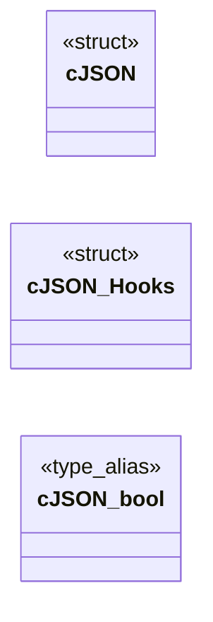
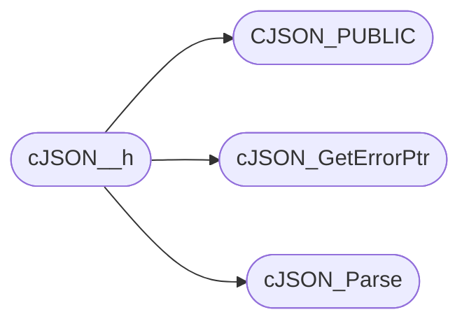

# `include/cJSON.h`

> Source: [include/cJSON.h:1](../../include/cJSON.h#L1) | language `h` | coverage 20.0% | [API index](../index.md)

## Contents

- **Structs:** [`cJSON`](#cjson), [`cJSON_Hooks`](#cjson_hooks)
- **Type Aliases:** [`cJSON_bool`](#cjson_bool)
- **Functions:** [`cJSON_Parse`](#cjson_parse), [`cJSON_GetErrorPtr`](#cjson_geterrorptr), [`that`](#that), [`sensitive`](#sensitive)
- **Macros:** [`cJSON__h`](#cjson__h), [`__WINDOWS__`](#__windows__), [`CJSON_CDECL`](#cjson_cdecl), [`CJSON_STDCALL`](#cjson_stdcall), [`CJSON_EXPORT_SYMBOLS`](#cjson_export_symbols), [`CJSON_PUBLIC`](#cjson_public), [`CJSON_PUBLIC`](#cjson_public), [`CJSON_PUBLIC`](#cjson_public), [`CJSON_CDECL`](#cjson_cdecl), [`CJSON_STDCALL`](#cjson_stdcall), [`CJSON_PUBLIC`](#cjson_public), [`CJSON_PUBLIC`](#cjson_public), [`CJSON_VERSION_MAJOR`](#cjson_version_major), [`CJSON_VERSION_MINOR`](#cjson_version_minor), [`CJSON_VERSION_PATCH`](#cjson_version_patch), [`cJSON_Invalid`](#cjson_invalid), [`cJSON_False`](#cjson_false), [`cJSON_True`](#cjson_true), [`cJSON_NULL`](#cjson_null), [`cJSON_Number`](#cjson_number), [`cJSON_String`](#cjson_string), [`cJSON_Array`](#cjson_array), [`cJSON_Object`](#cjson_object), [`cJSON_Raw`](#cjson_raw), [`cJSON_IsReference`](#cjson_isreference), [`cJSON_StringIsConst`](#cjson_stringisconst), [`CJSON_NESTING_LIMIT`](#cjson_nesting_limit), [`CJSON_CIRCULAR_LIMIT`](#cjson_circular_limit), [`cJSON_SetIntValue`](#cjson_setintvalue), [`cJSON_SetNumberValue`](#cjson_setnumbervalue), [`cJSON_SetBoolValue`](#cjson_setboolvalue), [`cJSON_ArrayForEach`](#cjson_arrayforeach)
- **Variables:** [`next`](#next)

## Type Diagram



## Call Graph

Solid arrows stay in this module, dashed arrows leave it.



## Structs

<a id="cjson"></a>

### `cJSON`

`struct` | [include/cJSON.h:98](../../include/cJSON.h#L98)

```c
typedef struct cJSON
```

The cJSON structure:

---

<a id="cjson_hooks"></a>

### `cJSON_Hooks`

`struct` | [include/cJSON.h:123](../../include/cJSON.h#L123)

```c
typedef struct cJSON_Hooks
```

---

## Type Aliases

<a id="cjson_bool"></a>

### `cJSON_bool`

`type_alias` | [include/cJSON.h:130](../../include/cJSON.h#L130)

```c
typedef int cJSON_bool;
```

---

## Functions

<a id="cjson_parse"></a>

### `cJSON_Parse`

`function` | [include/cJSON.h:152](../../include/cJSON.h#L152)

```c
* cJSON_Parse (with cJSON_Delete) and cJSON_Print (with stdlib free, cJSON_Hooks.free_fn, or * cJSON_free as appropriate). The exception is cJSON_PrintPreallocated, where the caller has * full respons
```

**Parameters**

| Name | Type | Default | Description |
|---|---|---|---|
| `cJSON_Delete` | `with` |  |  |

**Returns:** `*`

*Called by:* [`cJSON__h`](#cjson__h)

---

<a id="cjson_geterrorptr"></a>

### `cJSON_GetErrorPtr`

`function` | [include/cJSON.h:161](../../include/cJSON.h#L161)

```c
* a pointer to the error so will match cJSON_GetErrorPtr(). */ CJSON_PUBLIC(cJSON *) cJSON_ParseWithOpts(const char *value, const char **return_parse_end, cJSON_bool require_null_terminated);
```

**Returns:** `* a pointer to the error so will match`

*Called by:* [`CJSON_PUBLIC`](include.cJSON.c.md#cjson_public), [`cJSON__h`](#cjson__h)

---

<a id="that"></a>

### `that`

`function` | [include/cJSON.h:247](../../include/cJSON.h#L247)

```c
* that (item->type & cJSON_StringIsConst) is zero before writing to `item->string` */ CJSON_PUBLIC(cJSON_bool) cJSON_AddItemToObjectCS(cJSON *object, const char *string, cJSON *item);
```

**Parameters**

| Name | Type | Default | Description |
|---|---|---|---|
| `cJSON_StringIsConst` | `item->type &` |  |  |

**Returns:** `*`

---

<a id="sensitive"></a>

### `sensitive`

`function` | [include/cJSON.h:286](../../include/cJSON.h#L286)

```c
* sensitive (1) or case insensitive (0) */ CJSON_PUBLIC(cJSON_bool) cJSON_Compare(const cJSON *const a, const cJSON *const b, const cJSON_bool case_sensitive);
```

**Parameters**

| Name | Type | Default | Description |
|---|---|---|---|
| `1` |  |  |  |

**Returns:** `*`

---

## Macros

<a id="cjson__h"></a>

### `cJSON__h`

`macro` | [include/cJSON.h:24](../../include/cJSON.h#L24)

```c
#define cJSON__h
```

*Calls:* [`CJSON_PUBLIC`](#cjson_public), [`cJSON_GetErrorPtr`](#cjson_geterrorptr), [`cJSON_Parse`](#cjson_parse)

---

<a id="__windows__"></a>

### `__WINDOWS__`

`macro` | [include/cJSON.h:33](../../include/cJSON.h#L33)

```c
#define __WINDOWS__
```

---

<a id="cjson_cdecl"></a>

### `CJSON_CDECL`

`macro` | [include/cJSON.h:49](../../include/cJSON.h#L49)

```c
#define CJSON_CDECL
```

!__WINDOWS__

> **Inherited:** Documentation from [`CJSON_CDECL`](#cjson_cdecl) (cJSON.h:65).

---

<a id="cjson_stdcall"></a>

### `CJSON_STDCALL`

`macro` | [include/cJSON.h:50](../../include/cJSON.h#L50)

```c
#define CJSON_STDCALL
```

---

<a id="cjson_export_symbols"></a>

### `CJSON_EXPORT_SYMBOLS`

`macro` | [include/cJSON.h:54](../../include/cJSON.h#L54)

```c
#define CJSON_EXPORT_SYMBOLS
```

---

<a id="cjson_public"></a>

### `CJSON_PUBLIC`

`macro` | [include/cJSON.h:58](../../include/cJSON.h#L58)

```c
#define CJSON_PUBLIC(type)
```

*Called by:* [`cJSON__h`](#cjson__h)

---

<a id="cjson_public"></a>

### `CJSON_PUBLIC`

`macro` | [include/cJSON.h:60](../../include/cJSON.h#L60)

```c
#define CJSON_PUBLIC(type)
```

---

<a id="cjson_public"></a>

### `CJSON_PUBLIC`

`macro` | [include/cJSON.h:62](../../include/cJSON.h#L62)

```c
#define CJSON_PUBLIC(type)
```

---

<a id="cjson_cdecl"></a>

### `CJSON_CDECL`

`macro` | [include/cJSON.h:65](../../include/cJSON.h#L65)

```c
#define CJSON_CDECL
```

!__WINDOWS__

---

<a id="cjson_stdcall"></a>

### `CJSON_STDCALL`

`macro` | [include/cJSON.h:66](../../include/cJSON.h#L66)

```c
#define CJSON_STDCALL
```

---

<a id="cjson_public"></a>

### `CJSON_PUBLIC`

`macro` | [include/cJSON.h:70](../../include/cJSON.h#L70)

```c
#define CJSON_PUBLIC(type)
```

---

<a id="cjson_public"></a>

### `CJSON_PUBLIC`

`macro` | [include/cJSON.h:72](../../include/cJSON.h#L72)

```c
#define CJSON_PUBLIC(type)
```

---

<a id="cjson_version_major"></a>

### `CJSON_VERSION_MAJOR`

`macro` | [include/cJSON.h:77](../../include/cJSON.h#L77)

```c
#define CJSON_VERSION_MAJOR
```

project version

---

<a id="cjson_version_minor"></a>

### `CJSON_VERSION_MINOR`

`macro` | [include/cJSON.h:78](../../include/cJSON.h#L78)

```c
#define CJSON_VERSION_MINOR
```

---

<a id="cjson_version_patch"></a>

### `CJSON_VERSION_PATCH`

`macro` | [include/cJSON.h:79](../../include/cJSON.h#L79)

```c
#define CJSON_VERSION_PATCH
```

---

<a id="cjson_invalid"></a>

### `cJSON_Invalid`

`macro` | [include/cJSON.h:84](../../include/cJSON.h#L84)

```c
#define cJSON_Invalid
```

cJSON Types:

---

<a id="cjson_false"></a>

### `cJSON_False`

`macro` | [include/cJSON.h:85](../../include/cJSON.h#L85)

```c
#define cJSON_False
```

---

<a id="cjson_true"></a>

### `cJSON_True`

`macro` | [include/cJSON.h:86](../../include/cJSON.h#L86)

```c
#define cJSON_True
```

---

<a id="cjson_null"></a>

### `cJSON_NULL`

`macro` | [include/cJSON.h:87](../../include/cJSON.h#L87)

```c
#define cJSON_NULL
```

---

<a id="cjson_number"></a>

### `cJSON_Number`

`macro` | [include/cJSON.h:88](../../include/cJSON.h#L88)

```c
#define cJSON_Number
```

---

<a id="cjson_string"></a>

### `cJSON_String`

`macro` | [include/cJSON.h:89](../../include/cJSON.h#L89)

```c
#define cJSON_String
```

---

<a id="cjson_array"></a>

### `cJSON_Array`

`macro` | [include/cJSON.h:90](../../include/cJSON.h#L90)

```c
#define cJSON_Array
```

---

<a id="cjson_object"></a>

### `cJSON_Object`

`macro` | [include/cJSON.h:91](../../include/cJSON.h#L91)

```c
#define cJSON_Object
```

---

<a id="cjson_raw"></a>

### `cJSON_Raw`

`macro` | [include/cJSON.h:92](../../include/cJSON.h#L92)

```c
#define cJSON_Raw
```

---

<a id="cjson_isreference"></a>

### `cJSON_IsReference`

`macro` | [include/cJSON.h:94](../../include/cJSON.h#L94)

```c
#define cJSON_IsReference
```

---

<a id="cjson_stringisconst"></a>

### `cJSON_StringIsConst`

`macro` | [include/cJSON.h:95](../../include/cJSON.h#L95)

```c
#define cJSON_StringIsConst
```

---

<a id="cjson_nesting_limit"></a>

### `CJSON_NESTING_LIMIT`

`macro` | [include/cJSON.h:136](../../include/cJSON.h#L136)

```c
#define CJSON_NESTING_LIMIT
```

---

<a id="cjson_circular_limit"></a>

### `CJSON_CIRCULAR_LIMIT`

`macro` | [include/cJSON.h:142](../../include/cJSON.h#L142)

```c
#define CJSON_CIRCULAR_LIMIT
```

---

<a id="cjson_setintvalue"></a>

### `cJSON_SetIntValue`

`macro` | [include/cJSON.h:312](../../include/cJSON.h#L312)

```c
#define cJSON_SetIntValue(object, number)
```

When assigning an integer value, it needs to be propagated to valuedouble too.

---

<a id="cjson_setnumbervalue"></a>

### `cJSON_SetNumberValue`

`macro` | [include/cJSON.h:316](../../include/cJSON.h#L316)

```c
#define cJSON_SetNumberValue(object, number)
```

---

<a id="cjson_setboolvalue"></a>

### `cJSON_SetBoolValue`

`macro` | [include/cJSON.h:324](../../include/cJSON.h#L324)

```c
#define cJSON_SetBoolValue(object, boolValue)
```

If the object is not a boolean type this does nothing and returns cJSON_Invalid else it returns the new type

---

<a id="cjson_arrayforeach"></a>

### `cJSON_ArrayForEach`

`macro` | [include/cJSON.h:331](../../include/cJSON.h#L331)

```c
#define cJSON_ArrayForEach(element, array)
```

Macro for iterating over an array or object

---

## Variables

<a id="next"></a>

### `next`

`variable` `extern` | [include/cJSON.h:27](../../include/cJSON.h#L27)

```c
extern "C" { #endif #if !defined(__WINDOWS__) && \ (defined(WIN32) || defined(WIN64) || defined(_MSC_VER) || defined(_WIN32)) #define __WINDOWS__ #endif #ifdef __WINDOWS__ /* When compiling for window
```

ifdef __cplusplus

---
