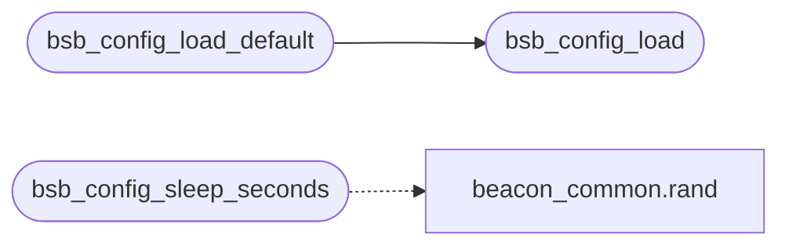

# `include/config.c`

> Source: [include/config.c:1](../../include/config.c#L1) | language `c` | coverage 50.0% | [API index](../index.md)

## Contents

- **Functions:** [`bsb_config_load`](#bsb_config_load), [`bsb_config_load_default`](#bsb_config_load_default), [`bsb_config_sleep_seconds`](#bsb_config_sleep_seconds)
- **Macros:** [`_POSIX_C_SOURCE`](#_posix_c_source), [`HKDF_SALT`](#hkdf_salt), [`HKDF_INFO_ENC`](#hkdf_info_enc), [`HKDF_INFO_HMAC`](#hkdf_info_hmac)

## Call Graph

Solid arrows stay in this module, dashed arrows leave it.



## Functions

<a id="bsb_config_load"></a>

### `bsb_config_load`

`function` | [include/config.c:655](../../include/config.c#L655)

```c
int bsb_config_load(const char *path, bsb_config_t *cfg, char *err, size_t errlen)
```

--- main load ---

**Parameters**

| Name | Type | Default | Description |
|---|---|---|---|
| `path` | `char *` |  |  |
| `cfg` | `bsb_config_t *` |  |  |
| `err` | `char *` |  |  |
| `errlen` | `size_t` |  |  |

**Returns:** `int`

*Called by:* [`bsb_config_load_default`](#bsb_config_load_default)

---

<a id="bsb_config_load_default"></a>

### `bsb_config_load_default`

`function` | [include/config.c:820](../../include/config.c#L820)

```c
int bsb_config_load_default(bsb_config_t *cfg, char *err, size_t errlen)
```

Load from BSB_CONFIG env or default path.

**Parameters**

| Name | Type | Default | Description |
|---|---|---|---|
| `cfg` | `bsb_config_t *` |  |  |
| `err` | `char *` |  |  |
| `errlen` | `size_t` |  |  |

**Returns:** `int`

> **Inherited:** Documentation from [`bsb_config_load_default`](#bsb_config_load_default) (include/config.h:92).

*Calls:* [`bsb_config_load`](#bsb_config_load)

---

<a id="bsb_config_sleep_seconds"></a>

### `bsb_config_sleep_seconds`

`function` | [include/config.c:853](../../include/config.c#L853)

```c
int bsb_config_sleep_seconds(const bsb_config_t *cfg)
```

Compute a sleep duration with jitter applied.

Returns seconds.

**Parameters**

| Name | Type | Default | Description |
|---|---|---|---|
| `cfg` | `bsb_config_t *` |  |  |

**Returns:** `int`

> **Inherited:** Documentation from [`bsb_config_sleep_seconds`](#bsb_config_sleep_seconds) (include/config.h:95).

*Calls:* [`rand`](include.beacon_common.c.md#rand)

---

## Macros

<a id="_posix_c_source"></a>

### `_POSIX_C_SOURCE`

`macro` | [include/config.c:13](../../include/config.c#L13)

```c
#define _POSIX_C_SOURCE
```

config.c - JSON config loader for Black Sand Beacon.

Self-contained: no libc JSON dependency, only stdio/stdlib/string.
Parses the schema documented in include/config.h.

The parser is intentionally simple: it walks the JSON looking
for top-level keys ("c2", "crypto", "timing", "network", "bof")
and reads the string / integer / boolean / array values
declared in the schema. Unknown keys are skipped. Missing
sections fall back to safe defaults.

---

<a id="hkdf_salt"></a>

### `HKDF_SALT`

`macro` | [include/config.c:288](../../include/config.c#L288)

```c
#define HKDF_SALT
```

---

<a id="hkdf_info_enc"></a>

### `HKDF_INFO_ENC`

`macro` | [include/config.c:289](../../include/config.c#L289)

```c
#define HKDF_INFO_ENC
```

---

<a id="hkdf_info_hmac"></a>

### `HKDF_INFO_HMAC`

`macro` | [include/config.c:290](../../include/config.c#L290)

```c
#define HKDF_INFO_HMAC
```

---
