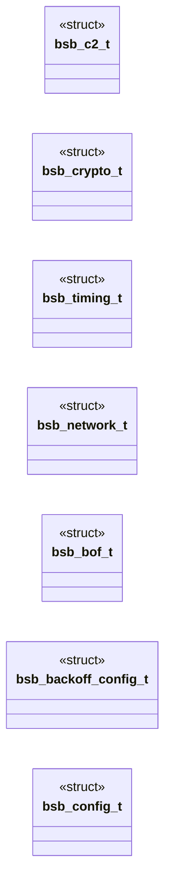

# `include/config.h`

> Source: [include/config.h:1](../../include/config.h#L1) | language `h` | coverage 19.0% | [API index](../index.md)

## Contents

- **Structs:** [`bsb_c2_t`](#bsb_c2_t), [`bsb_crypto_t`](#bsb_crypto_t), [`bsb_timing_t`](#bsb_timing_t), [`bsb_network_t`](#bsb_network_t), [`bsb_bof_t`](#bsb_bof_t), [`bsb_backoff_config_t`](#bsb_backoff_config_t), [`bsb_config_t`](#bsb_config_t)
- **Functions:** [`bsb_config_load`](#bsb_config_load), [`bsb_config_load_default`](#bsb_config_load_default), [`bsb_config_sleep_seconds`](#bsb_config_sleep_seconds)
- **Macros:** [`BSB_CONFIG_PATH_DEFAULT`](#bsb_config_path_default), [`BSB_CONFIG_PATH_ENV`](#bsb_config_path_env), [`BSB_MAX_URL`](#bsb_max_url), [`BSB_MAX_URI`](#bsb_max_uri), [`BSB_MAX_CLIENT_ID`](#bsb_max_client_id), [`BSB_AES_KEY_HEX_LEN`](#bsb_aes_key_hex_len), [`BSB_AES_KEY_BYTES`](#bsb_aes_key_bytes), [`BSB_MAX_USER_AGENTS`](#bsb_max_user_agents), [`BSB_USER_AGENT_LEN`](#bsb_user_agent_len), [`BSB_REPORT_URI_DEFAULT`](#bsb_report_uri_default)

## Type Diagram



## Structs

<a id="bsb_c2_t"></a>

### `bsb_c2_t`

`struct` | [include/config.h:30](../../include/config.h#L30)

```c
typedef struct
```

---

<a id="bsb_crypto_t"></a>

### `bsb_crypto_t`

`struct` | [include/config.h:37](../../include/config.h#L37)

```c
typedef struct
```

---

<a id="bsb_timing_t"></a>

### `bsb_timing_t`

`struct` | [include/config.h:42](../../include/config.h#L42)

```c
typedef struct
```

---

<a id="bsb_network_t"></a>

### `bsb_network_t`

`struct` | [include/config.h:49](../../include/config.h#L49)

```c
typedef struct
```

---

<a id="bsb_bof_t"></a>

### `bsb_bof_t`

`struct` | [include/config.h:55](../../include/config.h#L55)

```c
typedef struct
```

---

<a id="bsb_backoff_config_t"></a>

### `bsb_backoff_config_t`

`struct` | [include/config.h:60](../../include/config.h#L60)

```c
typedef struct
```

---

<a id="bsb_config_t"></a>

### `bsb_config_t`

`struct` | [include/config.h:65](../../include/config.h#L65)

```c
typedef struct
```

---

## Functions

<a id="bsb_config_load"></a>

### `bsb_config_load`

`function` | [include/config.h:77](../../include/config.h#L77)

```c
int bsb_config_load(const char *path, bsb_config_t *cfg, char *err, size_t errlen);
```

Load config from path.

Returns 0 on success, -1 on error. On error, leaves a human-readable message in `err` (if non-NULL).

**Parameters**

| Name | Type | Default | Description |
|---|---|---|---|
| `path` | `char *` |  |  |
| `cfg` | `bsb_config_t *` |  |  |
| `err` | `char *` |  |  |
| `errlen` | `size_t` |  |  |

**Returns:** `int`

---

<a id="bsb_config_load_default"></a>

### `bsb_config_load_default`

`function` | [include/config.h:80](../../include/config.h#L80)

```c
int bsb_config_load_default(bsb_config_t *cfg, char *err, size_t errlen);
```

Load from BSB_CONFIG env or default path.

**Parameters**

| Name | Type | Default | Description |
|---|---|---|---|
| `cfg` | `bsb_config_t *` |  |  |
| `err` | `char *` |  |  |
| `errlen` | `size_t` |  |  |

**Returns:** `int`

---

<a id="bsb_config_sleep_seconds"></a>

### `bsb_config_sleep_seconds`

`function` | [include/config.h:83](../../include/config.h#L83)

```c
int bsb_config_sleep_seconds(const bsb_config_t *cfg);
```

Compute a sleep duration with jitter applied.

Returns seconds.

**Parameters**

| Name | Type | Default | Description |
|---|---|---|---|
| `cfg` | `bsb_config_t *` |  |  |

**Returns:** `int`

---

## Macros

<a id="bsb_config_path_default"></a>

### `BSB_CONFIG_PATH_DEFAULT`

`macro` | [include/config.h:19](../../include/config.h#L19)

```c
#define BSB_CONFIG_PATH_DEFAULT
```

---

<a id="bsb_config_path_env"></a>

### `BSB_CONFIG_PATH_ENV`

`macro` | [include/config.h:20](../../include/config.h#L20)

```c
#define BSB_CONFIG_PATH_ENV
```

---

<a id="bsb_max_url"></a>

### `BSB_MAX_URL`

`macro` | [include/config.h:21](../../include/config.h#L21)

```c
#define BSB_MAX_URL
```

---

<a id="bsb_max_uri"></a>

### `BSB_MAX_URI`

`macro` | [include/config.h:22](../../include/config.h#L22)

```c
#define BSB_MAX_URI
```

---

<a id="bsb_max_client_id"></a>

### `BSB_MAX_CLIENT_ID`

`macro` | [include/config.h:23](../../include/config.h#L23)

```c
#define BSB_MAX_CLIENT_ID
```

---

<a id="bsb_aes_key_hex_len"></a>

### `BSB_AES_KEY_HEX_LEN`

`macro` | [include/config.h:24](../../include/config.h#L24)

```c
#define BSB_AES_KEY_HEX_LEN
```

---

<a id="bsb_aes_key_bytes"></a>

### `BSB_AES_KEY_BYTES`

`macro` | [include/config.h:25](../../include/config.h#L25)

```c
#define BSB_AES_KEY_BYTES
```

32 bytes -> 64 hex chars

---

<a id="bsb_max_user_agents"></a>

### `BSB_MAX_USER_AGENTS`

`macro` | [include/config.h:26](../../include/config.h#L26)

```c
#define BSB_MAX_USER_AGENTS
```

---

<a id="bsb_user_agent_len"></a>

### `BSB_USER_AGENT_LEN`

`macro` | [include/config.h:27](../../include/config.h#L27)

```c
#define BSB_USER_AGENT_LEN
```

---

<a id="bsb_report_uri_default"></a>

### `BSB_REPORT_URI_DEFAULT`

`macro` | [include/config.h:28](../../include/config.h#L28)

```c
#define BSB_REPORT_URI_DEFAULT
```

---
