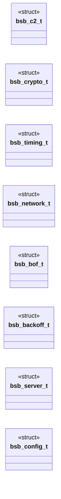

# `include/config_autogen.h`

> Source: [include/config_autogen.h:1](../../include/config_autogen.h#L1) | language `h` | coverage 25.0% | [API index](../index.md)

## Contents

- **Structs:** [`bsb_c2_t`](#bsb_c2_t), [`bsb_crypto_t`](#bsb_crypto_t), [`bsb_timing_t`](#bsb_timing_t), [`bsb_network_t`](#bsb_network_t), [`bsb_bof_t`](#bsb_bof_t), [`bsb_backoff_t`](#bsb_backoff_t), [`bsb_server_t`](#bsb_server_t), [`bsb_config_t`](#bsb_config_t)
- **Functions:** [`bsb_config_load`](#bsb_config_load), [`bsb_config_load_default`](#bsb_config_load_default), [`bsb_config_sleep_seconds`](#bsb_config_sleep_seconds)

## Type Diagram



## Structs

<a id="bsb_c2_t"></a>

### `bsb_c2_t`

`struct` | [include/config_autogen.h:11](../../include/config_autogen.h#L11)

```c
typedef struct
```

---

<a id="bsb_crypto_t"></a>

### `bsb_crypto_t`

`struct` | [include/config_autogen.h:21](../../include/config_autogen.h#L21)

```c
typedef struct
```

---

<a id="bsb_timing_t"></a>

### `bsb_timing_t`

`struct` | [include/config_autogen.h:28](../../include/config_autogen.h#L28)

```c
typedef struct
```

---

<a id="bsb_network_t"></a>

### `bsb_network_t`

`struct` | [include/config_autogen.h:35](../../include/config_autogen.h#L35)

```c
typedef struct
```

---

<a id="bsb_bof_t"></a>

### `bsb_bof_t`

`struct` | [include/config_autogen.h:42](../../include/config_autogen.h#L42)

```c
typedef struct
```

---

<a id="bsb_backoff_t"></a>

### `bsb_backoff_t`

`struct` | [include/config_autogen.h:47](../../include/config_autogen.h#L47)

```c
typedef struct
```

---

<a id="bsb_server_t"></a>

### `bsb_server_t`

`struct` | [include/config_autogen.h:52](../../include/config_autogen.h#L52)

```c
typedef struct
```

---

<a id="bsb_config_t"></a>

### `bsb_config_t`

`struct` | [include/config_autogen.h:57](../../include/config_autogen.h#L57)

```c
typedef struct
```

---

## Functions

<a id="bsb_config_load"></a>

### `bsb_config_load`

`function` | [include/config_autogen.h:69](../../include/config_autogen.h#L69)

```c
int bsb_config_load(const char *path, bsb_config_t *cfg, char *err, size_t errlen);
```

Load config from path.

Returns 0 on success, -1 on error.

**Parameters**

| Name | Type | Default | Description |
|---|---|---|---|
| `path` | `char *` |  |  |
| `cfg` | `bsb_config_t *` |  |  |
| `err` | `char *` |  |  |
| `errlen` | `size_t` |  |  |

**Returns:** `int`

---

<a id="bsb_config_load_default"></a>

### `bsb_config_load_default`

`function` | [include/config_autogen.h:72](../../include/config_autogen.h#L72)

```c
int bsb_config_load_default(bsb_config_t *cfg, char *err, size_t errlen);
```

Load from BSB_CONFIG env or default path.

**Parameters**

| Name | Type | Default | Description |
|---|---|---|---|
| `cfg` | `bsb_config_t *` |  |  |
| `err` | `char *` |  |  |
| `errlen` | `size_t` |  |  |

**Returns:** `int`

---

<a id="bsb_config_sleep_seconds"></a>

### `bsb_config_sleep_seconds`

`function` | [include/config_autogen.h:75](../../include/config_autogen.h#L75)

```c
int bsb_config_sleep_seconds(const bsb_config_t *cfg);
```

Compute a sleep duration with jitter applied.

Returns seconds.

**Parameters**

| Name | Type | Default | Description |
|---|---|---|---|
| `cfg` | `bsb_config_t *` |  |  |

**Returns:** `int`

---
