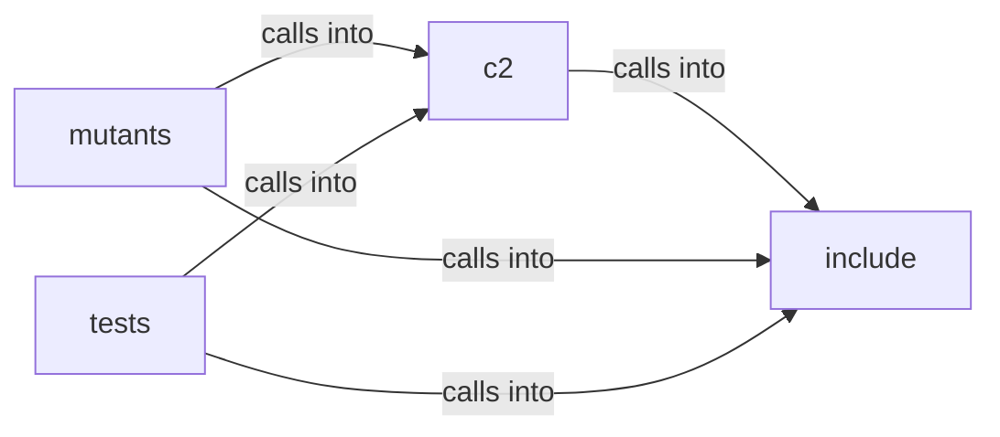

# c2

c2 groups 17 files (py) around _derive_keys, _deep_merge, load_config, _random_free_port, load_runtime_config. Black Sand Beacon C2 Server  Gopher-style command and control server for Black Sand...

## c2 (2.1)

c2 groups 2 files (py) around _random_free_port, load_runtime_config, compute_hmac, verify_hmac, encrypt_data. Black Sand Beacon C2 Server  Gopher-style command and control server for Black Sand...

## include (2.2)

include groups 1 files (py) around _derive_keys, _deep_merge, load_config. Python loader for BSB JSON config files.

## mutants (2.3)

mutants groups 3 files (py) around _free_port, _recv_response, test_http_get_poll_returns_encrypted_command, test_http_post_report_writes_log, test_gopher_legacy_still_works. End-to-end test: a real HTTP/1.1 client talks to a real TCP socket bound by...

## tests (2.4)

tests groups 11 files (py) around TestBOFPathTraversalConfig, test_upload_dir_config_exists, TestBOFPathTraversalServer, test_normal_bof_name_served, test_path_traversal_parent_dir_rejected. Tests for BOF Path Traversal Hardening (Contract: BOF Path Traversal Hardening)  BDD...

**Files**:

- c2/__init__.py
- c2/server.py
- include/config_py.py
- mutants/tests/test_c2_http_e2e.py
- mutants/tests/test_c2_server.py
- mutants/tests/test_certificate_pinning.py
- tests/test_bof_path_traversal.py
- tests/test_c2_beacon_bof_integration.py
- tests/test_c2_http_e2e.py
- tests/test_c2_server.py
- tests/test_certificate_pinning.py
- tests/test_crypto.py
- tests/test_hkdf_key_derivation.py
- tests/test_iv_generation.py
- tests/test_replay_protection.py
- tests/test_runtime_random.py
- tests/test_stage.py
