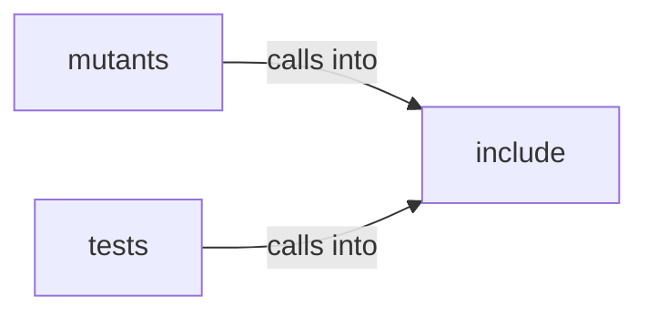

# include: aes

include: aes groups 6 files (c, h) around BSB_AES_CFB_H, aes256_cfb_encrypt, aes256_cfb_decrypt, _AES_H_, CBC. tiny-AES-c (https://github.com/kokke/tiny-AES-c)

## include (4.1)

include groups 4 files (c, h) around BSB_AES_CFB_H, aes256_cfb_encrypt, aes256_cfb_decrypt, _AES_H_, CBC. tiny-AES-c (https://github.com/kokke/tiny-AES-c)

## mutants (4.2)

mutants groups 1 files (c) around hex_to_bytes, main.

## tests (4.3)

tests groups 1 files (c) around hex_to_bytes, main.

**Files**:

- include/aes.c
- include/aes.h
- include/aes_cfb.c
- include/aes_cfb.h
- mutants/tests/crypto_harness.c
- tests/crypto_harness.c
