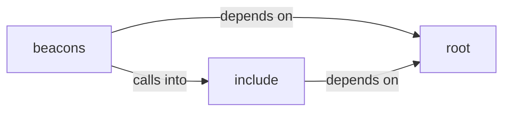

# include: cJSON

include: cJSON groups 9 files (c, h) around BEACON_COMMON_H, _GNU_SOURCE, BSB_OUTPUT_BUFFER_DEFAULT, BSB_OUTPUT_TRUNCATION_MARKER, http_response_t.

## beacons (2.1)

beacons groups 3 files (c) around _GNU_SOURCE, report_result, execute_command, main, _GNU_SOURCE.

## include (2.2)

include groups 4 files (c, h) around BEACON_COMMON_H, _GNU_SOURCE, BSB_OUTPUT_BUFFER_DEFAULT, BSB_OUTPUT_TRUNCATION_MARKER, http_response_t. MemoryStruct: if (g_cache_count >= g_cache_capacity) { size_t new_cap =...

## root (2.3)

root groups 2 files (c, h) around cJSON__h, next, __WINDOWS__, CJSON_CDECL, CJSON_STDCALL. case_insensitive_strcmp: /* This is a safeguard to prevent copy-pasters from using...

**Files**:

- beacons/v1/beacon.c
- beacons/v2/beacon.c
- beacons/v3/beacon.c
- cJSON.c
- cJSON.h
- include/beacon_common.c
- include/beacon_common.h
- include/cJSON.c
- include/cJSON.h
