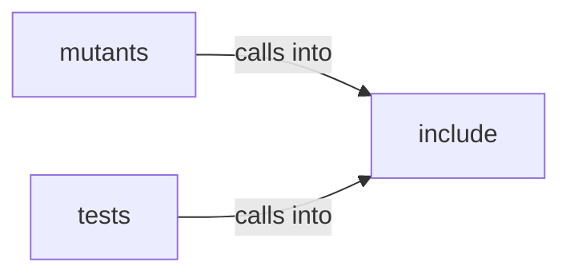

# include: config

include: config groups 6 files (c, h) around BSB_CONFIG_H, BSB_CONFIG_PATH_DEFAULT, BSB_CONFIG_PATH_ENV, BSB_MAX_URL, BSB_MAX_URI. slurp: declared in the schema.

## include (5.1)

include groups 2 files (c, h) around BSB_CONFIG_H, BSB_CONFIG_PATH_DEFAULT, BSB_CONFIG_PATH_ENV, BSB_MAX_URL, BSB_MAX_URI. slurp: declared in the schema.

## mutants (5.2)

mutants groups 1 files (c) around main.

## tests (5.3)

tests groups 3 files (c) around main, test_cert_fingerprint_defaults_to_empty, test_cert_fingerprint_loads_from_config, test_cert_fingerprint_invalid_length_fails, test_network_struct_has_fingerprint_field. test_cert_fingerprint_defaults_to_empty: #include <stdarg.h> #include <stddef.h>...

**Files**:

- include/config.c
- include/config.h
- mutants/tests/config_harness.c
- tests/config_harness.c
- tests/test_certificate_pinning_c.c
- tests/test_hkdf_key_derivation_c.c
