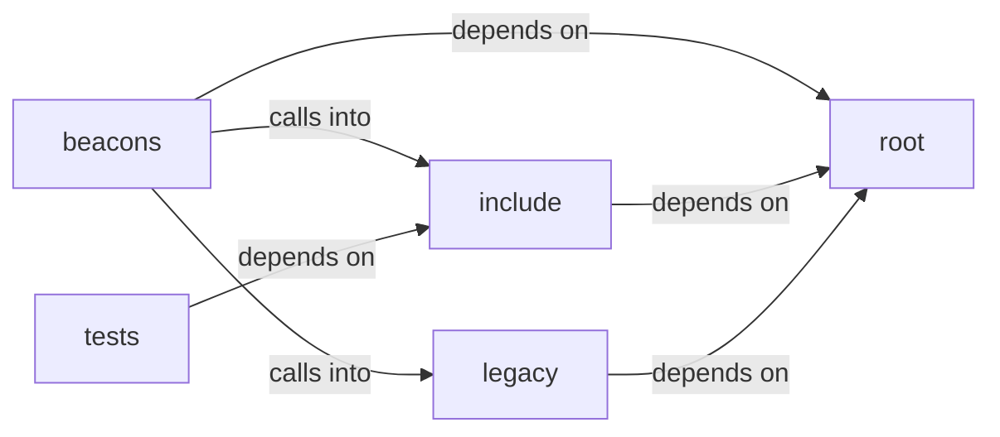

# legacy

legacy groups 20 files (c, h) around BEACON_COMMON_H, _GNU_SOURCE, BSB_OUTPUT_BUFFER_DEFAULT, BSB_OUTPUT_TRUNCATION_MARKER, http_response_t. tiny-AES-c (https://github.com/kokke/tiny-AES-c)

## beacons (1.1)

beacons groups 3 files (c) around _GNU_SOURCE, report_result, execute_command, main, _GNU_SOURCE.

## include (1.2)

include groups 4 files (c, h) around BEACON_COMMON_H, _GNU_SOURCE, BSB_OUTPUT_BUFFER_DEFAULT, BSB_OUTPUT_TRUNCATION_MARKER, http_response_t. MemoryStruct: size_t new_cap = g_cache_capacity ? g_cache_capacity * 2 : 8...

## legacy (1.3)

legacy groups 6 files (c) around _GNU_SOURCE, C2_URL, CLIENT_ID, MALEABLE, USER_AGENTS_COUNT. MemoryStruct: === ESTRUCTURAS ===

## root (1.4)

root groups 6 files (c, h) around _AES_H_, CBC, ECB, CTR, AES256. tiny-AES-c (https://github.com/kokke/tiny-AES-c)

## tests (1.5)

tests groups 1 files (c) around test_generate_secure_iv_success, test_generate_secure_iv_different_each_call, test_generate_secure_iv_null_input, test_generate_secure_iv_length, test_beacon_common_has_iv_function. test_generate_secure_iv_success: #include <stdarg.h> #include <stddef.h> #include...

**Files**:

- aes.c
- aes.h
- beacon.h
- beacons/v1/beacon.c
- beacons/v2/beacon.c
- beacons/v3/beacon.c
- bof.c
- cJSON.c
- cJSON.h
- include/beacon_common.c
- include/beacon_common.h
- include/cJSON.c
- include/cJSON.h
- legacy/beacon3.c
- legacy/beacon5.c
- legacy/beacon6.c
- legacy/beacon_p2p.c
- legacy/gopher_beacon.c
- legacy/v1_gopher_beacon.c
- tests/test_iv_generation_c.c
