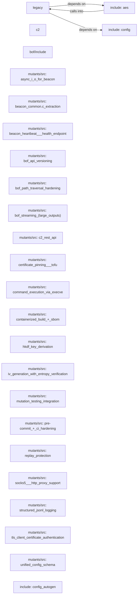

## Details

Static architecture map of 175 files (c, h, py, sh) in 25 components: legacy, c2, bof/include, include: aes, include: config, mutants/src: async_i_o_for_beacon, mutants/src: beacon_common.c_extraction, mutants/src: beacon_heartbeat___health_endpoint. Structure is extracted statically without LLM calls; component prose may be enriched locally.

### legacy (1)

legacy groups 20 files (c, h) around BEACON_COMMON_H, _GNU_SOURCE, BSB_OUTPUT_BUFFER_DEFAULT, BSB_OUTPUT_TRUNCATION_MARKER, http_response_t. tiny-AES-c (https://github.com/kokke/tiny-AES-c)

**Related Classes/Methods**:

- <a href="../include/beacon_common.h#L13-L14">include/beacon_common.h::BEACON_COMMON_H</a>
- <a href="../include/beacon_common.h#L15-L25">include/beacon_common.h::_GNU_SOURCE</a>
- <a href="../include/beacon_common.h">include/beacon_common.h::BSB_OUTPUT_BUFFER_DEFAULT</a>
- <a href="../include/beacon_common.h#L27-L32">include/beacon_common.h::BSB_OUTPUT_TRUNCATION_MARKER</a>
- <a href="../include/beacon_common.h#L33-L40">include/beacon_common.h::http_response_t</a>
- <a href="../include/beacon_common.h#L41-L50">include/beacon_common.h::Trampoline</a>
- <a href="../include/beacon_common.h#L51-L57">include/beacon_common.h::SymbolResolver</a>
- <a href="../include/beacon_common.h#L58-L64">include/beacon_common.h::TrampolineCache</a>

### c2 (2)

c2 groups 15 files (py) around _derive_keys, _deep_merge, load_config, load_runtime_config, compute_hmac. Black Sand Beacon C2 Server  Gopher-style command and control server for Black Sand...

**Related Classes/Methods**:

- <a href="../include/config_py.py#L65-L83">include/config_py.py::_derive_keys</a>
- <a href="../include/config_py.py#L84-L93">include/config_py.py::_deep_merge</a>
- <a href="../include/config_py.py#L94-L146">include/config_py.py::load_config</a>
- <a href="../c2/server.py#L62-L109">c2/server.py::load_runtime_config</a>
- <a href="../c2/server.py#L110-L114">c2/server.py::compute_hmac</a>
- <a href="../c2/server.py#L115-L120">c2/server.py::verify_hmac</a>
- <a href="../c2/server.py#L121-L143">c2/server.py::encrypt_data</a>
- <a href="../c2/server.py#L144-L177">c2/server.py::encrypt_data_replay</a>

### bof/include (3)

bof/include groups 7 files (c, h) around go, BSB_BOF_BEACON_API_H, CALLBACK_OUTPUT, CALLBACK_ERROR, CALLBACK_OUTPUT_OEM. datap: Argument parser.

**Related Classes/Methods**:

- <a href="../bof/include/beacon_api.h#L10-L16">bof/include/beacon_api.h::go</a>
- <a href="../bof/include/beacon_api.h#L17-L23">bof/include/beacon_api.h::BSB_BOF_BEACON_API_H</a>
- <a href="../bof/include/beacon_api.h">bof/include/beacon_api.h::CALLBACK_OUTPUT</a>
- <a href="../bof/include/beacon_api.h">bof/include/beacon_api.h::CALLBACK_ERROR</a>
- <a href="../bof/include/beacon_api.h#L26-L29">bof/include/beacon_api.h::CALLBACK_OUTPUT_OEM</a>
- <a href="../bof/include/beacon_api.h#L30-L36">bof/include/beacon_api.h::datap</a>
- <a href="../bof/include/beacon_api.h">bof/include/beacon_api.h::BeaconDataParse</a>
- <a href="../bof/include/beacon_api.h">bof/include/beacon_api.h::BeaconDataPtr</a>

### include: aes (4)

include: aes groups 6 files (c, h) around BSB_AES_CFB_H, aes256_cfb_encrypt, aes256_cfb_decrypt, _AES_H_, CBC. tiny-AES-c (https://github.com/kokke/tiny-AES-c)

**Related Classes/Methods**:

- <a href="../include/aes_cfb.h#L5-L8">include/aes_cfb.h::BSB_AES_CFB_H</a>
- <a href="../include/aes_cfb.h#L9-L10">include/aes_cfb.h::aes256_cfb_encrypt</a>
- <a href="../include/aes_cfb.h#L11-L14">include/aes_cfb.h::aes256_cfb_decrypt</a>
- <a href="../include/aes.h#L2-L8">include/aes.h::_AES_H_</a>
- <a href="../include/aes.h#L9-L11">include/aes.h::CBC</a>
- <a href="../include/aes.h#L12-L14">include/aes.h::ECB</a>
- <a href="../include/aes.h#L15-L17">include/aes.h::CTR</a>
- <a href="../include/aes.h#L18-L19">include/aes.h::AES256</a>

### include: config (5)

include: config groups 6 files (c, h) around BSB_CONFIG_H, BSB_CONFIG_PATH_DEFAULT, BSB_CONFIG_PATH_ENV, BSB_MAX_URL, BSB_MAX_URI. slurp: declared in the schema.

**Related Classes/Methods**:

- <a href="../include/config.h#L14-L18">include/config.h::BSB_CONFIG_H</a>
- <a href="../include/config.h">include/config.h::BSB_CONFIG_PATH_DEFAULT</a>
- <a href="../include/config.h">include/config.h::BSB_CONFIG_PATH_ENV</a>
- <a href="../include/config.h">include/config.h::BSB_MAX_URL</a>
- <a href="../include/config.h">include/config.h::BSB_MAX_URI</a>
- <a href="../include/config.h">include/config.h::BSB_MAX_CLIENT_ID</a>
- <a href="../include/config.h">include/config.h::BSB_AES_KEY_HEX_LEN</a>
- <a href="../include/config.h">include/config.h::BSB_AES_KEY_BYTES</a>

### mutants/src: async_i_o_for_beacon (6)

mutants/src: async_i_o_for_beacon groups 3 files (c, h) around ASYNC_I_O_FOR_BEACON_H, async_i_o_for_beacon_process, async_i_o_for_beacon_process, async_i_o_for_beacon_process. Auto-generated implementation for contract: Async I/O for Beacon

**Related Classes/Methods**:

- <a href="../include/async_i_o_for_beacon.h#L2-L3">include/async_i_o_for_beacon.h::ASYNC_I_O_FOR_BEACON_H</a>
- <a href="../include/async_i_o_for_beacon.h#L4-L6">include/async_i_o_for_beacon.h::async_i_o_for_beacon_process</a>
- <a href="../mutants/src/async_i_o_for_beacon.c#L6-L10">mutants/src/async_i_o_for_beacon.c::async_i_o_for_beacon_process</a>
- <a href="../src/async_i_o_for_beacon.c#L6-L10">src/async_i_o_for_beacon.c::async_i_o_for_beacon_process</a>

### mutants/src: beacon_common.c_extraction (7)

mutants/src: beacon_common.c_extraction groups 3 files (c, h) around BEACON_COMMON. Auto-generated implementation for contract: beacon_common.c Extraction

**Related Classes/Methods**:

- <a href="../include/beacon_common.c_extraction.h#L2-L6">include/beacon_common.c_extraction.h::BEACON_COMMON</a>

### mutants/src: beacon_heartbeat___health_endpoint (8)

mutants/src: beacon_heartbeat___health_endpoint groups 3 files (c, h) around BEACON_HEARTBEAT___HEALTH_ENDPOINT_H, beacon_heartbeat___health_endpoint_process, beacon_heartbeat___health_endpoint_process, beacon_heartbeat___health_endpoint_process. Auto-generated implementation for contract: Beacon Heartbeat / Health Endpoint

**Related Classes/Methods**:

- <a href="../include/beacon_heartbeat___health_endpoint.h#L2-L3">include/beacon_heartbeat___health_endpoint.h::BEACON_HEARTBEAT___HEALTH_ENDPOINT_H</a>
- <a href="../include/beacon_heartbeat___health_endpoint.h#L4-L6">include/beacon_heartbeat___health_endpoint.h::beacon_heartbeat___health_endpoint_process</a>
- <a href="../mutants/src/beacon_heartbeat___health_endpoint.c#L6-L10">mutants/src/beacon_heartbeat___health_endpoint.c::beacon_heartbeat___health_endpoint_process</a>
- <a href="../src/beacon_heartbeat___health_endpoint.c#L6-L10">src/beacon_heartbeat___health_endpoint.c::beacon_heartbeat___health_endpoint_process</a>

### mutants/src: bof_api_versioning (9)

mutants/src: bof_api_versioning groups 3 files (c, h) around BOF_API_VERSIONING_H, bof_api_versioning_process, bof_api_versioning_process, bof_api_versioning_process. Auto-generated implementation for contract: BOF API Versioning

**Related Classes/Methods**:

- <a href="../include/bof_api_versioning.h#L2-L3">include/bof_api_versioning.h::BOF_API_VERSIONING_H</a>
- <a href="../include/bof_api_versioning.h#L4-L6">include/bof_api_versioning.h::bof_api_versioning_process</a>
- <a href="../mutants/src/bof_api_versioning.c#L6-L10">mutants/src/bof_api_versioning.c::bof_api_versioning_process</a>
- <a href="../src/bof_api_versioning.c#L6-L10">src/bof_api_versioning.c::bof_api_versioning_process</a>

### mutants/src: bof_path_traversal_hardening (10)

mutants/src: bof_path_traversal_hardening groups 3 files (c, h) around BOF_PATH_TRAVERSAL_HARDENING_H, bof_path_traversal_hardening_process, bof_path_traversal_hardening_process, bof_path_traversal_hardening_process. Auto-generated implementation for contract: BOF Path Traversal Hardening

**Related Classes/Methods**:

- <a href="../include/bof_path_traversal_hardening.h#L2-L3">include/bof_path_traversal_hardening.h::BOF_PATH_TRAVERSAL_HARDENING_H</a>
- <a href="../include/bof_path_traversal_hardening.h#L4-L6">include/bof_path_traversal_hardening.h::bof_path_traversal_hardening_process</a>
- <a href="../mutants/src/bof_path_traversal_hardening.c#L6-L10">mutants/src/bof_path_traversal_hardening.c::bof_path_traversal_hardening_process</a>
- <a href="../src/bof_path_traversal_hardening.c#L6-L10">src/bof_path_traversal_hardening.c::bof_path_traversal_hardening_process</a>

### mutants/src: bof_streaming_(large_outputs) (11)

mutants/src: bof_streaming_(large_outputs) groups 3 files (c, h) around BOF_STREAMING_, bof_streaming_, bof_streaming_, bof_streaming_. Auto-generated implementation for contract: BOF Streaming (Large Outputs)

**Related Classes/Methods**:

- <a href="../include/bof_streaming_(large_outputs).h#L2-L3">include/bof_streaming_(large_outputs).h::BOF_STREAMING_</a>
- <a href="../include/bof_streaming_(large_outputs).h#L4-L6">include/bof_streaming_(large_outputs).h::bof_streaming_</a>
- <a href="../mutants/src/bof_streaming_(large_outputs).c#L6-L10">mutants/src/bof_streaming_(large_outputs).c::bof_streaming_</a>
- <a href="../src/bof_streaming_(large_outputs).c#L6-L10">src/bof_streaming_(large_outputs).c::bof_streaming_</a>

### mutants/src: c2_rest_api (12)

mutants/src: c2_rest_api groups 3 files (c, h) around C2_REST_API_H, c2_rest_api_process, c2_rest_api_process, c2_rest_api_process. Auto-generated implementation for contract: C2 REST API

**Related Classes/Methods**:

- <a href="../include/c2_rest_api.h#L2-L3">include/c2_rest_api.h::C2_REST_API_H</a>
- <a href="../include/c2_rest_api.h#L4-L6">include/c2_rest_api.h::c2_rest_api_process</a>
- <a href="../mutants/src/c2_rest_api.c#L6-L10">mutants/src/c2_rest_api.c::c2_rest_api_process</a>
- <a href="../src/c2_rest_api.c#L6-L10">src/c2_rest_api.c::c2_rest_api_process</a>

### mutants/src: certificate_pinning___tofu (13)

mutants/src: certificate_pinning___tofu groups 3 files (c, h) around CERTIFICATE_PINNING___TOFU_H, certificate_pinning___tofu_process, certificate_pinning___tofu_process, certificate_pinning___tofu_process. Auto-generated implementation for contract: Certificate Pinning / TOFU

**Related Classes/Methods**:

- <a href="../include/certificate_pinning___tofu.h#L2-L3">include/certificate_pinning___tofu.h::CERTIFICATE_PINNING___TOFU_H</a>
- <a href="../include/certificate_pinning___tofu.h#L4-L6">include/certificate_pinning___tofu.h::certificate_pinning___tofu_process</a>
- <a href="../mutants/src/certificate_pinning___tofu.c#L6-L10">mutants/src/certificate_pinning___tofu.c::certificate_pinning___tofu_process</a>
- <a href="../src/certificate_pinning___tofu.c#L6-L10">src/certificate_pinning___tofu.c::certificate_pinning___tofu_process</a>

### mutants/src: command_execution_via_execve (14)

mutants/src: command_execution_via_execve groups 3 files (c, h) around COMMAND_EXECUTION_VIA_EXECVE_H, command_execution_via_execve_process, command_execution_via_execve_process, command_execution_via_execve_process. Auto-generated implementation for contract: Command Execution via execve

**Related Classes/Methods**:

- <a href="../include/command_execution_via_execve.h#L2-L3">include/command_execution_via_execve.h::COMMAND_EXECUTION_VIA_EXECVE_H</a>
- <a href="../include/command_execution_via_execve.h#L4-L6">include/command_execution_via_execve.h::command_execution_via_execve_process</a>
- <a href="../mutants/src/command_execution_via_execve.c#L6-L10">mutants/src/command_execution_via_execve.c::command_execution_via_execve_process</a>
- <a href="../src/command_execution_via_execve.c#L6-L10">src/command_execution_via_execve.c::command_execution_via_execve_process</a>

### mutants/src: containerized_build_+_sbom (15)

mutants/src: containerized_build_+_sbom groups 3 files (c, h) around CONTAINERIZED_BUILD_. Auto-generated implementation for contract: Containerized Build + SBOM

**Related Classes/Methods**:

- <a href="../include/containerized_build_+_sbom.h#L2-L6">include/containerized_build_+_sbom.h::CONTAINERIZED_BUILD_</a>

### mutants/src: hkdf_key_derivation (16)

mutants/src: hkdf_key_derivation groups 3 files (c, h) around HKDF_KEY_DERIVATION_H, hkdf_key_derivation_process, hkdf_key_derivation_process, hkdf_key_derivation_process. Auto-generated implementation for contract: HKDF Key Derivation

**Related Classes/Methods**:

- <a href="../include/hkdf_key_derivation.h#L2-L3">include/hkdf_key_derivation.h::HKDF_KEY_DERIVATION_H</a>
- <a href="../include/hkdf_key_derivation.h#L4-L6">include/hkdf_key_derivation.h::hkdf_key_derivation_process</a>
- <a href="../mutants/src/hkdf_key_derivation.c#L6-L10">mutants/src/hkdf_key_derivation.c::hkdf_key_derivation_process</a>
- <a href="../src/hkdf_key_derivation.c#L6-L10">src/hkdf_key_derivation.c::hkdf_key_derivation_process</a>

### mutants/src: iv_generation_with_entropy_verification (17)

mutants/src: iv_generation_with_entropy_verification groups 3 files (c, h) around IV_GENERATION_WITH_ENTROPY_VERIFICATION_H, iv_generation_with_entropy_verification_process, iv_generation_with_entropy_verification_process, iv_generation_with_entropy_verification_process. Auto-generated implementation for contract: IV Generation with Entropy Verification

**Related Classes/Methods**:

- <a href="../include/iv_generation_with_entropy_verification.h#L2-L3">include/iv_generation_with_entropy_verification.h::IV_GENERATION_WITH_ENTROPY_VERIFICATION_H</a>
- <a href="../include/iv_generation_with_entropy_verification.h#L4-L6">include/iv_generation_with_entropy_verification.h::iv_generation_with_entropy_verification_process</a>
- <a href="../mutants/src/iv_generation_with_entropy_verification.c#L6-L10">mutants/src/iv_generation_with_entropy_verification.c::iv_generation_with_entropy_verification_process</a>
- <a href="../src/iv_generation_with_entropy_verification.c#L6-L10">src/iv_generation_with_entropy_verification.c::iv_generation_with_entropy_verification_process</a>

### mutants/src: mutation_testing_integration (18)

mutants/src: mutation_testing_integration groups 3 files (c, h) around MUTATION_TESTING_INTEGRATION_H, mutation_testing_integration_process, mutation_testing_integration_process, mutation_testing_integration_process. Auto-generated implementation for contract: Mutation Testing Integration

**Related Classes/Methods**:

- <a href="../include/mutation_testing_integration.h#L2-L3">include/mutation_testing_integration.h::MUTATION_TESTING_INTEGRATION_H</a>
- <a href="../include/mutation_testing_integration.h#L4-L6">include/mutation_testing_integration.h::mutation_testing_integration_process</a>
- <a href="../mutants/src/mutation_testing_integration.c#L6-L10">mutants/src/mutation_testing_integration.c::mutation_testing_integration_process</a>
- <a href="../src/mutation_testing_integration.c#L6-L10">src/mutation_testing_integration.c::mutation_testing_integration_process</a>

### mutants/src: pre-commit_+_ci_hardening (19)

mutants/src: pre-commit_+_ci_hardening groups 3 files (c, h) around PRE. Auto-generated implementation for contract: Pre-commit + CI Hardening

**Related Classes/Methods**:

- <a href="../include/pre-commit_+_ci_hardening.h#L2-L6">include/pre-commit_+_ci_hardening.h::PRE</a>

### mutants/src: replay_protection (20)

mutants/src: replay_protection groups 3 files (c, h) around REPLAY_PROTECTION_H, replay_protection_process, replay_protection_process, replay_protection_process. Auto-generated implementation for contract: Replay Protection

**Related Classes/Methods**:

- <a href="../include/replay_protection.h#L2-L3">include/replay_protection.h::REPLAY_PROTECTION_H</a>
- <a href="../include/replay_protection.h#L4-L6">include/replay_protection.h::replay_protection_process</a>
- <a href="../mutants/src/replay_protection.c#L6-L10">mutants/src/replay_protection.c::replay_protection_process</a>
- <a href="../src/replay_protection.c#L6-L10">src/replay_protection.c::replay_protection_process</a>

### mutants/src: socks5___http_proxy_support (21)

mutants/src: socks5___http_proxy_support groups 3 files (c, h) around SOCKS5___HTTP_PROXY_SUPPORT_H, socks5___http_proxy_support_process, socks5___http_proxy_support_process, socks5___http_proxy_support_process. Auto-generated implementation for contract: SOCKS5 / HTTP Proxy Support

**Related Classes/Methods**:

- <a href="../include/socks5___http_proxy_support.h#L2-L3">include/socks5___http_proxy_support.h::SOCKS5___HTTP_PROXY_SUPPORT_H</a>
- <a href="../include/socks5___http_proxy_support.h#L4-L6">include/socks5___http_proxy_support.h::socks5___http_proxy_support_process</a>
- <a href="../mutants/src/socks5___http_proxy_support.c#L6-L10">mutants/src/socks5___http_proxy_support.c::socks5___http_proxy_support_process</a>
- <a href="../src/socks5___http_proxy_support.c#L6-L10">src/socks5___http_proxy_support.c::socks5___http_proxy_support_process</a>

### mutants/src: structured_jsonl_logging (22)

mutants/src: structured_jsonl_logging groups 3 files (c, h) around STRUCTURED_JSONL_LOGGING_H, structured_jsonl_logging_process, structured_jsonl_logging_process, structured_jsonl_logging_process. Auto-generated implementation for contract: Structured JSONL Logging

**Related Classes/Methods**:

- <a href="../include/structured_jsonl_logging.h#L2-L3">include/structured_jsonl_logging.h::STRUCTURED_JSONL_LOGGING_H</a>
- <a href="../include/structured_jsonl_logging.h#L4-L6">include/structured_jsonl_logging.h::structured_jsonl_logging_process</a>
- <a href="../mutants/src/structured_jsonl_logging.c#L6-L10">mutants/src/structured_jsonl_logging.c::structured_jsonl_logging_process</a>
- <a href="../src/structured_jsonl_logging.c#L6-L10">src/structured_jsonl_logging.c::structured_jsonl_logging_process</a>

### mutants/src: tls_client_certificate_authentication (23)

mutants/src: tls_client_certificate_authentication groups 3 files (c, h) around TLS_CLIENT_CERTIFICATE_AUTHENTICATION_H, tls_client_certificate_authentication_process, tls_client_certificate_authentication_process, tls_client_certificate_authentication_process. Auto-generated implementation for contract: TLS Client Certificate Authentication

**Related Classes/Methods**:

- <a href="../include/tls_client_certificate_authentication.h#L2-L3">include/tls_client_certificate_authentication.h::TLS_CLIENT_CERTIFICATE_AUTHENTICATION_H</a>
- <a href="../include/tls_client_certificate_authentication.h#L4-L6">include/tls_client_certificate_authentication.h::tls_client_certificate_authentication_process</a>
- <a href="../mutants/src/tls_client_certificate_authentication.c#L6-L10">mutants/src/tls_client_certificate_authentication.c::tls_client_certificate_authentication_process</a>
- <a href="../src/tls_client_certificate_authentication.c#L6-L10">src/tls_client_certificate_authentication.c::tls_client_certificate_authentication_process</a>

### mutants/src: unified_config_schema (24)

mutants/src: unified_config_schema groups 3 files (c, h) around UNIFIED_CONFIG_SCHEMA_H, unified_config_schema_process, unified_config_schema_process, unified_config_schema_process. Auto-generated implementation for contract: Unified Config Schema

**Related Classes/Methods**:

- <a href="../include/unified_config_schema.h#L2-L3">include/unified_config_schema.h::UNIFIED_CONFIG_SCHEMA_H</a>
- <a href="../include/unified_config_schema.h#L4-L6">include/unified_config_schema.h::unified_config_schema_process</a>
- <a href="../mutants/src/unified_config_schema.c#L6-L10">mutants/src/unified_config_schema.c::unified_config_schema_process</a>
- <a href="../src/unified_config_schema.c#L6-L10">src/unified_config_schema.c::unified_config_schema_process</a>

### include: config_autogen (25)

include: config_autogen groups 2 files (c, h) around BSB_CONFIG_AUTOGEN_H, bsb_c2_t, bsb_crypto_t, bsb_timing_t, bsb_network_t. slurp: Auto-generated C config parser from config/schema.json DO NOT EDIT MANUALLY...

**Related Classes/Methods**:

- <a href="../include/config_autogen.h#L6-L10">include/config_autogen.h::BSB_CONFIG_AUTOGEN_H</a>
- <a href="../include/config_autogen.h#L11-L20">include/config_autogen.h::bsb_c2_t</a>
- <a href="../include/config_autogen.h#L21-L27">include/config_autogen.h::bsb_crypto_t</a>
- <a href="../include/config_autogen.h#L28-L34">include/config_autogen.h::bsb_timing_t</a>
- <a href="../include/config_autogen.h#L35-L41">include/config_autogen.h::bsb_network_t</a>
- <a href="../include/config_autogen.h#L42-L46">include/config_autogen.h::bsb_bof_t</a>
- <a href="../include/config_autogen.h#L47-L51">include/config_autogen.h::bsb_backoff_t</a>
- <a href="../include/config_autogen.h#L52-L56">include/config_autogen.h::bsb_server_t</a>
