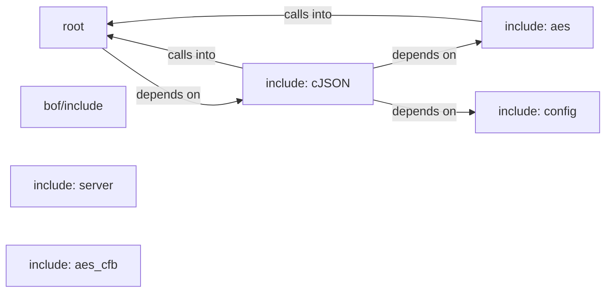

## Details

Static architecture map of 52 files (c, h, py, sh) in 7 components: root, include: cJSON, bof/include, include: server, include: aes, include: config, include: aes_cfb. Structure is extracted statically without LLM calls; component prose may be enriched locally.

### root (1)

root groups 10 files (c, h) around _AES_H_, CBC, ECB, CTR, AES256. tiny-AES-c (https://github.com/kokke/tiny-AES-c)

**Related Classes/Methods**:

- <a href="../aes.h#L2-L8">aes.h::_AES_H_</a>
- <a href="../aes.h#L9-L11">aes.h::CBC</a>
- <a href="../aes.h#L12-L14">aes.h::ECB</a>
- <a href="../aes.h#L15-L17">aes.h::CTR</a>
- <a href="../aes.h#L18-L19">aes.h::AES256</a>
- <a href="../aes.h#L20-L22">aes.h::AES_BLOCKLEN</a>
- <a href="../aes.h">aes.h::AES_KEYLEN</a>
- <a href="../aes.h#L24-L25">aes.h::AES_keyExpSize</a>

### include: cJSON (2)

include: cJSON groups 9 files (c, h) around BEACON_COMMON_H, _GNU_SOURCE, BSB_OUTPUT_BUFFER_DEFAULT, BSB_OUTPUT_TRUNCATION_MARKER, http_response_t.

**Related Classes/Methods**:

- <a href="../include/beacon_common.h#L13-L14">include/beacon_common.h::BEACON_COMMON_H</a>
- <a href="../include/beacon_common.h#L15-L25">include/beacon_common.h::_GNU_SOURCE</a>
- <a href="../include/beacon_common.h">include/beacon_common.h::BSB_OUTPUT_BUFFER_DEFAULT</a>
- <a href="../include/beacon_common.h#L27-L31">include/beacon_common.h::BSB_OUTPUT_TRUNCATION_MARKER</a>
- <a href="../include/beacon_common.h#L32-L38">include/beacon_common.h::http_response_t</a>
- <a href="../include/beacon_common.h#L39-L47">include/beacon_common.h::Trampoline</a>
- <a href="../include/beacon_common.h#L48-L53">include/beacon_common.h::SymbolResolver</a>
- <a href="../include/beacon_common.h#L54-L59">include/beacon_common.h::TrampolineCache</a>

### bof/include (3)

bof/include groups 7 files (c, h) around go, BSB_BOF_BEACON_API_H, CALLBACK_OUTPUT, CALLBACK_ERROR, CALLBACK_OUTPUT_OEM. datap: Argument parser.

**Related Classes/Methods**:

- <a href="../bof/include/beacon_api.h#L10-L16">bof/include/beacon_api.h::go</a>
- <a href="../bof/include/beacon_api.h#L17-L23">bof/include/beacon_api.h::BSB_BOF_BEACON_API_H</a>
- <a href="../bof/include/beacon_api.h">bof/include/beacon_api.h::CALLBACK_OUTPUT</a>
- <a href="../bof/include/beacon_api.h">bof/include/beacon_api.h::CALLBACK_ERROR</a>
- <a href="../bof/include/beacon_api.h#L26-L29">bof/include/beacon_api.h::CALLBACK_OUTPUT_OEM</a>
- <a href="../bof/include/beacon_api.h#L30-L35">bof/include/beacon_api.h::datap</a>
- <a href="../bof/include/beacon_api.h">bof/include/beacon_api.h::BeaconDataParse</a>
- <a href="../bof/include/beacon_api.h">bof/include/beacon_api.h::BeaconDataPtr</a>

### include: server (4)

include: server groups 3 files (py) around _deep_merge, load_config, load_runtime_config, compute_hmac, verify_hmac. Black Sand Beacon C2 Server  Gopher-style command and control server for Black Sand...

**Related Classes/Methods**:

- <a href="../include/config_py.py#L55-L64">include/config_py.py::_deep_merge</a>
- <a href="../include/config_py.py#L65-L83">include/config_py.py::load_config</a>
- <a href="../c2/server.py#L60-L86">c2/server.py::load_runtime_config</a>
- <a href="../c2/server.py#L87-L91">c2/server.py::compute_hmac</a>
- <a href="../c2/server.py#L92-L97">c2/server.py::verify_hmac</a>
- <a href="../c2/server.py#L98-L117">c2/server.py::encrypt_data</a>
- <a href="../c2/server.py#L118-L136">c2/server.py::decrypt_data</a>
- <a href="../c2/server.py#L137-L139">c2/server.py::C2State</a>

### include: aes (5)

include: aes groups 3 files (c, h) around _AES_H_, CBC, ECB, CTR, AES256. tiny-AES-c (https://github.com/kokke/tiny-AES-c)

**Related Classes/Methods**:

- <a href="../include/aes.h#L2-L8">include/aes.h::_AES_H_</a>
- <a href="../include/aes.h#L9-L11">include/aes.h::CBC</a>
- <a href="../include/aes.h#L12-L14">include/aes.h::ECB</a>
- <a href="../include/aes.h#L15-L17">include/aes.h::CTR</a>
- <a href="../include/aes.h#L18-L19">include/aes.h::AES256</a>
- <a href="../include/aes.h#L20-L22">include/aes.h::AES_BLOCKLEN</a>
- <a href="../include/aes.h">include/aes.h::AES_KEYLEN</a>
- <a href="../include/aes.h#L24-L25">include/aes.h::AES_keyExpSize</a>

### include: config (6)

include: config groups 3 files (c, h) around BSB_CONFIG_H, BSB_CONFIG_PATH_DEFAULT, BSB_CONFIG_PATH_ENV, BSB_MAX_URL, BSB_MAX_URI. slurp: declared in the schema.

**Related Classes/Methods**:

- <a href="../include/config.h#L14-L18">include/config.h::BSB_CONFIG_H</a>
- <a href="../include/config.h">include/config.h::BSB_CONFIG_PATH_DEFAULT</a>
- <a href="../include/config.h">include/config.h::BSB_CONFIG_PATH_ENV</a>
- <a href="../include/config.h">include/config.h::BSB_MAX_URL</a>
- <a href="../include/config.h">include/config.h::BSB_MAX_URI</a>
- <a href="../include/config.h">include/config.h::BSB_MAX_CLIENT_ID</a>
- <a href="../include/config.h">include/config.h::BSB_AES_KEY_HEX_LEN</a>
- <a href="../include/config.h">include/config.h::BSB_AES_KEY_BYTES</a>

### include: aes_cfb (7)

include: aes_cfb groups 2 files (c, h) around BSB_AES_CFB_H, aes256_cfb_encrypt, aes256_cfb_decrypt, hex_to_bytes, main.

**Related Classes/Methods**:

- <a href="../include/aes_cfb.h#L5-L8">include/aes_cfb.h::BSB_AES_CFB_H</a>
- <a href="../include/aes_cfb.h#L9-L10">include/aes_cfb.h::aes256_cfb_encrypt</a>
- <a href="../include/aes_cfb.h#L11-L14">include/aes_cfb.h::aes256_cfb_decrypt</a>
- <a href="../tests/crypto_harness.c#L12-L22">tests/crypto_harness.c::hex_to_bytes</a>
- <a href="../tests/crypto_harness.c#L23-L73">tests/crypto_harness.c::main</a>
