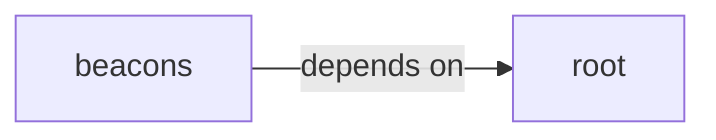

# root

root groups 10 files (c, h) around _AES_H_, CBC, ECB, CTR, AES256. tiny-AES-c (https://github.com/kokke/tiny-AES-c)

## beacons (1.1)

beacons groups 1 files (c) around _GNU_SOURCE, C2, CLIENT_ID, MALEABLE, USER_AGENTS_COUNT. MemoryStruct: === ESTRUCTURAS ===

## root (1.2)

root groups 9 files (c, h) around _AES_H_, CBC, ECB, CTR, AES256. tiny-AES-c (https://github.com/kokke/tiny-AES-c)

**Files**:

- aes.c
- aes.h
- beacon.h
- beacon3.c
- beacon5.c
- beacon6.c
- beacon_p2p.c
- beacons/v1/gopher_beacon.c
- bof.c
- gopher_beacon.c
